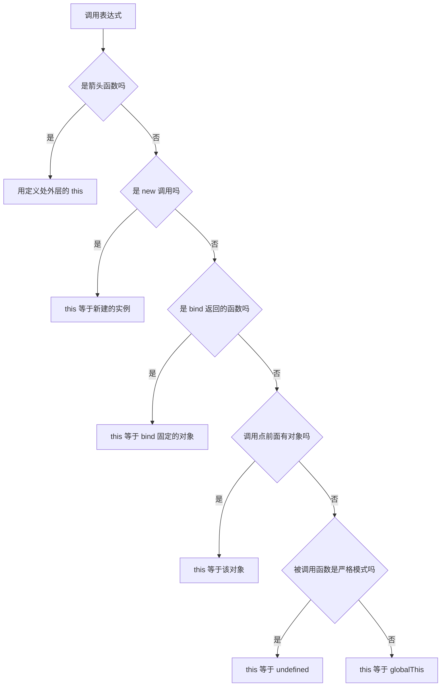

# this 指向：从调用现场到 new / call / apply / bind

`this` 不是定义时决定的，也不是「谁调用就指向谁」这么一句能说完的：它是**每次调用时被塞进函数执行上下文的一个隐式参数**。`call / apply / bind / new` 做的都是改写这个参数，只是改写方式和优先级不同。

```js
function whoAmI() {
  'use strict'
  return this?.tag ?? 'undefined'
}

const holder = { tag: 'holder', whoAmI }
const bound = whoAmI.bind({ tag: 'bind' })

whoAmI() // 'undefined'
holder.whoAmI() // 'holder'
whoAmI.call({ tag: 'call' }) // 'call'
bound.call({ tag: 'call' }) // 'bind'   ← bind 固定后 call 改不了
new bound() instanceof whoAmI // true   ← new 又压过 bind，this 是新建实例
```

---

## 目录

- [一句话结论：一条优先级链](#一句话结论一条优先级链)
- [根因：调用表达式怎么算出 this](#根因调用表达式怎么算出-this)
- [call 与 apply：显式指定 this](#call-与-apply显式指定-this)
- [bind：把 this 焊死](#bind把-this-焊死)
- [new：先造对象，再决定 this](#new先造对象再决定-this)
- [箭头函数与丢失 this 的现场](#箭头函数与丢失-this-的现场)
- [手写实现的三个边界](#手写实现的三个边界)
- [常见坑](#常见坑)
- [答题模板](#答题模板)

---

## 一句话结论：一条优先级链

从高到低：

```
new  >  bind  >  call / apply  >  方法调用（obj.fn）  >  默认（严格 undefined / 非严格 globalThis）
```

- **`new` 最高**：只要走构造调用，`bind` 固定的 this 也会被忽略，this 一定是新建的实例。
- **`bind` 次高**：返回的新函数把 this 焊死，之后再 `call / apply / bind` 都改不了。
- **`call / apply`**：只在普通调用时生效，用来显式指定 this。
- **方法调用**：`obj.fn()` 的 this 是 `obj`，前提是调用表达式还是「引用」而不是「值」。
- **默认绑定**：`fn()` 的 this 在严格函数里是 `undefined`，在非严格函数里是 `globalThis`。
- **箭头函数不在这条链上**：它没有自己的 this，捕获定义处外层的 this，`call / apply / bind / new` 都不适用。

> 判定口诀：先看是不是 `new` → 再看是不是 `bind` 返回的函数 → 再看调用点前面有没有对象 → 最后看被调用函数是不是严格模式。

## 根因：调用表达式怎么算出 this

规范里调用分两步：先求值得到一个 **Reference**（引用）或普通 **Value**，再由 `EvaluateCall` 决定 thisArgument。

- `obj.fn()` 求值得到的是引用，引用的**基座**是 `obj`，于是 this = `obj`
- `fn()` 求值时只拿到函数值，没有基座，于是 this = `undefined`（严格）或 `globalThis`（非严格）
- `(obj.fn)()` 括号**不改变引用**，this 仍是 `obj`
- `(0, obj.fn)()` 逗号运算符返回的是 Value，引用被丢掉，this 回到默认绑定

所以「this 丢失」不是玄学，而是**你把方法从对象上取下来，变成了一个没有基座的函数值**。赋值、解构、当参数传、放进数组、逗号表达式，都会造成这件事。

```js
const obj = { tag: 'obj', fn() { 'use strict'; return this } }

obj.fn() // obj
obj.fn.call(undefined) // undefined
;(obj.fn)() // obj        括号保留引用
;(0, obj.fn)() // undefined  逗号丢掉引用
const alias = obj.fn
alias() // undefined      赋值丢掉引用
const { fn } = obj
fn() // undefined        解构丢掉引用
```

判定流程可以直接记成一张图：



几个容易漏掉的调用形式：

| 写法                  | this                              | 原因                    |
| --------------------- | --------------------------------- | ----------------------- |
| `obj.fn()`            | `obj`                             | 引用基座是 obj          |
| `obj['fn']()`         | `obj`                             | 计算属性仍是引用        |
| `(obj.fn)()`          | `obj`                             | 括号不改变引用          |
| `(0, obj.fn)()`       | `undefined / globalThis`          | 逗号返回 Value          |
| `obj.fn?.()`          | `obj`                             | 可选调用保留引用        |
| `const f = obj.fn; f()` | `undefined / globalThis`        | 赋值后只剩函数值        |
| `new obj.fn()`        | 新建的实例                        | new 优先，不是 obj      |
| `get value() {}`      | 访问该属性的对象                  | getter 的 this 是基座   |
| `static m() {}`       | 类本身                            | 静态方法的基座是类      |

## call 与 apply：显式指定 this

两者只差参数形态，语义完全一样：

```js
fn.call(ctx, a, b) // 参数逐个传
fn.apply(ctx, [a, b]) // 参数用数组 / 类数组传
Reflect.apply(fn, ctx, [a, b]) // 等价，参数顺序不同，返回统一
```

`apply` 的第二个参数只要是类数组即可，`arguments`、`NodeList`、`{ 0: 1, 1: 2, length: 2 }` 都能用；传 `null / undefined` 等于不传参数。

真正要记的是 this 的**原样传递规则**，它取决于**被调用函数是否严格**，而不是调用方：

| 传入的 thisArg | 非严格函数          | 严格函数            |
| -------------- | ------------------- | ------------------- |
| `null`         | `globalThis`        | `null`              |
| `undefined`    | `globalThis`        | `undefined`         |
| 原始值 `1`     | `Number` 包装对象   | `1`                 |
| 对象           | 原对象              | 原对象              |

```js
function sloppy() {
  return this
}
function strictFn() {
  'use strict'
  return this
}

typeof sloppy.call(1) // 'object'，是 Number 包装对象
strictFn.call(1) // 1
sloppy.call(null) === globalThis // true
strictFn.call(null) // null
```

两个边界：

1. **`call` 改不了箭头函数**，也改不了已经 `bind` 过的函数。
2. **`call` 不能调用 class 构造函数**：`Person.call({})` 会抛 `TypeError`，class 只有 `[[Construct]]`，必须 `new`。

`call` 本身也是 `Function.prototype` 上的方法，所以可以被覆盖；要绝对安全就用 `Reflect.apply(fn, ctx, args)` 或 `Function.prototype.call.call(fn, ctx)`。

## bind：把 this 焊死

`bind` 不执行函数，而是返回一个 **bound function**，它做了三件事：

1. 固定 this：之后 `call / apply / bind` 都改不了（**第二次 bind 无效**）
2. 预设参数：调用时拼在新参数前面
3. 修正 `length`：`bound.length = max(0, fn.length - preset.length)`，`name` 变成 `bound fn`

```js
function fn(a, b) {}
const bound = fn.bind({ tag: 'ctx' }, 1)

bound.length // 1（fn.length 是 2，预设了 1 个参数）
bound.name // 'bound fn'
bound.prototype // undefined，bound function 没有 prototype 属性
```

与 `new` 的关系是重点：

```js
function F(a, b) {
  this.pair = [a, b]
}

const Bound = F.bind({ tag: 'ctx' }, 1)
const ins = new Bound(2)

ins.pair // [1, 2]  ← 预设参数保留
ins instanceof F // true
ins instanceof Bound // true
// 但 bind 的 { tag: 'ctx' } 完全没参与，this 是新建实例
```

`new` 会忽略 bound this，但保留预设参数；如果原构造函数返回对象，这个返回值同样会覆盖新实例：

```js
function R() {
  return { b: 2 }
}
new (R.bind({}))() // { b: 2 }
```

## new：先造对象，再决定 this

`new F(...args)` 的四个步骤：

1. 创建一个新对象，原型指向 `F.prototype`（如果 `F.prototype` 不是对象，则回退到 `Object.prototype`）
2. 以新对象为 this 执行 `F`
3. 如果构造函数返回**对象**，用它覆盖新对象；返回**原始值**则忽略
4. 返回最终对象

```js
function RetObject() {
  this.a = 1
  return { b: 2 }
}
function RetPrimitive() {
  this.a = 1
  return 5
}

new RetObject() // { b: 2 }，对象覆盖
new RetPrimitive().a // 1，原始值被忽略
```

### new.target

`new.target` 用来判断「当前是不是被 new 调用」，普通调用时是 `undefined`：

```js
function detect() {
  this.mode = new.target ? 'new' : 'call'
}

const ctx = {}
detect.call(ctx)
ctx.mode // 'call'
new detect().mode // 'new'
```

它比 `this instanceof F` 可靠：如果传入的 this 恰好是 `F` 的实例，`this instanceof F` 会误判成 new 调用。

### 谁能被 new

- 普通 `function` 声明 / 函数表达式：可以
- **对象方法简写** `{ m() {} }`：不可以，`new obj.m()` 抛 `TypeError`
- **class 方法**、**箭头函数**：不可以，没有 `[[Construct]]`
- `class` 本身：只能 `new`，直接调用 `Person()` 抛 `TypeError`
- 派生类构造函数：`super()` 之前访问 `this` 会抛 `ReferenceError`

```js
const obj = { m() {} }
new obj.m() // TypeError: obj.m is not a constructor

class Person {}
Person() // TypeError: Class constructor Person cannot be invoked without 'new'

class Base {}
class Derived extends Base {
  constructor() {
    this.x = 1 // ReferenceError，super() 之前没有 this
    super()
  }
}
```

最后一个细节：`new obj.fn()` 的 this 是**新实例**，不是 `obj`。`new` 的优先级高于隐式绑定。

## 箭头函数与丢失 this 的现场

箭头函数没有自己的 this，也没有 `arguments`、`prototype`、`[[Construct]]`：

```js
const holder = {
  tag: 'holder',
  read() {
    const arrow = () => this.tag
    return arrow.call({ tag: 'other' }) // 仍然是 'holder'
  },
}
```

`call / apply / bind` 对箭头无效，`new arrow()` 会抛 `TypeError`。它唯一的 this 来源是**定义时所在的外层作用域**。

这也带来一个常见写法：class field 用箭头函数，把 this 绑定到实例上：

```js
class Button {
  handleClick = () => {
    this.count += 1
  }
  count = 0
}
```

丢失 this 的高频现场与修复：

| 场景       | 代码                              | this                      | 修复                                   |
| ---------- | --------------------------------- | ------------------------- | -------------------------------------- |
| 方法赋值   | `const f = obj.m; f()`            | `undefined / globalThis`  | `f.call(obj)` 或 `obj.m.bind(obj)`     |
| 解构       | `const { m } = obj; m()`          | `undefined / globalThis`  | `m.bind(obj)`                          |
| 回调       | `arr.map(obj.m)`                  | `undefined / globalThis`  | `arr.map(obj.m.bind(obj))` 或箭头包一层 |
| 定时器     | `setTimeout(obj.m, 0)`            | 由宿主决定，通常不是 obj  | `setTimeout(() => obj.m(), 0)`         |
| DOM 事件   | `el.addEventListener('click', obj.m)` | 普通函数是 `el`       | `obj.m.bind(obj)` 或箭头               |
| 逗号表达式 | `(0, obj.m)()`                    | `undefined / globalThis`  | 不要这样写                             |
| 括号       | `(obj.m)()`                       | `obj`，引用没丢           | 本身就正确                             |
| 可选调用   | `obj.m?.()`                       | `obj`，引用没丢           | 本身就正确                             |

`map / forEach` 的第二个参数 `thisArg` 只对**普通函数**生效，对箭头函数无效，因为它根本不读这个参数。

## 手写实现的三个边界

完整的手写题解见 [手写 call / bind](/doc/call-bind) 与 [this 绑定与原型链](/doc/programming-this-prototype)，这里只列容易写错的三处：

| 边界                    | 正确做法                                          | 常见错误                                       |
| ----------------------- | ------------------------------------------------- | ---------------------------------------------- |
| 临时属性覆盖            | 用 `Symbol` 当临时键                              | `ctx.fn = this` 覆盖同名属性且有并发风险       |
| 严格语义                | 用 `Reflect.apply(fn, ctx, args)` 交给引擎处理    | 手写 `ctx = ctx \|\| globalThis` 破坏严格模式  |
| bind 与 new 的判定      | 用 `new.target`                                   | 用 `this instanceof bound`，会被实例误判       |

一个能同时处理 new、预设参数、返回对象和原型链的最小 `bind`：

```js
Function.prototype.myBind = function (ctx, ...preset) {
  const fn = this

  function bound(...args) {
    if (new.target) {
      return Reflect.construct(fn, [...preset, ...args], new.target)
    }
    return Reflect.apply(fn, ctx, [...preset, ...args])
  }

  bound.prototype = Object.create(fn.prototype)
  return bound
}
```

`Reflect.construct` 会自动处理「构造函数返回对象就覆盖实例」，不需要手写判断；`new.target` 则保证只有真正 `new` 时才走构造分支。

## 常见坑

1. **把箭头函数当对象方法。** 它的 this 来自定义处外层，`obj.arrow()` 也不会指向 obj。
2. **以为 bind 之后还能改 this。** 第二次 `bind` 和后续 `call / apply` 都无效，第一次 bind 生效。
3. **用 `call(null)` 依赖全局对象。** 非严格函数会拿到 `globalThis`，严格函数拿到 `null`，class 方法、ESM 默认严格。
4. **把 class 方法取出来直接调用。** this 是 `undefined`，报 `Cannot read properties of undefined`；用 `bind`、箭头或 class field。
5. **`new obj.method()` 想复用 obj。** new 优先，this 是新实例；要复用就 `obj.method.call(obj)`。
6. **手写 bind 用 `this instanceof bound` 判断 new。** 传入的 this 若恰好是原构造函数的实例，会被误判成 new；用 `new.target`。
7. **顶层 this 记混。** ESM 是 `undefined`，CommonJS 是 `module.exports`，普通 script 是 `globalThis`。
8. **忘了非严格模式的原始值装箱。** `sloppy.call(1)` 的 this 是 `Number` 对象，`this === 1` 为 false。

## 答题模板

**30 秒版：**

> this 是调用时确定的隐式参数，优先级是 `new > bind > call/apply > 方法调用 > 默认绑定`。`call` 和 `apply` 只是参数形态不同，`bind` 会返回一个固定 this 和预设参数的新函数，`new` 优先级最高、会创建新实例。箭头函数没有自己的 this，捕获外层，以上规则都不适用。

**2 分钟版：**

> 从规范看，`obj.fn()` 求值得到引用，引用基座成为 this；`fn()` 只有函数值，所以走默认绑定。把方法赋值、解构、当回调传，都会丢掉引用，这是 this 丢失的根因。`call / apply` 直接指定 thisArgument，是否装箱、null 是否变成全局，取决于被调用函数是否严格。`bind` 固化 this 和参数，返回的 bound function 在 `new` 时会被忽略 bound this，但保留预设参数。`new` 自己创建对象、执行构造函数、处理返回值。箭头函数没有 `[[Construct]]`，也没有自己的 this。

**追问表：**

| 追问                              | 回答                                                         |
| --------------------------------- | ------------------------------------------------------------ |
| `new` 和 `bind` 谁优先            | `new`，bound this 被忽略，预设参数保留                       |
| 连续 bind 两次，this 是谁         | 第一次 bind 的对象                                           |
| 箭头函数能被 call 改 this 吗      | 不能，箭头没有自己的 this                                    |
| 箭头函数能被 new 吗              | 不能，没有 `[[Construct]]`                                   |
| 严格模式下的 `call(null)`         | `null`；非严格是 `globalThis`                                |
| `obj.m()` 和 `(0, obj.m)()` 区别  | 前者是引用、this 是 obj；后者是值、走默认绑定                |
| class 方法取出后为什么丢 this     | class 内部默认严格，独立调用 this 是 `undefined`             |
| 手写 bind 怎么判断 new            | 用 `new.target`，不要用 `this instanceof bound`              |

> 相关教程：[手写 call / bind](/doc/call-bind)、[this 绑定与原型链](/doc/programming-this-prototype)、[作用域 · 闭包 · this](/doc/js-scope-closure-this)、[变量、作用域、闭包与 this](/doc/es6-variables-scope-closure-this)。
