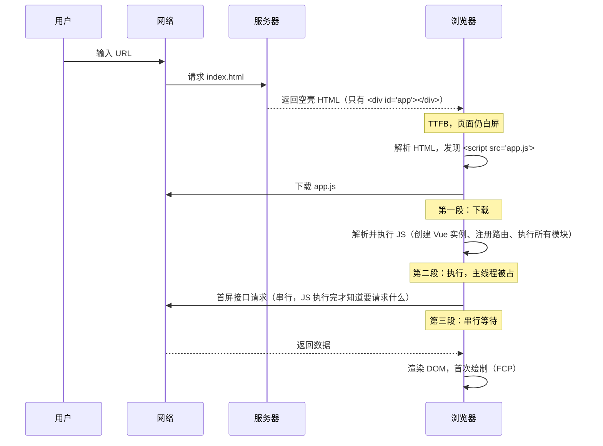
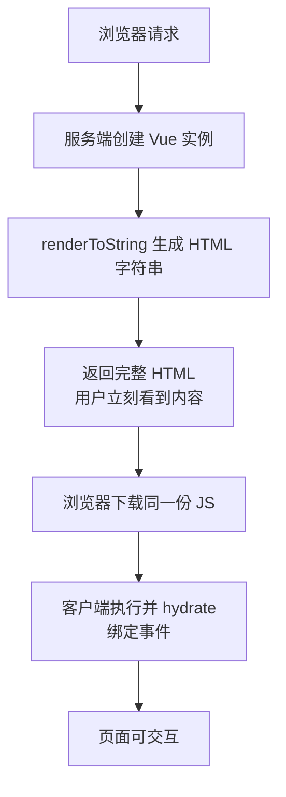
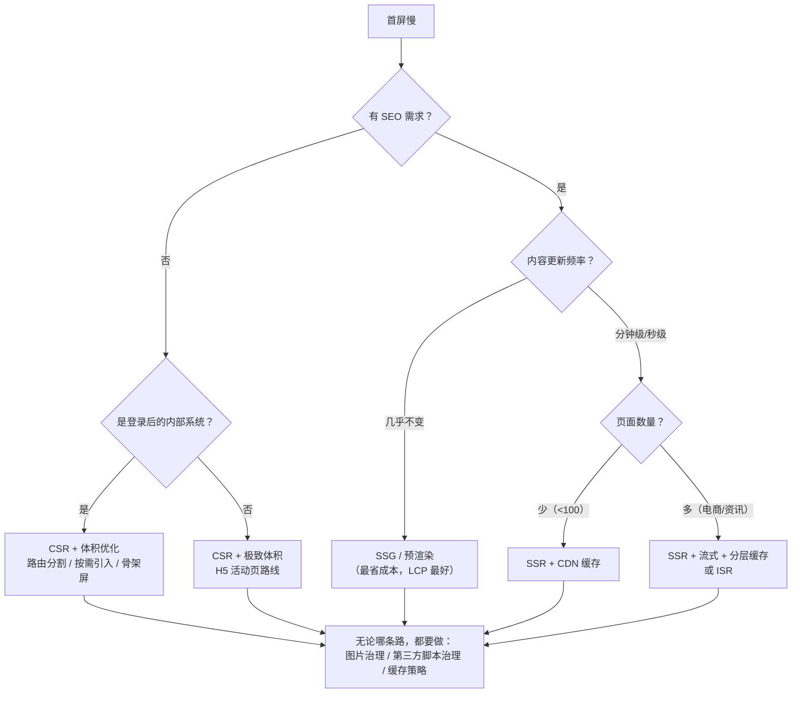

# 性能 · 03 首屏优化：从 SSR 到关键路径

> 覆盖：首屏口径、SPA 三段时序、四类手段、SSR/SSG/预渲染、骨架屏与关键 CSS
> 主线：先定位慢在哪一段，再按时段选手段

---

## 目录

- [1. 先搞清"首屏"到底指什么](#1-先搞清首屏到底指什么)
- [2. SPA 首屏为什么慢（时序剖析）](#2-spa-首屏为什么慢时序剖析)
- [3. 四类手段总览（12 种，按思路分类）](#3-四类手段总览12-种按思路分类)
- [4. A 类：少给 —— 减少首屏必须下载和执行的东西](#4-a-类少给--减少首屏必须下载和执行的东西)
- [5. B 类：快给 —— 缩短传输时间](#5-b-类快给--缩短传输时间)
- [6. C 类：改变渲染方式 —— SSR / SSG / 流式 / 预渲染](#6-c-类改变渲染方式--ssr--ssg--流式--预渲染)
- [7. D 类：感知优化 —— 让用户"觉得"快](#7-d-类感知优化--让用户觉得快)
- [8. 骨架屏怎么做才不帮倒忙](#8-骨架屏怎么做才不帮倒忙)
- [9. 关键 CSS 内联与剩余 CSS 异步加载](#9-关键-css-内联与剩余-css-异步加载)
- [10. 路由懒加载与预加载策略](#10-路由懒加载与预加载策略)
- [11. 决策树：什么项目该上什么](#11-决策树什么项目该上什么)
- [12. 常见坑](#12-常见坑)
- [13. 答题模板](#13-答题模板)
- [14. 追问表](#14-追问表)
- [15. 速记卡](#15-速记卡)

---

## 1. 先搞清"首屏"到底指什么

"首屏"有三种口径，对应不同指标，优化手段也不同：

| 口径 | 含义 | 对应指标 |
|---|---|---|
| **视觉首屏** | 用户看到页面上部有内容 | FCP |
| **内容首屏** | 视口内主要内容都渲染完 | **LCP**（最常用） |
| **可交互首屏** | 页面能响应点击 | INP / TBT / TTI |

内容型页面盯 LCP；表单类页面"能点了"更关键，盯 TBT 与 INP。

---

## 2. SPA 首屏为什么慢（时序剖析）

### 2.1 完整时序



### 2.2 三段"浪费"

| 阶段 | 问题本质 | 优化方向 |
|---|---|---|
| ① HTML 是空壳 | 服务端没给内容 | **改变渲染方式**（SSR/SSG/预渲染） |
| ② JS 太大且必须执行完才有内容 | 体积 + 执行成本 | **少给**（分割、tree-shaking、按需） |
| ③ 数据请求串行在 JS 之后 | 瀑布流 | **提前**（SSR 直出、preload 接口、并行请求） |

路由懒加载 + gzip + CDN 优化的是 ②；瓶颈若在 ① 或 ③，这类手段收效有限。

---

## 3. 四类手段总览（12 种，按思路分类）

| 类别 | 思路 | 手段 | 主要改善 |
|---|---|---|---|
| **A 少给** | 首屏不需要的别加载 | ① 路由/组件级代码分割 ② tree-shaking + 按需引入 ③ 第三方脚本治理 ④ 移除无用 polyfill | LCP、TBT |
| **B 快给** | 缩短传输时间 | ⑤ CDN + brotli ⑥ 资源优先级（preload/preconnect） ⑦ HTTP/2/3 ⑧ 减少重定向 | TTFB、LCP |
| **C 换方式** | 别让浏览器从零渲染 | ⑨ SSR ⑩ SSG/预渲染 ⑪ 流式 SSR + 渐进水合 | LCP、FCP |
| **D 抢先感知** | 让用户觉得快 | ⑫ 骨架屏 + 关键 CSS 内联 + 字体优化 + 渐进式图片 | FCP、CLS、主观体验 |

四类的分工：A、B 改善真实指标；C 取决于项目类型；D 主要改善 FCP、CLS 与主观体验，对 LCP 影响有限。

---

## 4. A 类：少给 —— 减少首屏必须下载和执行的东西

### 4.1 路由/组件级代码分割

```js
// ❌ 全量引入：所有页面打成一个 bundle
import Home from './views/Home.vue'
import About from './views/About.vue'
import Detail from './views/Detail.vue'

// ✅ 路由级分割：每个页面一个 chunk，访问时才下载
const routes = [
  { path: '/', component: () => import('./views/Home.vue') },
  { path: '/about', component: () => import('./views/About.vue') },
  { path: '/detail/:id', component: () => import('./views/Detail.vue') },
]
```

```js
// ✅ 组件级分割：首屏不可见的重组件（弹窗、图表、编辑器）
const HeavyChart = defineAsyncComponent(() => import('./components/HeavyChart.vue'))

// ✅ 条件加载：只在需要时 import
async function openEditor() {
  const { Editor } = await import('./editor')
  new Editor()
}
```

**Vite 下的分包配置：**

```js
// vite.config.js
export default {
  build: {
    rollupOptions: {
      output: {
        manualChunks: {
          // 把变化频率低的第三方库单独成 chunk，利于长期缓存
          'vendor-vue': ['vue', 'vue-router', 'pinia'],
          'vendor-chart': ['echarts'],
          'vendor-ui': ['element-plus'],
        },
      },
    },
  },
}
```

> **拆分粒度**按「变更频率」和「首屏是否需要」两个维度决定，而不是按文件大小。`vue` 全家桶几乎不变 → 单独 chunk 长期缓存；业务代码频繁变更 → 单独 chunk 高频更新。

### 4.2 tree-shaking 与按需引入

**tree-shaking 生效的三个前提：**

1. 使用 **ESM**（`import/export`），CJS 的 `module.exports` 无法静态分析
2. 打包工具开启 `usedExports` + `sideEffects`（Webpack 生产模式默认开）
3. 库本身是"可摇"的（提供 ESM 产物、`sideEffects: false`）

```js
// ❌ 全量引入 lodash：即使只用 debounce，也会打进 70KB+
import _ from 'lodash'
_.debounce(fn, 300)

// ✅ 具名引入（依赖 tree-shaking）
import { debounce } from 'lodash-es'

// ✅ 更稳：直接引子模块
import debounce from 'lodash/debounce'

// ❌ 全量引入 ECharts
import * as echarts from 'echarts'

// ✅ 按需注册
import * as echarts from 'echarts/core'
import { LineChart } from 'echarts/charts'
import { GridComponent, TooltipComponent } from 'echarts/components'
import { CanvasRenderer } from 'echarts/renderers'
echarts.use([LineChart, GridComponent, TooltipComponent, CanvasRenderer])
```

**Element Plus / Ant Design 按需引入：**

```js
// Vite + unplugin-vue-components 自动按需
import Components from 'unplugin-vue-components/vite'
import { ElementPlusResolver } from 'unplugin-vue-components/resolvers'

export default {
  plugins: [Components({ resolvers: [ElementPlusResolver()] })],
}
```

> **量级参考**：Element Plus 全量引入在数百 KB（gzip 后仍在百 KB 级）；按需只引一个 Table 组件可降到几十 KB。

### 4.3 第三方脚本治理

第三方脚本（统计、客服、广告、A/B 测试、地图）是首屏性能的主要干扰项：

| 现象 | 说明 |
|---|---|
| 第三方脚本占主线程比例高 | 移动端更明显 |
| 客服 / 地图 SDK 常达数百 KB | 且常常同步加载 |
| 广告脚本引发额外布局偏移 | 直接拉高 CLS |

**治理手段：**

```html
<!-- ① 非关键脚本延后到解析完成之后 -->
<script src="https://analytics.example.com/a.js" defer></script>

<!-- ② 交互后才加载（客服、评论），用一个标志位防止重复注入 -->
<script>
  let loaded = false
  function loadThirdParty() {
    if (loaded) return
    loaded = true
    const s = document.createElement('script')
    s.src = 'https://chat.example.com/sdk.js'
    s.async = true
    document.head.appendChild(s)
  }
  ;['scroll', 'pointerdown', 'keydown'].forEach((evt) =>
    window.addEventListener(evt, loadThirdParty, { once: true, passive: true }),
  )
</script>

<!-- ③ 重脚本用 iframe / Web Worker 隔离，不占主线程 -->
```

用 Performance 面板的 Third-party 归因查看主线程占比；超过 30% 时优先治理第三方脚本，收益通常大于继续压 bundle。

### 4.4 移除无用 polyfill

```js
// babel 按目标浏览器注入，而不是全量引入
// vite: 用 @vitejs/plugin-legacy 只给老浏览器出 polyfill 包
// webpack: 用 babel-preset-env 的 useBuiltIns: 'usage'
```

> 很多项目为兼容 IE 引入了 `core-js` 全量与 `regenerator-runtime`，体积 100KB+。已不支持 IE 时删掉即可减少上百 KB。

---

## 5. B 类：快给 —— 缩短传输时间

与 02 加载与网络重叠，这里只列首屏相关项：

| 手段 | 首屏相关要点 |
|---|---|
| **CDN** | 静态资源上 CDN，命中率 > 90%；HTML 也可走 CDN（配 `no-cache`） |
| **brotli** | 文本资源通常可压掉 70% 以上，首屏 JS/CSS 收益最大 |
| **preconnect** | 对首屏要用的 API / 字体域名提前建连，省 2~4 RTT |
| **preload** | 首屏 LCP 图、字体、关键 CSS/JS |
| **HTTP/2** | 单连接多路复用，避免 HTTP/1.1 的 6 并发排队 |
| **减少重定向** | 每个 301 多一次 RTT；`http→https` 与 `不带 www→带 www` 串联即 2 次 |
| **HTML 直出** | 配合 SSR，或至少把关键数据内联（`window.__INITIAL_STATE__`） |

首屏图用 `fetchpriority="high"` 标注，并用 `<link rel="preload" as="image">` 提前发现；**不要**加 `loading="lazy"`——lazy 会把图片发现推迟到布局完成之后。非首屏图才用 `loading="lazy"` + `fetchpriority="low"`。

### 5.1 一个具体例子：内联初始数据，砍掉一次串行请求

```html
<!-- SSR 或后端模板直接注入，前端不再发首屏请求 -->
<script>
  window.__INITIAL_STATE__ = {"user":{"name":"张三"},"list":[...]}
</script>
```

```js
// 前端启动时优先读这份数据
const store = createStore()
if (window.__INITIAL_STATE__) {
  store.replaceState(window.__INITIAL_STATE__)
  delete window.__INITIAL_STATE__   // 释放内存
}
```

**收益**：省掉「JS 执行 → 发请求 → 等响应」这一整段串行，节省量等于该接口的耗时。

---

## 6. C 类：改变渲染方式 —— SSR / SSG / 流式 / 预渲染

### 6.1 四种渲染模式对比

| | CSR | SSR | SSG | ISR / 增量静态 |
|---|---|---|---|---|
| HTML 生成时机 | 浏览器运行时 | **每次请求** | **构建时** | 构建时 + 定期/按需重新生成 |
| 首屏 LCP | 差（等 JS） | 好（HTML 直出） | **最好**（CDN 直接返回） | 最好 |
| TTFB | 好（静态壳） | **较差**（服务端渲染耗时） | 最好 | 最好 |
| SEO | 差 | 好 | 好 | 好 |
| 数据新鲜度 | 实时 | 实时 | 构建时 | 可配置（如 60s） |
| 服务端成本 | 无 | **高**（每请求渲染） | 无 | 低 |
| 适合 | 后台管理、强交互应用 | 内容需实时 + 要 SEO | 博客、文档、营销页 | 电商列表、资讯 |

> **SSR 不是"更快"，而是"更早"**：渲染从客户端挪到服务端，用户更早看到内容；总 JS 体积不减少，还要额外付 hydration 成本，TTFB 可能变差。

### 6.2 SSR 的完整流程与代价



**SSR 的 5 项代价：**

| 代价 | 说明 |
|---|---|
| **TTFB 变差** | 服务端要渲染，接口慢会直接拖慢首字节 |
| **Hydration 成本** | 客户端要重新执行一遍组件树来绑定事件；大页面 TBT 反而升高 |
| **两套环境** | 代码里不能用 `window`/`document`，第三方库可能不兼容 |
| **部署复杂** | 需要 Node 服务、缓存策略、降级方案 |
| **状态一致性** | 服务端与客户端渲染结果必须一致，否则 hydration mismatch |

**hydration mismatch 的典型原因：**

| 原因 | 例子 | 解法 |
|---|---|---|
| 用了随机/时间 | `Math.random()`、`Date.now()` | 用固定值，或放到 `onMounted` 后再更新 |
| 依赖浏览器 API | `window.innerWidth` 决定渲染内容 | 服务端给默认值，客户端挂载后修正 |
| 浏览器插件改 DOM | 翻译插件、广告拦截 | 用 `data-allow-mismatch` 忽略 |
| 非法 HTML 嵌套 | `<p>` 里套 `<div>` | 修正结构 |
| 数据不一致 | 服务端数据与客户端首帧数据不同 | 用同一份序列化状态 |

### 6.3 流式 SSR（Streaming SSR）

`renderToString` 要等整个页面渲染完才返回，TTFB 被最慢的接口拖住；流式渲染边渲染边发送：

```js
// Vue 3.5 的流式 API 是 renderToNodeStream / renderToWebStream
import { createSSRApp } from 'vue'
import { renderToNodeStream } from 'vue/server-renderer'

app.get('*', (req, res) => {
  res.setHeader('Content-Type', 'text/html')
  const stream = renderToNodeStream(createSSRApp(App))
  stream.pipe(res)                 // 外壳先发出去，慢区块随后补流
  stream.on('error', () => {
    res.statusCode = 500
    res.end()
  })
})
```

```vue
<!-- 慢的区块用 Suspense 包起来，先发占位，数据好了再流式补上 -->
<template>
  <Header />
  <Suspense>
    <SlowComments />
    <template #fallback><CommentsSkeleton /></template>
  </Suspense>
</template>
```

**收益**：TTFB 从"等所有接口"降到"外壳渲染完成"，慢区块随后补流。React 18 的对应 API 是 `renderToPipeableStream`。

### 6.4 预渲染（Prerender）：只给首屏做一次静态化

如果只有**首页/落地页**需要快，没必要上完整 SSR：

```js
// vite-plugin-prerender 或 prerender-spa-plugin
// 构建时用无头浏览器访问一次，把渲染结果存成 index.html
export default {
  plugins: [prerender({ routes: ['/', '/about', '/pricing'] })],
}
```

**适合**：页面数量少、内容变化不频繁（营销页、官网、活动页）。
**不适合**：内容实时变化、页面数量成百上千。

### 6.5 选型建议

| 项目类型 | 建议 | 理由 |
|---|---|---|
| 后台管理系统 | **CSR 就够** | 登录后使用、无 SEO 需求、交互复杂；SSR 收益低且维护成本高 |
| 官网 / 营销页 | **SSG / 预渲染** | 内容静态、要 SEO、可全站 CDN |
| 电商 / 资讯 | **SSR + 流式 + CDN 缓存** | 要 SEO、内容需实时、列表页可短缓存 |
| 活动页（H5） | **CSR + 极致体积优化** | 生命周期短，上 SSR 不值；重投在体积和图片 |
| 内容站 / 博客 | **SSG / ISR** | 大量静态页面，构建期生成最划算 |

---

## 7. D 类：感知优化 —— 让用户"觉得"快

### 7.1 字体优化

| 手段 | 说明 |
|---|---|
| `font-display: swap` | block 期极短、swap 期无限：先用系统字体，字体到了再换；可能闪烁，但不会长时间空白 |
| `font-display: optional` | block 期 100ms、swap 期为 0：100ms 内没到就用系统字体，本次访问不再替换（CLS 最小） |
| `font-display: block` | block 期 3s：文本最长 3s 不可见，文本型 LCP 直接受损 |
| **子集化** | 只保留用到的字符（中文可从数 MB 降到数百 KB） |
| **`unicode-range` 分片** | 按字符集切成多个字体文件，按需下载 |
| **预加载首屏字体** | `<link rel="preload" as="font" type="font/woff2" crossorigin>`；字体请求是 CORS 模式，缺 `crossorigin` 会下载两份 |
| **`size-adjust`** | 校准回退字体与 Web 字体的度量，减小切换时的布局抖动 |

```css
@font-face {
  font-family: 'PingFang Custom';
  src: url('/fonts/pingfang-subset.woff2') format('woff2');
  font-display: swap;                /* 或 optional，按业务选择 */
  unicode-range: U+4E00-9FFF;        /* 只加载中文字符范围 */
  size-adjust: 105%;                 /* 与系统字体度量对齐，减小 CLS */
}
```

### 7.2 渐进式图片

```html
<!-- LQIP：先显示模糊小图，高清图加载完再替换；dataset 置空防止重复触发 -->

```

或用 CSS 背景色 + `aspect-ratio` 占位，避免布局抖动。

### 7.3 交互反馈（改善 INP 体感）

| 手段 | 说明 |
|---|---|
| 点击立即给视觉反馈 | 按钮立刻变 loading 态，即使用户要等 500ms 也不觉得卡 |
| 乐观更新 | 先更新 UI，失败再回滚 |
| 进度条 | 路由切换时顶部进度条（NProgress） |

---

## 8. 骨架屏怎么做才不帮倒忙

### 8.1 核心原则：**骨架的形状必须和真实内容一致**

骨架高度与真实内容高度不一致时，内容到达会触发布局偏移，**CLS 反而变差**。

```vue
<!-- ✅ 正确：骨架和真实结构的尺寸对齐 -->
<template>
  <div class="card">
    <div v-if="loading" class="skeleton" style="height: 120px"></div>
    
    <h3>{{ data.title }}</h3>
    <p>{{ data.desc }}</p>
  </div>
</template>
```

### 8.2 三种实现方式

| 方式 | 优点 | 缺点 | 适合 |
|---|---|---|---|
| **手写组件** | 可控、精准 | 工作量大 | 结构固定的核心页面 |
| **构建时自动生成** | 一次配置全站可用（`vue-skeleton-webpack-plugin`） | 生成的骨架可能不准 | 多页面项目 |
| **HTML 内置首屏骨架** | 0 JS 即可显示（写在 `index.html` 里） | 需要手动维护 | **对 FCP 收益最大** |

第三种把骨架写在 `index.html` 里，JS 执行前即可绘制，是 FCP 收益最直接的形态：

```html
<!-- index.html -->
<div id="app">
  <!-- 骨架在 JS 加载前就显示；Vue 挂载时会替换 #app 的内容，骨架自动消失 -->
  <div class="app-skeleton">
    <div class="sk-header"></div>
    <div class="sk-banner"></div>
    <div class="sk-list">
      <div class="sk-item"></div>
      <div class="sk-item"></div>
    </div>
  </div>
</div>
```

### 8.3 骨架屏的常见坑

| 坑 | 说明 |
|---|---|
| 骨架显示太久 | 接口只要 100ms 时骨架一闪而过，反而像闪屏；可延迟 200ms 再显示骨架 |
| 骨架和真实内容高度不一致 | 内容到达时布局偏移，CLS 变差 |
| 骨架动画太重 | `shimmer` 用 `background-position` 动画，别动 `width/height`（触发 Layout） |
| 骨架没无障碍处理 | 加 `aria-busy="true"`，屏幕阅读器才不读空内容 |

---

## 9. 关键 CSS 内联与剩余 CSS 异步加载

### 9.1 为什么 CSS 是"渲染阻塞资源"

HTML 解析到 `<link rel="stylesheet">` 后，首屏绘制要等 CSSOM 就绪——Render Tree 需要 DOM 与 CSSOM 同时可用。而首屏真正用到的规则通常只占样式表的一小部分。

### 9.2 标准做法：内联关键 CSS + 异步剩余 CSS

```html
<head>
  <!-- ① 首屏关键样式直接内联（控制在 14KB 量级，见下方说明） -->
  <style>
    /* header / banner / 首屏列表的样式 */
    .header{height:56px;display:flex;...}
    .banner{aspect-ratio:16/9;...}
  </style>

  <!-- ② 剩余 CSS 异步加载，不阻塞渲染 -->
  <link rel="preload" href="/styles/main.css" as="style"
        onload="this.onload=null;this.rel='stylesheet'">
  <noscript><link rel="stylesheet" href="/styles/main.css"></noscript>
</head>
```

> **为什么是 14KB？** TCP 慢启动的初始拥塞窗口约 10 个 MSS ≈ 14.6KB。首屏 HTML（含内联 CSS）能装进第一个 RTT，就省掉一个往返。

### 9.3 自动化方案

手写并维护关键 CSS 成本高，一般用工具生成：

```js
// critical（npm）+ 构建钩子
import { generate } from 'critical'

await generate({
  base: 'dist/',
  src: 'index.html',
  target: 'index.html',
  inline: true,
  extract: true,          // 把原 CSS 抽出为异步加载
  dimensions: [{ width: 375, height: 667 }, { width: 1920, height: 1080 }],
})
```

Vite 生态可用 `vite-plugin-critical`。

### 9.4 常见坑

| 坑 | 说明 |
|---|---|
| 内联了全量 CSS | HTML 变大、无法缓存，反而更慢 |
| 用 `media="print" onload` 老技巧 | 可用，但要自行处理 `rel` 切换与 `noscript` 兜底 |
| 忘了 `noscript` | 禁用 JS 时页面完全没样式 |
| 内联 CSS 里引用了字体 | 字体加载仍会阻塞文本渲染，要配 `font-display` |

---

## 10. 路由懒加载与预加载策略

### 10.1 懒加载只是"推迟"，不是"消灭"

路由懒加载让首屏只加载当前路由，但如果用户下一步就点"关于我们"，这段等待就转移到了路由切换时。所以**必须配预加载**。

### 10.2 三级预加载策略

```js
// 策略 1：空闲时预取所有路由（简单粗暴，适合路由少的项目）
router.isReady().then(() => {
  requestIdleCallback(() => {
    routes.forEach(r => r.component?.())    // 触发 import()
  })
})

// 策略 2：hover / focus 时预取（推荐，命中率高）
const prefetched = new Set()
router.options.routes.forEach(route => {
  const loader = route.component
  if (typeof loader !== 'function') return
  // 给每个路由挂一个预取函数
  route.meta.preload = () => {
    if (prefetched.has(route.path)) return
    prefetched.add(route.path)
    loader()
  }
})

document.addEventListener('mouseover', (e) => {
  const link = e.target.closest('a[href]')
  if (!link) return
  const route = router.resolve(link.getAttribute('href'))
  route.meta.preload?.()
}, { passive: true })

// 策略 3：视口内出现链接就预取（IntersectionObserver）
const io = new IntersectionObserver((entries) => {
  entries.forEach(en => {
    if (en.isIntersecting) {
      en.target.dataset.preload && router.resolve(en.target.dataset.preload).meta.preload?.()
      io.unobserve(en.target)
    }
  })
})
document.querySelectorAll('[data-preload]').forEach(el => io.observe(el))
```

### 10.3 Webpack 魔法注释

```js
// prefetch：空闲时下载（浏览器自动，无需手写策略 1）
const About = () => import(/* webpackPrefetch: true */ './views/About.vue')

// preload：与父 chunk 并行下载（慎用，会抢首屏带宽）
const Home = () => import(/* webpackPreload: true */ './views/Home.vue')

// 指定 chunk 名，便于分析
const Detail = () => import(/* webpackChunkName: "detail" */ './views/Detail.vue')
```

> Vite / Rollup 不支持这些魔法注释；预取要按策略 1/2 手写，或直接输出 `<link rel="modulepreload">`。

---

## 11. 决策树：什么项目该上什么



---

## 12. 常见坑

| # | 坑 | 纠正 |
|---|---|---|
| 1 | `manualChunks` 拆得过细 | 请求数放大，HTTP/1.1 下更糟；按变更频率合并 |
| 2 | 忽略 hydration mismatch | 客户端重渲染闪烁，事件可能失效 |
| 3 | 第三方脚本同步加载 | 阻塞解析，直接拖慢 FCP |
| 4 | 只优化首屏不管二次访问 | 二次访问靠缓存策略 |

---

## 13. 答题模板

### 13.1 「首屏优化方案」——30 秒

- **少给**：路由/组件分割、tree-shaking 与按需引入、第三方脚本延后、删除无用 polyfill
- **快给**：CDN + brotli、preconnect、首屏关键资源 preload、HTTP/2、减少重定向
- **换渲染方式**：有 SEO → SSR/SSG/预渲染；无 SEO → `index.html` 内置骨架保证 FCP
- **抢先感知**：关键 CSS 内联、`font-display`、首屏图 `fetchpriority="high"`

### 13.2 「SPA 首屏太慢怎么办」——2 分钟

1. **空壳**：服务端只返回 `div#app`，JS 执行前白屏 → 有 SEO 上 SSR/SSG，否则把骨架写进 `index.html`
2. **JS 体积与执行**：bundle 分析通常暴露路由未分割、库全量引入、polyfill 冗余；第三方脚本按交互延后
3. **数据串行**：首屏数据随 HTML 直出（`window.__INITIAL_STATE__`），再接 CDN / brotli / preconnect / preload
4. **验证**：按 LCP 四段归因确认瓶颈确实移走

### 13.3 「首屏优化」被追问"你怎么知道有效"时

- 看 LCP 四段：TTFB、资源加载延迟、资源加载时长、元素渲染延迟
- TTFB 大 → 服务端或网络；加载延迟大 → 资源发现太晚（写在 JS 里或被 lazy）；加载时长大 → 资源过大；渲染延迟大 → 主线程被占
- 优化占比最大的一段，改完复测同一段是否下降

---

## 14. 追问表

| # | 追问 | 要点 |
|---|---|---|
| 1 | 什么是 hydration？ | 客户端复用服务端 HTML，重新执行组件树以绑定事件，而不是重新创建 DOM |
| 2 | hydration mismatch 怎么排查？ | 看控制台警告定位组件；常见原因见 6.2 的表 |
| 3 | 预渲染和 SSG 区别？ | 预渲染通常指给 SPA 的少数路由生成静态 HTML（工具驱动）；SSG 是框架级全站生成 |
| 4 | 骨架屏会改善 LCP 吗？ | 纯色块骨架不是 LCP 候选（候选是图片、文本块、背景图等），主要改善 FCP 与感知；若骨架内含文本或背景图且成为视口内最大元素，LCP 时间点会前移到骨架绘制 |
| 5 | 怎么量化首屏优化效果？ | LCP p75 前后对比 + Lighthouse 多次采样 + 灰度 A/B |
| 6 | 首屏优化做到什么程度停？ | LCP p75 < 2.5s 或达到业务目标；继续投入 ROI 明显下降 |
| 7 | 大屏/低端机怎么兼顾？ | 响应式图片 + 按 `deviceMemory`/`connection` 降级（少图、关动画） |
| 8 | SPA 首屏后切路由也慢怎么办？ | 路由级 prefetch、组件级缓存（keep-alive）、接口并行、骨架屏 |
| 9 | 内联 `__INITIAL_STATE__` 有什么风险？ | XSS（要转义 `</script>`）、数据量大增 HTML、敏感信息泄露 |
| 10 | Islands 架构是什么？ | 静态 HTML + 局部交互岛屿（Astro），只水合需要交互的部分，大幅减少 JS |
| 11 | 边缘渲染（ESR）是什么？ | 在 CDN 边缘节点跑 SSR，兼顾"HTML 直出"和"低 TTFB"，如 Vercel Edge、Cloudflare Workers |

---

## 15. 速记卡

```
【三段浪费】
① HTML 是空壳 → 换渲染方式（SSR/SSG/预渲染/HTML 内骨架）
② JS 太大太慢 → 少给（路由分割/按需引入/第三方治理/删 polyfill）
③ 数据串行在 JS 后 → 提前（__INITIAL_STATE__ 直出 / 接口并行）

【四类手段】少给 / 快给 / 换渲染方式 / 抢先感知

【四种渲染模式】
CSR：无 SEO，LCP 差，适合后台
SSR：SEO 好，LCP 好，TTFB 差，成本高
SSG：构建时生成，最适合静态内容
ISR：SSG + 定期重生成，适合电商/资讯

【SSR 五代价】TTFB 变差 / hydration 成本 / 两套环境 / 部署复杂 / 状态一致性

【关键数字】14KB ≈ 10 MSS，TCP 初始拥塞窗口；HTML 装进第一个 RTT 即省一次往返

【首屏图】fetchpriority=high + preload，不加 loading=lazy

【骨架屏】尺寸与真实内容一致；写进 index.html 才对 FCP 有收益
```
