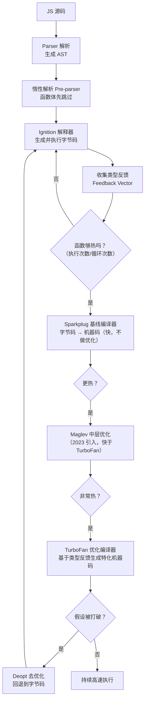
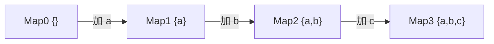
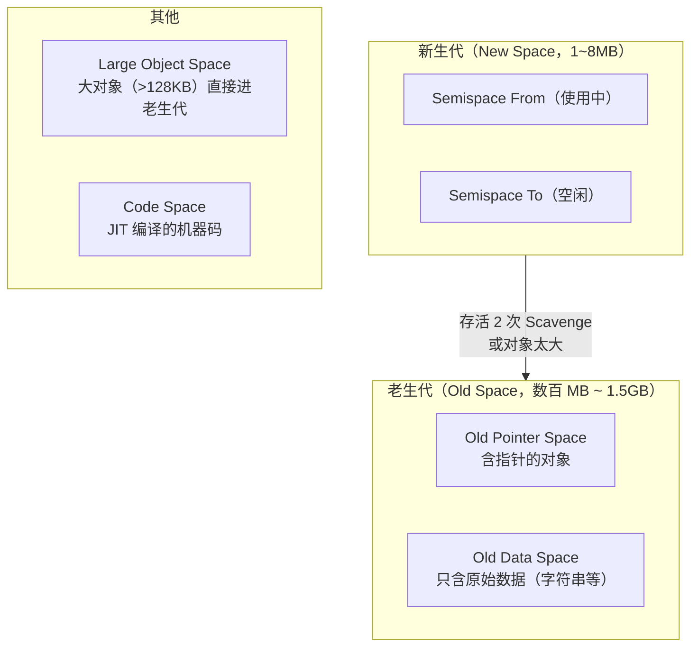

# 性能 · 06 JS 引擎与内存：V8 优化与内存泄漏

> 覆盖题号：**8、9**
> 对应原题：《浏览器是怎么对 JS 的执行效率进行优化和提升的》《如何排查及优化内存泄漏》
> 这两题一个讲"代码怎么跑得快"（V8 做了什么 + 你能配合什么），一个讲"内存怎么不涨"（泄漏定位与修复）。

---

## 目录

- [1. V8 怎么执行和优化 JS](#1-v8-怎么执行和优化-js)
- [2. 隐藏类：V8 性能的第一块基石](#2-隐藏类v8-性能的第一块基石)
- [3. 内联缓存 IC](#3-内联缓存-ic)
- [4. 其他关键优化：内联 / 逃逸分析 / 元素类型](#4-其他关键优化内联--逃逸分析--元素类型)
- [5. 怎么写 V8 友好的代码（实战清单）](#5-怎么写-v8-友好的代码实战清单)
- [6. 垃圾回收：分代与三色标记](#6-垃圾回收分代与三色标记)
- [7. 内存泄漏的 8 种典型场景（上半）](#7-内存泄漏的-8-种典型场景上半)
- [8. 怎么排查内存泄漏（下半）](#8-怎么排查内存泄漏下半)
- [9. 怎么优化内存占用](#9-怎么优化内存占用)
- [10. 常见坑](#10-常见坑)
- [11. 答题模板](#11-答题模板)
- [12. 追问表](#12-追问表)
- [13. 速记卡](#13-速记卡)

---

## 1. V8 怎么执行和优化 JS

### 1.1 一句话结论

**V8 采用"解释 + 分层编译"的混合策略**：先快速把源码变成字节码解释执行（Ignition），同时收集类型反馈；热代码逐级升级为基线编译（Sparkplug）和优化编译（Maglev / TurboFan），生成高度特化的机器码；一旦假设被打破就**去优化（deopt）**回退。

### 1.2 完整执行管线



**四个执行层的定位：**

| 层 | 名称 | 启动速度 | 执行速度 | 说明 |
|---|---|---|---|---|
| 解析 | Parser + Pre-parser | — | — | 惰性解析：函数体先不解析，只记位置 |
| ① | **Ignition**（解释器） | 极快 | 慢（10~100 倍于机器码） | 生成紧凑字节码，省内存 |
| ② | **Sparkplug**（基线） | 快 | 中 | 字节码一对一翻译成机器码，不做优化，但比解释快 5~10 倍 |
| ③ | **Maglev**（中层） | 中 | 较快 | 2023 加入，填补 Sparkplug 与 TurboFan 的空档 |
| ④ | **TurboFan**（优化） | 慢（编译耗时） | 最快 | 基于类型反馈做特化、内联、逃逸分析 |

> **为什么需要分层？** 如果所有代码都直接上 TurboFan，编译时间会拖垮启动；如果只解释，长期运行太慢。分层让"冷代码快速跑起来、热代码跑得飞快"，这是 **JIT 的核心权衡（warmup cost vs peak performance）**。

### 1.3 类型反馈（Type Feedback）

Ignition 执行时会记录"这个操作见过什么类型"：

```js
function add(a, b) { return a + b }

add(1, 2)        // 反馈：a 是 SMI，b 是 SMI
add(3, 4)        // 反馈强化：还是 SMI + SMI
add(100, 200)    // 依然 SMI
// → TurboFan 生成"整数加法"的专用机器码，一条 add 指令搞定

add('1', 2)      // ⚠️ 类型变了！假设被打破 → deopt
// → 回退到字节码，重新收集反馈；如果一直混合类型，就永远不优化
```

**这就是"类型稳定"为什么重要**：V8 的优化建立在"我猜你下次还是这个类型"之上，类型一乱，优化全废。

### 1.4 惰性解析（Lazy Parsing）

```js
// 只有函数被调用时才真正解析它的函数体
function neverCalled() {
  // 这段代码在首次解析时被跳过（pre-parse 只检查语法，不生成 AST）
  // 省下解析时间 + 内存
}
```

**对你写代码的启示**：别在顶层写大量不执行的代码；把只在小概率路径用的逻辑放进函数（V8 会自动懒解析）。

### 1.5 常见坑

| 坑 | 说明 |
|---|---|
| 认为 V8 是"纯解释器" | 是"解释 + 多层 JIT" |
| 认为 V8 是"纯编译器" | 有 Ignition 解释器，冷代码不编译 |
| 只知道 TurboFan | 现代 V8 还有 Sparkplug 和 Maglev |
| 认为 deopt 是错误 | 是正常机制，只是频繁 deopt 会拖慢 |
| 认为优化是"一次性的" | 会随类型变化反复优化/去优化 |

### 1.6 30 秒版

> "V8 是解释加分层编译。源码先被解析成 AST，注意函数体是惰性解析的；然后 Ignition 解释器生成字节码执行，同时收集类型反馈。代码变热后逐级升级：Sparkplug 基线编译、Maglev 中层优化、TurboFan 做基于类型反馈的特化优化。如果运行时类型和假设不符，就 deopt 回退到字节码。"

### 1.7 2 分钟版

> "V8 的执行分四层。
>
> **第一层是解析**，源码变 AST。这里有个优化叫惰性解析，函数体在首次解析时只做语法检查不生成 AST，等真正调用才解析，省时间和内存。
>
> **第二层是 Ignition 解释器**，把 AST 编译成紧凑的字节码执行。字节码比机器码省内存，启动快，但执行慢。同时它会记录类型反馈，比如某个加法操作见过的是数字还是字符串。
>
> **第三层是 Sparkplug 基线编译器**，把字节码一对一翻译成机器码，不做任何优化，编译非常快，但比解释执行快五到十倍。它解决的是'中等热度代码'的性价比问题。
>
> **第四层是 TurboFan**，真正的优化编译器。它基于类型反馈生成高度特化的机器码——比如知道参数都是小整数，就直接用一条加法指令。还会做函数内联、逃逸分析、常量折叠。中间还有个 Maglev 是 2023 年加的中层优化器，比 TurboFan 编译快、比 Sparkplug 执行快。
>
> 最后是**去优化**：如果实际类型和假设不符，TurboFan 生成的代码会失效，回退到字节码重新收集反馈。所以优化不是一劳永逸的，类型不稳定会反复 deopt，反而比不优化更慢。
>
> 这也解释了一个实践原则：**保持对象形状和变量类型稳定**，是让 V8 帮你优化的前提。"

### 1.8 追问

| 追问 | 要点 |
|---|---|
| 为什么字节码不直接用机器码？ | 字节码紧凑省内存、生成快、可跨平台；机器码生成慢且占内存 |
| Sparkplug 存在的意义？ | 弥补"解释太慢、TurboFan 编译太贵"的中间地带 |
| Maglev 和 TurboFan 区别？ | Maglev 编译快、优化程度中等；TurboFan 编译慢、优化更激进 |
| 什么是 deopt？ | 优化代码的假设失效，回退到字节码 |
| deopt 常见原因？ | 类型变化、对象形状变化、`delete` 属性、数组越界访问、`arguments` 滥用 |
| 怎么观察 deopt？ | `node --trace-deopt`、`--trace-opt`；Chrome 可用 `%GetOptimizationStatus` |
| JS 是编译型还是解释型？ | 都是。现代引擎是"解释 + JIT 编译"的混合 |

---

## 2. 隐藏类：V8 性能的第一块基石

> 这是**题 8 里最能体现深度**的部分。答出隐藏类和内联缓存，就明显高于"V8 用了 JIT"这种答案。

### 2.1 问题：JS 对象是哈希表，访问很慢

JS 是动态语言，对象可以随时加属性：

```js
const obj = {}
obj.a = 1
obj.b = 2
delete obj.a
```

如果用哈希表存，每次 `obj.b` 都要算哈希、查表——比 C 的结构体偏移访问慢得多。

### 2.2 解法：隐藏类（Hidden Class / Map）

V8 给每个对象关联一个**隐藏类（Map）**，记录"这个对象有哪些属性、各在什么偏移"。

```js
function Point(x, y) {
  this.x = x
  this.y = y
}

const p1 = new Point(1, 2)
const p2 = new Point(3, 4)
```

```
p1 ──→ [Map: {x: offset 0, y: offset 8}]   ← p1、p2 共享同一个 Map
p2 ──→ （同一个 Map）
```

访问 `p1.y` 时，V8 查一次 Map 拿到偏移量 8，直接 `[对象基址 + 8]` 读取——**和 C 的结构体一样快**。

### 2.3 隐藏类的"转换链"（transition tree）

加属性时不是修改原 Map，而是**创建一个新 Map**，形成链：

```js
const o = {}            // Map0: {}
o.a = 1                 // Map0 → Map1 {a}
o.b = 2                 // Map1 → Map2 {a, b}
o.c = 3                 // Map2 → Map3 {a, b, c}
```



**只要两个对象用同样的顺序加同样的属性，它们就共享同一条链上的 Map。**

### 2.4 五条必须遵守的规则

```js
// ❌ 1. 属性顺序不一致 → 生成不同 Map
const a = {}; a.x = 1; a.y = 2      // Map: {x, y}
const b = {}; b.y = 2; b.x = 1      // Map: {y, x}  ← 不同的 Map！

// ✅ 统一在构造函数里按固定顺序初始化
class P { constructor(x, y) { this.x = x; this.y = y } }
```

```js
// ❌ 2. 构造后再加属性 → 新 Map，且破坏共享
function P(x) { this.x = x }
const p1 = new P(1)
const p2 = new P(2)
p1.extra = 'a'          // p1 走了新分支，p1 和 p2 不再共享 Map

// ✅ 所有属性在构造函数里一次声明（即使是 undefined）
function P(x, extra) {
  this.x = x
  this.extra = extra     // 不用也声明，保持形状一致
}
```

```js
// ❌ 3. delete 属性 → 对象退化为"字典模式"（dictionary mode），哈希表查找
delete obj.a

// ✅ 用置 null 代替
obj.a = null
```

```js
// ❌ 4. 用对象当 Map 且键是动态的 → 形状爆炸
const cache = {}
for (const key of dynamicKeys) cache[key] = value   // 每个 key 产生新 Map

// ✅ 动态键用 Map / Object.create(null)
const cache = new Map()
cache.set(key, value)
```

```js
// ❌ 5. 用 in / for...in / Object.keys 频繁操作奇形怪状的对象
// 这本身不一定慢，但如果对象形状高度不一致，V8 会退回慢路径
```

### 2.5 一个可以直接演示的性能差异

```js
// 形状一致：约 50ms
class Good { constructor(i) { this.a = i; this.b = i; this.c = i } }
const arr1 = Array.from({ length: 1e6 }, (_, i) => new Good(i))
let s1 = 0
for (const o of arr1) s1 += o.a + o.b + o.c

// 形状不一致：约 500ms（10 倍差距）
const arr2 = []
for (let i = 0; i < 1e6; i++) {
  const o = {}
  o.a = i
  if (i % 2) o.b = i          // 一半对象多一个属性 → 两种 Map
  o.c = i
  arr2.push(o)
}
let s2 = 0
for (const o of arr2) s2 += o.a + o.b + o.c
```

> 面试时不需要背数字，说清"**形状不一致会导致隐藏类分裂、访问走慢路径**"就够。

### 2.6 追问

| 追问 | 要点 |
|---|---|
| 隐藏类是什么？ | V8 内部描述对象结构的元数据（记录属性名与偏移） |
| 为什么属性顺序重要？ | 不同顺序产生不同隐藏类，无法共享 |
| `delete` 为什么慢？ | 会把对象退化成字典模式，放弃偏移访问 |
| 数组有类似机制吗？ | 有，叫"元素类型"（elements kind），见第 4 节 |
| 类字段（class fields）有帮助吗？ | 有：在类体里声明字段保证形状固定、顺序一致 |
| 隐藏类和 Map 是一回事吗？ | 在 V8 源码里叫 `Map`（注意不是 JS 的 `Map`），社区常叫 hidden class |

---

## 3. 内联缓存 IC

### 3.1 机制

每个属性访问点（如 `obj.x`）在字节码里都有一个"内联缓存槽"，记录"上次这里的对象是哪个 Map、`x` 在哪个偏移"。

```js
function getX(o) { return o.x }

getX({ x: 1 })     // IC 记录：Map_A → offset 0
getX({ x: 2 })     // 命中！直接用 offset 0   → 单态（monomorphic）
```

### 3.2 三种状态

| 状态 | 见过的 Map 数量 | 性能 |
|---|---|---|
| **单态（Monomorphic）** | 1 | **最快**（直接命中） |
| **多态（Polymorphic）** | 2~4 | 较快（逐个比较） |
| **超多态（Megamorphic）** | > 4 | **退化为哈希查找**，和没优化差不多 |

```js
// 单态：所有调用传同一种形状
function area(rect) { return rect.w * rect.h }
area({ w: 1, h: 2 })
area({ w: 3, h: 4 })    // 同一个 Map，单态 ✅

// 超多态：传各种形状
function get(o) { return o.value }
get({ value: 1 })
get({ a: 1, value: 2 })
get({ b: 1, c: 2, value: 3 })
get(new SomeClass())
get(Object.create({ value: 4 }))
// → 超过 4 种 Map，超多态，慢
```

### 3.3 实践启示

| 做法 | 效果 |
|---|---|
| 同一函数只接受一种形状的对象 | 保持单态 |
| 别用"万能工具函数"处理各种形状 | 容易变超多态 |
| 多态无法避免时，拆成多个专门函数 | 各自单态 |
| 传值而非传"形状各异的配置对象" | 减少 Map 种类 |

---

## 4. 其他关键优化：内联 / 逃逸分析 / 元素类型

### 4.1 函数内联（Inlining）

```js
function square(x) { return x * x }
function sumSquares(a, b) { return square(a) + square(b) }

// TurboFan 会把 square 内联展开：
// function sumSquares(a, b) { return a * a + b * b }
```

**好处**：省掉函数调用开销（栈帧创建、参数传递），还能进一步做常量折叠、死代码消除。

**代价**：代码膨胀（code bloat），所以只对小函数内联。

### 4.2 逃逸分析（Escape Analysis）

```js
function makePoint(x, y) {
  const p = { x, y }       // p 没有"逃逸"出函数
  return p.x + p.y
}
// V8 可以直接把 p 拆成两个局部变量，甚至不分配堆内存（标量替换）
```

**启示**：**短生命周期的小对象不会造成 GC 压力**，别为了"省对象"把代码写得很拧巴。

### 4.3 数组元素类型（Elements Kind）

V8 给数组也分了类型，且**只能从"具体"退化为"通用"，不能反过来**：

```
PACKED_SMI_ELEMENTS      纯小整数，最紧凑
   ↓ 加入小数
PACKED_DOUBLE_ELEMENTS   浮点数
   ↓ 加入对象/字符串
PACKED_ELEMENTS          任意类型
   ↓ 出现空洞（delete、a[100] = x）
HOLEY_*_ELEMENTS         带空洞，更慢
```

```js
const a = [1, 2, 3]          // PACKED_SMI_ELEMENTS（最快）
a.push(1.5)                  // → PACKED_DOUBLE_ELEMENTS
a.push('x')                  // → PACKED_ELEMENTS
a[100] = 1                   // → HOLEY_ELEMENTS（退化，且不可逆）

// ✅ 好习惯
const b = []                 // 保持同类型
for (let i = 0; i < 1000; i++) b.push(i)

// ❌ 避免
const c = new Array(1000)    // 立即变成 HOLEY（有空洞）
c[0] = 1
```

**启示**：**数组别混类型、别用 `new Array(n)` 预分配、别制造空洞**。

### 4.4 其他小事

| 优化 | 说明 |
|---|---|
| SMI（Small Integer） | 小整数直接存在指针位里，不额外分配 |
| 字符串拼接 | V8 用 rope（绳子）结构延迟拼接；但循环里大量 `+=` 仍会退化 |
| `arguments` | 会阻止优化，用剩余参数 `...args` |
| `try/catch` | 现代 V8 已优化，不再是性能杀手（老资料说"别用"已过时） |
| `eval` / `with` | 会让作用域静态分析失效，禁用 |

---

## 5. 怎么写 V8 友好的代码（实战清单）

| # | 规则 | 原因 |
|---|---|---|
| 1 | 对象属性在构造函数/类字段中一次声明，顺序固定 | 隐藏类共享 |
| 2 | 不用 `delete`，用置 `null` | 避免退化字典模式 |
| 3 | 动态键用 `Map`，不用普通对象 | 避免形状爆炸 |
| 4 | 函数参数类型稳定 | 保持单态 IC、避免 deopt |
| 5 | 数组保持同类型元素 | 保持紧凑元素类型 |
| 6 | 不用 `new Array(n)` 预分配 | 避免 HOLEY |
| 7 | 用剩余参数代替 `arguments` | 可优化 |
| 8 | 避免 `eval` / `with` | 破坏静态分析 |
| 9 | 热函数保持小而纯 | 便于内联 |
| 10 | 别在热路径里做类型转换（`String()`、`Number()`） | 破坏类型反馈 |

> **一句重要的现实提醒**：这些是**微优化**，收益在 10%~30% 量级，且仅对**真正热的代码**有意义。**先解决算法复杂度和 DOM 数量，再考虑这些**。面试时主动说这句话，能体现你有优先级意识。

---

## 6. 垃圾回收：分代与三色标记

### 6.1 为什么要分代

**绝大多数对象死得很早**（弱代假说）。所以把内存分成"新生代"和"老生代"，新生代用**复制算法**（快，但要留一半空间），老生代用**标记-清除-整理**（省空间，但慢）。

### 6.2 V8 的内存结构



### 6.3 新生代：Scavenge（复制算法）

```
1. 新对象分配在 From 区
2. From 满了 → 触发 Scavenge
3. 从根开始遍历 From 中的存活对象，复制到 To 区（顺带整理，无碎片）
4. From 与 To 角色互换，From 整体清空（瞬间完成，因为只需重置指针）
5. 存活过一次的 → 年龄 +1；存活两次的 → 晋升到老生代
```

| 优点 | 缺点 |
|---|---|
| 极快（只处理存活对象，存活率低时几乎无成本） | 浪费一半空间 |
| 天然无碎片（复制即整理） | 不适合存活率高的场景（大量复制） |

> **"Cheney 复制算法"** 是它的正式名字，提到算加分。

### 6.4 老生代：标记-清除-整理 + 增量/并发

老生代对象存活率高，复制不划算，所以用**标记-清除（Mark-Sweep）**，配合**标记-整理（Mark-Compact）**消除碎片。

**三色标记法：**

| 颜色 | 含义 |
|---|---|
| **白** | 未访问（可能是垃圾） |
| **灰** | 自己已访问，子引用还没扫完（在待处理队列里） |
| **黑** | 自己和子引用都扫完了（存活） |

```
1. 所有对象标白
2. 根对象（全局、栈、寄存器）标灰，入队
3. 取出灰色对象 → 标黑 → 它引用的白色对象标灰入队
4. 队列空 → 剩下的白色就是垃圾 → 清除
```

**为了不"卡住"主线程，V8 做了三件事（Orinoco 项目）：**

| 技术 | 说明 |
|---|---|
| **增量标记（Incremental Marking）** | 把标记拆成小片，穿插在 JS 执行之间（每片几毫秒） |
| **并发标记（Concurrent Marking）** | 标记在**辅助线程**上跑，与主线程并行 |
| **并行整理（Parallel Compaction）** | 多个辅助线程一起做整理 |
| **惰性清除（Lazy Sweeping）** | 清除不一次做完，按需进行 |

**并发带来的问题：JS 在主线程改引用，标记线程怎么知道？**

→ **写屏障（Write Barrier）**：任何"黑对象指向白对象"的写入都会被记录下来（记入 remembered set），标记线程稍后重新扫描。这就是三色标记的**"强三色不变式"**。

```js
// 概念示意（V8 内部用 C++ 实现）
obj.newRef = whiteObj
// 写屏障：如果 obj 是黑色、whiteObj 是白色 → 把 whiteObj 标灰或把 obj 重新标灰
```

### 6.5 什么时候会触发 GC

| 触发 | 说明 |
|---|---|
| 新生代 From 区满 | Scavenge（很频繁，几毫秒） |
| 老生代达到阈值 | Major GC（较慢，几十到几百毫秒） |
| 显式调用 | 浏览器不暴露；Node 可 `global.gc()`（需 `--expose-gc`） |
| 内存压力 | 系统内存紧张时 |

### 6.6 追问

| 追问 | 要点 |
|---|---|
| 为什么新生代用复制、老生代用标记清除？ | 新生代存活率低（复制成本低），老生代存活率高（复制太贵） |
| 什么是晋升？ | 新生代对象存活两次 Scavenge 后移到老生代 |
| 增量标记解决什么？ | 避免长时间 Stop-The-World 卡顿 |
| 三色标记的白/灰/黑含义？ | 未访问 / 待扫描 / 已完成 |
| 写屏障是什么？ | 并发标记时记录引用变化，防止存活对象被误回收 |
| 为什么大对象直接进老生代？ | 复制成本太高（Large Object Space） |
| 内存泄漏会导致什么？ | 老生代不断增长 → 频繁 Major GC → 卡顿 → 最终 OOM 崩溃 |

---

## 7. 内存泄漏的 8 种典型场景（上半）

> 内存泄漏的定义：**对象已经不再使用，但仍被引用，GC 无法回收。**

### 7.1 意外的全局变量

```js
function leak() {
  name = 'global'          // ❌ 没声明，隐式创建全局变量
}
leak()

// ❌ 非严格模式下 this 指向 window
function bad() { this.data = new Array(1e6) }
bad()                       // window.data 被创建，永不释放

// ✅ 用 'use strict' / 模块（ESM 默认严格）
// ✅ 用 let/const
```

### 7.2 未清理的定时器 / 动画帧

```js
// ❌ 组件卸载后定时器还在跑，回调里引用的变量全都释放不掉
onMounted(() => {
  setInterval(() => {
    bigData.push(fetchSomething())    // bigData 永远活着
  }, 1000)
})

// ✅ 保存句柄并清理
let timer
onMounted(() => { timer = setInterval(tick, 1000) })
onUnmounted(() => { clearInterval(timer) })

// ✅ rAF 同理
let rafId
function loop() { rafId = requestAnimationFrame(loop) }
onUnmounted(() => cancelAnimationFrame(rafId))
```

### 7.3 未移除的事件监听

```js
// ❌ 全局事件 + 组件内闭包 → 组件卸载后闭包不释放
onMounted(() => {
  window.addEventListener('resize', handleResize)
})

// ✅ 必须移除，且函数引用要一致
onUnmounted(() => {
  window.removeEventListener('resize', handleResize)
})
```

> **关键点**：`addEventListener` 会把**回调函数**和它的**闭包作用域**一起挂在目标对象上。如果目标是 `window`/`document`（永不销毁），闭包里的所有变量都会永久存活。**这是 SPA 里最常见、最隐蔽的泄漏。**

### 7.4 闭包持有大对象

```js
// ❌ 闭包捕获了整个大对象，但只用了一个字段
function createHandler() {
  const hugeData = fetchHugeData()      // 10MB
  return function () {
    console.log(hugeData.id)            // 只用了 id，但整个 hugeData 被持有
  }
}

// ✅ 提前取出需要的字段
function createHandler() {
  const hugeData = fetchHugeData()
  const id = hugeData.id
  hugeData = null                        // 解除引用
  return function () { console.log(id) }
}
```

> **原理**：V8 的闭包会捕获整个作用域（Context 对象），不会只捕获用到的变量（除非被优化）。所以"大对象 + 闭包"是经典组合。

### 7.5 游离 DOM（Detached DOM）

```js
// ❌ 变量还引用着已从文档移除的节点
let detachedNodes = []

function removeItem(el) {
  el.parentNode.removeChild(el)
  detachedNodes.push(el)       // 元素已不在 DOM 树，但 JS 还引用 → 整棵子树都活着
}

// ✅ 移除引用
function removeItem(el) {
  el.parentNode.removeChild(el)
  el = null
}
```

**为什么严重**：一个 detached 的 `<div>` 会带着它的**所有子节点、事件监听、闭包**一起活着。列表页反复增删，几小时就能涨几百 MB。

### 7.6 Map / Set 当缓存（强引用）

```js
// ❌ Map 的键是强引用，DOM 节点被移除后依然被 Map 持有
const cache = new Map()
function process(el) {
  if (!cache.has(el)) cache.set(el, compute(el))   // el 永远不被回收
}

// ✅ 用 WeakMap：键是弱引用，键对象被回收后条目自动消失
const cache = new WeakMap()
cache.set(el, compute(el))
```

### 7.7 无上限的缓存 / 数组

```js
// ❌ 全局缓存只增不减
const store = {}
window.addEventListener('scroll', () => {
  store[Date.now()] = window.scrollY     // 每秒几十条，永不清理
})

// ✅ 用 LRU + 上限
class LRU {
  constructor(max = 100) { this.max = max; this.map = new Map() }
  get(k) {
    if (!this.map.has(k)) return undefined
    const v = this.map.get(k)
    this.map.delete(k); this.map.set(k, v)   // 刷新为最新
    return v
  }
  set(k, v) {
    if (this.map.has(k)) this.map.delete(k)
    this.map.set(k, v)
    if (this.map.size > this.max) {
      this.map.delete(this.map.keys().next().value)   // 淘汰最旧的
    }
  }
}
```

### 7.8 订阅 / 观察者未取消

```js
// ❌ 事件总线 / 全局 store 订阅
onMounted(() => {
  bus.on('user-update', handler)
})
onUnmounted(() => {
  bus.off('user-update', handler)       // 必须解除
})

// ✅ Vue3 的 watch 在 setup 内会自动停止，但异步创建的要手动停
let stop
onMounted(async () => {
  await nextTick()
  stop = watch(source, cb)              // 异步创建的 watcher
})
onUnmounted(() => stop?.())
```

### 7.9 补充几个不太常见但真实的

| 场景 | 说明 |
|---|---|
| `console.log(bigObject)` | DevTools 持有引用（生产环境要去掉 console） |
| iframe 泄漏 | 父页面引用 iframe 内的对象，iframe 销毁后对象仍活着 |
| Web Worker 未终止 | `worker.terminate()` 没调用 |
| IndexedDB / Cache 无限增长 | 不算"内存"泄漏，但占磁盘且可能被读入内存 |
| 第三方库内部缓存 | 如某些图表库反复 `init` 不 `dispose` |

---

## 8. 怎么排查内存泄漏（下半）

### 8.1 标准流程：三快照对比法


**为什么是三张而不是两张？**
- #1 → #2：包含"首次初始化"的正常增长（懒加载模块、首次创建的缓存）
- #2 → #3：**只包含泄漏**（同样的操作重复，正常的话应该回到同样大小）

> **只看 #2 会误判**——很多"增长"是正常的首次分配。这是三快照法的核心价值，也是面试能拉开差距的细节。

### 8.2 DevTools 具体操作

| 步骤 | 操作 |
|---|---|
| 打开面板 | DevTools → **Memory** |
| 拍快照 | 选 "Heap snapshot" → 点 "Take snapshot" |
| 强制 GC | 快照面板左上角的 🗑️（垃圾桶）图标，点一下会触发 GC |
| 对比 | 快照列表选 #3 → 顶部下拉选 "Comparison" → 基准选 #2 |
| 找增长 | 按 **"# Delta"** 或 **"Size Delta"** 排序，看正数最大的 |
| 看引用链 | 点开某个对象 → 看 **Retainers**（谁在引用它） |
| 找游离节点 | 在筛选框输入 `Detached` |

**几个必须理解的列：**

| 列 | 含义 | 怎么用 |
|---|---|---|
| **Shallow Size** | 对象自身占的字节（不含引用的对象） | 找"大对象本身" |
| **Retained Size** | 该对象被回收后能释放的总字节（含它独占引用的子树） | **找真正的大头，优先看这个** |
| **Distance** | 到 GC 根的距离 | 辅助判断 |
| **Retainers** | 谁在引用它（引用链） | **定位泄漏源的关键** |

> **关键技巧**：找到可疑对象后，展开 **Retainers** 一层层往上追，直到看到自己的代码（如某个模块的变量、某个闭包、某个事件监听）。**这一步才是"定位"，前面只是"发现"。**

### 8.3 其他工具

| 工具 | 用途 |
|---|---|
| **Performance monitor**（DevTools 右上角 ⋮ → More tools） | 实时看 JS heap size、DOM 节点数、事件监听数；**曲线持续上升 = 泄漏** |
| **Allocation instrumentation on timeline** | 看内存分配速率，找出"一直在分配"的代码 |
| **Allocation sampling** | 低开销采样，找分配热点 |
| **`performance.memory`** | 代码里读 `usedJSHeapSize`（仅 Chrome，非标准） |
| **Node: `--inspect` + Chrome DevTools** | 服务端同款分析 |
| **Node: `process.memoryUsage()`** | 定时打印 heapUsed 观察趋势 |

```js
// 一个可以在生产环境跑的"泄漏探针"（低开销）
if (performance.memory) {
  setInterval(() => {
    const { usedJSHeapSize, jsHeapSizeLimit } = performance.memory
    const mb = (usedJSHeapSize / 1048576).toFixed(1)
    // 连续多次采样持续上升 → 上报
    report({ type: 'memory', mb, ratio: usedJSHeapSize / jsHeapSizeLimit })
  }, 30000)
}
```

### 8.4 一个真实排查案例（面试可以直接讲）

> **现象**：某后台系统，用户连续切换菜单 30 分钟后页面卡死，刷新才恢复。
>
> **定位**：
> 1. Performance monitor 看 JS heap 呈锯齿上升，基线越来越高 → 确认泄漏
> 2. 三快照法：进出"订单列表"路由 10 次，拍 #2 和 #3
> 3. Comparison 按 Size Delta 排序，发现 `OrderTable` 实例每次多 10 个
> 4. 展开 Retainers，发现被一个 `window.addEventListener('resize', ...)` 的回调闭包持有
> 5. 代码里搜索，发现 `mounted` 里加了 resize 监听，`beforeDestroy` 里**漏了移除**（而且用了匿名箭头函数，即使想移除也移除不掉）
>
> **修复**：
> ```js
> // ❌ 原代码
> mounted() {
>   window.addEventListener('resize', () => this.handleResize())
> }
>
> // ✅ 保存引用并清理
> mounted() {
>   this._onResize = () => this.handleResize()
>   window.addEventListener('resize', this._onResize)
> },
> beforeUnmount() {
>   window.removeEventListener('resize', this._onResize)
> }
> ```
>
> **结果**：连续切换 100 次，heap 稳定在 45MB 不再增长。

> 这个案例的价值：**匿名函数无法移除**这个细节，是很多人踩过的坑，讲出来非常有说服力。

### 8.5 常见坑

| 坑 | 说明 |
|---|---|
| 只拍两张快照 | 会把"首次初始化"误判为泄漏 |
| 不手动 GC 就拍 | 垃圾还没回收，全是"疑似泄漏" |
| 只看 Shallow Size | 漏掉"小对象引用大子树"的情况，要看 Retained Size |
| 不追 Retainers | 只知道"谁泄漏了"，不知道"为什么没释放" |
| 用生产构建排查 | 压缩后的变量名难以阅读，用 sourcemap 或 dev 构建 |
| 在 DevTools 打开状态下测 | DevTools 本身会持有引用（尤其 console），可能干扰 |

---

## 9. 怎么优化内存占用

### 9.1 减少对象数量

| 手段 | 说明 |
|---|---|
| **虚拟列表** | 10000 条 → 50 个节点，内存降 2 个数量级 |
| **分页而不是全量加载** | 一次只持有一页数据 |
| **及时释放大对象** | 用完置 `null`（尤其在闭包外） |
| **避免深拷贝** | 深拷贝会瞬间翻倍内存；用 `shallowRef` / 结构共享 |
| **图片及时释放** | `img.src = ''` 或移除 DOM，位图占内存很大 |

### 9.2 用弱引用

```js
// WeakMap：键弱引用，键被回收则条目消失
const meta = new WeakMap()
meta.set(domNode, { clicks: 0 })

// WeakRef：不阻止回收（谨慎使用，GC 时机不确定）
const ref = new WeakRef(bigObject)
if (ref.deref()) { /* 还活着 */ }

// FinalizationRegistry：对象被回收后的回调（不能用于关键逻辑）
const registry = new FinalizationRegistry((id) => {
  console.log('对象已回收', id)
})
registry.register(bigObject, 'id-1')
```

### 9.3 避免不必要的响应式

这是 Vue/React 项目里最实用的内存优化：

```js
import { shallowRef, markRaw } from 'vue'

// ❌ 大列表用 ref：每个元素都被 Proxy 包裹，内存翻倍、访问变慢
const list = ref(hugeArray)

// ✅ 只关心整体替换时用 shallowRef
const list = shallowRef(hugeArray)

// ✅ 明确不需要响应式的对象（如 ECharts 实例、地图实例）用 markRaw
const chart = markRaw(echarts.init(el))
```

### 9.4 复用而非重建

```js
// ❌ 每次渲染都创建新对象 → GC 压力
function render() {
  return items.map(i => ({ ...i, label: format(i) }))
}

// ✅ 缓存计算结果（配合 LRU / 失效策略）
const cache = new Map()
function render() {
  return items.map(i => cache.get(i.id) ?? compute(i))
}
```

### 9.5 对象池（极端场景）

在高频创建/销毁的场景（如粒子动画、游戏、虚拟滚动中的行对象），可以复用对象：

```js
class Pool {
  constructor(factory, reset, size = 100) {
    this.factory = factory
    this.reset = reset
    this.free = Array.from({ length: size }, factory)
  }
  acquire() { return this.free.pop() ?? this.factory() }
  release(obj) { this.reset(obj); this.free.push(obj) }
}
```

> **现实提醒**：前端很少需要对象池，除非在跑 60fps 的密集循环。面试提到即可，不要硬套。

---

## 10. 常见坑

| # | 坑 | 纠正 |
|---|---|---|
| 1 | 认为 V8 只有 TurboFan | 有 Ignition / Sparkplug / Maglev / TurboFan 四层 |
| 2 | 认为 JS 对象就是哈希表 | 有隐藏类，访问接近结构体 |
| 3 | 用 `delete` 删属性 | 退化字典模式，用置 `null` |
| 4 | 构造后再加属性 | 破坏隐藏类共享 |
| 5 | 数组混类型 / `new Array(n)` | 元素类型退化 |
| 6 | 认为 `try/catch` 会阻止优化 | 现代 V8 已优化，这是过时结论 |
| 7 | 认为 GC 是"定期全量扫描" | 分代 + 增量 + 并发 |
| 8 | 内存泄漏只查"变量没置 null" | 更常见的是监听器/定时器/游离 DOM |
| 9 | 只用两张快照对比 | 用三张（#1 基线、#2 首轮、#3 重复） |
| 10 | 只看 Shallow Size | 看 Retained Size 找大头 |
| 11 | 用匿名函数加监听 | 无法移除，必然泄漏 |
| 12 | 排查时不手动 GC | 满屏疑似泄漏，无法判断 |
| 13 | 把微优化当首要任务 | 先解决算法与 DOM 数量，微优化收益有限 |

---

## 11. 答题模板

### 11.1 「浏览器怎么优化 JS 执行」——30 秒

> "V8 是解释加分层编译：源码先解析成 AST，函数体惰性解析；Ignition 解释器生成字节码执行并收集类型反馈；热代码逐级升级为 Sparkplug 基线、Maglev 中层、TurboFan 优化编译。优化建立在类型假设上，类型一变就 deopt 回退。另外 V8 用隐藏类让对象属性按偏移访问、用内联缓存加速属性读取，还有分代垃圾回收。"

### 11.2 「浏览器怎么优化 JS 执行」——2 分钟

> "我分三块讲：**执行管线、对象访问优化、垃圾回收**。
>
> **执行管线**是分层编译。解析阶段有惰性解析，函数体首次只检查语法不生成 AST，调用时才真解析。然后 Ignition 把 AST 编成字节码执行，同时记录类型反馈——比如某个加法见过的是小整数还是字符串。函数变热后升级：Sparkplug 把字节码一对一翻成机器码，编译快、比解释快五到十倍；再热就上 Maglev 和 TurboFan，TurboFan 会基于类型反馈生成特化机器码，还会做函数内联、逃逸分析。如果实际类型和假设不符，就 deopt 回退。
>
> **对象访问优化**是隐藏类。JS 对象如果按哈希表存，每次访问都要算哈希，太慢。V8 给每个对象关联一个隐藏类，记录属性名和偏移，访问就直接按偏移读，和 C 的结构体一样快。但隐藏类对"形状"敏感：属性顺序不一致、构造后再加属性、用 `delete` 删属性，都会让隐藏类分裂或者退化成字典模式。配合隐藏类的还有内联缓存，记录"上次这个访问点的对象是哪个隐藏类"，见过一种叫单态最快，超过四种就变超多态、退化成哈希查找。
>
> **垃圾回收**是分代。新生代用 Scavenge 复制算法，存活对象复制到另一半空间，存活两次晋升老生代；老生代用标记-清除-整理，配合三色标记、增量标记和并发标记，把 Stop-The-World 时间压到几毫秒。
>
> 对写代码的启示就三条：对象形状稳定、变量类型稳定、数组别混类型。"

### 11.3 「如何排查和优化内存泄漏」——30 秒

> "先用 Performance monitor 看 JS heap 曲线是不是持续上升，确认有没有泄漏。然后三快照法：打开页面拍基线，做可疑操作拍第二张，重复同样操作再拍第三张，对比二和三，按 Retained Size 排序找增长的对象，再展开 Retainers 往上追，看是谁在引用它。常见泄漏有四类：全局变量、未清理的定时器和 rAF、未移除的事件监听、游离 DOM。修复就是用 WeakMap、及时清理、避免匿名函数加监听。"

### 11.4 「如何排查和优化内存泄漏」——2 分钟

> "我按'确认 → 定位 → 归因 → 修复 → 验证'五步讲。
>
> **确认**：打开 Performance monitor 看 JS heap size 和 DOM 节点数。正常应该是锯齿形、有升有降；如果基线持续抬高，就是泄漏。
>
> **定位**：用三快照法。第一张在页面稳定后拍，作为基线；然后执行可疑操作，比如反复进出某个路由十次，强制 GC 后拍第二张；再重复十次，拍第三张。**关键是第二张和第三张的对比**，因为第一张到第二张包含了首次初始化的正常增长，只看两张会误判。对比时先按 Retained Size 排序，因为 Shallow Size 小的对象可能独占一棵大子树。
>
> **归因**：选中可疑对象，展开 Retainers 引用链，一层层往上追，直到看到自己的代码。这一步才是真正定位——前面只是发现。
>
> **修复**：常见四类。全局变量，用严格模式和 let/const；定时器和 rAF，保存句柄在卸载时清理；事件监听，尤其是挂在 window 上的，回调闭包会把整个作用域一起留住，而且必须用同一个函数引用才能移除，所以不能用匿名箭头函数；游离 DOM，变量引用着已经从文档移除的节点，整棵子树都活着。
>
> **验证**：再跑一遍重复操作，看 heap 是否稳定。最后加一道防线——如果项目大，我会在 CI 或预发环境跑固定路径 100 次，把 heap 增长作为卡口。
>
> 另外补一个框架层的手段：Vue 里大列表用 `shallowRef`、图表实例用 `markRaw`，可以显著降低响应式带来的内存和性能开销。"

---

## 12. 追问表

| # | 追问 | 要点 |
|---|---|---|
| 1 | JS 是解释型还是编译型？ | 混合：解释器 + 多层 JIT |
| 2 | Ignition 和 TurboFan 分工？ | 前者解释执行、收集反馈；后者基于反馈生成优化机器码 |
| 3 | Sparkplug 是什么？ | 基线编译器，字节码一对一翻机器码，编译极快 |
| 4 | deopt 是什么？ | 优化假设失效，回退字节码 |
| 5 | 隐藏类是什么？ | 描述对象属性布局的元数据，支持偏移访问 |
| 6 | 什么操作会破坏隐藏类？ | 属性顺序不一致、构造后加属性、`delete`、动态键 |
| 7 | 内联缓存三种状态？ | 单态（1）/ 多态（2~4）/ 超多态（>4，退化） |
| 8 | 数组元素类型有哪些？ | PACKED_SMI / PACKED_DOUBLE / PACKED / HOLEY_* |
| 9 | 为什么 `delete` 慢？ | 退化为字典模式，失去偏移访问 |
| 10 | 逃逸分析有什么用？ | 对象不逃逸时可栈分配或标量替换，减少 GC |
| 11 | 新生代用什么算法？ | Scavenge（Cheney 复制），两个 Semispace |
| 12 | 老生代用什么算法？ | 标记-清除 + 标记-整理 |
| 13 | 三色标记的白灰黑含义？ | 未访问 / 待扫描 / 已完成 |
| 14 | 增量标记解决什么？ | 减少 Stop-The-World 卡顿 |
| 15 | 并发标记的写屏障是什么？ | 记录引用变化，防止存活对象被误回收 |
| 16 | 什么是内存泄漏？ | 对象不再使用但仍被引用，GC 无法回收 |
| 17 | 四类最常见泄漏？ | 全局变量 / 定时器 / 事件监听 / 游离 DOM |
| 18 | 为什么匿名函数加监听会泄漏？ | 无法传入相同引用调用 `removeEventListener` |
| 19 | 为什么要三张快照？ | 排除首次初始化的正常增长 |
| 20 | Shallow 和 Retained Size 区别？ | 自身大小 vs 回收后能释放的总大小 |
| 21 | WeakMap 为什么能防泄漏？ | 键是弱引用，键对象被回收后条目自动删除 |
| 22 | 内存泄漏会表现成什么？ | 页面越用越卡、Major GC 频繁、最终 OOM 崩溃 |
| 23 | 服务端也能这么排查吗？ | 能，`node --inspect` + Chrome DevTools，同款快照 |
| 24 | `performance.memory` 靠谱吗？ | 仅 Chrome、非标准、有精度限制，只能看趋势 |

---

## 13. 速记卡

```
【V8 四层】
Parser（惰性解析函数体）→ Ignition 字节码（收类型反馈）
→ Sparkplug 基线（一对一翻机器码，快）
→ Maglev 中层（2023）→ TurboFan 优化（特化 + 内联 + 逃逸分析）
类型假设破裂 → Deopt 回退字节码

【两大对象优化】
隐藏类 Hidden Class：记录属性名与偏移，访问 = 基址 + 偏移
  破坏方式：顺序不一致 / 构造后加属性 / delete / 动态键
内联缓存 IC：单态(1，最快) → 多态(2~4) → 超多态(>4，退化)

【数组元素类型】
PACKED_SMI → PACKED_DOUBLE → PACKED → HOLEY（只能单向退化）
别混类型、别 new Array(n)、别制造空洞

【GC】
新生代：Scavenge 复制（S0/S1 互换），存活 2 次晋升
老生代：标记-清除-整理，三色标记（白未访问/灰待扫/黑完成）
优化：增量标记 + 并发标记 + 写屏障 + 惰性清除

【泄漏四类】
全局变量 / 未清定时器与 rAF / 未移除监听（匿名声明的必泄漏）/ 游离 DOM
再加：Map 强引用（用 WeakMap）/ 无上限缓存（LRU）/ 订阅未取消

【排查三步】
Performance monitor 看曲线是否持续上升
三快照（基线 → 首轮 → 重复轮），对比 #2 与 #3
按 Retained Size 排序 → 展开 Retainers 追到自己的代码

【防泄漏写法】
监听用命名函数 + 卸载时移除｜WeakMap 做缓存｜LRU 限容
Vue：shallowRef + markRaw｜脱离引用置 null
```
