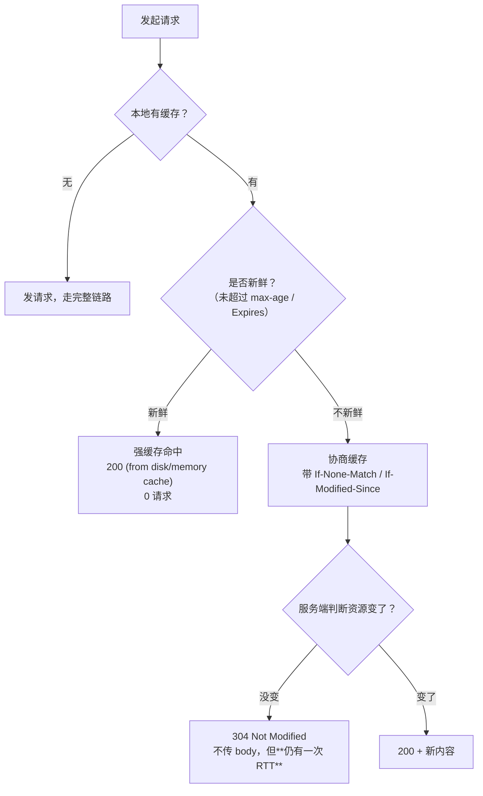

# 性能 · 02 加载与网络：缓存 / CDN / HTTP2 / 资源优先级

> 覆盖题号：**1、3**（题 1 的"加载优化 + 缓存"部分，题 3 的"网络 + 缓存"两个维度）
> 对应原题：《前端性能优化有哪些方式》《从网络、渲染、缓存三方面讲优化》
> 这一册讲**"资源从服务器到浏览器"这段路怎么走得更快**。渲染部分见 04，首屏整体打法见 03。

---

## 目录

- [1. 一次请求的时间都花在哪（先建立成本模型）](#1-一次请求的时间都花在哪先建立成本模型)
- [2. DNS 与连接：把 RTT 砍掉](#2-dns-与连接把-rtt-砍掉)
- [3. HTTP 版本演进：从队头阻塞到多路复用](#3-http-版本演进从队头阻塞到多路复用)
- [4. 传输压缩：gzip / brotli](#4-传输压缩gzip--brotli)
- [5. HTTP 缓存（重中之重）](#5-http-缓存重中之重)
- [6. Service Worker 缓存](#6-service-worker-缓存)
- [7. 资源优先级：preload / prefetch / preconnect](#7-资源优先级preload--prefetch--preconnect)
- [8. CDN 怎么用才有效](#8-cdn-怎么用才有效)
- [9. "减少请求数"在 HTTP/2 时代还成立吗](#9-减少请求数在-http2-时代还成立吗)
- [10. 常见坑](#10-常见坑)
- [11. 答题模板（题 1 / 题 3）](#11-答题模板题-1--题-3)
- [12. 追问表](#12-追问表)
- [13. 速记卡](#13-速记卡)

---

## 1. 一次请求的时间都花在哪（先建立成本模型）

面试时如果你想显得"真的懂"，别一上来报手段，先给一个**成本模型**——所有手段都是在砍下面这几项中的某一项。

```
t_total = DNS + TCP握手 + TLS握手 + 请求发送 + 服务端处理 + 响应传输 + 浏览器解析
          ↑1RTT   ↑1RTT      ↑1~2RTT      ~0         ↑可变         ↑可变        ↑可变
```

| 环节 | 典型耗时（4G，无缓存） | 砍它的手段 |
|---|---|---|
| DNS 解析 | 20 ~ 120ms | `dns-prefetch`、HTTPDNS、减少域名数量 |
| TCP 握手 | 1 RTT（约 50ms） | `preconnect`、连接复用（keep-alive）、HTTP/3（0-RTT） |
| TLS 握手 | 1~2 RTT | TLS 1.3（1-RTT，会话恢复 0-RTT）、OCSP Stapling、`preconnect` |
| 请求/响应传输 | 取决于体积与带宽 | 压缩、CDN 就近、HTTP/2 多路复用 |
| 服务端处理 | 10ms ~ 数秒 | 缓存、索引、SSR 流式、边缘计算 |

> **关键认知**：一个"新域名"上的资源，第一次请求要额外付 **DNS + TCP + TLS ≈ 2~4 个 RTT**，在 4G 上就是 **200~400ms**。这就是为什么"减少域名数量"和"`preconnect`"能带来肉眼可见的提升——**不是传得快了，是建连快了**。

---

## 2. DNS 与连接：把 RTT 砍掉

### 2.1 四个"预"指令的区别（必考细节）

| 指令 | 做什么 | 省下什么 | 使用场景 |
|---|---|---|---|
| `dns-prefetch` | 只做 DNS 解析 | 一次 DNS（20~120ms） | 即将访问的第三方域名（如 CDN、API） |
| `preconnect` | DNS + TCP + TLS | 2~4 个 RTT | 一定会用到、且跨域的**关键**资源源站（如字体、API） |
| `preload` | 提前**下载**指定资源（高优先级） | 发现延迟 | 首屏关键资源：LCP 图、字体、关键 CSS/JS |
| `prefetch` | 空闲时**低优先级下载**，供**下一个页面**用 | 下次导航的加载时间 | 用户大概率会去的下一页、下一个路由 chunk |

```html
<!-- 典型组合：首屏要用的 CDN 与 API -->
<link rel="dns-prefetch" href="https://cdn.example.com">
<link rel="preconnect" href="https://cdn.example.com" crossorigin>
<link rel="preconnect" href="https://api.example.com" crossorigin>

<!-- 首屏 LCP 图 -->
<link rel="preload" as="image" href="/hero.webp" fetchpriority="high"
      imagesrcset="/hero-640.webp 640w, /hero-1280.webp 1280w"
      imagesizes="100vw">

<!-- 字体：必须带 crossorigin，否则会重复下载一份 -->
<link rel="preload" as="font" href="/font.woff2" type="font/woff2" crossorigin>

<!-- 关键脚本模块 -->
<link rel="modulepreload" href="/src/main.js">
```

### 2.2 三个高频陷阱

| 陷阱 | 说明 |
|---|---|
| **`preload` 字体不加 `crossorigin`** | 字体的 CORS 模式与其他资源不同。不加会**下载两份**，反而更慢。这是最经典的坑 |
| **`preload` 了但没在 3s 内用到** | Chrome 会警告 "resource was preloaded but not used"，且它占着高优先级带宽，会**拖慢真正关键的资源** |
| **`preconnect` 开太多** | 每个 `preconnect` 都占用 socket 和 CPU，Chrome 建议**不超过 4 个**；开 10 个等于没优化 |

### 2.3 DNS 优化的进阶手段

| 手段 | 说明 |
|---|---|
| **HTTPDNS** | 用 HTTP 接口查 IP，绕开 LocalDNS 劫持和解析慢（移动端常用） |
| **减少域名** | 每个新域名都要 DNS；HTTP/2 多路复用后"域名分片"收益消失 |
| **DNS 缓存 TTL 调优** | TTL 太短解析频繁，太长切流不及时 |
| **`rel="dns-prefetch"` 放 `<head>` 最前** | 越早越好，解析是并行的 |

### 2.4 TLS 优化

| 手段 | 收益 |
|---|---|
| **TLS 1.3** | 握手从 2-RTT 降到 1-RTT，支持 0-RTT 会话恢复 |
| **OCSP Stapling** | 服务器代为获取证书吊销状态，省一次客户端请求 |
| **会话复用（Session Ticket）** | 二次连接 0-RTT |
| **证书链精简** | 证书链过长会增加握手包体积 |
| **HTTP/3（QUIC）** | 把 TCP + TLS 合并，首次 1-RTT，恢复 0-RTT |

---

## 3. HTTP 版本演进：从队头阻塞到多路复用

### 3.1 一张表说清

| | HTTP/1.0 | HTTP/1.1 | HTTP/2 | HTTP/3 |
|---|---|---|---|---|
| 连接 | 每请求一个连接 | keep-alive 复用 | 单连接多路复用 | 基于 UDP（QUIC） |
| 并发 | 无 | 浏览器限 6 个/域名 | 一个连接上百个流 | 同 HTTP/2，无 TCP 层阻塞 |
| 队头阻塞 | 有 | **有**（同域 6 并发排队） | **应用层无**，但 TCP 层仍有 | **无** |
| 头部 | 文本，重复传 | 文本，重复传 | **HPACK 压缩** | QPACK |
| 服务器推送 | 无 | 无 | 有（Chrome 106 已移除） | 已移除 |
| 典型优化 | 合并请求 | 雪碧图/域名分片 | 拆细粒度、去雪碧图 | 同 HTTP/2 |

### 3.2 为什么 HTTP/1.1 时代要"合并请求、域名分片"

HTTP/1.1 有两个限制：

1. **一个连接同一时刻只能处理一个请求**（响应必须按序返回）
2. **浏览器对同一域名最多 6 个并发连接**（Chrome）

所以老优化手段全是为了绕开这两条：

- 雪碧图 / CSS 合并 / JS 合并 → 减少请求数
- 域名分片（`static1.xx.com`、`static2.xx.com`）→ 突破 6 并发
- 内联小图（base64）→ 省一个请求

### 3.3 为什么 HTTP/2 之后这些手段反而有害

| 老手段 | HTTP/2 下为什么变差 |
|---|---|
| 雪碧图 | 一张图变了整张缓存失效；无法按需加载；单张图更大 |
| 大合并 bundle | 一个字节变了整个文件 hash 变，缓存全失效；首屏加载了用不到的代码 |
| 域名分片 | **反向优化**：每个域名要重新建连、失去单连接多路复用优势 |
| 大量内联 base64 | 增大 HTML、无法单独缓存、阻塞首屏 |

**HTTP/2 时代的正确姿势**：**细粒度拆分 + 强缓存 + 按路由加载**。

### 3.4 HTTP/2 的遗留问题 → HTTP/3

HTTP/2 解决了**应用层**队头阻塞，但 TCP 层还在：一个 TCP 包丢了，这个连接上**所有流**都要等重传。QUIC 把流放在 UDP 之上，丢包只影响那一个流。

> 面试加分点：说"HTTP/2 的多路复用是**逻辑上**的复用，物理上还共享一条 TCP 管道，所以弱网丢包时仍然会互相拖累，这也是 HTTP/3 出现的动机"。

---

## 4. 传输压缩：gzip / brotli

### 4.1 选谁

| 算法 | 压缩率（相对原始） | 压缩耗时 | 支持度 | 建议 |
|---|---|---|---|---|
| gzip | 约 30%（文本） | 低 | 全平台 | 兜底必备 |
| **brotli（br）** | 约 **20%**（比 gzip 再小 15~25%） | level 11 很慢，level 5 尚可 | 所有现代浏览器（仅 HTTPS） | **首选** |
| zstd | 约 22% | 快 | 新，浏览器支持尚不完整 | 关注中 |

**实践策略：**

```
静态资源（构建时预压缩）：brotli level 11 + gzip，两者都产出，服务端按 Accept-Encoding 返回
动态内容（实时压缩）：brotli level 5 或 gzip level 6（level 太高会拖慢 TTFB）
```

```nginx
# nginx 配置示例
gzip on;
gzip_comp_level 6;
gzip_min_length 1024;            # 小于 1KB 压缩收益为负（gzip 头本身 18 字节 + CPU）
gzip_types text/plain text/css application/json application/javascript
           application/xml image/svg+xml;

# brotli 需要 ngx_brotli 模块
brotli on;
brotli_comp_level 6;
brotli_static on;                # 优先用构建时生成的 .br 文件（level 11 预压）
brotli_types text/css application/javascript application/json image/svg+xml;
```

### 4.2 不要压缩的

| 类型 | 原因 |
|---|---|
| 图片（jpg/png/webp/avif） | 已压缩，再压可能变大 |
| 视频/音频 | 同上 |
| 字体（woff2） | 已内含压缩（Brotli） |
| 小于 1KB 的文件 | 压缩头开销 > 收益 |

### 4.3 一个容易被忽略的点

**压缩能极大改善 TTFB 之后的传输时间，但对 TTFB 本身没帮助**。如果 TTFB 已经 1.5s，先查服务端，别折腾压缩。

---

## 5. HTTP 缓存（重中之重）

> 这是性能题里**最能拉开差距**的一块。90% 的人只会说"强缓存 Cache-Control，协商缓存 ETag"，说不出 `no-cache` 和 `no-store` 的区别、`immutable` 解决什么、`index.html` 为什么不能强缓存。

### 5.1 两类缓存的判定顺序



**关键数字**：强缓存命中 = **0 请求**；协商缓存命中 = **1 次 RTT（约 50~200ms）+ 服务端处理**。所以"能强缓存就别只做协商缓存"。

### 5.2 强缓存相关头

| 响应头 | 说明 |
|---|---|
| `Cache-Control: max-age=31536000` | 相对时间（秒），**优先级高于 Expires** |
| `Cache-Control: public` | 允许 CDN/代理缓存 |
| `Cache-Control: private` | 只允许浏览器缓存（含用户私有数据时必须加） |
| `Cache-Control: immutable` | **在 max-age 内，即使用户刷新也不回源验证**（见 5.4） |
| `Expires: Wed, 21 Oct 2026 07:28:00 GMT` | 绝对时间，依赖客户端时钟，已被 Cache-Control 取代 |

### 5.3 协商缓存相关头

| 响应头 | 请求头 | 特点 |
|---|---|---|
| `ETag: "abc123"` | `If-None-Match: "abc123"` | **内容指纹**，精确；强 ETag 逐字节，弱 ETag（`W/"..."`）语义等价即可 |
| `Last-Modified: <时间>` | `If-Modified-Since: <时间>` | 秒级精度；**1 秒内多次修改无法识别**；文件内容没变但 mtime 变了也会误判 |

> **优先级**：`ETag` > `Last-Modified`。两者同时存在时，浏览器发 `If-None-Match`，服务端以 ETag 为准。

### 5.4 五个必须能说清的细节

**(1) `no-cache` vs `no-store`（最高频的坑）**

| 指令 | 含义 | 是否存缓存 | 是否回源验证 |
|---|---|---|---|
| `no-cache` | **可以存，但每次使用前必须向服务端验证** | ✅ 存 | ✅ 每次都验 |
| `no-store` | **完全不许存**（含请求和响应） | ❌ 不存 | 每次都完整请求 |

> 记法：`no-cache` 是"**c**ache but revalidate"（缓存但不直接用），`no-store` 是"**s**top storing"。名字反直觉，**这是面试官最爱挖的点**。

**(2) `immutable` 解决什么问题**

正常情况：用户**刷新页面**时，浏览器会对所有资源发**协商请求**（即使 max-age 还没过）——这是浏览器的保守行为。

对于带 hash 的静态资源（`app.a1b2c3.js`），内容永不变，这个验证纯属浪费。

```http
Cache-Control: public, max-age=31536000, immutable
```

加上 `immutable` 后，**刷新也不会发验证请求**，直接命中本地缓存。

**(3) `index.html` 绝对不能强缓存**

```
index.html          → Cache-Control: no-cache（必须每次验证）
app.[hash].js       → Cache-Control: public, max-age=31536000, immutable
```

原因：`index.html` 是"资源清单"，它引用了带新 hash 的 JS。如果 `index.html` 被强缓存，用户会一直用旧 HTML → 加载旧 JS → **永远看不到新版本**。这就是"发版后让用户刷新一下"的经典事故。

**(4) `stale-while-revalidate`：先给旧的，后台更新**

```http
Cache-Control: max-age=60, stale-while-revalidate=600
```

含义：60s 内直接用；60s~660s 之间**先用过期内容**（0 等待），同时后台发请求更新；超过 660s 才同步等待。

适合"允许短暂不一致"的场景（商品列表、资讯流），能显著降低用户感知延迟。

**(5) `Vary` 头与 CDN 缓存污染**

```http
Vary: Accept-Encoding
```

如果忘了写 `Vary`，CDN 可能把 gzip 版本返回给不支持 gzip 的客户端。同理，如果接口按 `Accept-Language` 返回不同语言，必须 `Vary: Accept-Language`，否则 CDN 会串语言。

### 5.5 一套可以直接抄的缓存策略

| 资源 | Cache-Control | 理由 |
|---|---|---|
| `index.html` | `no-cache` | 必须每次验证，保证拿到新资源清单 |
| `*.{hash}.js/css` | `public, max-age=31536000, immutable` | hash 变则 URL 变，永不过期 |
| 图片/字体（带 hash） | `public, max-age=31536000, immutable` | 同上 |
| 图片（固定 URL，如用户头像） | `public, max-age=86400, stale-while-revalidate=604800` | 允许短期不一致 |
| API GET（公开数据） | `private, max-age=60, stale-while-revalidate=300` | 短缓存 + 后台刷新 |
| API（用户私有） | `private, no-cache` | 必须验证，且不能进 CDN |
| 敏感数据 | `no-store` | 完全不存 |

### 5.6 常见坑

| 坑 | 后果 | 修复 |
|---|---|---|
| `index.html` 强缓存 | 发版后用户白屏/用旧版 | `no-cache` |
| 静态资源用固定文件名 + 长缓存 | 改了内容用户看不到 | 文件名带 contenthash |
| `no-cache` 当成"不缓存" | 以为省了带宽，其实每次还发请求 | 想彻底不存用 `no-store` |
| 用户私有接口 `public` | CDN 把 A 用户数据给 B 用户（**严重安全事故**） | `private` |
| 漏配 `Vary` | 编码/语言串版本 | 按实际协商维度配 |
| 强缓存时间太短（如 5 分钟） | 频繁回源，CDN 命中率低 | 静态资源按"永不过期"设计 |

---

## 6. Service Worker 缓存

### 6.1 定位

Service Worker 是**浏览器与网络之间的可编程代理**。它能在**离线、弱网、重复访问**场景下接管请求，实现比 HTTP 缓存更灵活的策略（HTTP 缓存只能表达"多久算新鲜"，表达不了"先给旧的再更新"这类逻辑）。

### 6.2 五种经典策略

| 策略 | 流程 | 适合 |
|---|---|---|
| **Cache First** | 缓存有就用，没有才请求 | 不变的静态资源（hash 化的 JS/CSS/图片） |
| **Network First** | 先请求，失败回落缓存 | 接口数据、需要最新的内容 |
| **Stale-While-Revalidate** | 立即返回缓存 + 后台请求更新 | 头像、列表、非关键接口（体验最好） |
| **Network Only** | 只走网络 | 支付、鉴权等绝不能缓存的 |
| **Cache Only** | 只走缓存 | 预缓存的应用外壳 |

```js
// 一个最小可用的 SW：预缓存外壳 + 静态资源 Cache First + 导航 Network First
const CACHE = 'v1'
const PRECACHE = ['/', '/index.html', '/app.js', '/app.css']

self.addEventListener('install', (e) => {
  e.waitUntil(caches.open(CACHE).then((c) => c.addAll(PRECACHE)))
  self.skipWaiting()   // 新 SW 立即接管
})

self.addEventListener('activate', (e) => {
  // 清理旧版本缓存
  e.waitUntil(
    caches.keys().then((keys) =>
      Promise.all(keys.filter((k) => k !== CACHE).map((k) => caches.delete(k)))
    ).then(() => self.clients.claim())
  )
})

self.addEventListener('fetch', (e) => {
  const { request } = e
  if (request.mode === 'navigate') {
    // 导航请求：Network First，离线回落缓存
    e.respondWith(
      fetch(request)
        .then((res) => {
          const copy = res.clone()
          caches.open(CACHE).then((c) => c.put('/index.html', copy))
          return res
        })
        .catch(() => caches.match('/index.html'))
    )
    return
  }

  // 静态资源：Cache First
  e.respondWith(
    caches.match(request).then((hit) => hit || fetch(request).then((res) => {
      const copy = res.clone()
      caches.open(CACHE).then((c) => c.put(request, copy))
      return res
    }))
  )
})
```

### 6.3 三个必须知道的坑

| 坑 | 说明 |
|---|---|
| **SW 更新有延迟** | 浏览器默认等所有旧页面关闭才激活新 SW；用了 `skipWaiting()` + `clients.claim()` 才能立即生效，但可能造成"页面 JS 与 SW 版本不一致"，要配合提示用户刷新 |
| **缓存无限增长** | 必须写清理逻辑（`activate` 里删旧 cache），否则占满磁盘被浏览器清掉 |
| **首次访问不生效** | SW 在首次注册后的**下一次**访问才接管（除非 `clients.claim()`）。所以它优化的是"二次访问"，不是首屏 |

### 6.4 PWA / Workbox

生产环境一般不用手写 SW，用 Workbox：

```js
// workbox-build 注入预缓存清单，自动处理版本与清理
import { precacheAndRoute } from 'workbox-precaching'
import { registerRoute } from 'workbox-routing'
import { CacheFirst, StaleWhileRevalidate } from 'workbox-strategies'
import { ExpirationPlugin } from 'workbox-expiration'

precacheAndRoute(self.__WB_MANIFEST)

registerRoute(
  ({ request }) => request.destination === 'image',
  new CacheFirst({
    cacheName: 'images',
    plugins: [new ExpirationPlugin({ maxEntries: 100, maxAgeSeconds: 30 * 86400 })],
  })
)
```

---

## 7. 资源优先级：preload / prefetch / preconnect

已在 2.1 给过表格，这里补**浏览器自己的优先级规则**——这是很多人不知道的加分内容。

### 7.1 浏览器的默认优先级（Chrome）

| 资源 | 默认优先级 |
|---|---|
| HTML、CSS、字体 | Highest |
| 首屏 `` | High |
| 非首屏 ``（`loading="lazy"`） | Low |
| `defer` 脚本 | Low |
| `async` 脚本 | Low |
| `<script>` 同步 | High |
| XHR / fetch | High |
| `preload` | 按要求（可覆盖） |
| `prefetch` | Lowest |

### 7.2 用 `fetchpriority` 手动干预

```html
<!-- 首屏大图：提升到 High，让它和 CSS 抢带宽 -->


<!-- 轮播图后面几张：降级，别抢首屏带宽 -->


<!-- 脚本：降低优先级，别阻塞首屏 -->
<script src="/analytics.js" fetchpriority="low" defer></script>
```

> **一个真实的优化案例**：某页面 LCP 图是 `fetchpriority` 默认的 High，但页面上有 20 张商品小图也是 High，导致带宽被抢。给 20 张图设 `low` 后，LCP 图下载时间从 1.2s 降到 400ms，LCP 改善 800ms。**这说明"优先级"比"总量"有时更关键**。

### 7.3 103 Early Hints（进阶）

服务端在**还没算完 HTML** 时，先返回一个 `103` 状态码带上 `Link: rel=preload`，让浏览器提前开始下载关键资源。

```http
HTTP/1.1 103 Early Hints
Link: </app.css>; rel=preload; as=style
Link: </hero.webp>; rel=preload; as=image

HTTP/1.1 200 OK
Content-Type: text/html
...
```

**收益**：SSR 场景下能省掉"等 HTML 首字节"的那几百毫秒。Nginx / Cloudflare / Fastly 都已支持。

### 7.4 Speculation Rules（预渲染，新东西）

```html
<script type="speculationrules">
{
  "prerender": [{
    "where": { "href_matches": "/product/*" },
    "eagerness": "moderate"
  }]
}
</script>
```

浏览器会在空闲时**完整预渲染**目标页面（包括执行 JS）。用户点击时页面"瞬间"出现。

> 代价：消耗 CPU/内存/流量，需谨慎限定范围。这是当前替代已废弃的 `<link rel="prerender">` 的方案，提到算加分。

---

## 8. CDN 怎么用才有效

### 8.1 CDN 到底优化了什么

大部分人答"就近访问"，但没说清优化了哪一段：

| 环节 | CDN 的作用 |
|---|---|
| DNS | 智能解析到最近节点（可能需要 HTTPDNS 配合） |
| TCP/TLS | 与边缘节点建连，RTT 大幅降低（边缘节点离用户 < 50ms） |
| 传输 | 边缘命中缓存 → 0 回源，响应体直接就近返回 |
| 服务端 | 未命中时回源，但**边缘可以做压缩、图片处理、协议转换** |

**核心价值：把"用户到源站"的长链路，换成"用户到边缘"的短链路。** TTFB 从 300ms 降到 30ms 是常见效果。

### 8.2 命中率是唯一关键指标

```
CDN 命中率 < 90% 基本等于没上 CDN
```

**提高命中率的手段：**

| 手段 | 说明 |
|---|---|
| 静态资源 URL 稳定 | 别在 URL 上加随机 query（`?t=timestamp`），会导致每次都 miss。这是**最常见的命中率杀手** |
| 合理的 `Cache-Control` | 边缘节点按 `s-maxage` 或 `max-age` 缓存 |
| 忽略无关 query | CDN 配置"忽略指定参数"（如 `utm_*`） |
| 预热（Prefetch/Push） | 发版后主动把热点资源推到边缘 |
| 分层缓存 | L1（边缘）+ L2（区域），提高整体命中 |
| 动态加速 | 对 API 用"动态路由优化"（TCP 优化、长连接回源），而不是缓存 |

### 8.3 发版时的 CDN 陷阱

| 陷阱 | 后果 | 解法 |
|---|---|---|
| 只刷新 CDN 不刷 `index.html` | 用户拿到旧 HTML，引用旧 JS，白屏 | `index.html` 设 `no-cache`，让它天然回源 |
| 新旧资源不同步 | 旧 HTML + 已删除的旧 JS → 404 | **发版期间保留上一版本资源**（灰度/双版本共存） |
| 目录刷新太慢 | 用户短时间看到新旧混合 | 用 URL 刷新核心文件 + 预热新文件 |
| 图片 CDN 处理未开 | 传原图，浪费带宽 | 开启"按需缩放 + 格式转换"（`?w=400&fm=webp`） |

---

## 9. "减少请求数"在 HTTP/2 时代还成立吗

**结论：部分成立，但优先级大幅下降，且手段从"合并"改成"拆分"。**

| 老结论 | 现在怎么看 |
|---|---|
| 合并 CSS/JS 减少请求 | **半错**。过度合并导致缓存粒度变粗（改一行全失效）。应按"变更频率"分组，而不是全合成一个 |
| 雪碧图 | **基本废弃**（HTTP/2 下）。仅精灵动画或 HTTP/1.1 环境有意义 |
| base64 内联小图 | **谨慎**。小于 2KB 可内联，但会增大 HTML、无法单独缓存 |
| 域名分片 | **反向优化**，别做 |
| 图标用 iconfont | 仍有价值（一个字体文件替代几十个图），但 SVG symbol sprite 更灵活 |
| 减少第三方脚本数量 | **依然极其重要**。第三方脚本是主线程杀手，与 HTTP 版本无关 |

> 面试时的漂亮回答："HTTP/2 让'请求数量'不再是瓶颈，但'请求的**总字节**'和'**主线程执行成本**'依然是瓶颈。所以优化重点从'合并'转向'按需加载 + 缓存粒度 + 减少执行成本'。"

---

## 10. 常见坑

| # | 坑 | 纠正 |
|---|---|---|
| 1 | `no-cache` 当成"不缓存" | 它是"缓存但每次验证"；彻底不存是 `no-store` |
| 2 | `index.html` 强缓存 | 必然导致发版不生效，必须 `no-cache` |
| 3 | 字体 `preload` 不加 `crossorigin` | 会下载两份，比不 preload 更慢 |
| 4 | `preconnect` 开一堆 | 建议 ≤ 4 个，多了抢占资源 |
| 5 | `preload` 了不用 | 占用高优先级带宽，拖慢关键资源 |
| 6 | CDN 上带随机 query | 命中率归零 |
| 7 | 用户私有接口用 `public` | 数据串号，安全事故 |
| 8 | HTTP/2 下还做域名分片 | 反向优化 |
| 9 | 压缩所有类型 | 图片/字体已压缩，再压可能变大 |
| 10 | `gzip_min_length` 没设 | 压缩几十字节的文件纯浪费 CPU |
| 11 | 只刷 CDN 不处理 `index.html` | 用户卡在旧版本 |
| 12 | 认为 SW 能优化首屏 | SW 首次注册后第二次访问才生效 |

---

## 11. 答题模板（题 1 / 题 3）

### 11.1 题 1「优化有哪些方式」——30 秒

> "我习惯按六层拆：网络层做 DNS 预解析、预连接、HTTP/2；加载层做压缩、代码分割、CDN、缓存；解析层做关键 CSS 内联、脚本 defer/async；渲染层做减少重排重绘、虚拟列表；运行时层拆长任务、用 Worker、控制响应式开销；工程层做性能预算和监控。面试常问的那几个手段（压缩、懒加载、CDN、缓存）都在前两层。"

### 11.2 题 1「优化有哪些方式」——2 分钟

> "我不会按清单背，而是按资源从服务器到屏幕的路径来分。
>
> **第一段是建连**：DNS 要 20 到 120 毫秒，TCP 加 TLS 要两到四个 RTT，所以关键第三方域名我会加 `dns-prefetch` 和 `preconnect`，但控制在 4 个以内。协议上尽量用 HTTP/2 或 HTTP/3，单连接多路复用，省掉并发排队的开销。
>
> **第二段是传输**：文本资源开 brotli，静态资源构建时预压缩到 level 11，动态内容用 level 5 避免拖慢 TTFB。资源走 CDN，关键是把命中率做到 90% 以上——很多项目上了 CDN 但 URL 带时间戳，等于没上。
>
> **第三段是缓存**，这是收益最大的一块。带 hash 的静态资源用 `max-age=31536000, immutable`，真正做到零请求；`index.html` 必须 `no-cache`，否则发版不生效。再往上一层是 Service Worker，可以实现"先给缓存再后台更新"这种 HTTP 缓存表达不了的策略。
>
> **第四段是加载量**，按路由做代码分割、tree-shaking、第三方脚本延后。
>
> 后面就是解析和渲染了，关键 CSS 内联、脚本 defer、减少重排重绘、长列表虚拟化。最后是工程上加性能预算和 RUM 监控，防止回退。"

### 11.3 题 3「从网络、渲染、缓存三方面讲」——30 秒

> "**网络**：DNS 预解析、preconnect、HTTP/2 多路复用、CDN 就近、brotli 压缩、按路由拆包减少首屏字节。**渲染**：减少重排重绘、用 transform/opacity 走合成层、长列表虚拟滚动、requestAnimationFrame、图片预留尺寸防 CLS。**缓存**：强缓存用 `Cache-Control: max-age + immutable`，协商缓存用 ETag，Service Worker 做离线与 SWR 策略，再加 CDN 边缘缓存。"

### 11.4 题 3——2 分钟（结构同上，每块深入一层）

> 开场："我按您说的三个方面讲，每个方面给两个最有代表性的手段，并说明它主要改善哪个指标。"
>
> **网络**：先讲成本模型（DNS/TCP/TLS 各占几个 RTT），再讲 `preconnect` 和 HTTP/2。重点说清"HTTP/2 之后域名分片是反向优化"。
>
> **渲染**：先讲渲染流水线（Layout → Paint → Composite），再讲"为什么 transform/opacity 便宜"（只走合成），最后讲虚拟列表和强制同步布局的避免。挂指标：这一段主要改善 INP 和 CLS。
>
> **缓存**：强缓存零请求 vs 协商缓存一次 RTT 的差别；`no-cache` 与 `no-store` 的区别；`immutable` 解决刷新验证；`index.html` 不能强缓存。挂指标：这一段主要改善二次访问的 LCP 和整体带宽成本。

---

## 12. 追问表

| # | 追问 | 要点 |
|---|---|---|
| 1 | `no-cache` 和 `no-store` 区别？ | 前者缓存但每次验证，后者完全不存 |
| 2 | 强缓存和协商缓存谁优先？ | 先判强缓存是否新鲜，不新鲜才走协商 |
| 3 | 304 有开销吗？ | 有，一次 RTT + 服务端判断；所以能强缓存就别只做协商 |
| 4 | ETag 和 Last-Modified 区别？ | ETag 是内容指纹精确；Last-Modified 秒级精度，1 秒内多次改识别不了 |
| 5 | 为什么静态资源要带 hash？ | 内容变则 URL 变，可设永久缓存；否则只能短缓存 |
| 6 | `immutable` 解决什么？ | 刷新页面时的无谓协商请求 |
| 7 | `index.html` 为什么不能强缓存？ | 它是资源清单，缓存了就拿不到新 hash 的资源 |
| 8 | HTTP/2 解决了什么？ | 单连接多路复用、HPACK 头压缩、二进制分帧；但 TCP 层仍有队头阻塞 |
| 9 | HTTP/3 为什么用 UDP？ | 绕开 TCP 的队头阻塞，QUIC 在用户态实现可靠传输 + 0-RTT |
| 10 | 服务器推送为什么被废弃？ | 无法感知浏览器缓存、推送内容难精确、收益低于预期；Chrome 106 移除 |
| 11 | `preload` 和 `prefetch` 区别？ | preload 当前页高优先级；prefetch 下一页低优先级空闲下载 |
| 12 | `preconnect` 和 `dns-prefetch` 区别？ | 前者含 DNS+TCP+TLS，后者只 DNS；前者成本高，慎用数量 |
| 13 | 字体为什么要 `crossorigin`？ | 字体请求走 CORS 模式，不加会导致缓存未命中而重复下载 |
| 14 | CDN 命中率怎么提？ | 稳定 URL（去随机 query）、合理 Cache-Control、预热、忽略无关参数、分层缓存 |
| 15 | CDN 回源慢怎么办？ | 提高命中率、开分层缓存、动态加速、源站加缓存层 |
| 16 | brotli 为什么比 gzip 好？ | 内置静态字典（含常见 HTML/JS 片段）、上下文建模更强；代价是压缩更慢 |
| 17 | 为什么小文件不压缩？ | gzip 头约 18 字节 + CPU 成本 > 收益 |
| 18 | Service Worker 能优化首屏吗？ | 首次不能（注册后下次才接管），优化的是二次访问与弱网/离线 |
| 19 | `stale-while-revalidate` 有什么用？ | 先用过期内容保证 0 等待，后台更新，兼顾速度与新鲜度 |
| 20 | 103 状态码是什么？ | Early Hints，服务端在算 HTML 前先发 preload 提示，省首字节等待 |

---

## 13. 速记卡

```
【成本模型】
DNS(20~120ms) + TCP(1RTT) + TLS(1~2RTT) + 传输 + 服务端
新域名首次 ≈ 2~4 RTT ≈ 200~400ms  ← 这是"减少域名/预连接"的根因

【四个"预"】
dns-prefetch  只解析 DNS
preconnect    DNS+TCP+TLS，≤4 个
preload       当前页高优先级下载（字体必带 crossorigin！）
prefetch      下一页低优先级空闲下载

【缓存】
强缓存命中 0 请求 / 协商命中 1 RTT
no-cache  = 缓存但每次验证
no-store  = 完全不存
immutable = 刷新也不验证（配 hash 资源）
index.html → no-cache；hash 资源 → max-age=31536000, immutable
用户私有 → private；敏感 → no-store；别忘了 Vary

【HTTP】
1.1：6 并发 + 队头阻塞 → 合并/雪碧图/域名分片
2：多路复用 + HPACK，TCP 层仍阻塞 → 拆分取代合并，域名分片反而有害
3：QUIC over UDP，无 TCP 阻塞，0-RTT

【压缩】
br 比 gzip 再小 15~25%；静态 level 11 预压，动态 level 5；<1KB 不压；图片字体不压

【CDN】
核心价值 = 缩短 RTT（TTFB 300ms → 30ms）；唯一关键指标 = 命中率 > 90%
命中率杀手：URL 带随机 query
```
