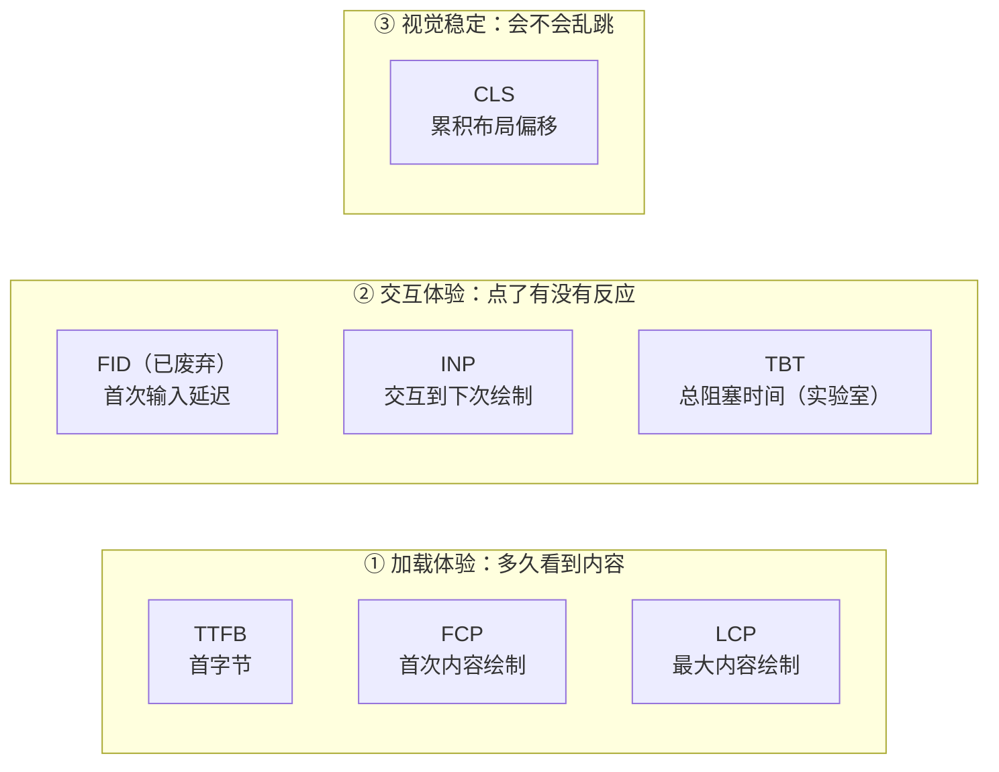
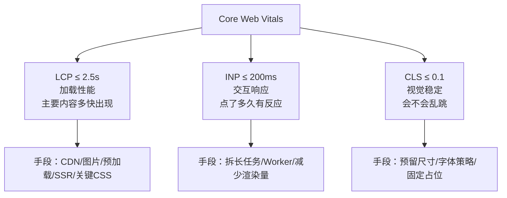
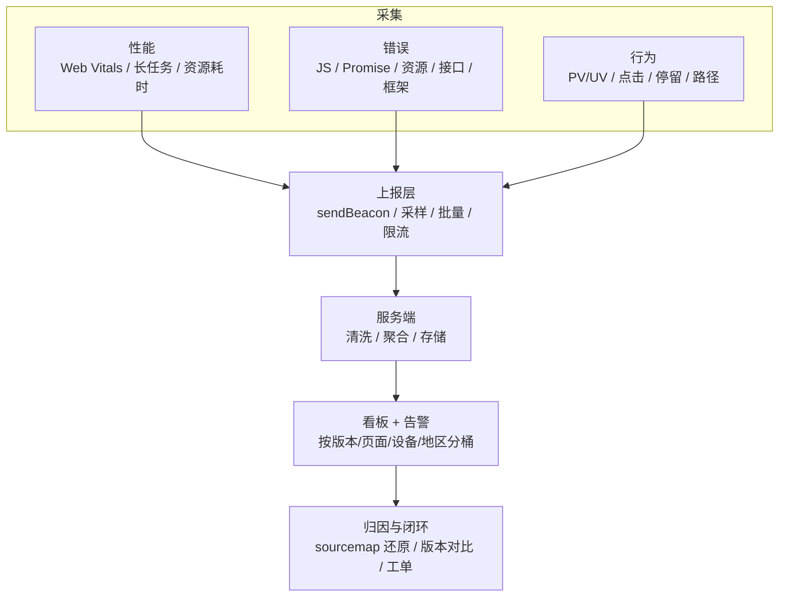

# 性能 · 01 指标体系与监控

> 覆盖题号：**6、14、24、4**
> 对应原题：《简述一下前端性能优化指标》《Web 性能指标有哪些》《什么是 Core Web Vitals》《前端监控方案》
> 这 4 题指向同一个问题：**优化到什么程度算好，线上怎么确认好不好。**

---

## 目录

- [1. 性能指标全景](#1-性能指标全景)
- [2. LCP 深度拆解（最该讲透的指标）](#2-lcp-深度拆解最该讲透的指标)
- [3. INP：FID 的替代者](#3-inpfid-的替代者)
- [4. CLS：布局稳定性](#4-cls布局稳定性)
- [5. Core Web Vitals 专题](#5-core-web-vitals-专题)
- [6. 其他指标：TTFB / FCP / TBT / TTI](#6-其他指标ttfb--fcp--tbt--tti)
- [7. 指标采集代码（能直接上生产）](#7-指标采集代码能直接上生产)
- [8. 前端监控方案](#8-前端监控方案)
- [9. 常见坑（本册汇总）](#9-常见坑本册汇总)
- [10. 答题模板](#10-答题模板)
- [11. 追问表（跨题汇总，20 条）](#11-追问表跨题汇总20-条)
- [12. 速记卡](#12-速记卡)

---

## 1. 性能指标全景

### 1.1 一句话结论

性能指标是三类用户感受的量化：**"多久看到东西"（加载）、"点了有没有反应"（交互）、"页面会不会乱跳"（稳定）**。Core Web Vitals 三类各取一个代表。

### 1.2 按"度量什么"分成三类



### 1.3 全指标速查表

| 指标 | 全称 | 度量什么 | 良好阈值 | 数据来源 | 现状 |
|---|---|---|---|---|---|
| **TTFB** | Time To First Byte | 请求发出到收到第一个字节（DNS + TCP + TLS + 服务端处理） | **≤ 800ms** | Lab + Field | 核心诊断指标 |
| **FCP** | First Contentful Paint | 首个文本/图片像素出现 | **≤ 1.8s** | Lab + Field | 常用 |
| **LCP** | Largest Contentful Paint | 视口内最大内容元素绘制完成 | **≤ 2.5s** | Lab + Field | **CWV 核心** |
| **INP** | Interaction to Next Paint | 交互到下一帧绘制的最长延迟（近似 98 分位） | **≤ 200ms** | Field | **CWV 核心（2024.3 取代 FID）** |
| **CLS** | Cumulative Layout Shift | 意外布局偏移累积 | **≤ 0.1** | Lab + Field | **CWV 核心** |
| ~~FID~~ | First Input Delay | 首次交互的输入延迟（不含处理与渲染） | ~~< 100ms~~ | Field | **已被 INP 取代（仍可采集）** |
| **TBT** | Total Blocking Time | FCP 到 TTI 之间所有长任务超出 50ms 部分之和 | **< 200ms** | 仅 Lab | INP 的实验室代理 |
| ~~TTI~~ | Time to Interactive | 首个可稳定响应交互的时间点 | < 3.8s | 仅 Lab | Lighthouse 10 已移除 |
| **SI** | Speed Index | 首屏内容填充速度（视觉进度） | < 3.4s | 仅 Lab | 辅助 |

> **记法**：`TTFB ≤ 800ms` → `FCP ≤ 1.8s` → `LCP ≤ 2.5s` 是时间轴上的递进：字节到了 → 有东西了 → 主要内容齐了。

### 1.4 一张时间轴串起来


### 1.5 常见坑

| 坑 | 说明 | 正确做法 |
|---|---|---|
| 还在说 FID | 2024 年 3 月已由 INP 取代 | 说"FID 是旧指标，只测首次输入且不含处理耗时，现已被 INP 取代" |
| 把 TTI 当重要指标 | Lighthouse 10 已移除 TTI | 用 TBT 替代 |
| 拿实验室 TBT 当线上指标 | TBT 必须靠长任务观测，线上可用 `longtask` + INP 组合 | 线上看 INP，实验室看 TBT |
| 只报平均值 | 掩盖长尾 | 报 p50/p75/p95，评分用 p75 |
| 混淆 FCP 和 LCP | FCP 是"第一个像素"，LCP 是"最大那块" | 两者相差很大说明"骨架出来了但主内容没出来" |

### 1.6 30 秒版

- 加载：TTFB 800ms → FCP 1.8s → LCP 2.5s，依次递进。
- 交互：FID 已被 INP 取代，阈值 200ms。
- 稳定：CLS 0.1。
- LCP / INP / CLS 即 Core Web Vitals；评分按 p75；实验室另看 TBT 与长任务。

### 1.7 2 分钟版

- 分三组：加载（TTFB / FCP / LCP）、交互（INP）、稳定（CLS）。
- 三组是递进关系：TTFB 超了，FCP、LCP 都会被拖后；FCP 与 LCP 差距大，说明主内容加载慢。
- FID 只测首次输入的排队延迟，不含处理与渲染；INP 覆盖全部交互，取接近 98 分位。
- CLS 只算非用户输入触发的偏移，按 5 秒会话窗口取最大值。
- 评分按 p75；TTI 已从 Lighthouse 10 移除，实验室诊断看 TBT 与长任务。

### 1.8 追问

| 追问 | 要点 |
|---|---|
| 为什么 TTI 被移除？ | 算法复杂（基于 5s 无长任务窗口）、不稳定、与 INP 语义重叠 |
| INP 和 FID 最本质的区别？ | FID 只测输入排队延迟（不含处理+渲染），只测首次；INP 测全生命周期所有交互的端到端延迟 |
| 为什么用 p75 不用平均？ | 平均值被快用户稀释；p75 意味着 75% 的访问是好的，Google 评分口径 |
| TBT 和 INP 的关系？ | TBT 是实验室里长任务的代理指标，与 INP 相关性高但不完全等价（INP 还含输入延迟和渲染） |
| 首屏时间怎么算？ | 没有标准定义。常用"视口内首屏内容全部渲染完"或自定义埋点（如某个标志元素可见），也可用 LCP 近似 |

---

## 2. LCP 深度拆解（最该讲透的指标）

LCP 拆成四段后，每一段都能对应到具体优化手段，形成"指标 → 归因 → 手段"的闭环。

### 2.1 LCP 元素是谁

浏览器只把这几种元素当 LCP 候选：

1. `` 元素（包括 `srcset` 当前选中的那张）
2. `<image>`（SVG 内的 image）
3. `<video>` 的 `poster` 图
4. 通过 `url()` 加载背景图的元素（**注意：`background-image` 用 CSS 渐变不算**）
5. **包含文本节点**的块级元素（`<p>`、`<h1>`、`<div>` 等）

> LCP 只考虑**首屏视口内**的元素；更大的元素出现会更新 LCP，直到用户首次按键/点击或页面隐藏。

### 2.2 四段拆解

| 阶段 | 定义 | 典型病因 | 对应手段 |
|---|---|---|---|
| **① TTFB** | 导航到首字节 | 服务端慢、CDN 未命中、重定向链、TLS 慢 | CDN 边缘缓存、减少重定向、服务端缓存/SSR 流式输出、HTTP/2 + TLS1.3、预连接 |
| **② 资源加载延迟** | TTFB 到资源开始请求 | **图片在 JS 里才被插入 DOM**（最典型）、`loading="lazy"` 用在首屏图、资源优先级低、CSS 阻塞导致发现晚 | 首屏图直接写在 HTML、`fetchpriority="high"`、`<link rel="preload">`、避免首屏图懒加载 |
| **③ 资源加载时长** | 请求发出到下载完 | 图片太大、带宽竞争、无 CDN | 压缩/转 WebP/AVIF、响应式尺寸、CDN、避免首屏加载大量其它资源抢带宽 |
| **④ 元素渲染延迟** | 下载完到绘制 | 主线程被 JS 长任务占用、字体阻塞、有 `@import` 深链、渲染阻塞 CSS | 拆长任务、`font-display: swap`、内联关键 CSS、减少同步脚本 |

### 2.3 一段能定位问题的代码

```js
// LCP 归因：navigation + resource timing 还原四段
new PerformanceObserver((list) => {
  const lcp = list.getEntries().at(-1)
  const nav = performance.getEntriesByType('navigation')[0]
  const res = lcp.url
    ? performance.getEntriesByType('resource').find((e) => e.name === lcp.url)
    : null

  const ttfb = nav?.responseStart ?? 0
  const requestStart = Math.max(ttfb, res ? res.requestStart || res.startTime : 0)
  const responseEnd = Math.max(requestStart, res ? res.responseEnd : 0)
  const renderTime = Math.max(responseEnd, lcp.startTime)

  console.log({
    element: lcp.element,
    ttfb,
    loadDelay: requestStart - ttfb,
    loadDuration: responseEnd - requestStart,
    renderDelay: renderTime - responseEnd,
  })
}, { type: 'largest-contentful-paint', buffered: true })
```

> 分段口径与 web-vitals LCP attribution 一致：`requestStart` 缺失时退回 `startTime`，各段做单调钳制。文本类 LCP 没有 `url`，后三段退化为 `renderTime - ttfb`；跨域图片缺少 Timing-Allow-Origin 时 `renderTime` 会被粗化。精确分段直接用 7.2 的 attribution 版本。

**判断口诀：**

- `资源加载延迟` 大 → **资源发现太晚**（没写在 HTML 里 / 被 JS 插入 / 优先级低）
- `资源加载时长` 大 → **资源太大或带宽不足**
- `元素渲染延迟` 大 → **主线程忙**（JS 长任务）或渲染被阻塞

### 2.4 常见坑

| 坑 | 后果 | 修复 |
|---|---|---|
| 首屏图加 `loading="lazy"` | 浏览器推迟到布局后才请求，LCP 明显变差 | 首屏图不要 lazy，加 `fetchpriority="high"` |
| 轮播图第一张是 `background-image` | 浏览器发现晚（CSSOM 解析后才知道） | 用 `` + `preload` |
| 用一个 2000px 大图在 375px 屏上显示 | 加载时长远超预期 | `srcset` + `sizes` |
| 首屏内容靠 JS 渲染 | 资源加载延迟会膨胀到"JS 下载+执行完" | SSR / 骨架屏 / 关键内容直出 |
| 字体用 `font-display: block` | 文本类 LCP 元素被延迟到字体加载完 | 用 `swap` + `size-adjust` 减少抖动 |

### 2.5 追问

| 追问 | 要点 |
|---|---|
| LCP 会一直更新吗？ | 会，直到用户首次按键/点击或页面隐藏；取最后一次 |
| 视频算 LCP 吗？ | 只看 `poster`，不把视频帧算进去 |
| CLS 和 LCP 冲突怎么办？ | 图片不写宽高比会撑开布局 → 既伤 CLS 也可能推迟 LCP；必须写 `width/height` 或 `aspect-ratio` |
| LCP 2.5s 是怎么定的？ | 基于用户感知研究定的良好线，评分时按站点 p75 统计 |

---

## 3. INP：FID 的替代者

### 3.1 一句话结论

**INP 度量用户每次交互从输入到下一帧绘制完成的耗时，取整个访问过程中接近最差的一次（约 98 分位）。**

### 3.2 为什么 FID 不够

FID 只测 **首次** 交互的 **输入延迟（input delay）**，即"事件从排队到开始执行"的时间。它有三处局限：

1. **只测第一次交互** —— 用户后面点了一百次，卡不卡它不管
2. **不含处理时间** —— 事件处理器跑了 800ms，FID 仍然很小
3. **不含渲染时间** —— 处理完了但画面到下一帧才更新，FID 看不到

```
FID 只量这一段：  |██|
                   输入延迟

INP 量完整三段：  |██████████████████████████|
                  输入延迟 + 处理时间 + 呈现延迟
```

### 3.3 INP 的三段

| 段 | 含义 | 变差的原因 |
|---|---|---|
| **输入延迟** | 交互到事件回调开始执行 | 主线程有长任务在跑（最大的元凶） |
| **处理时间** | 所有事件回调执行的总时长 | 回调里做了重活（大循环、同步计算、大组件重渲染） |
| **呈现延迟** | 回调结束到下一帧画出来 | 强制同步布局、大量 DOM 变更、React/Vue 大范围 diff |

### 3.4 阈值

按 p75 分档：**≤ 200ms 良好，200 ~ 500ms 需改进，> 500ms 差**（与 5.4 同一套口径）。

### 3.5 怎么优化 INP（四个方向）

| 方向 | 手段 |
|---|---|
| **减少长任务** | 拆任务（`setTimeout` / `scheduler.yield()` / `requestIdleCallback`）、时间切片、`isInputPending` |
| **把活挪走** | Web Worker 处理计算、OffscreenCanvas 绘图、服务端算 |
| **减少渲染量** | 虚拟列表、`v-memo`/`memo`、局部更新、避免整表重渲染 |
| **降低单次工作量** | 防抖（仅对搜索类输入）、避免在 input 事件里做重活、事件委托 |

```js
// 时间切片：把一个大循环拆成多个 <50ms 的小任务，让浏览器有机会响应输入
async function chunkedProcess(items, handle) {
  const CHUNK = 200
  for (let i = 0; i < items.length; i += CHUNK) {
    items.slice(i, i + CHUNK).forEach(handle)
    // 让出主线程，浏览器可以处理输入和渲染
    await (globalThis.scheduler?.yield?.() ?? new Promise((r) => setTimeout(r, 0)))
  }
}
```

> `scheduler.yield()` 会让出主线程，但优先恢复当前任务，语义优于 `setTimeout(0)`。

### 3.6 常见坑

| 坑 | 说明 |
|---|---|
| 认为 INP 只和 JS 有关 | 渲染延迟也算，DOM 太多、布局复杂同样会差 |
| 用防抖"优化 INP" | 防抖只是减少触发次数，单次仍然卡；关键是把单次做快 |
| 忽略"呈现延迟" | 回调只跑了 20ms，但改了 3000 个 DOM，渲染排了 300ms |

### 3.7 追问

| 追问 | 要点 |
|---|---|
| INP 为什么用高分位？ | 用户对"偶发卡顿"记忆深刻，最差体验决定感受；但完全取最大值噪声太大，故取约 98 分位 |
| 键盘输入算交互吗？ | 算。click / tap / keydown（部分）都计入；scroll 和 hover 不算 |
| 长任务一定是 INP 问题吗？ | 不一定。长任务恰好挡在交互前才是；但它是最常见的诱因 |
| 怎么在实验室测 INP？ | 不能直接测（依赖真实交互），用 TBT 代理；也可用 Performance 面板手动录制交互 |

---

## 4. CLS：布局稳定性

### 4.1 一句话结论

**CLS 衡量页面元素在非预期时发生位移的严重程度**，单次偏移得分为「影响比例 × 距离比例」，按 5 秒会话窗口取最大值。

### 4.2 计算方式

单个布局偏移的得分：

```
layout shift score = impact fraction × distance fraction
```

- **impact fraction（影响比例）**：受影响区域（元素移动前后的并集）占视口的比例
- **distance fraction（距离比例）**：元素移动的最大距离 / 视口最大边（高或宽取大）

**CLS 不是简单相加**：按"会话窗口"分组 —— 相邻偏移间隔 < 1s 且窗口总时长 < 5s 视为一个窗口，取**最大窗口的和**。

```js
// 手写 CLS 计算，理解口径
let cls = 0
let sessionEntries = []

new PerformanceObserver((list) => {
  for (const entry of list.getEntries()) {
    // 关键：只有"非用户输入触发"的偏移才算
    if (entry.hadRecentInput) continue

    const first = sessionEntries[0]
    const last = sessionEntries[sessionEntries.length - 1]
    // 与上一次偏移间隔 ≥ 1s，或窗口总长 ≥ 5s，就开新窗口
    if (
      !first ||
      entry.startTime - last.startTime >= 1000 ||
      entry.startTime - first.startTime >= 5000
    ) {
      sessionEntries = [entry]
    } else {
      sessionEntries.push(entry)
    }
    cls = Math.max(cls, sessionEntries.reduce((sum, e) => sum + e.value, 0))
  }
}, { type: 'layout-shift', buffered: true })
```

> `hadRecentInput === true` 的偏移不计入 CLS：用户点击后 500ms 内引起的位移属于预期行为。

### 4.3 五大成因与修法

| 成因 | 表现 | 修法 |
|---|---|---|
| **图片/视频没写尺寸** | 加载完把下面内容顶下去 | `width` + `height` 属性，或 `aspect-ratio` |
| **广告/嵌入内容** | iframe 撑开 | 预留固定尺寸容器 |
| **动态插入内容** | 通知条、cookie 横幅从顶部插入 | 用 `position: fixed` 覆盖，或预留占位 |
| **字体切换（FOIT/FOUT）** | 字体加载后文字重排 | `font-display: optional` / `swap` + `size-adjust` / 预加载字体 |
| **异步渲染的组件** | 骨架屏和真实内容高度不一致 | 骨架屏高度对齐真实内容 |

### 4.4 常见坑

| 坑 | 说明 |
|---|---|
| 只写 CSS 宽高不写 HTML 属性 | HTML `width/height` 属性才能让浏览器在**解析阶段**就预留空间，CSS 要等 CSSOM 解析完 |
| 用 `top`/`left` 做位移动画 | 改变布局位置，会计入 CLS；改用 `transform` / `opacity` 合成动画 |
| 忽略字体导致的 CLS | 中文字体文件大，`swap` 后字体到达必然重排；用 `size-adjust` + 系统字体度量匹配 |
| 认为 CLS 只在首屏 | 滚动触发的偏移也算，懒加载图片没预留高度是常见来源 |

### 4.5 追问

| 追问 | 要点 |
|---|---|
| 为什么用会话窗口而不是总和？ | 避免"页面开很久、零散偏移累积"把分数堆爆；5 秒窗口更贴近"一次交互体验" |
| 用户点击导致的偏移算吗？ | 不算（`hadRecentInput`）。输入后 500ms 内的偏移被标记；超过 500ms 才出现的插入内容仍然计入 |
| `transform: translateY` 会算 CLS 吗？ | 不算。`transform` / `opacity` 是合成动画，不触发 layout 也不产生布局偏移；`top` / `left` 动画才会 |
| CLS 能到 0 吗？ | 很难，SSR/字体/图片都可能带小幅偏移；< 0.1 就算良好 |

---

## 5. Core Web Vitals 专题

### 5.1 一句话结论

**Core Web Vitals 是三项核心体验指标：LCP（加载）、INP（交互）、CLS（稳定），同时是 Google 搜索排名的一个轻量信号。**

### 5.2 三根支柱



### 5.3 演进历史

| 时间 | 变化 |
|---|---|
| 2020.5 | 提出 Core Web Vitals：LCP、FID、CLS |
| 2021.6 | 纳入 Google 搜索排名信号（Page Experience） |
| 2021 | CLS 引入 session window 计算口径 |
| **2024.3** | **FID 退役，INP 成为核心指标** |

### 5.4 评分口径

- **按 p75 分档**，不是平均：

| | 良好（Good） | 需改进 | 差（Poor） |
|---|---|---|---|
| LCP | ≤ 2.5s | 2.5 ~ 4s | > 4s |
| INP | ≤ 200ms | 200 ~ 500ms | > 500ms |
| CLS | ≤ 0.1 | 0.1 ~ 0.25 | > 0.25 |

- 三项**全部**达到"良好"，页面才算"通过 CWV"
- 数据来源：Chrome UX Report（CrUX，真实 Chrome 用户 28 天滚动数据）
- 阈值与 `web-vitals` 的 `LCPThresholds`（2500/4000）、`INPThresholds`（200/500）、`CLSThresholds`（0.1/0.25）一致

### 5.5 常见坑

| 坑 | 说明 |
|---|---|
| 说"CWV 直接影响排名" | 它是**轻微的**排名信号（tie-breaker 级别），内容相关性权重远高于它 |
| 说 CWV 有 6 项 | 只有 3 项。FCP/TTFB/TBT 是诊断指标，不是 CWV |
| 用 Lighthouse 分数当 CWV | Lighthouse 是实验室模拟，CWV 官方口径是现场数据 p75 |
| 认为 CWV 好就等于体验好 | 它不覆盖可访问性、动画流畅度、内存占用 |

### 5.6 30 秒版

- CWV = LCP（加载）、INP（交互）、CLS（稳定），三类各取一个代表。
- 评分按 p75 分三档，三项全部良好才算通过（阈值见 5.4）。
- INP 于 2024.3 取代 FID；FCP / TTFB / TBT 是诊断指标，不属于 CWV。
- 它是 Page Experience 的轻量排名信号，不是决定性因素。

### 5.7 追问

| 追问 | 要点 |
|---|---|
| CWV 影响 SEO 吗？ | 是 Page Experience 的一部分，权重较轻；内容质量仍是主导 |
| 怎么查自己站的 CWV？ | PageSpeed Insights（含 CrUX 现场数据）、Search Console 的 Core Web Vitals 报告、自建 RUM |
| 三项冲突时优先哪个？ | 通常 LCP 优先（影响最大、最容易被感知）；但电商类 INP 权重也高 |
| CrUX 数据里没有目标站点怎么办？ | 流量不足时无数据；用自建 RUM 采样替代 |

---

## 6. 其他指标：TTFB / FCP / TBT / TTI

| 指标 | 精确定义 | 怎么优化 |
|---|---|---|
| **TTFB** | `responseStart - startTime`，含 DNS、TCP、TLS、请求排队、服务端处理、首字节传输 | CDN 边缘缓存、减少重定向（每个 301 加一次 RTT）、服务端缓存/数据库索引、HTTP/2+、TLS1.3、`preconnect` |
| **FCP** | 首个文本或图片像素绘制 | 内联关键 CSS、减少阻塞脚本、`font-display`、避免 JS 渲染首屏 |
| **TBT** | FCP 到 TTI 之间，所有长任务（>50ms）超出 50ms 部分之和 | 拆长任务、代码分割、延后非关键 JS、Worker |
| **TTI** | 在 FCP 与 DOMContentLoaded 之后，找到连续 5s 无长任务、并行 GET 请求 ≤ 2 的静默窗口，取窗口起点 | Lighthouse 10 已移除，用 TBT 代替 |
| **长任务** | 主线程连续执行 > 50ms 的任务 | 切片、Worker、`requestIdleCallback` |

> TTFB 高但服务端日志显示处理只要 20ms 时，问题通常在 CDN 回源、TLS 握手或重定向链。

---

## 7. 指标采集代码（能直接上生产）

### 7.1 基础版：web-vitals 库

```js
import { onLCP, onINP, onCLS, onTTFB, onFCP } from 'web-vitals'

const queue = []
function report(metric) {
  queue.push({
    name: metric.name,
    value: Math.round(metric.name === 'CLS' ? metric.value * 1000 : metric.value),
    rating: metric.rating,
    id: metric.id,             // 同一次页面加载的唯一 ID，用于关联
    navigationType: metric.navigationType,  // navigate / reload / back-forward 等
  })
}

onLCP(report)
onINP(report)
onCLS(report)
onTTFB(report)
onFCP(report)

// 页面隐藏时统一上报，避免多次请求
document.addEventListener('visibilitychange', () => {
  if (document.visibilityState === 'hidden' && queue.length) {
    navigator.sendBeacon('/api/perf', JSON.stringify({
      url: location.href,
      appVersion: window.__APP_VERSION__,
      metrics: queue.splice(0),
    }))
  }
})
```

> 上报时机与传输方式见 8.4：`visibilitychange` + `sendBeacon` 是页面销毁阶段仍能发出的组合。

### 7.2 归因版：定位瓶颈分段

```js
import { onLCP, onINP, onCLS } from 'web-vitals/attribution'

onLCP(({ value, attribution }) => {
  // attribution 直接给出四段耗时
  console.log({
    element: attribution.element,                   // LCP 元素选择器
    url: attribution.url,
    timeToFirstByte: attribution.timeToFirstByte,
    resourceLoadDelay: attribution.resourceLoadDelay,
    resourceLoadDuration: attribution.resourceLoadDuration,
    elementRenderDelay: attribution.elementRenderDelay,
  })
})

onINP(({ value, attribution }) => {
  console.log({
    interactionTarget: attribution.interactionTarget,
    interactionType: attribution.interactionType,
    inputDelay: attribution.inputDelay,
    processingDuration: attribution.processingDuration,
    presentationDelay: attribution.presentationDelay,
    longAnimationFrame: attribution.longAnimationFrameEntries.at(-1),
  })
})

onCLS(({ value, attribution }) => {
  console.log({
    largestShiftTarget: attribution.largestShiftTarget,  // 跳得最厉害的元素
    largestShiftValue: attribution.largestShiftValue,
  })
})
```

把 attribution 一起上报，告警里能直接给出瓶颈分段，而不是只有总时长。

### 7.3 手动观测长任务

```js
new PerformanceObserver((list) => {
  for (const entry of list.getEntries()) {
    // longtask 的判定标准就是 > 50ms，无需再过滤
    report({ type: 'longtask', duration: entry.duration, name: entry.name })
  }
}).observe({ type: 'longtask', buffered: true })
```

---

## 8. 前端监控方案

### 8.1 一句话结论

**监控 = 性能 / 错误 / 行为三类数据的「采集 → 上报 → 聚合 → 告警 → 归因」闭环**，最终要能定位到发布版本、页面、设备。

### 8.2 体系分解



### 8.3 三类数据的采集点

**(1) 性能监控**

| 采什么 | 怎么采 |
|---|---|
| LCP / INP / CLS + TTFB / FCP | `web-vitals` |
| 长任务 | `PerformanceObserver('longtask')` |
| 资源耗时 | `PerformanceObserver('resource')`，找出最慢的 10 个资源 |
| 慢接口 | 包装 `fetch` / `axios` 拦截器，记录 > 1s 的请求 |
| 白屏 | 首屏关键元素 3s 未出现则上报「疑似白屏」 |
| 运行时帧率 | `requestAnimationFrame` 采样计算 FPS（注意开销，可只在特定页面开） |

**(2) 错误监控**

```js
// ① JS 运行时错误
window.addEventListener('error', (e) => {
  // 资源加载失败也走这里：e.target 是元素，没有 message
  if (e.target && (e.target.src || e.target.href)) {
    report({
      type: 'resource-error',
      url: e.target.src || e.target.href,
      tag: e.target.tagName,
    })
    return
  }
  report({
    type: 'js-error',
    message: e.message,
    stack: e.error?.stack,
    filename: e.filename,
    lineno: e.lineno,
    colno: e.colno,
  })
}, true)   // 必须 true，否则捕获不到资源错误

// ② 未处理的 Promise rejection
window.addEventListener('unhandledrejection', (e) => {
  report({ type: 'promise-error', reason: String(e.reason), stack: e.reason?.stack })
})

// ③ 接口错误
axios.interceptors.response.use(
  (res) => res,
  (err) => {
    report({ type: 'api-error', url: err.config?.url, status: err.response?.status })
    return Promise.reject(err)
  }
)

// ④ 框架错误（Vue3 / React）
app.config.errorHandler = (err, instance, info) => {
  report({ type: 'vue-error', message: err.message, stack: err.stack, info })
}
// React 需配合 ErrorBoundary 的 componentDidCatch
```

**(3) 行为监控**

- PV/UV：路由变化 + `sessionStorage` 去重
- 点击热图：全局监听 click + `data-track` 属性标埋点（比手写 `trackEvent` 可维护）
- 停留时长：`visibilitychange` + 心跳
- 转化漏斗：关键节点打点，后端做漏斗计算

### 8.4 上报层的工程细节

| 问题 | 方案 |
|---|---|
| **页面卸载丢数据** | `visibilitychange` + `sendBeacon`；`unload` / `beforeunload` 在 iOS 与 bfcache 下不可靠，`fetch` 在页面销毁时会被取消 |
| **上报量太大** | 采样：错误 100% 采、性能按会话采（如 10%）、行为按需 |
| **上报本身拖慢页面** | 批量 + 延迟（`requestIdleCallback`）+ 单独域名（避免占用主域连接数） |
| **重复上报刷爆** | 相同 message + stack 指纹去重，同指纹 1 分钟内只报 1 次；客户端限流（如单页最多 20 条） |
| **跨域脚本错误信息 `Script error.`** | `<script crossorigin="anonymous">` + 服务端 `Access-Control-Allow-Origin` |
| **压缩后堆栈看不懂** | 上传 sourcemap 到监控平台（不要公开部署），或用 `source-map` 库还原 |

### 8.5 告警与归因

**必备的分桶维度**（没有这些维度，数据无法归因）：

```
appVersion / 构建 hash   ← 最重要：能定位到"哪次发布引入的"
page / route
deviceType / UA / 机型
networkType (4g/wifi)
region (国家/省市，走 CDN 边缘字段)
isSpider / isTest
```

**告警规则示例：**

| 规则 | 阈值 | 说明 |
|---|---|---|
| 错误率突增 | 5 分钟内错误数 > 基线 3 倍 | 通常意味着刚发版 |
| 白屏率 | 单页 > 1% | 直接联系值班 |
| LCP p75 劣化 | 比上周同期 +30% | 性能回退 |
| 接口错误率 | 单接口 > 5% | 后端问题 |
| 资源 404 | 新增 URL 404 | 常见于 CDN 上传漏文件 |

### 8.6 工具选型

| 类型 | 代表 | 适合 |
|---|---|---|
| 开源自建 | Sentry（错误 + 性能）、Grafana + Prometheus | 有运维能力、要数据自主 |
| 云服务 | 阿里云 ARMS、腾讯云 RUM、Fundebug | 快速接入、省人力 |
| 纯性能 | PageSpeed Insights、WebPageTest、Lighthouse CI | 实验室分析、CI 卡口 |
| 自建轻量 | `web-vitals` + 自建 Node 服务 + ClickHouse | 定制化强、成本低 |

> 常见组合：错误用 Sentry（sourcemap 处理成熟），性能用自建 `web-vitals` 上报（数据自主、可加归因字段），行为用自研埋点 SDK。

### 8.7 常见坑

| 坑 | 说明 |
|---|---|
| 只监控错误不监控性能 | 性能劣化没有"报错"，不会触发告警 |
| 上报不带版本号 | 无法归因到发布 |
| 用 `window.onerror` 而非 `addEventListener` | 会覆盖别人的处理器，且捕获不到资源错误 |
| 资源错误用 `false`（冒泡阶段） | 资源错误不冒泡，必须捕获阶段 |
| 只看总量不看分桶 | "错误 1000 条"没意义，"某机型 900 条"才有意义 |

### 8.8 30 秒版

- 三类数据：性能（web-vitals + 长任务）、错误（error 捕获阶段 / unhandledrejection / 接口 / 框架）、行为（PV、点击、漏斗）。
- 上报统一走 `visibilitychange` + `sendBeacon`，配合采样、去重、独立域名（见 8.4）。
- 服务端按 appVersion / 页面 / 机型 / 网络分桶聚合，按阈值告警。
- sourcemap 上传监控平台，用于堆栈还原。

### 8.9 2 分钟版

- 采集：性能、错误、行为三类。错误四个来源必须全覆盖——`window.addEventListener('error')` 捕获阶段、`unhandledrejection`、axios 拦截器、框架 `errorHandler`。
- 上报：`visibilitychange` + `sendBeacon`；独立域名、采样、指纹去重；跨域脚本加 `crossorigin`（细节见 8.4）。
- 消费：每条数据带 appVersion、路由、机型、网络、地区；没有版本号就无法归因到发布。
- 告警：错误率突增、白屏率、LCP p75 劣化、接口错误率。
- 选型：错误 Sentry，性能自建，行为自研 SDK。

### 8.10 追问

| 追问 | 要点 |
|---|---|
| 怎么监控白屏？ | 首屏关键元素 3s 未出现 + 截图对比（可选）；也要区分"真白屏"和"骨架屏" |
| sourcemap 怎么处理才安全？ | 构建后上传到监控平台，产物里删除 `.map`，或用 `hidden-source-map` + 鉴权访问 |
| 上报会影响性能吗？ | 会。用 `sendBeacon`（不阻塞）、批量、`requestIdleCallback`、单独域名、采样 |
| 怎么知道是哪个用户反馈的问题？ | 上报带 `userId` + `sessionId`，客服反馈时按 session 回放（配合 rrweb） |
| 怎么做错误聚合？ | 按 `message + 首行 stack + 版本` 生成指纹，同指纹归为一类，看影响用户数排序 |
| 埋点方案怎么选？ | 代码埋点（准但侵入）/ 可视化埋点（快但受限）/ 无埋点（全但数据量大），通常组合 |

---

## 9. 常见坑（本册汇总）

| # | 坑 | 纠正 |
|---|---|---|
| 1 | 还在把 FID 当核心指标 | 2024.3 起为 INP，阈值 200ms |
| 2 | 说 CWV 有 6 项 | 只有 LCP / INP / CLS 三项 |
| 3 | 用 Lighthouse 分数代表 CWV | CWV 官方口径是现场 p75 |
| 4 | 指标报平均值 | 用 p75/p95 |
| 5 | 只监控错误不监控性能 | 性能劣化无"报错"，必须独立监控 |
| 6 | 资源错误监听不到 | `addEventListener('error', fn, true)` 捕获阶段 |
| 7 | 用 `unload` 上报 | iOS 与 bfcache 下不可靠，用 `visibilitychange` + `sendBeacon` |
| 8 | 用 `top`/`left` 做位移动画 | 会计入 CLS；用 `transform` / `opacity` |
| 9 | 上报无版本号 | 无法归因到发布 |

---

## 10. 答题模板

| 题目 | 时长 | 结构 |
|---|---|---|
| 性能指标有哪些 | 30 秒 | 三类三组 + p75 口径（见 1.6） |
| 性能指标有哪些 | 2 分钟 | 三类 + 每类一个"为什么这么定"的细节（见 1.7） |
| 什么是 Core Web Vitals | 30 秒 | 三项定义 + 分档 + 排名权重（见 5.6） |
| 前端监控方案 | 30 秒 | 采集 / 上报 / 消费三段（见 8.8） |
| 前端监控方案 | 2 分钟 | 三类数据 + 上报细节 + 分桶维度（见 8.9） |

---

## 11. 追问表（跨题汇总，20 条）

| # | 追问 | 要点 |
|---|---|---|
| 1 | LCP 和 FCP 差很多说明什么？ | 主内容加载慢：图片太大、字体阻塞、内容靠 JS 渲染 |
| 2 | TTFB 高怎么排查？ | 看 Network 的 Waiting；查 DNS/TLS、CDN 命中率、重定向、后端耗时 |
| 3 | CLS 阈值为什么是 0.1？ | 来自用户感知研究：0.1 以下的位移可察觉但不至于困扰；评分仍按 p75 统计 |
| 4 | INP 200ms 对应多少帧？ | 60fps 下一帧 16.7ms，200ms≈12 帧，用户开始感到"不跟手" |
| 5 | 长任务为什么定 50ms？ | 主线程被占 50ms 以上，浏览器就无法保证 60fps 响应 |
| 6 | 怎么测首屏时间？ | 无标准；用 LCP 近似，或自定义"关键元素可见"埋点 |
| 7 | 指标采集会影响性能吗？ | `PerformanceObserver` 是异步批量回调，开销可控；不要全量监听 `event`，也不要在回调里做重活 |
| 8 | 怎么区分"慢"是前端还是后端？ | TTFB 正常 → 前端；TTFB 高 → 网络/后端 |
| 9 | 用户网络差怎么优化？ | 分桶看指标；低端机降级（少图、关动画、简化骨架） |
| 10 | 单页应用路由切换有指标吗？ | CWV 只覆盖首次加载；SPA 内可自测"路由切换可交互时间" |
| 11 | 怎么衡量动画流畅度？ | FPS / 掉帧率、`requestAnimationFrame` 间隔方差；也可用 `PerformanceObserver('long-animation-frame')` |
| 12 | 内存指标怎么监控？ | `performance.memory`（仅 Chrome）+ 自定义内存快照上报 |
| 13 | 怎么做性能回归测试？ | Lighthouse CI + 性能预算 + 关键路径 E2E 计时 |
| 14 | 灰度期间怎么对比性能？ | 按 appVersion 分桶对比 p75，注意样本量与流量结构 |
| 15 | 指标好但用户仍投诉慢，怎么办？ | 指标不覆盖全部：查具体交互路径、接口串行、首屏后的二次加载 |
| 16 | 怎么做错误去重？ | message + stack 首行 + 版本 生成指纹 |
| 17 | 怎么做用户行为回放？ | rrweb 录制 DOM 变更 + 输入脱敏 |
| 18 | 监控数据存哪？ | 时序数据（指标）→ ClickHouse/Prometheus；明细（错误）→ ES；量大要采样和 TTL |
| 19 | 怎么做多项目统一监控？ | 统一 SDK + 项目 ID 维度 + 统一上报协议 |
| 20 | 怎么说服团队投入监控？ | 用历史故障的定位耗时对比说明 |

---

## 12. 速记卡

```
【三类指标】
加载：TTFB 800ms → FCP 1.8s → LCP 2.5s（递进）
交互：INP 200ms（2024.3 取代 FID）
稳定：CLS 0.1

【CWV】
LCP / INP / CLS，p75 口径，三项全 Good 才通过
SEO 上是轻量信号

【LCP 四段】
TTFB → 资源加载延迟（发现晚）→ 资源加载时长（太大）→ 元素渲染延迟（主线程忙）
口诀：发现晚 / 太大 / 太忙

【监控三块】
性能（web-vitals + 长任务）｜错误（error 捕获阶段 + rejection + 接口 + 框架）｜行为（PV/点击/漏斗）
上报：visibilitychange + sendBeacon + 采样 + 去重 + 独立域名
分桶：appVersion / route / 机型 / 网络 / 地区
```
