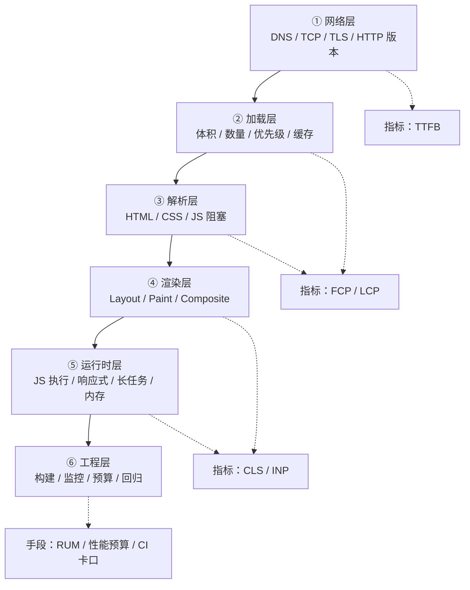

# 性能优化 25 题 · 总览与索引

> 来源题单：`10. 性能优化（25题）.md`
> 使用方法：先读本册（建立框架 + 背会答题总纲 + 记住一个项目实例），再按知识域进分册。
> 全系列统一结构：**一句话结论 → 原理展开（含代码）→ 常见坑 → 30 秒版 → 2 分钟版 → 追问表**

---

## 目录

- [0.1 先说结论：25 道题其实是 8 个知识域](#01-先说结论25-道题其实是-8-个知识域)
- [0.2 性能优化的六层模型（背这张图就够）](#02-性能优化的六层模型背这张图就够)
- [0.3 面试答题总纲：四段式 + 三个反模式](#03-面试答题总纲四段式--三个反模式)
- [0.4 题 2：前端优化的完整流程（方法论题）](#04-题-2前端优化的完整流程方法论题)
- [0.5 一个可背的项目实例（带数字）](#05-一个可背的项目实例带数字)
- [0.6 25 题 → 分册索引表](#06-25-题--分册索引表)
- [0.7 题单本身的 5 个问题（先说清楚）](#07-题单本身的-5-个问题先说清楚)
- [0.8 全局自测清单](#08-全局自测清单)

---

## 0.1 先说结论：25 道题其实是 8 个知识域

拿到这 25 题，第一件事是**归并**。原题单是别人按"想到哪问到哪"整理的，重复率极高：

| 知识域 | 题号 | 题目本质 | 归到分册 |
|---|---|---|---|
| **A. 指标体系与监控** | 6、14、24｜4 | "优化到什么程度算好" + "线上怎么知道好不好" | 01 |
| **B. 加载与网络** | 1、3（网络/缓存部分） | CDN、压缩、HTTP/2、缓存、资源优先级 | 02 |
| **C. 首屏优化** | 5、10、19 | SPA 首屏慢的十几种解法 | 03 |
| **D. 渲染与运行时** | 12、17、18、23、25 | 渲染流水线 + 重排重绘 + 合成层 | 04 |
| **E. 图片与资源** | 13、15 | 格式、懒加载、响应式图 | 05 |
| **F. JS 引擎与内存** | 8、9 | V8 怎么优化代码 + 内存泄漏怎么查 | 06 |
| **G. 构建工程化** | 7、11、22 | Webpack 原理 + 构建提速 + HMR | 07 |
| **H. 全景与流程** | 1、2、3、16、20、21 | 优化手段总览 + 优化流程 | 本册 + 02 |

**重复题的合并关系（面试时可以主动说明，显得你读得透）：**

```
题 1  ≡ 题 16 ≡ 题 20 ≡ 题 21   → 都是「优化有哪些方式」，答一套就够
题 3  ⊂ 题 1                     → 题 3 只是要求按「网络/渲染/缓存」三分法讲
题 5  ≡ 题 10 ≡ 题 19            → 都是「首屏优化」
题 6  ≡ 题 14                    → 都是「性能指标有哪些」
题 24 ⊂ 题 6                     → 题 24 只问 Core Web Vitals 三项
题 18 ≡ 题 25 ≡ 题 23（追问版）  → 重绘重排定义与关系
题 17 ⊂ 题 12                    → 题 17 是"怎么减少"，题 12 是"原理是什么"
题 11 ⊃ 题 7（原理 vs 手段）     → 先讲原理，优化手段自然就出来了
```

> 25 道题压缩下来，真正要准备的只有 **11 个答案模块**。这就是面试准备的正确姿势：不是背 25 份答案，而是准备 11 块积木，现场按题目要求拼。

---

## 0.2 性能优化的六层模型（背这张图就够）

面试时最怕"张口就是压缩、CDN、懒加载"——这是一份清单，不是一套体系。给一个**分层模型**，立刻从"背过"变成"想过"。



**每一层的核心问题与主要手段（这张表值得默写）：**

| 层 | 这一层在解决什么 | 主要手段 | 对应指标 |
|---|---|---|---|
| ① 网络 | 第一个字节什么时候到 | DNS 预解析、预连接、HTTP/2 多路复用、QUIC、边缘节点、减少重定向、TLS 1.3、0-RTT | TTFB |
| ② 加载 | 传多少、传多快 | gzip/brotli、代码分割、tree-shaking、CDN、强缓存/协商缓存、preload/prefetch、字体优化 | FCP、LCP |
| ③ 解析 | 别让关键路径被堵 | 关键 CSS 内联、CSS 不阻塞 DOM 但阻塞渲染、`defer`/`async`、避免同步脚本、减少 DOM 深度 | FCP |
| ④ 渲染 | 每一帧画得动 | 减少重排重绘、`transform/opacity`、合成层、`content-visibility`、虚拟列表、避免布局抖动 | CLS、INP、掉帧率 |
| ⑤ 运行时 | 主线程别被占死 | 拆长任务、Web Worker、时间切片、防抖节流、`shallowRef/markRaw`、内存回收、事件委托 | INP、TBT |
| ⑥ 工程 | 别让优化回退 | 性能预算、Lighthouse CI、RUM 监控、包体积卡口、告警 | 全部 |

**面试时这么用**：面试官问"有哪些优化手段"，你先说"我习惯按层拆，从网络到工程六层"，再挑 2 层展开细节。这个开场就已经赢了 80% 的候选人。

---

## 0.3 面试答题总纲：四段式 + 三个反模式

### 四段式（每道性能题都能套）

```
1. 定指标 —— 这类问题的"好"是用什么量的？（LCP / INP / CLS / 内存 / 构建时长）
2. 定位置 —— 瓶颈在哪一层？（用工具定位，而不是猜）
3. 给手段 —— 按层给 3~5 个具体手段，每个说清"为什么有效"
4. 说验证 —— 改完怎么证明有效？量化前后对比 + 怎么防回退
```

### 三个反模式（面试官最反感的答法）

| 反模式 | 表现 | 为什么扣分 | 正确做法 |
|---|---|---|---|
| **报菜名** | "压缩、CDN、懒加载、雪碧图、防抖节流……" 一口气 20 个 | 说明你只有清单没有体系，且分不清主次 | 先说分层/分类，再每类挑 1~2 个讲透 |
| **不提指标** | 全程说"变快了""体验更好了" | 优化没有度量就是玄学 | 每个手段都挂一个指标："这招主要压 LCP" |
| **不看场景** | 对小项目也建议上 SSR + 微前端 + 边缘计算 | 说明没成本意识 | 加一句"如果项目只有 3 个页面，我优先做 X，不上 Y" |

### 一句万能收尾（很好用）

> "性能优化不是把能做的都做一遍，而是**先用数据找到那 20% 的瓶颈，再挑性价比最高的手段**。我们项目最后只做了 3 件事，LCP 从 4.2s 降到 1.8s，因为剩下那些手段的收益都在 50ms 量级。"

---

## 0.4 题 2：前端优化的完整流程（方法论题）

> 题单原答案只有 4 行：测量 → 优化 → 验证 → 监控。这个答案能过，但**拿不到高分**。下面给可落地的完整版。

### 一句话结论

性能优化是一个**闭环**而非一次性动作：**建基线 → 找瓶颈 → 定方案 → 改 → 验证 → 加监控防回退**。没有度量就没有优化。

### 展开：六步闭环


**第 1 步：建基线（Measure）**

两套数据都要，缺一不可：

| 类型 | 工具 | 特点 | 用来干什么 |
|---|---|---|---|
| **实验室数据（Lab）** | Lighthouse、Performance 面板、WebPageTest | 环境可控、可复现、能看火焰图 | 定位瓶颈、做技术决策 |
| **现场数据（Field / RUM）** | web-vitals 库 + 自建上报、Sentry、ARMS | 真实设备、真实网络、真实用户分布 | 判断"到底有多少用户受影响" |

> **关键认知**：实验室数据好看不等于线上好。Lighthouse 跑分 95，但线上 40% 用户在 4G 千元机上 LCP 5s——因为 Lighthouse 默认模拟的是中端机 + 慢 4G，且只跑首屏一次。
> 反过来，只看 RUM 也无法定位"为什么慢"。**Lab 找原因，Field 定优先级。**

**第 2 步：找瓶颈（Diagnose）**

按指标反推层级，这是最实用的归因表：

| 症状 | 大概率瓶颈层 | 先用什么工具看 |
|---|---|---|
| TTFB > 800ms | 网络 / 服务端 | Network 面板看 Waiting(TTFB)；查 CDN 命中率、后端耗时、重定向 |
| FCP 慢但 TTFB 正常 | 关键渲染路径 | 看是否有阻塞渲染的 CSS/JS；Coverage 面板看未使用代码 |
| LCP 慢 | 资源加载 or 渲染 | LCP 元素是谁？是图片（下载慢）还是文本（字体/JS 阻塞）？ |
| CLS 高 | 渲染层 | Performance 面板的 Layout Shift 轨道，看是谁在跳 |
| INP 差 | 主线程 | Performance 面板找 >50ms 的长任务，看是不是某个事件处理器/大组件渲染 |
| 滚动卡顿 | 渲染层 or 内存 | 看是否掉帧、是否有大量 DOM、是否频繁 Layout |
| 内存持续上涨 | 内存 | Memory 面板堆快照对比（详见分册 06） |

**第 3 步：定目标（性能预算 Performance Budget）**

不要"越快越好"，要给数字：

```js
// 一个真实可用的预算表（按 75 分位用户定，而不是平均值）
const budget = {
  // 体积
  'initial-js': '170 KB (gzip)',   // 首屏 JS
  'initial-css': '50 KB (gzip)',
  'total-image-first-screen': '300 KB',
  // 指标（p75）
  LCP: 2500,   // ms
  INP: 200,    // ms
  CLS: 0.1,    // 无量纲
  TTFB: 800,   // ms
  // 工程
  'build-time': '60s',
}
```

> 为什么用 **p75** 而不是平均值？因为平均值会被"网络好的用户"稀释。Google 的评分标准就是 p75——**75% 的用户访问体验达到"良好"，这个页面才算"良好"**。

**第 4 步：实施（按 ROI 排序）**

用「收益 ÷ 成本」排序，而不是按"听起来高级"排序：

| 手段 | 典型收益 | 成本 | ROI |
|---|---|---|---|
| 开 gzip/brotli | JS 体积 -70% | 改一行 nginx | ★★★★★ |
| `Cache-Control` + 文件名 hash | 二次访问几乎零请求 | 半天 | ★★★★★ |
| 路由级代码分割 | 首屏 JS -40%~60% | 半天 | ★★★★★ |
| 图片转 WebP + 懒加载 | 首屏流量 -50% | 1 天 | ★★★★★ |
| 第三方脚本延后/移除 | 主线程 -30% | 1 天 | ★★★★ |
| 虚拟列表 | 长列表渲染 -90% | 2~3 天 | ★★★★（仅长列表场景） |
| SSR | LCP -40% | 2~4 周 + 长期维护 | ★★（内容型站点才值） |

**第 5 步：验证（Verify）**

- **多次采样**：Lighthouse 单次波动可达 ±20%，同一配置跑 5 次取中位数
- **控制变量**：同设备、同网络、同缓存状态（无痕 + Disable cache）
- **看分布不看均值**：p50/p75/p95 都要看，优化可能只改善了快的那批人
- **灰度 A/B**：大改动上线前用 5% 流量对比，避免"优化完反而更慢"（真实发生过：预加载太多把带宽抢了）

**第 6 步：监控（Monitor）**

```js
// 用官方 web-vitals 库上报，注意用 sendBeacon 防止卸载丢数据
import { onLCP, onINP, onCLS, onTTFB, onFCP } from 'web-vitals'

function report(metric) {
  const body = JSON.stringify({
    name: metric.name,
    value: metric.value,
    rating: metric.rating,      // 'good' | 'needs-improvement' | 'poor'
    id: metric.id,
    // 关键：带上归因信息，否则线上数据没法定位
    url: location.href,
    // 设备/网络分桶，才能知道"谁慢"
    conn: navigator.connection?.effectiveType,
    mem: navigator.deviceMemory,
    appVersion: window.__APP_VERSION__,
  })
  // 页面卸载时 fetch 会被取消，必须用 sendBeacon
  navigator.sendBeacon('/api/perf', body)
}

onLCP(report)
onINP(report)
onCLS(report)
onTTFB(report)
onFCP(report)
```

> **加分点**：上报一定要带 `appVersion`。否则某次发版后 LCP 突然劣化，你无法快速归因到"是哪个版本引入的"。

### 常见坑

| 坑 | 后果 | 正确做法 |
|---|---|---|
| 只跑 Lighthouse 就下结论 | 分数高但线上差 | Lab + Field 双数据 |
| 用平均值汇报 | 掩盖长尾用户 | 用 p75/p95 |
| 优化完不留监控 | 3 个月后被人加了个 2MB 的库，回到解放前 | 性能预算进 CI |
| 一次性上太多手段 | 出问题无法归因 | 分批上，每批单独度量 |
| 忽略第三方脚本 | 主线程被广告/统计脚本占满 | 用 Performance 面板看 third-party 占比 |

### 30 秒版

> "我一般按闭环做：先用 Lighthouse 和 Performance 面板建基线、定位瓶颈，再用 RUM 看真实用户的 p75 指标决定优先级；然后定性能预算，按 ROI 从高到低实施，比如先做压缩和代码分割这种一天见效的，SSR 这种重投入的放最后；改完多次采样验证，最后把指标做成监控和 CI 卡口，防止回退。"

### 2 分钟版

> "性能优化我理解是一个闭环，分六步。
>
> **第一步建基线**，我会同时拿两套数据：实验室数据用 Lighthouse 和 Performance 面板，环境可控、能看火焰图，用来定位原因；现场数据用 web-vitals 上报到自建接口，看真实用户的 p75，用来定优先级。只看实验室容易自我感觉良好，只看线上又找不到原因。
>
> **第二步找瓶颈**，我有个归因习惯：TTFB 慢就查网络和服务端；FCP 慢但 TTFB 正常就查关键渲染路径有没有阻塞资源；LCP 慢就先看 LCP 元素是图片还是文本；INP 差就在 Performance 面板找超过 50ms 的长任务；CLS 高就看 Layout Shift 轨道是谁在跳。基本上一分钟内能锁定到层。
>
> **第三步定目标**，我会给具体数字，比如首屏 JS 控制在 170KB gzip 内、LCP p75 小于 2.5s。用 p75 不用平均值，因为平均值会被网络好的用户稀释。
>
> **第四步实施**，按收益除以成本排序。压缩、缓存、路由分割、图片这几个都是一天见效的，先做；SSR 这种要两三周还有长期维护成本的，只在前面的手段榨干之后才考虑。
>
> **第五步验证**，同设备同网络跑 5 次取中位数，大改动用灰度对比。
>
> **最后一步监控**，把指标做成看板和告警，同时把包体积和 Lighthouse 分数接进 CI，超预算就卡住合并。这样优化成果才不会被下一个人一个 `lodash` 全量引入给吃掉。"

### 追问

| 追问 | 要点 |
|---|---|
| 实验室数据和真实用户数据哪个更重要？ | 都重要，用途不同：Lab 找原因、Field 定优先级；决策看 Field，调试看 Lab |
| 为什么用 p75？ | Google 评分口径；平均值会被快用户稀释，掩盖长尾；p75 代表"大多数人的体验" |
| 怎么防性能回退？ | 性能预算 + CI 卡口（bundle size、Lighthouse CI）+ 上线后 RUM 告警 |
| 优化到什么程度停？ | 达到业务目标（如 p75 LCP < 2.5s）或继续投入的 ROI 低于阈值；避免过度优化 |
| 用户设备差异大怎么办？ | 分桶上报（`navigator.connection.effectiveType`、`deviceMemory`、UA）；对低端机做降级策略（少图、关动画） |
| 你会怎么给老板汇报？ | 用业务指标翻译：跳出率、转化率、停留时长；技术指标作为过程指标 |

---

## 0.5 一个可背的项目实例（带数字）

面试官听腻了理论，**一定要准备一个带数字的实例**。下面是一个可以直接改造成自己项目讲法的模板。

> **背景**：B 端中后台 + C 端活动页的混合项目，Vue3 + Vite，首屏 Lighthouse 只有 42 分，线上 p75 LCP 4.2s，用户投诉"点进来白屏很久"。

**第一步：定位（不要猜）**

| 现象 | 工具 | 结论 |
|---|---|---|
| TTFB 320ms | Network | 正常，不是服务端问题 |
| 首屏 JS 1.8MB（未压缩 5.2MB） | Bundle Analyzer | 主因：全量引入 ECharts + lodash + 一个 UI 库 + 未分割路由 |
| 主线程 3.2s 被占（TBT 2.1s） | Performance | 次因：首屏同步渲染 3000 行表格 |
| LCP 元素是首屏 Banner 图 1.4MB | Performance | 三因：图片未压缩未预加载 |

**第二步：动手（只做 4 件事）**

1. **路由级代码分割 + 手动 chunk**
   - `() => import()` 拆分路由；`manualChunks` 把 echarts/lodash 单独成 chunk
   - 首屏 JS **1.8MB → 420KB（gzip 后 340KB → 118KB）**
2. **ECharts 按需引入**
   - `echarts/core` + 只注册用到的 `LineChart / BarChart` + `CanvasRenderer`
   - 图表 chunk **980KB → 310KB**
3. **长列表虚拟滚动**
   - 只渲染可视区 + 上下各 5 行缓冲，DOM 从 3000×8 个降到约 60×8
   - 首屏渲染耗时 **1.9s → 180ms**，TBT **2.1s → 480ms**
4. **图片治理**
   - 构建期转 WebP（`vite-imagetools`），首屏图加 `fetchpriority="high"` + `preload`
   - Banner **1.4MB → 210KB**；非首屏图 `loading="lazy"`

**第三步：验证**

| 指标 | 优化前 | 优化后 |
|---|---|---|
| Lighthouse 性能分 | 42 | 91 |
| LCP（p75） | 4.2s | 1.7s |
| INP（p75） | 340ms | 120ms |
| CLS | 0.18 | 0.02 |
| 首屏 JS（gzip） | 340KB | 118KB |
| 跳出率 | 51% | 38% |

**第四步：防回退**

- `rollup-plugin-visualizer` 进 CI，单 chunk 超过 250KB 直接 fail
- Lighthouse CI 对 3 个核心页面跑分，低于阈值阻断合并
- RUM 看板 + 阈值告警（LCP p75 > 2.5s 报警到群）

> **讲这个实例的关键**：不要只念数字，要讲**"我怎么定位的"**。数字是结果，"TTFB 正常 → 排除服务端 → 看 Bundle → 发现全量引入"这条推理链才是能力证明。

---

## 0.6 25 题 → 分册索引表

| 题号 | 题目 | 去哪看 | 一句话答案 |
|---|---|---|---|
| 1 | 前端性能优化有哪些方式 | 本册 0.2 + 02/03/04 全册 | 按六层模型答：网络/加载/解析/渲染/运行时/工程，每层给 2 个手段 |
| 2 | 前端优化的完整流程 | **本册 0.4** | 建基线 → 找瓶颈 → 定预算 → 按 ROI 实施 → 验证 → 监控防回退 |
| 3 | 从网络/渲染/缓存三方面讲 | 02 全册 | 网络：CDN/HTTP2/预连接；渲染：重排重绘/虚拟列表/rAF；缓存：强缓存+协商+SW |
| 4 | 前端监控方案 | **01 · 4 节** | 性能（Web Vitals）+ 错误（JS/Promise/资源）+ 行为；采集 → 上报 → 聚合 → 告警 → 归因 |
| 5 | 首屏优化方案 | **03 全册** | 分"减体积、提优先级、改渲染方式、争取感知"四类，共 12 种手段 |
| 6 | 前端性能指标 | **01 · 1 节** | Core Web Vitals（LCP/INP/CLS）+ FCP/TTFB/TBT/TTI，说清每个指标度量什么 |
| 7 | Webpack 性能优化 | **07 · 2 节** | 分"构建速度"和"产物质量"两条线，各 6 个手段 |
| 8 | 浏览器怎么优化 JS 执行 | **06 · 1 节** | 解析（惰性）→ 字节码（Ignition）→ 基线（Sparkplug）→ 优化（TurboFan/Maglev）+ 隐藏类 + IC + 分代 GC |
| 9 | 排查与优化内存泄漏 | **06 · 2 节** | 三快照对比法定位；四类常见泄漏（全局/定时器/监听/游离 DOM）+ WeakRef 思路 |
| 10 | 首屏优化 | 同题 5 | 见 03 |
| 11 | Webpack 打包原理 | **07 · 1 节** | 初始化 → 编译（entry → AST → 依赖图）→ 生成 chunk → 输出；loader 转译、plugin 挂生命周期 |
| 12 | 浏览器渲染流程 | **04 · 1 节** | DOM + CSSOM → Render Tree → Layout → Paint → Layer → Composite；补上"分层"这一环才完整 |
| 13 | 懒加载是什么 | **05 · 1 节** | 延迟到"需要时"再加载；图片用 IntersectionObserver，组件用 `import()` |
| 14 | Web 性能指标有哪些 | 同题 6 | 见 01 |
| 15 | 图片优化方案 | **05 · 2 节** | 格式（AVIF/WebP）+ 尺寸（srcset）+ 懒加载 + CDN 处理 + 占位 + 优先级 |
| 16 | 怎么进行性能优化 | 同题 1 | 见本册 0.2 |
| 17 | 减少重绘和回流 | **04 · 4 节** | 批量改 DOM、脱离文档流改、只改合成属性、避免强制同步布局、用 rAF |
| 18 | 简述重绘和重排 | **04 · 2 节** | 重排改几何、重绘改外观；重排必重绘，重绘不必重排；现代浏览器还有"只合成" |
| 19 | SPA 首屏太慢怎么办 | **03 · 3 节** | SPA 慢的根因是"JS 下载+执行完才有内容"，解法分"少给 JS / 提前给 HTML / 先给假内容" |
| 20 | 常见的性能优化方案 | 同题 1 | 见本册 0.2 |
| 21 | 性能优化 | 同题 1 | 见本册 0.2 |
| 22 | Webpack 热更新原理 | **07 · 3 节** | 文件变化 → 增量编译 → 生成 hash 与 manifest → WebSocket 推送 → HMR runtime 拉取 chunk → 替换模块并执行 accept 回调 |
| 23 | 回流一定会触发重绘吗 | **04 · 2.4** | 会。位置变了必须重画；但注意"合成层内的位移"可以只重合成 |
| 24 | 什么是 Core Web Vitals | **01 · 1.4** | Google 的核心体验指标：LCP / INP（2024 年取代 FID）/ CLS，按 p75 分三档，影响 SEO |
| 25 | 浏览器回流与重绘 | 同题 18 | 见 04 |

**分册清单：**

| 文件 | 覆盖题号 | 内容 |
|---|---|---|
| `性能-00-总览与索引.md` | 1、2、3、16、20、21 | 知识地图、答题总纲、优化流程、项目实例 |
| `性能-01-指标体系与监控.md` | 6、14、24、4 | Web Vitals 逐项拆解、采集代码、监控体系 |
| `性能-02-加载与网络-缓存-CDN-HTTP2.md` | 1、3 | 网络层与加载层纵深 |
| `性能-03-首屏优化-SSR到关键路径.md` | 5、10、19 | SPA 首屏 12 种手段 |
| `性能-04-渲染优化-渲染流水线与重排重绘.md` | 12、17、18、23、25 | 渲染流水线、分层合成、强制同步布局 |
| `性能-05-图片与资源优化-懒加载.md` | 13、15 | 图片格式、响应式图、懒加载实现 |
| `性能-06-JS引擎与内存-V8与内存泄漏.md` | 8、9 | V8 四阶编译、隐藏类、GC、泄漏排查 |
| `性能-07-Webpack-原理-构建优化-HMR.md` | 7、11、22 | 打包原理、构建提速、产物优化、HMR |

---

## 0.7 题单本身的 5 个问题（先说清楚）

题单是别人整理的，有 5 处需要修正，面试时如果你能指出来，是明显的加分项。

| # | 问题 | 说明 |
|---|---|---|
| 1 | **FID 已经被 INP 取代** | 题 6、24 都写"FID < 100ms"。2024 年 3 月起，Core Web Vitals 用 **INP（Interaction to Next Paint）** 替代 FID，阈值 **< 200ms**。现在面试如果只说 FID，会被认为资料过期。正确说法："FID 是旧指标，只测首次输入，现已由 INP 取代"。 |
| 2 | **"重排一定触发重绘"这句话不完全准确** | 传统说法没错，但现代浏览器有**分层合成**：如果元素在独立合成层内，`transform` 变化会跳过 Layout 和 Paint，只做 Composite。所以更严谨的说法是"**几何变化一定会让该元素重新绘制，但如果它已独立成层，这次重绘发生在合成线程/GPU，成本极低**"。 |
| 3 | **题 7 把 `DllPlugin` 当优化手段** | Webpack 5 已经有持久化缓存（`cache: { type: 'filesystem' }`），官方文档明确 `DllPlugin` 属于**遗留方案**，新项目不该再用。面试若提，要加一句"webpack5 之后我更倾向 filesystem cache"。 |
| 4 | **题 15"雪碧图减少请求数"是 HTTP/1.1 时代的结论** | HTTP/2 多路复用后，雪碧图收益大幅下降，反而增加维护成本和缓存粒度问题。现在只在 HTTP/1.1 或需要"一张图切多状态"（如精灵动画）时用。 |
| 5 | **题 1 完全没提"交互性能"** | 原答案只覆盖加载和首屏，没有 INP、长任务、时间切片。而实际线上投诉最多的往往是"点了没反应"（INP 差），不是"首屏慢"。 |

---

## 0.8 全局自测清单

**框架层**

- [ ] 能画出性能优化六层模型，并给每层说出 2 个手段
- [ ] 能说出四段式答题结构（定指标 → 定位置 → 给手段 → 说验证）
- [ ] 能说出优化闭环六步（基线 → 瓶颈 → 预算 → 实施 → 验证 → 监控）
- [ ] 能解释为什么用 p75 而不是平均值

**指标层**

- [ ] LCP / INP / CLS 各自度量什么、阈值多少
- [ ] FID 为什么被 INP 取代
- [ ] CLS 的计算口径（影响分数 × 距离分数，session window）
- [ ] TTFB / FCP / TBT / TTI 各自属于哪个阶段

**加载层**

- [ ] 强缓存与协商缓存的完整字段与命中流程
- [ ] `Cache-Control: immutable` 解决什么问题
- [ ] HTTP/2 相比 1.1 解决了什么，为什么"合并请求"不再是铁律
- [ ] `preload` / `prefetch` / `preconnect` / `dns-prefetch` 的区别与误用后果

**渲染层**

- [ ] 完整渲染流水线（含分层与合成）
- [ ] 哪些 CSS 属性只触发 Composite
- [ ] 什么是强制同步布局，怎么避免
- [ ] 虚拟列表的核心思路，如何支持不定高

**运行时**

- [ ] 长任务的定义（>50ms）与拆解手段
- [ ] V8 四阶执行管线与隐藏类的作用
- [ ] 四类常见内存泄漏与堆快照对比法

**工程层**

- [ ] Webpack 打包五阶段
- [ ] HMR 完整链路
- [ ] 构建提速 6 个手段、产物优化 6 个手段
- [ ] 怎么把性能预算接进 CI

**表达层**

- [ ] 有一个带数字的真实项目实例，能讲清"怎么定位的"
- [ ] 能针对"小项目"和"大项目"给出不同建议
- [ ] 能说出 3 个"看起来有用其实收益很低"的手段（体现判断力）
