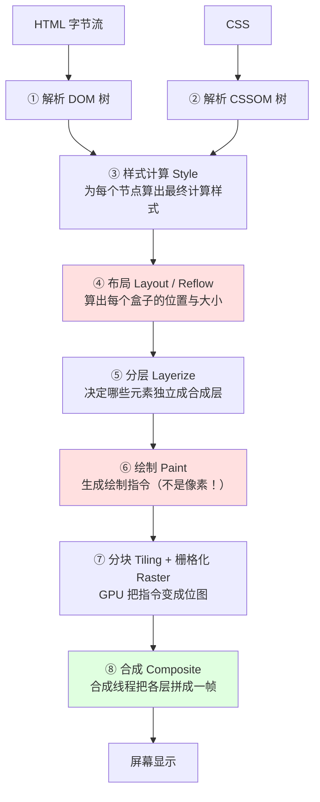
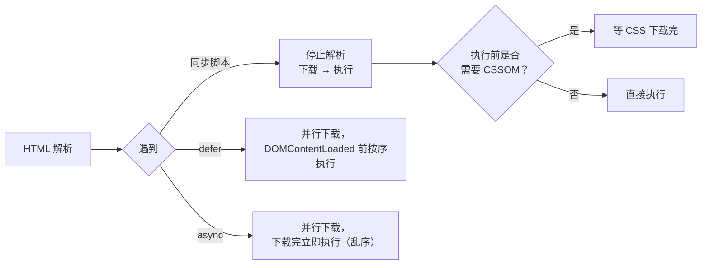
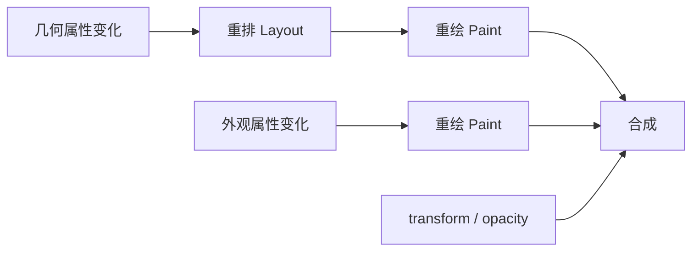

# 性能 · 04 渲染优化：渲染流水线与重排重绘

> 覆盖题号：**12、17、18、23、25**
> 对应原题：《浏览器的渲染流程》《减少重绘和回流》《简述重绘和重排》《浏览器回流一定会触发重绘吗》《浏览器的回流与重绘》

---

## 目录

- [1. 浏览器渲染流水线](#1-浏览器渲染流水线)
- [2. 重排与重绘](#2-重排与重绘)
- [3. 强制同步布局（性能第一大杀手）](#3-强制同步布局性能第一大杀手)
- [4. 减少重排重绘的 10 个手段](#4-减少重排重绘的-10-个手段)
- [5. 合成层：为什么 transform 便宜](#5-合成层为什么-transform-便宜)
- [6. 现代 CSS 优化：contain 与 content-visibility](#6-现代-css-优化contain-与-content-visibility)
- [7. 长列表虚拟滚动](#7-长列表虚拟滚动)
- [8. 动画优化：rAF 与动画属性选择](#8-动画优化raf-与动画属性选择)
- [9. 事件与交互优化（INP 相关）](#9-事件与交互优化inp-相关)
- [10. 怎么用 Performance 面板排查渲染问题](#10-怎么用-performance-面板排查渲染问题)
- [11. 常见坑](#11-常见坑)
- [12. 答题模板](#12-答题模板)
- [13. 追问表](#13-追问表)
- [14. 速记卡](#14-速记卡)

---

## 1. 浏览器渲染流水线

### 1.1 一句话结论

浏览器把一个 HTML 字符串变成屏幕像素，要经过 **5 个大阶段**：**解析 → 样式 → 布局 → 绘制 → 合成**。布局和绘制最贵，渲染优化的本质是**让变更跳过其中一步或几步**；能跳过哪几步，由「改了哪类属性」决定。

### 1.2 完整流水线（含分层/合成）



| 阶段 | 输入 | 输出 | 成本 |
| --- | --- | --- | --- |
| ① 解析 HTML | 字节流 | DOM 树 | 中（受 DOM 复杂度影响） |
| ② 解析 CSS | CSS 文本 | CSSOM 树 | 中 |
| ③ 样式计算 | DOM + CSSOM | 每个节点的 computedStyle | 中（选择器越复杂越慢） |
| ④ 布局 Layout | 样式树 | 几何信息（每个盒子 x/y/w/h） | **高**（遍历整棵树，且会连锁） |
| ⑤ 分层 | 布局树 | 图层树 | 低 |
| ⑥ 绘制 Paint | 图层树 | **绘制指令列表** | **高** |
| ⑦ 栅格化 | 绘制指令 | 位图（tile） | 中（GPU 并行） |
| ⑧ 合成 | 位图 | 最终帧 | **极低**（GPU 直接拼） |

> 流水线常被答到 Paint 为止，漏掉 ⑥⑦⑧ 的分层、栅格化、合成；而「为什么 transform 比 top 便宜」的依据就在这三步。

### 1.3 三个关键事实

**① Paint 产出的是绘制指令，不是像素。**

Paint 生成的是类似 `drawRect(x, y, w, h, color)` 的指令列表，像素填充发生在**栅格化**（Raster），由 GPU 完成。图层内的局部重绘可以增量栅格化，所以「重绘」不等于一定掉帧。

**② 属性类别决定从哪一步开始重跑。**

```
改 width/height/top/left  → Layout → Layerize → Paint → Raster → Composite
改 color/background       → Paint → Raster → Composite
改 transform/opacity      → Composite（独立合成层，可在合成线程完成）
```

**③ 合成阶段在独立线程。**

合成线程独立于主线程，JS 长时间占用主线程时，只改 `transform`/`opacity` 的动画仍能继续播放。这是「动画用 transform」的根本原因，不只是「少一次重排」（机制见 5.3）。

### 1.4 CSS 与 JS 对解析的阻塞关系



| 资源 | 阻塞解析？ | 阻塞渲染？ |
| --- | --- | --- |
| `<script>`（同步） | **是** | 是 |
| `<script defer>` | 否 | 否（解析完、`DOMContentLoaded` 前执行） |
| `<script async>` | 否（执行时占用主线程） | 可能 |
| `<link rel=stylesheet>` | 否 | **是**（CSSOM 就绪后才首次渲染） |
| 图片 / 字体 | 否 | 字体阻塞使用它的文本渲染 |

> CSS **不阻塞 DOM 解析**，但**阻塞渲染**，并且阻塞它后面的同步脚本（脚本可能读样式）。这是「CSS 放 head、同步 JS 放 body 末尾」的完整理由。

### 1.5 口述骨架

- 顺序：DOM + CSSOM → 样式计算 → 布局 → 绘制（指令）→ 分层栅格化 → 合成上屏。
- 判断：几何属性全跑，外观属性跳过布局，`transform`/`opacity` 只合成。
- 两个易漏点：绘制产出的是指令而非像素；合成在独立线程，所以主线程卡住时 `transform` 动画仍能跑。
- 阻塞关系：同步 script 阻塞解析；CSS 不阻塞解析但阻塞渲染，并阻塞后续同步脚本。

### 1.6 追问

| 追问 | 要点 |
| --- | --- |
| DOM 和 CSSOM 为什么要合成渲染树？ | 渲染树只含可见节点：`display:none` 不在其中，`visibility:hidden` 在其中 |
| 为什么 CSS 放 head？ | 早发现早下载，避免首屏无样式闪烁；也避免阻塞 body 里的同步脚本 |
| 布局为什么比绘制贵？ | 布局要解几何约束且会连锁到父级、兄弟；绘制的复杂图形（阴影、圆角、滤镜）也不便宜 |
| 什么是「渲染帧预算」？ | 每帧总预算见 8.4，布局 + 绘制只能用掉 JS 和样式计算剩下的部分 |

---

## 2. 重排与重绘

### 2.1 一句话结论

**重排（Reflow / Layout）**：几何属性变了，浏览器重新算布局；**重绘（Paint）**：只有外观变了，布局不用重算，但绘制内容要重新生成。

### 2.2 定义与关系

|  | 重排（回流 / Layout） | 重绘（Paint） |
| --- | --- | --- |
| 触发条件 | 几何属性变化：宽高、位置、字号、内容增减、窗口尺寸 | 外观属性变化：颜色、背景、边框色、阴影、可见性 |
| 影响范围 | **可能影响整棵树**（父级、兄弟、后续元素） | 通常只影响该元素所在图层 |
| 成本 | **高** | 中 |
| 后续阶段 | 必然跟一次重绘 | 不需要重排 |



**题 23「回流一定会触发重绘吗」**

> 会。布局变了，元素在屏幕上的位置也变了，绘制内容必须重新生成。例外是被提升为独立合成层的元素只改 `transform`：视觉位置变了，但不触发 Layout、不重新 Paint，只在合成阶段调整变换矩阵。所以更严谨的说法是「几何变化一定让绘制内容失效，但独立合成层内的 transform 变化被优化成重新合成」。

### 2.3 会触发重排的操作

**（1）几何 / 布局相关 CSS 属性**

```
width / height / min-height / max-height
padding / margin / border-width
top / right / bottom / left
position / float / display
font-size / font-weight / line-height / font-family
text-align / vertical-align / white-space
overflow / overflow-x / overflow-y
flex / grid 相关（flex-basis、grid-template-*）
```

**（2）内容与结构变化**

- 增删 DOM 节点、修改文本（`textContent` / `innerText`）
- 图片加载完成且未设置尺寸
- 窗口 resize、字体加载完成
- 滚动条出现或消失（改变可视区宽度）
- 读取依赖布局的属性（见第 3 节，属于被动触发）

**（3）只触发重绘的属性**

```
color / background / background-color / background-image
border-color / border-style / border-radius
box-shadow / text-shadow / outline
visibility
```

### 2.4 批量修改：DocumentFragment 与离线修改

```js
// 循环 append：每次插入只把布局标记为脏，中间不读取的话，一帧内仍只算一次布局
for (let i = 0; i < 100; i++) {
  const li = document.createElement('li')
  li.textContent = `item ${i}`
  list.appendChild(li)
}

// ✅ 做法一：DocumentFragment，脱离文档组装后一次插入
const frag = document.createDocumentFragment()
for (let i = 0; i < 100; i++) {
  const li = document.createElement('li')
  li.textContent = `item ${i}`
  frag.appendChild(li)
}
list.appendChild(frag) // 只插入一次

// ✅ 做法二：先脱离渲染树，改完再放回
list.style.display = 'none'
// ...大量 DOM 操作...
list.style.display = '' // 放回时算一次
```

> `display: none` 的元素不在渲染树中，内部改动不参与布局；重新显示时只算一次。批量操作真正要防的是「插入后立刻读取」——每次读取都会把当前的脏布局算一遍。

---

## 3. 强制同步布局（性能第一大杀手）

浏览器把 DOM 变更攒起来，到帧末统一布局。但如果在改样式之后**立刻读取**依赖布局的值，浏览器必须先执行布局才能返回正确结果，于是同一帧内被迫同步布局——这就是**强制同步布局**（forced synchronous layout），反复出现即**布局抖动**（layout thrashing）。

```js
// ❌ 读写交替：每读一次都强制布局一次
for (let i = 0; i < 100; i++) {
  const el = items[i]
  el.style.width = el.offsetWidth + 10 + 'px' // 写 → 读 → 写 → 读…
}

// ✅ 读写分离：先全部读，再全部写
const widths = items.map((el) => el.offsetWidth)
items.forEach((el, i) => {
  el.style.width = widths[i] + 10 + 'px'
})
```

### 3.1 哪些属性 / 方法会强制布局

**元素几何属性**

```
offsetTop / offsetLeft / offsetWidth / offsetHeight / offsetParent
clientTop / clientLeft / clientWidth / clientHeight
scrollTop / scrollLeft / scrollWidth / scrollHeight
```

**方法**

```
getBoundingClientRect() / getClientRects()
getComputedStyle()                 // 读几何类属性时
scrollIntoView() / scrollIntoViewIfNeeded()
focus()                            // 可能引起滚动
window.innerWidth / innerHeight    // 部分情况下
```

> 判断标准：值是否依赖布局结果。`offsetWidth` 依赖布局，`style.color`（内联样式字符串）不依赖。

### 3.2 案例：统一卡片高度

```js
// ✅ 读一遍、写一遍：只有第一次读需要布局
let max = 0
for (const c of cards) max = Math.max(max, c.offsetHeight)
for (const c of cards) c.style.height = max + 'px'

// ❌ 同一个循环里读写交替：每轮一次布局
for (const c of cards) {
  c.style.height = c.offsetHeight + 'px'
}
```

> 两遍循环本身只产生 1 次布局；把写放回读所在的循环，才会退化成 n 次。写操作放进 `requestAnimationFrame` 只是把写推迟一帧，不改变「读写分离」这个要求。

### 3.3 读写队列（FastDOM 思路）

```js
// 极简批处理，思想来自 fastdom
const reads = []
const writes = []
let scheduled = false

export function measure(fn) {
  reads.push(fn)
  schedule()
}
export function mutate(fn) {
  writes.push(fn)
  schedule()
}

function schedule() {
  if (scheduled) return
  scheduled = true
  requestAnimationFrame(() => {
    scheduled = false
    // 先跑完所有读，再跑所有写：整帧最多一次布局
    reads.splice(0).forEach((fn) => fn())
    writes.splice(0).forEach((fn) => fn())
  })
}
```

### 3.4 追问

| 追问 | 要点 |
| --- | --- |
| 为什么读 `offsetWidth` 会触发重排？ | 值依赖布局结果，浏览器必须立即布局才能保证返回值正确 |
| 读 `style.width` 会触发吗？ | 不会，读的是**内联样式字符串** |
| 读 `getComputedStyle(el).width` 呢？ | 会，返回的是计算后的实际值，依赖布局 |
| 怎么发现布局抖动？ | Performance 面板里 Layout 块与 JS 密集交替，或出现 "Forced reflow" 警告 |
| 用 `requestAnimationFrame` 能避免吗？ | 只能把写推迟一帧；根本解法是读写分离 |

---

## 4. 减少重排重绘的 10 个手段

| # | 手段 | 原理 | 代码 |
| --- | --- | --- | --- |
| 1 | **批量修改 DOM** | 用 `DocumentFragment` 或拼好字符串一次插入 | 见 2.4 |
| 2 | **离线修改** | 先 `display:none` 或从文档移除，改完再放回 | 见 2.4 |
| 3 | **读写分离** | 避免强制同步布局 | 见第 3 节 |
| 4 | **用 `transform` 代替 `top/left`** | 走合成，跳过 Layout + Paint | `transform: translate(x, y)` |
| 5 | **隐藏/显示用 `opacity` + `pointer-events`** | 走合成，仍占位 | `opacity: 0; pointer-events: none` |
| 6 | **用 `requestAnimationFrame` 更新视觉** | 一帧内的多次修改合并成一次渲染 | 见第 8 节 |
| 7 | **动画只改 `transform` / `opacity`** | 这类属性可跑在合成线程；CSS 动画改布局属性同样每帧重排 | `@keyframes` + `transform` |
| 8 | **`will-change` / `contain`** | 提前告知浏览器，减少影响范围 | 见第 5、6 节 |
| 9 | **避免用 table 布局做大范围结构** | table 布局变化会引起整表重算 | 用 flex/grid |
| 10 | **虚拟列表** | 从源头减少 DOM 数量 | 见第 7 节 |

### 4.1 展开动画：「错误 → 正确」对照

```js
// ❌ 改 height：每帧重排
el.style.height = '0px'
requestAnimationFrame(() => {
  el.style.transition = 'height .3s'
  el.style.height = '200px'
})

// ✅ 改 transform：走合成（scaleY 会压扁内容）
el.style.transformOrigin = 'top'
el.style.transform = 'scaleY(0)'
requestAnimationFrame(() => {
  el.style.transition = 'transform .3s'
  el.style.transform = 'scaleY(1)'
})
```

> 内容不能变形时，`max-height` 方案仍会重排但不影响兄弟元素；`clip-path: inset()` 动画不改布局，但要每帧重新绘制。两者都介于「重排」和「只合成」之间。

---

## 5. 合成层：为什么 transform 便宜

### 5.1 什么元素会被提升为合成层

| 触发条件 | 示例 |
| --- | --- |
| 3D 变换 | `transform: translateZ(0)`、`translate3d()` |
| `will-change: transform / opacity` | 显式提示 |
| `transform` / `opacity` 动画 | `animation`、`transition` 期间 |
| `position: fixed` | 部分情况下 |
| `filter` / `backdrop-filter` | 滤镜 |
| `<video>`、`<canvas>`、`<iframe>` | 天然独立层 |
| 与其他层重叠且需裁剪 | 浏览器自行判断 |

### 5.2 合成层的代价

| 代价 | 说明 |
| --- | --- |
| GPU 显存 | 每层存一份位图，`1920×1080` 一层约 8MB（1920×1080×4 字节） |
| 层数过多 | 占用显存与合成器预算，移动端容易闪退 |
| 首帧成本 | 新提升的层要重新栅格化 |
| `will-change` 滥用 | 层常驻，长期占显存 |

```css
/* ❌ 所有卡片常驻一层 */
.card {
  will-change: transform;
}

/* ✅ 只在交互/动画期间加 */
.card:hover {
  will-change: transform;
}
```

```js
// ✅ 动画开始前加，结束后释放
function animate(el) {
  el.style.willChange = 'transform'
  el.animate([{ transform: 'translateY(0)' }, { transform: 'translateY(-20px)' }], {
    duration: 300,
    easing: 'ease-out',
  }).finished.finally(() => {
    el.style.willChange = 'auto'
  })
}
```

### 5.3 为什么「只合成」能跑在独立线程

```
主线程：JS → 样式 → 布局 → 绘制 ─┐
                                  ├→ 提交给合成线程
合成线程：分块 → 栅格化 → 合成 → 上屏
```

合成线程有自己的动画调度器：动画只涉及 `transform`/`opacity` 时，它按关键帧插值后重新合成，不需要主线程参与。反过来，动画里若出现 `width`、`left`、`box-shadow`，每帧都要回主线程做布局或绘制，主线程一忙就掉帧。

### 5.4 追问

| 追问 | 要点 |
| --- | --- |
| `transform: translateZ(0)` 为什么叫「硬件加速」？ | 触发 3D 变换 → 提升为合成层 → 交给 GPU 合成 |
| 合成层越多越好吗？ | 不是，显存与合成开销上升，移动端易闪退 |
| `filter` 能走合成吗？ | 可以，但 GPU 计算贵（`blur` 尤其），大量使用反而更慢 |
| 为什么 `box-shadow` 动画卡？ | 它是绘制属性，每帧重新绘制阴影，不走合成 |
| 怎么查看合成层？ | DevTools 的 Layers 面板；Performance 面板的 Composite Layers |

---

## 6. 现代 CSS 优化：contain 与 content-visibility

### 6.1 `contain`：声明这块是独立的

```css
.card {
  contain: layout; /* 内部布局不影响外部 */
  /* contain: paint;     裁剪到边界，绘制不外溢 */
  /* contain: size;      尺寸不依赖子元素（需显式尺寸） */
  /* contain: style;     计数器等作用域隔离 */
  /* contain: strict;    = size layout paint style */
  /* contain: content;   = layout paint style（最常用） */
}
```

收益：元素内部的变化不再引起外部重排，在长列表、卡片网格里效果明显。注意 `layout` 只隔离内部布局，元素自身尺寸变化仍会影响外部；要连尺寸一起隔离需要加 `size`。

### 6.2 `content-visibility`：跳过屏幕外元素的渲染

```css
.section {
  content-visibility: auto;
  contain-intrinsic-size: 0 500px; /* 预估高度，避免滚动条乱跳 */
}
```

原理：不在视口附近的元素跳过其内容的布局与绘制，元素自身用 `contain-intrinsic-size` 占位，滚动到附近再渲染。屏幕外内容占比越大，收益越大。

坑：

| 坑 | 说明 |
| --- | --- |
| 不写 `contain-intrinsic-size` | 元素高度未知，滚动条与滚动位置会跳 |
| 预估尺寸与实际偏差大 | 滚动到该区域时内容高度突变，出现跳动 |
| 用在首屏 | 首屏本来就要渲染，没有收益 |

### 6.3 `will-change` 的三条用法

1. **只在动画前加**，不要全局加
2. **只写会变的属性**（`transform`、`opacity`），不要 `will-change: all`
3. **用完就移除**，否则层一直存在

---

## 7. 长列表虚拟滚动

### 7.1 为什么需要

10000 条数据、每条 8 个 DOM 节点就是 80000 个节点，每次布局都要遍历，滚动时每帧的布局与绘制都容易超出一帧预算。

虚拟滚动只渲染**可视区 + 上下缓冲**，节点数固定在几十个量级。

### 7.2 定高列表（核心思路 20 行）

```vue
<template>
  <div class="viewport" ref="viewport" @scroll="onScroll">
    <!-- 撑开滚动条，让滚动条长度看起来是"全部数据" -->
    <div class="phantom" :style="{ height: totalHeight + 'px' }"></div>
    <!-- 可视区内容，用 transform 定位 -->
    <div class="content" :style="{ transform: `translateY(${offsetY}px)` }">
      <div v-for="item in visible" :key="item.id" class="row">
        {{ item.text }}
      </div>
    </div>
  </div>
</template>

<script setup>
import { ref, computed } from 'vue'

const props = defineProps({
  items: { type: Array, required: true },
  itemHeight: { type: Number, default: 50 },
  buffer: { type: Number, default: 5 }, // 上下各多渲染几行，减少白屏
})

const viewport = ref(null)
const scrollTop = ref(0)

const totalHeight = computed(() => props.items.length * props.itemHeight)

const startIndex = computed(() =>
  Math.max(0, Math.floor(scrollTop.value / props.itemHeight) - props.buffer),
)
const endIndex = computed(() =>
  Math.min(
    props.items.length,
    Math.ceil((scrollTop.value + (viewport.value?.clientHeight || 0)) / props.itemHeight) +
      props.buffer,
  ),
)
const visible = computed(() => props.items.slice(startIndex.value, endIndex.value))
const offsetY = computed(() => startIndex.value * props.itemHeight)

let rafId = 0
function onScroll(e) {
  // 用 rAF 节流，一帧最多算一次
  const top = e.target.scrollTop
  if (rafId) return
  rafId = requestAnimationFrame(() => {
    scrollTop.value = top
    rafId = 0
  })
}
</script>

<style scoped>
.viewport {
  height: 100%;
  overflow-y: auto;
  position: relative;
}
.phantom {
  position: absolute;
  top: 0;
  left: 0;
  right: 0;
}
.content {
  position: absolute;
  top: 0;
  left: 0;
  right: 0;
  will-change: transform;
}
.row {
  height: 50px;
}
</style>
```

**三个关键点：**

1. **幻影元素撑高度**：滚动条代表全部数据
2. **`transform: translateY` 定位**：不触发 Layout
3. **rAF 节流 scroll**：一帧最多更新一次响应式状态

### 7.3 不定高列表

| 方案 | 思路 | 缺点 |
| --- | --- | --- |
| **预估 + 实测** | 先按平均值算总高，渲染后用 `ResizeObserver` 实测并修正偏移表 | 实现复杂，滚动中可能有微小跳动 |
| **二分查找 + 前缀和** | 维护 `offsets[]` 数组，用二分定位起始索引 | 数据量大时维护成本高 |
| **`content-visibility: auto`** | 不虚拟化，只让浏览器跳过屏幕外渲染 | 不是真虚拟化，节点数量仍多 |

```js
// ResizeObserver 实测行高
const ro = new ResizeObserver((entries) => {
  for (const entry of entries) {
    const index = Number(entry.target.dataset.index)
    const realHeight = entry.borderBoxSize[0].blockSize
    if (heights[index] !== realHeight) {
      heights[index] = realHeight
      rebuildOffsets() // 重建前缀和
    }
  }
})
```

### 7.4 现成方案

| 库 | 特点 |
| --- | --- |
| `vue-virtual-scroller` | Vue 生态成熟，支持动态高度 |
| `@tanstack/vue-virtual` | 轻量、headless、TS 友好 |
| `@vueuse/core` 的 `useVirtualList` | 简单场景够用 |
| `react-window` / `react-virtuoso` | React 生态 |

### 7.5 追问

| 追问 | 要点 |
| --- | --- |
| 快速滚动出现白屏怎么办？ | 加大 buffer、加占位骨架、用 `requestIdleCallback` 预渲染 |
| 不定高怎么处理？ | 预估 + `ResizeObserver` 实测 + 前缀和二分定位 |
| 虚拟列表能用于表格吗？ | 能，但要处理列宽同步、固定列、行合并 |
| 和分页比有什么优势？ | 滚动体验连续、无翻页等待；代价是内存里要持有全量数据 |

---

## 8. 动画优化：rAF 与动画属性选择

### 8.1 属性选择的优先级

```
🥇 transform / opacity        → 只合成，可在合成线程跑
🥈 filter                     → 可合成，但 GPU 计算贵
🥉 color / background-color   → 重绘
❌ width / height / top / left / margin / box-shadow  → 重排或昂贵重绘
```

### 8.2 为什么用 `requestAnimationFrame`

```js
// ❌ setInterval 16ms：时机不准、可能一帧跑多次、页面不可见时仍在跑
setInterval(() => {
  el.style.transform = `translateX(${x++}px)`
}, 16)

// ❌ 在 scroll/mousemove 里直接改：事件频率可能远高于帧率
window.addEventListener('scroll', () => {
  el.style.top = window.scrollY + 'px'
})

// ✅ rAF：与浏览器帧同步，页面不可见时自动暂停
let x = 0
function tick() {
  x += 2
  el.style.transform = `translateX(${x}px)`
  if (x < 500) requestAnimationFrame(tick)
}
requestAnimationFrame(tick)
```

**rAF 的三个特征：**

1. **与帧对齐**：回调在渲染步骤前执行，同一帧内的多次样式修改只渲染一次
2. **后台暂停**：页面不可见时回调停止，省电
3. **同帧批量**：同一帧注册的回调在该帧内统一执行

### 8.3 CSS 动画 vs JS 动画

|  | CSS 动画 | JS 动画（rAF） |
| --- | --- | --- |
| `transform`/`opacity` 动画 | **可跑在合成线程**，JS 卡也不掉帧 | 需要主线程逐帧计算，会掉帧 |
| 复杂路径/物理效果 | 难 | 灵活 |
| 动态参数 | 需改变量或重启动画 | 容易 |
| 性能上限 | 更高 | 较低 |

> 结论：动画只改 `transform`/`opacity` 时优先用 CSS 或 Web Animations API，这类动画可被浏览器放到合成线程；需要逐帧读写的复杂动效才用 rAF。

```js
// Web Animations API：比手写 rAF 省事，也比 CSS 灵活
const anim = el.animate(
  [
    { transform: 'translateY(0)', opacity: 1 },
    { transform: 'translateY(-20px)', opacity: 0 },
  ],
  { duration: 300, easing: 'cubic-bezier(.4,0,.2,1)', fill: 'forwards' }
)
anim.finished.then(() => {
  /* 清理 */
})
```

### 8.4 帧预算

| 刷新率 | 每帧预算 |
| --- | --- |
| 60Hz | 16.7ms |
| 90Hz | 11.1ms |
| 120Hz | 8.3ms |

**这些毫秒里要装**：JS 执行 + 样式计算 + 布局 + 绘制 + 合成。JS 占得越多，留给后面几步的越少；动画回调里避免读写交替和整树查询。

### 8.5 追问

| 追问 | 要点 |
| --- | --- |
| `rAF` 和 `setInterval` 区别？ | rAF 与帧同步、后台暂停；setInterval 不保证时机，可能一帧多次 |
| `rAF` 和 `requestIdleCallback` 区别？ | rAF 在渲染前、高优先级；rIC 在空闲时、低优先级，带 deadline |
| `transform` 动画会不会影响子元素？ | 会，整体变换带着子元素一起变 |
| 如何做"无限循环动画"？ | CSS `@keyframes` + `animation: ... infinite linear`，只动 transform |
| 动画掉帧怎么排查？ | Performance 面板看 Frames 轨道的红色帧，对应 Main 轨道上的长任务 |

---

## 9. 事件与交互优化（INP 相关）

| 手段 | 说明 | 代码 |
| --- | --- | --- |
| **事件委托** | 只在父级挂一个监听，减少监听器数量 | 见下 |
| **`passive: true`** | 让滚动不被 `preventDefault` 阻塞 | `addEventListener('touchmove', fn, { passive: true })` |
| **防抖** | 输入停止后才执行（搜索联想） | — |
| **节流** | 固定频率执行（滚动、resize） | — |
| **避免在 input 里做重活** | 每次按键都触发，容易拖垮 INP | 用防抖 + 拆任务 |
| **及时移除监听** | 防内存泄漏 | `onUnmounted` / `useEffect` cleanup |

```js
// 事件委托：1000 个列表项只需 1 个监听器
document.querySelector('.list').addEventListener('click', (e) => {
  const li = e.target.closest('li[data-id]')
  if (!li) return
  handleClick(li.dataset.id)
})
```

```js
// 防抖 vs 节流
function debounce(fn, delay = 300) {
  let timer
  return (...args) => {
    clearTimeout(timer)
    timer = setTimeout(() => fn(...args), delay)
  }
}

function throttle(fn, interval = 100) {
  let last = 0
  return (...args) => {
    const now = Date.now()
    if (now - last >= interval) {
      last = now
      fn(...args)
    }
  }
}
```

> 防抖**不改善单次交互的 INP**，它只是减少触发次数。改善 INP 要缩短**单次处理**的耗时：拆任务、减少一次性的渲染量、把重计算放到 Worker。

---

## 10. 怎么用 Performance 面板排查渲染问题

### 10.1 看什么

| 轨道 | 关注点 |
| --- | --- |
| **Main**（主线程火焰图） | 找 > 50ms 的长任务（右上角红三角） |
| **Frames** | 红色斜纹帧 = 掉帧 |
| **Layout** | 紫色块密集 = 频繁重排；有 "Forced reflow" 警告 = 布局抖动 |
| **Paint** | 绿色块 = 绘制；面积大说明绘制区域过大 |
| **Composite Layers** | 合成耗时 |
| **Layers** 面板 | 层数、每层显存占用 |

### 10.2 一个典型诊断流程

```
1. 录制 5 秒滚动/交互过程
2. 看 Frames 轨道有没有红色帧 → 有掉帧
3. 点中红色帧，看 Main 轨道对应时间段
4. Layout 块很大 → 布局问题（DOM 太多 / 布局抖动）
5. Paint 块很大 → 绘制问题（阴影/圆角/大面积）
6. 函数调用很长 → JS 问题（拆任务）
7. Layout 与 JS 交替出现 → 布局抖动（读写在循环里交替）
```

### 10.3 三个高频"证据"

| 现象 | 结论 |
| --- | --- |
| Layout 块出现 "Forced reflow is a likely performance bottleneck" | 读写交替，需要批处理 |
| 帧里出现多个 Paint 且有 "Layer" 相关 | 层数过多或层内大范围重绘 |
| `Recalculate Style` 耗时高 | 选择器太复杂（深层嵌套、通配符）或一次改动的节点太多 |

---

## 11. 常见坑

| # | 坑 | 纠正 |
| --- | --- | --- |
| 1 | 答渲染流程只说到 Paint | 补上分层、栅格化、合成，才能解释 transform 为什么便宜 |
| 2 | 以为 `transform` 位移不计入 CLS | 会，视觉位移照样算布局偏移 |
| 3 | 用 `display:none` 的元素做过渡动画 | 元素不在渲染树，过渡不触发；先显示，下一帧再加类 |
| 4 | 用 `opacity: 0` 隐藏但仍可点击 | 配 `pointer-events: none` |

其余同类问题（`will-change` 滥用、scroll 里读 `offsetTop`、用 `width` 做展开动画、`content-visibility` 缺 `contain-intrinsic-size`、用防抖改善 INP）分别见 5.2、3.1、4.1、6.2、9。

---

## 12. 答题模板

### 12.1 「浏览器渲染流程」

- 30 秒：五个阶段的顺序，加一句「属性决定跳过哪几步」。
- 展开：绘制产出的是指令而非像素；分层、栅格化、合成三步不能漏。
- 追问兜底：CSS 不阻塞解析但阻塞渲染并阻塞后续同步脚本；defer 保序、async 乱序；布局比绘制贵在会连锁。
- `transform` 便宜的原因是「可在合成线程完成」，不只是「少一次重排」。

### 12.2 「重绘和重排」

- 重排＝几何变化、重算布局、会连锁；重绘＝外观变化、不重算布局、重新生成绘制内容。
- 重排必然跟一次重绘；重绘不需要重排。
- 更便宜的第三条路径：`transform` / `opacity` 只走合成，独立合成层内的 transform 位移是「重排必重绘」的例外（见 2.2）。

### 12.3 「怎样减少重绘重排」

- **减少次数**：批量插入（Fragment）、`display:none` 离线修改、读写分离避免强制同步布局。
- **降低单次成本**：改用 `transform`/`opacity`、动画交给合成线程、`contain` 缩小影响范围、`content-visibility` 跳过屏幕外渲染。
- **从源头减少**：虚拟列表把节点数压到可视区量级，配合 rAF 节流 scroll、事件委托、`passive`。
- **排查**：Performance 面板看 Layout 块密度与 Forced reflow 警告。

---

## 13. 追问表

| # | 追问 | 要点 |
| --- | --- | --- |
| 1 | 重绘一定不触发回流吗？ | 对，外观变化不改变几何，不会引起 Layout |
| 2 | `visibility:hidden` 和 `display:none` 区别？ | 前者占位、在渲染树、触发重绘；后者不占位、不在渲染树、触发重排 |
| 3 | `opacity` 动画为什么比 `visibility` 好？ | `opacity` 可走合成；`visibility` 变化要重绘 |
| 4 | 表格为什么渲染慢？ | table 布局算法要求全局计算，任一单元格变化可能触发表级重算 |
| 5 | 怎么减少首屏绘制量？ | 减少 DOM 数量、`content-visibility`、避免首屏大面积阴影与模糊 |
| 6 | 什么是 LoAF？ | Long Animation Frames API，比 longtask 更细，能定位到具体脚本 |

---

## 14. 速记卡

```
【渲染流水线】
DOM + CSSOM → Style → Layout(重排) → Layerize → Paint(重绘) → Raster → Composite(合成)

【跳过关系】
改几何（width/height/top/left）   → Layout + Paint + Composite   （最贵）
改外观（color/bg/shadow）        → Paint + Composite
改 transform/opacity（独立合成层）→ Composite                    （最便宜）
动画跑在合成线程 → 主线程卡也不掉帧

【阻塞关系】
同步 script：阻塞 DOM 解析
CSS：不阻塞解析，但阻塞渲染，且阻塞后面的同步脚本
defer：并行下载、保序、DOMContentLoaded 前执行
async：并行下载、乱序、下载完立即执行

【强制同步布局】
改样式后立刻读 offsetWidth / getBoundingClientRect / getComputedStyle
→ 浏览器被迫立即布局
解法：先全部读，再全部写（读写分离 / rAF 批处理）

【减少重排】
批量插入(Fragment) / display:none 离线改 / 读写分离 / transform 代替 top
opacity 代替 visibility / rAF / 只动 transform+opacity / will-change+contain / 虚拟列表

【两个现代 CSS】
contain: content    → 隔离内部布局与绘制
content-visibility: auto + contain-intrinsic-size → 屏幕外跳过渲染

【帧预算】
60Hz = 16.7ms / 120Hz = 8.3ms
```
