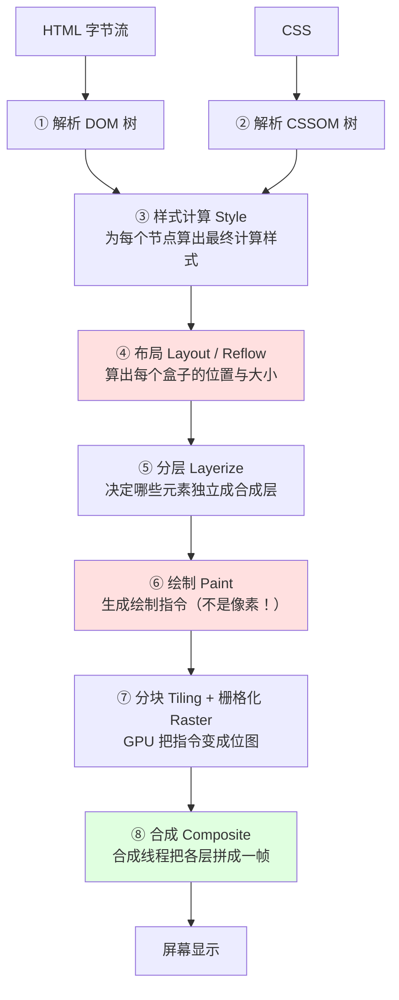
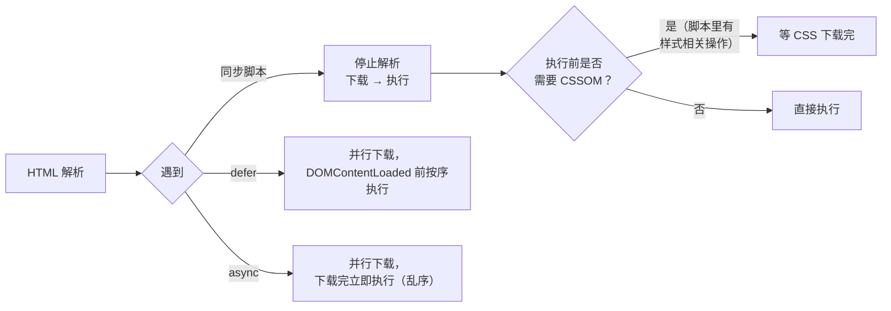
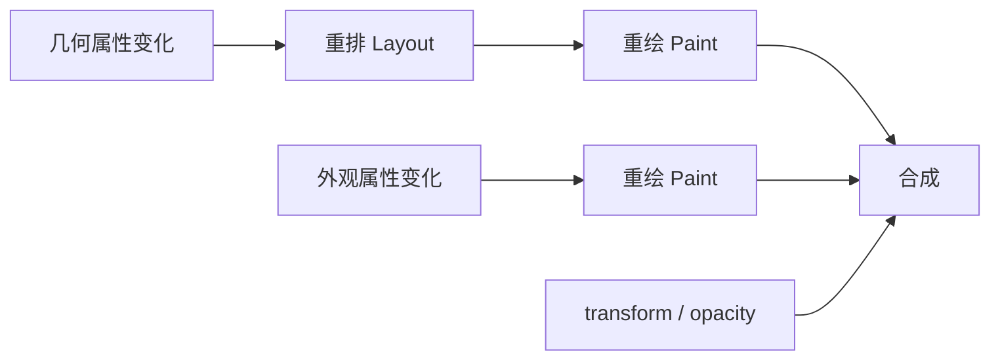

# 性能 · 04 渲染优化：渲染流水线与重排重绘

> 覆盖题号：**12、17、18、23、25**
> 对应原题：《浏览器的渲染流程》《减少重绘和回流》《简述重绘和重排》《浏览器回流一定会触发重绘吗》《浏览器的回流与重绘》
> 这一册是**前端渲染性能的地基**。答好它，虚拟列表、动画优化、CLS、INP 全都能顺着讲出来。

---

## 目录

- [1. 浏览器渲染流水线（题 12）](#1-浏览器渲染流水线题-12)
- [2. 重排与重绘（题 18 / 23 / 25）](#2-重排与重绘题-18--23--25)
- [3. 强制同步布局（性能第一大杀手）](#3-强制同步布局性能第一大杀手)
- [4. 减少重排重绘的 10 个手段（题 17）](#4-减少重排重绘的-10-个手段题-17)
- [5. 合成层：为什么 transform 便宜](#5-合成层为什么-transform-便宜)
- [6. 现代 CSS 优化：contain 与 content-visibility](#6-现代-css-优化contain-与-content-visibility)
- [7. 长列表虚拟滚动](#7-长列表虚拟滚动)
- [8. 动画优化：rAF 与动画属性选择](#8-动画优化raf-与动画属性选择)
- [9. 事件与交互优化（INP 相关）](#9-事件与交互优化inp-相关)
- [10. 怎么用 Performance 面板排查渲染问题](#10-怎么用-performance-面板排查渲染问题)
- [11. 常见坑](#11-常见坑)
- [12. 答题模板](#12-答题模板)
- [13. 追问表](#13-追问表)
- [14. 速记卡](#14-速记卡)

---

## 1. 浏览器渲染流水线（题 12）

### 1.1 一句话结论

浏览器把一个 HTML 字符串变成屏幕像素，要经过 **5 个大阶段**：**解析 → 样式 → 布局 → 绘制 → 合成**。其中"布局"和"绘制"是最贵的两步，所有渲染优化本质都是**让变更跳过其中一步或几步**。

### 1.2 完整流水线（含现代浏览器的分层/合成）



**每一步在干什么（面试要能逐条说）：**

| 阶段 | 输入 | 输出 | 成本 |
|---|---|---|---|
| ① 解析 HTML | 字节流 | DOM 树 | 中（受 DOM 复杂度影响） |
| ② 解析 CSS | CSS 文本 | CSSOM 树 | 中 |
| ③ 样式计算 | DOM + CSSOM | 每个节点的 computedStyle | 中（选择器越复杂越慢） |
| ④ 布局 Layout | 样式树 | 几何信息（每个盒子 x/y/w/h） | **高**（要遍历整棵树，且会连锁） |
| ⑤ 分层 | 布局树 | 图层树 | 低 |
| ⑥ 绘制 Paint | 图层树 | **绘制指令列表**（类似"在这里画个矩形"） | **高** |
| ⑦ 栅格化 | 绘制指令 | 位图（tile） | 中（GPU 并行） |
| ⑧ 合成 | 位图 | 最终帧 | **极低**（GPU 直接拼） |

> **常见误区**：很多人答"渲染流程"只答到 Paint 就停了，**漏掉分层与合成**。而"为什么 transform 比 top 快"这个必考题，答案恰恰在 ⑦⑧ 两步——所以这一环不能漏。

### 1.3 三个关键认知（这一节的价值所在）

**认知一：Paint 产出的是"指令"，不是"像素"。**

Paint 阶段生成的是类似 `drawRect(x, y, w, h, color)` 的指令列表。真正的像素填充发生在**栅格化**（Raster），由 GPU/合成线程完成。这就解释了为什么"重绘"不一定等于"卡"——如果只是图层内局部重绘，栅格化可以增量进行。

**认知二：只有"几何变化"才会让后续所有阶段重跑。**

```
改 width/height/top/left  →  Layout → Layerize → Paint → Raster → Composite  （全跑）
改 color/background       →            Paint  → Raster → Composite           （跳过 Layout）
改 transform/opacity      →                              Raster? → Composite （可能只 Composite）
```

**认知三：合成（Composite）在独立线程。**

合成线程（Compositor Thread）独立于主线程。这意味着：**即使主线程被 JS 卡住，纯 transform/opacity 的动画依然能流畅播放**。这是"动画要用 transform"的根本原因，不只是"少一次重排"。

### 1.4 CSS 与 JS 对解析的阻塞关系



| 资源 | 阻塞解析？ | 阻塞渲染？ |
|---|---|---|
| `<script>`（同步） | **是** | 是 |
| `<script defer>` | 否 | 否（DOMContentLoaded 前执行） |
| `<script async>` | 否（但执行时会打断） | 可能 |
| `<link rel=stylesheet>` | 否 | **是**（CSSOM 不完成不渲染） |
| 图片/字体 | 否 | 字体阻塞文本渲染 |

> **易错点**：CSS **不阻塞 DOM 解析**，但**阻塞渲染**，而且**阻塞后面同步脚本的执行**（因为脚本可能读样式）。这是"为什么 CSS 放 head、JS 放 body 底部"的完整理由。

### 1.5 30 秒版

> "渲染分五步：解析 HTML 生成 DOM、解析 CSS 生成 CSSOM，两者合成渲染树；然后样式计算、布局算位置大小、绘制生成指令，最后分层栅格化再合成上屏。关键是改不同属性跳过的阶段不同：改宽高要重排，改颜色只重绘，改 transform 和 opacity 只合成。"

### 1.6 2 分钟版

> "完整流水线是这样：
>
> 先是**解析**，HTML 解析成 DOM，CSS 解析成 CSSOM。这里有两个阻塞关系要说清：同步 script 会阻塞 DOM 解析，CSS 不阻塞解析但阻塞渲染，而且会阻塞后面的同步脚本。
>
> 然后是**样式计算**，把 DOM 和 CSSOM 合成渲染树，给每个节点算出最终计算样式。
>
> 接着是**布局**，也叫重排，算出每个盒子的精确位置和大小。这一步很贵，因为它要遍历整棵树，而且一个元素变化会连锁影响兄弟和父级。
>
> 再是**绘制**，注意它产出的是绘制指令，不是像素。真正的像素填充在后面。
>
> 现代浏览器还有两步很多人会漏：**分层和合成**。浏览器会把一些元素提升为独立合成层，绘制后由 GPU 分别栅格化，最后由合成线程拼成一帧。合成线程独立于主线程，所以纯 transform 动画即使 JS 卡住也能流畅——这是'动画用 transform'的根本原因，不只是少一次重排。
>
> 所以优化手段就是按'能跳过哪一步'来分类：改几何属性全跑，改颜色跳过布局，改 transform 跳过布局和绘制。"

### 1.7 追问

| 追问 | 要点 |
|---|---|
| DOM 和 CSSOM 为什么要合成渲染树？ | 渲染树只包含可见节点（`display:none` 不在其中，`visibility:hidden` 在） |
| 为什么 CSS 放 head？ | 早发现早下载，避免"无样式闪烁"（FOUC）；且避免阻塞后面脚本 |
| `defer` 和 `async` 区别？ | defer 保序、DOMContentLoaded 前执行；async 乱序、下载完就执行（适合独立脚本如统计） |
| 为什么 `display:none` 不占渲染树？ | 它不产生盒子；而 `visibility:hidden` 产生盒子只是不可见，仍参与布局 |
| 布局为什么比绘制贵？ | 布局要算几何约束（会连锁），绘制只是生成指令；但绘制复杂图形（阴影、圆角、滤镜）也很贵 |
| 什么是"渲染帧预算"？ | 60fps 下每帧 16.7ms；扣掉 JS 和样式计算，留给布局+绘制的通常只有几毫秒 |

---

## 2. 重排与重绘（题 18 / 23 / 25）

### 2.1 一句话结论

**重排（Reflow / Layout）= 元素的几何属性变了，浏览器要重新算布局；重绘（Repaint）= 只是外观变了（颜色、背景、阴影），布局不用重算，但像素要重画。**

### 2.2 定义与关系

| | 重排（回流 / Layout） | 重绘（Paint） |
|---|---|---|
| 触发条件 | 几何属性变化：宽高、位置、字体大小、内容增减、窗口尺寸 | 外观属性变化：颜色、背景、边框色、阴影、可见性 |
| 影响范围 | **可能影响整棵树**（父级、兄弟、后续元素） | 通常只影响该元素所在图层 |
| 成本 | **高** | 中 |
| 后续阶段 | 必然跟一次重绘 | 不需要重排 |



**题 23「回流一定会触发重绘吗」的标准答法：**

> "**会**。因为布局变了，元素在屏幕上的像素位置也变了，必须重新生成绘制内容。但这里要补充一个现代浏览器的细节：如果该元素已经被提升为独立合成层，那么它的 `transform` 位移虽然改变了**视觉位置**，但不会触发 Layout，也不会重新 Paint，只是合成阶段换个位置——所以更严谨的说法是'**几何变化一定会导致该元素的绘制内容失效，但对于独立合成层内的 transform 变化，这个'重绘'被优化成了'重新合成'**'。"

> 这个回答的好处：既答对了传统结论（面试官想听的），又展示了你知道现代浏览器有例外（体现深度）。**只答"会"是及格，补上例外是优秀。**

### 2.3 会触发重排的操作（清单要背）

**（1）几何/布局相关 CSS 属性**

```
width / height / min-height / max-height
padding / margin / border-width
top / right / bottom / left
position / float / display
font-size / font-weight / line-height / font-family
text-align / vertical-align / white-space
overflow / overflow-x / overflow-y
flex / grid 相关（flex-basis、grid-template-*）
```

**（2）内容与结构变化**

- 增删 DOM 节点
- 文本内容变化（`textContent`、`innerText`）
- 图片加载完成（未设置尺寸时）
- 窗口 resize、字体加载完成
- 滚动（某些情况下，尤其滚动条出现/消失）
- 读取某些属性（见第 3 节，这是"被动触发"的重排）

**（3）只触发重绘的属性**

```
color / background / background-color / background-image
border-color / border-style / border-radius
box-shadow / text-shadow / outline
visibility
```

### 2.4 一个反直觉的点：`display:none` 反而可能更快

```js
// ❌ 逐个改：每次都可能触发一次重排
const list = document.querySelector('.list')
for (let i = 0; i < 100; i++) {
  const li = document.createElement('li')
  li.textContent = `item ${i}`
  list.appendChild(li)      // 第 1 次插入后布局就脏了，第 2 次读取时才重排……但浏览器可能内部多次重算
}

// ✅ 做法一：DocumentFragment（减少插入次数，不触发中间重排）
const frag = document.createDocumentFragment()
for (let i = 0; i < 100; i++) {
  const li = document.createElement('li')
  li.textContent = `item ${i}`
  frag.appendChild(li)
}
list.appendChild(frag)        // 只触发一次

// ✅ 做法二：先脱离文档流，改完再放回
list.style.display = 'none'   // 脱离渲染树
// ... 大量 DOM 操作 ...
list.style.display = ''       // 放回时只重排一次
```

> `display: none` 的元素**不在渲染树中**，对它的 DOM 操作不会触发布局计算；等它重新显示时只算一次。这就是"离线操作"的原理。

---

## 3. 强制同步布局（性能第一大杀手）

> 这是渲染性能里**最值得讲、最少人讲透**的一点。面试时如果主动提出来，基本能确认你写过真实项目。

### 3.1 什么是强制同步布局（Layout Thrashing）

正常情况下，浏览器会把 DOM 变更**攒起来**，在下一帧统一重排——这是性能优化。

但如果你在修改样式之后**立刻读取**一个需要布局信息的属性，浏览器为了给你正确的值，**必须马上把攒的变更全部执行一遍布局**。这就叫"强制同步布局"（forced synchronous layout），也叫"布局抖动"（layout thrashing）。

```js
// ❌ 典型的性能灾难：读-写-读-写 交替
for (let i = 0; i < 100; i++) {
  const el = items[i]
  el.style.width = el.offsetWidth + 10 + 'px'   // 写 → 读（强制布局）→ 写 → 读…
}
// 100 次循环 = 100 次同步布局，本可以只有 1 次
```

```js
// ✅ 读写分离：先全部读，再全部写
const widths = items.map(el => el.offsetWidth)     // 一次性读
items.forEach((el, i) => {
  el.style.width = widths[i] + 10 + 'px'           // 一次性写
})
```

### 3.2 哪些属性/方法会强制布局

**Element 几何属性：**

```
offsetTop / offsetLeft / offsetWidth / offsetHeight / offsetParent
clientTop / clientLeft / clientWidth / clientHeight
scrollTop / scrollLeft / scrollWidth / scrollHeight
```

**方法：**

```
getBoundingClientRect()
getClientRects()
getComputedStyle()      // 读某些属性时会
scrollIntoView()
focus()                 // 会滚动到元素
window.innerWidth / innerHeight  （某些情况下）
element.scrollIntoViewIfNeeded()
```

> **判断标准**：只要这个值"依赖于布局结果"，浏览器就必须先算布局。`offsetWidth` 依赖布局，`style.color` 不依赖。

### 3.3 一个真实的优化案例

```js
// 需求：把一批卡片的高度统一为其中最高的那张

// ❌ 版本 1：两遍循环，每遍都读
let max = 0
cards.forEach(c => { max = Math.max(max, c.offsetHeight) })   // 100 次读
cards.forEach(c => { c.style.height = max + 'px' })           // 100 次写
// 实际：读阶段只强制 1 次布局（因为写发生在读之后）；
// 但如果中间有写，就会退化成 100 次

// ✅ 版本 2：用 getBoundingClientRect 批量读 + rAF 批量写
const heights = cards.map(c => c.getBoundingClientRect().height)
const max = Math.max(...heights)
requestAnimationFrame(() => {
  cards.forEach(c => { c.style.height = max + 'px' })
})
```

### 3.4 FastDOM 思路（读写队列）

```js
// 一个极简版的读写批处理，思想来自 fastdom
const reads = []
const writes = []
let scheduled = false

export function measure(fn) {
  reads.push(fn)
  schedule()
}
export function mutate(fn) {
  writes.push(fn)
  schedule()
}

function schedule() {
  if (scheduled) return
  scheduled = true
  requestAnimationFrame(() => {
    scheduled = false
    // 先执行所有读，再执行所有写 —— 保证最多一次布局
    reads.splice(0).forEach(fn => fn())
    writes.splice(0).forEach(fn => fn())
  })
}
```

> 面试提这个思路（不必背库名）能体现你理解"**批处理读、批处理写**"的本质。

### 3.5 追问

| 追问 | 要点 |
|---|---|
| 为什么读 `offsetWidth` 会触发重排？ | 它依赖布局结果，浏览器必须保证返回值正确，只能立即布局 |
| 读 `style.width` 会触发吗？ | 不会。它读的是**内联样式字符串**，不依赖布局 |
| 读 `getComputedStyle(el).width` 呢？ | 会。它是计算后的实际值，依赖布局（如果此时布局是脏的） |
| 怎么发现布局抖动？ | Performance 面板里出现密集的 "Layout" 紫色块，且与 JS 交替出现；或看到 "Forced reflow" 警告 |
| 用 `requestAnimationFrame` 能避免吗？ | 能缓解：把写操作推到下一帧，让读写分离；但根本解法还是"先读后写" |

---

## 4. 减少重排重绘的 10 个手段（题 17）

| # | 手段 | 原理 | 代码 |
|---|---|---|---|
| 1 | **批量修改 DOM** | 用 `DocumentFragment` 或拼好字符串一次插入 | 见 2.4 |
| 2 | **离线修改** | 先 `display:none` 或从文档移除，改完再放回 | 见 2.4 |
| 3 | **读写分离** | 避免强制同步布局 | 见第 3 节 |
| 4 | **用 `transform` 代替 `top/left`** | 走合成，跳过 Layout + Paint | `transform: translate(x, y)` |
| 5 | **用 `opacity` 代替 `visibility`/`display`** | 走合成 | `opacity: 0`（注意仍占位、可点击，需配 `pointer-events`） |
| 6 | **用 `requestAnimationFrame` 更新视觉** | 对齐帧节奏，避免一帧内多次改 | 见第 8 节 |
| 7 | **动画用 CSS 而非 JS 改样式** | CSS 动画可跑在合成线程 | `@keyframes` + `transform` |
| 8 | **`will-change` / `contain`** | 提前告知浏览器，减少影响范围 | 见第 5、6 节 |
| 9 | **避免用 table 布局做大范围结构** | table 布局变化会引发整表重算 | 用 flex/grid |
| 10 | **虚拟列表** | 从源头减少 DOM 数量 | 见第 7 节 |

### 4.1 一个完整的"错误 → 正确"对照

```js
// ❌ 展开动画：改 height，每帧都重排
el.style.height = '0px'
requestAnimationFrame(() => {
  el.style.transition = 'height .3s'
  el.style.height = '200px'
})

// ✅ 用 transform: scaleY（会变形文字）—— 或者更好的方案：
// 用 clip-path 或 max-height + transform 组合
el.style.transformOrigin = 'top'
el.style.transform = 'scaleY(0)'
requestAnimationFrame(() => {
  el.style.transition = 'transform .3s'
  el.style.transform = 'scaleY(1)'
})
```

> **注意**：`scaleY` 会把内容压扁。如果内容不能变形，可以用 `clip-path: inset(0 0 100% 0)` 做展开动画（`clip-path` 也是合成层友好的），或者接受 `max-height` 方案（会重排但不影响其它元素，性能可接受）。

---

## 5. 合成层：为什么 transform 便宜

### 5.1 什么元素会被提升为合成层

| 触发条件 | 示例 |
|---|---|
| 3D 变换 | `transform: translateZ(0)`、`translate3d()` |
| `will-change: transform / opacity` | 显式提示 |
| `opacity` 动画 / `transform` 动画（浏览器自动） | `animation`、`transition` |
| `position: fixed`（部分情况） | 固定定位元素 |
| `filter` / `backdrop-filter` | 滤镜 |
| `<video>`、`<canvas>`、`<iframe>` | 天然独立层 |
| 元素与其他层重叠且需裁剪 | 浏览器自动判断 |

### 5.2 合成层的代价（很多人只讲好处）

| 代价 | 说明 |
|---|---|
| **GPU 显存** | 每层都要存一份位图，`1920×1080` 的层约 8MB |
| **层数过多** | 显存爆掉，移动端直接闪退；Chrome 有层数上限 |
| **首帧成本** | 提升层本身要重新栅格化 |
| **`will-change` 滥用** | 元素一直留在层里，长期占显存 |

```css
/* ❌ 滥用：给所有卡片都加 will-change，几十个层常驻显存 */
.card { will-change: transform; }

/* ✅ 正确：只在即将动画时加，动画结束移除 */
.card:hover { will-change: transform; }
/* 或用 JS 在动画开始前加、结束后移除 */
```

```js
// ✅ JS 精确控制
function animate(el) {
  el.style.willChange = 'transform'
  el.animate(
    [{ transform: 'translateY(0)' }, { transform: 'translateY(-20px)' }],
    { duration: 300, easing: 'ease-out' }
  ).finished.finally(() => {
    el.style.willChange = 'auto'      // 及时释放
  })
}
```

### 5.3 为什么"只合成"能跑在独立线程

```
主线程：JS → 样式 → 布局 → 绘制 ─┐
                                  ├→ 提交给合成线程
合成线程：分块 → 栅格化 → 合成 → 上屏
```

合成线程有自己的动画调度器。当动画只涉及 `transform`/`opacity` 时，**合成线程可以直接按关键帧插值并重合成，完全不需要主线程参与**。这就是为什么"JS 卡住时 transform 动画依然流畅"。

> 反过来说：动画里如果用了 `width`、`left`、`box-shadow`，就必须回到主线程跑布局和绘制，一旦主线程忙就掉帧。

### 5.4 追问

| 追问 | 要点 |
|---|---|
| `transform: translateZ(0)` 为什么能"开启硬件加速"？ | 它触发 3D 变换，浏览器将其提升为合成层，交给 GPU |
| 合成层越多越好吗？ | 不是。显存开销大，移动端会闪退；层数过多反而降低合成效率 |
| `will-change` 什么时候加？ | 动画前 1 帧加，动画后移除；或只在 hover/交互时加 |
| `filter` 是合成的吗？ | 是，但 GPU 计算成本高（尤其 `blur`），大量使用反而卡 |
| 为什么 `box-shadow` 动画很卡？ | 它触发 Paint（不是合成），每帧都要重画阴影 |
| 怎么查看合成层？ | DevTools → Layers 面板；Performance 面板的 "Composite Layers" |

---

## 6. 现代 CSS 优化：contain 与 content-visibility

### 6.1 `contain`：告诉浏览器"这块是独立的"

```css
.card {
  contain: layout;       /* 内部布局不影响外部 */
  /* contain: paint;     裁剪到边界，外部不受影响 */
  /* contain: size;      尺寸不依赖子元素（需显式尺寸） */
  /* contain: style;     计数器等作用域隔离 */
  /* contain: strict;    = size layout paint style */
  /* contain: content;   = layout paint style（最常用） */
}
```

**收益**：浏览器知道"改这个元素内部不需要重算外面的布局"，可以大幅缩小重排范围。在长列表、卡片网格里效果明显。

### 6.2 `content-visibility`：跳过屏幕外元素的渲染

```css
.section {
  content-visibility: auto;
  contain-intrinsic-size: 0 500px;   /* 预估高度，避免滚动条乱跳 */
}
```

**原理**：屏幕外的 `.section` **完全跳过布局和绘制**（包括子元素），滚动到附近才开始渲染。

**收益**：长页面首屏渲染时间可以降 50%+，这是**"一行 CSS 换性能"**的典型代表。

**坑**：

| 坑 | 说明 |
|---|---|
| 不写 `contain-intrinsic-size` | 滚动条高度会跳（因为元素高度未知） |
| 影响锚点跳转/`find-in-page` | 未渲染区域的内容搜不到（Chrome 已改善） |
| 不适合首屏 | 首屏元素本来就要渲染，加了没收益 |

### 6.3 `will-change` 的正确用法（三原则）

1. **只在需要前加**，不要全局加
2. **加在会变的属性上**（`transform`、`opacity`），别写 `will-change: all`
3. **用完就移除**，否则层永远存在

---

## 7. 长列表虚拟滚动

### 7.1 为什么需要

10000 条数据、每条 8 个 DOM 节点 = 80000 个节点。浏览器布局要遍历全部，滚动时每帧都要重算 → **必然卡**。

虚拟滚动：**只渲染可视区 + 上下缓冲**，通常 20~60 个节点。

### 7.2 定高列表（核心思路 20 行）

```vue
<template>
  <div class="viewport" ref="viewport" @scroll="onScroll">
    <!-- 撑开滚动条，让滚动条长度看起来是"全部数据" -->
    <div class="phantom" :style="{ height: totalHeight + 'px' }"></div>
    <!-- 可视区内容，用 transform 定位 -->
    <div class="content" :style="{ transform: `translateY(${offsetY}px)` }">
      <div v-for="item in visible" :key="item.id" class="row">
        {{ item.text }}
      </div>
    </div>
  </div>
</template>

<script setup>
import { ref, computed, shallowRef } from 'vue'

const props = defineProps({
  items: { type: Array, required: true },
  itemHeight: { type: Number, default: 50 },
  buffer: { type: Number, default: 5 },     // 上下各多渲染几行，减少白屏
})

const viewport = ref(null)
const scrollTop = ref(0)

const totalHeight = computed(() => props.items.length * props.itemHeight)

const startIndex = computed(() =>
  Math.max(0, Math.floor(scrollTop.value / props.itemHeight) - props.buffer)
)
const endIndex = computed(() =>
  Math.min(
    props.items.length,
    Math.ceil((scrollTop.value + (viewport.value?.clientHeight || 0)) / props.itemHeight)
      + props.buffer
  )
)
const visible = computed(() => props.items.slice(startIndex.value, endIndex.value))
const offsetY = computed(() => startIndex.value * props.itemHeight)

let rafId = 0
function onScroll(e) {
  // 用 rAF 节流，一帧最多算一次
  const top = e.target.scrollTop
  if (rafId) return
  rafId = requestAnimationFrame(() => {
    scrollTop.value = top
    rafId = 0
  })
}
</script>

<style scoped>
.viewport { height: 100%; overflow-y: auto; position: relative; }
.phantom  { position: absolute; top: 0; left: 0; right: 0; }
.content  { position: absolute; top: 0; left: 0; right: 0; will-change: transform; }
.row      { height: 50px; }
</style>
```

**三个关键点：**

1. **幻影元素撑高度**：滚动条代表全部数据，用户滚动行为符合直觉
2. **`transform: translateY` 定位**：比 `top` 便宜（走合成）
3. **rAF 节流 scroll**：scroll 事件每秒可触发上百次，直接改响应式会卡

### 7.3 不定高列表

| 方案 | 思路 | 缺点 |
|---|---|---|
| **预估 + 实测** | 先按平均值算总高，渲染后用 `ResizeObserver` 实测并修正偏移表 | 实现复杂，滚动中可能有微小跳动 |
| **二分查找 + 前缀和** | 维护 `offsets[]` 数组，用二分定位起始索引 | 数据量大时维护成本高 |
| **`content-visibility: auto`** | 不虚拟化，只让浏览器跳过屏幕外渲染 | 简单但不是真虚拟化，节点数量仍多 |

```js
// ResizeObserver 实测行高
const ro = new ResizeObserver((entries) => {
  for (const entry of entries) {
    const index = Number(entry.target.dataset.index)
    const realHeight = entry.borderBoxSize[0].blockSize
    if (heights[index] !== realHeight) {
      heights[index] = realHeight
      rebuildOffsets()          // 重建前缀和
    }
  }
})
```

### 7.4 现成方案

| 库 | 特点 |
|---|---|
| `vue-virtual-scroller` | Vue 生态成熟，支持动态高度 |
| `@tanstack/vue-virtual` | 轻量、headless、TS 友好 |
| `@vueuse/core` 的 `useVirtualList` | 简单场景够用 |
| `react-window` / `react-virtuoso` | React 生态 |

### 7.5 追问

| 追问 | 要点 |
|---|---|
| 虚拟列表的滚动条为什么能代表全部？ | 用幻影元素撑出总高度 |
| 为什么用 transform 而不用 top？ | 避免 Layout，只走合成 |
| 快速滚动出现白屏怎么办？ | 加大 buffer、加占位骨架、用 `requestIdleCallback` 预渲染 |
| 不定高怎么处理？ | 预估 + ResizeObserver 实测 + 前缀和二分定位 |
| 虚拟列表能用于表格吗？ | 能，但要处理列宽同步、固定列、行合并（复杂） |
| 和分页比有什么优势？ | 滚动体验连续、无翻页等待；缺点是内存里要持有全量数据 |

---

## 8. 动画优化：rAF 与动画属性选择

### 8.1 属性选择的优先级

```
🥇 transform / opacity        → 只合成，可在合成线程跑
🥈 filter / clip-path         → 合成但 GPU 计算贵
🥉 color / background-color   → 重绘
❌ width / height / top / left / margin / box-shadow  → 重排（或昂贵重绘）
```

### 8.2 为什么用 `requestAnimationFrame`

```js
// ❌ setInterval 16ms：不准、可能一帧跑多次、页面不可见时仍在跑
setInterval(() => { el.style.transform = `translateX(${x++}px)` }, 16)

// ❌ 在 scroll/mousemove 里直接改：事件频率可能远高于帧率
window.addEventListener('scroll', () => { el.style.top = window.scrollY + 'px' })

// ✅ rAF：与浏览器帧同步，页面不可见时自动暂停
let x = 0
function tick() {
  x += 2
  el.style.transform = `translateX(${x}px)`
  if (x < 500) requestAnimationFrame(tick)
}
requestAnimationFrame(tick)
```

**rAF 的三个优势：**

1. **对齐帧**：回调在渲染前执行，不会"改了没画"或"一帧改多次"
2. **自动节流**：页面隐藏（切标签页）时暂停，省电
3. **批量机会**：同一帧内的多次 rAF 回调合并执行

### 8.3 CSS 动画 vs JS 动画

| | CSS 动画 | JS 动画（rAF） |
|---|---|---|
| transform/opacity 动画 | **可跑在合成线程**，JS 卡也不掉帧 | 需要主线程参与，会掉帧 |
| 复杂路径/物理效果 | 难 | 灵活 |
| 动态参数 | 需改变量或重启动画 | 容易 |
| 性能上限 | 更高 | 较低 |

> **结论**：能用 CSS 就用 CSS；需要复杂逻辑时，用 Web Animations API（`el.animate()`）——它同样能被浏览器优化到合成线程。

```js
// Web Animations API：比手写 rAF 更省事，也比 CSS 更灵活
const anim = el.animate(
  [
    { transform: 'translateY(0)', opacity: 1 },
    { transform: 'translateY(-20px)', opacity: 0 },
  ],
  { duration: 300, easing: 'cubic-bezier(.4,0,.2,1)', fill: 'forwards' }
)
anim.finished.then(() => { /* 清理 */ })
```

### 8.4 帧预算

| 刷新率 | 每帧预算 |
|---|---|
| 60Hz | 16.7ms |
| 90Hz | 11.1ms |
| 120Hz | 8.3ms |

**这 16.7ms 里要装**：JS 执行 + 样式计算 + 布局 + 绘制 + 合成。所以一个动画里，**JS 部分最好控制在 5ms 内**。

### 8.5 追问

| 追问 | 要点 |
|---|---|
| `rAF` 和 `setInterval` 区别？ | rAF 与帧同步、自动暂停；setInterval 不保证时机 |
| `rAF` 和 `requestIdleCallback` 区别？ | rAF 是渲染前高优先；rIC 是空闲时低优先，有 deadline |
| `transform` 动画会不会影响子元素？ | 会，子元素跟着变形（因为整体变换） |
| 为什么 `box-shadow` 动画卡？ | 每帧都要重绘阴影，阴影计算昂贵 |
| 如何做"无限滚动动画"？ | CSS `@keyframes` + `animation: ... infinite linear`，只动 transform |
| 动画掉帧怎么排查？ | Performance 面板看 Frames 轨道，红色帧对应长任务；或 `PerformanceObserver('long-animation-frame')` |

---

## 9. 事件与交互优化（INP 相关）

| 手段 | 说明 | 代码 |
|---|---|---|
| **事件委托** | 只在父级挂一个监听，减少监听器数量 | 见下 |
| **`passive: true`** | 让滚动不被 `preventDefault` 阻塞 | `addEventListener('touchmove', fn, { passive: true })` |
| **防抖** | 输入停止后才执行（搜索联想） | — |
| **节流** | 固定频率执行（滚动、resize） | — |
| **避免在 input 里做重活** | 每次按键都触发，容易拖垮 INP | 用防抖 + 拆任务 |
| **及时移除监听** | 防内存泄漏 | `onUnmounted` / `useEffect` cleanup |

```js
// 事件委托：1000 个列表项只需 1 个监听器
document.querySelector('.list').addEventListener('click', (e) => {
  const li = e.target.closest('li[data-id]')
  if (!li) return
  handleClick(li.dataset.id)
})
```

```js
// 防抖 vs 节流
function debounce(fn, delay = 300) {
  let timer
  return (...args) => {
    clearTimeout(timer)
    timer = setTimeout(() => fn(...args), delay)
  }
}

function throttle(fn, interval = 100) {
  let last = 0
  return (...args) => {
    const now = Date.now()
    if (now - last >= interval) {
      last = now
      fn(...args)
    }
  }
}
```

> **INP 视角的重要提醒**：防抖**不能改善单次交互的 INP**。它只是减少触发次数。真正要改善 INP，必须让**单次处理更快**（拆任务、减少渲染量、用 Worker）。

---

## 10. 怎么用 Performance 面板排查渲染问题

### 10.1 看什么

| 轨道 | 关注点 |
|---|---|
| **Main**（主线程火焰图） | 找 > 50ms 的长任务（右上角红三角） |
| **Frames** | 红色斜纹帧 = 掉帧 |
| **Layout** | 紫色块密集 = 频繁重排；有 "Forced reflow" 警告 = 布局抖动 |
| **Paint** | 绿色块 = 绘制；面积大说明绘制区域过大 |
| **Composite Layers** | 合成耗时 |
| **Layers** 面板 | 层数、每层显存占用 |

### 10.2 一个典型诊断流程

```
1. 录制 5 秒滚动/交互过程
2. 看 Frames 轨道有没有红色帧 → 有掉帧
3. 点中红色帧，看 Main 轨道对应时间段
4. 如果看到 Layout 块很大 → 布局问题（DOM 太多 / 布局抖动）
5. 如果看到 Paint 块很大 → 绘制问题（阴影/圆角/大面积）
6. 如果看到函数调用很长 → JS 问题（拆任务）
7. 如果 Layout 和 JS 交替出现 → 布局抖动（读写在循环里交替）
```

### 10.3 三个高频"证据"

| 现象 | 结论 |
|---|---|
| Layout 块里出现 "Forced reflow is a likely performance bottleneck" | 读写交替，需要批处理 |
| 帧里出现多个 Paint 且有 "Layer" 相关 | 层数过多或层内大范围重绘 |
| `Recalculate Style` 耗时高 | 选择器太复杂（深层嵌套、通配符） |

---

## 11. 常见坑

| # | 坑 | 纠正 |
|---|---|---|
| 1 | 答渲染流程漏掉"分层/合成" | 补上 ⑦⑧ 两步，才能解释 transform 为什么快 |
| 2 | 说"重排一定重绘"就完了 | 对，但补一句"独立合成层内的 transform 变化属于例外" |
| 3 | 用 `transform` 以为能消除 CLS | 不能。视觉位移同样计入 CLS |
| 4 | `will-change` 全局加 | 显存爆掉，移动端闪退 |
| 5 | 在 scroll 事件里直接读 `offsetTop` | 强制同步布局，滚动必卡 |
| 6 | 用 `setInterval` 做动画 | 不对齐帧，且后台仍耗电 |
| 7 | 用 `width` 做展开动画 | 每帧重排；用 `transform`/`clip-path` |
| 8 | `content-visibility` 忘了写 `contain-intrinsic-size` | 滚动条抖动 |
| 9 | 虚拟列表不用 rAF 节流 scroll | 高频响应式更新反而更卡 |
| 10 | 用防抖"优化 INP" | 只减少次数，不改善单次耗时 |
| 11 | `display:none` 的元素做动画 | 不会触发过渡（元素不在渲染树）；用 `visibility` 或先显示再在下一帧加类 |
| 12 | `opacity: 0` 的元素仍能点击 | 加 `pointer-events: none` |

---

## 12. 答题模板

### 12.1 「浏览器渲染流程」——30 秒

> "五步：解析 HTML 生成 DOM、解析 CSS 生成 CSSOM，合成渲染树并做样式计算；然后布局算位置大小，绘制生成指令，最后分层栅格化、合成上屏。关键点是改不同属性跳过的阶段不同——改宽高全跑一遍，改颜色跳过布局，改 transform 和 opacity 只合成。"

### 12.2 「浏览器渲染流程」——2 分钟

> （用 1.6 节 2 分钟版，重点在最后补"每步的成本"和"为什么 CSS 阻塞渲染不阻塞解析"。）

### 12.3 「重绘和重排」——30 秒

> "重排是几何属性变了，比如宽高位置字体，浏览器要重新算布局，成本高，而且会连锁影响兄弟和父级；重绘是外观变了，比如颜色背景阴影，布局不用重算，但像素要重画。重排一定跟着一次重绘，重绘不一定重排。现代浏览器还有第三种更便宜的路径：transform 和 opacity 变化可以只走合成，跳过布局和绘制。"

### 12.4 「怎样减少重绘重排」——2 分钟

> "我会从三个层面讲。
>
> **第一层是减少次数**。核心是批量：用 DocumentFragment 或拼字符串一次插入，而不是循环 append；或者先 `display:none` 脱离渲染树，改完再放回，这样只重排一次。还有一个更隐蔽的问题叫强制同步布局——如果在改完样式后立刻读 `offsetWidth` 这类依赖布局的属性，浏览器就必须马上把攒的变更算一遍，读写交替在循环里就是灾难，所以要读写分离，先全部读、再全部写。
>
> **第二层是降低单次成本**。避免改几何属性，改用 transform 和 opacity，因为它们可以只走合成；动画用 CSS 或 Web Animations API，跑在合成线程，JS 卡住也不掉帧；给元素加 contain 缩小重排影响范围；长页面用 content-visibility 让屏幕外跳过渲染。
>
> **第三层是从源头减少**。DOM 数量太多的话，怎么优化都会卡，所以要虚拟列表，10000 条只渲染可视区的几十个节点；再配合 rAF 节流 scroll，事件用委托，滚动监听加 passive。
>
> 最后排查用 Performance 面板，看 Layout 紫色块的密度和有没有 Forced reflow 警告。"

---

## 13. 追问表

| # | 追问 | 要点 |
|---|---|---|
| 1 | 回流一定触发重绘吗？ | 会。但独立合成层内的 transform 位移属于例外（只重新合成） |
| 2 | 重绘一定不触发回流吗？ | 对，外观变化不影响几何 |
| 3 | 哪些操作一定触发重排？ | 改几何属性、增删 DOM、改文本、resize、字体加载、读布局属性 |
| 4 | `visibility:hidden` 和 `display:none` 区别？ | 前者占位、在渲染树、触发重绘；后者不占位、不在渲染树、触发重排 |
| 5 | 什么是强制同步布局？ | 改样式后立即读布局属性，浏览器被迫立即布局 |
| 6 | 哪些属性读取会强制布局？ | offset*/client*/scroll*、getBoundingClientRect、getComputedStyle 的几何值 |
| 7 | DocumentFragment 为什么快？ | 脱离文档、不触发布局，最后一次性插入 |
| 8 | 为什么 transform 不触发重排？ | 它只影响合成阶段的变换矩阵，不改变布局几何 |
| 9 | 合成层越多越好吗？ | 不是，显存开销大，移动端易闪退 |
| 10 | `will-change` 怎么用？ | 动画前加、动画后移除；只写会变的属性 |
| 11 | `content-visibility` 原理？ | 屏幕外元素跳过布局和绘制，需配 `contain-intrinsic-size` |
| 12 | 60fps 意味着一帧多少毫秒？ | 16.7ms，包含 JS + 样式 + 布局 + 绘制 + 合成 |
| 13 | 动画该用什么属性？ | transform / opacity 优先；避免 width/height/top/left/box-shadow |
| 14 | 虚拟列表的滚动条怎么算的？ | 幻影元素撑出总高度 |
| 15 | 表格为什么渲染慢？ | table 布局算法要求全局计算，任一单元格变化可能触发表级重算 |
| 16 | 为什么 `box-shadow` 动画卡？ | 触发 Paint 且阴影计算昂贵，不走合成 |
| 17 | 怎么减少首屏绘制量？ | 减少 DOM 数量、`content-visibility`、避免首屏大阴影/模糊 |
| 18 | 布局抖动能用 rAF 彻底解决吗？ | 不能，rAF 只是把写推到下一帧；根本解法是读写分离 |
| 19 | `opacity` 动画为什么比 `visibility` 好？ | `opacity` 走合成；`visibility` 变化触发重绘 |
| 20 | 什么是 LoAF？ | Long Animation Frames API，比 longtask 更细，能定位到具体脚本 |

---

## 14. 速记卡

```
【渲染五步】
DOM + CSSOM → Style → Layout(重排) → Paint(重绘) → Layerize → Raster → Composite(合成)

【跳过关系】
改几何（width/height/top/left）  → Layout + Paint + Composite   （最贵）
改外观（color/bg/shadow）        → Paint + Composite
改合成（transform/opacity）      → Composite                    （最便宜）
动画跑在合成线程 → 主线程卡也不掉帧

【阻塞关系】
同步 script：阻塞 DOM 解析
CSS：不阻塞解析，但阻塞渲染，且阻塞后面的同步脚本
defer：并行下载、保序、DOMContentLoaded 前执行
async：并行下载、乱序、下载完立即执行

【强制同步布局】
改样式后立刻读 offsetWidth / getBoundingClientRect / getComputedStyle
→ 浏览器被迫立即布局
解法：先全部读，再全部写（读写分离 / rAF 批处理）

【减少重排十招】
批量插入(Fragment) / display:none 离线改 / 读写分离 / transform 代替 top
opacity 代替 visibility / rAF / CSS 动画 / will-change+contain / 避免 table / 虚拟列表

【两个现代 CSS】
contain: content    → 缩小重排影响范围
content-visibility: auto + contain-intrinsic-size → 屏幕外跳过渲染

【帧预算】
60Hz = 16.7ms / 120Hz = 8.3ms；JS 部分最好 < 5ms
```
