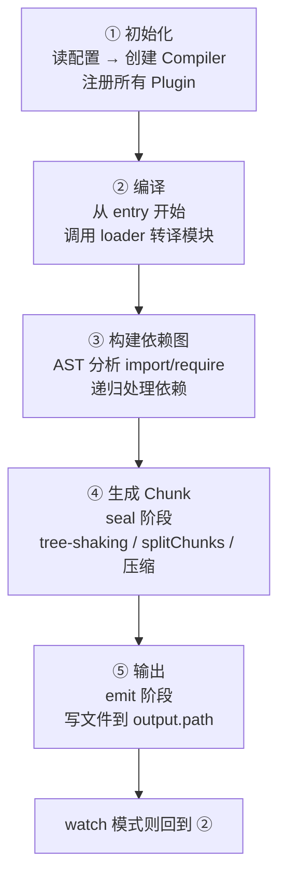
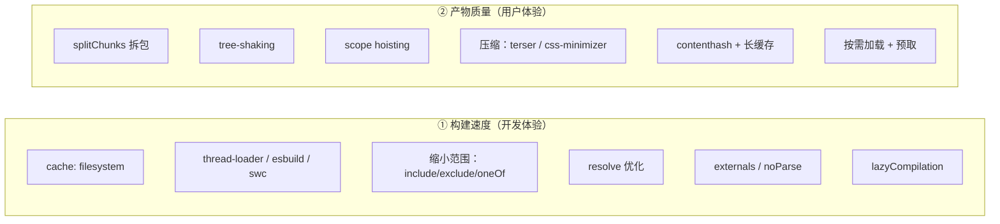
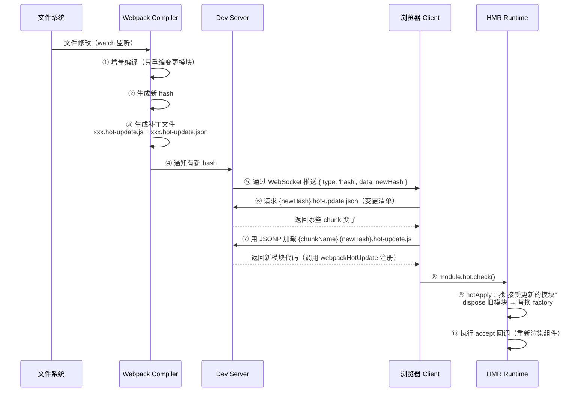

# 性能 · 07 Webpack：打包原理 / 构建优化 / HMR

> 覆盖题号：**7、11、22**
> 对应原题：《Webpack 性能优化》《谈谈你对 webpack 打包原理的理解》《谈谈你对 webpack 热更新原理的理解》
> 三题是一条线：**懂原理（11）→ 才能优化（7）→ 而 HMR（22）是原理的最佳应用**。

---

## 目录

- [1. Webpack 打包原理](#1-webpack-打包原理)
- [2. loader 与 plugin 的本质区别](#2-loader-与-plugin-的本质区别)
- [3. 手写一个 60 行的迷你打包器（加分项）](#3-手写一个-60-行的迷你打包器加分项)
- [4. Webpack 性能优化](#4-webpack-性能优化)
- [5. tree-shaking 的原理与生效条件](#5-tree-shaking-的原理与生效条件)
- [6. splitChunks 怎么配才合理](#6-splitchunks-怎么配才合理)
- [7. HMR 热更新原理](#7-hmr-热更新原理)
- [8. Webpack vs Vite（现代视角）](#8-webpack-vs-vite现代视角)
- [9. 常见坑](#9-常见坑)
- [10. 答题模板](#10-答题模板)
- [11. 追问表](#11-追问表)
- [12. 速记卡](#12-速记卡)

---

## 1. Webpack 打包原理

### 1.1 一句话结论

**Webpack 从入口出发，用 loader 把各种类型的文件"翻译"成 JS 模块，递归解析依赖构建依赖图，再把模块按规则组合成 chunk，最后交给 plugin 在生命周期的各个钩子上加工，输出成浏览器能跑的 bundle。**

### 1.2 五个阶段



**逐阶段细节：**

| 阶段 | 关键动作 | 核心对象 |
|---|---|---|
| **① 初始化** | 合并 CLI + 配置文件；`new Compiler()`；遍历 `plugins` 数组调用 `plugin.apply(compiler)` 注册钩子 | `Compiler` |
| **② 编译** | `compiler.run()` → 创建 `Compilation`；`addEntry` 把入口加入队列；对每个模块调用 `loader` 转译（**从右到左、从下到上**） | `Compilation` |
| **③ 建图** | 用 `acorn` 把 JS 解析成 AST，找出 `import`/`require`/`import()`；把依赖加入队列递归处理；形成 `ModuleGraph` | `Module` / `Dependency` |
| **④ 生成** | `seal` 阶段：根据入口与动态导入生成 chunk；执行优化（tree-shaking、splitChunks、minify）；生成最终代码 | `Chunk` / `ChunkGroup` |
| **⑤ 输出** | `emit` 钩子（可在这里改产物），写文件到磁盘；`afterEmit` + `done` | `assets` |

> **`Compiler` 与 `Compilation` 的区别**（高频追问）：
> - `Compiler`：**全局唯一**，代表整个构建过程，持有配置、文件系统、watch 等
> - `Compilation`：**每次构建创建一个**（watch 模式下每轮都新建），代表"这一次"的模块图与产物

### 1.3 核心概念对照

| 概念 | 是什么 | 一句话理解 |
|---|---|---|
| **entry** | 入口 | 依赖图的起点 |
| **output** | 输出 | 产物放哪、叫什么 |
| **loader** | 模块转换器 | 把非 JS 变成 JS（`css-loader`、`babel-loader`） |
| **plugin** | 生命周期扩展 | 在钩子上做任何事（压缩、生成 HTML、拷贝文件） |
| **module** | 模块 | 一个文件就是一个模块 |
| **chunk** | 代码块 | 一组模块的集合，最终对应一个输出文件 |
| **bundle** | 产物文件 | chunk 输出后的 `.js` 文件 |
| **tapable** | 事件流库 | 支撑 plugin 的钩子系统 |
| **ModuleGraph** | 模块依赖图 | 谁依赖谁、谁被谁引用 |
| **ChunkGraph** | 代码块图 | 模块怎么分配到 chunk |

### 1.4 tapable：plugin 的能力来源

Webpack 的所有扩展点都是 tapable 的钩子：

| 钩子类型 | 特点 | 例子 |
|---|---|---|
| `SyncHook` | 同步串行 | `emit` |
| `SyncBailHook` | 同步串行，返回非 `undefined` 就中断 | — |
| `AsyncSeriesHook` | 异步串行 | `beforeRun`、`done` |
| `AsyncParallelHook` | 异步并行 | `run` |

```js
// 一个 plugin 的最小结构
class MyPlugin {
  apply(compiler) {
    // 注册到某个钩子
    compiler.hooks.emit.tapAsync('MyPlugin', (compilation, callback) => {
      // compilation.assets 里是本次所有产物
      const content = '/* injected by MyPlugin */'
      compilation.assets['banner.txt'] = {
        source: () => content,
        size: () => content.length,
      }
      callback()
    })
  }
}
```

**常用钩子时序：**

```
entryOption → beforeRun → run → watchRun（watch 模式）
→ compile → thisCompilation → compilation → make（构建模块）
→ buildModule → succeedModule（每个模块）
→ finishMake → seal → optimize → optimizeModules → optimizeChunks
→ afterOptimizeChunks → emit → afterEmit → done
```

> 面试时能说出 `make`（构建模块）、`seal`（生成 chunk）、`emit`（输出）三个关键节点，就足够体现理解了。

### 1.5 30 秒版

> "五步：初始化时创建 Compiler 并注册所有 plugin；然后从 entry 开始，用 loader 把每个文件转成 JS 模块，用 acorn 解析 AST 找出依赖，递归构建依赖图；seal 阶段把模块分组成 chunk 并做 tree-shaking、拆包、压缩；最后 emit 写文件。核心是 loader 负责转换文件、plugin 通过 tapable 钩子介入各个生命周期。"

### 1.6 2 分钟版

> "Webpack 本质是个'依赖图打包器'，我按五个阶段讲。
>
> **初始化**：合并 CLI 参数和配置文件，创建全局唯一的 Compiler 对象，然后遍历 plugins 数组，调用每个 plugin 的 `apply(compiler)`，把它们的逻辑注册到 tapable 的钩子上。这是个事件流机制，所以 plugin 能介入任何阶段。
>
> **编译**：从 entry 开始，每个文件进来先过 loader 链。loader 是**从右到左、从下到上**执行的，本质是把上一个 loader 的输出喂给下一个。比如 `style-loader` 接收 `css-loader` 的输出。转译成 JS 后，用 acorn 解析成 AST，遍历找 `import`、`require`、`import()` 这些依赖。
>
> **建图**：把找到的依赖加入队列递归处理，最终形成 ModuleGraph——记录了谁依赖谁、谁被谁引用。这个图是后面 tree-shaking 和拆包的基础。
>
> **生成**：seal 阶段。根据入口和动态导入把模块分配到 chunk，然后跑一系列优化：tree-shaking 标记未使用导出、splitChunks 拆分公共代码、terser 压缩。
>
> **输出**：emit 阶段，把 chunk 写成文件。这里 plugin 还能改产物，比如 `html-webpack-plugin` 就是在这里把 script 标签注入 HTML。
>
> 有两个对象要区分：Compiler 是全局唯一的，代表整个构建；Compilation 是每次构建新建的，代表这一次的模块图和产物。watch 模式下每轮都新建一个 Compilation。"

### 1.7 追问

| 追问 | 要点 |
|---|---|
| Compiler 和 Compilation 区别？ | 前者全局唯一，后者每次构建新建 |
| loader 为什么从右到左？ | 函数组合（compose），`compose(a, b)(x) = a(b(x))` |
| loader 和 plugin 区别？ | loader 转换单个文件、在模块加载时执行；plugin 在生命周期钩子上做任意事 |
| Webpack 怎么解析依赖？ | acorn 解析 AST + `@babel/parser`，找 ImportDeclaration 等节点 |
| 什么是 chunk？ | 一组模块的集合，对应一个输出文件 |
| 动态导入变成什么？ | 生成独立 chunk + `__webpack_require__.e(chunkId)` 异步加载 |
| tapable 是什么？ | Webpack 作者写的事件流库，支撑 plugin 钩子 |
| Webpack 为什么慢？ | 全量构建：所有模块都要过 loader、解析 AST、生成代码 |

---

## 2. loader 与 plugin 的本质区别

| | loader | plugin |
|---|---|---|
| 作用对象 | **单个文件/模块** | **整个构建过程** |
| 运行时机 | 模块加载（`buildModule`）时 | 任意生命周期钩子 |
| 形态 | 一个函数：`source => newSource` | 一个类/对象，有 `apply(compiler)` |
| 能力 | 只能转换内容 | 可以做任何事（改配置、改产物、写文件、起服务） |
| 配置位置 | `module.rules` | `plugins` 数组 |
| 例子 | `babel-loader`、`css-loader`、`ts-loader` | `HtmlWebpackPlugin`、`MiniCssExtractPlugin`、`DefinePlugin` |

**loader 的两个阶段（高分点）：**

```js
// 一个 loader 可以导出 normal 和 pitch
module.exports = function (source) { /* normal 阶段 */ }
module.exports.pitch = function (remainingRequest, precedingRequest, data) {
  /* pitch 阶段 */
}
```

```
执行顺序：
pitch:  loader1 → loader2 → loader3
         ↓（如果某个 pitch 返回值，就跳过后续 loader 和读取文件）
normal: loader3 → loader2 → loader1
```

> **典型应用**：`style-loader` 用 pitch 阶段直接返回一段 JS 代码（运行时插入 style），从而**跳过**后面的 `css-loader` 读取文件的流程。这就是"pitch 能短路"的实际用途。

---

## 3. 手写一个 60 行的迷你打包器（加分项）

> 面试时说"我手写过简化版打包器，就是三步：读取入口 → 递归找依赖 → 生成一个能在浏览器跑的启动函数"，然后能画出结构，非常加分。

```js
// mini-webpack.js —— 理解原理用，不追求完备
const fs = require('fs')
const path = require('path')
const parser = require('@babel/parser')
const traverse = require('@babel/traverse').default
const { transformFromAstSync } = require('@babel/core')
const babelPresetEnv = require('@babel/preset-env')

let ID = 0

/** ① 读取一个模块，转译并找出它依赖谁 */
function createAsset(filename) {
  const content = fs.readFileSync(filename, 'utf-8')

  // 用 babel 解析成 AST
  const ast = parser.parse(content, { sourceType: 'module' })

  // 找出所有 import 语句的路径
  const dependencies = []
  traverse(ast, {
    ImportDeclaration({ node }) {
      dependencies.push(node.source.value)
    },
  })

  // 转成 CommonJS 并降级
  const { code } = transformFromAstSync(ast, null, {
    presets: [[babelPresetEnv, { modules: 'commonjs' }]],
  })

  return { id: ID++, filename, dependencies, code }
}

/** ② 从入口递归构建依赖图 */
function createGraph(entry) {
  const mainAsset = createAsset(entry)
  const queue = [mainAsset]
  const graph = {}

  for (const asset of queue) {
    const dirname = path.dirname(asset.filename)
    asset.mapping = {}                     // 记录"依赖的相对路径 → 模块 id"

    asset.dependencies.forEach((relativePath) => {
      const absolutePath = path.join(dirname, relativePath)
      const child = createAsset(absolutePath)
      asset.mapping[relativePath] = child.id
      queue.push(child)                    // 递归
    })

    graph[asset.id] = asset
  }
  return graph
}

/** ③ 生成一个自执行函数，把所有模块塞进一个表里 */
function bundle(graph) {
  let modules = ''
  for (const id in graph) {
    const { code, mapping } = graph[id]
    modules += `${id}: [
      function (require, module, exports) { ${code} },
      ${JSON.stringify(mapping)}
    ],`
  }

  return `
    (function (modules) {
      function require(id) {
        const [fn, mapping] = modules[id]
        const module = { exports: {} }
        // 把相对路径的 require 转成按 id 的 require
        function localRequire(name) { return require(mapping[name]) }
        fn(localRequire, module, module.exports)
        return module.exports
      }
      require(0);   // 从入口开始执行
    })({ ${modules} })
  `
}

// 使用
const graph = createGraph('./src/index.js')
fs.writeFileSync('./dist/bundle.js', bundle(graph))
```

**这个实现揭示了 Webpack 产的 bundle 长什么样：**

```
bundle.js =
  (function(modules) {
      function __webpack_require__(id) { ... }   ← 自己实现的 require
      return __webpack_require__(0)              ← 从入口执行
  })({
      0: [function(module, exports, __webpack_require__) { ... }, {"./a.js": 1}],
      1: [function(module, exports, __webpack_require__) { ... }, {}],
  })
```

> 真实 Webpack 产物多出来的东西：模块缓存、`__webpack_require__.d` 导出定义、`__webpack_require__.r` ESM 标记、`__webpack_require__.e` 异步 chunk 加载、runtime 分离、hash 命名等。

---

## 4. Webpack 性能优化

> **这题必须分两条线答**：**构建立得更快**（开发体验）和**产物更小更快**（用户体验）。80% 的人只答第一条，这是最常见的失分点。

### 4.1 总览



### 4.2 构建速度优化（8 个手段）

**(1) 开启持久化缓存（Webpack 5 最有效的一招）**

```js
module.exports = {
  cache: {
    type: 'filesystem',              // 缓存到磁盘，重启也能复用
    buildDependencies: {
      config: [__filename],          // 配置变了自动失效
    },
    maxAge: 7 * 24 * 60 * 60 * 1000,
  },
}
```

> **一次冷启动 90s → 二次启动 12s** 是常见效果。**这一条比其它所有优化加起来都值**，面试先说它。

**(2) 多进程/多线程转译**

```js
module.exports = {
  module: {
    rules: [
      {
        test: /\.js$/,
        exclude: /node_modules/,
        use: [
          'thread-loader',            // 把后续 loader 放到 worker 池
          'babel-loader',
        ],
      },
    ],
  },
}
```

> 更快的选择是**换工具**：`esbuild-loader`（比 babel 快 10~100 倍）、`swc-loader`。**Vite 默认用 esbuild，这是它快的重要原因**。

**(3) 缩小处理范围**

```js
module.exports = {
  module: {
    rules: [
      {
        test: /\.js$/,
        include: path.resolve(__dirname, 'src'),   // 只处理 src
        exclude: /node_modules/,                    // 排除依赖
        use: 'babel-loader',
      },
      {
        // oneOf：匹配到第一个规则就停，避免每个文件都过所有规则
        oneOf: [
          { test: /\.vue$/, use: 'vue-loader' },
          { test: /\.css$/, use: ['style-loader', 'css-loader'] },
          { test: /\.(png|jpe?g|svg)$/, type: 'asset' },
        ],
      },
    ],
  },
}
```

**(4) resolve 优化**

```js
module.exports = {
  resolve: {
    // 减少后缀尝试次数（每个 import 都会按顺序试）
    extensions: ['.js', '.json'],        // 不要写一堆
    // 别名，避免深层相对路径
    alias: { '@': path.resolve(__dirname, 'src') },
    // 缩小 node_modules 查找范围
    modules: [path.resolve(__dirname, 'node_modules')],
    // 少用 symlinks 解析（除非需要）
    symlinks: false,
  },
}
```

**(5) externals：不打包 CDN 上的库**

```js
module.exports = {
  externals: {
    vue: 'Vue',
    'element-plus': 'ElementPlus',
  },
}
```

```html
<script src="https://cdn.example.com/vue.global.prod.js"></script>
```

> **注意**：这招在 HTTP/2 时代收益下降（多一个请求的成本变低），而且失去 tree-shaking 和版本统一管理。**建议只在库极大且 CDN 稳定时用**。

**(6) module.noParse：跳过已知无依赖的库**

```js
module.exports = {
  module: {
    noParse: /lodash|moment/,   // 这些库不会再 import 别的模块，跳过解析
  },
}
```

**(7) 开发环境降级**

```js
module.exports = {
  mode: 'development',
  devtool: 'eval-cheap-module-source-map',   // 比 source-map 快很多
  optimization: {
    removeAvailableModules: false,
    removeEmptyChunks: false,
    splitChunks: false,                       // 开发环境不拆包
  },
  experiments: {
    lazyCompilation: true,                    // 访问到才编译路由
  },
}
```

**(8) 升级：Webpack 5 > 4，或直接换 Vite**

| 版本 | 关键提升 |
|---|---|
| Webpack 4 → 5 | 持久化缓存、更好的 tree-shaking、`asset modules` 替代 file-loader、构建速度提升 20%+ |
| Webpack → Vite | 开发环境用原生 ESM，**冷启动从 30s 降到 1s** |

### 4.3 产物质量优化（8 个手段）

**(1) splitChunks 拆包**（见第 6 节）

**(2) tree-shaking**（见第 5 节）

**(3) scope hoisting（作用域提升）**

```js
module.exports = {
  optimization: {
    concatenateModules: true,   // 生产模式默认开启
  },
}
```

**原理**：把多个模块合并到一个函数作用域里，消除 `__webpack_require__` 调用。

```js
// 未开启：每个模块包一层函数
var a = __webpack_require__(1)
var b = __webpack_require__(2)

// 开启后：直接展开
var a = 1
var b = 2
```

**收益**：代码更小、执行更快。**前提**：必须是 ESM（CJS 无法静态分析）。

**(4) 压缩**

```js
const TerserPlugin = require('terser-webpack-plugin')
const CssMinimizerPlugin = require('css-minimizer-webpack-plugin')

module.exports = {
  optimization: {
    minimize: true,
    minimizer: [
      new TerserPlugin({
        parallel: true,                        // 多进程压缩
        terserOptions: {
          compress: { drop_console: true, drop_debugger: true },
        },
      }),
      new CssMinimizerPlugin(),
    ],
  },
}
```

**(5) 内容 hash + 长缓存**

```js
module.exports = {
  output: {
    filename: 'js/[name].[contenthash:8].js',
    chunkFilename: 'js/[name].[contenthash:8].chunk.js',
    assetModuleFilename: 'assets/[name].[hash:8][ext]',
    clean: true,                               // 构建前清空 output
  },
}
```

> **`contenthash` vs `hash` vs `chunkhash`**（高频追问）：
> - `hash`：整个构建一个 hash，**改任何文件全都变**
> - `chunkhash`：按 chunk 算，改一个 chunk 只变那个
> - `contenthash`：按**文件内容**算，最精确，**生产必用**

**(6) 按需加载 + 预取**

```js
const Detail = () => import(/* webpackChunkName: "detail", webpackPrefetch: true */ './Detail.vue')
```

**(7) 提取 CSS**

```js
const MiniCssExtractPlugin = require('mini-css-extract-plugin')
// 生产环境把 CSS 抽成独立文件，避免闪屏且可并行下载
```

**(8) 资源内联阈值**

```js
{
  test: /\.(png|svg|jpg)$/,
  type: 'asset',
  parser: {
    dataUrlCondition: { maxSize: 4 * 1024 },   // < 4KB 转 base64
  },
}
```

### 4.4 一份可以直接用的生产配置骨架

```js
// webpack.prod.js
const path = require('path')
const { merge } = require('webpack-merge')
const MiniCssExtractPlugin = require('mini-css-extract-plugin')
const CssMinimizerPlugin = require('css-minimizer-webpack-plugin')
const TerserPlugin = require('terser-webpack-plugin')

module.exports = merge(require('./webpack.base'), {
  mode: 'production',
  devtool: 'source-map',              // 生产要能还原堆栈，但别用 eval
  output: {
    filename: 'js/[name].[contenthash:8].js',
    chunkFilename: 'js/[name].[contenthash:8].chunk.js',
    clean: true,
  },
  module: {
    rules: [
      {
        test: /\.css$/,
        use: [MiniCssExtractPlugin.loader, 'css-loader', 'postcss-loader'],
      },
    ],
  },
  plugins: [
    new MiniCssExtractPlugin({ filename: 'css/[name].[contenthash:8].css' }),
  ],
  optimization: {
    minimize: true,
    minimizer: [
      new TerserPlugin({ parallel: true, extractComments: false }),
      new CssMinimizerPlugin(),
    ],
    concatenateModules: true,
    runtimeChunk: 'single',            // runtime 单独抽，避免业务 hash 抖动
    splitChunks: {
      chunks: 'all',
      cacheGroups: {
        vue: {
          test: /[\\/]node_modules[\\/](vue|vue-router|pinia)[\\/]/,
          name: 'vendor-vue',
          priority: 30,
        },
        ui: {
          test: /[\\/]node_modules[\\/](element-plus|ant-design-vue)[\\/]/,
          name: 'vendor-ui',
          priority: 20,
        },
        vendor: {
          test: /[\\/]node_modules[\\/]/,
          name: 'vendor',
          priority: 10,
        },
      },
    },
  },
  performance: {
    maxEntrypointSize: 400 * 1024,
    maxAssetSize: 400 * 1024,          // 超预算时构建警告
  },
})
```

### 4.5 30 秒版

> "分两条线。**构建速度**：开 Webpack 5 的 filesystem 缓存、用 esbuild 或 swc 替代 babel、用 include/oneOf 缩小范围、resolve 少写 extensions、开发环境用 eval-cheap-source-map 并关掉 splitChunks。**产物质量**：splitChunks 拆公共代码、tree-shaking 去掉未使用导出、scope hoisting 合并模块、terser 压缩、contenthash 配长缓存、路由懒加载加预取。"

### 4.6 2 分钟版

> "Webpack 优化我分两条线：构建速度和产物质量。
>
> **构建速度**第一招一定是开 `cache: filesystem`，Webpack 5 的持久化缓存能让二次启动从 90 秒降到十几秒，性价比最高。第二招是换转译工具，babel 慢，用 esbuild-loader 或 swc-loader 能快十倍以上，或者 thread-loader 开多进程。第三招是缩小范围：loader 加 `include: src` 和 `exclude: node_modules`，用 `oneOf` 让每个文件匹配第一个规则就停，不要每个文件都过一遍所有规则。第四招是 resolve 优化，extensions 只留两三个，配 alias 减少深层查找。开发环境还要降级：devtool 用 eval-cheap-module-source-map，关掉 splitChunks，开 lazyCompilation。
>
> **产物质量**第一是拆包，splitChunks 把 vue 全家桶、UI 库、业务代码分开，配合 contenthash 让不常变的库长期缓存。第二是 tree-shaking，要求 ESM、`sideEffects: false`、生产模式。第三是 scope hoisting，把模块合并到同一作用域，减少 `__webpack_require__` 调用。第四是压缩，terser 开 parallel，CSS 用 css-minimizer。第五是按需加载，路由 `import()` 加 prefetch。
>
> 最后加一道防线：`performance.maxAssetSize` 设 400KB，超了构建就警告，把性能预算变成工程约束。"

### 4.7 追问

| 追问 | 要点 |
|---|---|
| 最有效的构建加速是什么？ | Webpack 5 的 `cache: { type: 'filesystem' }` |
| `DllPlugin` 还用吗？ | 不用了，官方定位为遗留方案，用 filesystem cache 替代 |
| `externals` 有什么代价？ | 失去 tree-shaking、版本管理分散、多一个请求、CDN 挂了就白屏 |
| `contenthash` 和 `chunkhash` 区别？ | 前者按文件内容，后者按 chunk；前者更精确 |
| `runtimeChunk: 'single'` 有什么用？ | 把 runtime（模块映射表）单独抽，避免业务代码改动导致 vendor hash 变化 |
| 为什么开发环境关掉 splitChunks？ | 拆包有计算成本，开发环境不需要长期缓存 |
| `sideEffects: false` 有什么风险？ | 如果代码真有副作用（如 polyfill、CSS 引入）会被摇掉 |
| 构建慢怎么定位？ | `speed-measure-webpack-plugin` 看每个 loader/plugin 耗时；`--profile` 生成 stats 分析 |

---

## 5. tree-shaking 的原理与生效条件

### 5.1 原理（两阶段）

**阶段一：标记（Webpack 做的）**

Webpack 分析 ESM 的 `import`/`export`，在 `usedExports` 阶段标记哪些导出被用到了。没被用到的导出会被标记为"可删除"。

```js
// utils.js
export function used() { return 1 }
export function unused() { return 2 }     // 没人 import → 标记可删

// main.js
import { used } from './utils'
used()
```

**阶段二：删除（Terser 做的）**

Webpack 只是**标记**，真正删除代码是压缩工具（Terser）根据标记做的。所以：

> **不开压缩，tree-shaking 不生效**（代码还在，只是标记了）。

### 5.2 生效的四个必要条件

| 条件 | 说明 |
|---|---|
| ① 使用 **ESM** | CJS 的 `module.exports` 是运行时赋值，无法静态分析 |
| ② `optimization.usedExports: true` | 生产模式默认开 |
| ③ `optimization.minimize: true` | 由 Terser 执行删除 |
| ④ 包的 `package.json` 有 `"sideEffects": false` | 允许删除"看起来没用到但可能有副作用"的模块 |

```json
// 库的作者要这样写
{
  "name": "my-lib",
  "sideEffects": false,
  "module": "es/index.js",     // 必须提供 ESM 入口
  "main": "lib/index.js"
}
```

```json
// 如果有副作用文件（CSS、polyfill），要精确声明
{
  "sideEffects": ["*.css", "./src/polyfill.js"]
}
```

### 5.3 为什么"全量引入"摇不掉

```js
// ❌ 摇不掉：整个对象被引入了
import _ from 'lodash'
_.debounce(fn, 300)

// 为什么？因为 `_` 是一个对象，Webpack 无法确定 `_.debounce` 之后会不会
// 通过动态方式访问 `_[key]`，所以整个对象都要保留
```

```js
// ✅ 摇得掉
import { debounce } from 'lodash-es'    // 具名导入，可静态分析
// ✅ 更保险
import debounce from 'lodash/debounce'
```

### 5.4 常见的"摇不掉"陷阱

| 陷阱 | 原因 | 解法 |
|---|---|---|
| `import * as x from 'lib'` 然后 `x.foo` | 命名空间对象可能被动态访问 | 用具名导入 |
| 库只有 CJS 产物 | 无法静态分析 | 找 ESM 版本（`lodash-es`） |
| `sideEffects` 未声明 | Webpack 保守保留 | 在库的 package.json 声明 |
| 类的方法 | 类整体被引入就全保留 | 拆成独立函数 |
| 循环依赖 | 依赖图不确定 | 重构消除循环 |
| 装饰器/动态 `require` | 无法静态分析 | 避免 |

### 5.5 追问

| 追问 | 要点 |
|---|---|
| tree-shaking 是 Webpack 做的还是 Terser 做的？ | 标记是 Webpack，删除是 Terser |
| 为什么必须 ESM？ | 静态结构，编译期可确定导入导出关系 |
| `sideEffects: false` 误用会怎样？ | 有副作用的模块（如 polyfill、全局 CSS）被删，功能失效 |
| 和 `dead code elimination` 区别？ | DCE 是删除函数内不可达代码；tree-shaking 是删除未使用的模块导出 |
| 为什么 Vue/React 项目 tree-shaking 效果有限？ | 大量用 CJS 的第三方库，且组件库常有副作用 |

---

## 6. splitChunks 怎么配才合理

### 6.1 默认行为

Webpack 4+ 默认只对**异步 chunk** 做拆分（`chunks: 'async'`）。生产环境通常要改成 `'all'`。

### 6.2 核心参数

```js
splitChunks: {
  chunks: 'all',              // async | initial | all
  minSize: 20000,             // 小于 20KB 不单独拆
  maxSize: 0,                 // 0 表示不限制；设值会尝试继续拆
  minChunks: 1,               // 被引用几次才拆
  maxAsyncRequests: 30,       // 异步并行请求上限
  maxInitialRequests: 30,     // 首屏并行请求上限
  automaticNameDelimiter: '~',
  cacheGroups: {
    // 自定义分组
  },
}
```

### 6.3 推荐的 cacheGroups 策略

```js
cacheGroups: {
  // ① 框架层：几乎不变，长期缓存，优先级最高
  framework: {
    test: /[\\/]node_modules[\\/](vue|vue-router|pinia|react|react-dom)[\\/]/,
    name: 'framework',
    chunks: 'all',
    priority: 40,
    enforce: true,
  },
  // ② 大体积库单独拆（图表、编辑器、地图）
  echarts: {
    test: /[\\/]node_modules[\\/](echarts|zrender)[\\/]/,
    name: 'echarts',
    chunks: 'all',
    priority: 35,
  },
  // ③ UI 库
  ui: {
    test: /[\\/]node_modules[\\/](element-plus|ant-design-vue)[\\/]/,
    name: 'ui',
    chunks: 'all',
    priority: 30,
  },
  // ④ 其他第三方
  vendors: {
    test: /[\\/]node_modules[\\/]/,
    name: 'vendors',
    chunks: 'all',
    priority: 10,
  },
  // ⑤ 被 2 个以上 chunk 共享的业务代码
  common: {
    name: 'common',
    minChunks: 2,
    chunks: 'all',
    priority: 5,
    reuseExistingChunk: true,
  },
}
```

### 6.4 拆分粒度的三条原则

| 原则 | 说明 |
|---|---|
| **按变更频率拆**，不按大小拆 | 框架不变 → 单独长期缓存；业务天天变 → 单独高频更新 |
| **首屏只加载首屏要的** | 图表、编辑器这类不进首屏 |
| **别拆太碎** | 每个 chunk 都是一次请求 + 一次解析；HTTP/1.1 下尤其致命 |

> **一个反面案例**：某项目按"每个页面一个 vendor"拆，结果首屏加载了 40 多个小 chunk，HTTP/1.1 下排队严重，反而更慢。**拆分不是越细越好。**

### 6.5 追问

| 追问 | 要点 |
|---|---|
| `chunks: 'all'` 和 `'async'` 区别？ | 前者也拆同步（首屏）chunk，后者只拆动态导入 |
| `minChunks: 2` 什么意思？ | 至少被 2 个 chunk 引用才单独拆出来 |
| `runtimeChunk` 为什么要单独抽？ | 模块映射表变了会导致引用它的 chunk hash 变化，抽出来隔离 |
| 拆包过多的副作用？ | 请求数增加、并行下载竞争带宽、HTTP/1.1 下队头阻塞 |
| 怎么判断拆得合理？ | 看 Bundle Analyzer：首屏 chunk 是否只含首屏代码；vendor 是否稳定 |

---

## 7. HMR 热更新原理

### 7.1 一句话结论

**文件变化 → Webpack 增量编译 → 生成"热更新补丁"（新模块的 JS + 变更清单 JSON）→ 通过 WebSocket 通知浏览器新 hash → 浏览器用 HMR runtime 拉取补丁 → 替换模块并执行 accept 回调，全程不刷新页面。**

### 7.2 完整链路（10 步）



### 7.3 每一步的关键细节

**① 增量编译**

Watch 模式（`watchOptions`）监听文件变化，只重新编译**受影响的模块**，而不是全量。这是 HMR 快的基础。

**②③ 生成两类补丁文件**

| 文件 | 内容 |
|---|---|
| `{chunkName}.{hash}.hot-update.js` | 变更模块的新代码（形如 `webpackHotUpdate("main", { "./src/a.js": function(...){} })`） |
| `{hash}.hot-update.json` | **变更清单**：哪些 chunk 变了，新的 hash 是什么 |

```json
// xxx.hot-update.json 示例
{
  "c": ["main"],          // 变化的 chunk 名
  "h": "a1b2c3d4",        // 新 hash
  "r": ["vendor"]         // 需要重新加载的 chunk
}
```

**⑤ WebSocket 通知**

Dev Server 与浏览器之间维持一条 WebSocket。编译完成后推送消息：

```js
// 服务端（webpack-dev-server 内部）
ws.send(JSON.stringify({ type: 'hash', data: newHash }))
ws.send(JSON.stringify({ type: 'ok' }))
```

> **为什么用 WebSocket 而不是轮询？** 实时性 + 省资源。这也是 Vite 采用同样方案的原因。

**⑥ 拉取变更清单**

```js
// webpack-dev-server/client 内部（简化）
const hotEmitter = require('webpack/hot/emitter')

socket.onmessage = (event) => {
  const msg = JSON.parse(event.data)
  if (msg.type === 'hash') {
    currentHash = msg.data
    // 通知 HMR runtime
    hotEmitter.emit('webpackHotUpdate', currentHash)
  }
}
```

**⑦⑧ 加载补丁并校验**

```js
// webpack/hot/dev-server.js（简化）
hotEmitter.on('webpackHotUpdate', (hash) => {
  if (!lastHash) return
  // 调用 HMR runtime 的 check
  module.hot.check(true).then((updatedModules) => {
    if (!updatedModules) {
      // 没有模块能接受更新 → 整页刷新
      window.location.reload()
      return
    }
    // 更新成功
    log('热更新成功')
  }).catch((err) => {
    console.error('热更新失败，回退整页刷新', err)
    window.location.reload()
  })
})
```

**⑨ hotApply：核心算法**

```
1. 从"变更的模块"出发，向上遍历依赖树
2. 找到第一个"自我接受"（self-accepted）的模块
   —— 即该模块自己调用了 module.hot.accept()
3. 如果一路到入口都没找到接受者 → 整页刷新（full reload）
4. 找到接受者后：
   a. 对每个待替换模块调用 dispose handler（清理副作用）
   b. 从 module cache 中删除旧模块
   c. 用新 factory 替换
   d. 执行 accept 回调
```

**⑩ 谁在"接受"更新**

业务代码一般不写 `module.hot.accept`，是**框架的 loader 帮你写了**：

| 框架 | 谁在做 accept |
|---|---|
| Vue | `vue-loader` 在 SFC 编译产物里注入 `module.hot.accept`，重新渲染组件 |
| React | `react-refresh`（React Fast Refresh）注册 accept，保留组件 state |
| 普通 JS | 需要自己写：`if (module.hot) module.hot.accept('./a', () => {...})` |

```js
// 手写 accept 的两种形式
// 形式一：自我接受（模块自己处理更新）
if (module.hot) {
  module.hot.accept()
  // 新模块代码已执行，这里可以做副作用
}

// 形式二：接受依赖的更新
if (module.hot) {
  module.hot.accept('./renderer', () => {
    const newRenderer = require('./renderer')
    newRenderer.render()
  })
}
```

### 7.4 为什么 HMR 有时会退化成整页刷新

| 原因 | 说明 |
|---|---|
| 没有模块 accept 这次变更 | 变更的模块及其上层都没有 accept，只能刷新 |
| 变更的是入口/runtime | 无法替换 |
| 语法错误 | 编译失败，保留上一次成功的产物并显示错误遮罩 |
| 修改了 `webpack.config.js` | 需要重启 dev server |
| 组件 export 结构变了 | Fast Refresh 无法保持 state，退化为刷新 |

### 7.5 HMR vs Live Reload

| | HMR | Live Reload |
|---|---|---|
| 是否刷新页面 | ❌ 不刷新 | ✅ 刷新 |
| 是否保留状态 | ✅ 保留（表单输入、组件 state） | ❌ 全丢 |
| 实现 | WebSocket + 补丁 + runtime 替换 | 文件变化 → 浏览器 `location.reload()` |

### 7.6 30 秒版

> "Webpack 用 watch 监听文件变化，增量编译后生成两类补丁：变更模块的 hot-update.js 和变更清单 hot-update.json，同时算出新 hash。Dev Server 通过 WebSocket 把 hash 推给浏览器，浏览器用 HMR runtime 请求清单、用 JSONP 加载新模块代码，然后 `module.hot.check` 走 hotApply：从变更模块向上找 accept 接受者，找到就 dispose 旧模块、替换 factory、执行回调，整个过程不刷新页面；找不到接受者就回退整页刷新。"

### 7.7 2 分钟版

> "分服务端和浏览器两端。
>
> **服务端**：webpack-dev-server 启动时用 watch 监听文件。文件一改，只做增量编译，重编受影响的模块。编译完生成两个东西：一个是 `{chunk}.{hash}.hot-update.js`，里面是变更模块的新代码；另一个是 `{hash}.hot-update.json`，是变更清单，说明哪些 chunk 变了、新 hash 是多少。然后通过 WebSocket 把新 hash 推给浏览器。
>
> **浏览器端**：dev-server 的 client 收到 hash 后交给 HMR runtime。runtime 先请求 hot-update.json 拿到变更的 chunk 列表，再用 JSONP 的方式动态插 script 标签加载对应的 hot-update.js。这些文件执行时会调用 `webpackHotUpdate` 把新模块注册进 `__webpack_require__.c` 的待更新表里。然后调用 `module.hot.check`。
>
> **check 的核心是 hotApply**：从变更的模块向上遍历依赖树，找第一个调用了 `module.hot.accept` 的模块作为接受者。找到后先调用旧模块的 dispose 处理器清理副作用，从模块缓存里删掉，换上新的 factory，最后执行 accept 回调。如果一路上到入口都没找到接受者，就只能整页刷新。
>
> 业务代码一般不自己写 accept，是 loader 代劳的：vue-loader 在 SFC 编译产物里注入了 accept，react-refresh 也是类似机制，所以改 Vue 组件能保留 data、改 React 组件能保留 state。
>
> 它和 Live Reload 的区别就在这：Live Reload 是改了就 `location.reload()`，状态全丢；HMR 是只换模块，页面不刷新。"

### 7.8 追问

| 追问 | 要点 |
|---|---|
| HMR 为什么用 WebSocket？ | 实时推送、双向、省资源（比轮询） |
| `hot-update.json` 里有什么？ | 变更的 chunk 列表 + 新 hash + 需重载的 chunk |
| HMR 一定不刷新页面吗？ | 不一定，找不到 accept 者会回退整页刷新 |
| 为什么 Vue 组件改动能保留状态？ | vue-loader 注入了 `module.hot.accept`，重新渲染而不是重建 |
| React Fast Refresh 和 HMR 关系？ | Fast Refresh 是 React 官方的 HMR 实现，能保留 state 和 hooks |
| HMR 会影响生产构建吗？ | 不会。`HotModuleReplacementPlugin` 只在开发环境启用 |
| HMR 更新失败怎么排查？ | 看控制台 `[HMR]` 日志；常见原因是模块无 accept 或语法错误 |
| Vite 的 HMR 有什么不同？ | 基于原生 ESM，只让浏览器重新请求变更的模块，不生成补丁包，更快 |

---

## 8. Webpack vs Vite（现代视角）

> 现在面试如果只讲 Webpack，会被认为"停留在 2020 年"。**主动对比 Vite 是加分项**。

| | Webpack | Vite（开发） | Vite（生产） |
|---|---|---|---|
| 启动方式 | 全量打包后起服务 | **不打包**，浏览器直接请求 ESM | Rollup 打包 |
| 冷启动 | 慢（与项目规模线性相关） | **极快**（与规模几乎无关） | 与 Webpack 相当 |
| 模块处理 | 所有模块都过 loader | 按需转译 + esbuild 预构建依赖 | Rollup + esbuild |
| HMR | 生成补丁包 + runtime 替换 | 只让浏览器重新请求该模块 | — |
| 生态 | 极成熟，插件多 | 较成熟，部分 Webpack 插件无替代 | — |
| 适合 | 老项目、复杂定制 | 新项目 | 新项目 |

**Vite 快的两个原因：**

1. **依赖预构建（Pre-bundling）**：用 esbuild 把 `node_modules` 里的 CJS 转 ESM 并合并成少量文件，解决"几百个请求"问题
2. **按需编译**：浏览器请求哪个模块才编译哪个，启动时不编译整个项目

**Vite 的代价：**

| 代价 | 说明 |
|---|---|
| 开发/生产用两套工具 | 开发 esbuild + 生产 Rollup，行为可能有差异 |
| 首屏请求数多 | 大项目首次访问可能发出上千个请求（有 HTTP/2 缓解） |
| 生态兼容 | 部分 Webpack 专属能力（如复杂 loader）无替代 |

---

## 9. 常见坑

| # | 坑 | 纠正 |
|---|---|---|
| 1 | 只说"构建速度"不说"产物质量" | 必须两条线 |
| 2 | 把 `DllPlugin` 当推荐方案 | Webpack 5 用 filesystem cache 替代 |
| 3 | `include`/`exclude` 不写 | 所有文件（含 node_modules）都过 loader |
| 4 | `resolve.extensions` 写一堆 | 每个 import 都要按顺序尝试，拖慢解析 |
| 5 | 用 `hash` 而不是 `contenthash` | 改一个文件全部缓存失效 |
| 6 | 没抽 `runtimeChunk` | runtime 变化导致 vendor hash 抖动 |
| 7 | `sideEffects: false` 全局声明 | 误删有副作用的模块（CSS、polyfill） |
| 8 | splitChunks 拆得过细 | 请求数爆炸，HTTP/1.1 下更糟 |
| 9 | 开发环境也开 splitChunks | 无意义且拖慢构建 |
| 10 | 认为 tree-shaking 是 Webpack 删的代码 | 是 Terser 删的，Webpack 只标记 |
| 11 | 认为 HMR 一定不刷新页面 | 找不到 accept 者会回退全量刷新 |
| 12 | 手写 `module.hot.accept` 却忘了清理副作用 | 需要配 `module.hot.dispose` |
| 13 | 生产环境开 HMR | 不应该，只在 dev 启用 |
| 14 | 用 `externals` 后忘了在 HTML 引 CDN | 运行时 `Vue is not defined` |

---

## 10. 答题模板

### 10.1 「Webpack 打包原理」——30 秒

> （用 1.5 节 30 秒版。）

### 10.2 「Webpack 打包原理」——2 分钟

> （用 1.6 节 2 分钟版，最后补一句 Compiler/Compilation 的区别。）

### 10.3 「Webpack 性能优化」——30 秒

> "分两条线。构建速度：开 filesystem 缓存、用 esbuild/swc 换掉 babel、include+oneOf 缩小范围、开发环境降级 devtool。产物质量：splitChunks 按变更频率拆包、tree-shaking、scope hoisting、terser 压缩、contenthash 配长缓存、路由懒加载加预取。"

### 10.4 「Webpack 性能优化」——2 分钟

> （用 4.6 节 2 分钟版。）

### 10.5 「HMR 原理」——30 秒

> （用 7.6 节 30 秒版。）

### 10.6 「HMR 原理」——2 分钟

> （用 7.7 节 2 分钟版，重点讲清 hotApply 的"向上找 accept 者"和"找不到就刷新"。）

---

## 11. 追问表

| # | 追问 | 要点 |
|---|---|---|
| 1 | Webpack 的五个阶段？ | 初始化 → 编译 → 建依赖图 → 生成 chunk → 输出 |
| 2 | Compiler 和 Compilation 区别？ | 全局唯一 vs 每次构建新建 |
| 3 | loader 和 plugin 区别？ | 转换单文件 vs 生命周期钩子 |
| 4 | loader 执行顺序？ | normal 从右到左；pitch 从左到右 |
| 5 | pitch 有什么用？ | 可短路后续 loader，`style-loader` 就靠它 |
| 6 | Webpack 怎么找依赖？ | acorn 解析 AST，遍历 ImportDeclaration |
| 7 | chunk 和 bundle 区别？ | chunk 是模块集合的逻辑概念，bundle 是输出的物理文件 |
| 8 | tapable 是什么？ | 事件流库，plugin 的基础 |
| 9 | 最有效的构建加速？ | Webpack 5 持久化缓存 |
| 10 | tree-shaking 谁做的？ | Webpack 标记 + Terser 删除 |
| 11 | tree-shaking 生效条件？ | ESM + usedExports + minimize + sideEffects |
| 12 | `hash`/`chunkhash`/`contenthash` 区别？ | 全局 / 按 chunk / 按文件内容 |
| 13 | `runtimeChunk` 为什么抽？ | 隔离 runtime 变化，稳定 vendor 缓存 |
| 14 | scope hoisting 是什么？ | 模块合并到同一作用域，去掉 `__webpack_require__` |
| 15 | splitChunks 怎么配？ | 按变更频率分组：framework / ui / vendors / common |
| 16 | HMR 的补丁文件有几种？ | 两种：`hot-update.js`（代码）+ `hot-update.json`（清单） |
| 17 | HMR 用什么通信？ | WebSocket |
| 18 | hotApply 的核心逻辑？ | 向上找 accept 者，dispose 旧模块 → 替换 → 执行回调 |
| 19 | 找不到 accept 者会怎样？ | 整页刷新 |
| 20 | Vue/React 为什么能保留状态？ | vue-loader / react-refresh 注入了 accept |
| 21 | HMR 和 Live Reload 区别？ | 是否刷新页面、是否保留状态 |
| 22 | Vite 为什么快？ | 不打包 + 原生 ESM + esbuild 预构建依赖 |
| 23 | Vite 有什么代价？ | 开发生产两套工具、首屏请求数多、生态兼容 |
| 24 | `externals` 的代价？ | 失去 tree-shaking、版本分散、CDN 依赖 |

---

## 12. 速记卡

```
【打包五阶段】
初始化（Compiler + plugin.apply）→ 编译（entry + loader 转译）
→ 建图（acorn AST 找依赖）→ seal（chunk + 优化）→ emit（写盘）

【两个对象】
Compiler     全局唯一，代表整个构建
Compilation  每次构建新建，代表这一次的模块图

【loader vs plugin】
loader：转换单个文件，normal 从右到左，pitch 从左到右
plugin：apply(compiler) + tap 钩子，介入任意生命周期
关键钩子：make（建模块）/ seal（生成 chunk）/ emit（输出）

【构建提速】
filesystem 缓存（最有效）> esbuild/swc 换 babel > include + oneOf
> resolve 精简 > 开发环境降级 devtool > lazyCompilation
DllPlugin 已过时

【产物优化】
splitChunks 按变更频率拆 > tree-shaking（ESM + sideEffects + minimize）
> scope hoisting > terser > contenthash 长缓存 > 懒加载 + prefetch

【hash 三兄弟】
hash        全局，改一处全变
chunkhash   按 chunk
contenthash 按文件内容 ← 生产必用

【HMR 链路】
watch 变化 → 增量编译 → 生成 hot-update.js + hot-update.json + 新 hash
→ WebSocket 推 hash → client 请求 json 清单 → JSONP 加载 js 补丁
→ module.hot.check → hotApply：向上找 accept 者
   → 找到：dispose 旧模块 → 替换 factory → 执行回调（不刷新）
   → 找不到：整页刷新

【Vite】
开发不打包 + 原生 ESM + esbuild 预构建依赖 → 冷启动秒级
生产 Rollup
```
