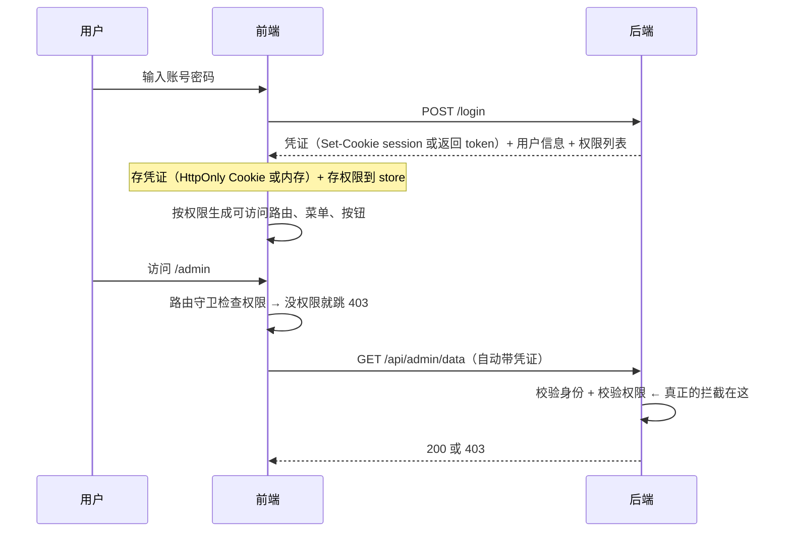
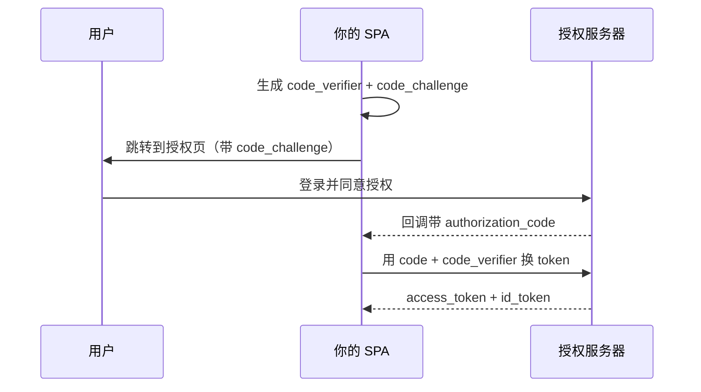

# 安全 · 06 鉴权体系与数据安全

> 覆盖题号：**3、4、15**
> 对应原题：《说说你对前端鉴权的理解》《如何禁止别人调试自己的前端代码》《前端数据安全》
> 这三题共享一个核心命题：**前端的一切都在用户控制之下**。理解这一点，才能说清"鉴权只能做 UX、防调试只能提成本、数据安全只能靠不放"。这个核心命题也是前端安全的关键边界。

---

## 目录

- [1. 前端鉴权（题 3）](#1-前端鉴权题-3)
- [2. 四种鉴权方案详解](#2-四种鉴权方案详解)
- [3. RBAC 与前端权限控制的边界](#3-rbac-与前端权限控制的边界)
- [4. 前端数据安全（题 15）](#4-前端数据安全题-15)
- [5. 如何"禁止"别人调试（题 4）](#5-如何禁止别人调试题-4)
- [6. 常见坑](#6-常见坑)
- [7. 答题模板](#7-答题模板)
- [8. 追问表](#8-追问表)
- [9. 速记卡](#9-速记卡)

---

## 1. 前端鉴权（题 3）

### 1.1 先分清三个词（这题的第一句就该说这个）

| 概念 | 英文 | 回答什么问题 | 例子 |
|---|---|---|---|
| **认证** | Authentication | **你是谁？** | 登录、验证密码/验证码/指纹 |
| **授权** | Authorization | **你能做什么？** | 有没有权限看这个订单、能不能删这条数据 |
| **审计** | Auditing | **你做过什么？** | 操作日志、登录日志 |

> **面试时先做这个区分，能立刻显得专业**。很多人把"鉴权"笼统地说成"登录校验"，其实登录是认证，能不能访问某个页面是授权。

### 1.2 一句话结论

**前端鉴权 = 前端配合后端完成"认证 + 授权"的展示层控制。** 前端负责：
1. 携带凭证（Cookie / Token）
2. 根据权限**决定渲染什么**（路由、菜单、按钮）
3. 处理 401/403 的跳转与提示

**但真正的拦截必须在后端**——因为前端的一切都可被绕过（见第 3 节）。

### 1.3 完整链路



> **关键**：前端守卫是"不给用户看"，后端校验是"不让他拿到"。**两个都要做，但只有后者是安全。**

---

## 2. 四种鉴权方案详解

### 2.1 方案一：Cookie + Session（传统，最稳）

**流程：**

```
① 登录成功 → 服务端创建 Session（存内存/Redis/数据库），得到 sessionId
② 响应 Set-Cookie: session=xxx; HttpOnly; Secure; SameSite=Lax
③ 后续请求浏览器自动带 Cookie
④ 服务端用 sessionId 查到 Session 数据 → 知道是谁
```

| 优点 | 缺点 |
|---|---|
| 凭证不暴露给 JS（HttpOnly） | 服务端要存状态（有状态） |
| 可随时失效（删 Session 即可） | 分布式要共享存储（Redis） |
| 实现简单、生态成熟 | 跨域/跨站场景配置麻烦（SameSite 限制） |
| 天然防 CSRF（配 SameSite） | 移动端/第三方接入不友好 |

**集群方案：**

| 方案 | 说明 |
|---|---|
| **Session 共享存储**（Redis） | 最常用 |
| **粘性会话（Sticky Session）** | 同一用户固定到同一台机器（负载均衡配置，机器挂了就丢） |
| **Session 复制** | 每台机器同步全量 Session（内存浪费，适合小集群） |
| **Token 化（JWT）** | 干脆改成无状态 |

### 2.2 方案二：JWT（无状态，最常考）

**结构：**

```
eyJhbGciOiJIUzI1NiIsInR5cCI6IkpXVCJ9  .  eyJzdWIiOiIxMjM0IiwibmFtZSI6IuW8oOS4iSJ9  .  SflKxwRJSMeKKF2QT4fwpMeJf36POk6yJV_adQssw5c
└──────────── Header ────────────┘     └──────────── Payload ────────────┘     └────────── Signature ──────────┘
       算法与类型（base64url）                声明数据（base64url，**明文可读**）           签名（防篡改）
```

```js
// Header
{ "alg": "HS256", "typ": "JWT" }

// Payload（标准声明）
{
  "sub": "1234567890",     // subject，用户 ID
  "name": "张三",
  "iat": 1516239022,       // issued at
  "exp": 1516242622,       // expiration
  "role": "admin"          // 自定义
}

// Signature
HMACSHA256(base64url(header) + "." + base64url(payload), secret)
```

**必须记住的一点：JWT 是"签名"，不是"加密"。**

```js
// 任何人都能解出 payload，不需要密钥
JSON.parse(atob('eyJzdWIiOiIxMjM0IiwibmFtZSI6IuW8oOS4iSJ9'))
// → { sub: "1234567890", name: "张三" }
```

> **所以绝对不能把敏感信息放进 JWT payload**：密码、身份证号、手机号、内部权限细节。**放 ID 和必要声明就够了。**

**JWT 的优缺点：**

| 优点 | 缺点 |
|---|---|
| **无状态**，服务端不用存 Session，易水平扩展 | **无法主动失效**（签出去就有效到过期） |
| 跨域、跨端友好（放 header 里） | 体积比 sessionId 大（每次请求都带） |
| 可携带声明，减少查库 | payload 明文（不能放敏感信息） |
| 适合微服务（各服务自己验签） | 密钥泄露 = 全部凭证伪造 |
| 天然抗 CSRF（不放 Cookie 就不自动带） | 放 localStorage 就怕 XSS（见 02 册） |

**五个 JWT 陷阱（这部分最能体现深度）：**

| 陷阱 | 说明 | 防御 |
|---|---|---|
| **`alg: none` 攻击** | 老库不校验算法，攻击者把 `alg` 改成 `none` 并去掉签名 | 服务端**固定算法白名单**，不接受 `none` |
| **HS256 / RS256 混淆** | 服务端用 RS256（公钥验签），攻击者改成 HS256 并用**公钥当密钥**签名 | 明确指定算法，不要让 `alg` 决定验证方式 |
| **无法撤销** | 用户登出/改密码后，旧 token 仍有效 | 短过期（5~15 分钟）+ refresh token 轮换 + 黑名单（`jti`） |
| **payload 明文** | 放了敏感信息就泄露 | 只放 ID 和必要声明 |
| **密钥强度不足 / 硬编码** | `secret` 写在代码仓库里 | 用环境变量 + 强随机（≥256 位） |

```js
// 服务端正确验签示例（Node jsonwebtoken）
const payload = jwt.verify(token, PUBLIC_KEY, {
  algorithms: ['RS256'],        // ← 必须固定算法白名单
  issuer: 'https://auth.example.com',
  audience: 'api.example.com',
})

// 撤销方案：维护一个短期的 jti 黑名单
const revoked = await redis.sismember('jwt:revoked', payload.jti)
if (revoked) throw new Error('token revoked')
```

### 2.3 方案三：OAuth 2.0 / OIDC（第三方登录）

**四个角色：**

| 角色 | 说明 |
|---|---|
| **Resource Owner** | 用户 |
| **Client** | 你的应用 |
| **Authorization Server** | 授权服务器（如微信、Google） |
| **Resource Server** | 资源服务器（提供用户信息的 API） |

**SPA 应该用「授权码 + PKCE」：**



| 流程 | 状态 | 说明 |
|---|---|---|
| **授权码 + PKCE** | ✅ **SPA 推荐** | 最安全，PKCE 防授权码拦截 |
| ~~Implicit~~ | ❌ **已废弃** | token 直接在 URL fragment 里，容易泄露 |
| ~~密码模式~~ | ❌ 已废弃 | 应用直接拿用户密码，违反 OAuth 初衷 |
| 客户端凭证 | ✅ 仅用于服务间 | 无用户参与 |

**PKCE 解决什么**：SPA 没有 `client_secret`（放前端等于公开），所以用一次性的 `code_verifier` 代替，防止授权码被拦截后冒用。

> **OIDC 是 OAuth 2.0 的身份层**：OAuth 只解决"授权访问资源"，OIDC 加了 `id_token`（JWT）来告诉应用"用户是谁"。**"用微信登录"本质是 OAuth + OIDC。**

### 2.4 方案四：SSO 单点登录

**核心**：一次登录，多系统互通。

| 实现 | 说明 |
|---|---|
| **CAS** | 老牌方案，中心认证服务 + ticket |
| **OIDC / OAuth2** | 现代方案 |
| **SAML** | 企业级（老系统多） |
| **共享 Cookie（同主域）** | `Domain=.example.com`，最简单但只适合同主域 |

**跨域 SSO 的难点**：Cookie 不能跨站 → 需要"重定向 + ticket"的模式，而且 `SameSite=None; Secure` 会让 CSRF 风险上升。

### 2.5 四种方案对比表

| | Session-Cookie | JWT | OAuth2/OIDC | SSO |
|---|---|---|---|---|
| 状态 | 有状态 | 无状态 | 取决于实现 | 中心有状态 |
| 主动失效 | ✅ 容易 | ❌ 难（需黑名单） | 看实现 | ✅ |
| 水平扩展 | 需共享存储 | ✅ 天然 | ✅ | 中心要扛住 |
| 跨端 | 一般 | ✅ 好 | ✅ 好 | 桌面 Web 好 |
| 安全风险 | CSRF | XSS（存 localStorage 时）/ 密钥泄露 | 授权码拦截（PKCE 防） | 单点故障 |
| 适合 | 传统 Web、同域 | 微服务、多端 | 第三方登录 | 企业内部多系统 |

---

## 3. RBAC 与前端权限控制的边界

### 3.1 RBAC 模型

```
用户 (User)  ──N:N──  角色 (Role)  ──N:N──  权限 (Permission)
                                                 │
                                                 ├─ 菜单权限
                                                 ├─ 页面/路由权限
                                                 ├─ 按钮/操作权限
                                                 └─ 数据权限（行级/字段级）
```

```js
// 后端返回的典型结构
{
  "user": { "id": 1, "name": "张三" },
  "roles": ["admin", "editor"],
  "permissions": [
    "order:list", "order:detail", "order:export",
    "user:list", "user:disable"
  ]
}
```

### 3.2 前端权限控制的三种粒度

**粒度一：路由级（页面能不能进）**

```js
// Vue Router
router.beforeEach((to, from, next) => {
  const required = to.meta.permission
  if (!required) return next()

  const { permissions } = useUserStore()
  if (!permissions.includes(required)) {
    return next({ name: 'Forbidden' })     // 403 页面
  }
  next()
})
```

**粒度二：菜单级（侧边栏显示哪些）**

```js
// 从完整路由表里过滤出有权限的
function filterRoutes(routes, permissions) {
  return routes
    .filter((r) => !r.meta?.permission || permissions.includes(r.meta.permission))
    .map((r) => ({ ...r, children: r.children ? filterRoutes(r.children, permissions) : undefined }))
}
```

**粒度三：按钮/元素级（能不能点）**

```vue
<!-- 指令式（Vue） -->
<script setup>
const vPermission = {
  mounted(el, binding) {
    const { permissions } = useUserStore()
    const need = Array.isArray(binding.value) ? binding.value : [binding.value]
    if (!need.some((p) => permissions.includes(p))) {
      el.parentNode?.removeChild(el)      // 直接移除，而不是 display:none
    }
  },
}
</script>

<template>
  <button v-permission="'order:export'">导出</button>
</template>
```

```jsx
// 组件式（React）
function Can({ permission, children, fallback = null }) {
  const { permissions } = useUserStore()
  const need = Array.isArray(permission) ? permission : [permission]
  return need.some((p) => permissions.includes(p)) ? children : fallback
}

<Can permission="order:export"><button>导出</button></Can>
```

> **为什么用"移除"而不是 `display: none`**：`display:none` 的元素还在 DOM 里，用户改一行 CSS 就能看到；虽然看到了也点不了（后端会拦），但会显得"有权限"，容易引起困惑和误报。**移除更干净**。

### 3.3 前端权限的边界（最重要的一节）

> **这一节是本题的分水岭。** 面试官问"前端鉴权"，真正想确认的是：**你知不知道前端权限不等于安全**。

| 前端能做的 | 前端做不了的 |
|---|---|
| 不给用户看没权限的菜单/路由/按钮 | **阻止用户直接调接口** |
| 提供更好的 UX（少走弯路） | **阻止用户改请求参数**（如 `userId=2`） |
| 减少无效请求 | **阻止用户用 curl/Postman 发请求** |
| 前端展示层的权限一致性 | **数据权限（行级/字段级）** |

**三种绕过方式（证明前端防线很薄）：**

```js
// ① 直接改 JS 变量
useUserStore().permissions.push('order:export')

// ② 直接调接口
fetch('/api/order/export', { headers: { Authorization: `Bearer ${token}` } })

// ③ 改请求参数（水平越权）
// GET /api/order/123  →  GET /api/order/124
```

**所以正确的说法是：**

> "前端权限控制是**UX 层的可见性控制**，目的是'让用户不看到不该看的东西、少走弯路'，它**不是安全边界**。真正的授权必须在后端每个接口上做——**每个接口都要校验'当前用户有没有权限操作这个资源'**，尤其是涉及资源 ID 的接口，必须校验这个资源是否属于当前用户（防水平越权）。"

### 3.4 两种越权（面试常追问）

| 类型 | 说明 | 例子 | 防御 |
|---|---|---|---|
| **水平越权** | 同角色用户之间越界 | 用户 A 改 `orderId` 看到用户 B 的订单 | 每个查询都带 `where user_id = current_user` |
| **垂直越权** | 低权限做高权限操作 | 普通用户直接调管理员接口 | 每个接口做角色/权限校验 |

```js
// ❌ 水平越权漏洞
app.get('/api/order/:id', (req, res) => {
  const order = db.order.findById(req.params.id)   // 只按 id 查，没校验归属
  res.json(order)
})

// ✅ 正确
app.get('/api/order/:id', (req, res) => {
  const order = db.order.findOne({
    id: req.params.id,
    user_id: req.user.id,        // ← 强制带当前用户
  })
  if (!order) return res.status(404).end()   // 不透露"存在但无权限"
  res.json(order)
})
```

> **返回 404 而不是 403** 是一个细节：403 会告诉攻击者"这个资源存在"，404 则不会泄露信息。

---

## 4. 前端数据安全（题 15）

> **这是这三题里最能体现"工程判断"的一题。** 原答案只有 4 条，且漏了最致命的第 1 条。

### 4.1 第一条（最重要）：任何打进 bundle 的东西都是公开的

```js
// ❌ 你以为这很安全？
const API_KEY = 'sk-live-abc123...'
fetch(`https://api.example.com/data?key=${API_KEY}`)
```

**结果**：打包后在 `app.js` 里明文躺着，打开 DevTools 搜一下就有。**不管你怎么混淆**——混淆只是让变量名变成 `_0x1a2b`，字符串常量还在。

**最典型的三个误解：**

| 误解 | 真相 |
|---|---|
| "我用环境变量就安全了" | **`VITE_` / `REACT_APP_` / `NEXT_PUBLIC_` 前缀的变量会在构建时被静态替换进产物**。它们只是为了"区分环境"，不是为了"保密" |
| "我放在 `.env` 里，用户看不到" | `.env` 只在**构建时**被读取，最终值已经内联到 bundle 里 |
| "我做了混淆/加密" | 字符串常量还在；加密的密钥也在同一个 bundle 里 |

```bash
# Vite 的实际行为：构建时把 import.meta.env.VITE_XXX 替换成字面量
echo 'VITE_API_KEY=sk-live-abc' > .env.production
# 构建后，bundle 里就是 'sk-live-abc'，任何人可搜到
```

**自查方法：**

```bash
# 在 dist 里搜敏感词
grep -rE "sk-live|secret|password|AKID|Bearer [A-Za-z0-9]{20,}" dist/

# 或者更狠：grep 常见的密钥格式
grep -rE "(AKIA|sk-[A-Za-z0-9]{20,}|ghp_[A-Za-z0-9]{36})" dist/
```

**正确做法：**

| 需求 | 正确方案 |
|---|---|
| 调用第三方 API（如地图、支付） | **后端代理**（前端调自己的接口，后端带上密钥去调） |
| 需要限制调用量 | 后端做限流 + 短期临时凭证（如 STS、前端拿临时 token） |
| 需要在浏览器直连（如某些地图 SDK） | 用**域名白名单 + 配额限制**的 key（服务商支持），接受它公开 |
| 真正的机密（数据库密码、私钥） | **永远不进前端** |

### 4.2 第二条：敏感数据不要放 localStorage

```js
// ❌ 任何 XSS 都能一行偷走
localStorage.setItem('token', token)
localStorage.setItem('userInfo', JSON.stringify({ idCard: '...' }))

// ✅ 只放非敏感内容
localStorage.setItem('theme', 'dark')
localStorage.setItem('locale', 'zh-CN')
```

| 存储 | 能放什么 |
|---|---|
| `localStorage` | 主题、语言、非敏感的用户偏好、草稿（不含隐私） |
| `sessionStorage` | 同上，但生命周期短 |
| **Cookie（`HttpOnly`）** | 会话凭证（JS 读不到） |
| **内存变量** | access token（短命，刷新丢失但可续） |

### 4.3 第三条：前端加密 ≈ 混淆，不是安全

```js
// ❌ 这段代码看起来"加密了"，但毫无意义
const key = 'a1b2c3d4'                             // 密钥在前端
const encrypted = CryptoJS.AES.encrypt(password, key).toString()
fetch('/api/login', { body: JSON.stringify({ password: encrypted }) })
```

**为什么没有意义：**

1. **密钥也在前端**——攻击者能看到加密逻辑和密钥，能自己解密
2. **攻击者不需要解密**——他直接重放这个密文就能登录
3. **真正的保护是 HTTPS**——传输层已经加密了，前端再加密是重复劳动且更弱

**唯一有价值的场景**（了解即可）：

| 场景 | 说明 |
|---|---|
| 减少明文在日志/埋点里出现 | 算是"降低误泄露概率"，但不是安全边界 |
| 满足某些合规的"字段加密"要求 | 形式合规 |
| 密码在传输前做一次哈希（老方案） | 已被 HTTPS 取代，**不要再做**（会引入"哈希即密码"的问题） |

> **正确说法**："前端加密只是混淆，因为密钥必然在前端。真正的保护是 HTTPS + 后端用 bcrypt/argon2 加盐哈希存储密码。"

### 4.4 第四条：日志与错误上报脱敏

```js
// ❌ 把敏感信息发给监控平台（等于把数据给了第三方）
Sentry.captureException(err, {
  extra: { requestBody: JSON.stringify(formData) },   // 含密码、身份证
})

// ✅ 统一脱敏
const SENSITIVE = ['password', 'pwd', 'token', 'secret', 'idCard', 'phone', 'bankCard', 'cvv']

function mask(obj) {
  if (obj == null || typeof obj !== 'object') return obj
  if (Array.isArray(obj)) return obj.map(mask)
  return Object.fromEntries(
    Object.entries(obj).map(([k, v]) => {
      if (SENSITIVE.some((s) => k.toLowerCase().includes(s.toLowerCase()))) {
        return [k, '***']
      }
      return [k, typeof v === 'object' ? mask(v) : v]
    })
  )
}

app.config.errorHandler = (err, instance, info) => {
  report({ message: err.message, stack: err.stack, info, extra: mask(context) })
}
```

**还有两个容易忽略的：**

| 位置 | 风险 |
|---|---|
| `console.log` 打印完整响应 | 生产环境要去掉（用 `terser` 的 `drop_console`） |
| **URL 里带 token** | 会进浏览器历史、Referer、服务器日志、截图 |

### 4.5 第五条：sourcemap 不要公开

```js
// Vite
export default {
  build: {
    sourcemap: false,              // 生产不生成
    // 或：sourcemap: 'hidden'     // 生成但不写 sourceMappingURL 注释
  },
}
```

```js
// webpack
module.exports = {
  devtool: false,                  // 或 'hidden-source-map'
}
```

**正确做法**：生成 `hidden-source-map` → 上传到 Sentry 等监控平台 → 从部署目录删除 `.map` 文件。这样既能有可读的堆栈，又不泄露源码。

> **为什么 sourcemap 泄露严重**：它能还原出**完整源码**（包括注释、内部接口路径、甚至硬编码的测试账号）。有专门的工具（`sourcemapper`）扫全网找暴露的 `.map` 文件。

### 4.6 第六条：敏感页面的缓存与展示

| 场景 | 措施 |
|---|---|
| 订单详情、个人信息页 | `Cache-Control: no-store`（防止"后退键"看到上一个用户的页面，尤其是在公用电脑上） |
| 手机号/身份证展示 | 脱敏显示 `138****1234` |
| 敏感操作 | 二次验证（密码/短信） |
| 复制/截图 | 可加提示（无法真正阻止） |
| 打印 | 可加 `@media print` 隐藏敏感信息 |

```http
Cache-Control: no-store, no-cache, must-revalidate
Pragma: no-cache
```

> **`no-store` 的场景很具体**：用户在网吧登录后退出，下一个人点"后退"——如果页面被缓存了，他能看到上一个用户的订单。**这不是理论问题，是真实发生过的。**

### 4.7 一个完整的自查清单

```
□ dist 里 grep 不到任何 secret / API key / 私钥
□ 所有 VITE_/REACT_APP_ 变量都被 review 过（确认可以公开）
□ localStorage 里没有 token、身份证、手机号
□ 生产构建 sourcemap 关闭或已上传后删除
□ console.log 已被 drop_console 移除
□ 错误上报走统一脱敏函数
□ URL 里不携带 token（改用 header 或 body）
□ 敏感页面有 Cache-Control: no-store
□ 列表/详情页的手机号、身份证做了脱敏
□ 上传文件的响应有 Content-Disposition: attachment
```

---

## 5. 如何"禁止"别人调试（题 4）

### 5.1 一句话结论

**不可能真正禁止。** 前端代码最终要交给浏览器执行，浏览器不是你的运行环境——**开发者工具不归你管**。所有手段都只是"提高门槛"，而且**门槛都不高**。

> **这题的正确答法不是"我会这 5 招"，而是"我知道这 5 招为什么都没用，所以我把精力放在别处"。** 这是能明显区分候选人层次的题。

### 5.2 五种常见手段与它们的真实效果

| 手段 | 实现 | 绕过方式 | 有效性 |
|---|---|---|---|
| **`debugger` 死循环** | `setInterval(() => { debugger }, 100)` | DevTools → Sources → **Deactivate breakpoints（Ctrl+F8）**；或右键 "Never pause here" | ⭐（几乎无效，还拖慢性能） |
| **检测窗口尺寸差** | `window.outerWidth - innerWidth > 160` | 把 DevTools 拖成独立窗口；或用远程调试 | ⭐⭐ |
| **检测 `console.log` getter** | 用带 getter 的对象，DevTools 展开时才触发 | 不展开那个对象；或用无 DevTools 的调试方式 | ⭐⭐ |
| **`debugger` 计时检测** | 执行 `debugger` 前后 `performance.now()` 差值大 → 说明被暂停 | 关断点 | ⭐⭐ |
| **禁用右键 / F12** | `oncontextmenu` / `onkeydown` 拦 F12 | 菜单栏打开；Ctrl+Shift+I；直接抓包 | ⭐（还影响正常用户体验） |
| **代码混淆** | `javascript-obfuscator` 控制流平坦化、字符串数组加密 | de4js、AST 还原、动态调试打日志 | ⭐⭐⭐（提高阅读成本，但不可阻止） |
| **域名锁** | 检测 `location.host` | 改 hosts / 本地代理 | ⭐ |
| **WebAssembly** | 核心逻辑编译成 wasm | 仍可调试；只是更麻烦 | ⭐⭐⭐ |

```js
// 一个"看起来完整"的防调试实现（用来展示你知道这些手段）
;(function antiDebug() {
  // ① debugger 循环（节流，否则太耗 CPU）
  setInterval(() => {
    const t = performance.now()
    // eslint-disable-next-line no-debugger
    debugger
    if (performance.now() - t > 100) {
      document.body.innerHTML = ''       // 检测到调试就清空页面（粗暴但有威慑）
    }
  }, 2000)

  // ② 窗口尺寸差
  setInterval(() => {
    if (window.outerWidth - window.innerWidth > 160) {
      // 疑似打开了 DevTools
    }
  }, 1000)

  // ③ 禁用右键与 F12（体验很差，不推荐）
  document.addEventListener('contextmenu', (e) => e.preventDefault())
  document.addEventListener('keydown', (e) => {
    if (e.key === 'F12' || (e.ctrlKey && e.shiftKey && ['I', 'J', 'C'].includes(e.key))) {
      e.preventDefault()
    }
  })
})()
```

### 5.3 为什么本质不可能（三条根本原因）

| 原因 | 说明 |
|---|---|
| **① 代码是交给对方执行的** | 如同把文件交给别人却要求他不能打开看 |
| **② DevTools 不属于页面** | 它是浏览器的一部分，页面无权控制；甚至可以用**远程调试**（`chrome://inspect`）完全绕过页面内的检测 |
| **③ 攻击者不需要看你的代码** | 直接抓包看接口、直接改请求参数、用 Postman 调接口——**这些都不需要 DevTools** |

> **一句话总结**："防调试的假设是'看不到代码就安全'，但这是**代码保密（security through obscurity）**的思路。真正的安全从来不依赖'对方看不懂'，而依赖'即使看懂了也做不了'。"

### 5.4 那应该做什么（这题的真正答案）

| 目标 | 正确做法 |
|---|---|
| 保护密钥 | **不放前端**（见 4.1） |
| 保护业务逻辑 | **核心逻辑放后端**（如价格计算、优惠券校验） |
| 防止篡改请求 | **接口签名 + 后端校验**（但密钥仍不能在前端，所以更现实的是"后端校验所有输入"） |
| 提高逆向成本（有商业价值时） | 代码混淆（`javascript-obfuscator`）+ 关键逻辑 wasm + 接口签名 |
| 防批量爬取 | 后端限流、风控、验证码、行为分析 |
| 防截图/录屏 | **做不到**；可用水印（含用户 ID）做**追溯威慑** |

**一个很实用的替代方案：数字水印**

```js
// 与其"防截图"，不如"让泄露可追溯"
function addWatermark(userId) {
  const wm = document.createElement('div')
  wm.style.cssText = `
    position: fixed; inset: 0; pointer-events: none; z-index: 9999;
    background-image: url("data:image/svg+xml,...");  /* 含 userId 的斜向文字 */
    opacity: .06;
  `
  document.body.appendChild(wm)
}
```

> **思路转变**：从"防止"变成"威慑 + 追溯"。这是安全领域的通用思路——**当阻止不可能时，就提高被发现的概率**。

### 5.5 30 秒版

> "从技术上不可能真正禁止。因为前端代码最终要交给浏览器执行，而 DevTools 是浏览器的一部分，页面无权控制；用户还能用远程调试完全绕过页面内的检测。常见手段有 `debugger` 死循环、检测窗口尺寸差、禁用 F12、代码混淆，但都有现成的绕过方式——比如 Ctrl+F8 关掉断点。我的观点是这些都是'提高成本'而不是'安全'，真正该做的是**不把密钥放前端、核心逻辑放后端、后端校验所有输入**，另外用代码混淆提高逆向成本。"

---

## 6. 常见坑

| # | 坑 | 纠正 |
|---|---|---|
| 1 | 把"鉴权"等同于"登录" | 认证（你是谁）+ 授权（你能干什么）是两件事 |
| 2 | 认为前端路由守卫能保护权限 | 改 JS 或直接调接口就绕过；必须后端校验 |
| 3 | 把 JWT 当加密 | 它是签名，payload 任何人可读，不能放敏感信息 |
| 4 | JWT 验签不固定 alg | `alg: none` 和算法混淆攻击 |
| 5 | JWT 过期时间设很长 | 无法撤销，一旦泄露长期有效；用短过期 + refresh |
| 6 | 把 `client_secret` 放 SPA | 前端没有秘密；用 PKCE |
| 7 | 还用 Implicit 流程 | 已废弃，token 在 URL 里泄露 |
| 8 | 权限不足返回 403 | 对"资源不属于你"返回 404，避免泄露存在性 |
| 9 | 只做垂直权限不做水平权限 | 水平越权（改 ID）是最常见的真实漏洞 |
| 10 | 认为环境变量能保密 | `VITE_`/`NEXT_PUBLIC_` 会被内联进 bundle |
| 11 | 把 token 存 localStorage | 任何 XSS 都能读 |
| 12 | 做"前端加密密码" | 密钥在前端，等于没加密；靠 HTTPS + 后端哈希 |
| 13 | 生产开 sourcemap 且公开 | 源码完全泄露 |
| 14 | 日志/上报不脱敏 | 密码、身份证进了第三方监控平台 |
| 15 | 敏感页面没 `no-store` | 公用电脑上"后退键"看到上一个人的数据 |
| 16 | 用 `debugger` 死循环防调试 | Ctrl+F8 就绕过，还拖慢性能 |
| 17 | 禁用右键/F12 | 影响正常用户体验，毫无安全收益 |
| 18 | 认为混淆等于安全 | 混淆只是提高阅读成本，能还原 |

---

## 7. 答题模板

### 7.1 「说说你对前端鉴权的理解」——30 秒

> "先分清两个词：认证是'你是谁'，授权是'你能干什么'。前端鉴权做三件事：携带凭证、按权限决定渲染什么、处理 401/403。常见方案有四种：Cookie + Session 有状态但可控；JWT 无状态易扩展但无法撤销；OAuth2 + OIDC 做第三方登录，SPA 要用授权码加 PKCE；SSO 做多系统互通。**但要说清一点：前端权限只是 UX 层的可见性控制，不是安全边界，真正的授权必须在后端每个接口上做。**"

### 7.2 「说说你对前端鉴权的理解」——2 分钟

> "我会先做三个区分。
>
> **第一是认证和授权。** 认证解决'你是谁'，授权解决'你能干什么'，很多面试题把这两个混在一起讲，其实防护手段完全不同。
>
> **第二是前端和后端的职责边界。** 前端负责携带凭证、按权限渲染、处理 401/403；后端负责每个接口的身份和权限校验。**前端做的一切权限控制都只是让用户不看到不该看的东西，不是安全边界**——用户可以直接改 store 里的 permissions，也可以绕开页面直接 curl 接口。所以水平越权（改 orderId 看别人订单）和垂直越权（普通用户调管理接口）都必须在后端防。
>
> **第三是方案选型。**
>
> Session + Cookie 是传统方案，有状态、可随时踢下线，但集群要共享存储，跨域场景 SameSite 配置麻烦。
>
> JWT 是无状态方案，适合微服务和多端。但有两个必须知道的点：一是 **JWT 是签名不是加密**，payload 是 base64url，任何人都能读，所以不能放敏感信息；二是**签出去就无法主动撤销**，所以要短过期加 refresh token 轮换，再配合 jti 黑名单。验签时还要固定算法白名单，防 `alg: none` 和 HS256/RS256 混淆。
>
> OAuth2 用于第三方登录，SPA 必须用授权码加 PKCE，因为前端没有 `client_secret`，Implicit 流程已经废弃。
>
> SSO 用于企业内部多系统，本质是中心认证服务 + ticket 重定向。
>
> **落地层面**我会讲 RBAC：用户-角色-权限三层，前端做路由级、菜单级、按钮级三种粒度。按钮级我会用移除 DOM 而不是 `display: none`——虽然都不安全，但移除更干净，不会让用户以为'有权限但点不了'。
>
> 最后补一句 Cookie 的配置：会话 Cookie 必须 `HttpOnly + Secure + SameSite=Lax`，这样 XSS 偷不到、CSRF 也挡住大半。"

### 7.3 「前端数据安全」——30 秒

> "最核心的一条是：**任何打进 bundle 的东西都是公开的**。包括 `VITE_` / `NEXT_PUBLIC_` 前缀的环境变量，它们在构建时被静态替换进产物，只是为了区分环境不是为了保密。所以密钥一律不放前端，走后端代理。第二，敏感数据不放 localStorage，任何 XSS 都能读。第三，前端加密只是混淆，因为密钥也在前端，真正的保护是 HTTPS 加后端哈希存储。第四，日志和错误上报要脱敏。第五，生产 sourcemap 不能公开。"

### 7.4 「如何禁止别人调试」——30 秒

> "技术上不可能真正禁止。因为代码要交给浏览器执行，而 DevTools 是浏览器的一部分，页面无权控制，用户还能用远程调试完全绕过。常见手段有 `debugger` 死循环、检测窗口尺寸差、禁用 F12、代码混淆，但都能绕过，比如 Ctrl+F8 关断点、把 DevTools 拖成独立窗口。所以我的观点是这些只是提高成本不是安全，真正该做的是不把密钥放前端、核心逻辑放后端、后端校验所有输入。"

---

## 8. 追问表

| # | 追问 | 要点 |
|---|---|---|
| 1 | 认证和授权区别？ | 你是谁 vs 你能干什么 |
| 2 | Session 和 JWT 怎么选？ | 要主动踢人/内部系统用 Session；微服务/多端用 JWT |
| 3 | JWT 能撤销吗？ | 不能直接撤销；用短过期 + refresh 轮换 + jti 黑名单 |
| 4 | JWT 是加密的吗？ | 不是，只是签名；payload 可读 |
| 5 | `alg: none` 攻击怎么防？ | 验签时固定算法白名单 |
| 6 | HS256/RS256 混淆怎么防？ | 明确指定算法，不让 token 里的 alg 决定验证方式 |
| 7 | SPA 为什么不能用 `client_secret`？ | 前端没有秘密；用 PKCE 替代 |
| 8 | 为什么 Implicit 被废弃？ | token 在 URL fragment，容易通过 Referer/历史泄露 |
| 9 | RBAC 和 ABAC 区别？ | 基于角色 vs 基于属性（更细粒度，如"部门+时间"） |
| 10 | 前端路由守卫安全吗？ | 不安全，只是不渲染；接口必须自己校验 |
| 11 | 水平越权和垂直越权？ | 同角色间越界 vs 低权限做高权限操作 |
| 12 | 为什么无权限返回 404 而不是 403？ | 403 泄露"资源存在"这一信息 |
| 13 | 环境变量能保密吗？ | 不能，`VITE_` 等前缀会被内联进 bundle |
| 14 | 前端加密有意义吗？ | 基本没有，密钥在前端；只在降低误泄露概率上有微弱意义 |
| 15 | sourcemap 泄露什么？ | 完整源码、注释、内部路径、可能硬编码的测试账号 |
| 16 | 为什么敏感页要 `no-store`？ | 公用电脑"后退键"会看到上一个用户的数据 |
| 17 | 怎么防调试？ | 只能提高成本；真正的安全靠"不放秘密" |
| 18 | 混淆有用吗？ | 提高逆向成本，但可还原；有商业价值时值得做 |
| 19 | 怎么防截图？ | 做不到；用带用户 ID 的水印做追溯威慑 |
| 20 | 前端能防爬虫吗？ | 不能，只能提高成本；真正靠后端限流 + 风控 + 验证码 |

---

## 9. 速记卡

```
【三个词】
认证（你是谁）｜授权（你能干什么）｜审计（你做过什么）

【前端鉴权边界（最重要）】
前端 = UX 层的可见性控制，不是安全边界
用户能改 store、能 curl 接口、能改 orderId
→ 每个接口后端必须校验身份 + 权限 + 资源归属

【四种方案】
Session+Cookie  有状态、可踢人、集群要共享存储
JWT             无状态、易扩展、无法撤销、payload 明文
OAuth2+OIDC     SPA 用授权码+PKCE（Implicit 已废弃）
SSO             中心认证 + ticket 重定向

【JWT 五坑】
① 是签名不是加密，payload 可读
② alg:none / HS256-RS256 混淆 → 固定算法白名单
③ 无法撤销 → 短过期 + refresh 轮换 + jti 黑名单
④ 密钥硬编码 → 环境变量 + 强随机
⑤ 存 localStorage → 怕 XSS；放内存 + HttpOnly refresh

【RBAC 三粒度】
路由级（守卫）→ 菜单级（过滤）→ 按钮级（指令/组件，用移除而非 display:none）

【越权】
水平：改 ID 看别人数据 → 查询必须带 where user_id = current
垂直：低权限调高权限接口 → 每个接口校验角色
无权限返回 404 而非 403（不泄露资源存在性）

【数据安全五条】
① bundle 里的一切都是公开的（VITE_/NEXT_PUBLIC_ 会被内联！）
② 敏感数据不进 localStorage
③ 前端加密≈混淆（密钥也在前端）
④ 日志/上报脱敏（password/token/idCard/phone）
⑤ 生产 sourcemap 关闭或上传后删除

【防调试】
本质上不可能：代码交给对方 + DevTools 不属于页面 + 远程调试可绕过
手段都只提成本：debugger 循环（Ctrl+F8 破）、尺寸差（拖独立窗口破）、
禁用 F12（菜单栏破）、混淆（de4js 还原）
该做：密钥不放前端 / 逻辑放后端 / 后端校验 / 水印追溯
```
