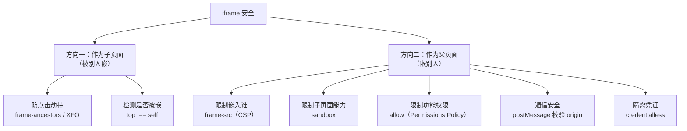

# 安全 · 04 点击劫持与 iframe 安全

> 覆盖题号：**9、21、16**
> 对应原题：《什么是点击劫持？如何防范》《点击劫持》《iframe 安全》
> 三条题的主线：点击劫持是 iframe 最典型的滥用；iframe 安全要同时管「被嵌」与「嵌别人」两个方向。

---

## 目录

- [1. 点击劫持](#1-点击劫持)
- [2. 防御：三种手段与它们的可靠性](#2-防御三种手段与它们的可靠性)
- [3. iframe 安全全景](#3-iframe-安全全景)
- [4. sandbox 属性详解](#4-sandbox-属性详解)
- [5. postMessage 的正确用法](#5-postmessage-的正确用法)
- [6. window.opener 与标签页劫持](#6-windowopener-与标签页劫持)
- [7. 一个完整的 iframe 接入规范](#7-一个完整的-iframe-接入规范)
- [8. 常见坑](#8-常见坑)
- [9. 答题模板](#9-答题模板)
- [10. 追问表](#10-追问表)
- [11. 速记卡](#11-速记卡)

---

## 1. 点击劫持

### 1.1 一句话结论

**点击劫持（Clickjacking）= 攻击者把目标站点放进透明 iframe 铺满自己的页面，并让诱饵按钮与目标站真实按钮的位置对齐；用户以为点的是诱饵，实际点到的是真实按钮。**

它借的是「用户主动点击」，不是窃取数据：请求会带上用户的 Cookie 和 CSRF Token，服务端日志也看不出异常。

### 1.2 完整攻击示例

```html
<!-- 攻击者页面 evil.com -->
<!DOCTYPE html>
<html>
<head>
  <style>
    /* ① 目标站铺满全屏、完全透明、且位于最上层 */
    iframe {
      position: fixed;
      top: 0;
      left: 0;
      width: 100vw;
      height: 100vh;
      opacity: 0;
      z-index: 2;
      border: none;
    }
    /* ② 诱饵按钮：坐标与 iframe 里的真实按钮对齐，层级在 iframe 之下 */
    .bait {
      position: fixed;
      top: 320px;
      left: 480px;
      z-index: 1;
      padding: 12px 40px;
      font-size: 20px;
      background: #ff5722;
      color: #fff;
      border-radius: 8px;
    }
  </style>
</head>
<body>
  <div class="bait">🎁 点击领取 100 元红包</div>
  <iframe src="https://bank.com/transfer?to=hacker&amount=10000"></iframe>
</body>
</html>
```

三个条件缺一不可：

- 目标站允许被 iframe 嵌入（没有 `frame-ancestors` / `X-Frame-Options`）
- iframe 透明但仍覆盖在最上层，点击才会落进 iframe
- 诱饵与真实按钮坐标对齐

用户已登录 bank.com，点击落在「确认转账」上，请求带有效 Cookie，转账成功。

### 1.3 攻击变种

| 变种 | 手法 |
|---|---|
| **Likejacking** | 诱导点"赞"/"关注"，实际在社交站点完成点赞/关注 |
| **Cursorjacking** | 用 CSS 偏移指针**显示位置**，用户以为点 A 实际点 B |
| **Filejacking** | 诱导点击 `<input type="file">`，再读取选中文件的名称/内容 |
| **Drag-and-drop jacking** | 诱导拖拽，把敏感内容拖进攻击者的输入框 |
| **Double-clickjacking** | 确认框要求双击，第一次点击被利用，第二次才是真实操作 |
| **Tapjacking（移动端）** | 移动端用 `touch` 事件 + 透明覆盖层，诱导点中底层页面 |

---

## 2. 防御：三种手段与它们的可靠性

### 2.1 手段一：`X-Frame-Options`（老标准，兼容性好）

```http
X-Frame-Options: DENY
X-Frame-Options: SAMEORIGIN
```

| 值 | 含义 |
|---|---|
| `DENY` | 任何页面都不能嵌套，包括同源 |
| `SAMEORIGIN` | 只有同源页面能嵌套 |
| `ALLOW-FROM https://a.com` | 已废弃：Chrome 直接忽略该值（实测允许嵌入），Firefox 70 起移除 |

限制有两条：不支持多个域名与通配符；只能作为响应头下发，写进 `<meta>` 会被忽略（实测）。

### 2.2 手段二：CSP `frame-ancestors`（现代标准，推荐）

```http
Content-Security-Policy: frame-ancestors 'none'
Content-Security-Policy: frame-ancestors 'self'
Content-Security-Policy: frame-ancestors 'self' https://portal.example.com https://*.partner.com
```

- 支持多来源与通配符（`https://*.partner.com`）
- 与 `X-Frame-Options` 同时下发时以 `frame-ancestors` 为准，XFO 被忽略
- 同样只能走响应头，写在 `<meta http-equiv>` 里无效（实测）

**Chrome 实测**（puppeteer-core 驱动本机 Chrome，node 本地服务下发响应头，父页面同源/跨源嵌入 iframe，以子页脚本是否执行为判定）：

| 响应头 | 同源嵌入 | 跨源嵌入 |
|---|---|---|
| `X-Frame-Options: DENY` | 拒绝 | 拒绝 |
| `X-Frame-Options: SAMEORIGIN` | 允许 | 拒绝 |
| `frame-ancestors 'self'` | 允许 | 拒绝 |
| `frame-ancestors 'none'` | 拒绝 | 拒绝 |
| XFO `DENY` + `frame-ancestors 'self'` | 允许（CSP 覆盖 XFO） | 拒绝 |
| XFO `SAMEORIGIN` + `frame-ancestors 'none'` | 拒绝（CSP 覆盖 XFO） | — |
| `X-Frame-Options: ALLOW-FROM http://localhost:3171` | 允许（该值被忽略） | — |
| `X-Frame-Options` 写在 `<meta http-equiv>` | 允许（meta 无效） | — |
| `frame-ancestors` 写在 `<meta http-equiv>` | 允许（meta 无效） | 允许（meta 无效） |

生产上两个都写：

```nginx
add_header X-Frame-Options "SAMEORIGIN" always;
add_header Content-Security-Policy "frame-ancestors 'self'" always;
```

### 2.3 手段三：JS frame busting（不可靠，只能兜底）

```js
if (top !== self) {
  top.location = self.location
}
```

两种实测有效的绕过：

| 绕过手法 | 原理 |
|---|---|
| `sandbox="allow-scripts"`（不给 `allow-top-navigation`） | 顶层导航被浏览器拒绝，赋值抛 `SecurityError` |
| 不给 `allow-scripts` | busting 代码根本不执行，且子页是不透明源 |

更稳的写法是「不跳转，只隐藏自己」：

```js
if (window.top !== window.self) {
  document.documentElement.style.display = 'none'
  navigator.sendBeacon?.('/api/frame-detected')
}
```

frame busting 只能提高攻击成本，主防御必须在响应头。

### 2.4 三层组合建议

```
第一层（主）：CSP frame-ancestors 'none' 或白名单     ← 浏览器强制
第二层（兼容）：X-Frame-Options: DENY / SAMEORIGIN    ← 老浏览器
第三层（兜底）：JS 检测 top !== self 并隐藏页面         ← 只提高成本
```

### 2.5 追问：业务上需要被嵌，怎么降风险

```
① 明确白名单：frame-ancestors 'self' https://portal.example.com
② 关键操作二次确认（转账、改密码要求重输密码）
③ 关键操作不设计成"一次点击"完成（加一步选择/滑动验证）
④ 用 postMessage 与父页面握手，而不是裸嵌
```

---

## 3. iframe 安全全景

iframe 安全有两个方向：作为子页面（被嵌），作为父页面（嵌别人）。



### 3.1 方向一：作为子页面（防点击劫持）

用 `frame-ancestors` / `X-Frame-Options`，见第 2 节。

### 3.2 方向二：作为父页面（四条限制）

| 限制什么 | 手段 |
|---|---|
| **能嵌哪些域** | CSP `frame-src`（默认回落到 `child-src`，再回落到 `default-src`） |
| **子页面能做什么** | `<iframe sandbox="...">` |
| **子页面能用哪些浏览器能力** | `<iframe allow="...">`（Permissions Policy） |
| **子页面能否与父页面通信** | `postMessage` + 严格校验 origin |

```html
<iframe
  src="https://widget.partner.com/chat"
  sandbox="allow-scripts allow-forms allow-same-origin"
  allow="clipboard-write; fullscreen"
></iframe>
```

```http
# 同时用 CSP 限制能嵌哪些域
Content-Security-Policy: frame-src 'self' https://widget.partner.com
```

### 3.3 `frame-src` 与 `frame-ancestors` 的方向

| 指令 | 声明方 | 控制什么 |
|---|---|---|
| **`frame-src`** | 父页面 | 父页面**能嵌谁** |
| **`frame-ancestors`** | 子页面 | **谁能嵌**这个子页面 |

防点击劫持用 `frame-ancestors`（写在子页面响应头，声明允许哪些页面嵌自己），限制第三方内容用 `frame-src`（写在父页面响应头，声明只嵌这些域）。

### 3.4 一个常被忽略的风险：同源 iframe

```
允许用户上传 HTML/SVG，且用同源 iframe 预览
→ iframe 里的内容可以访问 parent.document
→ 等于用户能在站点自己的域下执行任意 JS
```

**防御**：

| 手段 | 说明 |
|---|---|
| **上传内容用独立域名** | `usercontent.example.com`，与主站不同源 |
| **`sandbox` 不给 `allow-same-origin`** | 强制 iframe 变成不透明源（opaque origin） |
| **`Content-Disposition: attachment`** | 强制下载而非渲染 |
| **`X-Content-Type-Options: nosniff`** | 防 MIME 嗅探 |

---

## 4. sandbox 属性详解

### 4.1 一句话

**`sandbox` 给 iframe 施加一组"默认全禁"的限制，必须显式开启才允许。**

```html
<iframe sandbox src="..."></iframe>                  <!-- 最严格：不能跑 JS、不能提交表单、不能弹窗 -->
<iframe sandbox="allow-scripts" src="..."></iframe>  <!-- 只允许 JS -->
```

### 4.2 token 全表

| token | 允许什么 | 默认 |
|---|---|---|
| `allow-scripts` | 执行 JS | ❌ |
| `allow-same-origin` | 保留原源（否则变成 opaque origin，无法访问 Cookie/localStorage） | ❌ |
| `allow-forms` | 提交表单 | ❌ |
| `allow-popups` | `window.open` / `target=_blank` | ❌ |
| `allow-popups-to-escape-sandbox` | 弹出的窗口不带 sandbox | ❌ |
| `allow-top-navigation` | 能导航顶层页面（很危险，可用来做钓鱼跳转） | ❌ |
| `allow-top-navigation-by-user-activation` | 仅在用户手势下能导航顶层 | ❌ |
| `allow-modals` | `alert` / `confirm` / `prompt` | ❌ |
| `allow-downloads` | 触发下载 | ❌ |
| `allow-presentation` | 使用 Presentation API | ❌ |
| `allow-pointer-lock` | 锁定鼠标 | ❌ |
| `allow-orientation-lock` | 锁定屏幕方向 | ❌ |
| `allow-storage-access-by-user-activation` | 访问未分区存储（配合 Storage Access API） | ❌ |

**Chrome 实测**（同源父页面嵌入）：

- `sandbox` 不给任何 token：子页脚本被阻止执行，控制台提示缺少 `allow-scripts`
- `sandbox="allow-scripts"`：脚本执行，但源变成不透明——父页面收到的 `event.origin` 是 `null`，子页读 `parent.document` 抛 `SecurityError`
- `sandbox="allow-scripts allow-same-origin"` + 同源内容：`parent.document` 可读写
- 同样的 token + 跨源内容：`SecurityError`（`allow-same-origin` 只保留它自己的源）
- `sandbox="allow-scripts"` 下 `top.location = ...` 抛 `SecurityError`、顶层不跳转；加上 `allow-top-navigation` 后跳转成功

### 4.3 三个必须知道的坑

**坑一：`allow-scripts` + `allow-same-origin` 同时给 = sandbox 失效**

```html
<!-- ❌ 危险组合 -->
<iframe sandbox="allow-scripts allow-same-origin" src="https://same-origin-content"></iframe>
```

同源内容同时拿到这两个 token 时，沙箱内的脚本可以改写承载自己的元素，下一次导航就不再带 sandbox 标志：

```js
// iframe 内
window.frameElement.removeAttribute('sandbox')
location.reload()
```

Chrome 对该组合会直接给出警告：`An iframe which has both allow-scripts and allow-same-origin for its sandbox attribute can escape its sandboxing.`

**正确做法**：

| 场景 | 配置 |
|---|---|
| 嵌入**不可信**第三方内容 | `sandbox="allow-scripts"`（**不给** `allow-same-origin`，让它变成不透明源） |
| 嵌入**同源**可信内容（如自己的子应用） | 可以给两个，但要确保内容确实可信 |
| 嵌入**跨域**可信内容 | `sandbox="allow-scripts allow-same-origin allow-forms"`（跨域时 `allow-same-origin` 只保留它自己的源，拿不到父页面） |

**坑二：`allow-same-origin` 不等于"同源访问父页面"**

- 跨域 iframe + `allow-same-origin` → 保留**自己的源**，仍然不能访问 `parent.document`
- 同源 iframe + `allow-same-origin` → 能访问 `parent.document`

**坑三：`srcdoc` 默认继承父页面源**

```html
<!-- ❌ 如果 content 含用户输入，等于在父页面源下执行 -->
<iframe srcdoc="<script>alert(1)</script>"></iframe>
```

**修复**：`srcdoc` 的 iframe 必须加 `sandbox`（不给 `allow-same-origin`），或者先消毒内容。

### 4.4 sandbox 与 CSP 的关系

| | 作用对象 | 优先级 |
|---|---|---|
| `sandbox` 属性 | 单个 iframe | 属性层面 |
| CSP `sandbox` 指令 | 整个文档 | 更严格时生效 |

两者可以同时用，取更严格的限制。

---

## 5. postMessage 的正确用法

发送端不写死目标源、接收端不校验来源，是 `postMessage` 的两类典型漏洞。

### 5.1 错误示范

```js
// ❌ 发送端：不检查目标窗口当前是谁
iframe.contentWindow.postMessage({ token: userToken }, '*')

// ❌ 接收端：不校验来源，也不校验数据
window.addEventListener('message', (e) => {
  eval(e.data)
  document.getElementById('x').innerHTML = e.data
  localStorage.setItem('token', e.data.token)
})
```

后果：`'*'` 不校验目标窗口的 origin，那个 iframe 一旦被导航到别的源，token 照样发过去；接收端不校验来源，任何拿到窗口引用的页面都能往这个窗口发消息，注入内容或改 `localStorage`。

### 5.2 正确示范

```js
// ===== 发送端 =====
const ALLOWED_TARGET = 'https://widget.partner.com'

iframe.contentWindow.postMessage(
  { type: 'INIT', payload: { theme: 'dark' } },
  ALLOWED_TARGET            // ← 目标窗口 origin 不匹配时，消息不会发出
)

// ===== 接收端 =====
const ALLOWED_ORIGINS = new Set([
  'https://widget.partner.com',
  'https://app.example.com',
])

window.addEventListener('message', (event) => {
  if (!ALLOWED_ORIGINS.has(event.origin)) return       // ① 精确匹配来源
  if (event.source !== iframe.contentWindow) return    // ② 是预期的那个窗口
  const { type, payload } = event.data ?? {}           // ③ 消息内容也是不可信输入
  if (typeof type !== 'string') return

  switch (type) {
    case 'READY':
      break
    case 'RESIZE':
      if (typeof payload?.height === 'number' && payload.height < 5000) {
        iframe.style.height = `${payload.height}px`
      }
      break
    default:
      break
  }
})
```

### 5.3 三个必须校验的东西

| 校验 | 为什么 | 错误写法 |
|---|---|---|
| **`event.origin`** | 确认消息来自可信源 | `e.origin.includes('example.com')`（`example.com.evil.com` 也能过） |
| **`event.source`** | 确认是预期的那个窗口，防同源的其他 iframe 冒充 | 不校验 |
| **`event.data` 的结构与类型** | 对方可能被攻陷，发来恶意数据 | 直接 `eval` / `innerHTML` / 赋给 `location` |

### 5.4 `targetOrigin` 的三个值

```js
postMessage(data, '*')               // 不校验目标窗口 origin（只在公开数据时用）
postMessage(data, 'https://a.com')   // 只有该 origin 的窗口能收到（推荐）
postMessage(data, '/')               // 发送方自身的 origin
```

`targetOrigin` 是浏览器在发送端做的保护：目标窗口当前 origin 不匹配时，消息静默丢弃，不抛错。`event.origin` 校验是接收端的防御，两者都要做。

**Chrome 实测**（父页面 `http://localhost:3171` 向子 iframe `http://127.0.0.1:3172` 连发 4 条）：

```
targetOrigin 'http://127.0.0.1:3171'（与子窗口不符） → 未收到
targetOrigin 'http://127.0.0.1:3172'                → 收到，event.origin 为 http://localhost:3171
targetOrigin '*'                                    → 收到
targetOrigin '/'                                    → 未收到（'/' 取发送方 origin，不是子窗口的 origin）
```

### 5.5 postMessage 的一个实际风险场景

```
页面 A 嵌入了第三方 widget B
B 被攻陷，或者 B 本身就是恶意的
B 向 parent 发 postMessage({ type: 'SET_TOKEN', token: 'xxx' })
A 没有校验 origin → 接受 → 账号被接管
```

---

## 6. window.opener 与标签页劫持

### 6.1 攻击原理（Tabnabbing / 反向标签劫持）

```html
<a href="https://evil.com" target="_blank">点击查看</a>
```

新标签里的 `evil.com` 拿到 `window.opener`（指向原页面），可以直接改写原标签的地址：

```js
window.opener.location = 'https://evil.com/phishing-login'
```

用户切回原标签时看到的是钓鱼登录页，URL 很容易被忽略。

### 6.2 防御

```html
<a href="https://external.com" target="_blank" rel="noopener">链接</a>
<a href="https://external.com" target="_blank" rel="noopener noreferrer">链接</a>
```

| 值 | 作用 |
|---|---|
| `noopener` | 新页面拿不到 `window.opener`（为 `null`） |
| `noreferrer` | 不发送 `Referer` 头，同时隐含 `noopener` |
| `nofollow` | 与安全无关（SEO 用） |

用 JS 打开时显式切断：

```js
window.open(url, '_blank', 'noopener,noreferrer')
```

### 6.3 现代浏览器已经默认 noopener

| 浏览器 | 变化 |
|---|---|
| Chrome 88+（2021） | `target="_blank"` 默认相当于 `rel="noopener"` |
| Firefox 79+ | 同上 |
| Safari 12.1+ | 同上 |

显式写仍有价值：兼容老浏览器；需要 `opener` 的少数场景可以显式写 `rel="opener"`，意图更清楚。

---

## 7. 一个完整的 iframe 接入规范

### 7.1 作为父页面（嵌别人）

```html
<!--
  sandbox       最小权限，只开必需的 token
  allow         限制浏览器能力（Permissions Policy）
  referrerpolicy 不向第三方泄露来源；loading 懒加载；width/height 防 CLS；title 无障碍
-->
<iframe
  src="https://widget.partner.com/chat"
  sandbox="allow-scripts allow-forms allow-popups"
  allow="clipboard-write"
  referrerpolicy="no-referrer"
  loading="lazy"
  width="400"
  height="600"
  title="在线客服"
></iframe>
```

```http
Content-Security-Policy: frame-src 'self' https://widget.partner.com
```

通信侧按 5.2 校验 `event.origin` 与 `event.source`。

### 7.2 作为子页面（被别人嵌）

```http
Content-Security-Policy: frame-ancestors 'self' https://portal.example.com
X-Frame-Options: SAMEORIGIN
```

响应头声明允许哪些页面嵌自己，兜底检测用 `top !== self` 隐藏页面（见 2.3）。

### 7.3 一份检查清单

```
□ frame-ancestors 已配（不是 'none' 就是明确白名单）
□ X-Frame-Options 已配（兼容老浏览器）
□ frame-src 限制了能嵌入的域
□ iframe 有 sandbox，且没有危险的 token 组合
□ iframe 有 allow 限制浏览器能力
□ 所有 postMessage 都校验 origin + source
□ targetOrigin 不是 '*'
□ 所有 target="_blank" 都有 rel="noopener"
□ 同源 iframe 内容（如用户上传）已隔离到独立域
□ srcdoc 的 iframe 加了 sandbox
```

---

## 8. 常见坑

| # | 坑 | 纠正 |
|---|---|---|
| 1 | 只写 `X-Frame-Options`，不写 `frame-ancestors` | 前者不支持多域名；两者同时存在时以 `frame-ancestors` 为准，要两个都写 |
| 2 | 把 `frame-ancestors` 或 `X-Frame-Options` 写在 `meta` 里 | 都不生效，只能通过响应头 |
| 3 | 只靠 JS frame busting | `sandbox="allow-scripts"` 不给 `allow-top-navigation` 就能阻止跳转 |
| 4 | `sandbox="allow-scripts allow-same-origin"` 一起给 | 同源内容可移除 sandbox 后重载逃逸 |
| 5 | 以为 `allow-same-origin` 就是"允许访问父页面" | 跨域时它只保留自己的源 |
| 6 | `postMessage(data, '*')` | 不校验目标窗口 origin；写死具体来源 |
| 7 | 接收端不校验 `event.origin` / `event.source` | 任何拿到窗口引用的页面都能发消息，同源的其他 iframe 也能冒充 |
| 8 | 用 `startsWith` / `includes` 校验 origin | `https://example.com.evil.com` 能绕过；用 Set 精确匹配 |
| 9 | 用 `eval` / `innerHTML` 处理消息数据 | 消息内容也是不可信输入 |
| 10 | 用户上传内容同源 iframe 预览、`srcdoc` 不加 sandbox | 等于给用户上传 XSS 能力；独立域 + sandbox，srcdoc 必须加 sandbox |
| 11 | `frame-src` 和 `frame-ancestors` 搞混 | 前者"能嵌谁"，后者"谁能嵌自己" |
| 12 | 忘了 `target="_blank"` 的 `rel` | 标签页劫持；现代浏览器已默认，仍应显式写 |

---

## 9. 答题模板

### 9.1 「什么是点击劫持，如何防范」——30 秒

- 定义：透明 iframe 铺满 + 诱饵按钮对齐 → 骗到真实点击
- 为什么常规防护无效：点击真实、Cookie 与 CSRF Token 都正常带上
- 防御：响应头为准，`frame-ancestors 'none'`（或白名单）+ `X-Frame-Options` 兼容老浏览器
- JS 检测只能兜底，`sandbox` 不给 `allow-top-navigation` 即可让它失效

### 9.2 两分钟版（骨架）

- **原理**：`position: fixed` + `opacity: 0` 铺满全屏，诱饵按钮与目标按钮坐标对齐；借的是真实点击
- **防御排序**：`frame-ancestors`（支持多域/通配、仅响应头、覆盖 XFO）> `X-Frame-Options`（`DENY` / `SAMEORIGIN`，兼容老浏览器）> JS 兜底
- **兜底的边界**：`sandbox` 不给 `allow-top-navigation` 就能阻止跳转，所以改成「隐藏自己」只提高成本
- **业务层**：关键操作二次确认，不做成一次点击完成

### 9.3 「iframe 安全」——30 秒

- **子页面**：`frame-ancestors` / `X-Frame-Options` 防被嵌，`top !== self` 兜底
- **父页面**：`frame-src` 限制能嵌谁，`sandbox` 限制能力（别乱给 `allow-same-origin`），`allow` 限制浏览器功能
- **通信**：发送 `targetOrigin` 写死，接收校验 `event.origin` + `event.source` + 数据结构；`target="_blank"` 加 `rel="noopener"`

---

## 10. 追问表

| # | 追问 | 要点 |
|---|---|---|
| 1 | 点击劫持和 CSRF 区别？ | CSRF 是伪造请求（用户无感）；点击劫持是骗用户真实点击 |
| 2 | frame busting 为什么不可靠？ | `sandbox` 不给 `allow-top-navigation` 就能阻止跳转 |
| 3 | 有没有更好的 busting 写法？ | 隐藏自己（`display: none`）比跳转更难被阻止 |
| 4 | `frame-src` 和 `frame-ancestors` 区别？ | 父页面限制能嵌谁 vs 子页面限制谁能嵌自己 |
| 5 | `allow-same-origin` 能让子页面访问父页面吗？ | 只有同源时才会；跨域时它只保留自己的源 |
| 6 | `postMessage` 要校验什么？ | `event.origin`（精确匹配）+ `event.source` + 数据结构 |
| 7 | `targetOrigin: '*'` 有什么问题？ | 不校验目标窗口 origin，窗口被导航到别的源也照发 |
| 8 | 为什么 origin 不能用 `includes` 校验？ | `https://example.com.evil.com` 能绕过 |
| 9 | `noopener` 和 `noreferrer` 区别？ | 前者断 opener，后者不发 Referer 且隐含 noopener |
| 10 | `srcdoc` 有什么风险？ | 继承父页面源，含用户输入时等于 XSS |
| 11 | 用户上传 HTML 怎么安全预览？ | 独立域 + `sandbox` 不给 `allow-same-origin` + `attachment` |
| 12 | `credentialless` iframe 是什么？ | 加载第三方内容时不携带凭证（Chrome 特性） |
| 13 | 微前端场景怎么配？ | `frame-ancestors` 白名单主应用域 + `postMessage` 严格校验 |

---

## 11. 速记卡

```
【点击劫持】透明 iframe + 诱饵对齐 → 真实点击；CSRF Token 会随请求正常带上
【防御】frame-ancestors（主：多域/通配/仅响应头/覆盖 XFO）> XFO（DENY、SAMEORIGIN）> JS 兜底
【方向】frame-src 能嵌谁（父页面）；frame-ancestors 谁能嵌自己（子页面）
【sandbox】默认全禁；allow-scripts + allow-same-origin 同源可逃逸；allow-top-navigation 危险
【postMessage】发送 targetOrigin 写死；接收校验 origin（精确）+ source + data
【opener】target="_blank" 配 rel="noopener noreferrer"
```
