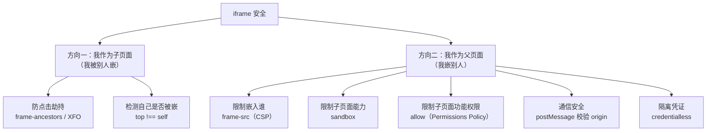

# 安全 · 04 点击劫持与 iframe 安全

> 覆盖题号：**9、21、16**
> 对应原题：《什么是点击劫持？如何防范》《点击劫持》《iframe 安全》
> 这三题是一组：**点击劫持是 iframe 最经典的滥用，而 iframe 安全要同时管"我被嵌"和"我嵌别人"两个方向。**

---

## 目录

- [1. 点击劫持](#1-点击劫持)
- [2. 防御：三种手段与它们的可靠性](#2-防御三种手段与它们的可靠性)
- [3. iframe 安全全景](#3-iframe-安全全景)
- [4. sandbox 属性详解](#4-sandbox-属性详解)
- [5. postMessage 的正确用法](#5-postmessage-的正确用法)
- [6. window.opener 与标签页劫持](#6-windowopener-与标签页劫持)
- [7. 一个完整的 iframe 接入规范](#7-一个完整的-iframe-接入规范)
- [8. 常见坑](#8-常见坑)
- [9. 答题模板](#9-答题模板)
- [10. 追问表](#10-追问表)
- [11. 速记卡](#11-速记卡)

---

## 1. 点击劫持

### 1.1 一句话结论

**点击劫持（Clickjacking）= 攻击者把目标网站用透明 iframe 盖在自己的页面上，诱骗用户在"看起来无害的按钮"上点击，实际点到的是 iframe 里目标网站的真实按钮。**

**关键点**：它不是"偷数据"，而是"**借用用户的点击**"。用户以为在点"领取奖品"，实际点的是"确认转账"。

### 1.2 完整攻击示例

```html
<!-- 攻击者页面 evil.com -->
<!DOCTYPE html>
<html>
<head>
  <style>
    /* ① 用 iframe 把目标站加载进来 */
    iframe {
      position: fixed;
      top: 0;
      left: 0;
      width: 100vw;
      height: 100vh;
      /* ② 关键：完全透明 */
      opacity: 0;
      /* 或者用 filter: alpha(opacity=0) 兼容老 IE */
      z-index: 2;
      border: none;
    }
    /* ③ 诱饵：看起来无害的按钮，位置精确对齐 iframe 里的真实按钮 */
    .bait {
      position: fixed;
      top: 320px;      /* 精确对齐目标按钮的位置 */
      left: 480px;
      z-index: 1;
      padding: 12px 40px;
      font-size: 20px;
      background: #ff5722;
      color: #fff;
      border-radius: 8px;
    }
  </style>
</head>
<body>
  <div class="bait">🎁 点击领取 100 元红包</div>
  <iframe src="https://bank.com/transfer?to=hacker&amount=10000"></iframe>
</body>
</html>
```

**用户看到**：一个"领取红包"的按钮。
**实际发生**：点击穿透到透明 iframe 里 `bank.com` 的"确认转账"按钮上。因为用户已登录 bank.com，Cookie 有效，转账成功。

> **为什么这个攻击特别阴险**：它是"**用户主动点击**"，所以：
> - CSRF Token 无效（Token 会随请求正确带上）
> - 验证码也可能被绕过（如果验证码只在"可疑"时触发）
> - 日志看起来完全正常（真实的用户点击、真实的请求）

### 1.3 攻击变种（说出来显得懂行）

| 变种 | 手法 |
|---|---|
| **Likejacking** | 诱导点"赞"/"关注"，实际在社交站点点了关注攻击者 |
| **Cursorjacking** | 用 CSS 把鼠标指针**显示的位置**偏移，用户以为在点 A 实际点 B |
| **Filejacking** | 诱导点击 `<input type="file">`，然后通过 JS 读取选中的文件名/内容（老浏览器） |
| **Drag-and-drop jacking** | 诱导"拖拽"操作，把敏感内容拖到攻击者输入框 |
| **Double-clickjacking** | 需要"双击"的确认框，第一次点击被利用，第二次是真实用户操作 |
| **Tapjacking（移动端）** | 移动端用 `touch` 事件 + 透明覆盖层；还可用"快速连续点击"绕过确认 |
| **嵌套多层 iframe** | 用多层嵌套 + 缩放，绕过简单的 `top !== self` 检测 |

### 1.4 30 秒版（原理）

> "点击劫持是把目标网站用透明 iframe 盖在攻击者页面上，用户在诱饵按钮上点击，实际点到 iframe 里目标站的真实按钮。因为它用的是用户真实的点击，所以 CSRF Token 和验证码都不一定拦得住。防御主要靠响应头：`X-Frame-Options: DENY` 或 CSP 的 `frame-ancestors 'none'`。"

---

## 2. 防御：三种手段与它们的可靠性

### 2.1 手段一：`X-Frame-Options`（老标准，兼容性好）

```http
X-Frame-Options: DENY
X-Frame-Options: SAMEORIGIN
```

| 值 | 含义 |
|---|---|
| `DENY` | 任何页面都不能嵌套我（**最安全**） |
| `SAMEORIGIN` | 只有同源页面能嵌套我 |
| ~~`ALLOW-FROM https://a.com`~~ | **已废弃**，Chrome/Safari 不支持；Firefox 也已移除 |

**注意**：`X-Frame-Options` **不支持指定多个域名**，这是它被 `frame-ancestors` 取代的主要原因。

### 2.2 手段二：CSP `frame-ancestors`（现代标准，推荐）

```http
Content-Security-Policy: frame-ancestors 'none'
Content-Security-Policy: frame-ancestors 'self'
Content-Security-Policy: frame-ancestors 'self' https://portal.example.com https://*.partner.com
```

| 优势 | 说明 |
|---|---|
| **支持多个来源** | 可以列白名单 |
| **支持通配符** | `https://*.partner.com` |
| **优先级更高** | 与 XFO 同时存在时，**浏览器忽略 XFO，以 `frame-ancestors` 为准** |
| **只能通过响应头** | 写在 `meta` 里无效（重要！） |

**两者对比：**

| | `X-Frame-Options` | CSP `frame-ancestors` |
|---|---|---|
| 多域名 | ❌ | ✅ |
| 通配符 | ❌ | ✅ |
| meta 生效 | ✅ | ❌ |
| 现代浏览器优先级 | 低（被忽略） | **高** |
| 建议 | 为兼容老浏览器保留 | **主用** |

**生产推荐（两个都写）：**

```nginx
add_header X-Frame-Options "SAMEORIGIN" always;
add_header Content-Security-Policy "frame-ancestors 'self'" always;
```

### 2.3 手段三：JS frame busting（不可靠，只能兜底）

```js
// 最经典的写法
if (top !== self) {
  top.location = self.location
}
```

**为什么不可靠——三种绕过：**

| 绕过手法 | 原理 |
|---|---|
| **`sandbox="allow-scripts"`** | 加 sandbox 但**不给** `allow-top-navigation`，则 `top.location = ...` 会被浏览器阻止（抛错），breakout 失败 |
| **`onbeforeunload` 拦截** | 攻击者让 iframe 页面在卸载时弹确认框，阻止跳转 |
| **`X-Frame-Options: ALLOW-FROM` + 多层嵌套** | 复杂场景下 `top` 与实际承载页不一致 |
| **禁用 JS** | 直接用 `sandbox` 不给 `allow-scripts`，你的 busting 代码根本不执行 |

**更稳的写法（不跳转，只隐藏自己）：**

```js
// 比起跳转，直接"不显示"更难被阻止
if (window.top !== window.self) {
  // 隐藏整个页面，让攻击者的诱饵按钮下面什么都没有
  document.documentElement.style.display = 'none'
  // 可选：上报
  navigator.sendBeacon?.('/api/frame-detected')
}
```

> **结论（一定要说）**：**frame busting 只能作为补充，不能作为主防御。** 真正的防御必须在响应头层。这是本题的核心判断。

### 2.4 三层组合建议

```
第一层（主）：CSP frame-ancestors 'none' 或白名单     ← 浏览器强制，不可绕过
第二层（兼容）：X-Frame-Options: DENY / SAMEORIGIN    ← 老浏览器
第三层（兜底）：JS 检测 top !== self 并隐藏页面         ← 只能提高成本
```

### 2.5 追问：那我不想被嵌，但业务上需要被嵌怎么办

```
① 明确白名单：frame-ancestors 'self' https://portal.example.com
② 关键操作二次确认（转账、改密码要求重输密码）
③ 关键操作不用"一次点击"完成（加一步选择/滑动验证）
④ 用 postMessage 与父页面约定握手，而不是裸嵌
```

---

## 3. iframe 安全全景

> **这题最容易答漏方向。** iframe 安全有两个方向，很多人只答一个。



### 3.1 方向一：我被嵌入（防点击劫持）

用 `frame-ancestors` / `X-Frame-Options`，见第 2 节。

### 3.2 方向二：我嵌入别人（四条限制）

| 限制什么 | 手段 |
|---|---|
| **能嵌哪些域** | CSP `frame-src`（默认回落到 `child-src`，再回落到 `default-src`） |
| **子页面能做什么** | `<iframe sandbox="...">` |
| **子页面能用哪些浏览器能力** | `<iframe allow="...">`（Permissions Policy） |
| **子页面能不能和我通信** | `postMessage` + 严格校验 origin |

```html
<iframe
  src="https://widget.partner.com/chat"
  sandbox="allow-scripts allow-forms allow-same-origin"
  allow="clipboard-write; fullscreen"
  referrerpolicy="no-referrer"
  loading="lazy"
  width="400"
  height="600"
></iframe>
```

```http
# 同时用 CSP 限制能嵌哪些域
Content-Security-Policy: frame-src 'self' https://widget.partner.com
```

### 3.3 `frame-src` 与 `frame-ancestors` 的方向（必考）

| 指令 | 我在哪 | 控制什么 | 类比 |
|---|---|---|---|
| **`frame-src`** | 父页面 | 我**能嵌谁** | 我的"白名单朋友" |
| **`frame-ancestors`** | 子页面 | **谁能嵌我** | 我的"门禁名单" |

> 防点击劫持用 **`frame-ancestors`**（我在子页面的位置，声明"别人不能嵌我"）。
> 限制第三方内容用 **`frame-src`**（我在父页面的位置，声明"我只嵌这些"）。

### 3.4 一个常被忽略的风险：同源 iframe

```
如果你的页面允许用户上传 HTML/SVG，并且用同源 iframe 预览
→ 那个 iframe 里的内容可以访问 parent.document
→ 等于用户能在你的域下执行任意 JS
```

**防御**：

| 手段 | 说明 |
|---|---|
| **上传内容用独立域名** | `usercontent.example.com`，与主站不同源 |
| **`sandbox` 不给 `allow-same-origin`** | 强制 iframe 变成"不透明源"（opaque origin） |
| **`Content-Disposition: attachment`** | 强制下载而非渲染 |
| **`X-Content-Type-Options: nosniff`** | 防 MIME 嗅探 |

---

## 4. sandbox 属性详解

### 4.1 一句话

**`sandbox` 给 iframe 施加一组"默认全禁"的限制，必须显式开启才允许。**

```html
<iframe sandbox src="..."></iframe>                  <!-- 最严格：不能跑 JS、不能提交表单、不能弹窗 -->
<iframe sandbox="allow-scripts" src="..."></iframe>  <!-- 只允许 JS -->
```

### 4.2 token 全表

| token | 允许什么 | 默认 |
|---|---|---|
| `allow-scripts` | 执行 JS | ❌ |
| `allow-same-origin` | 保留原源（否则变成 opaque origin，**无法访问 Cookie/localStorage/父页面**） | ❌ |
| `allow-forms` | 提交表单 | ❌ |
| `allow-popups` | `window.open` / `target=_blank` | ❌ |
| `allow-popups-to-escape-sandbox` | 弹出的窗口不带 sandbox | ❌ |
| `allow-top-navigation` | 能导航顶层页面（**很危险**，可用来做钓鱼跳转） | ❌ |
| `allow-top-navigation-by-user-activation` | 仅在用户手势下能导航顶层 | ❌ |
| `allow-modals` | `alert` / `confirm` / `prompt` | ❌ |
| `allow-downloads` | 触发下载 | ❌ |
| `allow-presentation` | 使用 Presentation API | ❌ |
| `allow-pointer-lock` | 锁定鼠标 | ❌ |
| `allow-orientation-lock` | 锁定屏幕方向 | ❌ |
| `allow-storage-access-by-user-activation` | 访问未分区存储（配合 Storage Access API） | ❌ |

### 4.3 三个必须知道的坑

**坑一：`allow-scripts` + `allow-same-origin` 同时给 = sandbox 失效**

```html
<!-- ❌ 危险组合 -->
<iframe sandbox="allow-scripts allow-same-origin" src="https://same-origin-content"></iframe>
```

**为什么**：如果 iframe 内容与父页面**同源**，且同时给了这两个 token，iframe 里的脚本可以：

```js
// iframe 内
parent.document.querySelector('iframe').removeAttribute('sandbox')
// → sandbox 被移除，然后重新加载即可完全逃逸
```

> **MDN 明确警告**："强烈不建议同时使用 `allow-scripts` 和 `allow-same-origin`，除非内容与父页面同源且你完全信任它。"

**正确做法**：

| 场景 | 配置 |
|---|---|
| 嵌入**不可信**第三方内容 | `sandbox="allow-scripts"`（**不给** `allow-same-origin`，让它变成 opaque origin） |
| 嵌入**同源**可信内容（如自己的子应用） | 可以给两个，但要确保内容确实可信 |
| 嵌入**跨域**可信内容 | `sandbox="allow-scripts allow-same-origin allow-forms"`（跨域时 `allow-same-origin` 只是保留它自己的源，拿不到父页面） |

**坑二：`allow-same-origin` 不等于"同源访问父页面"**

- 跨域 iframe + `allow-same-origin` → 它保留**自己的源**，仍然**不能**访问 `parent.document`
- 同源 iframe + `allow-same-origin` → 它能访问 `parent.document`

**坑三：`srcdoc` 默认继承父页面源**

```html
<!-- ❌ 如果 content 含用户输入，等于在父页面源下执行 -->
<iframe srcdoc="<script>alert(1)</script>"></iframe>
```

**修复**：`srcdoc` 的 iframe 必须加 `sandbox`（不给 `allow-same-origin`），或者先消毒内容。

### 4.4 sandbox 与 CSP 的关系

| | 作用对象 | 优先级 |
|---|---|---|
| `sandbox` 属性 | 单个 iframe | 属性层面 |
| CSP `sandbox` 指令 | 整个文档 | 更严格时生效 |

两者可以同时用，取更严格的限制。

---

## 5. postMessage 的正确用法

> **这是题 16 里最容易出漏洞的地方。** 很多项目的 `postMessage` 直接写 `origin: '*'` 且不校验 `event.origin`，等于给所有页面开了后门。

### 5.1 错误示范（真实项目中很常见）

```js
// ❌ 发送端：广播给任何人
iframe.contentWindow.postMessage({ token: userToken }, '*')

// ❌ 接收端：不校验来源
window.addEventListener('message', (e) => {
  eval(e.data)                        // 更糟：直接执行
  document.getElementById('x').innerHTML = e.data
  localStorage.setItem('token', e.data.token)
})
```

**后果**：任何能嵌你页面（或被你嵌）的页面都能：
- 拿到你广播出去的 token
- 往你页面注入任意内容
- 改你的 localStorage

### 5.2 正确示范

```js
// ===== 发送端 =====
// ① targetOrigin 必须写死具体来源，绝不用 '*'
const ALLOWED_TARGET = 'https://widget.partner.com'

iframe.contentWindow.postMessage(
  { type: 'INIT', payload: { theme: 'dark' } },
  ALLOWED_TARGET            // ← 只有这个源能收到
)

// ===== 接收端 =====
const ALLOWED_ORIGINS = new Set([
  'https://widget.partner.com',
  'https://app.example.com',
])

window.addEventListener('message', (event) => {
  // ① 校验来源（必须精确匹配，不能用 startsWith/includes）
  if (!ALLOWED_ORIGINS.has(event.origin)) return

  // ② 校验发送者窗口（防止同源的其他 iframe 冒充）
  if (event.source !== iframe.contentWindow) return

  // ③ 校验数据结构（不能假设对方一定发合法数据）
  const { type, payload } = event.data ?? {}
  if (typeof type !== 'string') return

  switch (type) {
    case 'READY':
      console.log('子页面就绪', payload)
      break
    case 'RESIZE':
      if (typeof payload?.height === 'number' && payload.height < 5000) {
        iframe.style.height = `${payload.height}px`
      }
      break
    default:
      // 未知类型一律忽略
      break
  }
})
```

### 5.3 三个必须校验的东西

| 校验 | 为什么 | 错误写法 |
|---|---|---|
| **`event.origin`** | 确认消息来自可信源 | `if (e.origin.includes('example.com'))`（`example.com.evil.com` 也能过） |
| **`event.source`** | 确认是预期的那个窗口（防同源的其他 iframe 冒充） | 不校验 |
| **`event.data` 的结构与类型** | 对方可能被攻陷，发来恶意数据 | 直接 `eval` / `innerHTML` / 赋给 `location` |

### 5.4 `targetOrigin` 的三个值

```js
postMessage(data, '*')                        // 任何源都能收（只在公开数据时用）
postMessage(data, 'https://a.com')            // 只有 https://a.com 能收（推荐）
postMessage(data, '/')                        // 同源
```

> **关键细节**：`targetOrigin` 是**浏览器帮你做的保护**——如果目标窗口的实际 origin 不匹配，消息**不会发送**。所以它是"发送端的自我约束"，而 `event.origin` 校验是"接收端的防御"。**两者都要做，缺一不可。**

### 5.5 postMessage 的一个实际风险场景

```
你的页面 A 嵌入了第三方 widget B
B 被攻陷，或者 B 本身就是恶意的
B 向 parent 发 postMessage({ type: 'SET_TOKEN', token: 'xxx' })
你的 A 没有校验 origin → 接受了 → 账号被接管
```

**这就是为什么"校验 origin"不是可选项。**

---

## 6. window.opener 与标签页劫持

### 6.1 攻击原理（Tabnabbing / 反向标签劫持）

```html
<!-- 你的页面 -->
<a href="https://evil.com" target="_blank">点击查看</a>
```

用户点击后，`evil.com` 在新标签打开，但它拿到了 `window.opener`（指向你的页面）。于是它可以：

```js
// evil.com 里
window.opener.location = 'https://evil.com/phishing-login'
// → 用户切回原来的标签，发现"你的网站"变成了钓鱼登录页
```

**为什么成功率不低**：用户切回标签时不会注意 URL，看到熟悉的页面就输入密码。

### 6.2 防御

```html
<!-- 三选一，推荐第一个 -->
<a href="https://external.com" target="_blank" rel="noopener">链接</a>
<a href="https://external.com" target="_blank" rel="noopener noreferrer">链接</a>
<a href="https://external.com" target="_blank" rel="noreferrer">链接</a>
```

| 值 | 作用 |
|---|---|
| `noopener` | 新页面拿不到 `window.opener`（设为 `null`） |
| `noreferrer` | 不发送 `Referer` 头，**同时隐含 `noopener`** |
| `nofollow` | 与安全无关（SEO 用） |

**用 JS 打开时：**

```js
// ❌ 保留 opener
window.open(url, '_blank')

// ✅ 切断 opener
window.open(url, '_blank', 'noopener,noreferrer')
```

### 6.3 现代浏览器已经默认 noopener

| 浏览器 | 变化 |
|---|---|
| Chrome 88+（2021） | `target="_blank"` 默认相当于 `rel="noopener"` |
| Firefox 79+ | 同上 |
| Safari 12.1+ | 同上 |

**但还是建议显式写**：
1. 兼容老浏览器
2. **代码可读性**——让 reviewer 知道你考虑过这个问题
3. 如果你需要 `opener`（少数场景），显式写 `rel="opener"` 更有表达力

---

## 7. 一个完整的 iframe 接入规范

> 面试时如果问"你们项目怎么安全地嵌第三方"，能给出这份规范就很强。

### 7.1 作为父页面（我嵌别人）

```html
<iframe
  src="https://widget.partner.com/chat"
  <!-- ① 最小权限：只给必需的 -->
  sandbox="allow-scripts allow-forms allow-popups"
  <!-- ② 限制浏览器能力 -->
  allow="clipboard-write"
  <!-- ③ 不泄露来源信息 -->
  referrerpolicy="no-referrer"
  <!-- ④ 懒加载（性能） -->
  loading="lazy"
  <!-- ⑤ 预留尺寸防 CLS -->
  width="400" height="600"
  <!-- ⑥ 给个 title（无障碍） -->
  title="在线客服"
></iframe>
```

```http
# ⑦ CSP 限制只能嵌这些域
Content-Security-Policy: frame-src 'self' https://widget.partner.com
```

```js
// ⑧ 通信时严格校验
window.addEventListener('message', (e) => {
  if (e.origin !== 'https://widget.partner.com') return
  if (e.source !== iframe.contentWindow) return
  // 校验数据结构后再用
})
```

### 7.2 作为子页面（我被别人嵌）

```http
# ① 明确谁能嵌我
Content-Security-Policy: frame-ancestors 'self' https://portal.example.com
X-Frame-Options: SAMEORIGIN
```

```js
// ② 兜底检测（被非法嵌套时隐藏页面）
if (window.top !== window.self) {
  document.documentElement.style.display = 'none'
}
```

```js
// ③ 与父页面通信时也校验
window.addEventListener('message', (e) => {
  if (e.origin !== 'https://portal.example.com') return
  // ...
})
```

### 7.3 一份检查清单

```
□ frame-ancestors 已配（不是 'none' 就是明确白名单）
□ X-Frame-Options 已配（兼容老浏览器）
□ frame-src 限制了能嵌入的域
□ iframe 有 sandbox，且没有危险的 token 组合
□ iframe 有 allow 限制浏览器能力
□ 所有 postMessage 都校验 origin + source
□ targetOrigin 不是 '*'
□ 所有 target="_blank" 都有 rel="noopener"
□ 同源 iframe 内容（如用户上传）已隔离到独立域
□ srcdoc 的 iframe 加了 sandbox
```

---

## 8. 常见坑

| # | 坑 | 纠正 |
|---|---|---|
| 1 | 只写 `X-Frame-Options`，不写 `frame-ancestors` | 前者不支持多域名；现代浏览器优先 `frame-ancestors`，要两个都写 |
| 2 | 把 `frame-ancestors` 写在 `meta` 里 | **无效**，只能通过响应头 |
| 3 | 只靠 JS frame busting | 用 `sandbox="allow-scripts"` 就能绕过 |
| 4 | frame busting 用 `top.location = self.location` | 可能被 `onbeforeunload` 拦截；改为"隐藏自己"更稳 |
| 5 | `sandbox="allow-scripts allow-same-origin"` 一起给 | 同源内容可移除 sandbox 逃逸 |
| 6 | 以为 `allow-same-origin` 就是"允许访问父页面" | 跨域时它只保留自己的源 |
| 7 | `postMessage(data, '*')` | 任何源都能收到；写死具体 origin |
| 8 | 接收端不校验 `event.origin` | 任何页面都能往你页面发消息 |
| 9 | 用 `startsWith` / `includes` 校验 origin | `https://example.com.evil.com` 能绕过；用 Set 精确匹配 |
| 10 | 不校验 `event.source` | 同源的其他 iframe 可冒充 |
| 11 | 用 `eval` / `innerHTML` 处理消息数据 | 消息内容也是不可信输入 |
| 12 | 用户上传内容同源 iframe 预览 | 等于给用户上传 XSS 能力；用独立域 + sandbox |
| 13 | `srcdoc` 不加 sandbox | 继承父页面源，直接 XSS |
| 14 | `frame-src` 和 `frame-ancestors` 搞混 | 前者"我能嵌谁"，后者"谁能嵌我" |
| 15 | 忘了 `target="_blank"` 的 `rel` | 标签页劫持；现代浏览器已默认，但仍应显式写 |

---

## 9. 答题模板

### 9.1 「什么是点击劫持，如何防范」——30 秒

> "点击劫持是把目标网站用透明 iframe 盖在攻击者页面上，用户在诱饵按钮上点击，实际点到 iframe 里目标站的真实按钮，比如'确认转账'。因为它用的是用户真实点击，所以 CSRF Token 拦不住。防御靠响应头：`X-Frame-Options: DENY`，或者 CSP 的 `frame-ancestors 'none'`，后者更现代、支持多域名。JS 的 `top !== self` 检测只能兜底，加 sandbox 就能绕过。"

### 9.2 ——2 分钟

> "点击劫持的本质是**借用用户的点击**，不是偷数据。攻击者页面用 `position: fixed` 加 `opacity: 0` 把目标站 iframe 铺满全屏，上面盖一个看起来无害的按钮，位置精确对齐 iframe 里的真实按钮。用户以为在点'领取红包'，实际点的是'确认转账'。因为用户已经登录、Cookie 有效、点击也是真实的，所以 CSRF Token、验证码都不一定能拦住。
>
> **变种**还有 likejacking 诱导关注、cursorjacking 偏移鼠标指针、移动端的 tapjacking，以及用多层 iframe 嵌套绕过简单检测的。
>
> **防御有三种，但可靠性差别很大。**
>
> 第一种是 **`X-Frame-Options`**，`DENY` 或 `SAMEORIGIN`。缺点是**不支持指定多个域名**，`ALLOW-FROM` 已废弃。
>
> 第二种是 **CSP 的 `frame-ancestors`**，它支持多域名和通配符，而且和 XFO 同时存在时浏览器会**忽略 XFO**，以它为准。生产上我两个都写，XFO 是为了兼容老浏览器。注意它**只能写在响应头里，写 meta 无效**。
>
> 第三种是 **JS frame busting**，`if (top !== self) top.location = self.location`。这个**不可靠**——攻击者给 iframe 加 `sandbox="allow-scripts"` 但不给 `allow-top-navigation`，你这段跳转代码就被浏览器阻止了；或者用 `onbeforeunload` 拦住跳转。所以它只能兜底，而且我会改成'隐藏自己'而不是'跳转'，更难被阻止。
>
> 除了技术手段，业务上还有一层：关键操作不要设计成'一次点击就完成'，加一步确认或重新输入密码，能从根本上降低危害。"

### 9.3 「iframe 安全」——30 秒

> "iframe 安全分两个方向。**作为子页面**要防被点击劫持，用 `frame-ancestors` 和 `X-Frame-Options`。**作为父页面**要管好嵌进来的内容：用 CSP 的 `frame-src` 限制能嵌哪些域，用 `sandbox` 限制子页面能力（注意 `allow-scripts` 和 `allow-same-origin` 不能随便一起给），用 `allow` 限制浏览器功能，`postMessage` 通信时必须校验 `event.origin` 和 `event.source`，发送时 `targetOrigin` 不能写 `*`。另外 `target="_blank"` 要加 `rel="noopener"`。"

---

## 10. 追问表

| # | 追问 | 要点 |
|---|---|---|
| 1 | 点击劫持和 CSRF 区别？ | CSRF 是伪造请求（用户无感）；点击劫持是骗用户真实点击 |
| 2 | 为什么 CSRF Token 防不住点击劫持？ | Token 会随真实点击的请求正确带上 |
| 3 | `X-Frame-Options` 有几个值？ | `DENY` / `SAMEORIGIN`；`ALLOW-FROM` 已废弃 |
| 4 | `frame-ancestors` 和 XFO 谁优先？ | `frame-ancestors` 优先，XFO 被忽略 |
| 5 | `frame-ancestors` 能写在 meta 里吗？ | 不能，只能响应头 |
| 6 | frame busting 为什么不可靠？ | `sandbox` 不给 `allow-top-navigation` 就能阻止跳转 |
| 7 | 有没有更好的 busting 写法？ | 隐藏自己（`display: none`）比跳转更难被阻止 |
| 8 | `frame-src` 和 `frame-ancestors` 区别？ | 我能嵌谁 vs 谁能嵌我 |
| 9 | `sandbox` 默认是什么？ | 全禁；必须显式开 token |
| 10 | 为什么 `allow-scripts` + `allow-same-origin` 危险？ | 同源内容可移除 sandbox 属性逃逸 |
| 11 | `allow-same-origin` 会让我访问父页面吗？ | 只有同源时才会；跨域时它只保留自己的源 |
| 12 | `postMessage` 要校验什么？ | `event.origin`（精确匹配）+ `event.source` + 数据结构 |
| 13 | `targetOrigin: '*'` 有什么问题？ | 任何源都能收到，可能泄露 token |
| 14 | 为什么 origin 不能用 `includes` 校验？ | `https://example.com.evil.com` 能绕过 |
| 15 | `noopener` 和 `noreferrer` 区别？ | 前者断 opener，后者不发 Referer 且隐含 noopener |
| 16 | 现代浏览器还默认需要 `noopener` 吗？ | 已默认，但仍建议显式写 |
| 17 | `srcdoc` 有什么风险？ | 继承父页面源，含用户输入时等于 XSS |
| 18 | 用户上传 HTML 怎么安全预览？ | 独立域 + `sandbox` 不给 `allow-same-origin` + `attachment` |
| 19 | `credentialless` iframe 是什么？ | 加载第三方内容时不携带凭证（Chrome 新特性） |
| 20 | 微前端场景怎么配？ | `frame-ancestors` 白名单主应用域 + `postMessage` 严格校验 |

---

## 11. 速记卡

```
【点击劫持】
透明 iframe 铺满 + 诱饵按钮精确对齐 → 骗真实点击
CSRF Token 拦不住（因为是真实点击）
变种：likejacking / cursorjacking / tapjacking / 多层嵌套

【三种防御，可靠性递减】
① CSP frame-ancestors 'none' 或白名单   ← 主，支持多域/通配，只能响应头
② X-Frame-Options DENY / SAMEORIGIN    ← 兼容老浏览器（ALLOW-FROM 已废弃）
③ JS top !== self（隐藏自己 > 跳转）    ← 只兜底，sandbox 就能绕过

【iframe 两个方向】
我被嵌 → frame-ancestors / X-Frame-Options
我嵌别人 → frame-src + sandbox + allow + postMessage 校验 + credentialless

【别搞混】
frame-src       我能嵌谁（父页面）
frame-ancestors 谁能嵌我（子页面，防点击劫持用这个）

【sandbox】
默认全禁，必须显式开
⚠️ allow-scripts + allow-same-origin 同源时会失效（可移除 sandbox 逃逸）
⚠️ allow-top-navigation 很危险（可做钓鱼跳转）

【postMessage 三校验】
event.origin  精确匹配（不能用 includes，防 evil.com 后缀）
event.source  是预期窗口
event.data    结构与类型（消息也是不可信输入）
发送端 targetOrigin 写死具体源，不用 '*'

【opener】
target="_blank" → rel="noopener noreferrer"
window.open(url, '_blank', 'noopener,noreferrer')
```
