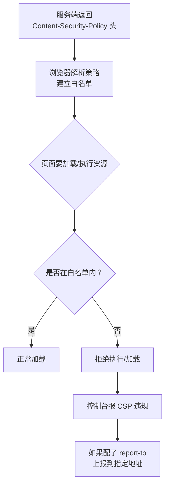
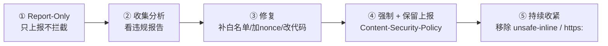

# 安全 · 03 CSP 与安全响应头

> 覆盖题号：**5、13**
> 对应原题：《CSP 可以解决什么问题》《前端的常规安全策略》

---

## 目录

- [1. CSP 是什么、解决什么问题](#1-csp-是什么解决什么问题)
- [2. 指令全表（按用途分三类）](#2-指令全表按用途分三类)
- [3. script-src 的四种策略（核心）](#3-script-src-的四种策略核心)
- [4. nonce 的完整实现](#4-nonce-的完整实现)
- [5. hash 与 strict-dynamic](#5-hash-与-strict-dynamic)
- [6. 上线策略：从 report-only 到强制](#6-上线策略从-report-only-到强制)
- [7. CSP 的边界：它能防什么、不能防什么](#7-csp-的边界它能防什么不能防什么)
- [8. CSP 的常见绕过手法（理解为什么不能只靠它）](#8-csp-的常见绕过手法理解为什么不能只靠它)
- [9. 其他安全响应头（主干）](#9-其他安全响应头主干)
- [10. Vue / React / Vite 项目落地 CSP 的坑](#10-vue--react--vite-项目落地-csp-的坑)
- [11. 题 13：前端常规安全策略总清单](#11-题-13前端常规安全策略总清单)
- [12. 常见坑](#12-常见坑)
- [13. 答题模板](#13-答题模板)
- [14. 追问表](#14-追问表)
- [15. 速记卡](#15-速记卡)

---

## 1. CSP 是什么、解决什么问题

### 1.1 一句话结论

**CSP（Content Security Policy，内容安全策略）是一份白名单声明，由响应头下发给浏览器：页面只允许从指定来源加载资源、只允许执行带授权的脚本。** 不在名单内的一律拒绝。

它是 XSS 的最后一道防线：注入的 `<script>` 没有 nonce、也不在白名单里，浏览器不会执行。

### 1.2 交付方式

```http
# 响应头（推荐）
Content-Security-Policy: default-src 'self'; script-src 'self' 'nonce-abc123'

# meta（能力受限）
<meta http-equiv="Content-Security-Policy" content="default-src 'self'">
```

| 方式 | 能力 | 局限 |
|---|---|---|
| 响应头 | 支持全部指令；约束本文档内所有资源（iframe 文档由它自己的响应头约束） | 需要服务端或网关配置 |
| meta | 前端可改 | 不支持 `frame-ancestors`、`sandbox`、`report-uri`；必须位于 `<head>` 且早于任何资源 |

### 1.3 工作原理



| 特性 | 说明 |
|---|---|
| **默认拒绝** | 没声明的指令回落到 `default-src`；两者都没写才是不限制 |
| **多策略取交集** | 多个 CSP 头（或头 + meta）同时存在时，浏览器按最严格的那份执行 |

### 1.4 一个"最小可用"的配置

```http
Content-Security-Policy:
  default-src 'self';
  script-src 'self';
  object-src 'none';
  base-uri 'none';
  frame-ancestors 'none';
```

| 指令 | 作用 | 为什么这么设 |
|---|---|---|
| `default-src 'self'` | 所有资源的兜底：只允许同源 | 先把未声明类型的入口关死 |
| `script-src 'self'` | 脚本只允许同源 | 挡住 `<script src="evil.com">` |
| `object-src 'none'` | 禁止 `<object>` / `<embed>` / `<applet>` | 老插件是绕过的经典入口（如 Flash） |
| `base-uri 'none'` | 禁止 `<base>` 标签 | 防 `<base href="//evil.com">` 劫持相对路径 |
| `frame-ancestors 'none'` | 禁止被任何页面 iframe 嵌套 | 防点击劫持（见 04 册） |

`base-uri` 单独说明：页面里的 `<script src="/app.js">` 是相对路径，注入 `<base href="https://evil.com/">` 后会改从 `evil.com` 加载，`script-src 'self'` 随之失效；`base-uri 'none'` 堵的就是这条路径。

---

## 2. 指令全表（按用途分三类）

### 2.1 资源加载类（Fetch Directives）

| 指令 | 控制什么 | 常见坑 |
|---|---|---|
| `default-src` | **所有未显式声明资源的兜底** | 忘设 → 其他指令没写就等于不限制 |
| `script-src` | JS 来源 | 最关键的指令 |
| `style-src` | CSS 来源 | **内联 `style` 属性也受它管**，Vue/React 项目最容易卡在这 |
| `img-src` | 图片 | `data:` 和 `blob:` 要显式允许 |
| `font-src` | 字体 | 字体 CDN 要加白名单 |
| `connect-src` | `fetch` / `XHR` / `WebSocket` / `EventSource` | **接口域名必须在这**，否则请求全被拦 |
| `media-src` | 音视频 | — |
| `object-src` | `<object>` / `<embed>` | **建议 `'none'`** |
| `frame-src` | 可以嵌套哪些 iframe | 不管"谁能嵌套本文档"（那是 `frame-ancestors`） |
| `worker-src` | Worker / SharedWorker / ServiceWorker | — |
| `manifest-src` | PWA manifest | — |

### 2.2 文档/导航类

| 指令 | 控制什么 | 建议 |
|---|---|---|
| `base-uri` | `<base>` 标签的 URL | **`'none'`**（防相对路径劫持） |
| `form-action` | 表单能提交到哪 | `'self'`（防表单把密码发到外部） |
| `frame-ancestors` | **谁能嵌套本文档**（防点击劫持） | `'none'` 或 `'self'` |
| `sandbox` | 给页面施加 iframe sandbox 限制 | 一般不用于顶层文档 |
| `upgrade-insecure-requests` | 把 HTTP 子资源自动升级为 HTTPS | 建议加 |
| `block-all-mixed-content` | 阻止所有混合内容 | 已废弃，由 `upgrade-insecure-requests` 取代 |

`frame-src` 和 `frame-ancestors` 方向相反：

- `frame-src`：父页面能嵌入谁
- `frame-ancestors`：子页面能被谁嵌入

### 2.3 报告类

| 指令 | 说明 |
|---|---|
| `report-uri` | CSP2 的上报地址，兼容性好，CSP3 标记为废弃 |
| `report-to` | Reporting API，需要额外的 `Report-To` 响应头 |

```http
Content-Security-Policy: default-src 'self'; report-uri /api/csp-report

Content-Security-Policy: default-src 'self'; report-to csp
Report-To: {"group":"csp","max_age":10886400,"endpoints":[{"url":"https://report.example.com"}]}
```

### 2.4 来源表达式（Source Expressions）

| 表达式 | 含义 |
|---|---|
| `'self'` | 同源（协议 + 域名 + 端口都相同） |
| `'none'` | 什么都不允许 |
| `'unsafe-inline'` | 允许内联脚本/样式（**危险**） |
| `'unsafe-eval'` | 允许 `eval` / `new Function` / `setTimeout(string)`（**危险**） |
| `'nonce-<base64>'` | 只有带这个 nonce 的脚本才允许 |
| `'sha256-<base64>'` | 只有内容哈希匹配的内联脚本才允许 |
| `'strict-dynamic'` | 信任"由已信任脚本动态创建"的脚本 |
| `https:` | 允许任意 HTTPS 来源（**等于不限制**） |
| `data:` / `blob:` | 允许 data/blob URL |

---

## 3. script-src 的四种策略（核心）

四代策略解决同一个问题：怎样在不维护域名清单的前提下，只放行可信脚本。

### 3.1 策略一：域名白名单（CSP 1.0 时代）

```http
Content-Security-Policy: script-src 'self' https://cdn.example.com
```

| 问题 | 说明 |
|---|---|
| **内联脚本全部失效** | 没有 nonce/hash/`'unsafe-inline'` 时，`<script>...</script>` 和 `onclick="..."` 都不执行；为恢复只能加 `'unsafe-inline'`，等于放弃防护 |
| **挡不住 JSONP 绕过** | 白名单域名上有 JSONP 接口时，`?callback=alert(1)` 就能执行任意代码 |
| **挡不住已知库的 gadget** | 白名单内的 AngularJS 等库可用模板能力执行代码 |
| **白名单只增不减** | 业务迭代不断加域名，最终退化成 `https:` |

结论：域名白名单只约束 URL，不约束脚本内容，白名单里任何一个可编程端点都会放大攻击面。

### 3.2 策略二：nonce（CSP 2.0，推荐）

```http
Content-Security-Policy: script-src 'nonce-r4nd0mV4lu3=' 'self'
```

```html
<!-- 只有带正确 nonce 的脚本才执行 -->
<script nonce="r4nd0mV4lu3=" src="/app.js"></script>
<script nonce="r4nd0mV4lu3=">console.log('inline ok')</script>

<!-- 注入的脚本没有 nonce → 拒绝执行 -->
<script>alert(1)</script>
<script src="https://evil.com/x.js"></script>
```

| 要求 | 原因 |
|---|---|
| **每次请求都要重新生成** | nonce 固定后，攻击者能从页面源码里读到 |
| **必须是密码学随机** | `crypto.randomBytes(16).toString('base64')`，不能用时间戳 |
| **带 nonce 的 HTML 不能被缓存** | 否则同一个 nonce 被复用 |
| **不要用 `'unsafe-inline'` 搭配 nonce** | 支持 CSP2+ 的浏览器会忽略 `'unsafe-inline'`，CSP1 浏览器仍会生效 → 等于没防 |

### 3.3 策略三：hash（CSP 2.0）

```http
Content-Security-Policy: script-src 'sha256-abc123...' 'self'
```

```html
<!-- 浏览器计算这段内联脚本的 sha256，与策略比对 -->
<script>console.log('this exact content is allowed')</script>
```

适用场景：内容固定的内联脚本（埋点初始化、`window.__INITIAL_STATE__`）。

| 优点 | 缺点 |
|---|---|
| 不用每次生成随机值，可以缓存 | 内容改一个字 hash 就变，要重新配 |
| 精确到内容 | 不适合频繁变化的脚本 |

`'unsafe-hashes'` 允许对**内联事件属性**（`onclick="..."`）做 hash 校验，但这个属性本身就不该用。

### 3.4 策略四：strict-dynamic（CSP 3.0，现代最佳）

```http
Content-Security-Policy: script-src 'nonce-xxx' 'strict-dynamic' https: 'unsafe-inline'
```

**作用**：信任会沿 DOM 创建链传播。由已信任脚本动态创建的脚本（`document.createElement('script')`、`import()`）自动被信任，**不需要 nonce**；在 CSP3 浏览器里同时**忽略域名白名单**。

```js
// 已信任的 app.js 里
const s = document.createElement('script')
s.src = '/chunk-abc.js' // 这个脚本没有 nonce
document.head.appendChild(s) // 仍然执行
```

没有 `strict-dynamic` 时，每个 chunk 都要单独加 nonce；现代框架（webpack 的 chunk 加载、Vite 的 modulepreload）无法做到。

**兼容写法（按浏览器降级）：**

| 浏览器 | 实际生效的源 | 结果 |
|---|---|---|
| 支持 CSP3 | `'nonce-...'` + `'strict-dynamic'` | 忽略 `https:`、主机白名单和 `'unsafe-inline'` |
| 支持 CSP2 | `'nonce-...'`、`https:` | 不识别 `'strict-dynamic'`；`'unsafe-inline'` 因有 nonce 被忽略，但 `https:` 仍放行任意 HTTPS 域 |
| 只支持 CSP1 | `https:`、`'unsafe-inline'` | nonce 与 `'strict-dynamic'` 都不识别，等同域名白名单 + 内联放行 |

只面向现代浏览器时，直接写 `script-src 'nonce-xxx' 'strict-dynamic'` 即可；但 CSP1 浏览器会把 `script-src` 视为空而全部拦截，需要兼容时才补 `https: 'unsafe-inline'` 作为降级。

### 3.5 四种策略对比

| 策略 | 内联脚本 | 防 JSONP / gadget 绕过 | 动态 chunk | 维护成本 |
|---|---|---|---|---|
| 域名白名单 | 需 `'unsafe-inline'`（失去防护） | ❌ | ✅ | 中（会越来越长） |
| nonce | nonce 放行 | ✅ | ❌（需给每个 chunk 加） | 中 |
| hash | hash 放行 | ✅ | ❌ | 高（内容变就失效） |
| **nonce + strict-dynamic** | nonce 放行 | ✅ | ✅ | **低** |

---

## 4. nonce 的完整实现

### 4.1 服务端（Node / Express 示例）

```js
const crypto = require('crypto')
const express = require('express')
const app = express()

app.use((req, res, next) => {
  // 每次请求生成新的随机 nonce
  const nonce = crypto.randomBytes(16).toString('base64')
  res.locals.nonce = nonce

  res.setHeader(
    'Content-Security-Policy',
    [
      `default-src 'self'`,
      // 需要兼容 CSP1 时在末尾补 https: 'unsafe-inline'，见 3.4
      `script-src 'nonce-${nonce}' 'strict-dynamic'`,
      `style-src 'self' 'unsafe-inline'`, // 见 10.1
      `img-src 'self' data:`,
      `font-src 'self' https://fonts.gstatic.com`,
      `connect-src 'self' https://api.example.com`,
      `object-src 'none'`,
      `base-uri 'none'`,
      `frame-ancestors 'none'`,
      `upgrade-insecure-requests`,
      `report-uri /api/csp-report`,
    ].join('; '),
  )

  // 带 nonce 的 HTML 不能被共享缓存
  res.setHeader('Cache-Control', 'private, no-cache')
  next()
})

app.get('/', (req, res) => {
  res.render('index', { nonce: res.locals.nonce })
})
```

```html
<script nonce="<%= nonce %>" src="/app.js"></script>
```

### 4.2 Nginx

```nginx
# nonce 由生成 HTML 的一层产生，nginx 只透传
# 若让 nginx 自己生成：$request_id 不是密码学随机值，只能算弱化方案
add_header Content-Security-Policy "script-src 'nonce-$request_id' 'strict-dynamic'; object-src 'none'; base-uri 'none'; frame-ancestors 'none'" always;
```

还要把同一个 nonce 写进 HTML。`sub_filter` 是字符串替换，遇到不带空格的 `<script>` 会漏；由后端模板直接渲染更稳妥。

纯静态站点没有每请求的 HTML 生成过程：用构建期 hash，或在 CDN 边缘函数里改写 HTML 注入 nonce。

### 4.3 纯前端项目（Vite）的 nonce

Vite 构建期只能注入固定字符串，nonce 会变成静态值，失去"每请求随机"的意义。纯静态 + CDN 的常见路径是构建期 hash 或边缘层按请求改写 HTML；两者都做不到时，只能退化为域名白名单。

---

## 5. hash 与 strict-dynamic

### 5.1 计算内联脚本的 hash

```bash
# 精确到字节，包括缩进和换行
printf %s "console.log('hello')" | openssl dgst -sha256 -binary | openssl base64
# → RiiZMt4WBEeSYPAXi7o6X3AZ0TOyY+/BOcmhjYVr6/E=
```

```http
Content-Security-Policy: script-src 'sha256-RiiZMt4WBEeSYPAXi7o6X3AZ0TOyY+/BOcmhjYVr6/E=' 'self'
```

```html
<script>console.log('hello')</script>   <!-- 内容完全一致才允许 -->
```

工程化做法是用构建插件扫描 HTML 里的内联脚本、算 hash、生成 CSP 头：

```js
import crypto from 'node:crypto'

function computeHashes(html) {
  const re = /<script(?![^>]*\bsrc=)[^>]*>([\s\S]*?)<\/script>/g
  const hashes = []
  let m
  while ((m = re.exec(html))) {
    if (!m[1].trim()) continue
    hashes.push(`'sha256-${crypto.createHash('sha256').update(m[1]).digest('base64')}'`)
  }
  return hashes
}
```

### 5.2 strict-dynamic 的适用边界

`'strict-dynamic'` 的信任只沿 DOM 创建链传播：由已信任脚本用 `document.createElement('script')`、`appendChild`、`import()` 创建的脚本自动信任。

- 解析器插入的 `<script>` 仍需 nonce 或 hash。
- `innerHTML` 插入的 `<script>` 本来就不执行，`'strict-dynamic'` 不改变这一点。

---

## 6. 上线策略：从 report-only 到强制

直接上强制 CSP 容易把站点打挂，标准做法是灰度推进。

### 6.1 灰度流程



### 6.2 第一步：Report-Only

```http
Content-Security-Policy-Report-Only: default-src 'self'; script-src 'self'; report-uri /api/csp-report
```

这个头下违规只上报、不拦截，可以在生产环境先跑一段时间。

### 6.3 第二步：接收报告

```js
// /api/csp-report
app.post('/api/csp-report', express.json({ type: 'application/csp-report' }), (req, res) => {
  const report = req.body['csp-report'] || req.body
  console.warn('[CSP]', {
    blocked: report['blocked-uri'],
    directive: report['violated-directive'],
    document: report['document-uri'],
    source: report['source-file'],
    line: report['line-number'],
  })
  res.status(204).end()
})
```

| 看什么 | 说明 |
|---|---|
| `violated-directive` | 哪条指令被触发（说明漏配了哪个域） |
| `blocked-uri` | 被拦的具体 URL |
| `source-file` + `line-number` | 哪段代码触发的（用于定位内联脚本） |

`report-to` 的报文是 Reporting API 的数组格式，字段名与 `report-uri` 不同，解析要分别处理。

### 6.4 第三步：常见修复

| 报告内容 | 修复 |
|---|---|
| `script-src` 拦了某 CDN | 加白名单；改用 nonce + strict-dynamic 后不再需要 |
| `script-src` 拦了内联脚本 | 加 nonce，或把内联代码抽成外部文件 |
| `style-src` 拦了内联 style | 见 10.1 |
| `connect-src` 拦了接口 | 加接口域名 |
| `img-src` 拦了 data URL | 加 `data:` |

### 6.5 第四步：强制 + 长期收紧

```http
Content-Security-Policy: ...; report-uri /api/csp-report
```

保留上报：新接入的第三方脚本、新的接口域名都会以违规形式暴露，作为回归检测。

---

## 7. CSP 的边界：它能防什么、不能防什么

### 7.1 能防

| 场景 | 说明 |
|---|---|
| 注入 `<script src="evil.com">` | 不在白名单 → 拒绝 |
| 注入内联 `<script>alert(1)</script>` | 没有 nonce → 拒绝 |
| 注入 `` | 内联事件处理器需要 `'unsafe-inline'` → 拒绝 |
| 注入 `<iframe src="evil.com">` | `frame-src` 限制 |
| `eval` / `new Function` 注入 | 没有 `'unsafe-eval'` → 拒绝 |
| 点击劫持 | `frame-ancestors` |
| 相对路径劫持 | `base-uri 'none'` |
| 表单劫持（密码发到外部） | `form-action 'self'` |
| HTTP 降级 | `upgrade-insecure-requests` |

### 7.2 不能防

| 场景 | 为什么 CSP 管不了 |
|---|---|
| **数据外带（exfiltration）** | `img-src` 允许 `https:` 时，XSS 仍可用 `` 带出数据 |
| **非脚本型 DOM 问题** | 页面把不可信数据写进 `innerHTML` 造成的 UI 欺骗不受 CSP 约束 |
| **服务端漏洞** | SQL 注入、越权、SSRF 全在服务端 |
| **CSRF** | CSP 不校验请求来源，也不提供 token；`form-action` 只限制表单提交目标 |
| **业务逻辑漏洞** | 如价格篡改、越权操作 |
| **第三方脚本自身被攻陷** | 在白名单内就放行，属于供应链风险 |
| **社工 / 钓鱼** | 与 CSP 无关 |

### 7.3 定位

CSP 是**缓解（mitigation）**，不是**修复（fix）**。它降低 XSS 的可利用性，不替代输出编码，也不覆盖服务端漏洞。防线顺序：输出编码 → CSP → Trusted Types。

---

## 8. CSP 的常见绕过手法（理解为什么不能只靠它）

| 绕过手法 | 原理 | 防御 |
|---|---|---|
| **JSONP 端点** | 白名单域名上有 JSONP 接口 → `?callback=alert(1)` 直接执行 | 用 nonce + strict-dynamic（忽略白名单）；或清理白名单里的 JSONP 域名 |
| **`<base>` 劫持** | 注入 `<base href="//evil.com">`，相对路径脚本改从攻击者域加载 | `base-uri 'none'` |
| **已知库 gadget** | 白名单里的 AngularJS / 老版本 jQuery 有模板执行能力 | 不用不合规的库；用 strict-dynamic |
| **`unsafe-eval` 存在** | 任何能控制字符串的地方都能执行代码 | 去掉 `unsafe-eval` |
| **`unsafe-inline` 存在** | 等于没配 `script-src` | 去掉，改用 nonce |
| **开放重定向** | 白名单域上有跳转接口，可跳到 `evil.com` | 修开放重定向 |
| **`script-src` 允许 `data:`** | 可以 `<script src="data:text/javascript,...">` | 不允许 `data:` |
| **CSP 只写在 meta 里** | 部分指令失效；且 meta 之前的资源已经加载 | 用响应头 |

结论：域名白名单不是安全边界；nonce/hash + `strict-dynamic` 把信任收敛到入口脚本，才不依赖白名单里第三方的行为。

---

## 9. 其他安全响应头（主干）

### 9.1 全景表

| 响应头 | 防什么 | 推荐值 |
|---|---|---|
| `Content-Security-Policy` | XSS、点击劫持、混合内容 | 见前文 |
| `Strict-Transport-Security` | SSL 剥离、降级攻击 | `max-age=31536000; includeSubDomains; preload` |
| `X-Frame-Options` | 点击劫持 | `DENY` / `SAMEORIGIN` |
| `X-Content-Type-Options` | MIME 嗅探导致的上传文件执行 | `nosniff` |
| `Referrer-Policy` | URL 中的敏感信息泄露给第三方 | `strict-origin-when-cross-origin` |
| `Permissions-Policy` | 第三方滥用摄像头/麦克风/定位 | `camera=(), microphone=(), geolocation=()` |
| `Cross-Origin-Opener-Policy` | `window.opener` 攻击 | `same-origin` |
| `Cross-Origin-Embedder-Policy` | 跨域资源未授权加载 | `require-corp`（需跨域隔离时） |
| `Cross-Origin-Resource-Policy` | 资源被其他站热链/嵌入 | `same-origin` |
| `Cache-Control`（敏感页） | 敏感页面被缓存/回退键看到 | `no-store` |
| ~~`X-XSS-Protection`~~ | 老浏览器 XSS 过滤器 | **`0`**（关掉） |

`X-Frame-Options` 与 `frame-ancestors` 同时存在时，Chrome 以 `frame-ancestors` 为准，`X-Frame-Options` 被忽略（实测见 12 节）。

### 9.2 HSTS 详解

```http
Strict-Transport-Security: max-age=31536000; includeSubDomains; preload
```

| 参数 | 作用 |
|---|---|
| `max-age` | 浏览器记住"这个域必须用 HTTPS"的秒数 |
| `includeSubDomains` | 所有子域也强制 HTTPS |
| `preload` | 进入浏览器内置列表，首次访问也不会走 HTTP |

HSTS 解决 **SSL 剥离**：攻击者在用户第一次访问（还是 HTTP）时拦截并降级，让用户全程走 HTTP；HSTS 让浏览器记住必须 HTTPS，后续访问不再发 HTTP 请求。

| 风险 | 说明 |
|---|---|
| **max-age 有效期内无法撤销** | 子域没有 HTTPS 时，无法从该子域下发清除头，到期前一直不可访问 |
| **preload 撤出慢** | 提交到内置列表后，撤出要等浏览器发版 |
| **只认 HTTPS 响应** | HTTP 响应里的 HSTS 头会被浏览器忽略 |

实践：先 `max-age=300` 观察，确认所有子域都有 HTTPS 后再加长；`preload` 最后做。

### 9.3 `X-Content-Type-Options: nosniff`

`nosniff` 让浏览器严格按 `Content-Type` 处理响应：`text/plain` 的响应不会被当成脚本执行。

上传文件的响应还应加 `Content-Disposition: attachment`，强制下载而不是内联渲染。

### 9.4 `Referrer-Policy`

| 值 | 跨源时发送的 Referer |
|---|---|
| `no-referrer` | 什么都不发 |
| `same-origin` | 只同源发，跨源不发 |
| `strict-origin-when-cross-origin`（现代默认） | 跨源只发**源**（`https://a.com/`），不发路径 |
| `unsafe-url` | 发完整 URL（含参数，**危险**） |

URL 里可能有 token、手机号、订单号；完整 Referer 发给第三方就是泄露。

### 9.5 COOP / COEP / CORP（跨域隔离三件套）

| 头 | 作用 |
|---|---|
| `Cross-Origin-Opener-Policy: same-origin` | 隔离 `window.opener` 引用，防标签页劫持 |
| `Cross-Origin-Embedder-Policy: require-corp` | 要求所有跨域资源显式声明允许嵌入 |
| `Cross-Origin-Resource-Policy: same-origin` | 资源只允许同源引用 |

用途：开启 `crossOriginIsolated`，从而能用 `SharedArrayBuffer`、高精度计时器。

COEP `require-corp` 会让所有没声明 CORP/CORS 的第三方资源加载失败，上线前要逐个排查。

### 9.6 `X-XSS-Protection: 0` 为什么

老浏览器（IE / 旧 Chrome）的 XSS 过滤器基于反射检测，可以被绕过，也会误删合法内容。现代做法是显式关掉：`X-XSS-Protection: 0`。Chrome 已移除 XSS Auditor。

---

## 10. Vue / React / Vite 项目落地 CSP 的坑

### 10.1 坑一：框架的内联样式被 `style-src` 拦

```vue
<!-- Vue 的 :style 会生成内联 style 属性 -->
<div :style="{ color: activeColor }">文本</div>
```

```html
<div style="color: red">文本</div>
<!-- 这是 style 属性，由 style-src-attr 控制，未设置时回落到 style-src -->
```

| 方案 | 说明 |
|---|---|
| `style-src 'self' 'unsafe-inline'` | 最常见；样式内联的攻击面远小于脚本 |
| `style-src-attr 'unsafe-hashes' 'sha256-...'` | 只能放行内容固定的属性值，动态值无法预先算 hash |
| 用 class + CSS 变量代替 `:style` | 不用放宽策略，改造量大 |

nonce 只作用于 `<style>` 元素，对 `style` 属性无效。

### 10.2 坑二：Vue 的运行时编译器需要 `unsafe-eval`

```js
// ❌ 完整版 Vue（含编译器）：用 new Function 编译模板
import { createApp } from 'vue/dist/vue.esm-bundler.js'
createApp({ template: '<div>{{ msg }}</div>' })
// → 需要 'unsafe-eval'
```

```js
// ✅ SFC（.vue 文件）+ 构建时预编译：不需要 eval
import { createApp } from 'vue'
import App from './App.vue'
createApp(App).mount('#app')
```

### 10.3 坑三：webpack / Vite 的运行时注入

| 注入内容 | 受哪条指令约束 | 解决 |
|---|---|---|
| webpack 的 `runtimeChunk` | `script-src`（外部文件，`'self'` 即可） | 无需处理 |
| webpack 的 HMR 客户端（仅开发环境） | 内联脚本 + `eval` | 开发环境放宽，生产不启用 |
| Vite 的 `modulepreload` polyfill（内联） | `script-src` | 用 hash 或 nonce |
| Vite 的 dev server 注入 | 内联脚本 + WS 连接 | 开发环境放宽 |
| `__INITIAL_STATE__` 内联数据 | `script-src`（如果是 `<script>window.x=...</script>`） | 改用 `type="application/json"` + `JSON.parse` |

```html
<!-- ❌ 会被 CSP 拦（可执行内联脚本） -->
<script>window.__STATE__ = {"user":"张三"}</script>

<!-- ✅ 不是可执行脚本，不会被拦 -->
<script type="application/json" id="__STATE__">{"user":"张三"}</script>
<script src="/app.js" nonce="xxx"></script>
```

```js
const state = JSON.parse(document.getElementById('__STATE__').textContent)
```

### 10.4 坑四：`connect-src` 漏配导致接口全挂

```http
Content-Security-Policy: default-src 'self'
```

`connect-src` 未声明时回落到 `default-src 'self'`，所有跨域接口请求和跨域 WebSocket 连接都会失败。

上线前检查：

```
□ 所有 API 域名在 connect-src
□ WebSocket 地址（wss://）在 connect-src
□ 图片 CDN 在 img-src（含 data: 如果需要 base64）
□ 字体 CDN 在 font-src
□ 埋点/监控上报地址在 connect-src
□ iframe 内嵌的第三方在 frame-src
```

### 10.5 坑五：`frame-ancestors` 和微前端

被其他系统 iframe 嵌入时，`frame-ancestors 'none'` 会让页面无法被嵌套。

```http
Content-Security-Policy: frame-ancestors 'self' https://portal.example.com
```

---

## 11. 题 13：前端常规安全策略总清单

按"必须做 / 应该做 / 视情况"三档。

### 11.1 必须做（P0）

| # | 项 | 落地方式 |
|---|---|---|
| 1 | **全站 HTTPS** | 证书 + 301 跳转 + HSTS |
| 2 | **Cookie 三件套** | `HttpOnly; Secure; SameSite=Lax`（会话 Cookie 必加） |
| 3 | **输出编码** | 禁止 `innerHTML` 直接用用户输入；框架用 `{{ }}` |
| 4 | **危险 API 禁用** | ESLint `no-unsanitized`；`v-html`/`dangerouslySetInnerHTML` 需 review |
| 5 | **CSP** | 至少 `default-src 'self'; object-src 'none'; base-uri 'none'; frame-ancestors 'none'` |
| 6 | **`X-Content-Type-Options`** | 见 9.3 |
| 7 | **上传文件独立域 + `Content-Disposition`** | 防 SVG/HTML 上传 XSS |
| 8 | **密钥不进前端** | 检查 bundle 里有没有 API key / secret |

### 11.2 应该做（P1）

| # | 项 | 落地方式 |
|---|---|---|
| 9 | **CSRF Token / SameSite** | 见 02 册 |
| 10 | **安全响应头补齐** | `Referrer-Policy`、`Permissions-Policy` 取值见 9.1 |
| 11 | **SRI（第三方脚本）** | `integrity` + `crossorigin` |
| 12 | **依赖审计** | `npm audit` / Snyk 进 CI |
| 13 | **锁文件 + `npm ci`** | 防依赖漂移 |
| 14 | **sourcemap 不公开** | 上传到监控平台后删除 |
| 15 | **日志脱敏** | 不打印手机号/密码/token |
| 16 | **`target="_blank"` 加 `rel="noopener noreferrer"`** | 防标签页劫持 |

### 11.3 视情况（P2）

| # | 项 | 说明 |
|---|---|---|
| 17 | **Trusted Types** | 改造量大，效果最好 |
| 18 | **COOP/COEP/CORP** | 需要跨域隔离（`SharedArrayBuffer`）时才上，见 9.5 |
| 19 | **CSP `report-to` + 告警** | 有安全运营能力时 |
| 20 | **前端混淆 / 防调试** | 只提高成本，见 06 册 |

---

## 12. 常见坑

下面的报错文案是本机 Chrome 对 `script-src`、`nonce`、`Report-Only`、`frame-ancestors` 的实测输出（摘要）。

| # | 现象 / 典型报错 | 原因 | 处理 |
|---|---|---|---|
| 1 | `Executing inline script violates ... 'script-src 'self''. ... a nonce ('nonce-...') is required ... The action has been blocked.` | 内联脚本没有授权 | 加 nonce/hash，或抽成外部文件 |
| 2 | `Loading the script 'http://localhost:PORT/app.js' violates ... "script-src 'self'". Note that 'script-src-elem' was not explicitly set, so 'script-src' is used as a fallback.` | 跨源脚本不在白名单 | 加源，或改用 nonce + `strict-dynamic` |
| 3 | 同一句违规文案，但级别是 info，结尾是 `The policy is report-only, so the violation has been logged but no further action has been taken.` | 用了 `Content-Security-Policy-Report-Only` | 页面没有被拦截，按报告补齐后再切强制 |
| 4 | `Framing 'http://127.0.0.1:PORT/' violates ... "frame-ancestors 'none'". The request has been blocked.` | 被嵌页面禁止任何祖先 | 调整 `frame-ancestors` |
| 5 | `Refused to display '...' in a frame because it set 'X-Frame-Options' to 'deny'.` | 只配了 `X-Frame-Options` | 迁到 `frame-ancestors`；两者同时存在时以后者为准 |
| 6 | 页面样式被拒，`style-src` 相关报错 | `:style` / `style` 属性没有 `'unsafe-inline'` | 见 10.1 |
| 7 | 接口、WebSocket 全部失败 | `connect-src` 漏配，回落到 `default-src` | 补齐接口域名 |
| 8 | nonce 固定不变或整页被缓存 | HTML 被共享缓存，同一个 nonce 复用 | 每请求随机 + `Cache-Control: private, no-cache` |
| 9 | 4xx/5xx 页面没有安全头 | nginx 的 `add_header` 默认只对部分 2xx/3xx 生效 | 加 `always` |

---

## 13. 答题模板

### 13.1 「CSP 可以解决什么问题」——30 秒

- **定义**：响应头下发的白名单，声明页面只能从哪些源加载资源、执行哪些脚本，不在名单内的一律拒绝。
- **能防**：XSS 脚本执行（无 nonce / 不在白名单不执行）、点击劫持（`frame-ancestors`）、相对路径劫持（`base-uri 'none'`）。
- **定位**：缓解手段，不是根治手段。

### 13.2 「CSP 可以解决什么问题」——2 分钟

- **机制**：服务端下发策略；未声明的指令回落到 `default-src`，多个策略取交集；违规可上报。
- **能防三类**：XSS 脚本执行、点击劫持（`frame-ancestors`）、混合内容与相对路径劫持。
- **策略演进**：域名白名单 → nonce → hash → nonce + `strict-dynamic`。白名单要么拦掉所有内联脚本，要么开 `'unsafe-inline'` 后失去防护，且挡不住 JSONP；`strict-dynamic` 让信任沿 DOM 创建链传播，动态 chunk 不需要逐个加 nonce。
- **上线**：`Report-Only` 收集违规 → 补白名单 / 加 nonce → 强制并保留上报。
- **边界**：缓解不是修复，不防数据外带和服务端漏洞；定位是输出编码 → CSP → Trusted Types。

### 13.3 「前端的常规安全策略」——30 秒

- **传输层**：全站 HTTPS + HSTS。
- **响应头层**：CSP、`X-Content-Type-Options`、`Referrer-Policy`、`X-Frame-Options`（或 `frame-ancestors`）、`Permissions-Policy`。
- **代码层**：输出编码，禁用 `innerHTML` / `v-html`，Cookie 加 `HttpOnly + Secure + SameSite`，外链加 `rel="noopener"`。
- **工程层**：依赖审计、SRI、密钥不进 bundle、sourcemap 不公开、日志脱敏。

---

## 14. 追问表

| # | 追问 | 要点 | 见 |
|---|---|---|---|
| 1 | CSP 通过什么下发？ | 响应头（推荐）或 meta；meta 不支持 `frame-ancestors` | 1.2 |
| 2 | `default-src` 和其他指令的关系？ | 其他指令没写时回落到 `default-src` | 1.3 |
| 3 | nonce 和 hash 的区别？ | nonce 每请求随机、适合动态；hash 按内容、适合固定 | 3.2 / 3.3 |
| 4 | `'unsafe-inline'` 和 nonce 同时存在？ | CSP2+ 忽略 `'unsafe-inline'`，CSP1 仍生效 | 3.2 |
| 5 | `strict-dynamic` 解决什么？ | 信任传染给动态创建的脚本，同时忽略域名白名单 | 3.4 |
| 6 | 为什么 `base-uri 'none'` 重要？ | 防 `<base>` 劫持相对路径脚本 | 1.4 |
| 7 | `frame-src` 和 `frame-ancestors` 的区别？ | 前者父页面能嵌谁，后者子页面能被谁嵌 | 2.2 |
| 8 | CSP 能防 DOM 型 XSS 吗？ | 能拦内联事件和未授权脚本；挡不住数据外带和非脚本型问题 | 7.2 |
| 9 | CSP 能防 CSRF 吗？ | 不能；`form-action` 只限制表单提交目标 | 7.2 |
| 10 | 白名单 CSP 怎么被绕过？ | JSONP 端点、库 gadget、`<base>` 劫持、开放重定向 | 8 |
| 11 | 怎么上线 CSP 不影响业务？ | `Report-Only` 先跑，收集报告，补白名单，再强制 | 6 |
| 12 | Vue 项目有什么坑？ | `:style` 需 `style-src` 放行内联样式；运行时编译需 `unsafe-eval` | 10 |
| 13 | 初始数据怎么内联才不被拦？ | `<script type="application/json">` + `JSON.parse` | 10.3 |
| 14 | 纯静态站点怎么做 nonce？ | 做不到每请求随机；用 hash 或边缘函数注入 | 4.3 |
| 15 | HSTS 的三个参数？ | `max-age` / `includeSubDomains` / `preload` | 9.2 |
| 16 | `X-XSS-Protection` 该设什么？ | `0`，已废弃且有漏洞 | 9.6 |
| 17 | COOP/COEP 有什么用？ | 跨域隔离，开启 `crossOriginIsolated` | 9.5 |
| 18 | CSP 和 Trusted Types 的关系？ | CSP 管"能执行什么"，Trusted Types 管"字符串能不能变成 HTML" | 7.3 |
| 19 | 为什么 4xx 页面也要带安全头？ | nginx `add_header` 要加 `always` | 12 |

---

## 15. 速记卡

```
【CSP 一句话】
白名单声明：只允许从哪加载、只允许执行哪些脚本
定位：缓解（mitigation），不是修复（fix）

【最小可用配置】
default-src 'self'; script-src 'nonce-xxx';
object-src 'none'; base-uri 'none'; frame-ancestors 'none'

【四代策略】
① 域名白名单    内联要 unsafe-inline，可被 JSONP / gadget 绕过
② nonce         每请求随机、不能复用、HTML 不能缓存
③ hash          内容固定，可缓存
④ nonce + strict-dynamic   忽略白名单 + 信任传染 ← 推荐

【兼容三件套】
script-src 'nonce-xxx' 'strict-dynamic' https: 'unsafe-inline'
CSP3 忽略 https: 与 unsafe-inline；CSP2 用 nonce 但 https: 仍生效；
CSP1 不识别 nonce，退化为 https: + 内联放行

【关键规则】
'unsafe-inline' 遇 nonce/hash 被忽略（CSP2+）→ 只留 nonce
frame-src 父页面能嵌谁 ｜ frame-ancestors 子页面能被谁嵌（防点击劫持用后者）
frame-ancestors 与 X-Frame-Options 同时存在 → 前者优先
default-src 是兜底，未声明指令回落

【上线四步】
Report-Only 跑一段时间 → 收报告看 violated-directive/blocked-uri
→ 补白名单/加 nonce → 强制 + 保留上报

【边界】
防：注入脚本、内联事件、eval、iframe 嵌套、base 劫持、表单劫持、HTTP 降级
不防：数据外带、服务端漏洞、CSRF、业务逻辑、第三方脚本自身被攻陷

【安全头清单】
CSP / HSTS / X-Frame-Options / X-Content-Type-Options: nosniff
/ Referrer-Policy: strict-origin-when-cross-origin
/ Permissions-Policy / COOP+COEP+CORP / X-XSS-Protection: 0

【框架坑】
Vue :style → 需 style-src 'unsafe-inline'
Vue 完整版（运行时编译）→ 需 'unsafe-eval'；用 SFC 就不需要
初始数据用 <script type="application/json"> 而不是内联 JS
```
