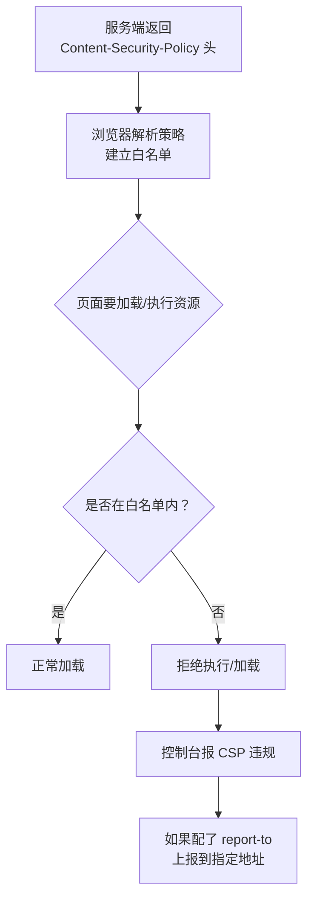
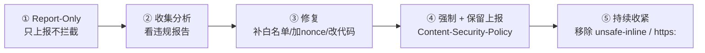

# 安全 · 03 CSP 与安全响应头

> 覆盖题号：**5、13**
> 对应原题：《CSP 可以解决什么问题》《前端的常规安全策略》
> 这一册讲**"用响应头给浏览器立规矩"**——这是前端能主动掌控的、成本最低、收益最大的一层防御。

---

## 目录

- [1. CSP 是什么、解决什么问题](#1-csp-是什么解决什么问题)
- [2. 指令全表（按用途分三类）](#2-指令全表按用途分三类)
- [3. script-src 的四种策略（核心）](#3-script-src-的四种策略核心)
- [4. nonce 的完整实现](#4-nonce-的完整实现)
- [5. hash 与 strict-dynamic](#5-hash-与-strict-dynamic)
- [6. 上线策略：从 report-only 到强制](#6-上线策略从-report-only-到强制)
- [7. CSP 的边界：它能防什么、不能防什么](#7-csp-的边界它能防什么不能防什么)
- [8. CSP 的常见绕过手法（理解为什么不能只靠它）](#8-csp-的常见绕过手法理解为什么不能只靠它)
- [9. 其他安全响应头（主干）](#9-其他安全响应头主干)
- [10. Vue / React / Vite 项目落地 CSP 的坑](#10-vue--react--vite-项目落地-csp-的坑)
- [11. 题 13：前端常规安全策略总清单](#11-题-13前端常规安全策略总清单)
- [12. 常见坑](#12-常见坑)
- [13. 答题模板](#13-答题模板)
- [14. 追问表](#14-追问表)
- [15. 速记卡](#15-速记卡)

---

## 1. CSP 是什么、解决什么问题

### 1.1 一句话结论

**CSP（Content Security Policy，内容安全策略）是一份"白名单声明"，通过响应头告诉浏览器：这个页面只允许从哪些地方加载资源、只允许执行哪些脚本。** 不在白名单里的一律拒绝。

**核心价值**：它是**最后一道防线**。即使 XSS 注入成功了，因为注入的 `<script>` 没有 nonce、不在白名单，浏览器也不会执行——**把"XSS 一定导致代码执行"变成"XSS 可能只是一个无害的标签"**。

### 1.2 交付方式

```http
# ① 响应头（推荐）
Content-Security-Policy: default-src 'self'; script-src 'self' 'nonce-abc123'

# ② meta 标签（不推荐，能力受限）
<meta http-equiv="Content-Security-Policy" content="default-src 'self'">
```

| 方式 | 优点 | 局限 |
|---|---|---|
| **响应头** | 能力完整；对所有资源类型生效（含 iframe 文档） | 需要服务端/网关配置 |
| **meta** | 前端能改 | **不支持 `frame-ancestors`、`sandbox`、`report-uri`**；必须在 `<head>` 里且早于任何资源 |

> **为什么不推荐 meta**：最常用的 `frame-ancestors`（防点击劫持）在 meta 里**无效**。而且 meta 只能覆盖 HTML 文档自身，覆盖不到通过 iframe 加载的其他文档。

### 1.3 工作原理



**两个关键特性：**

| 特性 | 说明 |
|---|---|
| **默认拒绝** | 没声明的指令回落到 `default-src`；都没声明 = 不限制（所以 `default-src` 很重要） |
| **示例是叠加的** | 多个 CSP 头（或头 + meta）同时存在时，浏览器取**交集**（最严格的） |

### 1.4 一个"最小可用"的配置

```http
Content-Security-Policy:
  default-src 'self';
  script-src 'self';
  object-src 'none';
  base-uri 'none';
  frame-ancestors 'none';
```

**逐条解释（这段能讲清就够专业）：**

| 指令 | 作用 | 为什么这么设 |
|---|---|---|
| `default-src 'self'` | 所有资源的兜底：只允许同源 | 默认拒绝，先把门关死 |
| `script-src 'self'` | 脚本只允许同源 | 挡住外部注入的 `<script src="evil.com">` |
| `object-src 'none'` | 禁止 `<object>` / `<embed>` / `<applet>` | 这些老插件是绕过的经典入口（如 Flash） |
| `base-uri 'none'` | 禁止 `<base>` 标签 | **防 `<base href="//evil.com">` 劫持所有相对路径**（超重要的细节） |
| `frame-ancestors 'none'` | 禁止被任何页面 iframe 嵌套 | 防点击劫持（见 04 册） |

> **`base-uri` 为什么重要**：如果页面有 `<script src="/app.js">`（相对路径），攻击者注入 `<base href="https://evil.com/">` 后，这个脚本就会从 `evil.com` 加载——**绕过 `script-src 'self'`**。这是一个非常经典的 CSP 绕过手法，`base-uri 'none'` 就是专门堵它的。

### 1.5 30 秒版

> "CSP 是一份白名单，通过响应头告诉浏览器只允许从哪些源加载资源、只允许执行哪些脚本，不在白名单的一律拒绝。它主要防 XSS——即使注入了 `<script>`，没有 nonce、不在白名单就不会执行。典型配置是 `default-src 'self'` 加 `script-src 'nonce-xxx'`，再配 `object-src 'none'`、`base-uri 'none'`、`frame-ancestors 'none'`。它是缓解手段不是根治手段。"

---

## 2. 指令全表（按用途分三类）

### 2.1 资源加载类（Fetch Directives）

| 指令 | 控制什么 | 常见坑 |
|---|---|---|
| `default-src` | **所有未显式声明资源的兜底** | 忘了设 → 其他指令没写就等于不限制 |
| `script-src` | JS 来源 | 最关键的指令 |
| `style-src` | CSS 来源 | **内联 `style` 属性也受它管**，Vue/React 项目最容易卡在这 |
| `img-src` | 图片 | 注意 `data:` 和 `blob:` 要显式允许 |
| `font-src` | 字体 | 字体 CDN 要加白名单 |
| `connect-src` | `fetch` / `XHR` / `WebSocket` / `EventSource` | **接口域名必须在这**，否则所有请求被拦 |
| `media-src` | 音视频 | — |
| `object-src` | `<object>` / `<embed>` | **建议 `'none'`** |
| `frame-src` | 可以嵌套哪些 iframe | 不管"谁能嵌套我"（那是 `frame-ancestors`） |
| `worker-src` | Worker / SharedWorker / ServiceWorker | — |
| `manifest-src` | PWA manifest | — |

### 2.2 文档/导航类

| 指令 | 控制什么 | 建议 |
|---|---|---|
| `base-uri` | `<base>` 标签的 URL | **`'none'`**（防相对路径劫持） |
| `form-action` | 表单能提交到哪 | `'self'`（防表单劫持把密码发到外部） |
| `frame-ancestors` | **谁能嵌套我**（防点击劫持） | `'none'` 或 `'self'` |
| `sandbox` | 给页面施加 iframe sandbox 限制 | 一般不用于顶层文档 |
| `upgrade-insecure-requests` | 把 HTTP 子资源自动升级为 HTTPS | 强烈建议加 |
| `block-all-mixed-content` | 阻止所有混合内容 | 已被上面的取代 |

> **`frame-src` 和 `frame-ancestors` 方向相反，这是最容易搞混的一对：**
> - `frame-src`：**我**能嵌入**谁**（我作为父页面）
> - `frame-ancestors`：**谁**能嵌入**我**（我作为子页面）
> 防点击劫持用 **`frame-ancestors`**。

### 2.3 报告类

| 指令 | 说明 |
|---|---|
| `report-uri` | 违规上报地址（已废弃但兼容性好） |
| `report-to` | 新的 Reporting API（需要配 `Report-To` 响应头） |

```http
Content-Security-Policy: default-src 'self'; report-uri /api/csp-report
Report-To: {"group":"csp","max_age":10886400,"endpoints":[{"url":"https://report.example.com"}]}
Content-Security-Policy: default-src 'self'; report-to csp
```

### 2.4 来源表达式（Source Expressions）

| 表达式 | 含义 |
|---|---|
| `'self'` | 同源（协议 + 域名 + 端口都相同） |
| `'none'` | 什么都不允许 |
| `'unsafe-inline'` | 允许内联脚本/样式（**危险**） |
| `'unsafe-eval'` | 允许 `eval` / `new Function` / `setTimeout(string)`（**危险**） |
| `'nonce-<base64>'` | 只有带这个 nonce 的内联脚本才允许 |
| `'sha256-<base64>'` | 只有内容哈希匹配的内联脚本才允许 |
| `'strict-dynamic'` | 信任"由已信任脚本动态创建"的脚本 |
| `https:` | 允许任意 HTTPS 来源（**等于不限制**） |
| `data:` / `blob:` | 允许 data/blob URL |

---

## 3. script-src 的四种策略（核心）

> 面试问 CSP，真正的分水岭在于：**你能不能说出"为什么光靠域名白名单不够，需要 nonce + strict-dynamic"**。

### 3.1 策略一：域名白名单（CSP 1.0 时代）

```http
Content-Security-Policy: script-src 'self' https://cdn.example.com
```

**问题：**

| 问题 | 说明 |
|---|---|
| **挡不住内联脚本** | 页面里所有 `<script>内容</script>` 和 `onclick="..."` 全部失效 |
| **挡不住 JSONP 绕过** | 如果白名单里有任何支持 JSONP 的域名，攻击者可以用 `?callback=alert(1)` 执行代码 |
| **挡不住已知库的 gadget** | 如果白名单里有 AngularJS 等库，可以用它自带的模板功能执行 |
| **白名单会越加越长** | 业务迭代中不断加域名，最终变成 `https:` |

**结论**：**域名白名单是"看起来安全"，实际很脆弱**。现代做法是策略二/三。

### 3.2 策略二：nonce（CSP 2.0，推荐）

```http
Content-Security-Policy: script-src 'nonce-r4nd0mV4lu3=' 'self'
```

```html
<!-- 只有带正确 nonce 的脚本才执行 -->
<script nonce="r4nd0mV4lu3=" src="/app.js"></script>
<script nonce="r4nd0mV4lu3=">console.log('inline ok')</script>

<!-- 攻击者注入的脚本没有 nonce（他不知道）→ 拒绝执行 -->
<script>alert(1)</script>
<script src="https://evil.com/x.js"></script>
```

**关键要求（说出来就显专业）：**

| 要求 | 原因 |
|---|---|
| **每次请求都要重新生成** | nonce 一旦固定就失去意义（攻击者能从页面源码里读到） |
| **必须是密码学随机** | `crypto.randomBytes(16).toString('base64')`，不能用时间戳 |
| **带 nonce 的 HTML 不能被缓存** | 否则同一个 nonce 被复用 |
| **不要用 `'unsafe-inline'` 搭配 nonce** | 在支持 nonce 的浏览器里 `'unsafe-inline'` 会被忽略，但在老浏览器（CSP1）里会生效 → 等于没防 |

**这是 CSP 最重要的一句话：**

> **`'unsafe-inline'` 和 nonce/hash 同时存在时，支持 CSP2+ 的浏览器会忽略 `'unsafe-inline'`。** 所以正确做法是**只留 nonce，不留 `'unsafe-inline'`**。

### 3.3 策略三：hash（CSP 2.0）

```http
Content-Security-Policy: script-src 'sha256-abc123...' 'self'
```

```html
<!-- 浏览器计算这段内联脚本的 sha256，与策略比对 -->
<script>console.log('this exact content is allowed')</script>
```

**适用场景**：**内容固定的内联脚本**（如埋点初始化代码、`window.__INITIAL_STATE__`）。

| 优点 | 缺点 |
|---|---|
| 不用每次生成随机值，可以缓存 | 内容改一个字 hash 就变，要重新配 |
| 精确到内容 | 不适合频繁变化的脚本 |

**补充**：`'unsafe-hashes'` 允许对**内联事件属性**（`onclick="..."`）做 hash 校验——但这个属性本身就不该用。

### 3.4 策略四：strict-dynamic（CSP 3.0，现代最佳）

```http
Content-Security-Policy: script-src 'nonce-xxx' 'strict-dynamic' https: 'unsafe-inline'
```

**作用**：**信任会"传染"**。只要一个脚本是通过"已信任脚本"动态创建的（`document.createElement('script')`、`import()`），它就自动被信任，**不需要 nonce**，并且**忽略域名白名单**。

**为什么需要它：**

```js
// 现代框架会动态插入脚本（如 webpack 的 chunk 加载、Vite 的 modulepreload）
const s = document.createElement('script')
s.src = '/chunk-abc.js'      // 这个脚本没有 nonce！
document.head.appendChild(s)
```

如果没有 `strict-dynamic`，你得给每个 chunk 都加 nonce（不现实）。有了它，因为创建者是已信任的 `app.js`，新脚本自动被信任。

**兼容写法（生产常用）：**

```http
Content-Security-Policy:
  script-src 'nonce-xxx' 'strict-dynamic' https: 'unsafe-inline';
  object-src 'none';
  base-uri 'none';
```

**这个"三件套"的妙处：**

| 浏览器 | 行为 |
|---|---|
| **支持 CSP3** | 用 `'nonce'` + `'strict-dynamic'`，**忽略 `https:` 和 `'unsafe-inline'`** → 安全 |
| **只支持 CSP2** | 用 `'nonce'`，忽略 `'unsafe-inline'` → 安全 |
| **只支持 CSP1**（老浏览器） | 用 `https:`（允许 HTTPS 来源）→ 降级但仍比 `*` 强 |

> 这是 Google 推荐的"渐进增强"写法。**能说出这个兼容策略，是很强的加分项。**

### 3.5 四种策略对比

| 策略 | 挡内联 | 挡 JSONP 绕过 | 支持动态 chunk | 维护成本 |
|---|---|---|---|---|
| 域名白名单 | ❌ | ❌ | ✅ | 中（会越来越长） |
| nonce | ✅ | ✅ | ❌（需给每个 chunk 加） | 中 |
| hash | ✅ | ✅ | ❌ | 高（内容变就失效） |
| **nonce + strict-dynamic** | ✅ | ✅ | ✅ | **低** |

---

## 4. nonce 的完整实现

### 4.1 服务端（Node / Express 示例）

```js
const crypto = require('crypto')
const express = require('express')
const app = express()

app.use((req, res, next) => {
  // 每次请求生成新的随机 nonce
  const nonce = crypto.randomBytes(16).toString('base64')
  res.locals.nonce = nonce

  res.setHeader(
    'Content-Security-Policy',
    [
      `default-src 'self'`,
      `script-src 'nonce-${nonce}' 'strict-dynamic' https: 'unsafe-inline'`,
      `style-src 'self' 'unsafe-inline'`,       // 样式一般需要放宽，见 10 章
      `img-src 'self' data: https:`,
      `font-src 'self' https://fonts.gstatic.com`,
      `connect-src 'self' https://api.example.com`,
      `object-src 'none'`,
      `base-uri 'none'`,
      `frame-ancestors 'none'`,
      `upgrade-insecure-requests`,
      `report-uri /api/csp-report`,
    ].join('; ')
  )

  // 关键：带 nonce 的 HTML 不能被共享缓存
  res.setHeader('Cache-Control', 'private, no-cache')
  next()
})

// 模板里注入
app.get('/', (req, res) => {
  res.render('index', { nonce: res.locals.nonce })
})
```

```html
<!-- 模板 -->
<script nonce="<%= nonce %>" src="/app.js"></script>
```

### 4.2 Nginx（配合后端注入，或用 sub_filter）

```nginx
# 方案一：后端生成，nginx 透传（推荐）
# 方案二：nginx 自己生成（用 $request_id 作为伪 nonce，安全性弱一些，但比没有强）
add_header Content-Security-Policy "script-src 'nonce-$request_id' 'strict-dynamic'; object-src 'none'; base-uri 'none'; frame-ancestors 'none'" always;
sub_filter '<script ' '<script nonce="$request_id" ';
sub_filter_once off;

# 方案三：静态站点用 hash（内容固定）
```

> **静态站点（无服务端）怎么办？** 两个办法：
> 1. 用 **hash**（内容固定，构建时算出每个内联脚本的 sha256）
> 2. 用 **CDN 的边缘计算**（Cloudflare Workers / Vercel Edge）在响应时注入 nonce

### 4.3 纯前端项目（Vite）的 nonce

Vite 构建会把入口脚本注入 HTML。用插件在构建时或边缘层加 nonce：

```js
// vite-plugin-csp-guard 或自己写一个简单插件
export default {
  name: 'csp-nonce',
  transformIndexHtml(html) {
    // 注意：这只在构建时注入一次，nonce 会固定 → 需要配合边缘层
    return html.replace(/<script /g, '<script nonce="__CSP_NONCE__" ')
  },
}
```

> **这里有个现实困境**：纯静态 + CDN 的架构下，**无法做到"每请求一个 nonce"**。可行的替代是：
> - 用 **hash**（推荐，因为构建后内容已知）
> - 或用边缘函数注入
> - 或退化成"域名白名单 + `strict-dynamic`"

---

## 5. hash 与 strict-dynamic

### 5.1 计算内联脚本的 hash

```bash
# 注意：要精确到字节，包括缩进和换行
echo -n "console.log('hello')" | openssl dgst -sha256 -binary | openssl base64
# 得到：xxxxxxxxxxxxxxxxxxxxxxxxxxxxxxxxxxxxxxxxxxx=
```

```http
Content-Security-Policy: script-src 'sha256-xxxxxxxxxxxxxxxxxxxxxxxxxxxxxxxxxxxxxxxxxxx=' 'self'
```

```html
<script>console.log('hello')</script>   <!-- 内容完全一致才允许 -->
```

**工程化做法**：用构建插件自动扫描 HTML 里的内联脚本、算 hash、生成 CSP 头。

```js
// 一个简化版的构建插件
import crypto from 'crypto'

function computeHashes(html) {
  const hashes = []
  const re = /<script(?![^>]*\bsrc=)[^>]*>([\s\S]*?)<\/script>/g
  let m
  while ((m = re.exec(html))) {
    const content = m[1]
    if (!content.trim()) continue
    const hash = crypto.createHash('sha256').update(content).digest('base64')
    hashes.push(`'sha256-${hash}'`)
  }
  return hashes
}
```

### 5.2 strict-dynamic 的两条规则

| 规则 | 说明 |
|---|---|
| **① 域名白名单被忽略**（CSP3 浏览器） | `https:`、`cdn.example.com` 都不再生效 |
| **② 信任可传染** | 由已信任脚本通过 `document.createElement('script')`、`import()`、`appendChild` 创建的脚本自动信任 |

```js
// 已信任的 app.js 里
const s = document.createElement('script')
s.src = 'https://cdn.example.com/analytics.js'   // 自动被信任 ✅
document.head.appendChild(s)

// 但攻击者注入的 <script> 没有 nonce，也不是被信任脚本创建的 → 拒绝
```

**注意**：`strict-dynamic` **不**让 `innerHTML` 插入的脚本生效（`innerHTML` 里的 `<script>` 本来就不执行）。

---

## 6. 上线策略：从 report-only 到强制

> **直接上强制 CSP 几乎必然把站点搞挂**（因为你会漏掉某个内联脚本或接口域名）。标准做法是四步灰度。

### 6.1 四步流程



### 6.2 第一步：Report-Only

```http
Content-Security-Policy-Report-Only: default-src 'self'; script-src 'self'; report-uri /api/csp-report
```

**这个头下，违规不会阻止，只会发送报告。** 可以放心在生产环境跑一周。

### 6.3 第二步：接收报告

```js
// /api/csp-report
app.post('/api/csp-report', express.json({ type: 'application/csp-report' }), (req, res) => {
  const report = req.body['csp-report'] || req.body
  console.warn('[CSP]', {
    blocked: report['blocked-uri'],
    directive: report['violated-directive'],
    document: report['document-uri'],
    source: report['source-file'],
    line: report['line-number'],
  })
  res.status(204).end()
})
```

**报告里要重点看三件事：**

| 看什么 | 说明 |
|---|---|
| `violated-directive` | 哪条指令被触发（说明你漏配了哪个域） |
| `blocked-uri` | 被拦的具体 URL |
| `source-file` + `line-number` | 是哪段代码触发的（用于定位内联脚本） |

### 6.4 第三步：常见修复

| 报告内容 | 修复 |
|---|---|
| `script-src` 拦了某 CDN | 加白名单（或改用 nonce + strict-dynamic 后就不需要） |
| `script-src` 拦了内联脚本 | 加 nonce，或把内联代码抽成外部文件 |
| `style-src` 拦了内联 style | 见第 10 章（Vue/React 的内联样式问题） |
| `connect-src` 拦了接口 | 加接口域名 |
| `img-src` 拦了 data URL | 加 `data:` |

### 6.5 第四步：强制 + 长期收紧

```http
Content-Security-Policy: ...; report-uri /api/csp-report
```

**保留上报**很重要——上线后仍会出现新的违规（新加的第三方脚本、新的接口域名），这是"性能/安全回归检测"的一部分。

---

## 7. CSP 的边界：它能防什么、不能防什么

> **这一节是"深度分水岭"。** 只会说 CSP 能防 XSS 是及格；能说清它防不住什么，才是真的懂。

### 7.1 能防

| 场景 | 说明 |
|---|---|
| 注入 `<script src="evil.com">` | 不在白名单 → 拒绝 |
| 注入内联 `<script>alert(1)</script>` | 没有 nonce → 拒绝 |
| 注入 `` | 内联事件处理器需要 `'unsafe-inline'` → 拒绝 |
| 注入 `<iframe src="evil.com">` | `frame-src` 限制 |
| `eval` / `new Function` 注入 | 没有 `'unsafe-eval'` → 拒绝 |
| 点击劫持 | `frame-ancestors` |
| 相对路径劫持 | `base-uri 'none'` |
| 表单劫持（密码发到外部） | `form-action 'self'` |
| HTTP 降级 | `upgrade-insecure-requests` |

### 7.2 不能防（重要）

| 场景 | 为什么 CSP 管不了 |
|---|---|
| **数据外带（exfiltration）** | 如果 `img-src` 允许 `https:`，XSS 仍可用 `` 把数据带出去 |
| **DOM 型 XSS 的"非脚本"部分** | 如 `<a href="javascript:...">`（受 `script-src` 约束，但如果页面本身允许 `unsafe-inline` 就无效）；或者页面自己把数据写入 `innerHTML` 造成的 UI 欺骗 |
| **服务端漏洞** | SQL 注入、越权、SSRF 全在服务端 |
| **CSRF** | 与 CSP 无关（`form-action` 只限制表单目标） |
| **业务逻辑漏洞** | 如价格篡改、越权操作 |
| **第三方脚本自身被攻陷** | 如果在白名单里，它干坏事 CSP 不管（**供应链风险**） |
| **已经存在的合法脚本被滥用** | 如 JSONP 接口被利用（除非有 strict-dynamic） |
| **社工 / 钓鱼** | 完全无关 |

### 7.3 一句精确的总结（可以直接背）

> "CSP 是**缓解（mitigation）**不是**修复（fix）**。它能把'XSS 必然导致代码执行'降级成'XSS 可能只是一个坏掉的标签'，但它不能阻止数据外带、不能替代输出编码、不能防服务端漏洞。**正确的定位是：输出编码是第一道防线，CSP 是第二道，Trusted Types 是第三道。**"

---

## 8. CSP 的常见绕过手法（理解为什么不能只靠它）

> 这些不是让你去攻击，而是让你理解"**为什么域名白名单不够、为什么要 strict-dynamic**"。

| 绕过手法 | 原理 | 防御 |
|---|---|---|
| **JSONP 端点** | 白名单域名上有 JSONP 接口 → `?callback=alert(1)` 直接执行 | 用 nonce + strict-dynamic（忽略白名单）；或清理白名单里的 JSONP 域名 |
| **`<base>` 劫持** | 注入 `<base href="//evil.com">`，相对路径脚本改从攻击者域加载 | `base-uri 'none'` |
| **已知库 gadget** | 白名单里的 AngularJS / 老版本 jQuery 有模板执行能力 | 不打不合规的库；用 strict-dynamic |
| **`unsafe-eval` 存在** | 任何能控制字符串的地方都能执行代码 | 去掉 `unsafe-eval` |
| **`unsafe-inline` 存在** | 等于没配 script-src | 去掉（用 nonce） |
| **开放重定向** | 白名单域上有跳转接口，可跳到 `evil.com` | 修开放重定向 |
| **`script-src` 允许 `data:`** | 可以 `<script src="data:text/javascript,...">` | 不允许 `data:` |
| **CSP 只写在 meta 里** | 部分指令失效；且 HTML 前面的资源已经加载 | 用响应头 |

> **面试时的表达**："CSP 的白名单策略容易被'白名单域名上的 JSONP 接口'和'库 gadget'绕过，所以我更倾向 nonce + strict-dynamic，让域名白名单在 CSP3 浏览器里失效，只信任带 nonce 的入口脚本。"

---

## 9. 其他安全响应头（主干）

### 9.1 全景表

| 响应头 | 防什么 | 推荐值 |
|---|---|---|
| `Content-Security-Policy` | XSS、点击劫持、混合内容 | 见前文 |
| `Strict-Transport-Security` | SSL 剥离、降级攻击 | `max-age=31536000; includeSubDomains; preload` |
| `X-Frame-Options` | 点击劫持 | `DENY` / `SAMEORIGIN` |
| `X-Content-Type-Options` | MIME 嗅探导致的上传文件执行 | `nosniff` |
| `Referrer-Policy` | URL 中的敏感信息泄露给第三方 | `strict-origin-when-cross-origin` |
| `Permissions-Policy` | 第三方滥用摄像头/麦克风/定位 | `camera=(), microphone=(), geolocation=()` |
| `Cross-Origin-Opener-Policy` | `window.opener` 攻击 | `same-origin` |
| `Cross-Origin-Embedder-Policy` | 跨域资源未授权加载 | `require-corp`（需跨域隔离时） |
| `Cross-Origin-Resource-Policy` | 资源被其他站热链/嵌入 | `same-origin` |
| `Cache-Control`（敏感页） | 敏感页面被缓存/回退键看到 | `no-store` |
| ~~`X-XSS-Protection`~~ | 老浏览器 XSS 过滤器 | **`0`**（关掉） |

### 9.2 HSTS 详解

```http
Strict-Transport-Security: max-age=31536000; includeSubDomains; preload
```

| 参数 | 作用 |
|---|---|
| `max-age` | 浏览器记住"这个域必须用 HTTPS"的秒数 |
| `includeSubDomains` | 所有子域也强制 HTTPS |
| `preload` | 申请加入浏览器内置列表（**硬编码在浏览器里，即使用户第一次访问也用 HTTPS**） |

**为什么需要 HSTS**：解决 **SSL 剥离攻击**——攻击者在用户第一次访问（还是 HTTP）时拦截并降级，让用户全程走 HTTP。HSTS 让浏览器"记住"必须 HTTPS，后续访问不会再发 HTTP 请求。

**风险（必须说）：**

| 风险 | 说明 |
|---|---|
| **不可逆** | 一旦 `max-age` 很长且 `includeSubDomains`，你的某个子域如果暂时没有 HTTPS，会**直接不可访问** |
| **preload 更难撤** | 提交到 preload 列表后，要撤需要几个月（等浏览器发版） |
| **只能在 HTTPS 响应里发** | HTTP 响应里的 HSTS 头会被浏览器忽略（否则可被伪造） |

> **实践建议**：先上 `max-age=300` 观察，再逐步加长；`preload` 最后做，且确认所有子域都有 HTTPS。

### 9.3 `X-Content-Type-Options: nosniff`

**防什么**：浏览器"猜"内容类型。

```
用户上传 1.jpg，实际内容是 <script>alert(1)</script>
如果没有 nosniff，某些情况下浏览器会按 HTML/JS 解析执行
加了 nosniff，浏览器严格按 Content-Type 处理 → 不会执行
```

**配套**：上传文件的响应还要加 `Content-Disposition: attachment`（强制下载）。

### 9.4 `Referrer-Policy`

| 值 | 跨源时发送的 Referer |
|---|---|
| `no-referrer` | 什么都不发 |
| `same-origin` | 只同源发，跨源不发 |
| `strict-origin-when-cross-origin`（现代默认） | 跨源只发**源**（`https://a.com/`），不发路径 |
| `unsafe-url` | 发完整 URL（含参数，**危险**） |

**为什么重要**：URL 里可能有 token、手机号、订单号。如果完整 Referer 发给了第三方（广告、CDN），就是泄露。

### 9.5 COOP / COEP / CORP（跨域隔离三件套）

| 头 | 作用 |
|---|---|
| `Cross-Origin-Opener-Policy: same-origin` | 隔离 `window.opener` 引用，防标签页劫持 |
| `Cross-Origin-Embedder-Policy: require-corp` | 要求所有跨域资源显式声明允许嵌入 |
| `Cross-Origin-Resource-Policy: same-origin` | 我的资源只允许同源引用 |

**用途**：开启 `crossOriginIsolated`，从而能用 `SharedArrayBuffer`、高精度计时器（`performance.now()` 精度提升）。

> **注意**：COEP `require-corp` 会导致**所有没声明 CORP/CORS 的第三方资源加载失败**，上线前必须逐个排查。

### 9.6 `X-XSS-Protection: 0` 为什么

老浏览器（IE/旧 Chrome）的 XSS 过滤器有**自身漏洞**：
- 它基于"反射检测"，可以被绕过
- 某些情况下它会把页面上合法的内容误删，甚至**制造新的 XSS**

所以现代建议是**显式关掉**：`X-XSS-Protection: 0`。Chrome 已移除 XSS Auditor。

---

## 10. Vue / React / Vite 项目落地 CSP 的坑

> 这一节是最"实战"的部分。面试时能说出这些，说明你真的配过 CSP。

### 10.1 坑一：框架的内联样式被 `style-src` 拦

```vue
<!-- Vue 的 :style 会生成内联 style 属性 -->
<div :style="{ color: activeColor }">文本</div>
```

**渲染结果**：

```html
<div style="color: red">文本</div>   <!-- 这是内联样式，受 style-src 约束 -->
```

**如果 `style-src` 没有 `'unsafe-inline'`，这个样式会被拒绝**，页面样式全乱。

| 方案 | 说明 |
|---|---|
| `style-src 'self' 'unsafe-inline'` | 最简单，最常见（**样式内联的 XSS 风险远低于脚本**） |
| `style-src 'self' 'nonce-xxx'` | 严格，但需要给所有动态 style 加 nonce（框架不支持，很难） |
| 用 CSS 变量 + class 代替 `:style` | 最干净但改造量大 |

**行业现状**：绝大多数生产站点都用了 `style-src 'unsafe-inline'`，因为**内联样式造成的 XSS 面很小**（`expression()` 只在老 IE 有）。**这就是一个"安全 vs 可用"的现实权衡，面试时说出来很加分。**

### 10.2 坑二：Vue 的运行时编译器需要 `unsafe-eval`

```js
// ❌ 用完整版 Vue（含编译器）：会用 new Function 编译模板
import { createApp } from 'vue/dist/vue.esm-bundler.js'
createApp({ template: '<div>{{ msg }}</div>' })
// → CSP 需要 'unsafe-eval'
```

```js
// ✅ 用 SFC（.vue 文件）+ 构建时预编译：不需要 eval
import { createApp } from 'vue'
import App from './App.vue'
createApp(App).mount('#app')
```

> **结论**：**用 SFC + 构建时编译，就不会有 `unsafe-eval` 需求**。这是一个很多人不知道的细节。

### 10.3 坑三：webpack / Vite 的运行时注入

| 注入内容 | 受哪条指令约束 | 解决 |
|---|---|---|
| webpack 的 `runtimeChunk`（模块加载逻辑） | `script-src`（外部文件，`'self'` 即可） | 无需处理 |
| webpack 的 HMR 客户端（仅开发环境） | 内联脚本 + `eval` | 开发环境可放宽，生产不启用 |
| Vite 的 `modulepreload` polyfill（内联） | `script-src` | 用 hash 或 nonce |
| Vite 的 dev server 注入 | 内联脚本 + WS 连接 | 开发环境放宽 |
| `__INITIAL_STATE__` 内联数据 | `script-src`（如果是 `<script>window.x=...</script>`） | 改用 `type="application/json"` + `JSON.parse` |

**最后一条是个好技巧**：

```html
<!-- ❌ 会被 CSP 拦（内联脚本） -->
<script>window.__STATE__ = {"user":"张三"}</script>

<!-- ✅ 不会被拦（不是可执行脚本） -->
<script type="application/json" id="__STATE__">{"user":"张三"}</script>
<script src="/app.js" nonce="xxx"></script>
```

```js
// app.js 里读
const state = JSON.parse(document.getElementById('__STATE__').textContent)
```

### 10.4 坑四：`connect-src` 漏配导致接口全挂

```http
Content-Security-Policy: default-src 'self'
```

这行配置会让**所有跨域接口请求、所有 WebSocket 连接全部失败**（因为 `connect-src` 回落到 `default-src 'self'`）。

**上线前必查清单：**

```
□ 所有 API 域名在 connect-src
□ WebSocket 地址（wss://）在 connect-src
□ 图片 CDN 在 img-src（含 data: 如果需要 base64）
□ 字体 CDN 在 font-src
□ 埋点/监控上报地址在 connect-src
□ iframe 内嵌的第三方在 frame-src
```

### 10.5 坑五：`frame-ancestors` 和微前端

如果你们有微前端 / 被其他系统 iframe 嵌入的场景，`frame-ancestors 'none'` 会**直接让页面无法被嵌入**。

```http
Content-Security-Policy: frame-ancestors 'self' https://portal.example.com
```

---

## 11. 题 13：前端常规安全策略总清单

> 原答案 6 条太粗。这里给一份可以直接贴到项目 README 的清单，按"必须做 / 应该做 / 视情况"三档。

### 11.1 必须做（P0）

| # | 项 | 落地方式 |
|---|---|---|
| 1 | **全站 HTTPS** | 证书 + 301 跳转 + HSTS |
| 2 | **Cookie 三件套** | `HttpOnly; Secure; SameSite=Lax`（会话 Cookie 必加） |
| 3 | **输出编码** | 禁止 `innerHTML` 直接用用户输入；框架用 `{{ }}` |
| 4 | **危险 API 禁用** | ESLint `no-unsanitized`；`v-html`/`dangerouslySetInnerHTML` 需 review |
| 5 | **CSP** | 至少 `default-src 'self'; object-src 'none'; base-uri 'none'; frame-ancestors 'none'` |
| 6 | **`X-Content-Type-Options: nosniff`** | 一行配置 |
| 7 | **上传文件独立域 + `Content-Disposition`** | 防 SVG/HTML 上传 XSS |
| 8 | **密钥不进前端** | 检查 bundle 里有没有 API key / secret |

### 11.2 应该做（P1）

| # | 项 | 落地方式 |
|---|---|---|
| 9 | **CSRF Token / SameSite** | 见 02 册 |
| 10 | **`Referrer-Policy`** | `strict-origin-when-cross-origin` |
| 11 | **`Permissions-Policy`** | 关闭不需要的能力 |
| 12 | **SRI（第三方脚本）** | `integrity` + `crossorigin` |
| 13 | **依赖审计** | `npm audit` / Snyk 进 CI |
| 14 | **锁文件 + `npm ci`** | 防依赖漂移 |
| 15 | **sourcemap 不公开** | 上传到监控平台后删除 |
| 16 | **日志脱敏** | 不打印手机号/密码/token |
| 17 | **`target="_blank"` 加 `rel="noopener noreferrer"`** | 防标签页劫持 |

### 11.3 视情况（P2）

| # | 项 | 说明 |
|---|---|---|
| 18 | **Trusted Types** | 改造量大，但效果最好 |
| 19 | **COOP/COEP/CORP** | 需要跨域隔离（`SharedArrayBuffer`）时才上 |
| 20 | **CSP `report-to` + 告警** | 有安全运营能力时 |
| 21 | **前端混淆 / 防调试** | 只提高成本，见 06 册 |

---

## 12. 常见坑

| # | 坑 | 纠正 |
|---|---|---|
| 1 | CSP 只写在 meta 里 | `frame-ancestors`、`sandbox`、`report-uri` 在 meta 里无效 |
| 2 | 同时写 `'unsafe-inline'` 和 nonce | CSP2+ 浏览器忽略 `'unsafe-inline'`，但老浏览器会生效 → 只留 nonce |
| 3 | nonce 固定不变 | 必须每请求随机；带 nonce 的 HTML 不能缓存 |
| 4 | 忘配 `base-uri` | `<base>` 劫持可绕过 `script-src 'self'` |
| 5 | 忘配 `object-src 'none'` | `<object>`/`<embed>` 是绕过入口 |
| 6 | 忘配 `connect-src` | 所有接口/WebSocket 请求被拦，站点全挂 |
| 7 | `script-src https:` | 等于允许任何 HTTPS 域，基本没防住 |
| 8 | 直接上强制 CSP | 必然搞挂站点；先 `Report-Only` 跑一周 |
| 9 | `style-src` 卡死 `:style` | 现实做法是 `'unsafe-inline'`（风险较低），或改 CSS 变量 |
| 10 | 把 CSP 当"根治" | 它是缓解，不能防数据外带，不能替代输出编码 |
| 11 | `frame-src` 和 `frame-ancestors` 搞混 | 前者"我能嵌谁"，后者"谁能嵌我" |
| 12 | HSTS 一上来就 `preload` | 不可逆，先用短 `max-age` 观察 |
| 13 | `includeSubDomains` 但某子域没 HTTPS | 那个子域会直接不可访问 |
| 14 | 开了 COEP `require-corp` | 所有没声明 CORP 的第三方资源全部加载失败 |
| 15 | 还留着 `X-XSS-Protection: 1; mode=block` | 已废弃且有漏洞，应设 `0` |
| 16 | 4xx/5xx 响应没带安全头 | nginx 的 `add_header` 要加 `always` |

---

## 13. 答题模板

### 13.1 「CSP 可以解决什么问题」——30 秒

> "CSP 是一份白名单，通过响应头告诉浏览器只允许从哪些源加载资源、执行哪些脚本，不在白名单的一律拒绝。它主要防 XSS——即使注入了 `<script>`，没有 nonce、不在白名单就不执行；同时还能用 `frame-ancestors` 防点击劫持、`base-uri 'none'` 防相对路径劫持。它是缓解手段不是根治手段。"

### 13.2 「CSP 可以解决什么问题」——2 分钟

> "CSP 本质是**给浏览器立规矩**：一份由服务端下发的策略，声明这个页面只允许加载哪些资源、只允许执行哪些脚本。不在名单里的一律拒绝，并且可以上报违规。
>
> **它能解决的问题**主要是三类：一是 XSS，注入的脚本没有 nonce 就不执行，把'XSS 必然导致代码执行'降级成'XSS 可能只是一个坏标签'；二是点击劫持，用 `frame-ancestors` 控制谁能嵌我；三是混合内容和相对路径劫持，用 `upgrade-insecure-requests` 和 `base-uri 'none'`。
>
> **配置演进上有四代**。第一代是域名白名单，`script-src 'self' cdn.example.com`，问题是挡不住内联脚本，而且白名单域名上如果有 JSONP 接口就能被绕过。第二代是 **nonce**，每次请求生成随机值，只有带这个 nonce 的脚本才执行，关键要求是必须每请求随机、不能复用、带 nonce 的 HTML 不能缓存。第三代是 **hash**，适合内容固定的内联脚本。第四代是 **nonce 加 `strict-dynamic`**，这也是现在的推荐做法——它会忽略域名白名单，并让信任从入口脚本传染给动态创建的脚本，所以 webpack/Vite 的 chunk 加载不会被拦。
>
> 还有一个兼容写法值得记：`script-src 'nonce-xxx' 'strict-dynamic' https: 'unsafe-inline'`。支持 CSP3 的浏览用 nonce 和 strict-dynamic，忽略后面两个；支持 CSP2 的用 nonce 忽略 unsafe-inline；老浏览器降级用 https。这是渐进增强。
>
> **上线必须灰度**：先用 `Content-Security-Policy-Report-Only` 头跑一两周，它只上报不拦截；收集报告看 `violated-directive` 和 `blocked-uri`，补齐白名单；再切成强制模式，并保留上报作为长期回归检测。
>
> **最后要说清它的边界**：CSP 是缓解不是修复，它挡不住数据外带（`img-src` 允许 https 的话，XSS 仍可以用 img 把数据带出去），也防不了服务端漏洞。所以定位是：输出编码第一道，CSP 第二道，Trusted Types 第三道。"

### 13.3 「前端的常规安全策略」——30 秒

> "我按四层讲：**传输层**全站 HTTPS 加 HSTS；**响应头层**CSP、`X-Content-Type-Options: nosniff`、`Referrer-Policy`、`X-Frame-Options`；**代码层**输出编码、禁用 `innerHTML` 和 `v-html`、Cookie 加 `HttpOnly+Secure+SameSite`、外链加 `rel="noopener"`；**工程层**依赖审计、SRI、密钥不进 bundle、sourcemap 不公开、日志脱敏。"

---

## 14. 追问表

| # | 追问 | 要点 |
|---|---|---|
| 1 | CSP 通过什么下发？ | 响应头（推荐）或 meta；meta 不支持 `frame-ancestors` |
| 2 | `default-src` 和其他指令关系？ | 其他指令没写时回落到 `default-src` |
| 3 | nonce 和 hash 区别？ | nonce 每请求随机、适合动态；hash 按内容、适合固定 |
| 4 | `'unsafe-inline'` 和 nonce 同时存在？ | CSP2+ 忽略 `'unsafe-inline'`；老浏览器会生效 → 别写 |
| 5 | `strict-dynamic` 解决什么？ | 让信任传染给动态创建的脚本；同时忽略域名白名单 |
| 6 | 为什么 `base-uri 'none'` 重要？ | 防 `<base>` 劫持相对路径脚本 |
| 7 | `frame-src` 和 `frame-ancestors` 区别？ | 前者我能嵌谁，后者谁能嵌我 |
| 8 | CSP 能防 DOM 型 XSS 吗？ | 能拦内联事件和未授权脚本；但挡不住数据外带和非脚本型问题 |
| 9 | CSP 能防 CSRF 吗？ | 不能（`form-action` 只限制表单目标） |
| 10 | 白名单 CSP 怎么被绕过？ | JSONP 端点、库 gadget、`<base>` 劫持、开放重定向 |
| 11 | 怎么上线 CSP 不影响业务？ | `Report-Only` 先跑，收集报告，补白名单，再强制 |
| 12 | Vue 项目 CSP 有什么坑？ | `:style` 需 `style-src 'unsafe-inline'`；完整版 Vue 需 `unsafe-eval` |
| 13 | 初始数据怎么内联才不被拦？ | 用 `<script type="application/json">` + `JSON.parse` |
| 14 | HSTS 三个参数？ | `max-age` / `includeSubDomains` / `preload` |
| 15 | HSTS preload 有什么风险？ | 不可逆，撤出要等浏览器发版 |
| 16 | `X-XSS-Protection` 该设什么？ | `0`（关掉），已废弃且有漏洞 |
| 17 | `nosniff` 防什么？ | 防浏览器 MIME 嗅探，避免上传文件被当脚本执行 |
| 18 | `Referrer-Policy` 默认值？ | 现代浏览器默认 `strict-origin-when-cross-origin` |
| 19 | COOP/COEP 有什么用？ | 跨域隔离，开启 `crossOriginIsolated`（`SharedArrayBuffer`） |
| 20 | 纯静态站点怎么做 nonce？ | 做不到每请求随机；用 hash，或边缘函数注入 |
| 21 | CSP 和 Trusted Types 关系？ | CSP 管"能执行什么"，Trusted Types 管"能不能把字符串变成 HTML" |
| 22 | 为什么 4xx 页面也要带安全头？ | nginx `add_header` 要加 `always`，否则错误页无保护 |

---

## 15. 速记卡

```
【CSP 一句话】
白名单声明：只允许从哪加载、只允许执行哪些脚本
定位：缓解（mitigation），不是修复（fix）

【最小可用配置】
default-src 'self'; script-src 'nonce-xxx';
object-src 'none'; base-uri 'none'; frame-ancestors 'none'

【四代策略】
① 域名白名单    挡不住内联，可被 JSONP 绕过
② nonce         每请求随机、不能复用、HTML 不能缓存
③ hash          内容固定，可缓存
④ nonce + strict-dynamic   忽略白名单 + 信任传染 ← 推荐

【兼容三件套】
script-src 'nonce-xxx' 'strict-dynamic' https: 'unsafe-inline'
CSP3 用 nonce+strict-dynamic / CSP2 用 nonce / CSP1 降级用 https

【关键规则】
'unsafe-inline' 遇 nonce/hash 被忽略（CSP2+）→ 只留 nonce
frame-src 我能嵌谁 ｜ frame-ancestors 谁能嵌我（防点击劫持用后者）
default-src 是兜底

【上线四步】
Report-Only 跑一周 → 收报告看 violated-directive/blocked-uri
→ 补白名单/加 nonce → 强制 + 保留上报

【边界】
防：注入脚本、内联事件、eval、iframe 嵌套、base 劫持、表单劫持、HTTP 降级
不防：数据外带、服务端漏洞、CSRF、业务逻辑、第三方脚本自身被攻陷

【安全头清单】
CSP / HSTS / X-Frame-Options / X-Content-Type-Options: nosniff
/ Referrer-Policy: strict-origin-when-cross-origin
/ Permissions-Policy / COOP+COEP+CORP / X-XSS-Protection: 0

【框架坑】
Vue :style → 需 style-src 'unsafe-inline'
Vue 完整版（运行时编译）→ 需 'unsafe-eval'；用 SFC 就不需要
初始数据用 <script type="application/json"> 而不是内联 JS
```
