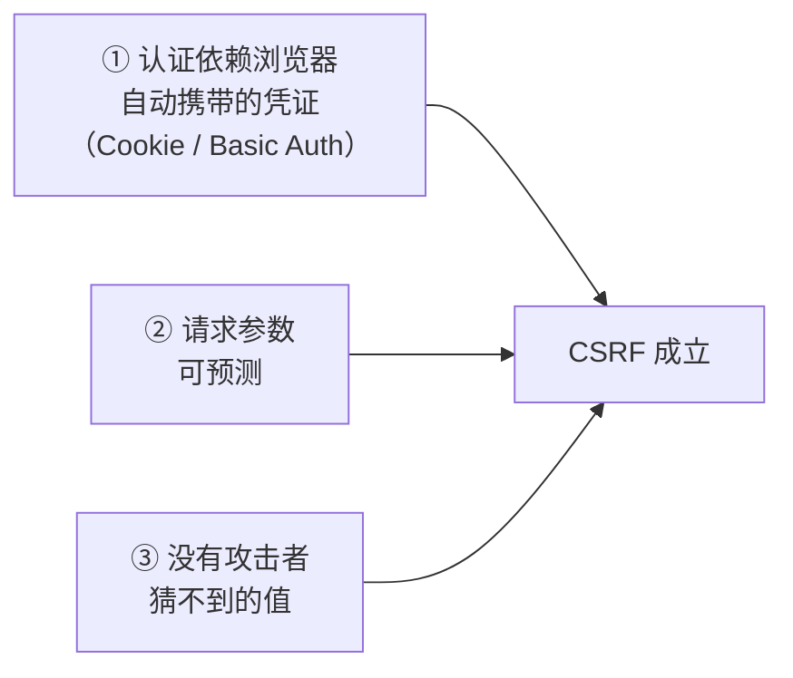
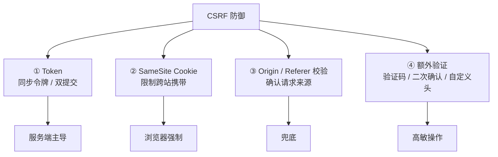
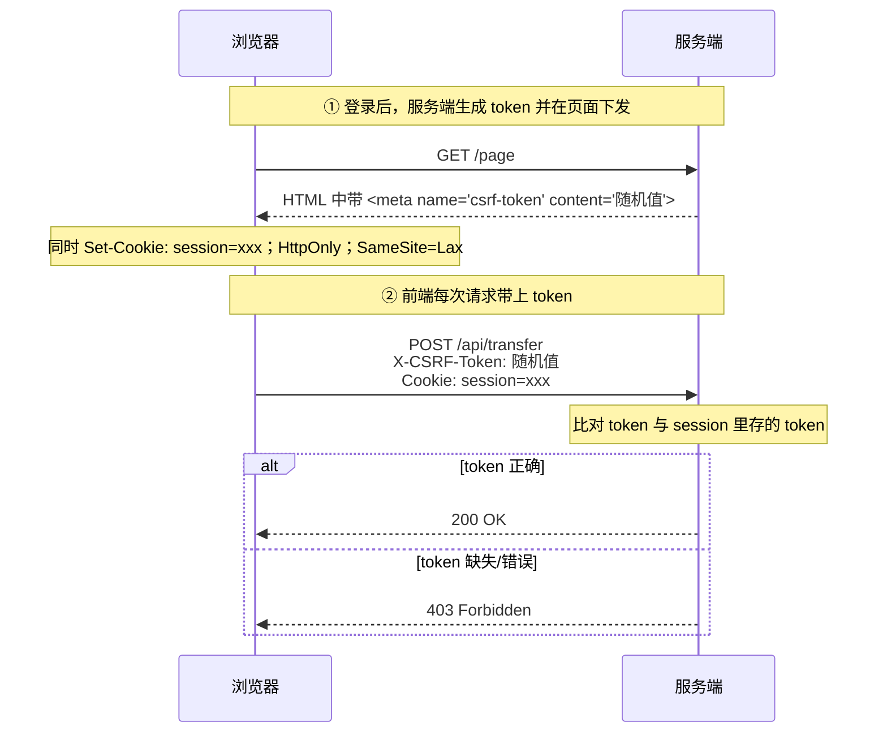
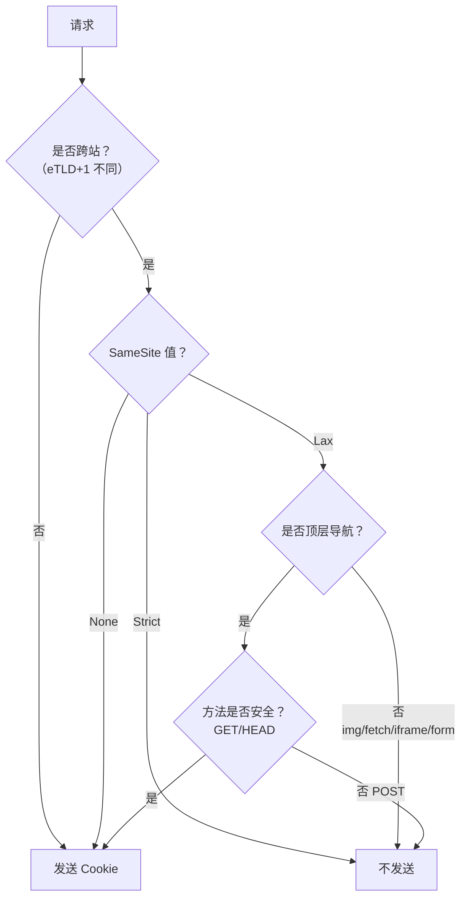

# 安全 · 02 CSRF 与 Cookie 安全

> 覆盖题号：**19、10、11、12**
> 对应原题：《CSRF 攻击及防护》《什么是 SameSite Cookie 属性》《Cookie 的 SameSite 属性有什么作用》《Cookie 中的 HttpOnly 属性有什么用途》

---

## 目录

- [1. CSRF 是什么（上半）](#1-csrf-是什么上半)
- [2. CSRF 的四种防御（下半）](#2-csrf-的四种防御下半)
- [3. SameSite](#3-samesite)
- [4. HttpOnly](#4-httponly)
- [5. Secure / Domain / Path / Cookie 前缀](#5-secure--domain--path--cookie-前缀)
- [6. 现代最佳实践：Token 该放哪](#6-现代最佳实践token-该放哪)
- [7. 几个容易忽略的变种](#7-几个容易忽略的变种)
- [8. 常见坑](#8-常见坑)
- [9. 答题模板](#9-答题模板)
- [10. 追问表](#10-追问表)
- [11. 速记卡](#11-速记卡)

---

## 1. CSRF 是什么（上半）

### 1.1 CSRF 一句话结论

**CSRF（Cross-Site Request Forgery，跨站请求伪造）= 攻击者让受害者的浏览器，带着受害者的登录态，向目标站点发出一个受害者不知情的请求。**

请求由受害者浏览器发出，Cookie 真实有效，服务端无法从请求本身区分。

### 1.2 一个直观的例子

```
① 用户登录 bank.com，浏览器存了 session Cookie
② 用户在同一浏览器打开 evil.com
③ evil.com 页面里有：
   
   （或一个自动提交的隐藏表单）
④ 浏览器加载 img 时自动带上 bank.com 的 Cookie
⑤ bank.com 校验 Cookie 有效 → 执行转账
```

### 1.3 为什么同源策略挡不住

| 同源策略限制 | 不限制 |
|---|---|
| 跨源读取响应内容 | 跨源发送请求 |
| 跨源访问 DOM | 跨源加载 `` `<script>` `<link>` `<form>` |
| 跨源读 Cookie（对 JS 而言） | 浏览器自动携带 Cookie |

同源策略保护的是“能看到什么”，不是“能请求什么”。CSRF 利用的是后者，所以防御核心不是拦住请求，而是让攻击者猜不到请求里必须带的某个值。

### 1.4 CSRF 成立的三个条件（缺一不可）



| 条件 | 说明 | 破坏它的手段 |
|---|---|---|
| **① 凭证自动携带** | 用 `Authorization: Bearer` 头时 CSRF 天然不成立 | 改用 Token in header |
| **② 参数可预测** | 攻击者知道要发什么参数 | 加不可预测的 Token |
| **③ 无额外校验** | 服务端只检查 Cookie | Token / Origin / SameSite |

任意一条被破坏，CSRF 就不成立；四种防御分别对应这三条。

### 1.5 攻击载体（能发跨站请求的 HTML）

| 载体 | 方法 | 能否读响应 | 能否自定义头 | 能否发 JSON |
|---|---|---|---|---|
| `` | GET | ❌ | ❌ | ❌ |
| `<script src>` | GET | ❌（JSONP 除外） | ❌ | ❌ |
| `<link rel=stylesheet>` | GET | ❌ | ❌ | ❌ |
| `<form>` 自动提交 | GET / POST | ❌（会跳转） | ❌ | ❌（只能三种简单类型） |
| `<iframe>` | GET / POST | ❌（跨源） | ❌ | ❌ |
| `fetch` / `XHR` | 任意 | 需 CORS | 需预检 | 需预检 |

攻击者能自动发出的是“简单请求”：GET，以及 `Content-Type` 为 `application/x-www-form-urlencoded` / `multipart/form-data` / `text/plain` 的 POST。`<form>` 发不出 `application/json`；如果 API 严格只接受 JSON，这本身就是一层门槛（见 7.2）。

---

## 2. CSRF 的四种防御（下半）



### 2.1 防御一：CSRF Token（同步令牌）

服务端生成一个**随机、不可预测、与用户会话绑定**的 Token，页面渲染时下发给前端；前端每次请求带上，服务端比对。



攻击者拿不到 Token：Token 在页面 HTML 里，`evil.com` 跨源读不到页面内容；它只能发请求，不能读响应。

**前端实现（Vue + axios）：**

```html
<!-- index.html：服务端渲染时注入 -->
<meta name="csrf-token" content="{{ csrfToken }}">
```

```js
const token = document.querySelector('meta[name="csrf-token"]')?.content
axios.defaults.headers.common['X-CSRF-Token'] = token
```

axios 也可以配置 `xsrfCookieName` / `xsrfHeaderName`，从 Cookie 读取并自动写入请求头。

**Token 的三个设计要求：**

| 要求 | 原因 |
|---|---|
| **不可预测** | 用 CSPRNG（`crypto.randomUUID()` / 服务端 `SecureRandom`），不能用时间戳、自增 ID |
| **与会话绑定** | 否则攻击者可以用自己的 Token 攻击别人（Token 固定攻击） |
| **一次性或定期轮换**（可选） | 降低 Token 泄露后的利用窗口 |

Token 不能放在 URL query 里：会通过日志、Referer、浏览器历史记录泄露；放在请求头或 POST body。

### 2.2 同步令牌的变体：双提交 Cookie

服务端不存储 Token，而是下发一个随机 Cookie（**非 HttpOnly**，让 JS 能读）；前端读出来放到请求头，服务端比对“Cookie 里的值”和“请求头里的值”是否一致。

```js
// 服务端：登录时下发
res.cookie('csrf_token', randomValue, {
  httpOnly: false,     // 必须能被 JS 读
  secure: true,
  sameSite: 'lax',
  path: '/',
})

// 前端：读出来放到头里
const csrf = document.cookie.match(/csrf_token=([^;]+)/)?.[1]
fetch('/api/transfer', {
  method: 'POST',
  headers: { 'X-CSRF-Token': csrf },
  credentials: 'include',
  body: JSON.stringify(data),
})

// 服务端：比对 cookie.csrf_token === header['x-csrf-token']
```

有效性依赖同一条同源策略：攻击者能让浏览器自动带上 Cookie，但跨源读不到 Cookie 的值，无法把头里的值填对。

**两个弱点：**

| 弱点 | 说明 | 缓解 |
|---|---|---|
| **子域可写父域 Cookie（Cookie Tossing）** | `evil.example.com` 可以设置同名、`Domain=.example.com` 的 Cookie，与父域 Cookie 并存，服务端可能读到攻击者的值 | 用 **`__Host-` 前缀**（强制无 `Domain`、`Path=/`、`Secure`），或用签名 Cookie |
| **依赖 Cookie 本身的安全性** | 站点存在 CRLF 注入或子域 XSS 时仍可能被利用 | 配合 HMAC 签名 |

### 2.3 防御二：SameSite Cookie

给 Cookie 加一个“只在同站请求时才发送”的限制，由浏览器强制执行，业务代码零改动。细节见第 3 节。

### 2.4 防御三：校验 Origin / Referer

```js
// 服务端中间件
function checkOrigin(req, res, next) {
  const origin = req.headers.origin || req.headers.referer
  if (!origin) {
    // 浏览器发起的顶层导航、部分子资源请求可能不带 Origin/Referer
    // 非安全方法一律拒绝
    return req.method === 'GET' ? next() : res.status(403).end()
  }
  const allowed = ['https://app.example.com', 'https://m.example.com']
  const host = new URL(origin).origin
  if (!allowed.includes(host)) return res.status(403).end()
  next()
}
```

| 细节 | 说明 |
|---|---|
| `Origin` 的发送范围 | 跨源 `fetch`/XHR、跨源表单 POST、同源 POST 会带；``/`<script>` 等子资源 GET 和顶层 GET 导航通常不带 |
| `Referer` 可被 `Referrer-Policy: no-referrer` 剥掉 | 不能只依赖 `Referer` |
| `Origin: null`（`file://`、sandbox iframe、某些重定向） | 当作不可信处理 |

### 2.5 防御四：额外验证（高敏操作）

| 手段 | 说明 |
|---|---|
| **验证码** | 破坏自动化，主要防批量；对“用户手动点一次”的 CSRF 无效 |
| **二次确认 / 密码确认** | 转账、改密码要求重输密码，校验独立于 Cookie |
| **自定义请求头** | 跨源带自定义头会触发预检；服务端 CORS 不允许该头时，真实请求发不出去 |
| **业务层确认** | 关键操作要求输入短信验证码 |

### 2.6 组合建议

```
第一层：SameSite=Lax（或 Strict）+ Secure + HttpOnly
第二层：CSRF Token（同步令牌，放在请求头）
第三层：Origin / Referer 白名单校验
第四层：高敏操作二次验证（密码 / 验证码）
```

---

## 3. SameSite

### 3.1 SameSite 一句话结论

**SameSite 控制 Cookie 在“跨站请求”中是否被发送**，是浏览器层面防 CSRF 的第一道闸门。

### 3.2 三个值的确切行为

| 值 | 跨站子资源 / fetch | 跨站顶层 GET 导航 | 说明 |
|---|---|---|---|
| **`Strict`** | ❌ | ❌ | 跨站请求完全不发；从外站链接进来时不带 Cookie，页面显示未登录 |
| **`Lax`** | ❌ | ✅ | 平衡点，Chrome 默认值 |
| **`None`** | ✅ | ✅ | 必须同时设 `Secure`，否则浏览器拒绝该 Cookie |

```http
Set-Cookie: session=abc; HttpOnly; Secure; SameSite=Lax
```

以上行为以浏览器允许第三方 Cookie 为前提；用户或浏览器阻止第三方 Cookie 时，`None` 也不会随跨站子资源发送。

### 3.3 一张图理解 Lax 的边界



| 场景 | `Lax` 下是否带 Cookie |
|---|---|
| 从外站链接 / 搜索结果进入（GET 顶层导航） | ✅ |
| 恶意页面 `` | ❌ |
| 恶意页面自动提交 `<form method=POST>` | ❌（新设置的默认 Lax Cookie 见 3.4） |
| 恶意页面 `fetch(..., {credentials:'include'})` | ❌ |
| 站内页面互相跳转 | ✅（同站，不受限） |

### 3.4 三个必须知道的细节

**细节一：SameSite 判断的是 “site”，不是 “origin”**

`https://a.example.com` → `https://b.example.com` 跨 origin，但同 site（eTLD+1 都是 `example.com`）。因此 `SameSite` 不限制同站不同子域之间的请求；攻击者控制同站某个子域时，可以向其他子域发起 CSRF。

**细节二：`None` 必须配 `Secure`**

```http
Set-Cookie: tracking=1; SameSite=None          ← 浏览器直接丢弃
Set-Cookie: tracking=1; SameSite=None; Secure  ← 有效
```

如果允许非加密连接发送跨站 Cookie，攻击者可以在 Wi-Fi 层注入；这是浏览器强制的硬约束。

**细节三：Lax + POST 的 2 分钟宽限期**

Chrome 对**未显式声明 SameSite**（按默认 Lax 处理）且**创建不足 2 分钟**的 Cookie，允许在顶层跨站 POST 中发送（Lax-allowing-unsafe）。显式写了 `SameSite=Lax` 的 Cookie 不享受这个宽限期。

实测（Chrome 154）：

- 显式 `SameSite=Lax`：顶层跨站 POST 不带 Cookie。
- 未声明 SameSite：顶层跨站 POST 立即发送；2 分钟后不再发送。

因此新登录后短时间内，默认 Lax 仍可能被顶层 POST CSRF 利用；需要更严格时显式设置 `SameSite=Strict` 或加 CSRF Token。

### 3.5 Chrome 的默认值变更

| 时间 | 变化 |
|---|---|
| 2016 | SameSite 属性由 Chrome 51 引入 |
| 2020 | Chrome 80 开始推行、Chrome 84 起全量：未声明 SameSite 的 Cookie 默认按 `Lax` 处理 |

影响：依赖跨站 Cookie 的老项目（第三方 iframe、跨站 SSO 回跳）升级后失效。修复方法是显式声明 `SameSite=None; Secure`，不要依赖浏览器默认值。

### 3.6 什么时候必须用 `None`

| 场景 | 说明 |
|---|---|
| 第三方 iframe 内嵌（如嵌入式客服、支付组件） | 需要跨站携带会话 |
| 跨站 SSO 回跳 | 需要在新站带上旧站的 Cookie |
| 跨站埋点 / 广告归因 | 需要跨站识别 |
| 前后端不同站部署（如 `api.com` + `app.com`） | 需要 `None` + `Secure` + CORS `credentials: true` |

---

## 4. HttpOnly

### 4.1 HttpOnly 一句话结论

**`HttpOnly` 让 Cookie 无法被 JS 通过 `document.cookie` 读取**，从而在 XSS 发生时保护 Cookie 不被窃取。

### 4.2 能防什么、不能防什么

| | 说明 |
|---|---|
| ✅ **能防** | XSS 用 `document.cookie` 偷走 Cookie |
| ✅ **能防** | XSS 读取 Cookie 后外发 |
| ❌ **不能防** | XSS **直接发请求**（浏览器依然会自动带 Cookie） |
| ❌ **不能防** | CSRF |
| ❌ **不能防** | 中间人攻击（明文传输照样能看到），需要 `Secure` + HTTPS |

`HttpOnly` 防的是“**偷凭证**”，不是“**用凭证**”。XSS 即使读不到 Cookie，仍能发请求、读页面数据，所以它只降低损失，不能替代防 XSS。

```js
// XSS 不需要读 Cookie，直接以用户身份发请求
fetch('/api/transfer', {
  method: 'POST',
  credentials: 'include',
  body: JSON.stringify({ to: 'hacker', amount: 10000 }),
})
```

### 4.3 使用方式

```http
Set-Cookie: session=abc123; HttpOnly; Secure; SameSite=Lax; Path=/; Max-Age=3600
```

```js
// Express
res.cookie('session', token, {
  httpOnly: true,
  secure: true,
  sameSite: 'lax',
  path: '/',
  maxAge: 3600 * 1000,
})
```

```js
// 前端：读不到，返回空字符串（不报错）
document.cookie   // "" 或只有非 HttpOnly 的那些
```

`document.cookie` 读不到 HttpOnly 的 Cookie 时不报错，只是不出现；用“JS 读一下看有没有”判断 Cookie 是否存在并不可靠。

---

## 5. Secure / Domain / Path / Cookie 前缀

### 5.1 各属性速查

| 属性 | 作用 | 推荐值 | 注意 |
|---|---|---|---|
| `HttpOnly` | 禁止 JS 读取 | 会话 Cookie **必加** | 见第 4 节 |
| `Secure` | 只在安全上下文发送 | **必加** | Chrome 把 `http://localhost` 视为安全上下文 |
| `SameSite` | 限制跨站发送 | `Lax`（默认）或 `Strict` | 见第 3 节 |
| `Domain` | 允许哪些域接收 | **尽量不设**（默认仅当前主机） | 设了 `.example.com` 后**所有子域都能收到**，扩大攻击面 |
| `Path` | 限制发送与 `document.cookie` 的可见路径 | 会话 Cookie 设 `/` | **不是安全边界** |
| `Max-Age` / `Expires` | 有效期 | 会话 Cookie 不设 | 长期 Cookie 风险更大 |
| `Partitioned` (CHIPS) | 按顶层站点分区存储 | 第三方场景用 | 替代第三方 Cookie 的一种方案 |

`Path` 不是安全机制：`Path=/admin` 只能让 Cookie 在 `/admin` 路径的请求和页面里可见；同源脚本可以从 `/` 页面用 iframe 加载 `/admin`，再读 `iframe.contentDocument.cookie`。它限制的是发送和可见范围，不是访问权限。

### 5.2 Cookie 前缀

| 前缀 | 强制要求 | 作用 |
|---|---|---|
| `__Secure-` | 必须 `Secure`，且从 HTTPS 设置 | 防止降级到 HTTP 时被覆盖 |
| **`__Host-`** | 必须 `Secure` + `Path=/` + **不能有 `Domain`** | **防止子域覆盖（Cookie Tossing）** |

```http
Set-Cookie: __Host-session=abc; Secure; Path=/; HttpOnly; SameSite=Lax
```

```
没有前缀：
  evil.example.com 可以设置同名、Domain=.example.com 的 Cookie
  → 与 app.example.com 的 host-only Cookie 并存，服务端可能读到攻击者的值

有 __Host- 前缀：
  evil.example.com 无法设置 __Host- 开头的 Cookie（带 Domain 会被拒绝）
  → 攻击失败
```

`__Host-` 是双提交 Cookie 的必要加固（见 2.2）。

### 5.3 Cookie 的其他限制

| 限制 | 数值 |
|---|---|
| 单个 Cookie 大小 | 约 4KB |
| 单域名 Cookie 数量 | 各浏览器有上限 |
| 每个请求都会带上同域 Cookie | Cookie 越多，请求头越大；静态资源用独立域名（无 Cookie）可减少开销 |

---

## 6. 现代最佳实践：Token 该放哪

### 6.1 四种存储位置的对比

| 存储位置 | XSS 风险 | CSRF 风险 | 持久性 | 说明 |
|---|---|---|---|---|
| **`localStorage`** | ❌ **高**（任何 XSS 都能读） | ✅ 无（不会自动发送） | ✅ 长期 | 需要手动放 `Authorization` 头 |
| **`sessionStorage`** | ❌ 高 | ✅ 无 | 标签页级 | 同上 |
| **`Cookie`（HttpOnly）** | ✅ 低（JS 读不到） | ❌ **有**（自动带） | 可配 | 必须配 SameSite + CSRF Token |
| **内存变量**（模块作用域） | ✅ 最低（XSS 仍可在运行时读，但无法持久化窃取） | ✅ 无 | ❌ 刷新即丢 | 需配 refresh token |

### 6.2 推荐的组合方案

```
Access Token：放内存（模块变量），有效期 5~15 分钟
Refresh Token：放 HttpOnly + Secure + SameSite=Strict Cookie，Path 限制到 /api/refresh
刷新流程：Access 过期 → 用 Refresh 换新的（Refresh 有轮换 + 复用检测）
```

`Path` 只缩小发送范围，不是安全边界；Refresh Token 仍需要 HttpOnly、Secure、SameSite 和轮换。

```js
// 内存中保存 access token
let accessToken = null

export function setToken(t) { accessToken = t }
export function getToken() { return accessToken }

// 请求拦截器
axios.interceptors.request.use((config) => {
  if (accessToken) config.headers.Authorization = `Bearer ${accessToken}`
  return config
})

// 响应拦截器：401 时用 refresh 换新 token
axios.interceptors.response.use(
  (res) => res,
  async (error) => {
    if (error.response?.status === 401 && !error.config._retry) {
      error.config._retry = true
      const { data } = await axios.post('/api/refresh', null, { withCredentials: true })
      setToken(data.accessToken)
      error.config.headers.Authorization = `Bearer ${data.accessToken}`
      return axios(error.config)
    }
    return Promise.reject(error)
  }
)
```

| 攻击 | 结果 |
|---|---|
| XSS | 只能偷到当前内存里的 access token（短命），**偷不到 refresh token**（HttpOnly） |
| CSRF | access token 在头里，不自动发送；refresh 接口有 SameSite=Strict + Path 限制 |
| 物理接触 / 重启 | refresh token 在 Cookie 里，能恢复会话 |

`localStorage` 抗 CSRF 但怕 XSS；Cookie + HttpOnly 抗偷但需要配 SameSite + CSRF Token；如果 Token 已经在 `Authorization` 头里（例如移动端共用 API），CSRF 天然不成立。

---

## 7. 几个容易忽略的变种

### 7.1 登录 CSRF（Login CSRF）

攻击者让受害者**登录到攻击者的账号**：

```
① 攻击者用自己的账号登录 bank.com，拿到自己的 session
② 构造自动提交的表单，向 bank.com/login 提交攻击者的账号密码
③ 受害者的浏览器变成“登录了攻击者的账号”
④ 受害者后续操作（存收货地址、上传文件、绑定银行卡）全部进了攻击者的账号
```

防御：登录接口也要 CSRF Token。

### 7.2 JSON 接口是不是天然免疫

部分成立：

| 情况 | 能否被 CSRF |
|---|---|
| API 只接受 `Content-Type: application/json`，且**严格校验** Content-Type | ✅ 基本免疫（`<form>` 发不出 JSON） |
| API 同时接受 `text/plain` 并宽容解析 JSON | ❌ 可被攻击（form 能发 `text/plain`） |
| API 用 `application/x-www-form-urlencoded` | ❌ 完全可被攻击 |

```js
// 危险的宽容解析：<form enctype="text/plain"> 提交的 body 也能被解析成 JSON
app.use(express.json({ type: ['application/json', 'text/plain'] }))
```

纯 JSON API 不要为了兼容放宽 Content-Type 校验。

### 7.3 CORS 配错误

```js
// 危险：反射 Origin + 允许凭证
app.use((req, res, next) => {
  res.setHeader('Access-Control-Allow-Origin', req.headers.origin)
  res.setHeader('Access-Control-Allow-Credentials', 'true')
  next()
})
```

任意网站都能读到接口响应，而不只是发请求。CSRF 只能让浏览器发请求；这个配置会把用户数据直接暴露给攻击者页面。修复：`Access-Control-Allow-Origin` 只回显白名单，不用 `*` 配 `credentials`。

---

## 8. 常见坑

| # | 坑 | 纠正 |
|---|---|---|
| 1 | 认为同源策略能防 CSRF | SOP 只限制读响应，不限制发请求 |
| 2 | CSRF Token 放在 URL query 里 | 会通过 Referer、日志、历史泄露；放请求头或 body |
| 3 | Token 用时间戳 / 自增 ID / 不绑会话 | 必须密码学随机并与会话绑定，否则可被枚举或固定 |
| 4 | `SameSite=None` 不配 `Secure` | 浏览器直接丢弃该 Cookie |
| 5 | 以为 `Lax` 对 POST 绝对安全 | 未显式声明 SameSite 的新 Cookie 有 2 分钟顶层 POST 宽限期 |
| 6 | 以为 `Path=/admin` 能保护 Cookie | 只限制发送和可见路径；同源脚本可在匹配路径页面读取 |
| 7 | 设了 `Domain=.example.com` | 所有子域都能收到，攻击面扩大；优先不设，或用 `__Host-` |
| 8 | 以为 HttpOnly 能防 XSS | 只防“偷”，不防“用” |
| 9 | CORS 反射 Origin + 允许凭证 | 任意站点可读响应，不只是发请求 |
| 10 | Token 存 localStorage 还觉得安全 | 任何 XSS 都能读；用内存 + HttpOnly refresh |

---

## 9. 答题模板

| 题目 | 30 秒要点 |
|---|---|
| CSRF 攻击及防护 | 攻击者诱导受害者浏览器带 Cookie 向目标站发伪造请求。根因是同源策略只限制跨源读响应，不限制跨源发请求；成立条件是凭证自动携带、参数可预测、服务端只校验 Cookie。防御：SameSite、CSRF Token、Origin/Referer 校验、高敏操作二次验证。 |
| SameSite 属性 | Strict 跨站完全不发（含顶层导航）；Lax 只允许顶层 GET 导航；None 全发但必须配 Secure。判断的是 site 不是 origin；未显式声明 SameSite 的新 Cookie 有 2 分钟顶层 POST 宽限期。 |
| HttpOnly 用途 | 让 Cookie 无法被 `document.cookie` 读取，降低 XSS 窃取会话的风险。它只防“偷”不防“用”：XSS 仍可直接发请求。会话 Cookie 应同时加 `HttpOnly + Secure + SameSite`。 |

---

## 10. 追问表

| # | 追问 | 要点 |
|---|---|---|
| 1 | CSRF 和 XSS 区别？ | XSS 是注入代码执行；CSRF 是借用身份发请求。XSS 能读页面里的 Token，所以能绕过 CSRF 防护 |
| 2 | CSRF Token 为什么有效？ | 攻击者跨源读不到页面内容，猜不到 Token |
| 3 | 双提交 Cookie 有什么弱点？ | 子域 Cookie Tossing；用 `__Host-` 前缀或签名 Cookie 缓解 |
| 4 | SameSite 判断 origin 还是 site？ | **site**（eTLD+1），所以同站子域不设防 |
| 5 | `SameSite=Lax` 有例外吗？ | 未显式声明 SameSite 的新 Cookie 有 2 分钟顶层 POST 宽限期 |
| 6 | HttpOnly 能防 CSRF / XSS 吗？ | 都不能；只防 JS 读取 Cookie |
| 7 | `Secure` 有什么例外？ | `http://localhost` 被视为安全上下文 |
| 8 | `Path` 是安全边界吗？ | 不是，只限制发送和可见路径 |
| 9 | `__Host-` 前缀有什么用？ | 强制 Secure + Path=/ + 无 Domain，防子域覆盖 |
| 10 | 什么是登录 CSRF？ | 把受害者登进攻击者账号，后续操作都记到攻击者名下 |
| 11 | JSON 接口需要 CSRF 防护吗？ | 严格校验 Content-Type 时基本免疫；放宽就危险 |
| 12 | CORS 配错会怎样？ | 反射 Origin + 允许凭证 = 任意站都能读响应 |
| 13 | 前后端跨站部署怎么办？ | Cookie 用 `SameSite=None; Secure`，CORS `credentials: true`，ACAO 回显白名单而非 `*` |

---

## 11. 速记卡

```
【CSRF 本质】
受害者浏览器带着真实 Cookie 发伪造请求
根因：同源策略只限制读响应，不限制发请求

【三条件（打断任一即防住）】
① 凭证自动携带  ② 参数可预测  ③ 服务端只校验 Cookie

【四防御】
① SameSite Cookie（浏览器强制）
② CSRF Token（同步令牌 / 双提交）
③ Origin / Referer 白名单
④ 高敏操作二次验证

【SameSite】
Strict  跨站全不发（含顶层导航）
Lax     只顶层 GET 导航发送（Chrome 默认）
None    全发，必须配 Secure
同站不同子域不设防
未声明 SameSite 的新 Cookie 有 2 分钟顶层 POST 宽限期

【HttpOnly】
防“偷”不防“用”；XSS 仍可 credentials: include 直接发请求

【Cookie 五件套】
HttpOnly + Secure + SameSite + 尽量不设 Domain + __Host- 前缀
Path 不是安全边界

【Token 放哪】
localStorage：抗 CSRF，怕 XSS
Cookie HttpOnly：抗偷，怕 CSRF（配 SameSite + Token）
内存：不自动发送，刷新即丢；配 HttpOnly refresh token 续期
```
