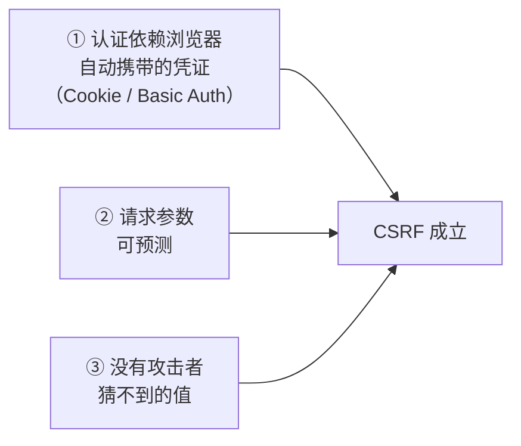
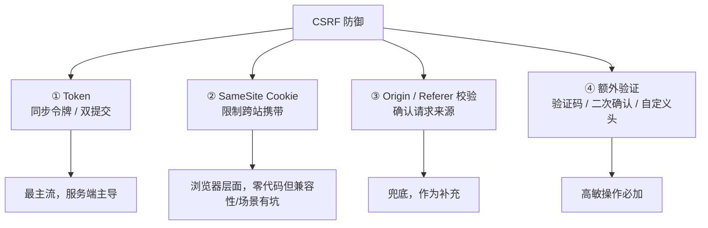
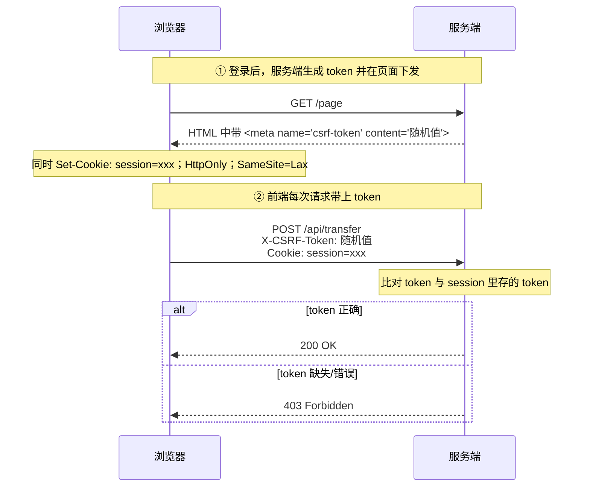
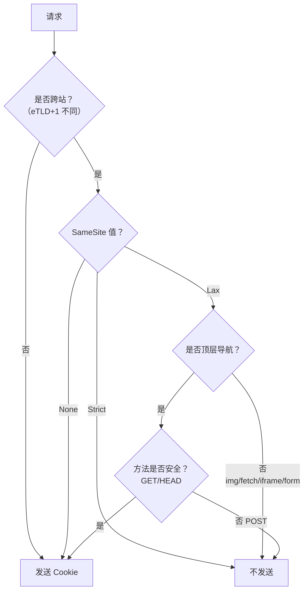

# 安全 · 02 CSRF 与 Cookie 安全

> 覆盖题号：**19、10、11、12**
> 对应原题：《CSRF 攻击及防护》《什么是 SameSite Cookie 属性》《Cookie 的 SameSite 属性有什么作用》《Cookie 中的 HttpOnly 属性有什么用途》
> 这四题是一组：**CSRF 是"借用身份"的攻击，Cookie 的三个属性是"给凭证上锁"的手段。**

---

## 目录

- [1. CSRF 是什么（上半）](#1-csrf-是什么上半)
- [2. CSRF 的四种防御（下半）](#2-csrf-的四种防御下半)
- [3. SameSite](#3-samesite)
- [4. HttpOnly](#4-httponly)
- [5. Secure / Domain / Path / Cookie 前缀](#5-secure--domain--path--cookie-前缀)
- [6. 现代最佳实践：Token 该放哪](#6-现代最佳实践token-该放哪)
- [7. 几个容易忽略的变种](#7-几个容易忽略的变种)
- [8. 常见坑](#8-常见坑)
- [9. 答题模板](#9-答题模板)
- [10. 追问表](#10-追问表)
- [11. 速记卡](#11-速记卡)

---

## 1. CSRF 是什么（上半）

### 1.1 一句话结论

**CSRF（Cross-Site Request Forgery，跨站请求伪造）= 攻击者让受害者的浏览器，带着受害者的登录态，向目标站点发出一个受害者不知情的请求。**

关键在"**伪造**"两个字：请求是**受害者自己的浏览器发的**，Cookie 是**真实有效的**，所以服务端从请求本身看不出任何异常。

### 1.2 一个直观的例子

```
① 用户登录了 bank.com，浏览器存了 session Cookie
② 用户在同一浏览器打开 evil.com（钓鱼邮件/论坛帖）
③ evil.com 页面里有：
   
   （或者一个自动提交的隐藏表单）
④ 浏览器加载这个 img 时，会自动带上 bank.com 的 Cookie
⑤ bank.com 收到请求，Cookie 有效 → 执行转账
```

**用户全程什么都没点**（如果用的是 ``）。

### 1.3 为什么同源策略挡不住（核心认知）

> **这是本题最重要的一个追问点。** 很多人以为"有同源策略就不会被跨站攻击"，这是错的。

| 同源策略限制什么 | 不限制什么 |
|---|---|
| ❌ 跨源**读取**响应内容 | ✅ 跨源**发送**请求 |
| ❌ 跨源访问 DOM | ✅ 跨源加载 `` `<script>` `<link>` `<form>` |
| ❌ 跨源读 Cookie（对 JS 而言） | ✅ **浏览器自动携带 Cookie**（这是浏览器的设计，不是 bug） |

**一句话**：同源策略保护的是"**我能看到什么**"，不是"**我能请求什么**"。CSRF 利用的正是后者。

> 这也是为什么 CSRF 的防御核心不是"拦住请求"，而是"**让攻击者猜不到请求里必须带的某个值**"。

### 1.4 CSRF 成立的三个条件（缺一不可）



| 条件 | 说明 | 破坏它的手段 |
|---|---|---|
| **① 凭证自动携带** | 如果用 `Authorization: Bearer` 头，CSRF 天然不成立 | 改用 Token in header |
| **② 参数可预测** | 攻击者知道要发什么参数（`to=hacker&amount=10000`） | 加 Token（不可预测） |
| **③ 无额外校验** | 服务端只检查 Cookie | Token / Origin / SameSite |

> **这个"三条件"框架很有用**：面试时你可以说"我会先判断这三个条件是否都成立，只要打断任意一个，CSRF 就不成立"。这比背四种防御手段更有条理。

### 1.5 攻击载体（能发跨站请求的 HTML）

| 载体 | 方法 | 能否读响应 | 能否自定义头 | 能否发 JSON |
|---|---|---|---|---|
| `` | GET | ❌ | ❌ | ❌ |
| `<script src>` | GET | ❌（JSONP 除外） | ❌ | ❌ |
| `<link rel=stylesheet>` | GET | ❌ | ❌ | ❌ |
| `<form>` 自动提交 | GET / POST | ❌（会跳转） | ❌ | ❌（只能三种简单类型） |
| `<iframe>` | GET / POST | ❌（跨源） | ❌ | ❌ |
| `fetch` / `XHR` | 任意 | 需 CORS | 需预检 | 需预检 |

> **关键结论**：攻击者能用的是"**简单请求**"——GET、以及 `Content-Type` 为 `application/x-www-form-urlencoded` / `multipart/form-data` / `text/plain` 的 POST。
> **这就解释了一个重要的实践**：如果 API 只接受 `Content-Type: application/json` 且**严格校验**，那么一个 `<form>` 是发不出合法请求的（form 发不了 JSON）——这本身就是一层天然防护。**但如果后端"宽容解析"（比如把 `text/plain` 的 body 也当 JSON 解），这层防护就失效了。**

### 1.6 30 秒版（CSRF 原理）

> "CSRF 是攻击者诱导受害者浏览器，带着受害者的 Cookie 向目标站发一个伪造请求。关键点是**同源策略只阻止跨源读响应，不阻止跨源发请求**，所以 `` 或自动提交的表单就能发出请求，而且浏览器会自动带 Cookie。它成立需要三个条件：认证靠自动携带的 Cookie、参数可预测、服务端只校验 Cookie。"

---

## 2. CSRF 的四种防御（下半）



### 2.1 防御一：CSRF Token（同步令牌模式，最主流）

**原理**：服务端生成一个**随机、不可预测、与用户会话绑定**的 Token，页面渲染时下发给前端，前端每次请求必须带上；服务端比对。

**完整流程：**



**为什么攻击者拿不到 Token**：Token 在页面 HTML 里，攻击者的 `evil.com` **跨源读不到**这个页面的内容（同源策略）。他只能发请求，不能读响应。

**前端实现（Vue + axios）：**

```html
<!-- index.html：服务端渲染时注入 -->
<meta name="csrf-token" content="{{ csrfToken }}">
```

```js
// 统一在拦截器里带上
import axios from 'axios'

const token = document.querySelector('meta[name="csrf-token"]')?.content

axios.defaults.headers.common['X-CSRF-Token'] = token

// 或者用 axios 的 xsrf 内置能力（读名为 XSRF-TOKEN 的 Cookie）
axios.defaults.xsrfCookieName = 'XSRF-TOKEN'
axios.defaults.xsrfHeaderName = 'X-CSRF-Token'
axios.defaults.withCredentials = true
```

**Token 的三个设计要求（这个细节很能体现深度）：**

| 要求 | 原因 |
|---|---|
| **不可预测** | 用 CSPRNG（`crypto.randomUUID()` / 服务端 `SecureRandom`），**不能用时间戳、自增 ID** |
| **与会话绑定** | 否则攻击者可以用自己的 Token 攻击别人（Token 固定攻击） |
| **一次性 or 定期轮换**（可选） | 降低 Token 泄露后的利用窗口 |

> **注意**：**Token 不能放在 URL query 里**（会被日志、Referer、浏览器历史记录泄露）。放在**请求头**或**POST body** 里。

### 2.2 防御二：双提交 Cookie（Double Submit Cookie）

**原理**：不用在服务端存 Token。服务端下发一个随机 Cookie（**非 HttpOnly**，让 JS 能读），前端读出来放到请求头里，服务端比对"**Cookie 里的值**"和"**请求头里的值**"是否一致。

```js
// 服务端：登录时下发
res.cookie('csrf_token', randomValue, {
  httpOnly: false,     // 必须能被 JS 读
  secure: true,
  sameSite: 'lax',
  path: '/',
})

// 前端：读出来放到头里
const csrf = document.cookie.match(/csrf_token=([^;]+)/)?.[1]
fetch('/api/transfer', {
  method: 'POST',
  headers: { 'X-CSRF-Token': csrf },
  credentials: 'include',
  body: JSON.stringify(data),
})

// 服务端：比对 cookie.csrf_token === header['x-csrf-token']
```

**为什么有效**：攻击者能让浏览器**自动带上** Cookie，但**无法读取** Cookie 的值（跨源读不到），所以无法把头里的值填对。

**两个弱点（必须能说出来，否则只答对一半）：**

| 弱点 | 说明 | 缓解 |
|---|---|---|
| **子域可写父域 Cookie（Cookie Tossing）** | 如果 `evil.example.com` 被攻陷，它可以 `document.cookie = "csrf_token=x; domain=.example.com"` 覆盖掉父域的 Cookie，然后让受害者的头和 Cookie 都是它设的值 | 用 **`__Host-` 前缀**（强制无 `Domain`、`Path=/`、`Secure`），或用签名 Cookie |
| **依赖 Cookie 本身的安全性** | 如果站点存在 CRLF 注入或子域 XSS，仍可能被利用 | 配合签名（HMAC） |

### 2.3 防御三：SameSite Cookie（见第 3 节详述）

**一句话**：给 Cookie 加一个"**只在同站请求时才发送**"的限制。**这是成本最低、覆盖面最广的一层**，因为它是浏览器强制执行的，业务代码零改动。

### 2.4 防御四：校验 Origin / Referer

```js
// 服务端中间件
function checkOrigin(req, res, next) {
  const origin = req.headers.origin || req.headers.referer
  if (!origin) {
    // 某些场景下浏览器不发 Origin（如老浏览器的 GET）
    // 策略：对非安全方法（POST/PUT/DELETE）一律拒绝
    return req.method === 'GET' ? next() : res.status(403).end()
  }
  const allowed = ['https://app.example.com', 'https://m.example.com']
  const host = new URL(origin).origin
  if (!allowed.includes(host)) return res.status(403).end()
  next()
}
```

**注意两个细节：**

| 细节 | 说明 |
|---|---|
| `Origin` 头在**跨源请求和 POST 时一定发送**（浏览器强制），比 `Referer` 可靠 | `Referer` 可能被 `Referrer-Policy: no-referrer` 剥掉 |
| **`Origin: null`** 的情况（`file://`、`sandbox` iframe、某些重定向） | 必须当作不可信处理 |

### 2.5 防御五：额外验证（高敏操作必加）

| 手段 | 说明 |
|---|---|
| **验证码** | 破坏"自动化"，但对"用户手动点一次"的 CSRF 无效，主要防批量 |
| **二次确认 / 密码确认** | 转账、改密码要求重输密码，这是最可靠的一道 |
| **自定义请求头** | 如 `X-Requested-With: XMLHttpRequest`，跨源要带自定义头就会触发**预检**，而预检需要服务端允许——**等于让浏览器帮忙拦了** |
| **业务层确认** | 关键操作要求输入短信验证码 |

> **"自定义头"这一招的原理值得单独记**：它不依赖任何 Token，只依赖"**跨源带自定义头必须过预检**"这条规则。如果服务端 CORS **没有**给 `evil.com` 发 `Access-Control-Allow-Headers: X-Requested-With`，预检就失败，真实请求发不出去。**成本极低，效果很好。**

### 2.6 组合建议（可以直接说给面试官）

```
第一层：SameSite=Lax（或 Strict）+ Secure + HttpOnly     ← 浏览器强制，零成本
第二层：CSRF Token（同步令牌，放在请求头）                ← 服务端主防线
第三层：Origin / Referer 白名单校验                       ← 兜底
第四层：高敏操作二次验证（密码/验证码）                    ← 最后一道
交叉层：API 只接受 application/json + 自定义头            ← 天然提高攻击门槛
```

### 2.7 30 秒版（防御）

> "四层：第一层 **SameSite Cookie**，设成 Lax 或 Strict，浏览器层面就不跨站发 Cookie 了，零成本；第二层 **CSRF Token**，服务端下发随机值，前端放请求头里，服务端比对，这是主防线；第三层 **Origin/Referer 白名单校验**兜底；第四层高敏操作加**二次验证**。另外 API 只接受 `application/json` 加自定义头，能借浏览器的预检机制天然挡掉一批。"

---

## 3. SameSite

### 3.1 一句话结论

**SameSite 控制 Cookie 在"跨站请求"中是否被发送**，是浏览器层面防 CSRF 的第一道闸门。

### 3.2 三个值的确切行为

| 值 | 跨站请求是否发送 | 顶层导航（点链接）是否发送 | 说明 |
|---|---|---|---|
| **`Strict`** | ❌ 完全不发 | ❌ **也不发** | 最严格。但从外站点链接进来时，用户会显示"未登录"（体验问题） |
| **`Lax`** | ❌ 不发 | ✅ **GET 顶层导航时发送** | **平衡点，Chrome 默认值** |
| **`None`** | ✅ 发送 | ✅ 发送 | 必须同时设 `Secure`，否则浏览器直接拒绝该 Cookie |

```http
Set-Cookie: session=abc; HttpOnly; Secure; SameSite=Lax
```

### 3.3 一张图理解 Lax 的边界



**几个具体场景（很容易考）：**

| 场景 | `Lax` 下是否带 Cookie |
|---|---|
| 从 Google 搜索结果点进你的站（GET 顶层导航） | ✅ 带（所以用户是登录态） |
| 从邮件里点一个链接进你的站（GET 顶层导航） | ✅ 带 |
| 恶意页面 `` | ❌ 不带（不是顶层导航） |
| 恶意页面自动提交 `<form method=POST>` | ❌ 不带（不是安全方法） |
| 恶意页面 `fetch(..., {credentials:'include'})` | ❌ 不带 |
| 你自己的站内页面互相跳转 | ✅ 带（同站，不受限） |
| 你的 iframe 嵌入第三方页面，第三方发请求 | ⚠️ 看站点关系 |

### 3.4 三个必须知道的细节

**细节一：SameSite 判断的是"site"，不是"origin"**

```
https://a.example.com  →  https://b.example.com
```

- 跨 **origin**（协议+域名+端口不同）
- **同 site**（eTLD+1 都是 `example.com`）

**所以**：`SameSite` **挡不住同站不同子域之间的 CSRF**。如果 `evil.example.com` 有 XSS，它能直接攻击 `a.example.com`。**这是 SameSite 的一个重要盲区。**

> 面试时说出这一点，能明显区分"背过"和"想过"。

**细节二：`None` 必须配 `Secure`**

```http
Set-Cookie: tracking=1; SameSite=None          ← ❌ 浏览器直接丢弃
Set-Cookie: tracking=1; SameSite=None; Secure  ← ✅
```

**为什么**：如果允许非加密连接发送跨站 Cookie，攻击者可以在 Wi-Fi 层注入。这是浏览器强制的硬约束。

**细节三：Lax + POST 的 2 分钟宽限期（Chrome 的过渡策略）**

Chrome 有一个叫 "**Lax-allowing-unsafe**" 的机制：**新设置的 Cookie（2 分钟内）**，即使是 `SameSite=Lax`，也允许在**顶层跨站 POST** 中发送。

**为什么**：为了兼容老站点（如第三方支付回跳 POST）。**这意味着 `Lax` 不是 100% 可靠**——刚登录的 2 分钟内仍可能被 POST CSRF 攻击。

### 3.5 Chrome 的默认值变更（重要历史）

| 时间 | 变化 |
|---|---|
| 2016 | SameSite 属性被 Chrome 51 引入 |
| 2020.2 | **Chrome 80 起，未声明 SameSite 的 Cookie 默认按 `Lax` 处理** |
| 2020+ | 其他浏览器跟进（Firefox、Edge、Safari 都有类似策略） |

**影响**：很多老项目依赖"跨站 Cookie"（如第三方 iframe 内嵌、跨域单点登录回跳），升级后突然失效。**修复方法**：明确声明 `SameSite=None; Secure`。

> 这也是为什么"**显式声明 SameSite**"是好习惯——不要依赖浏览器默认值，因为默认值会变。

### 3.6 什么时候必须用 `None`

| 场景 | 说明 |
|---|---|
| 第三方 iframe 内嵌（如嵌入式客服、支付组件） | 需要跨站携带会话 |
| 跨站 SSO 回跳 | 需要在新站带上旧站的 Cookie |
| 跨站埋点 / 广告归因 | 需要跨站识别 |
| 前后端不同站部署（如 `api.com` + `app.com`） | 需要 `None` + `Secure` + CORS `credentials: true` |

### 3.7 30 秒版

> "SameSite 控制 Cookie 在跨站请求里发不发。三个值：`Strict` 完全不跨站发，连点链接进来都不带，所以会显示未登录；`Lax` 只在顶层 GET 导航时带，是 Chrome 的默认值，能挡掉 img、表单 POST、fetch 这类 CSRF；`None` 全发，但必须配 `Secure`，否则浏览器丢弃。要注意两点：它判断的是 site 不是 origin，所以挡不住同站子域之间的攻击；另外 Chrome 有个 2 分钟宽限期，新 Cookie 允许顶层 POST，所以 Lax 不是绝对安全。"

---

## 4. HttpOnly

### 4.1 一句话结论

**`HttpOnly` 让 Cookie 无法被 JS 通过 `document.cookie` 读取**，从而在 XSS 发生时保护 Cookie 不被窃取。

### 4.2 能防什么、不能防什么（这题的关键）

| | 说明 |
|---|---|
| ✅ **能防**：XSS 用 `document.cookie` 偷走 Cookie | 读取接口直接返回空 |
| ✅ **能防**：XSS 用 `fetch` 把 Cookie 内容发到外部 | 读不到就发不了 |
| ❌ **不能防**：XSS **直接发请求**（浏览器依然会自动带 Cookie） | 攻击者不需要读 Cookie，只要让浏览器发请求就行 |
| ❌ **不能防**：CSRF（本来就和 HttpOnly 无关） | — |
| ❌ **不能防**：中间人攻击（明文传输照样能看到） | 需要 `Secure` + HTTPS |

> **一句很能打的话**："`HttpOnly` 防的是'**偷凭证**'，不是'**用凭证**'。XSS 发生后，攻击者即使读不到 Cookie，依然能以用户身份发请求、读页面数据，所以 `HttpOnly` 只是降低损失，不能替代防 XSS。"

### 4.3 使用方式

```http
Set-Cookie: session=abc123; HttpOnly; Secure; SameSite=Lax; Path=/; Max-Age=3600
```

```js
// Express
res.cookie('session', token, {
  httpOnly: true,
  secure: true,
  sameSite: 'lax',
  path: '/',
  maxAge: 3600 * 1000,
})
```

```js
// 前端：读不到，返回空字符串（不报错！）
document.cookie   // "" 或只有非 HttpOnly 的那些
```

> **注意**：`document.cookie` 读不到 HttpOnly 的 Cookie 时**不报错，只是不出现**。所以"我用 JS 读一下看有没有"这种检测方式很不可靠。

### 4.4 一个常见误区

> "Cookie 加了 HttpOnly，就不怕 XSS 了。"

**错。** XSS 在同源里执行，它不需要"偷" Cookie——它可以直接：

```js
// 不需要读 Cookie，直接以用户身份发请求
fetch('/api/transfer', {
  method: 'POST',
  credentials: 'include',        // 浏览器自动带上 HttpOnly Cookie
  body: JSON.stringify({ to: 'hacker', amount: 10000 }),
})

// 或者直接读页面上的数据（订单、余额、聊天记录）
document.querySelector('.balance').innerText
```

**所以**：`HttpOnly` 是"降低 XSS 后果"，**防 XSS 本身要靠输出编码 + CSP**。

---

## 5. Secure / Domain / Path / Cookie 前缀

### 5.1 各属性速查

| 属性 | 作用 | 推荐值 | 注意 |
|---|---|---|---|
| `HttpOnly` | 禁止 JS 读取 | 会话 Cookie **必加** | 见第 4 节 |
| `Secure` | 只在 HTTPS 连接发送 | **必加** | 例外：`localhost` 被视为安全上下文 |
| `SameSite` | 限制跨站发送 | `Lax`（默认）或 `Strict` | 见第 3 节 |
| `Domain` | 允许哪些域接收 | **尽量不设**（默认仅当前主机） | 设了 `.example.com` 后**所有子域都能收到**，扩大攻击面 |
| `Path` | 限制发送路径 | 会话 Cookie 设 `/`（避免多路径重复） | 不是安全边界（同源 JS 能读任意路径的 Cookie） |
| `Max-Age` / `Expires` | 有效期 | 会话 Cookie 不设（浏览器关闭即失效） | 长期 Cookie 风险更大 |
| `Partitioned` (CHIPS) | 按顶层站点分区存储 | 第三方场景用 | 替代第三方 Cookie 的方案 |

> **`Path` 不是安全机制**：很多人以为 `Path=/admin` 能挡住其他页面读 Cookie，**错**——同源的 JS 可以通过 iframe 等方式读到。`Path` 只影响"发送范围"，不影响"可读性"。

### 5.2 Cookie 前缀（很实用但很少有人知道）

| 前缀 | 强制要求 | 作用 |
|---|---|---|
| `__Secure-` | 必须 `Secure`，且从 HTTPS 设置 | 防止降级到 HTTP 时被覆盖 |
| **`__Host-`** | 必须 `Secure` + `Path=/` + **不能有 `Domain`** | **防止子域覆盖（Cookie Tossing）** |

```http
Set-Cookie: __Host-session=abc; Secure; Path=/; HttpOnly; SameSite=Lax
```

**为什么 `__Host-` 重要**：

```
如果没有前缀：
  evil.example.com 可以设置  Set-Cookie: session=hacker; Domain=.example.com
  → 覆盖了 app.example.com 的 session

有 __Host- 前缀：
  evil.example.com 无法设置 __Host- 开头的 Cookie（因为带 Domain 会被拒绝）
  → 攻击失败
```

> 这是**双提交 Cookie 方案的必备加固**（见 2.2 的弱点）。面试提到 `__Host-` 前缀，基本可以确认你读过规范。

### 5.3 Cookie 的其他限制

| 限制 | 数值 |
|---|---|
| 单个 Cookie 大小 | 约 4KB |
| 单域名 Cookie 数量 | 约 50 个（浏览器不同） |
| 每个请求都会带上同域 Cookie | 所以 **Cookie 越多，每个请求越慢**——静态资源用独立域名（无 Cookie）是性能优化 |

---

## 6. 现代最佳实践：Token 该放哪

> 这是"Cookie 安全"延伸到"鉴权方案"的必然追问。**很多人只会说"token 放 localStorage 有 XSS 风险"，但说不出完整的取舍。**

### 6.1 四种存储位置的对比

| 存储位置 | XSS 风险 | CSRF 风险 | 持久性 | 说明 |
|---|---|---|---|---|
| **`localStorage`** | ❌ **高**（任何 XSS 都能读） | ✅ 无（不会自动发送） | ✅ 长期 | 需要手动放 `Authorization` 头 |
| **`sessionStorage`** | ❌ 高 | ✅ 无 | 标签页级 | 同上 |
| **`Cookie`（HttpOnly）** | ✅ 低（JS 读不到） | ❌ **有**（自动带） | 可配 | 必须配 SameSite + CSRF Token |
| **内存变量**（模块作用域） | ✅ 最低（XSS 仍可在运行时读，但无法持久化窃取） | ✅ 无 | ❌ 刷新即丢 | 需配 refresh token |

### 6.2 推荐的组合方案

```
Access Token：放内存（模块变量），有效期 5~15 分钟
Refresh Token：放 HttpOnly + Secure + SameSite=Strict Cookie，Path 限制到 /api/refresh
刷新流程：Access 过期 → 用 Refresh 换新的（Refresh 有轮换 + 复用检测）
```

```js
// 内存中保存 access token
let accessToken = null

export function setToken(t) { accessToken = t }
export function getToken() { return accessToken }

// 请求拦截器
axios.interceptors.request.use((config) => {
  if (accessToken) config.headers.Authorization = `Bearer ${accessToken}`
  return config
})

// 响应拦截器：401 时用 refresh 换新 token
axios.interceptors.response.use(
  (res) => res,
  async (error) => {
    if (error.response?.status === 401 && !error.config._retry) {
      error.config._retry = true
      const { data } = await axios.post('/api/refresh', null, { withCredentials: true })
      setToken(data.accessToken)
      error.config.headers.Authorization = `Bearer ${data.accessToken}`
      return axios(error.config)
    }
    return Promise.reject(error)
  }
)
```

**为什么这个方案好：**

| 攻击 | 结果 |
|---|---|
| XSS | 只能偷到当前内存里的 access token（短命），**偷不到 refresh token**（HttpOnly） |
| CSRF | access token 在头里，不自动发送；refresh 接口有 SameSite=Strict + Path 限制 |
| 物理接触/重启 | refresh token 在 Cookie 里，能恢复会话 |

### 6.3 一个反直觉的结论

> **`localStorage` 放 token，其实比 Cookie 更"抗 CSRF"，但更"怕 XSS"。**
>
> 而现实是：**XSS 比 CSRF 更常见、更严重**（见 01 册）。所以业界主流建议是"**Cookie + HttpOnly + SameSite + CSRF Token**"，而不是"localStorage + Bearer"。
>
> 但如果你的架构里 Token 已经在 header 里（比如移动端共用 API），那 CSRF 天然不成立，也是合理的。

---

## 7. 几个容易忽略的变种

### 7.1 登录 CSRF（Login CSRF）

**原理**：攻击者让受害者**登录到攻击者的账号**。

```
① 攻击者用自己的账号登录 bank.com，拿到自己的 session
② 构造页面：<form action="bank.com/login" method=POST>
              <input name=user value=hacker>
              <input name=pass value=hackerpass>
            </form> 自动提交
③ 受害者的浏览器变成"登录了攻击者的账号"
④ 受害者后续的操作（存收货地址、上传文件、绑定银行卡）全部进了攻击者的账号
```

**为什么危险**：受害者以为自己登录了自己的账号，实际在给别人"免费打工"。
**防御**：登录接口也要 CSRF Token。

### 7.2 JSON 接口是不是天然免疫

**部分成立，但别当保险。**

| 情况 | 能否被 CSRF |
|---|---|
| API 只接受 `Content-Type: application/json`，且**严格校验** Content-Type | ✅ 基本免疫（`<form>` 发不出 JSON） |
| API 同时接受 `text/plain` 并宽容解析 JSON | ❌ 可被攻击（form 能发 `text/plain`） |
| API 用 `application/x-www-form-urlencoded` | ❌ 完全可被攻击 |

```js
// ❌ 危险的"宽容解析"
app.use(express.json({ type: ['application/json', 'text/plain'] }))
// 此时 <form enctype="text/plain"> 提交的 body 也能被解析成 JSON
```

> **实践建议**：如果 API 是纯 JSON 的，**不要**为了"兼容"而放宽 Content-Type 校验。这是"顺手的防护"。

### 7.3 SameSite 挡不住的同站攻击

```
如果 evil.example.com 被攻陷（或允许用户上传 HTML）
→ 它和 app.example.com 同 site
→ SameSite 完全不起作用
→ 可以发起 CSRF
```

**这就是为什么 `__Host-` 前缀和 CSRF Token 都不能省。**

### 7.4 CORS 配错误，比 CSRF 更严重

```js
// ❌ 极度危险：反射 Origin + 允许凭证
app.use((req, res, next) => {
  res.setHeader('Access-Control-Allow-Origin', req.headers.origin)   // 反射任何来源
  res.setHeader('Access-Control-Allow-Credentials', 'true')
  next()
})
```

**后果**：任何网站都能**读**你的接口响应（不只是发请求），等于把用户数据完全暴露。**这比 CSRF 严重得多**——CSRF 只能"发请求"，这个能"读响应"。

---

## 8. 常见坑

| # | 坑 | 纠正 |
|---|---|---|
| 1 | 认为同源策略能防 CSRF | SOP 只限制读响应，不限制发请求 |
| 2 | CSRF Token 放在 URL query 里 | 会通过 Referer/日志/历史泄露；放请求头或 body |
| 3 | Token 用自增 ID 或时间戳 | 必须密码学随机，否则可被枚举 |
| 4 | Token 不绑会话 | 会受"Token 固定攻击" |
| 5 | `SameSite=None` 不配 `Secure` | 浏览器直接丢弃该 Cookie |
| 6 | 以为 `Lax` 就绝对安全 | 有 2 分钟宽限期，且挡不住同站子域 |
| 7 | 以为 `Path=/admin` 能保护 Cookie | `Path` 只影响发送范围，不限制同源 JS 读 |
| 8 | 设了 `Domain=.example.com` | 所有子域都能收到，攻击面扩大；优先不设，或用 `__Host-` |
| 9 | 以为 HttpOnly 能防 XSS | 只防"偷"，不防"用" |
| 10 | 双提交 Cookie 不加 `__Host-` | 可被子域 Cookie Tossing 覆盖 |
| 11 | 只靠 Referer 校验 | Referer 可被 `Referrer-Policy` 剥掉，优先用 Origin |
| 12 | 登录接口不做 CSRF 防护 | 存在"登录 CSRF"，会把用户登进攻击者账号 |
| 13 | CORS 反射 Origin + 允许凭证 | 比 CSRF 更严重，等于完全开放读权限 |
| 14 | Token 存 localStorage 还觉得安全 | 任何 XSS 都能读；用内存 + HttpOnly refresh |

---

## 9. 答题模板

### 9.1 「CSRF 攻击及防护」——30 秒

> "CSRF 是攻击者诱导受害者的浏览器，带着受害者的 Cookie 向目标站发一个伪造请求。核心原因是**同源策略只阻止跨源读响应，不阻止跨源发请求**，所以一个 `` 或自动提交的表单就能发出去，而且浏览器会自动带 Cookie。防御四层：SameSite Cookie、CSRF Token、Origin 校验、高敏操作二次验证。"

### 9.2 「CSRF 攻击及防护」——2 分钟

> "CSRF 的本质是**身份被借用**。攻击者不需要偷你的 Cookie，他只需要让你浏览器自己发请求。
>
> **先讲为什么能成立。** 同源策略有两个方向：读和写。它严格限制跨源**读响应**，但不限制跨源**发请求**——``、`<script>`、`<form>` 都能跨站加载。而 Cookie 是浏览器自动携带的，跟谁发起的请求无关。所以恶意页面只要放一个 ``，用户什么都没点，请求就发出去了，而且带着有效 Cookie。
>
> **它成立需要三个条件**：认证依赖自动携带的 Cookie、请求参数可预测、服务端只校验 Cookie。**打断任意一个就能防住**，这也是四种防御的来源。
>
> **第一种是 SameSite Cookie。** 设成 Lax，跨站的 img、表单 POST、fetch 都不带 Cookie，只有顶层 GET 导航才带。这是浏览器强制的，零成本，也是 Chrome 从 80 版本起的默认值。但要注意两点：它判断的是 site 不是 origin，所以同站子域之间挡不住；另外 Chrome 有 2 分钟宽限期，新 Cookie 允许顶层 POST。
>
> **第二种是 CSRF Token**，也就是同步令牌。服务端生成一个密码学随机值，跟会话绑定，渲染页面时下发给前端；前端每次请求放在请求头里；服务端比对。攻击者跨源读不到页面内容，所以拿不到 Token。实现上要注意：Token 不能放 URL、必须随机、必须绑会话。
>
> **第三种是 Origin/Referer 校验**，作为兜底。Origin 在跨源请求和 POST 时浏览器强制发送，比 Referer 可靠，因为 Referer 可能被策略剥掉。
>
> **第四种是高敏操作的二次验证**，转账、改密码要求重输密码或短信验证码，这是最后一道，也是最可靠的。
>
> 另外还有两个顺手的加固：API 只接受 `application/json` 并把自定义头作为必须项——因为跨源带自定义头会触发预检，预检不过请求就发不出去。以及 Cookie 用 `__Host-` 前缀，防止子域覆盖。"

### 9.3 「SameSite 属性」——30 秒

> （用 3.7 节 30 秒版。）

### 9.4 「HttpOnly 用途」——30 秒

> "`HttpOnly` 让 Cookie 无法被 `document.cookie` 读取，用来在 XSS 发生时保护会话 Cookie 不被窃取。但要注意它只防'偷'不防'用'——XSS 即使读不到 Cookie，也能用 `credentials: include` 直接发请求，所以它不能替代防 XSS，只是降低损失。会话 Cookie 应该同时加 `HttpOnly + Secure + SameSite`。"

---

## 10. 追问表

| # | 追问 | 要点 |
|---|---|---|
| 1 | CSRF 和 XSS 区别？ | XSS 是注入代码执行；CSRF 是借用身份发请求。XSS 能读 Token，所以能绕过 CSRF 防护 |
| 2 | 同源策略为什么挡不住 CSRF？ | 只限制读响应，不限制发请求 |
| 3 | CSRF 成立的三个条件？ | Cookie 自动携带 / 参数可预测 / 无额外校验 |
| 4 | CSRF Token 为什么有效？ | 攻击者跨源读不到页面内容，猜不到 Token |
| 5 | Token 应该放哪？ | 请求头（首选）或 POST body；不能放 URL |
| 6 | 双提交 Cookie 有什么弱点？ | 子域 Cookie Tossing；用 `__Host-` 前缀缓解 |
| 7 | SameSite 三档区别？ | Strict 全不发；Lax 只顶层 GET 发；None 全发但需 Secure |
| 8 | SameSite 是判断 origin 还是 site？ | **site**（eTLD+1），所以同站子域不设防 |
| 9 | `SameSite=Lax` 有例外吗？ | 有，Chrome 有 2 分钟宽限期允许顶层 POST |
| 10 | Chrome 什么时候改的默认值？ | 80 版本，2020 年 2 月 |
| 11 | HttpOnly 能防 CSRF 吗？ | 不能，两回事 |
| 12 | HttpOnly 能防 XSS 吗？ | 只防偷 Cookie，不防 XSS 发请求 |
| 13 | `Secure` 有什么例外？ | `localhost` 被视为安全上下文 |
| 14 | `Path` 是安全边界吗？ | 不是，只影响发送范围 |
| 15 | `__Host-` 前缀有什么用？ | 强制 Secure + Path=/ + 无 Domain，防子域覆盖 |
| 16 | 什么是登录 CSRF？ | 把受害者登进攻击者账号，后续操作都记到攻击者名下 |
| 17 | JSON 接口需要 CSRF 防护吗？ | 严格校验 Content-Type 时基本免疫；放宽就危险 |
| 18 | CORS 配错会怎样？ | 反射 Origin + 允许凭证 = 任何站都能读响应，比 CSRF 更严重 |
| 19 | Token 存 localStorage 还是 Cookie？ | localStorage 抗 CSRF 但怕 XSS；推荐内存 + HttpOnly refresh |
| 20 | 前后端跨站部署怎么办？ | Cookie 用 `SameSite=None; Secure`，CORS `credentials: true`，ACAO 必须回显白名单而非 `*` |

---

## 11. 速记卡

```
【CSRF 本质】
攻击者让受害者浏览器带着他的 Cookie 发伪造请求
根因：同源策略只限制"读响应"，不限制"发请求"

【三条件（打断任一即防住）】
① 认证靠自动携带的 Cookie
② 参数可预测
③ 服务端只校验 Cookie

【四防御】
① SameSite Cookie（浏览器强制，零成本）
② CSRF Token（同步令牌，主防线）
③ Origin / Referer 白名单（兜底，Origin 更可靠）
④ 高敏操作二次验证
顺手招：application/json + 自定义头 → 触发预检，天然拦截

【SameSite 三档】
Strict  全不发（含顶层导航）→ 从外站点进来显示未登录
Lax     只顶层 GET 发（Chrome 默认）
None    全发，必须配 Secure，否则被丢弃
坑：判断的是 site 不是 origin（同站子域不设防）
坑：Chrome 有 2 分钟宽限期，新 Cookie 允许顶层 POST

【HttpOnly】
防"偷"不防"用"
读不到 ≠ 用不了：XSS 仍可 credentials:include 直接发请求

【Cookie 五件套】
HttpOnly + Secure + SameSite + 尽量不设 Domain + __Host- 前缀
Path 不是安全边界
__Host- 强制 Secure + Path=/ + 无 Domain → 防子域 Cookie Tossing

【Token 放哪】
localStorage：抗 CSRF，怕 XSS（任何 XSS 都能读）
Cookie HttpOnly：抗 XSS 偷，怕 CSRF（配 SameSite + Token）
内存：最安全，配 HttpOnly refresh token 续期 ← 推荐组合
```
