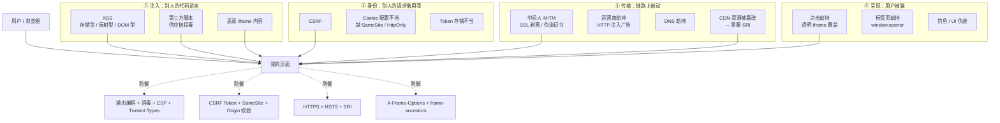

# 前端安全 21 题 · 总览与索引

> 来源题单：`11. 前端安全（21题）.md`
> 使用方法：先读本册（建立攻击面地图 + 背会防御矩阵 + 记住"前端能防什么、不能防什么"），再按攻击面进分册。
> 全系列统一结构：**一句话结论 → 原理展开（含代码/配置）→ 常见坑 → 30 秒版 → 2 分钟版 → 追问表**

---

## 目录

- [0.1 21 道题其实是 8 个攻击面](#01-21-道题其实是-8-个攻击面)
- [0.2 攻击面全景图（背这张图就够）](#02-攻击面全景图背这张图就够)
- [0.3 三条主线与四个防御原则](#03-三条主线与四个防御原则)
- [0.4 题 2：常见攻击方式与防御矩阵](#04-题-2常见攻击方式与防御矩阵)
- [0.5 最关键的判断：前端能防什么、不能防什么](#05-最关键的判断前端能防什么不能防什么)
- [0.6 安全响应头一页速查](#06-安全响应头一页速查)
- [0.7 21 题 → 分册索引表](#07-21-题--分册索引表)
- [0.8 题单本身的 7 个问题](#08-题单本身的-7-个问题)
- [0.9 全局自测清单](#09-全局自测清单)

---

## 0.1 21 道题其实是 8 个攻击面

原题单按"想到哪问到哪"排列，重复率高。归并后只剩 8 块：

| 攻击面 | 题号 | 本质问题 | 分册 |
|---|---|---|---|
| **A. 脚本注入（XSS）** | 1 | 别人的代码在我的页面里执行 | 01 |
| **B. 身份冒用（CSRF / Cookie）** | 19、10、11、12 | 别人的页面借用我的登录态 | 02 |
| **C. 内容策略（CSP / 安全头）** | 5、13 | 用响应头约束"页面能做什么" | 03 |
| **D. 界面欺骗（点击劫持 / iframe）** | 9、21、16 | 我的页面被别人套壳 | 04 |
| **E. 传输劫持（HTTPS / MITM / SRI）** | 7、18、20、14 | 数据在链路上被看/被改 | 05 |
| **F. 身份体系（鉴权 / 数据）** | 3、4、15 | 谁能访问什么、敏感数据放哪 | 06 |
| **G. 跨域与长连接（CORS / WebSocket）** | 6、8 | 浏览器边界怎么划、长连接怎么认人 | 07 |
| **H. 工程化落地（SQL 注入 / 供应链 / 清单）** | 17、2 | 前端做不到的部分怎么协作、怎么防回退 | 08 |

**重复题的合并关系（面试时可以主动说明）：**

```
题 2  ≈ 题 13          → 都是「常见攻击方式 / 安全策略全景」，答一套
题 9  ≡ 题 21          → 点击劫持（定义 + 防御完全一样）
题 10 ≡ 题 11          → SameSite Cookie
题 13 ⊃ 题 12、14、5   → 题 13 是清单，另外三题是清单里某一项的展开
题 17 不是前端问题      → 前端只能做输入校验，真正防御在后端
题 6 不是「安全漏洞」    → 跨域是同源策略机制，属于安全机制的"使用"，不是"缺陷"
```

> 21 道题压缩下来，真正要准备的只有 **12 个答案模块**：XSS、CSRF、CSP、安全头、点击劫持、iframe/postMessage、HTTPS/MITM、SRI、鉴权、数据安全、CORS、WebSocket。**准备积木，不要背 21 份答案。**

---

## 0.2 攻击面全景图（背这张图就够）



**一句话记忆**：安全题就是问"**别人的东西怎么进到我的页面（注入）、别人的请求怎么变成我的请求（身份）、我的数据怎么在链路上被改（传输）、我的界面怎么被别人套壳（呈现）**"。

---

## 0.3 三条主线与四个防御原则

### 三条主线

| 主线 | 核心问题 | 代表攻击 | 根本防御 |
|---|---|---|---|
| **注入类** | 数据被当成了代码 | XSS、SQL 注入、命令注入 | **区分数据与代码**：输出编码、参数化查询、CSP |
| **身份类** | 凭证被自动带上 | CSRF、Cookie 劫持 | **让请求带上攻击者猜不到的东西**：Token、SameSite、Origin |
| **传输类** | 链路可被旁观/改写 | MITM、DNS 劫持、CDN 篡改 | **加密 + 认证 + 完整性校验**：HTTPS、HSTS、SRI |

> 记住这三条，任何安全题都能归位。面试时先说"这道题属于注入类问题"，格局立刻不同。

### 四个防御原则

| 原则 | 含义 | 例子 |
|---|---|---|
| **① 永不信任输入** | 所有外部数据都是不可信的（URL、表单、接口返回、`postMessage`、第三方脚本） | 前端表单校验只是 UX，后端必须再校验 |
| **② 纵深防御** | 不依赖单一手段，多层叠加 | XSS 同时做编码 + CSP + HttpOnly |
| **③ 最小权限** | 只给必要的权限 | iframe `sandbox`、Cookie `Path`、数据库账号权限 |
| **④ 默认拒绝** | 白名单而非黑名单 | CSP 默认 `'self'`、CORS 白名单 Origin、`frame-ancestors 'none'` |

> **一条很实用的认知**：黑名单永远会漏（比如过滤 `<script>` 却漏了 ``），**白名单才能收敛**。这条在 XSS 过滤、CSP、CORS 上都成立。

---

## 0.4 题 2：常见攻击方式与防御矩阵

> 这题原答案给了 7 条，方向对但太粗，且混了"前端能防"和"只能后端防"。下面按**攻击面 + 前端能做什么**重做一遍。

### 4.1 完整矩阵

| 攻击 | 原理一句话 | 前端能做的 | 必须后端/运维做的 |
|---|---|---|---|
| **XSS** | 注入脚本在受害者浏览器执行 | 输出编码、避免 `innerHTML`、DOMPurify 消毒、CSP、Trusted Types | 输入存储前过滤（次要）、Cookie 加 HttpOnly |
| **CSRF** | 借用用户 Cookie 发伪造请求 | 请求带自定义头（触发预检）、前端配合读 Token | CSRF Token、SameSite、Origin 校验 |
| **点击劫持** | 透明 iframe 覆盖诱骗点击 | 页面自检 `top !== self`（可被绕过） | **`X-Frame-Options` / CSP `frame-ancestors`** |
| **SQL 注入** | 输入拼进 SQL 被执行 | 只能做输入格式校验（降低误操作） | **参数化查询 / 预编译 / ORM / 最小权限账号** |
| **NoSQL 注入** | 传对象操作符（如 `{"$gt":""}`）绕过查询 | 前端强制类型（不要直接透传对象） | 类型校验、`$` 开头的键过滤 |
| **中间人（MITM）** | 链路被窃听/篡改 | 无 | **HTTPS + HSTS + 证书校验** |
| **网络/运营商劫持** | HTTP 响应被注入广告或脚本 | 无（只能用 SRI 兜底静态资源） | **全站 HTTPS + HSTS preload + CSP `upgrade-insecure-requests`** |
| **CDN/供应链投毒** | 第三方资源被篡改 | **SRI**、锁定版本、`npm ci`、审计依赖 | 私有源、SBOM、CI 卡口 |
| **DDoS** | 流量打满 | 无 | CDN / WAF / 限流 |
| **暴力破解 / 撞库** | 反复试密码 | 无 | 限流、验证码、风控、MFA |
| **越权（水平/垂直）** | 改 ID 访问别人的数据 | 只能做前端路由/按钮控制（**仅 UX**） | **每个接口都做权限校验（后端）** |
| **敏感信息泄露** | 密钥打进前端包、日志打印密码 | **这条前端责任最大**：不要把密钥放前端 | 日志脱敏、sourcemap 保护 |
| **开放重定向** | `?redirect=https://evil.com` | 白名单校验跳转目标 | 服务端也校验 |
| **社工 / 钓鱼** | 骗人 | 无 | 用户教育、DMARC/SPF、域名监控 |

### 4.2 一段可以直接背的答题

> "我习惯按攻击面分四类。
>
> **注入类**：XSS 最重要，防御是输出编码 + CSP + 少用 `innerHTML`；SQL 注入前端其实防不了，只能配合做输入校验，真正的防御是后端的参数化查询。
>
> **身份类**：CSRF 靠 Token + SameSite + Origin 校验；越权问题前端只能做 UI 层面的控制，真正的拦截必须在后端每个接口上。
>
> **传输类**：中间人、运营商劫持、DNS 劫持，前端基本无能为力，靠 HTTPS + HSTS；但 CDN 资源被篡改这件事前端能用 SRI 兜底。
>
> **呈现类**：点击劫持靠 `X-Frame-Options` 或 CSP 的 `frame-ancestors`；标签页劫持靠 `rel="noopener"`。
>
> 另外还有一类是**前端自己造成的**：把密钥打进 bundle、日志打印敏感信息、sourcemap 公开部署。这类问题只有前端能修，而且最容易被忽略。"

---

## 0.5 最关键的判断：前端能防什么、不能防什么

> **这一节是整册的核心。** 面试官问安全，最想听的不是"你会背几种攻击"，而是"**你知不知道自己防线的边界**"。很多人把"前端校验"当安全措施，这是最典型的错误认知。

### 5.1 三档分类

| 档位 | 含义 | 例子 |
|---|---|---|
| **✅ 前端能真正防住** | 攻击发生在浏览器内，前端是唯一防线 | XSS 输出编码、点击劫持（配响应头）、SRI、`target="_blank"` 的 `noopener`、把密钥从 bundle 里删掉 |
| **⚠️ 前端只能"提高成本"** | 攻击者可以绕过，但绕过有代价 | 禁止调试、代码混淆、前端加密、前端路由权限、表单校验 |
| **❌ 前端完全防不了** | 必须在服务端/运维层解决 | SQL 注入、越权、暴力破解、DDoS、MITM、业务逻辑漏洞、服务端 SSRF |

### 5.2 一句话总结（可以直接说给面试官）

> "前端安全有一条铁律：**浏览器里的一切都在攻击者的控制之下**。他能改 JS、能改请求、能关掉校验、能直接调接口。所以前端做的是两件事：**保护用户不被别人的代码影响（XSS、点击劫持）**，和**不主动泄露信息（密钥、sourcemap、日志）**。凡是涉及'服务端该不该执行这个操作'的判断，前端做的一切都只是 UX，真正的防线必须在后端。"

### 5.3 三个最常见的认知错误

| 错误认知 | 为什么错 | 正确说法 |
|---|---|---|
| "前端做了表单校验，所以安全" | 攻击者直接发请求，绕过页面 | 前端校验是 UX（即时反馈）；后端校验才是安全 |
| "前端路由守卫挡住了，所以进不去" | 改一行 JS 或直接调接口就进去了 | 路由守卫只是不渲染；接口必须自己校验权限 |
| "我对密码做了前端加密，所以安全" | 加密的密钥也在前端代码里 | 前端加密≈混淆；安全靠 HTTPS + 后端哈希存储 |

---

## 0.6 安全响应头一页速查

> 面试时能报出这张表，说明你真的配过。

| 响应头 | 作用 | 推荐值 | 备注 |
|---|---|---|---|
| `Content-Security-Policy` | 限制资源加载与执行 | `default-src 'self'; script-src 'nonce-xxx' 'strict-dynamic'; object-src 'none'; base-uri 'none'; frame-ancestors 'none'` | 最重要，见 03 册 |
| `Strict-Transport-Security` | 强制 HTTPS | `max-age=31536000; includeSubDomains; preload` | 只能在 HTTPS 响应里发 |
| `X-Frame-Options` | 防被 iframe 嵌套 | `DENY` 或 `SAMEORIGIN` | 被 `frame-ancestors` 取代，但为兼容保留 |
| `X-Content-Type-Options` | 禁止 MIME 嗅探 | `nosniff` | 防"图片被当脚本执行" |
| `Referrer-Policy` | 控制 Referer 泄露 | `strict-origin-when-cross-origin` | 防 URL 里的 token 泄露给第三方 |
| `Permissions-Policy` | 限制浏览器能力 | `camera=(), microphone=(), geolocation=()` | 原 `Feature-Policy` |
| `Cross-Origin-Opener-Policy` | 隔离窗口引用 | `same-origin` | 防 `window.opener` 攻击，跨域隔离三件套之一 |
| `Cross-Origin-Embedder-Policy` | 要求子资源声明 | `require-corp` | 与 COOP 一起开启跨域隔离（`SharedArrayBuffer`） |
| `Cross-Origin-Resource-Policy` | 限制谁能引用我的资源 | `same-origin` | 防资源被别的站热链/嵌入 |
| ~~`X-XSS-Protection`~~ | 老浏览器 XSS 过滤器 | **`0`**（关掉） | 已废弃，开启反而有漏洞 |

```nginx
# 一份可以直接放到 nginx 的配置
add_header Content-Security-Policy "default-src 'self'; script-src 'self' 'nonce-$request_id'; style-src 'self' 'unsafe-inline'; img-src 'self' data: https:; connect-src 'self' https://api.example.com; object-src 'none'; base-uri 'none'; frame-ancestors 'none'; upgrade-insecure-requests" always;
add_header Strict-Transport-Security "max-age=31536000; includeSubDomains; preload" always;
add_header X-Content-Type-Options "nosniff" always;
add_header Referrer-Policy "strict-origin-when-cross-origin" always;
add_header Permissions-Policy "camera=(), microphone=(), geolocation=()" always;
```

> **`always` 参数很关键**：不加的话，4xx/5xx 响应不会带这些头——而错误页恰恰是最容易出问题的地方。

---

## 0.7 21 题 → 分册索引表

| 题号 | 题目 | 去哪看 | 一句话答案 |
|---|---|---|---|
| 1 | 说说你对 XSS 的了解 | **01** | 注入脚本在受害者浏览器执行；分存储/反射/DOM 三型；防御靠输出编码 + CSP + 消毒 + HttpOnly |
| 2 | 常见攻击方式及防御 | **本册 0.4 + 08** | 按注入/身份/传输/呈现四类答，每类给 1~2 个具体手段 |
| 3 | 前端鉴权 | **06 · 1 节** | 认证（你是谁）+ 授权（你能干什么）；Session/JWT/OAuth/RBAC 四套方案 |
| 4 | 如何禁止别人调试 | **06 · 3 节** | 不可能，只能提高成本；真正该做的是不把秘密放前端 |
| 5 | CSP 能解决什么问题 | **03 · 1 节** | 用白名单限制资源来源，核心是防 XSS 和内联脚本；配 nonce + report-only 上线 |
| 6 | 前端怎么实现跨域 | **07 · 1 节** | CORS（首选）/ 代理（最稳）/ JSONP（已淘汰）/ postMessage（窗口间） |
| 7 | HTTPS 有哪些优点 | **05 · 1 节** | 机密性 + 完整性 + 身份认证；顺带 HTTP/2 要求、SEO 加分 |
| 8 | WebSocket 安全问题 | **07 · 2 节** | 握手不受同源策略约束 → 必须校验 Origin；wss + 消息校验 + 连接期鉴权 |
| 9 | 点击劫持及防范 | **04 · 1 节** | 透明 iframe 覆盖；`X-Frame-Options` + CSP `frame-ancestors` |
| 10 | SameSite Cookie 属性 | **02 · 3 节** | Strict/Lax/None 三档；Lax 是 Chrome 默认值；None 必须配 Secure |
| 11 | SameSite 有什么作用 | **02 · 3 节** | 同题 10 |
| 12 | HttpOnly 有什么用途 | **02 · 4 节** | 禁止 `document.cookie` 读取，防 XSS 偷 Cookie；但挡不住 XSS 直接发请求 |
| 13 | 前端的常规安全策略 | **03 · 2 节 + 本册 0.6** | 输出编码 + 安全头 + Cookie 属性 + SRI + HTTPS + 依赖审计 |
| 14 | 静态资源完整性校验 | **05 · 3 节** | SRI：`integrity` + `crossorigin`，浏览器校验哈希，篡改则拒载 |
| 15 | 前端数据安全 | **06 · 2 节** | 密钥不进 bundle、敏感数据不进 localStorage、日志脱敏、sourcemap 保护 |
| 16 | iframe 安全 | **04 · 2 节** | `sandbox` 最小权限、`frame-src` 限制嵌套谁、`postMessage` 校验 origin |
| 17 | SQL 注入 | **08 · 1 节** | 前端防不了；防御是后端参数化查询；前端只做类型/格式校验 |
| 18 | 网络劫持 | **05 · 2 节** | 运营商 HTTP 注入 / DNS 劫持；HTTPS + HSTS + SRI |
| 19 | CSRF 攻击及防护 | **02 · 1~2 节** | 借用 Cookie 发伪造请求；Token + SameSite + Origin/Referer 校验 |
| 20 | 中间人攻击 | **05 · 1 节** | 链路窃听/篡改/SSL 剥离；HTTPS + HSTS + 证书固定 |
| 21 | 点击劫持 | **04 · 1 节** | 同题 9 |

**分册清单：**

| 文件 | 覆盖题号 | 内容 |
|---|---|---|
| `安全-00-总览与索引.md` | 2、13 | 攻击面地图、防御矩阵、前端边界、安全头速查 |
| `安全-01-XSS-跨站脚本.md` | 1 | 三型 XSS、上下文与编码、payload 与绕过、纵深防御、Trusted Types |
| `安全-02-CSRF与Cookie安全.md` | 19、10、11、12 | CSRF 原理与四种防御、SameSite/HttpOnly/Secure、现代 Token 方案 |
| `安全-03-CSP与安全响应头.md` | 5、13 | CSP 指令详解、nonce/hash/strict-dynamic、上线策略、其他头 |
| `安全-04-点击劫持与iframe安全.md` | 9、21、16 | 点击劫持变种、frame-ancestors、sandbox、postMessage 校验、opener |
| `安全-05-传输层-HTTPS与中间人.md` | 7、18、20、14 | TLS、HSTS、SSL 剥离、运营商劫持、SRI |
| `安全-06-鉴权与数据安全.md` | 3、4、15 | Session/JWT/OAuth、Token 存储、权限边界、密钥管理、防调试 |
| `安全-07-跨域与WebSocket安全.md` | 6、8 | 同源策略、CORS 预检、JSONP、代理、postMessage、CSWSH |
| `安全-08-工程化落地与供应链.md` | 17、2 | SQL/NoSQL 注入、供应链安全、上线检查清单、安全评审流程 |

---

## 0.8 题单本身的 7 个问题

题单是别人整理的，有 7 处需要修正或补充。面试时能指出来，是明显的加分项。

| # | 问题 | 说明 |
|---|---|---|
| 1 | **题 6「实现跨域」不是安全漏洞** | 跨域限制（同源策略）本身就是**安全机制**。把它放在安全题单里会让人误以为"跨域是问题"。正确说法："同源策略是浏览器最基础的安全边界，CORS 是在这个边界上开一个受控的口子。" |
| 2 | **题 17 SQL 注入前端无法防** | 原答案已说明"这是后端问题"，但还应该补一句：**前端的输入校验只是降低误操作和提升体验，对攻击者零作用**。真正的防御是参数化查询 + 最小权限数据库账号。 |
| 3 | **题 4 的四个手段全部无效** | `debugger` 死循环、检测窗口尺寸、禁用 F12、压缩混淆——对稍微懂行的人**全部可绕过**（关掉断点、改窗口、直接抓包）。更该讲的是"为什么这件事本质上不可能"，以及"该把精力放在不泄露密钥上"。 |
| 4 | **题 13 与题 2 几乎完全重复** | 已合并到本册 0.4 + 0.6。 |
| 5 | **题 10 与题 11 完全重复** | 已合并到 02 册 3 节。 |
| 6 | **题 15「前端数据安全」漏了最关键的一条** | 原答案说"前端加密只是混淆"是对的，但漏了更致命的：**任何被打包进 bundle 的密钥都是公开的**。包括 `VITE_` / `NEXT_PUBLIC_` 前缀的环境变量——它们在构建时就被内联进产物了，很多人以为"环境变量"就安全。 |
| 7 | **整套题缺了现代防御** | 缺 `nonce` / `strict-dynamic` / **Trusted Types**、缺 `postMessage` 的 origin 校验细节、缺**供应链安全**（依赖投毒）、缺 COOP/COEP。这些在 2020 年后的面试里越来越常问。 |

---

## 0.9 全局自测清单

**框架层**

- [ ] 能说出三条主线（注入 / 身份 / 传输）并把任意攻击归类
- [ ] 能说出四个防御原则（不信任输入 / 纵深 / 最小权限 / 默认拒绝）
- [ ] 能说清"前端能防什么、只能提高成本什么、完全防不了什么"
- [ ] 能指出三种最常见的认知错误（前端校验=安全、路由守卫=权限、前端加密=安全）

**注入类**

- [ ] XSS 三型的区别与典型场景
- [ ] 五种输出上下文（HTML / 属性 / URL / JS / CSS）各自的编码方式
- [ ] `innerHTML` / `v-html` / `dangerouslySetInnerHTML` 的风险
- [ ] DOMPurify 解决什么问题，什么时候必须用
- [ ] Trusted Types 是什么，怎么开

**身份类**

- [ ] CSRF 成立的三个条件
- [ ] CSRF Token 的完整流程（下发、存储、携带、校验）
- [ ] SameSite 三档的确切行为，`None` 为什么要配 `Secure`
- [ ] HttpOnly 能防什么、不能防什么
- [ ] `__Host-` / `__Secure-` Cookie 前缀的约束

**策略类**

- [ ] CSP 至少 6 个常用指令
- [ ] nonce 和 hash 的区别，`strict-dynamic` 解决什么
- [ ] `'unsafe-inline'` 和 nonce 同时存在会怎样
- [ ] CSP 能不能防 DOM 型 XSS（要能说清边界）
- [ ] `report-only` 怎么用于灰度上线

**呈现类**

- [ ] 点击劫持的三种变种
- [ ] `frame-ancestors` 和 `X-Frame-Options` 的关系
- [ ] `sandbox` 常用 token，`allow-scripts` + `allow-same-origin` 为什么危险
- [ ] `postMessage` 必须校验什么
- [ ] `target="_blank"` 不加 `noopener` 会怎样

**传输类**

- [ ] HTTPS 保证的三件事
- [ ] SSL 剥离攻击与 HSTS 的关系
- [ ] HSTS preload 的作用与风险
- [ ] SRI 的用法与三个限制（CORS、动态导入、JSONP）
- [ ] 混合内容（mixed content）的处理

**工程类**

- [ ] 为什么存在 bundle 里的密钥一定不安全
- [ ] 供应链攻击的三种形式与防御
- [ ] 一份上线前安全检查清单（至少 10 项）

**表达层**

- [ ] 能用一个真实项目例子说明"我们发现了什么、怎么修的"
- [ ] 能说清前端与后端在安全上的分工
- [ ] 能说出 3 个"看起来有用其实没用"的措施（体现判断力）
