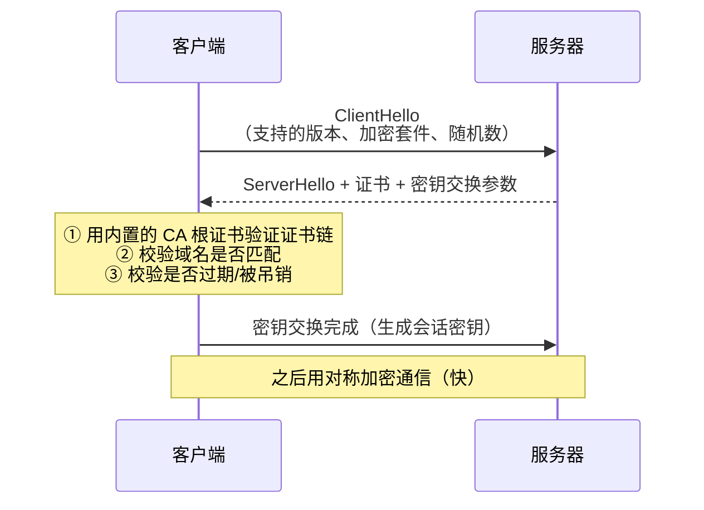
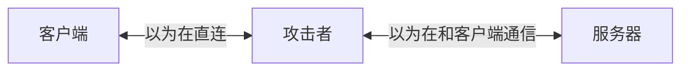
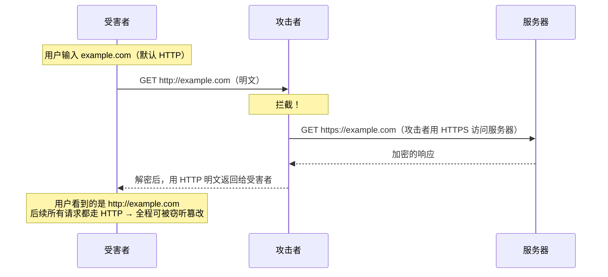

# 安全 · 05 传输层：HTTPS、中间人、网络劫持与 SRI

> 覆盖题号：**7、18、20、14**
> 对应原题：《HTTPS 有哪些优点》《网络劫持》《中间人攻击》《静态资源完整性校验》
> 这四题是一条线：**HTTPS 解决"链路可信"，中间人和网络劫持是"链路不可信"的后果，SRI 是"连 HTTPS 都不完全可信时"的最后一道校验。**

---

## 目录

- [1. HTTPS（题 7）](#1-https题-7)
- [2. 中间人攻击（题 20）](#2-中间人攻击题-20)
- [3. 网络劫持（题 18）](#3-网络劫持题-18)
- [4. SRI 静态资源完整性校验（题 14）](#4-sri-静态资源完整性校验题-14)
- [5. 前端在传输层能做什么（一张总结表）](#5-前端在传输层能做什么一张总结表)
- [6. 常见坑](#6-常见坑)
- [7. 答题模板](#7-答题模板)
- [8. 追问表](#8-追问表)
- [9. 速记卡](#9-速记卡)

---

## 1. HTTPS（题 7）

### 1.1 一句话结论

**HTTPS = HTTP + TLS**。TLS 提供三件事：**机密性（加密，防窃听）、完整性（防篡改）、身份认证（证书，防冒充）**。

> 面试时先给这三件事，再展开——这是最标准的回答结构。很多人只答"加密"，漏了"认证"，而**认证才是防中间人的关键**。

### 1.2 三件事分别解决什么

| 能力 | 手段 | 挡住的攻击 |
|---|---|---|
| **机密性** | 对称加密（AES-GCM / ChaCha20） | 窃听（抓包看密码） |
| **完整性** | AEAD / HMAC | 篡改（注入广告、改转账金额） |
| **身份认证** | 非对称加密 + X.509 证书 + CA | 冒充（假网站、中间人） |

**为什么需要"认证"**：如果只有加密，攻击者可以和你"各建一条加密通道"——你以为在跟银行通信，其实在跟攻击者通信，他再转发给银行。**这就是中间人攻击**（见第 2 节）。

### 1.3 TLS 握手（简化版）



**关键设计**：**用非对称加密"协商"出一个对称密钥，之后用对称加密传数据。** 因为非对称加密太慢（比对称慢几百倍），只用来做密钥交换和签名。

| | 非对称（RSA/ECDHE） | 对称（AES/ChaCha20） |
|---|---|---|
| 速度 | 慢 | 快 |
| 用途 | 密钥交换、签名、证书 | 数据传输 |
| 密钥 | 公钥/私钥 | 同一个密钥 |

### 1.4 TLS 1.2 vs 1.3

| | TLS 1.2 | TLS 1.3 |
|---|---|---|
| 握手 RTT | **2-RTT** | **1-RTT**（会话恢复 0-RTT） |
| 加密套件 | 多且杂（含不安全选项） | **只保留 AEAD**（AES-GCM / ChaCha20-Poly1305） |
| 前向保密 | 可选（RSA 密钥交换不支持） | **强制**（只能用 ECDHE） |
| 已废弃特性 | — | 移除 RSA 密钥交换、压缩、重协商 |

**前向保密（Forward Secrecy）**：即使服务器的私钥将来泄露，**过去的通信记录也无法解密**。因为每次会话用独立的临时密钥（ECDHE）。

> 面试加分点："TLS 1.3 强制前向保密，这是它比 1.2 更安全的重要一点——1.2 如果用了 RSA 密钥交换，私钥一旦泄露，历史流量全都能解。"

### 1.5 证书体系

```
根证书（Root CA，内置在操作系统/浏览器）
  └─ 中间证书（Intermediate CA）
       └─ 服务器证书（Leaf，绑定域名）
```

**浏览器验证什么：**

| 检查项 | 失败后果 |
|---|---|
| 证书链能否逐级验签到受信任的根 | `NET::ERR_CERT_AUTHORITY_INVALID` |
| 域名是否匹配（SAN 字段） | `NET::ERR_CERT_COMMON_NAME_INVALID` |
| 是否在有效期内 | `NET::ERR_CERT_DATE_INVALID` |
| 是否被吊销（CRL / OCSP） | 可能被忽略（软失败） |
| 证书用途是否正确 | — |

**证书类型（了解即可）：**

| 类型 | 验证什么 | 浏览器显示 |
|---|---|---|
| DV（域名验证） | 只验证域名控制权 | 普通锁标 |
| OV（组织验证） | 验证企业真实存在 | 普通锁标（信息在证书详情里） |
| EV（扩展验证） | 更严格审核 | **2019 年后 Chrome 取消了绿色地址栏**，与 DV 无异 |

> **EV 证书的"绿色地址栏"已被取消**，这是很多老资料里的过时信息。现在 EV 的唯一价值是证书详情里能看到公司名。

**证书透明度（Certificate Transparency, CT）**：所有公开 CA 签发的证书都要记录到公开日志里，任何人可以审计"有没有人给我的域名偷偷签了证书"。这是发现"错误签发"的关键机制。

### 1.6 题 7 完整答法：HTTPS 的优点（不止安全）

> **原答案只讲了 4 条安全相关，其实 HTTPS 还有几个"非安全"的刚需，说出来显得你对工程现实有感知。**

| 类别 | 优点 |
|---|---|
| **安全** | ① 防窃听（加密）② 防篡改（完整性）③ 防冒充（证书认证）④ 防运营商劫持注入 |
| **性能** | ⑤ **HTTP/2 在浏览器里实际要求 HTTPS**（否则只能用 HTTP/1.1）⑥ TLS 1.3 只需 1-RTT，会话恢复 0-RTT ⑦ 支持 Brotli（浏览器只在 HTTPS 下接受 br 压缩） |
| **能力** | ⑧ **很多 Web API 只在 Secure Context 下可用**：Service Worker（PWA 离线）、Geolocation、Clipboard、`getUserMedia`（摄像头）、`crypto.subtle`、WebAuthn（指纹/面容登录）、Notifications |
| **SEO / 商业** | ⑨ Google 排名轻微加分 ⑩ 浏览器对 HTTP 站点标"不安全"，影响转化率 ⑪ 很多支付/小程序/App 审核强制要求 HTTPS |
| **合规** | ⑫ 等保、PCI-DSS、GDPR 等合规要求传输加密 |

**第 ⑧ 条是最容易被忽略的**：很多人想做 PWA，发现 Service Worker 注册不了——因为本地开发用 `localhost` 可以，但线上必须 HTTPS（`localhost` 被视为安全上下文）。

### 1.7 混合内容（Mixed Content）

**问题**：HTTPS 页面里加载了 HTTP 资源。

| 类型 | 例子 | 浏览器行为 |
|---|---|---|
| **主动混合内容**（Active） | `<script src="http://...">`、`<link rel=stylesheet>`、`<iframe>`、`fetch`、`XHR` | **直接阻止**（因为可以执行代码/改页面） |
| **被动混合内容**（Passive） | ``、`<audio>`、`<video>` | Chrome 从 2020 起**自动升级为 HTTPS**；失败则阻止（以前只是警告） |

**解决方案：**

```http
# ① 让浏览器自动把所有 HTTP 子资源升级为 HTTPS
Content-Security-Policy: upgrade-insecure-requests

# ② 或者用 HSTS（见下）
Strict-Transport-Security: max-age=31536000
```

```html
<!-- ③ 明确写成 // 或 https:// -->
<script src="https://cdn.example.com/lib.js"></script>
```

> **一个隐蔽的坑**：后端接口返回的富文本/配置里如果硬编码了 `http://` 的图片地址，加了 `upgrade-insecure-requests` 后如果那个域名不支持 HTTPS，图片会直接加载失败。**上线前要扫一遍数据里的 http 链接。**

### 1.8 HTTPS 的性能代价与优化

| 代价 | 优化 |
|---|---|
| 握手增加 1~2 RTT | TLS 1.3（1-RTT）、0-RTT 会话恢复、`preconnect` |
| 加解密消耗 CPU | 现代 CPU 有 AES-NI 指令，开销已很小；用 ECDSA 证书（比 RSA 签名快） |
| 证书链验证耗时 | 精简证书链、开 OCSP Stapling（服务器代为获取吊销状态，省客户端一次请求） |
| 首次连接无缓存 | HSTS preload、`preconnect` |

> **现实结论**：在现代硬件上，**HTTPS 的性能代价基本可以忽略**（通常 < 5%），而 HTTP/2 带来的收益远大于 TLS 的开销。**"HTTPS 会拖慢网站"是老观念。**

### 1.9 30 秒版

> "HTTPS 是 HTTP 加 TLS，提供三件事：加密防窃听、完整性防篡改、证书认证防冒充。除了安全，它还有几个刚需：浏览器里 HTTP/2 实际要求 HTTPS，Brotli 也只在 HTTPS 下生效；很多 API 比如 Service Worker、定位、摄像头只在安全上下文可用；还有 SEO 和合规要求。"

---

## 2. 中间人攻击（题 20）

### 2.1 一句话结论

**中间人攻击（MITM）= 攻击者插入到通信双方之间，可以窃听、篡改、重放，而双方以为在直接通信。**



### 2.2 四种典型的 MITM 场景

| 场景 | 原理 |
|---|---|
| **公共 Wi-Fi 热点** | 攻击者架一个同名热点，用户连上后所有流量都过他 |
| **ARP 欺骗** | 在局域网内伪造 ARP 响应，把网关 IP 映射到攻击者 MAC，实现"局域网中间人" |
| **DNS 欺骗 / 投毒** | 篡改 DNS 响应，把 `bank.com` 解析到攻击者 IP |
| **恶意代理 / 企业网关** | 公司/学校的 SSL 检查代理，用自己的根证书重签所有 HTTPS |
| **BGP 劫持** | 在国家/运营商层面劫持路由，把流量引到错误的地方（少见但影响巨大） |

### 2.3 SSL 剥离攻击（最经典的 HTTPS 攻击）

> **这是面试最值得讲的一个细节**，因为它解释了"为什么有了 HTTPS 还需要 HSTS"。



**关键**：攻击者**不需要破解 TLS**，他只需要"让用户永远不走 TLS"。因为用户第一次访问用的是 HTTP（或者点了 HTTP 链接），攻击者在这一步就把连接降级了。

### 2.4 HSTS：专门对付 SSL 剥离

```http
Strict-Transport-Security: max-age=31536000; includeSubDomains; preload
```

**作用**：让浏览器**记住**"这个域必须用 HTTPS"。之后即使用户输入 `http://example.com`，浏览器也会**在本地就把地址改成 `https://`**，根本不会发出那个明文请求。

| 参数 | 作用 |
|---|---|
| `max-age` | 记住多少秒（建议 1 年 = 31536000） |
| `includeSubDomains` | 所有子域也强制 |
| `preload` | 申请加入浏览器内置列表 |

**HSTS 的三个关键细节（面试必问）：**

| 细节 | 说明 |
|---|---|
| **只能在 HTTPS 响应里发** | HTTP 响应里的 HSTS 头会被忽略（否则攻击者可以伪造一个） |
| **首次访问仍脆弱** | 用户第一次访问（还没收到 HSTS 头）时，仍可能被剥离 → 这就是 `preload` 的意义 |
| **preload 是不可逆的** | 提交到浏览器内置列表后，要撤销需要等浏览器发版（几个月）；且 `includeSubDomains` 下有子域没 HTTPS 会直接不可访问 |

**preload 的申请条件（严格）：**

```
① 有有效证书
② HTTP 请求全部 301 跳转到 HTTPS（同一 host）
③ 所有子域都支持 HTTPS
④ max-age ≥ 31536000（1 年）
⑤ 带 includeSubDomains
⑥ 带 preload 指令
```

> 提交地址：`hstspreload.org`。

### 2.5 其他防御

| 手段 | 说明 |
|---|---|
| **HTTPS 全站** | 基础 |
| **HSTS** | 防降级（核心） |
| **证书固定（Pinning）** | 只信任特定证书/公钥。**HPKP 已废弃**（容易把自己锁死），现在移动端 App 里用得多 |
| **证书透明度（CT）监控** | 监控有没有人为你的域名签发证书 |
| **不忽略证书警告** | 用户点了"继续访问"就前功尽弃；企业内要治理"自签证书"习惯 |
| **OCSP Stapling** | 服务器代为提供吊销状态，避免客户端查 OCSP 时被劫持 |

### 2.6 追问：HTTPS 能不能防住所有 MITM

**不能。** 三种例外：

| 例外 | 说明 |
|---|---|
| **用户主动信任了攻击者的根证书** | 企业 SSL 检查代理、抓包工具（Charles/Fiddler）就是这样工作的 |
| **攻击者能控制 CA** | 错误签发、CA 被攻陷（历史上发生过多次） |
| **客户端本身被控** | 设备被装了恶意根证书或恶意软件 |

> **这就是为什么"前端不能假设传输层绝对安全"**：SRI、CSP、端到端加密在特定场景下仍有价值。

---

## 3. 网络劫持（题 18）

### 3.1 一句话结论

**网络劫持 = 攻击者（通常是运营商、恶意路由器、恶意软件）在传输路径上篡改流量。** 它是 MITM 的一种"大规模、非定向"形式。

### 3.2 四种常见形式

| 形式 | 表现 | 原理 |
|---|---|---|
| **DNS 劫持** | 访问 A 站跳到 B 站；或弹出运营商广告页 | 篡改 DNS 响应，返回错误 IP |
| **HTTP 内容注入** | 页面底部多了一个浮动广告、多了一段 `<script>` | 运营商在 HTTP 响应体里插入内容（明文可改） |
| **HTTP 重定向劫持** | 第一次访问被跳到导航站 | 篡改 302 响应 |
| **流量劫持（弹窗/跳转）** | 手机上打开网页自动跳应用商店 | 注入 JS 或改响应 |

> **一个现实细节**：这类劫持在国内尤其常见于**中小运营商的移动网络**，且**只影响 HTTP**。全站 HTTPS 后基本消失——这也是国内推动 HTTPS 的最直接动力之一（不是"怕被黑客攻击"，而是"怕被运营商插广告"）。

### 3.3 防御：后端/运维为主，前端只能兜底

| 手段 | 谁来做 | 效果 |
|---|---|---|
| **全站 HTTPS** | 运维 | **根治**（明文不可改） |
| **HSTS + preload** | 运维 | 防降级 |
| **HTTP 301 跳 HTTPS** | 运维 | 减少明文窗口 |
| **CSP `upgrade-insecure-requests`** | 前端 | 防子资源被降级 |
| **SRI** | 前端 | 静态资源被篡改时拒绝加载 |
| **关键接口加签名** | 前后端 | 即使被改也能发现 |
| **前端异常监控** | 前端 | 发现"页面里多了不认识的脚本" |

### 3.4 一个实用的检测手段

```js
// 检测页面是否被注入了非预期的脚本（粗略但有用）
const knownScripts = new Set([
  '/app.js', '/vendor.js',
  'https://cdn.example.com/analytics.js',
])

new MutationObserver((mutations) => {
  for (const m of mutations) {
    for (const node of m.addedNodes) {
      if (node.tagName === 'SCRIPT' && !knownScripts.has(node.src)) {
        // 上报：可能是运营商注入或 XSS
        navigator.sendBeacon?.('/api/unexpected-script', JSON.stringify({
          src: node.src,
          inline: !node.src,
          html: node.src ? '' : node.textContent.slice(0, 200),
        }))
      }
    }
  }
}).observe(document.documentElement, { childList: true, subtree: true })
```

> **注意**：这个检测只能发现"事后注入"，不能阻止。真正的防线还是 HTTPS + CSP（CSP 会直接阻止未授权脚本执行）。

### 3.5 30 秒版

> "网络劫持常见四种：DNS 劫持把域名解析到错误 IP、HTTP 内容注入（运营商插广告）、HTTP 重定向劫持、移动端流量劫持跳应用商店。共同点是**只影响明文 HTTP**。防御主要靠运维：全站 HTTPS + HSTS + 301 跳转；前端能做的是 CSP 的 `upgrade-insecure-requests` 防子资源降级、SRI 防静态资源被篡改、以及监控页面里有没有出现非预期脚本。"

---

## 4. SRI 静态资源完整性校验（题 14）

### 4.1 一句话结论

**SRI（Subresource Integrity）= 给 `<script>` / `<link>` 加一个内容哈希，浏览器下载后自己算一遍，不一致就拒绝执行。** 它防的是"**资源在传输/存储环节被篡改**"——比如 CDN 被攻陷、DNS 劫持到假 CDN、运营商注入。

### 4.2 基本用法

```html
<script
  src="https://cdn.example.com/lib.js"
  integrity="sha384-oqVuAfXRKap7fdgcCY5uykM6+R9GqQ8K/uxy9rx7HNQlGYl1kPzQho1wx4JwY8wC"
  crossorigin="anonymous"
></script>

<link
  rel="stylesheet"
  href="https://cdn.example.com/lib.css"
  integrity="sha384-abc123..."
  crossorigin="anonymous"
>
```

### 4.3 三个必须知道的细节

**细节一：`crossorigin` 不能省**

```html
<!-- ❌ 跨域资源不加 crossorigin → 浏览器拿不到响应体做校验 → SRI 直接失败 -->
<script src="https://cdn.example.com/lib.js" integrity="sha384-..."></script>

<!-- ✅ 必须加 -->
<script src="https://cdn.example.com/lib.js" integrity="sha384-..." crossorigin="anonymous"></script>
```

**为什么**：SRI 需要读取完整的响应内容算哈希，而跨域读取需要 CORS 授权。`crossorigin="anonymous"` 会发起一个带 `Origin` 头的 CORS 请求；**CDN 必须返回 `Access-Control-Allow-Origin: *`**，否则资源加载失败。

> 这是 SRI 最常见的坑：**加了 integrity 但没加 crossorigin，或者 CDN 没配 CORS，结果资源直接加载不出来。**

**细节二：可以写多个哈希**

```html
integrity="sha256-xxx sha384-yyy sha512-zzz"
```

浏览器会选**它支持的最强算法**校验。用途：为未来算法迁移做准备。

**细节三：算法选择**

| 算法 | 建议 |
|---|---|
| `sha256` | 可用 |
| **`sha384`** | **推荐**（CDN 厂商默认） |
| `sha512` | 更安全但更长 |

**不要用 `md5` / `sha1`**（已不安全，浏览器也不支持用于 SRI）。

### 4.4 生成 hash

```bash
# 命令行
cat lib.js | openssl dgst -sha384 -binary | openssl base64 -A
# 输出：oqVuAfXRKap7fdgcCY5uykM6+R9GqQ8K/uxy9rx7HNQlGYl1kPzQho1wx4JwY8wC

# 拼成 integrity 值
# integrity="sha384-oqVuAfXRKap7fdgcCY5uykM6+R9GqQ8K/uxy9rx7HNQlGYl1kPzQho1wx4JwY8wC"
```

```js
// 构建时自动生成（Node）
import { createHash } from 'crypto'
import { readFileSync } from 'fs'

function sri(filePath, algorithm = 'sha384') {
  const buf = readFileSync(filePath)
  const hash = createHash(algorithm).update(buf).digest('base64')
  return `${algorithm}-${hash}`
}

// 用 webpack 插件自动注入：webpack-subresource-integrity
// 或在 html-webpack-plugin 的模板里算
```

### 4.5 SRI 的四个局限（说出来才完整）

| 局限 | 说明 | 替代 |
|---|---|---|
| **只能校验静态 `<script>` / `<link>`** | 动态 `import()`、`fetch` 加载的 JS **不受保护** | 用 webpack 的 `output.crossOriginLoading` + SRI 插件；或自行校验 |
| **JSONP 无法用 SRI** | JSONP 的内容是动态的（callback 参数不同），hash 不固定 | 用 CORS 替代 JSONP |
| **CSS 内部的 `url()` 不受保护** | `@import` 或 `background: url()` 加载的资源不走 SRI | 靠 CSP + HTTPS |
| **每次发版都要更新 hash** | 内容变 → hash 变 → 需要重新构建注入 | 用构建插件自动化（否则必然忘记） |

> **第 4 条是实践中最致命的**：如果手动维护 hash，几乎一定会忘了更新，导致**上线后资源全部加载失败**。**必须自动化。**

### 4.6 SRI 在什么场景下真正有价值

| 场景 | 价值 |
|---|---|
| 从**公共 CDN**（如 unpkg、jsdelivr、cdnjs）加载库 | **高**——你无法控制那个 CDN |
| 从**自己完全可控的 CDN** 加载 | 中——主要防"CDN 被攻陷"和"中间人" |
| 内网 / 离线部署 | 低 |
| 已经全站 HTTPS + HSTS + CSP | 低（多层防御，边际收益小） |

> **一个务实的判断**（面试可以这么说）："如果第三方脚本是从公共 CDN 加载的，SRI 是必须的；如果是自己的 CDN 且已经全站 HTTPS + HSTS，SRI 的边际收益不大，但成本很低（一个构建插件），我会加上。"

### 4.7 30 秒版

> "SRI 是给 `<script>` 或 `<link>` 加 `integrity` 属性，写内容的 sha384 哈希，浏览器下载后自己算一遍，不一致就拒绝执行。它防的是 CDN 被攻陷、DNS 劫持到假 CDN、运营商注入这类'资源被篡改'的问题。两个关键点：跨域资源必须加 `crossorigin`，而且 CDN 要返回 CORS 头，否则资源直接加载失败；另外 hash 必须用构建插件自动生成，手动维护一定会忘。"

---

## 5. 前端在传输层能做什么（一张总结表）

> 传输层的主体责任在运维/后端，但**前端并非无能为力**。这张表可以帮你回答"那你们前端在安全上做了什么"。

| 手段 | 前端能做的 | 局限 |
|---|---|---|
| **混合内容** | 检查代码/数据里有没有 `http://` 硬编码；确保所有资源用 `https://` 或协议相对 | — |
| **CSP `upgrade-insecure-requests`** | 配合后端加上 | 目标域不支持 HTTPS 时会加载失败 |
| **SRI** | 给第三方脚本加 `integrity` + `crossorigin`；构建时自动生成 | 只管静态资源 |
| **`preconnect` + HSTS** | 前端提需求给运维 | 需要运维配合 |
| **`Referrer-Policy`** | 防止 URL 里的敏感信息随 Referer 泄露到第三方 | — |
| **异常脚本监控** | `MutationObserver` 检测非预期脚本注入 | 只能发现，不能阻止 |
| **关键请求加签名** | 配合后端做请求签名 | 需要密钥管理（不能放前端！） |
| **不信任任何外部资源** | 所有第三方脚本都视为潜在风险 | — |
| **敏感页面 `Cache-Control: no-store`** | 防"后退键看到上一个用户的页面" | 需要后端配合 |

---

## 6. 常见坑

| # | 坑 | 纠正 |
|---|---|---|
| 1 | 认为 HTTPS 只提供"加密" | 还有完整性和**身份认证**（认证才是防 MITM 的关键） |
| 2 | 认为 HTTPS 会明显拖慢网站 | 现代硬件开销 < 5%，HTTP/2 收益远大于开销 |
| 3 | 只在登录页用 HTTPS | 必须全站，否则会话 Cookie 会在 HTTP 请求里明文暴露 |
| 4 | HSTS 写在 HTTP 响应里 | 会被忽略；只能在 HTTPS 响应里发 |
| 5 | HSTS 一上来就 `preload` + `includeSubDomains` | 不可逆；先短 `max-age` 观察，确认所有子域都支持 HTTPS |
| 6 | 以为 `EV 证书`有绿色地址栏 | 2019 年后 Chrome 已取消 |
| 7 | SRI 加了 `integrity` 没加 `crossorigin` | 跨域资源会导致加载失败 |
| 8 | CDN 没配 `Access-Control-Allow-Origin` | SRI 校验拿不到内容，资源加载失败 |
| 9 | SRI hash 手动维护 | 发版必忘，必须构建时自动生成 |
| 10 | 以为 SRI 能保护动态 `import()` | 不能，只管静态标签 |
| 11 | 用 JSONP 还想加 SRI | JSONP 内容动态，无法固定 hash；改用 CORS |
| 12 | 认为 HTTPS 能防所有 MITM | 用户信任了恶意根证书（抓包工具、企业代理）时无效 |
| 13 | 忽略证书警告继续访问 | 等于放弃全部保护 |
| 14 | 富文本/配置里有 `http://` 图片 | 加 `upgrade-insecure-requests` 后会加载失败，要扫数据 |

---

## 7. 答题模板

### 7.1 「HTTPS 有哪些优点」——30 秒

> "三件事：加密防窃听、完整性防篡改、证书认证防冒充。除了安全还有几个刚需：浏览器里 HTTP/2 实际要求 HTTPS，Brotli 也只在 HTTPS 下生效；很多 API 比如 Service Worker、定位、摄像头、`crypto.subtle` 只在安全上下文可用；另外还有 SEO 轻微加分、浏览器标'不安全'影响转化、合规要求。"

### 7.2 「HTTPS 有哪些优点」——2 分钟

> "我分三层讲：安全、性能与能力、商业与合规。
>
> **安全层**是核心三件事：机密性靠对称加密，完整性靠 AEAD，身份认证靠证书链。这里要说清一点——**很多人只强调加密，但真正防中间人的是认证**。如果只有加密，攻击者可以和你各建一条加密通道，你以为在跟银行通信，实际在跟他通信。
>
> **性能层**是反直觉的：HTTPS 在现代硬件上开销不到 5%，而它带来的收益更大——浏览器里 HTTP/2 实际要求 HTTPS，多路复用省下的时间远超 TLS 握手；Brotli 压缩也只在 HTTPS 下被浏览器接受；TLS 1.3 把握手从 2-RTT 降到 1-RTT，会话恢复可以 0-RTT。
>
> **能力层**最容易被忽略：Service Worker、Geolocation、剪贴板、`getUserMedia`、`crypto.subtle`、WebAuthn 这些 API 都要求 **Secure Context**。很多人想做 PWA 发现 Service Worker 注册不了，就是因为站点还是 HTTP。
>
> 最后还有 SEO 和商业因素：Google 排名是轻微加分，但浏览器给 HTTP 站点标'不安全'对转化率影响更直接；支付、小程序、App 上架基本都强制 HTTPS。"

### 7.3 「中间人攻击」——30 秒

> "中间人攻击是攻击者插在通信双方之间，可以窃听、篡改、重放，双方以为在直连。典型场景有公共 Wi-Fi 热点、ARP 欺骗、DNS 欺骗、恶意代理。最经典的手法是 **SSL 剥离**——用户第一次用 HTTP 访问，攻击者拦截后用 HTTPS 访问服务器，再把内容以明文返回给用户，于是全程可被窃听。防御是 HTTPS + HSTS，HSTS 让浏览器记住必须用 HTTPS，直接从本地就把 http 改成 https。"

### 7.4 「静态资源完整性校验」——30 秒

> "就是 SRI。给 `<script>` 或 `<link>` 加 `integrity` 属性写内容的 sha384 哈希，浏览器下载后自己算一遍，不一致就拒绝执行。防的是 CDN 被攻陷、DNS 劫持到假 CDN、运营商注入这类篡改。两个关键点：跨域资源必须加 `crossorigin` 且 CDN 要返回 CORS 头，否则资源直接加载失败；hash 必须构建时自动生成，手动维护一定会忘。"

---

## 8. 追问表

| # | 追问 | 要点 |
|---|---|---|
| 1 | HTTPS 保证哪三件事？ | 机密性、完整性、身份认证 |
| 2 | 为什么需要认证，光加密不够？ | 否则可与攻击者各建一条加密通道（MITM） |
| 3 | 为什么用非对称协商再转对称？ | 非对称太慢，只用于密钥交换和签名 |
| 4 | TLS 1.3 比 1.2 好在哪？ | 1-RTT、只留 AEAD、强制前向保密 |
| 5 | 什么是前向保密？ | 私钥泄露也无法解历史流量（ECDHE 临时密钥） |
| 6 | 中间人怎么防？ | HTTPS + HSTS（防降级）+ 不忽略证书警告 + CT 监控 |
| 7 | SSL 剥离是什么？ | 攻击者让用户全程走 HTTP，自己用 HTTPS 连服务器 |
| 8 | HSTS 为什么能防 SSL 剥离？ | 浏览器本地就把 http 改 https，不发明文请求 |
| 9 | HSTS 首次访问为什么脆弱？ | 还没收到 HSTS 头；所以需要 preload |
| 10 | HSTS preload 有什么风险？ | 不可逆，撤出要等浏览器发版 |
| 11 | HSTS 头能写在 HTTP 响应里吗？ | 不能，会被忽略 |
| 12 | EV 证书还有绿色地址栏吗？ | 没有，Chrome 2019 已取消 |
| 13 | 什么是 CT？ | 证书透明度，所有证书记入公开日志可审计 |
| 14 | 混合内容怎么处理？ | 主动内容直接阻止；用 `upgrade-insecure-requests` 或全改 HTTPS |
| 15 | 网络劫持怎么防？ | 全站 HTTPS + HSTS，前端用 CSP upgrade + SRI 兜底 |
| 16 | SRI 为什么必须加 crossorigin？ | 跨域读响应内容需要 CORS 授权 |
| 17 | SRI 能保护动态导入吗？ | 不能，只保护静态 script/link |
| 18 | SRI 对 JSONP 有效吗？ | 无效，内容随 callback 变化 |
| 19 | SRI 的 hash 怎么维护？ | 构建插件自动生成（webpack-subresource-integrity） |
| 20 | 有 HTTPS 了还需要 SRI 吗？ | 加载公共 CDN 时需要（CDN 自身可能被攻陷） |
| 21 | HTTPS 能防所有 MITM 吗？ | 不能，用户信任恶意根证书时无效 |
| 22 | 为什么抓包工具能看到 HTTPS？ | 它让你安装了它的根证书 |

---

## 9. 速记卡

```
【HTTPS 三件事】
机密性（对称加密）+ 完整性（AEAD）+ 身份认证（证书链）
认证才是防 MITM 的关键 → 否则攻击者可各建一条加密通道

【TLS 1.3】
1-RTT（1.2 是 2-RTT）、只留 AEAD、强制前向保密（ECDHE）
用非对称协商密钥 → 转对称传数据（因为非对称慢几百倍）

【HTTPS 的非安全优点（题 7 高分点）】
HTTP/2 在浏览器里要求 HTTPS ｜ Brotli 只在 HTTPS 生效
Service Worker / 定位 / 摄像头 / crypto.subtle 需要 Secure Context
SEO 轻微加分 ｜ 浏览器标"不安全" ｜ 合规要求

【MITM】
场景：公共 Wi-Fi / ARP 欺骗 / DNS 欺骗 / 恶意代理 / BGP 劫持
杀招：SSL 剥离（不破解 TLS，只让用户永远走 HTTP）
防御：HTTPS + HSTS + preload + 不忽略证书警告 + CT 监控

【HSTS 三要点】
只能在 HTTPS 响应里发（HTTP 里的会被忽略）
首次访问仍脆弱 → 需要 preload
preload 不可逆，includeSubDomains 下子域没 HTTPS 会直接不可访问
申请条件：max-age ≥ 31536000 + includeSubDomains + preload + 全站 301

【网络劫持】
DNS 劫持 / HTTP 内容注入（运营商插广告）/ 重定向劫持 / 移动端跳商店
共同点：只影响明文 HTTP → 全站 HTTPS 后基本消失
前端兜底：CSP upgrade-insecure-requests + SRI + 异常脚本监控

【SRI】
integrity="sha384-..." + crossorigin="anonymous"（缺一不可）
CDN 必须返回 ACAO，否则资源加载不出来
sha384 推荐；可写多个；不用 md5/sha1
局限：只管静态 script/link；动态 import 和 JSONP 无效
hash 必须构建时自动生成（手动必忘）
```
