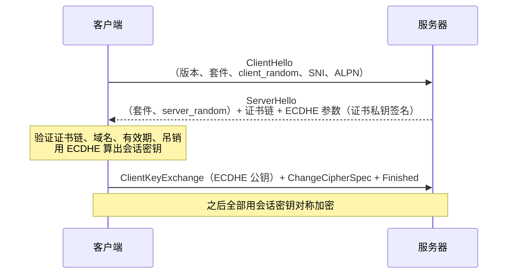
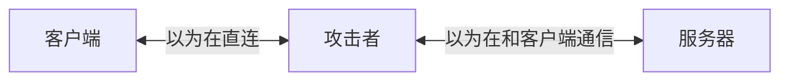
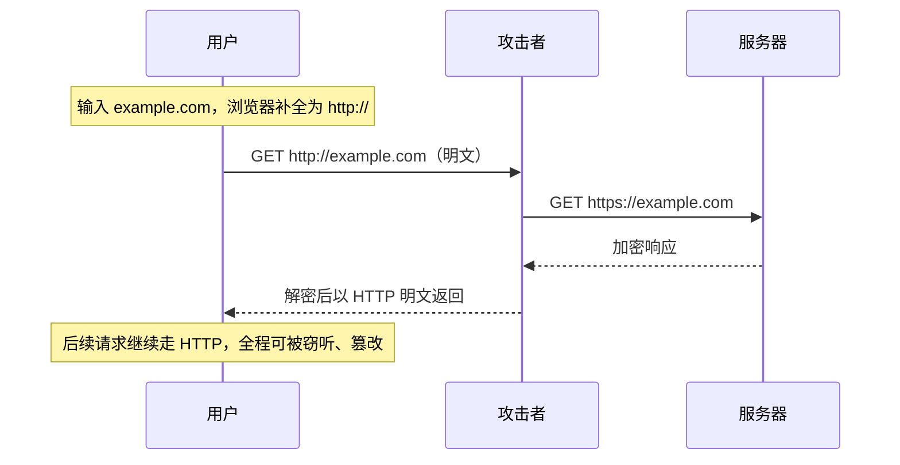

# 安全 · 05 传输层：HTTPS、中间人、网络劫持与 SRI

> 覆盖题号：**7、18、20、14**
> 对应原题：《HTTPS 有哪些优点》《网络劫持》《中间人攻击》《静态资源完整性校验》

---

## 目录

- [1. HTTPS](#1-https)
- [2. 中间人攻击](#2-中间人攻击)
- [3. 网络劫持](#3-网络劫持)
- [4. SRI 静态资源完整性校验](#4-sri-静态资源完整性校验)
- [5. 前端在传输层能做什么（一张总结表）](#5-前端在传输层能做什么一张总结表)
- [6. 常见坑](#6-常见坑)
- [7. 答题模板](#7-答题模板)
- [8. 追问表](#8-追问表)
- [9. 速记卡](#9-速记卡)

---

## 1. HTTPS

### 1.1 一句话结论

HTTPS = **HTTP + TLS**。TLS 提供三件事：**机密性（对称加密）、完整性（AEAD）、身份认证（证书链）**。

只加密不够：攻击者可以和客户端各建一条加密通道，再转发给服务器，双方都以为在直连，这就是中间人攻击（第 2 节）。

### 1.2 三件事分别解决什么

| 能力 | 手段 | 挡住的攻击 |
|---|---|---|
| 机密性 | 对称加密：AES-GCM / ChaCha20-Poly1305 | 窃听：抓包读取密码、Cookie |
| 完整性 | AEAD（GCM 自带 MAC） | 篡改：注入广告/JS、修改转账金额 |
| 身份认证 | X.509 证书 + CA 签名；握手参数用证书私钥签名 | 冒充：假服务器、DNS/ARP 劫持 |

### 1.3 TLS 握手（简化版）



非对称部分只做两件事：证书签名完成身份认证，ECDHE 协商会话密钥；HTTP 数据全程对称加密。

| | 非对称（RSA/ECDSA 签名、ECDHE） | 对称（AES-GCM / ChaCha20-Poly1305） |
|---|---|---|
| 速度 | 慢 3~4 个数量级 | 快，AES-NI 下可达 GB/s 级 |
| 用途 | 身份认证、密钥协商 | 数据传输 |
| 密钥 | 公钥/私钥、临时密钥对 | 会话密钥（双方相同） |

### 1.4 TLS 1.2 vs 1.3

| | TLS 1.2 | TLS 1.3 |
|---|---|---|
| 握手 RTT | 完整握手 2-RTT | 完整握手 1-RTT；PSK 恢复 1-RTT，带 early data 才 0-RTT |
| 加密套件 | 含 CBC / RC4 / SHA-1 等历史算法 | 只保留 AEAD + HKDF-SHA256/384 |
| 前向保密 | 可选：ECDHE 有，RSA 密钥交换没有 | 完整握手强制 (EC)DHE；0-RTT / 纯 PSK 恢复例外 |
| 已移除 | — | 静态 RSA 密钥交换、压缩、重协商 |

**前向保密**：服务器长期私钥将来泄露，也解不开之前录下的流量。会话密钥来自 ECDHE 临时密钥对，用完即弃；ECDHE 套件下证书私钥只参与签名。

### 1.5 证书体系

```
根 CA（Root CA，预装在系统/浏览器信任库）
  └─ 中间 CA（Intermediate CA，必须随服务器证书一起下发）
       └─ 服务器证书（Leaf，绑定域名）
```

| 检查项 | 失败结果 |
|---|---|
| 证书链逐级验签到受信任根 | `NET::ERR_CERT_AUTHORITY_INVALID` |
| 域名匹配（SAN） | `NET::ERR_CERT_COMMON_NAME_INVALID` |
| 有效期 | `NET::ERR_CERT_DATE_INVALID` |
| 用途 EKU 含 `serverAuth` | 证书不能用于服务器认证 |
| 吊销状态 CRL / OCSP | 可能软失败；用 OCSP Stapling 降低延迟 |

Chrome 58 起只看 SAN，不再匹配 CN；OpenSSL / Node 在证书完全没有 SAN 时仍会回退到 CN。

| 类型 | 验证内容 | 浏览器显示 |
|---|---|---|
| DV（域名验证） | 域名控制权 | 普通锁标 |
| OV（组织验证） | 企业真实存在 | 普通锁标，详情显示组织 |
| EV（扩展验证） | 更严格审核 | 2019 年后 Chrome 取消绿色地址栏，地址栏与 DV 相同 |

**证书透明度（CT）**：公开 CA 签发的证书需提交到公开日志；SCT 随证书或握手提供，用于发现错误签发。

### 1.6 HTTPS 的优点（不止安全）

| 类别 | 优点 |
|---|---|
| 安全 | 防窃听、防篡改、防冒充；防运营商 HTTP 内容注入 |
| 性能 | 浏览器只在 HTTPS 下启用 HTTP/2；Brotli 只在 HTTPS 下协商；TLS 1.3 为 1-RTT（early data 为 0-RTT） |
| 能力 | Secure Context：Service Worker、Geolocation、Clipboard、`getUserMedia`、`crypto.subtle`、WebAuthn、Notifications |
| SEO / 商业 / 合规 | Google 排名使用 HTTPS 作为信号；HTTP 站点标「不安全」；支付、小程序、App 上架要求 HTTPS；等保、PCI-DSS、GDPR |

`localhost` 也被视为 Secure Context，所以本地开发可以注册 Service Worker；线上必须是 HTTPS。

### 1.7 混合内容（Mixed Content）

| 类型 | 例子 | Chrome 行为 |
|---|---|---|
| 主动混合内容 | `<script>`、`<link rel=stylesheet>`、`<iframe>`、`fetch`、XHR | 直接阻止，必须改用 HTTPS |
| 被动混合内容 | ``、`<audio>`、`<video>` | 自动升级为 HTTPS；升级后失败则阻止 |

```http
# 让浏览器在发起请求前把页面内的 http:// 升级为 https://
Content-Security-Policy: upgrade-insecure-requests
```

```html
<!-- 资源直接写 https:// -->
<script src="https://cdn.example.com/lib.js"></script>
```

`http://localhost` 属于潜在可信来源，不触发混合内容的拦截或升级；验证混合内容行为要用普通域名。上线前还要扫描后端富文本、配置里的 `http://`：升级后目标域不支持 HTTPS 会直接加载失败。

### 1.8 HTTPS 的性能代价与优化

| 代价 | 优化 |
|---|---|
| 握手增加 1~2 RTT | TLS 1.3、会话复用、`preconnect` |
| 加解密消耗 CPU | AES-NI 下开销小；ECDSA 证书签名更快、证书更小 |
| 证书链验证与吊销查询 | 精简证书链、OCSP Stapling |
| 首次连接无缓存 | HSTS preload（见 2.4）、`preconnect` |

现代硬件上 TLS 计算通常不是瓶颈，主要成本是握手 RTT、证书链验证和首次连接无缓存。

---

## 2. 中间人攻击

### 2.1 一句话结论

中间人攻击（MITM）：攻击者位于通信双方之间，可窃听、篡改、重放，而双方以为在直接通信。



### 2.2 典型 MITM 场景

| 场景 | 原理 |
|---|---|
| 公共 Wi-Fi 热点 | 攻击者架同名热点，用户连上后所有流量都经过攻击者 |
| ARP 欺骗 | 在局域网伪造 ARP 响应，把网关 IP 映射到攻击者 MAC |
| DNS 欺骗 / 投毒 | 篡改 DNS 响应，把 `bank.com` 解析到攻击者 IP |
| 恶意代理 / 企业网关 | SSL 检查代理用自己的根证书重签 HTTPS，客户端需信任该根证书 |
| BGP 劫持 | 在运营商/国家层面劫持路由，把流量引到错误位置 |

### 2.3 SSL 剥离（降级攻击）



攻击者不需要破解 TLS，只需让用户始终走 HTTP。首次访问使用 `http://` 时存在这个窗口；攻击者以明文返回页面后，页面内的 HTTP 请求继续暴露。

### 2.4 HSTS：专门对付 SSL 剥离

```http
Strict-Transport-Security: max-age=31536000; includeSubDomains; preload
```

| 指令 | 作用 |
|---|---|
| `max-age=31536000` | 浏览器记住「这个域名只走 HTTPS」，有效期一年 |
| `includeSubDomains` | 所有子域同样强制 |
| `preload` | 申请进入浏览器内置列表，首次访问也强制 HTTPS |

- 只在 HTTPS 响应里生效；HTTP 响应中的 STS 头会被浏览器忽略。
- 生效后浏览器在本地把 `http://` 改写为 `https://`（Chrome 内部表现为 307 Internal Redirect），明文请求不会发出。
- 首次访问还没收到 HSTS 头，仍可能被剥离；`preload` 解决首次访问窗口。
- 提交 preload 需满足：有效证书、同 host 的 HTTP 全部跳转 HTTPS、所有子域支持 HTTPS、`max-age ≥ 31536000`、`includeSubDomains`、`preload`。
- preload 撤销无法即时生效，要等浏览器版本更新；`includeSubDomains` 下有子域不支持 HTTPS 会直接不可访问。

上线顺序：先用较短的 `max-age` 验证，再逐步加长，最后加 `includeSubDomains` 和 `preload`。

### 2.5 其他防御

| 手段 | 说明 |
|---|---|
| 全站 HTTPS | 基础 |
| HSTS | 防降级 |
| 证书固定（Pinning） | 只信任特定证书/公钥；HPKP 已废弃，移动端 App 仍在使用 |
| 证书透明度（CT）监控 | 监控有没有人为自己的域名签发证书 |
| 不忽略证书警告 | 用户点「继续访问」就放弃了证书认证 |
| OCSP Stapling | 服务器代为提供吊销状态，避免客户端查 OCSP 时被劫持 |

### 2.6 HTTPS 不能防住的 MITM

| 例外 | 说明 |
|---|---|
| 客户端信任了攻击者的根证书 | 企业 SSL 检查代理、Charles/Fiddler 抓包就是这样工作的 |
| CA 被攻陷或错误签发 | CT 日志能在事后发现错误签发；已记录到日志的证书不会被 CT 单独拦截 |
| 客户端本身被控 | 设备被安装恶意根证书或恶意软件 |

HTTPS 只保证传输层；SRI、CSP、端到端加密在特定场景下仍有价值。

---

## 3. 网络劫持

### 3.1 一句话结论

网络劫持：攻击者在传输路径上篡改流量，通常是运营商、恶意路由器或恶意软件发起的大规模 MITM。

### 3.2 四种常见形式

| 形式 | 表现 | 原理 |
|---|---|---|
| DNS 劫持 | 访问 A 站跳到 B 站，或弹出运营商广告页 | 篡改 DNS 响应，返回错误 IP |
| HTTP 内容注入 | 页面多出浮动广告或 `<script>` | 运营商在明文响应体里插入内容 |
| HTTP 重定向劫持 | 第一次访问被跳到导航站 | 篡改 302 响应 |
| 流量劫持（弹窗/跳转） | 手机上打开网页自动跳应用商店 | 注入 JS 或改响应 |

内容注入与重定向劫持只影响明文 HTTP，全站 HTTPS + HSTS 后这两类失效；DNS 劫持仍可把域名解析到错误 IP，但 HTTPS 通常会因证书不匹配而连接失败。

### 3.3 防御手段与责任划分

| 手段 | 谁来做 | 效果 |
|---|---|---|
| 全站 HTTPS | 运维 | 根治，明文不可改 |
| HSTS + preload | 运维 | 防降级 |
| HTTP 301 跳 HTTPS | 运维 | 减少明文窗口 |
| CSP `upgrade-insecure-requests` | 前端 | 防子资源被降级 |
| SRI | 前端 | 静态资源被篡改时拒绝加载 |
| 关键接口加签名 | 前后端 | 即使被改也能发现 |
| 前端异常监控 | 前端 | 发现页面里多出不认识的脚本 |

### 3.4 非预期脚本检测

```js
const knownScripts = new Set([
  new URL('/app.js', location.origin).href,
  new URL('/vendor.js', location.origin).href,
  'https://cdn.example.com/analytics.js',
])

new MutationObserver((mutations) => {
  for (const m of mutations) {
    for (const node of m.addedNodes) {
      if (node.tagName !== 'SCRIPT' || knownScripts.has(node.src)) continue
      navigator.sendBeacon?.(
        '/api/unexpected-script',
        JSON.stringify({
          src: node.src,
          inline: !node.src,
          html: node.src ? '' : node.textContent.slice(0, 200),
        }),
      )
    }
  }
}).observe(document.documentElement, { childList: true, subtree: true })
```

只能发现注册之后插入的脚本；内联脚本会一律上报，需要按业务白名单过滤。发现不等于阻止，拦截依赖 HTTPS + CSP。

---

## 4. SRI 静态资源完整性校验

### 4.1 一句话结论

SRI（Subresource Integrity）：给 `<script>` / `<link>` 加内容哈希，浏览器下载后自己算一遍，不一致就拒绝执行。防的是资源在传输或存储环节被篡改：CDN 被攻陷、DNS 劫持到假 CDN、运营商注入。

### 4.2 基本用法

```html
<script
  src="https://cdn.example.com/lib.js"
  integrity="sha384-oqVuAfXRKap7fdgcCY5uykM6+R9GqQ8K/uxy9rx7HNQlGYl1kPzQho1wx4JwY8wC"
  crossorigin="anonymous"
></script>

<link
  rel="stylesheet"
  href="https://cdn.example.com/lib.css"
  integrity="sha384-abc123..."
  crossorigin="anonymous"
>
```

### 4.3 三个细节

**`crossorigin` 不能省**

- 跨域资源必须加 `crossorigin="anonymous"`，CDN 必须返回 `Access-Control-Allow-Origin`；否则浏览器拿不到响应体做哈希，资源加载失败。
- 同源资源不需要 `crossorigin`。

**可以写多个哈希**

- `integrity="sha256-xxx sha384-yyy sha512-zzz"`，浏览器选择自己支持的最强算法，便于未来算法迁移。

**算法选择**

- 推荐 `sha384`；`sha256` 可用；`sha512` 更长。
- `md5` / `sha1` 不能用于 SRI。

### 4.4 生成 hash

```bash
cat lib.js | openssl dgst -sha384 -binary | openssl base64 -A
```

```js
import { createHash } from 'crypto'
import { readFileSync } from 'fs'

function sri(filePath, algorithm = 'sha384') {
  const buf = readFileSync(filePath)
  const hash = createHash(algorithm).update(buf).digest('base64')
  return `${algorithm}-${hash}`
}
```

构建时用 `webpack-subresource-integrity` 等插件自动注入，不手动维护。

### 4.5 SRI 的四个局限

| 局限 | 说明 | 替代 |
|---|---|---|
| 只能校验静态 `<script>` / `<link>` | 动态 `import()`、`fetch` 加载的 JS 不受保护 | 自行校验内容哈希 |
| JSONP 无法使用 SRI | 内容随 callback 参数变化，hash 不固定 | 用 CORS 替代 JSONP |
| CSS 内部的 `url()` 不受保护 | `@import`、`background: url()` 加载的资源不走 SRI | 靠 CSP + HTTPS |
| 每次发版都要更新 hash | 内容变则 hash 变，需要重新构建注入 | 用构建插件自动化 |

### 4.6 SRI 的适用场景

| 场景 | 价值 |
|---|---|
| 从公共 CDN（unpkg、jsdelivr、cdnjs）加载库 | 高：无法控制该 CDN |
| 从自己完全可控的 CDN 加载 | 中：防 CDN 被攻陷和中间人 |
| 内网 / 离线部署 | 低 |
| 已全站 HTTPS + HSTS + CSP | 低：多层防御下边际收益小 |

从公共 CDN 加载第三方脚本时应使用 SRI；自有 CDN 且已全站 HTTPS + HSTS 时边际收益小，但构建插件成本低。

---

## 5. 前端在传输层能做什么（一张总结表）

传输层的主体责任在运维/后端；前端可落地的措施如下。

| 手段 | 前端能做的 | 局限 |
|---|---|---|
| 混合内容 | 检查代码/数据里有没有 `http://`，资源统一用 `https://` | — |
| CSP `upgrade-insecure-requests` | 配合后端下发 | 目标域不支持 HTTPS 时会加载失败 |
| SRI | 给第三方脚本加 `integrity` + `crossorigin`，构建时生成 | 只管静态资源 |
| `preconnect` + HSTS | 向运维提需求 | 需要运维配合 |
| `Referrer-Policy` | 防止 URL 里的敏感信息随 Referer 泄露 | — |
| 异常脚本监控 | `MutationObserver` 检测非预期脚本注入 | 只能发现，不能阻止 |
| 关键请求加签名 | 配合后端做请求签名 | 密钥不能放前端 |
| 敏感页面 `Cache-Control: no-store` | 防后退键看到上一个用户的页面 | 需要后端配合 |

---

## 6. 常见坑

| # | 坑 | 纠正 |
|---|---|---|
| 1 | 只在登录页用 HTTPS | 必须全站，否则会话 Cookie 会在 HTTP 请求里明文暴露 |
| 2 | 忽略证书警告继续访问 | 等于放弃证书认证，中间人可以接管连接 |
| 3 | 富文本/配置里硬编码 `http://` 图片 | 加 `upgrade-insecure-requests` 后目标域不支持 HTTPS 会加载失败，上线前要扫描数据 |
| 4 | HSTS 头写在 HTTP 响应里 | 会被忽略，只能在 HTTPS 响应里发 |
| 5 | 首次上线直接 `preload` + `includeSubDomains` | 撤销慢；子域没有 HTTPS 会直接不可访问 |

---

## 7. 答题模板

### 7.1 HTTPS

- HTTPS = HTTP + TLS：机密性靠对称加密，完整性靠 AEAD，身份认证靠证书链。
- 非对称只用于证书认证与 ECDHE 协商，数据全程对称加密；非对称慢 3~4 个数量级。
- 证书验证：SAN、有效期、EKU、逐级验签、吊销、CT。
- 非安全刚需：HTTP/2、Brotli、Secure Context（Service Worker、定位、摄像头、`crypto.subtle`）、SEO 与合规。

### 7.2 中间人与网络劫持

- MITM：攻击者插入双方之间，可窃听、篡改、重放；场景有公共 Wi-Fi、ARP/DNS 欺骗、恶意代理、BGP 劫持。
- SSL 剥离：攻击者不破解 TLS，只让用户全程走 HTTP；首次 `http://` 访问是窗口。
- 防御：全站 HTTPS + HSTS + preload + 不忽略证书警告 + CT 监控；网络劫持再加 CSP `upgrade-insecure-requests`、SRI、异常脚本监控。

### 7.3 SRI

- 给 `<script>` / `<link>` 加 `integrity` 哈希，浏览器重算，不一致就拒绝执行。
- 防 CDN 被攻陷、DNS 劫持到假 CDN、运营商注入。
- 跨域必须加 `crossorigin` 且 CDN 返回 ACAO；hash 必须构建时自动生成。
- 局限：只管静态 `script` / `link`；动态 `import()`、JSONP、CSS `url()` 不受保护。

---

## 8. 追问表

| 追问 | 要点 |
|---|---|
| 为什么用混合加密？ | 对称密钥无法安全分发；非对称慢 3~4 个数量级，RSA-2048 单块最多 245 字节（PKCS#1 v1.5） |
| 为什么 ECDHE 参数要签名？ | 证明服务器持有证书私钥；没有私钥就签不出可验证的参数 |
| 证书私钥用来加密数据吗？ | ECDHE 套件下只用于签名；RSA 密钥交换套件还用于解密 pre-master，TLS 1.3 已删除 |
| 证书验证哪几步？ | SAN → 有效期 → EKU → 逐级验签 → 吊销 → CT |
| HSTS 首次访问为什么脆弱？ | 还没收到 HSTS 头；需要 preload 覆盖首次访问 |
| HSTS preload 有什么风险？ | 撤销慢；`includeSubDomains` 下子域没有 HTTPS 会不可访问 |
| HSTS 能写在 HTTP 响应里吗？ | 不能，会被忽略 |
| SRI 为什么必须加 `crossorigin`？ | 跨域读取响应体需要 CORS 授权；CDN 必须返回 ACAO |
| SRI 能保护动态 `import()` 吗？ | 不能，只保护静态 `script` / `link` |
| 抓包工具为什么能看到 HTTPS？ | 客户端安装了它的根证书，它用该根证书重签了站点证书 |

---

## 9. 速记卡

```
【HTTPS】
HTTP + TLS；机密性（对称）/ 完整性（AEAD）/ 身份认证（证书链）
非对称只做认证与 ECDHE 协商；数据对称加密（非对称慢 3~4 个数量级）

【TLS】
1.2 为 2-RTT；1.3 为 1-RTT（PSK 恢复 1-RTT，early data 才 0-RTT）
1.3 只留 AEAD；完整握手强制 (EC)DHE；删除静态 RSA / CBC / RC4 / SHA-1
前向保密：ECDHE 临时密钥；长期私钥泄露不影响历史流量

【证书】
根 CA（预装）→ 中间 CA（必须下发）→ 服务器证书
验证：SAN / 有效期 / EKU / 逐级验签 / 吊销 / CT
Chrome 58+ 忽略 CN；无 SAN 时 Node/OpenSSL 回退 CN

【HSTS】
Strict-Transport-Security: max-age=31536000; includeSubDomains; preload
只在 HTTPS 响应生效；防 SSL 剥离；首次访问靠 preload
preload 撤销慢；includeSubDomains 下子域无 HTTPS 会不可访问

【混合内容】
主动（script/link/iframe/fetch）→ 阻止；被动（img/audio/video）→ 自动升级，失败阻止
CSP: upgrade-insecure-requests；扫描数据中的 http://

【SRI】
integrity="sha384-..." + crossorigin="anonymous"；CDN 必须返回 ACAO
只管静态 script/link；动态 import / JSONP / CSS url() 不受保护
hash 构建时自动生成
```
