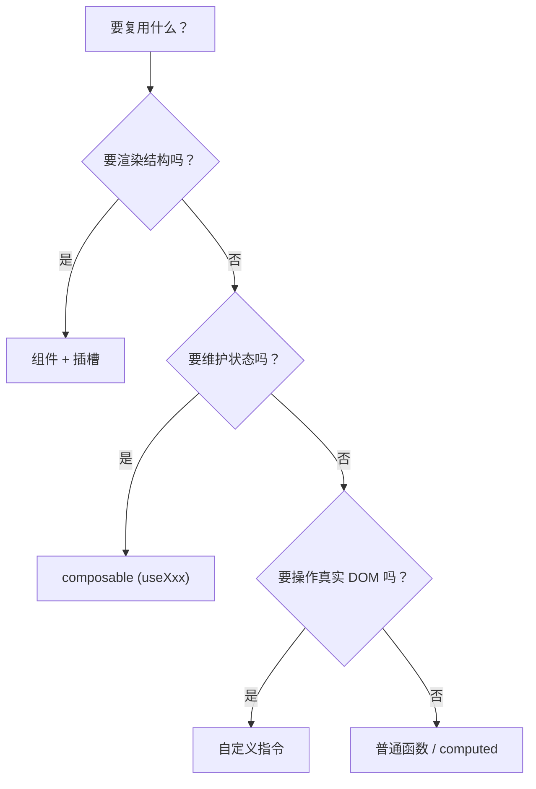
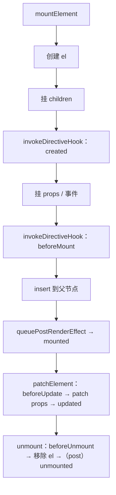

# Vue 自定义指令详解与面试回答

> 适用版本：Vue 2.x / Vue 3.x（含 `<script setup>`）

---

## 目录

1. [一句话回答](#1-一句话回答)
2. [什么时候该用自定义指令](#2-什么时候该用自定义指令)
3. [注册方式与生命周期钩子](#3-注册方式与生命周期钩子)
4. [binding 对象与动态参数](#4-binding-对象与动态参数)
5. [运行时原理](#5-运行时原理)
6. [手写 6 个高频指令](#6-手写-6-个高频指令)
7. [常见坑](#7-常见坑)
8. [面试怎么答](#8-面试怎么答)
9. [自测清单](#9-自测清单)

---

## 1. 一句话回答

**自定义指令是 Vue 提供的「可复用的底层 DOM 操作」机制**：它没有模板、没有独立实例，只拿到一个真实 DOM 元素和一组参数，在元素的生命周期节点上执行逻辑。

官方定位是「**当需要直接操作 DOM 时使用**」——也就是那些**用数据驱动表达不自然、但又要复用**的场景。

内置的 `v-model`、`v-show`、`v-if`、`v-for`、`v-once` 都是指令，自定义指令就是这套机制的开放版本。

---

## 2. 什么时候该用自定义指令

### 2.1 三条判断标准

1. **必须直接操作真实 DOM**：聚焦、选中、拖拽、Canvas、`IntersectionObserver`、测量尺寸、操作 `<video>`。
2. **和某个元素强绑定**：逻辑天然依附于一个 DOM 元素，而不是一组状态。
3. **需要跨组件复用**：同样的 DOM 操作在多个地方重复出现。

三条都满足 → 用指令。缺一条 → 大概率应该用**组件**或 **composable**。

### 2.2 典型场景

| 场景 | 指令 | 说明 |
| --- | --- | --- |
| 自动聚焦 | `v-focus` | 弹窗打开后输入框聚焦 |
| 防抖 / 节流点击 | `v-debounce` / `v-throttle` | 不用每次写 `debounce(fn)` |
| 图片懒加载 | `v-lazy` | `IntersectionObserver` + 替换 `src` |
| 权限控制 | `v-permission` | 无权限直接移除 DOM |
| 一键复制 | `v-copy` | `navigator.clipboard` |
| 点击外部关闭 | `v-click-outside` | 下拉框、弹窗 |
| 拖拽 | `v-draggable` | 对话框拖拽、排序 |
| 水印 | `v-watermark` | Canvas 生成背景图 |
| 长按 | `v-longpress` | 移动端 |
| 埋点 | `v-track` | 点击上报 |
| 输入限制 | `v-number` / `v-limit` | 输入框只允许数字 |
| 无限滚动 | `v-infinite-scroll` | 滚动到底部加载 |

### 2.3 明确不该用的场景

| 不适用 | 原因 | 应该用什么 |
| --- | --- | --- |
| 需要模板结构 | 指令没有模板 | 组件 |
| 需要维护内部状态 | 指令没有响应式状态容器 | 组件 / composable |
| 只是数据转换 | 不需要碰 DOM | computed / 普通函数 |
| 只是封装请求逻辑 | 不需要碰 DOM | composable（`useXxx`） |
| 需要跨元素协同 | 指令只知道自己那个 `el` | 组件 + provide / inject |

### 2.4 几种复用手段怎么选

| 手段 | 复用什么 | 有模板 | 有状态 | 典型场景 |
| --- | --- | --- | --- | --- |
| props / emits | 数据与事件 | — | — | 父子通信 |
| **插槽 slot** | **结构（UI 片段）** | ✅ | ❌ | 布局组件、Table 自定义列 |
| **自定义指令** | **DOM 行为** | ❌ | ❌ | 聚焦、懒加载、拖拽、权限 |
| composable（`useXxx`） | 逻辑（响应式状态） | ❌ | ✅ | 请求、表单校验、分页、主题 |
| mixin | 选项合并 | ✅ | ✅ | 已不推荐（来源不清晰、命名冲突） |
| 组件 | UI + 逻辑 | ✅ | ✅ | 一切需要独立封装的东西 |



---

## 3. 注册方式与生命周期钩子

### 3.1 注册

```js
// Vue 3 全局
const app = createApp(App)
app.directive('focus', {
  mounted(el) {
    el.focus()
  },
})
```

```js
// Vue 3 局部（选项式）
export default {
  directives: {
    focus: {
      mounted(el) {
        el.focus()
      },
    },
  },
}
```

`<script setup>` 里，**以 `v` 开头的驼峰变量**会自动注册成局部指令：

```vue
<script setup>
const vFocus = {
  mounted: (el) => el.focus(),
}
</script>

<template>
  <input v-focus />
</template>
```

```js
// Vue 2 全局
Vue.directive('focus', {
  inserted(el) {
    el.focus()
  },
})
```

### 3.2 钩子对照表

| 时机 | Vue 3 | Vue 2 |
| --- | --- | --- |
| 元素属性 / 事件应用前（子节点已挂载） | `created` | — |
| 挂载到父节点前 | `beforeMount` | `bind` |
| 挂载到父节点后 | `mounted` | `inserted` |
| 所在组件更新前 | `beforeUpdate` | `update` |
| 所在组件及子节点更新后 | `updated` | `componentUpdated` |
| 卸载前 | `beforeUnmount` | — |
| 卸载后 | `unmounted` | `unbind` |

参数签名：Vue 3 每个钩子都是 `(el, binding, vnode, prevVNode)`，Vue 2 是 `(el, binding, vnode)`，只有 `update` / `componentUpdated` 多一个 `oldVnode`。`prevVNode` 也只在 `beforeUpdate` / `updated` 时指向上一个 vnode，其余时机为 `null`。

> Vue 3 用 `mounted` / `updated` / `unmounted` 对齐组件生命周期；Vue 2 的 `update` / `componentUpdated` 分别对应 `beforeUpdate` / `updated`，`bind` / `inserted` / `unbind` 对应 `beforeMount` / `mounted` / `unmounted`。

### 3.3 简写形式

只关心「挂载」和「更新」两个时机时，可以直接传函数：

```js
app.directive('color', (el, binding) => {
  // 等价于 { mounted, updated }
  el.style.color = binding.value
})
```

---

## 4. binding 对象与动态参数

```vue
<div v-demo:foo.bar.baz="message" />
```

```js
{
  value: 'hello',                        // 绑定值（表达式求值结果）
  oldValue: 'old',                       // 上一次的值，仅 beforeUpdate / updated 可用
  arg: 'foo',                            // 参数：冒号后面的部分
  modifiers: { bar: true, baz: true },   // 修饰符：点后面的部分
  instance: componentInstance,           // 使用该指令的组件实例
  dir: directiveDefinition,              // 指令定义对象
}
```

| 属性 | 来自 | 用途 |
| --- | --- | --- |
| `value` | `="expr"` | 主参数，最常用 |
| `oldValue` | 上次的 `value` | 做 diff，只在更新阶段有意义 |
| `arg` | `:foo` | 静态 / 动态参数，区分行为分支 |
| `modifiers` | `.bar` | 开关式配置，比多传一个对象更简洁 |
| `instance` | 组件实例 | 访问 `$el`、`$props` 或 setup 暴露的属性 |
| `dir` | 指令对象 | 指令级共享数据（多数场景不建议用，见 4.2） |

### 4.1 动态参数

参数可以是表达式，随数据变化：

```vue
<div v-demo:[direction]="value" />
```

`binding.arg` 会随 `direction` 变化。注意动态参数必须是**合法的 attribute 名**（不能有空格、引号等）。

> 别混淆：`v-demo:[direction]` 变的是**参数**，指令名 `demo` 本身必须在编译期确定。

### 4.2 钩子之间共享状态

`mounted` 里注册的监听 / 观察器，`unmounted` 里要拿到同一个引用来卸载。存哪里差别很大：

```js
// ✅ 推荐：每个元素独立一份，互不干扰
const vResize = {
  mounted(el, binding) {
    el.__handler = () => binding.value(el.offsetWidth)
    window.addEventListener('resize', el.__handler)
  },
  unmounted(el) {
    window.removeEventListener('resize', el.__handler)
    delete el.__handler
  },
}
```

```js
// ⚠️ 谨慎：binding.dir 是被所有使用者共享的同一个指令定义对象
const vResize = {
  mounted(el, binding) {
    binding.dir.handler = () => binding.value(el.offsetWidth) // 第二个元素会覆盖第一个
    window.addEventListener('resize', binding.dir.handler)
  },
}
// 多个元素同时使用时，只有最后一个 handler 生效，前面的卸载不掉 → 泄漏
```

| 存储位置 | 作用域 | 适合存 | 风险 |
| --- | --- | --- | --- |
| `el.__xxx` | 每个元素独立 | DOM 句柄、observer、定时器 id | 要记得 `delete`，避免闭包长期占用 |
| `binding.dir.xxx` | 指令级共享 | 全局配置、缓存池 | 多元素互相覆盖，导致泄漏 |
| 模块级变量 | 全局 | 单例（极少用） | 多实例互相污染 |

> 多元素下安全工作的规则：**状态挂在 `el` 上，一个元素一份，`unmounted` 里用同一个引用清理。**

---

## 5. 运行时原理

### 5.1 编译阶段

```vue
<input v-focus />
```

```js
// 编译产物（省略 import），数组元素即 [指令对象, value, arg, modifiers]
const _directive_focus = _resolveDirective('focus')
_withDirectives((_openBlock(), _createElementBlock('input', null, null, 512)), [[_directive_focus]])
```

`withDirectives` 把指令信息挂到 vnode 的 `dirs` 属性上：

```js
export function withDirectives(vnode, directives) {
  const instance = getComponentPublicInstance(currentRenderingInstance)
  const dirs = vnode.dirs || (vnode.dirs = [])
  for (let i = 0; i < directives.length; i++) {
    let [dir, value, arg, modifiers = EMPTY_OBJ] = directives[i]
    if (!dir) continue
    if (isFunction(dir)) dir = { mounted: dir, updated: dir } // 简写形式
    dirs.push({ dir, instance, value, oldValue: void 0, arg, modifiers })
  }
  return vnode
}
```

> 指令名在编译期就被固化成字面量（`resolveDirective("focus")` 或 `<script setup>` 下的 `$setup.vFocus`），运行时拼接出的名字无法通过模板表达。

### 5.2 渲染阶段的调用顺序



核心函数：

```js
function invokeDirectiveHook(vnode, prevVNode, instance, name) {
  const bindings = vnode.dirs
  const oldBindings = prevVNode && prevVNode.dirs
  for (let i = 0; i < bindings.length; i++) {
    const binding = bindings[i]
    // 更新时把上一次的值带过来
    if (oldBindings) {
      binding.oldValue = oldBindings[i].value
    }
    const hook = binding.dir[name]
    if (hook) {
      // 暂停依赖收集，避免指令里访问响应式数据造成意外追踪
      pauseTracking()
      callWithAsyncErrorHandling(hook, instance, ErrorCodes.DIRECTIVE, [
        vnode.el,
        binding,
        vnode,
        prevVNode,
      ])
      resetTracking()
    }
  }
}
```

### 5.3 四个关键点

1. 钩子是在 **patch 元素时**调用的，所以 `el` 是**真实 DOM**，不是 vnode。
2. `mounted` / `updated` 走 `queuePostRenderEffect`，在**整棵组件树 patch 完之后**执行；`mounted` 时元素已在容器里，容器也已在 document 中才能量到 `offsetWidth`、`getBoundingClientRect`。
3. 执行钩子前后有 `pauseTracking` / `resetTracking`：**指令里的数据访问不会被收集为渲染依赖**，防止意外触发重渲染。
4. 元素上的 `mounted` 一定在它自己的 `beforeMount` 之后；无 `<Transition>` 时 `unmounted` 在元素移除之后执行，有过渡时 `unmounted` 会先于真正的 DOM 移除。

### 5.4 Vue 2 的差异

Vue 2 在 `patch` 的 `create` / `insert` / `update` / `destroy` 阶段分别调用 `bind` / `inserted` / `update` + `componentUpdated` / `unbind`。除 `created` 与 `beforeUnmount` 外，其余五个与 Vue 3 一一对应。

---

## 6. 手写 6 个高频指令

### 6.1 v-focus：自动聚焦

```js
const vFocus = {
  mounted(el) {
    // transition / 异步插入时，el 可能还不在 document 里
    if (document.contains(el)) el.focus()
    else requestAnimationFrame(() => el.focus())
  },
}
```

### 6.2 v-debounce：点击防抖

```js
const vDebounce = {
  mounted(el, binding) {
    let timer = null
    const delay = binding.arg ? Number(binding.arg) : 300

    el.__handler = (...args) => {
      clearTimeout(timer)
      timer = setTimeout(() => binding.value(...args), delay)
    }
    el.addEventListener('click', el.__handler)
    el.__timer = () => timer
  },
  unmounted(el) {
    el.removeEventListener('click', el.__handler)
    clearTimeout(el.__timer?.())
    delete el.__handler
    delete el.__timer
  },
}
```

```vue
<el-button v-debounce:500="submit">提交</el-button>
```

### 6.3 v-lazy：图片懒加载

```js
const vLazy = {
  mounted(el, binding) {
    const src = binding.value
    const observer = new IntersectionObserver(
      (entries) => {
        entries.forEach((entry) => {
          if (!entry.isIntersecting) return
          el.src = src
          observer.unobserve(el) // 加载过就不再观察
        })
      },
      { rootMargin: '200px' }, // 提前 200px 预加载
    )
    observer.observe(el)
    el.__observer = observer
  },
  updated(el, binding) {
    if (binding.value !== binding.oldValue) el.src = binding.value
  },
  unmounted(el) {
    el.__observer?.disconnect()
    delete el.__observer
  },
}
```

> 生产环境还要处理**加载失败的占位图**、**已加载 URL 的缓存（避免重复请求和闪烁）**、**SSR 兜底**。

### 6.4 v-permission：权限控制

```js
const vPermission = {
  mounted(el, binding) {
    const { value } = binding // ['user:add'] 或 'user:add'
    const codes = Array.isArray(value) ? value : [value]
    const has = codes.some((code) => store.state.permissions.includes(code))
    if (!has) {
      el.parentNode?.removeChild(el)
      // 也可以 el.style.display = 'none'，但要接受它仍留在 DOM 里
    }
  },
}
```

> 坑：用 `display: none` 隐藏后元素仍在 DOM 里，`v-show` 来回切换不会重新触发 `mounted`，权限变化后不会重新判断。更推荐把权限判断写成函数（`hasPerm('x')`）+ `v-if`，指令只作为语法糖。

### 6.5 v-click-outside：点击外部关闭

```js
const vClickOutside = {
  mounted(el, binding) {
    el.__clickOutside = (e) => {
      if (!el.contains(e.target)) binding.value(e)
    }
    // 用捕获阶段，避免被内部 stopPropagation 拦截
    document.addEventListener('click', el.__clickOutside, true)
  },
  unmounted(el) {
    document.removeEventListener('click', el.__clickOutside, true)
    delete el.__clickOutside
  },
}
```

> 坑：绑在 `document` 上一定要在 `unmounted` 移除，否则内存泄漏；`capture: true` 更稳。

### 6.6 v-draggable：对话框拖拽

```js
const vDraggable = {
  mounted(el, binding) {
    const handle = binding.value?.handle ? el.querySelector(binding.value.handle) : el
    let startX = 0
    let startY = 0
    let originLeft = 0
    let originTop = 0

    const onMouseDown = (e) => {
      startX = e.clientX
      startY = e.clientY
      const rect = el.getBoundingClientRect()
      originLeft = rect.left
      originTop = rect.top
      document.addEventListener('mousemove', onMouseMove)
      document.addEventListener('mouseup', onMouseUp)
    }

    const onMouseMove = (e) => {
      el.style.position = 'fixed'
      el.style.margin = '0'
      el.style.left = `${originLeft + e.clientX - startX}px`
      el.style.top = `${originTop + e.clientY - startY}px`
    }

    const onMouseUp = () => {
      document.removeEventListener('mousemove', onMouseMove)
      document.removeEventListener('mouseup', onMouseUp)
    }

    handle.addEventListener('mousedown', onMouseDown)
    el.__draggableCleanup = () => {
      handle.removeEventListener('mousedown', onMouseDown)
      document.removeEventListener('mousemove', onMouseMove)
      document.removeEventListener('mouseup', onMouseUp)
    }
  },
  unmounted(el) {
    el.__draggableCleanup?.()
    delete el.__draggableCleanup
  },
}
```

---

## 7. 常见坑

| 坑 | 现象 | 说明 / 解决 |
| --- | --- | --- |
| 用在组件上 | 透传到根元素；非元素根时警告 | 单根时作用于**根元素**；多根 / 文本根时 Vue 3 警告 `Runtime directive used on component with non-element root node` |
| 用在 `v-if` 为 false 的元素上 | 指令不执行 | 元素不存在；重新显示会重新走 `mounted` |
| 用在 `v-show` 隐藏的元素上 | 指令仍执行 | 元素还在 DOM 里，只是 `display: none` |
| `mounted` 里拿不到宽度 | 是 0 | 元素已在容器里，但容器可能不在 document 中，用 `nextTick` / `requestAnimationFrame` |
| 事件没移除 | 内存泄漏、重复触发 | 在 `unmounted` 里 `removeEventListener`，句柄挂 `el` 上 |
| 指令里访问响应式数据 | 意外重渲染 | Vue 内部已 `pauseTracking`，但仍不建议在指令里改状态 |
| 想用指令改子组件内部 | 改不到 | 只能操作 `el` 及其子树 DOM，不能碰组件实例状态 |
| SSR 中指令报错 | 服务端无 DOM | SSR 不执行指令钩子，只支持 `getSSRProps` |
| 指令名大小写 | in-DOM 模板对不上 | SFC 会 camelize（`v-my-dir` ↔ `myDir`）；in-DOM 模板的属性名会被 HTML 转小写 |
| 动态指令名 | 不支持 | `v-[name]` 编译成 `resolveDirective("[name]")`，按字面量名字解析，取不到指令 |
| 多个指令的钩子顺序 | 按书写顺序 | `dirs` 按模板中指令出现顺序 push，同一时机依次执行 |
| 指令里写 `await` | 钩子返回值不会被等待 | 返回的 Promise 只用于捕获异步错误，后续流程要自己在钩子内部管理 |

### 7.1 指令能用在组件上吗

- **技术上可以写**，Vue 会把它透传到组件根元素上。
- **但有两个限制**：① 组件必须是**单根**，多根 / 文本根时 Vue 3 会警告 `non-element root node`，指令不执行；② 你拿到的是根元素的 DOM，无法触及组件内部。
- **所以**：想控制组件行为，用 props / 事件 / `expose`；只有「给根元素加个 DOM 行为」（比如拖拽整个 Card）时，才在组件上用指令。

### 7.2 SSR 中的指令

服务端没有 DOM，`mounted` 等钩子不会执行，只支持 `getSSRProps`：

```js
const vShow = {
  getSSRProps(binding) {
    return { style: { display: binding.value ? '' : 'none' } }
  },
  beforeMount(el, { value }) {
    el.style.display = value ? '' : 'none'
  },
}
```

如果指令影响首屏展示（比如 `v-show`），**必须**实现 `getSSRProps`，否则会出现「服务端渲染出来是显示的、客户端 hydrate 后才隐藏」的闪烁。

---

## 8. 面试怎么答

### 8.1 30 秒版

- **定义**：可复用的底层 DOM 操作，没有模板和独立实例，只拿到 `el` 和 `binding`。
- **边界**：必须直接操作 DOM、与元素强绑定、需要复用时才用；数据转换和逻辑复用交给 computed / composable。
- **原理**：模板编译出 `withDirectives(vnode, [[dir, value, arg, modifiers]])`，渲染时挂到 `vnode.dirs`；`mountElement` / `patchElement` / `unmount` 各阶段调用 `invokeDirectiveHook`，首参是 `vnode.el`（真实 DOM）。钩子与 `binding` 字段见 3.2 / 4。

### 8.2 2 分钟结构化版

1. **是什么、什么时候用**：复用底层 DOM 操作，无模板、无实例；必须碰真实 DOM + 与元素强绑定 + 需要复用，否则用组件或 composable。
2. **怎么注册**：全局 `app.directive('x', {...})` / 局部 `directives: { x }` / `<script setup>` 的 `vXxx` 变量；只关心挂载和更新时可直接传函数，等价于 `{ mounted, updated }`。
3. **钩子与参数**：Vue 3 七个钩子与组件生命周期同名；`el` 是真实 DOM，`binding` 里取 `value` / `oldValue` / `arg` / `modifiers`，`binding.instance` 取组件实例。重点 `mounted`（元素已插入、可测量）与 `unmounted`（清理监听）。
4. **原理与坑**：`withDirectives` → `vnode.dirs` → `invokeDirectiveHook`；多根组件不生效、`mounted` 时容器可能不在 document、监听必须在 `unmounted` 清理、SSR 只有 `getSSRProps`。

### 8.3 高频追问速答

**Q：自定义指令和组件的区别？**

组件有模板、有实例、有状态、能组合；指令没有模板和独立实例，只操作宿主元素，是「给元素加行为」。组件是「造 UI」，指令是「改 DOM」。

**Q：`mounted` 和 Vue 2 的 `inserted` 有什么区别？**

两者都表示元素已插入父节点，但不保证祖先已在 document 中（`transition` 里 `el.focus()` 可能失败）。`mounted` 走 post-render 队列，整棵树 patch 完才执行；此时容器已在 document 中才能测到尺寸，否则用 `document.contains(el)` 判断。

**Q：指令能拿到组件实例吗？**

可以，`binding.instance` 是使用该指令的组件实例（公开实例代理），能读 `$el`、`$props` 和 setup 暴露的属性。

---

## 9. 自测清单

- [ ] 用一句话说清指令的定位，并说出三条「该用」的判断标准
- [ ] 举出 5 个典型场景
- [ ] 背出 Vue 3 / Vue 2 钩子对照表
- [ ] 说出 `binding` 的 6 个属性及用途
- [ ] 解释 `withDirectives` 和 `vnode.dirs`
- [ ] 说清 `mounted` 为什么能测量尺寸
- [ ] 说出 `pauseTracking` 的意义
- [ ] 解释为什么指令不能用在多根组件上
- [ ] 说出 `getSSRProps` 的用途
- [ ] 手写 v-focus / v-lazy / v-debounce 中任意两个，并正确清理
