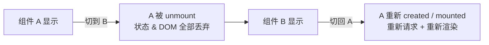
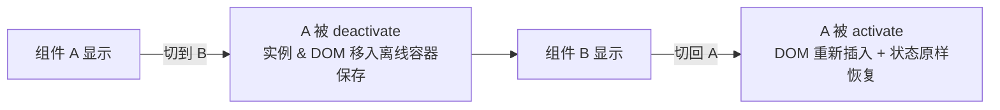
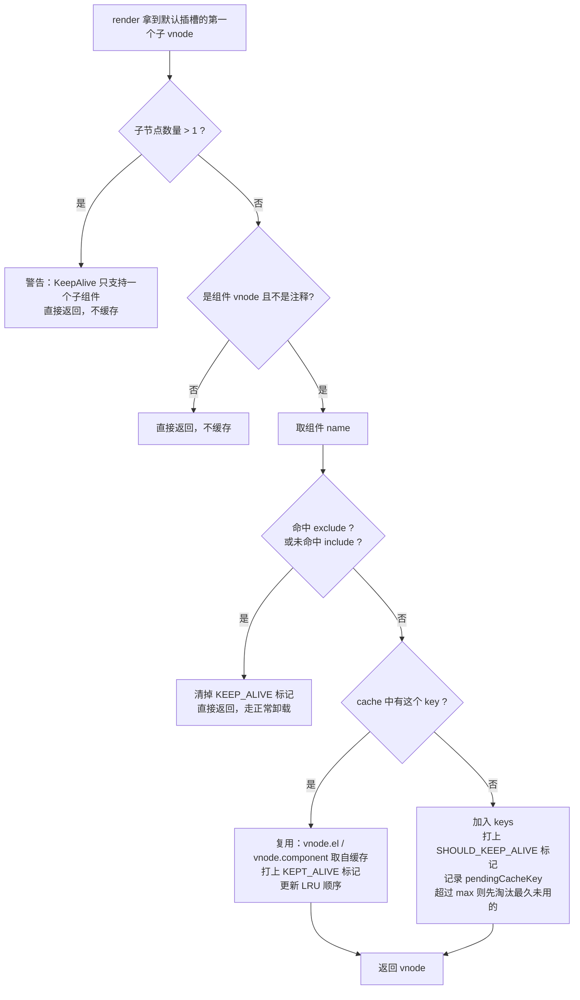

# Vue 中 keep-alive 详解与面试回答模板

> 适用版本：Vue 2.x / Vue 3.x（含 `<script setup>`）
> 结构：1~4 节讲用法与匹配规则，5~6 节讲源码，7~8 节是问答，9~11 节是坑、手写与自测

---

## 目录

- [1. 一句话回答](#1-一句话回答)
- [2. 它到底解决了什么问题](#2-它到底解决了什么问题)
- [3. 基本用法](#3-基本用法)
- [4. 三个 props 详解](#4-三个-props-详解)
- [5. 底层原理（面试加分核心）](#5-底层原理面试加分核心)
- [6. Vue 2 与 Vue 3 的实现差异](#6-vue-2-与-vue-3-的实现差异)
- [7. 面试怎么答](#7-面试怎么答)
- [8. 高频追问 20 问](#8-高频追问-20-问)
- [9. 常见坑与最佳实践](#9-常见坑与最佳实践)
- [10. 手写一个简化版 KeepAlive](#10-手写一个简化版-keepalive)
- [11. 自测清单](#11-自测清单)
- [附：一页速记](#附一页速记)

---

## 1. 一句话回答

`<keep-alive>` 是 Vue 的**内置抽象组件**：把组件实例连同 DOM 和内部状态缓存起来，切换时只做「移出 / 移回」，不销毁、不重新创建，从而保留组件状态、避免重复渲染和重复请求。

关键词：**缓存组件实例、跳过销毁重建、activated / deactivated 生命周期、LRU 淘汰**。

---

## 2. 它到底解决了什么问题

### 2.1 默认行为：切走即销毁

Vue 中 `<component :is="xxx">` 或路由切换时，旧组件会被**卸载（unmount）**：

- 触发 `beforeDestroy / beforeUnmount` → `destroyed / unmounted`
- 组件实例、响应式数据、DOM 全部丢弃
- 再次切回来时**重新 created → mounted**，重新发请求、重新渲染，滚动位置、表单内容、TAB 选中态都回到初始值



### 2.2 用了 keep-alive 之后



对比表：

| 维度 | 不加 keep-alive | 加 keep-alive |
| --- | --- | --- |
| 组件实例 | 销毁后重建 | 复用同一个实例 |
| 生命周期 | created / mounted 每次触发 | 只触发一次，之后走 activated / deactivated |
| 内部状态（data、滚动位置、表单） | 丢失 | 保留 |
| 网络请求 | 每次进入都请求 | 只请求一次（需要刷新要自己控制） |
| 渲染开销 | 每次重新创建 DOM | 复用已有 DOM，只做移动 |
| 内存 | 及时释放 | 常驻内存，需 `max` / `include` 控制 |

keep-alive 用「内存换体验」，把「销毁重建」换成了「休眠唤醒」。

### 2.3 和其他方案的对比

| 方案 | 思路 | 优点 | 缺点 |
| --- | --- | --- | --- |
| `v-show` | 不销毁，靠 `display:none` 隐藏 | 保留状态、DOM 还在 | 所有分支都要渲染，首屏成本高；不适合大组件 / 路由级切换 |
| `keep-alive` | 缓存实例 + DOM，切走时移出文档 | 懒渲染、保留状态 | 内存占用、需要手动控制刷新 |
| 状态提升（Vuex / Pinia） | 组件照常销毁，数据放 store | 无内存压力、数据可控 | UI 状态（滚动、DOM 引用、组件内部状态）恢复麻烦 |
| 手动缓存数据（localStorage / sessionStorage） | 只缓存请求结果 | 简单 | 只能恢复数据，不能恢复 DOM 与交互状态 |

---

## 3. 基本用法

### 3.1 包裹动态组件

```vue
<template>
  <div>
    <button @click="current = current === 'CompA' ? 'CompB' : 'CompA'">
      切换
    </button>

    <keep-alive>
      <component :is="current" />
    </keep-alive>
  </div>
</template>

<script setup>
import { shallowRef } from 'vue'
import CompA from './CompA.vue'
import CompB from './CompB.vue'

const current = shallowRef('CompA')
</script>
```

> Vue 3 中也可以用 `<KeepAlive>`（首字母大写），在 `<script setup>` 里无需注册。

### 3.2 包裹路由出口（最常见的业务场景）

**Vue 3 + Vue Router 4（推荐写法，slot 形式）**

```vue
<template>
  <router-view v-slot="{ Component, route }">
    <keep-alive :include="cachedViews" :max="10">
      <component :is="Component" :key="route.name" />
    </keep-alive>
  </router-view>
</template>

<script setup>
import { computed } from 'vue'
import { useRoute } from 'vue-router'

const route = useRoute()
// 只缓存 meta.keepAlive === true 的页面
const cachedViews = computed(() =>
  route.matched.filter((r) => r.meta?.keepAlive).map((r) => r.name)
)
</script>
```

**路由配置**

```js
const routes = [
  { path: '/list', name: 'List', component: List, meta: { keepAlive: true } },
  { path: '/detail/:id', name: 'Detail', component: Detail }, // 不缓存
]
```

**Vue 2 写法**

```vue
<keep-alive :include="cachedViews">
  <router-view />
</keep-alive>
```

### 3.3 两个专属生命周期

| 钩子 | 选项式 API | 组合式 API | 触发时机 |
| --- | --- | --- | --- |
| 激活 | `activated` | `onActivated` | 组件首次挂载后、以及每次从缓存被重新插入时 |
| 失活 | `deactivated` | `onDeactivated` | 组件被移出视图、但保留在缓存中时 |

```vue
<script setup>
import { onMounted, onActivated, onDeactivated, onUnmounted } from 'vue'

onMounted(() => console.log('mounted：只执行一次'))
onActivated(() => {
  console.log('activated：首次挂载后 + 每次回到该页面')
  // 适合：刷新数据、恢复定时器、恢复滚动位置
})
onDeactivated(() => {
  console.log('deactivated：离开该页面但被缓存')
  // 适合：清理定时器、取消未完成请求、暂停视频
})
onUnmounted(() => console.log('unmounted：组件真正被销毁时才执行'))
</script>
```

**执行顺序（首次进入）**：`setup` → `beforeMount` → `mounted` → `activated`
**再次进入**：只触发 `activated`
**离开**：只触发 `deactivated`，**不触发** `beforeUnmount / unmounted`

---

## 4. 三个 props 详解

| prop | 类型 | 说明 |
| --- | --- | --- |
| `include` | `String \| RegExp \| Array` | 只有**名称匹配**的组件会被缓存，其余不缓存 |
| `exclude` | `String \| RegExp \| Array` | 名称匹配的组件**不**被缓存，优先级高于 `include` |
| `max` | `String \| Number` | 最多缓存多少个实例，超出后按 **LRU（最近最少使用）** 淘汰 |

### 4.1 匹配规则

```js
// runtime-core 中的 matches（简化）
function matches(pattern, name) {
  if (Array.isArray(pattern)) return pattern.some((p) => matches(p, name))
  if (typeof pattern === 'string') return pattern.split(',').includes(name)
  if (pattern instanceof RegExp) {
    pattern.lastIndex = 0 // 带 g 标志的正则复用前必须重置
    return pattern.test(name)
  }
  return false
}
```

- 匹配的是 `getComponentName()` 的结果：优先组件 `name` 选项，其次 `<script setup>` 编译期按文件名注入的 `__name`；不是路由 `name`，也不是组件标签名。
- `include="a,b"` 与 `include="a"`、`include="b"` 效果一致；`split(',')` 不 trim，`"a, b"` 里的 `" b"` 匹配不上 `b`。
- 字符串与数组匹配区分大小写；正则按自身 `flags` 判定（加 `i` 才不区分）。
- `exclude` 与 `include` 同时命中时以 `exclude` 为准（排除优先）。

```vue
<!-- 字符串：逗号分隔 -->
<keep-alive include="List,Detail">

<!-- 数组（注意要绑定，否则会当成字符串） -->
<keep-alive :include="['List', 'Detail']">

<!-- 正则 -->
<keep-alive :include="/List|Detail/">
```

> 常见错误：写 `:include="['list']"` 但组件里 `name` 是大写 `List` —— **大小写敏感，匹配不上**。

### 4.2 `<script setup>` 里组件名从哪来？

`<script setup>` 默认不暴露 `name`，导致 `include` 失效。三种解法：

```vue
<!-- 方式 1：Vue 3.3+ 推荐 -->
<script setup>
defineOptions({ name: 'List' })
</script>

<!-- 方式 2：额外一个普通 script 块 -->
<script>
export default { name: 'List' }
</script>
<script setup>
// ...
</script>

<!-- 方式 3：依赖文件名推断（编译器会把文件名注入 __name） -->
<!-- 文件叫 List.vue 时，include="List" 通常可用，但不如前两种稳妥 -->
```

### 4.3 `max` 与 LRU

`max` 不是「随便删一个」，而是**最近最少使用淘汰（LRU）**：

- 内部维护 `cache: Map<key, vnode>` 和 `keys: Set<key>`，`keys` 的插入序即 LRU 序
- 每次命中缓存时，把该 key 从 `keys` 中删除再重新加入（**移到队尾 = 标记为最近使用**）
- 新增 key 后判断 `keys.size > parseInt(max, 10)`，超了就淘汰 `keys` 的**第一个**（最久未使用），并真正 `unmount` 它

```
keys（左 = 最久未用，右 = 最近使用）
[ A, B, C ]  max = 3
访问 B → [ A, C, B ]
插入 D → 淘汰 A → [ C, B, D ]
```

> Vue 3 用 `Set` 的 `delete` + `add`，Vue 2 用数组 `remove` + `push`，语义都是「插入序 = LRU 序」。

---

## 5. 底层原理（面试加分核心）

### 5.1 三个核心设计

| 设计 | 作用 |
| --- | --- |
| **抽象组件**（Vue 2 `abstract: true`） | 自身不渲染包裹 DOM，不进入父组件链，`$parent` 会跳过它（Vue 3 无 `abstract`，靠直接返回子 vnode 达到同样效果） |
| **`cache` + `keys` 容器** | `cache` 存 `vnode`（内含 `component` 实例和 `el`），`keys` 维护 LRU 顺序 |
| **接管组件的卸载流程** | 命中缓存时不走 `unmount`，而是把 DOM 移到离线容器，实例标记为 `isDeactivated` |

### 5.2 核心流程图



### 5.3 关键源码（Vue 3，简化注释版）

```ts
// packages/runtime-core/src/components/KeepAlive.ts
const KeepAliveImpl = {
  name: 'KeepAlive',
  __isKeepAlive: true,        // 全局标记，供 renderer 识别
  props: { include: [String, RegExp, Array], exclude: [String, RegExp, Array], max: [String, Number] },

  setup(props, { slots }) {
    const cache = new Map()   // key -> vnode（vnode 上挂着 component 实例和 el）
    const keys = new Set()    // LRU 顺序：越靠后越新
    let current = null        // 当前正在渲染的 vnode
    let pendingCacheKey = null

    // ① 关键：把「缓存组件」的 DOM 移到一个离屏 div 里，而不是销毁
    const storageContainer = createElement('div')

    sharedContext.activate = (vnode, container, anchor) => {
      const instance = vnode.component
      move(vnode, container, anchor)            // DOM 从离屏容器搬回页面
      patch(instance.vnode, vnode, container)   // 增量 patch，恢复 props / slots
      queuePostRenderEffect(() => {
        instance.isDeactivated = false
        if (instance.a) invokeArrayFns(instance.a) // 触发 activated
      })
    }

    sharedContext.deactivate = (vnode) => {
      const instance = vnode.component
      move(vnode, storageContainer, null)       // DOM 搬进离屏容器（并未销毁）
      queuePostRenderEffect(() => {
        if (instance.da) invokeArrayFns(instance.da) // 触发 deactivated
        instance.isDeactivated = true
      })
    }

    // ② 真正卸载（max 超额、include / exclude 变更时才会走这里）
    function unmount(vnode) {
      resetShapeFlag(vnode)
      _unmount(vnode, instance, parentSuspense, true)
    }

    // ③ include / exclude 变化时，把不再匹配的缓存清掉
    watch(() => [props.include, props.exclude], ([include, exclude]) => {
      include && pruneCache((name) => matches(include, name))
      exclude && pruneCache((name) => !matches(exclude, name))
    }, { flush: 'post', deep: true })

    return () => {
      const children = slots.default?.() || []
      const rawVNode = children[0]
      if (children.length > 1) return children          // 只允许一个子组件

      const vnode = getInnerChild(rawVNode)
      const comp = vnode.type
      const name = getComponentName(comp)
      const { include, exclude, max } = props

      // 不满足缓存条件 → 清掉标记，原样返回，交给正常流程卸载
      if ((include && (!name || !matches(include, name))) ||
          (exclude && name && matches(exclude, name))) {
        vnode.shapeFlag &= ~ShapeFlags.COMPONENT_SHOULD_KEEP_ALIVE
        current = vnode
        return rawVNode
      }

      const key = vnode.key == null ? comp : vnode.key
      const cachedVNode = cache.get(key)
      pendingCacheKey = key

      if (cachedVNode) {
        // 命中缓存：复用实例和 DOM
        vnode.el = cachedVNode.el
        vnode.component = cachedVNode.component
        if (vnode.transition) setTransitionHooks(vnode, vnode.transition)
        vnode.shapeFlag |= ShapeFlags.COMPONENT_KEPT_ALIVE
        keys.delete(key); keys.add(key)                 // 更新 LRU：移到队尾
      } else {
        keys.add(key)
        if (max && keys.size > parseInt(max, 10)) {
          pruneCacheEntry(keys.values().next().value)   // 淘汰最久未使用
        }
      }
      vnode.shapeFlag |= ShapeFlags.COMPONENT_SHOULD_KEEP_ALIVE

      current = vnode
      return rawVNode
    }
  },

  // ④ 挂载 / 更新后才写入缓存（这样可以正确处理 Suspense 等异步子树）
  mounted() { if (pendingCacheKey != null) cache.set(pendingCacheKey, getInnerChild(this.subTree)) },
  updated() { /* 同上 */ },
  beforeUnmount() { /* KeepAlive 自身卸载：缓存条目逐个真实 unmount，当前 vnode 只清标记 */ },
}
```

### 5.4 最核心的一句话

> keep-alive 并没有「暂停」组件，而是**给 vnode 打上 `COMPONENT_SHOULD_KEEP_ALIVE` 标记**，让 renderer 在卸载时改走 `deactivate`：**把 DOM 移进离屏容器、保留 component 实例、不调用 `unmount`**；下次渲染命中缓存时，再用 `activate` 把 DOM 搬回来并做一次增量 `patch`。

由此得到三个结果：

- 状态能保留 → 实例没销毁，响应式数据、闭包、定时器全都还在
- 滚动位置能保留 → **DOM 节点是同一个**，只是被移动到别处又移回来
- `unmounted` 不触发 → 根本没走卸载流程

---

## 6. Vue 2 与 Vue 3 的实现差异

| 维度 | Vue 2 | Vue 3 |
| --- | --- | --- |
| 定义方式 | `Vue.component` 的选项对象，`abstract: true` | 组合式 `setup` 返回 render 函数，`__isKeepAlive` 标记 |
| 抽象标识 | `abstract: true`（跳过父组件链、不渲染包裹节点） | 无 `abstract`，靠返回子 vnode 天然不产生包裹节点 |
| 缓存时机 | `render` 中直接 `cache[key] = vnode` | `render` 只记 `pendingCacheKey`，在 `mounted / updated` 中写缓存（为兼容 Suspense / Transition） |
| 缓存 key 默认值 | `componentOptions.Ctor.cid`（有 tag 时追加 `::tag`） | `vnode.type`（组件定义对象本身） |
| 保留状态的方式 | 打 `vnode.data.keepAlive = true`，卸载钩子里判断该标记 → 不 `$destroy`，改调 `deactivateChildComponent`；DOM 引用留在 vnode 上，再激活时 `insert` 回去 | renderer 内部直接 `move` 到 `storageContainer`（离屏 div），激活时 `move` 回来 |
| 生命周期钩子 | `activated` / `deactivated` | `onActivated` / `onDeactivated`（同样存在 `activated` 选项） |
| 多子节点 | `getFirstComponentChild` 取第一个，其余忽略 | 警告 `KeepAlive should contain exactly one component child`，且不缓存 |
| 组件名获取 | 只看 `name` 选项 | 先 `name`，再 `__name`（`<script setup>` 由文件名推断） |
| LRU 容器 | `cache` 对象 + `keys` 数组（`remove` + `push`） | `cache: Map` + `keys: Set`（`delete` + `add`） |

### Vue 2 关键源码（`src/core/components/keep-alive.js` + `src/core/vdom/patch.js`）

```js
// keep-alive.js
render () {
  const slot = this.$slots.default
  const vnode = getFirstComponentChild(slot)      // 只取第一个子组件
  const componentOptions = vnode && vnode.componentOptions
  if (componentOptions) {
    const name = getComponentName(componentOptions)
    const { include, exclude } = this
    if ((include && (!name || !matches(include, name))) ||
        (exclude && name && matches(exclude, name))) {
      return vnode                                 // 不缓存，走正常销毁
    }
    const { cache, keys } = this
    const key = vnode.key == null
      ? componentOptions.Ctor.cid + (componentOptions.tag ? `::${componentOptions.tag}` : '')
      : vnode.key

    if (cache[key]) {
      vnode.componentInstance = cache[key].componentInstance  // 复用实例
      remove(keys, key); keys.push(key)                       // 更新 LRU
    } else {
      cache[key] = vnode
      keys.push(key)
      if (this.max && keys.length > parseInt(this.max)) {
        pruneCacheEntry(cache, keys[0], keys, this._vnode)     // 淘汰最久未使用
      }
    }
    vnode.data.keepAlive = true                                // 关键标记
  }
  return vnode || (slot && slot[0])
}
```

```js
// patch.js —— 组件 vnode 的 destroy 钩子，卸载时拦截
destroy (vnode) {
  const { componentInstance } = vnode
  if (!componentInstance._isDestroyed) {
    if (!vnode.data.keepAlive) {
      componentInstance.$destroy()            // 普通组件：真销毁
    } else {
      deactivateChildComponent(componentInstance, true) // 缓存组件：只失活
    }
  }
}
```

---

## 7. 面试怎么答

### 7.1 30 秒版（先给结论）

- **是什么**：内置抽象组件，缓存组件实例（vnode 上挂 `component` / `el`），不产生包裹 DOM。
- **默认行为**：切换即卸载，实例与 DOM 丢弃，回来要重新创建、请求、渲染。
- **怎么做**：切走时 `deactivate`（DOM 移到离屏容器、实例保留、触发 `deactivated`），切回时 `activate`（DOM 移回 + 增量 patch、触发 `activated`）。
- **API**：`include` / `exclude` 按组件名控制范围，`max` 用 LRU 限数量；典型场景是列表页往返保留筛选与滚动位置。

### 7.2 2 分钟版（结构化展开）

按「是什么 → 为什么 → 怎么用 → 原理 → 注意点 → 场景」六段说：

1. **是什么**：内置抽象组件，缓存组件实例，不产生额外 DOM。
2. **为什么**：动态组件 / 路由切换默认会 `unmount` 旧组件，导致状态丢失、重复请求、重复渲染；keep-alive 用内存换体验。
3. **怎么用**：包裹 `<component :is>` 或 `<router-view>`；`include` / `exclude` / `max`；`activated` / `deactivated`。
4. **原理**：`cache`（Map/对象）+ `keys`（LRU 顺序）；render 时给 vnode 打 `keepAlive` 标记；命中缓存就复用 `component` 实例和 `el`；卸载流程被改写为 `deactivate`，激活时 `activate`。
5. **注意点**：只支持一个子组件；`include` 匹配组件 `name`，`<script setup>` 要 `defineOptions({ name })`；缓存期间 `unmounted` 不触发，定时器 / 事件 / 请求要在 `deactivated` 清理；数据不会自动刷新；`max` 防止内存膨胀。
6. **场景**：列表页 → 详情页 → 返回；多 Tab 后台系统；步骤表单；地图 / 编辑器等重初始化成本高的组件。

### 7.3 答题节奏建议

- 先给结论再展开，源码细节留到被追问。
- 主动补「缓存后数据不更新」「定时器泄漏」两个坑，并对比 `v-show` / 状态提升 / 手动缓存。

---

## 8. 高频追问 20 问

### Q1. keep-alive 缓存的是 DOM 还是组件实例？

**两者都保留。** 缓存的是 vnode，vnode 上挂着 `component`（组件实例，含响应式状态、生命周期、闭包）和 `el`（真实 DOM 根节点）。切走时 DOM 被**移动**到离屏容器而非销毁，所以滚动位置、`<video>` 播放进度、`<input>` 光标这类纯 DOM 状态也能保留。

### Q2. 为什么缓存后 `mounted` 不再触发？

`mounted` 属于「挂载」阶段钩子，只在实例首次挂载时执行。缓存复用的是同一个实例，不重新挂载，所以只触发 `activated`。需要「每次进入都执行」的逻辑应放到 `activated`。

### Q3. `activated` 和 `mounted` 的执行顺序？

同 3.3：首次进入 `setup` → `beforeMount` → `mounted` → `activated`；之后每次回到该组件只有 `activated`。

### Q4. 缓存后数据不更新怎么办？

四种常见做法：

```js
// ① 最简单：每次进入都重新拉数据
onActivated(() => { fetchList() })

// ② 按需刷新：加时间戳，超过 N 分钟才刷新
let lastFetch = 0
onActivated(() => {
  if (Date.now() - lastFetch > 5 * 60 * 1000) {
    fetchList()
    lastFetch = Date.now()
  }
})

// ③ 用事件/状态标记触发（详情页修改后返回列表要刷新）
// 在 store / provide-inject 里放一个 needRefresh 标记，activated 里检查

// ④ 干脆不缓存这个页面：把 include 里对应的 name 移除
// 注意：include 变化会触发 pruneCache，正在显示的组件会被 reset 标记
```

路由参数变化（`/detail/1` → `/detail/2`）时组件被复用，需要 `watch(() => route.params.id)` 或 `onBeforeRouteUpdate`。

### Q5. `include` 不生效，可能是什么原因？

按概率排序：

1. 组件的 `name` 写错 / 大小写不一致；
2. `<script setup>` 没有声明 `name`（用 `defineOptions({ name: 'Xxx' })`）；
3. 用了路由 `name` 或文件路径去匹配，但组件 `name` 是另一回事；
4. 写成 `include="['A']"`（少了冒号，变成字符串 `"['A']"`）；
5. 组件外面还包了一层（比如 `<transition>` 之外又包了 `div`），导致 keep-alive 拿到的不是组件 vnode；
6. 缓存的不是 `include` 里的那个组件，而是它的父级容器组件。

### Q6. 为什么 keep-alive 里只能有一个子组件？

它取默认插槽的第一个组件 vnode 来缓存。Vue 2 的 `getFirstComponentChild` 遍历 `$slots.default` 找第一个组件 vnode，其余忽略；Vue 3 子节点数 > 1 会警告 `KeepAlive should contain exactly one component child` 并放弃缓存。

要切换多个组件，用 `<component :is>` 或 `v-if / v-else` 保证同一时刻只渲染一个。

```vue
<!-- ✅ 正确：同一时刻只产生一个组件 vnode -->
<keep-alive>
  <component :is="current" />
</keep-alive>

<!-- ✅ 正确：v-if / v-else 是「二选一」，编译器只生成一个 vnode -->
<keep-alive>
  <CompA v-if="showA" />
  <CompB v-else />
</keep-alive>

<!-- ❌ 错误：两个子节点同时存在，第二个会被忽略 / 触发警告 -->
<keep-alive>
  <CompA />
  <CompB />
</keep-alive>
```

> 判断标准不是「写了几个标签」，而是**运行时 `slots.default()` 返回了几个 vnode**。`v-if` / `v-else` 只产出一个，所以没问题；两个兄弟节点同时渲染（或用 `v-show` 的两个组件）就会出问题。

### Q7. `:key` 在 keep-alive 里起什么作用？

`key` 就是缓存 Map 的 key。默认 key 是组件类型本身，所以**同一个组件的不同路由参数会共用一份缓存**。

```vue
<!-- 默认：/user/1 和 /user/2 共用缓存，切换时数据不会重新请求 -->
<component :is="Component" />

<!-- 加 key：每个 fullPath 一份缓存（内存消耗大，慎用） -->
<component :is="Component" :key="$route.fullPath" />
```

回答要点：`key` 决定缓存粒度，默认按组件类型缓存，加了 `key` 就按 `key` 值分别缓存。

### Q8. `max` 超出后是怎么淘汰的？

同 4.3：命中缓存把 key 挪到 `keys` 末尾；新增 key 后 `keys.size > max` 时删掉首位（最久未使用），并对那个 vnode 执行真正的 `unmount`。

### Q9. 被 `max` 淘汰的组件会触发什么钩子？

`deactivated` 早在它被移出视图时就触发过；淘汰时只走完整卸载的 `beforeUnmount` → `unmounted`（Vue 2：`beforeDestroy` → `destroyed`），不会再补一次 `deactivated`。

### Q10. 缓存组件的定时器会怎样？

**继续跑。** 因为实例没销毁，`setInterval`、`addEventListener`、WebSocket 连接都还活着。不清理的后果：

- 内存泄漏（持有已不需要的引用）
- 后台仍在发请求 / 轮询
- 重新进入时重复绑定，回调执行多次

正确姿势：

```js
let timer = null
onActivated(() => { timer = setInterval(poll, 3000) })
onDeactivated(() => { clearInterval(timer); timer = null })
```

### Q11. keep-alive 会导致内存泄漏吗？

它是「常驻内存」的设计，缓存不主动释放就会一直占内存：

- 缓存实例上的响应式数据、闭包、DOM 全都不释放；
- 缓存页面越多，内存越高；
- 页面里有大列表 / 大图 / 大对象时尤其明显。

缓解手段：`include` 精准白名单、`max` 限制数量、`deactivated` 里释放大对象（把列表数据置空）、不要把详情页这种一次性页面也缓存。

### Q12. 如何手动清除某个缓存？

Vue 2 可以拿到内部实例：

```js
// 通过 keep-alive 组件实例访问 cache（不推荐，属于 hack）
const keepAlive = this.$vnode.parent.componentInstance
delete keepAlive.cache[key]
keepAlive.keys = keepAlive.keys.filter((k) => k !== key)
```

推荐做法：通过改变 `include` 数组驱动 `pruneCache`（Vue 3 内部 `watch` 了 `include` / `exclude`，不匹配的缓存会被卸载）。

```js
// 关掉某个页面的缓存
cachedViews.value = cachedViews.value.filter((n) => n !== 'Detail')
```

### Q13. `<transition>` 和 `<keep-alive>` 的嵌套顺序？

```vue
<!-- Vue 3 -->
<Transition>
  <KeepAlive>
    <component :is="current" />
  </KeepAlive>
</Transition>

<!-- Vue 2 -->
<transition>
  <keep-alive>
    <component :is="current" />
  </keep-alive>
</transition>
```

外层 `transition`、内层 `keep-alive`，切换动画才正常。

### Q14. keep-alive 和 `v-if` 一起用有什么问题？

`v-if` 为 `false` 时，插槽里产出的是**注释占位 vnode**，KeepAlive 判定它不是组件后原样返回，不写新缓存，也不报警告。已经缓存过的条目仍然保留在 `cache` 里（key 没变），下次显示时照常命中。

要注意的是：**keep-alive 自身被 `v-if` 移除时会销毁整个缓存**。

### Q15. 嵌套的 keep-alive 会怎样？

多层缓存可以工作，但语义容易混乱：内层外层各有一份 cache。实际项目尽量避免，会显著增加内存和维护成本。

### Q16. keep-alive 组件内部还能再放 keep-alive 吗？缓存会不会叠加？

能。每层独立维护自己的 `cache` / `keys`，不会互相覆盖；外层 `deactivate` 只是把整棵 DOM 移出，不改变内层缓存内容。

### Q17. keep-alive 在 SSR 下有用吗？

SSR 是「一次渲染、直出 HTML」，没有客户端长时间的组件切换过程，缓存在服务端没有意义（每个请求实例独立，跨请求共享会造成状态污染）。所以 `keep-alive` 基本是**纯客户端行为**。

### Q18. 为什么不用 `v-show` 代替？

`v-show` 是「全部渲染 + 切换 `display`」：状态天然保留，但首屏就要渲染所有分支，DOM 数量和组件初始化成本成倍增加；地图、图表、富文本编辑器这类重组件不适合。

`keep-alive` 是「按需渲染 + 缓存已渲染的」，更省首屏。少量轻量组件切换用 `v-show`，路由级 / 重组件用 `keep-alive`。

### Q19. keep-alive 缓存后，`beforeRouteEnter` / `beforeRouteLeave` 还会触发吗？

会。路由守卫属于路由层，与组件是否被缓存无关，只要路由变化就会执行。但组件内的 `created` / `mounted` 不会重复执行，所以「进入页面时初始化」的逻辑要放 `activated`，或者用 `onBeforeRouteUpdate` 处理参数变化。

### Q20. 如果一个页面既想缓存，又想「从详情页返回时刷新」，怎么做？

同 Q4 的 ②③：时间戳过期刷新，或 store 里放 `needRefresh` 标记。页面级还可以用 `meta.keepAlive` 区分列表页 / 详情页；或者在路由 `beforeEach` 里判断 `from / to`，临时把某个 name 从 `include` 里摘掉（后台系统「关闭标签页即销毁缓存」就是这么做的）。

---

## 9. 常见坑与最佳实践

### 9.1 坑位清单

| 坑 | 现象 | 解决 |
| --- | --- | --- |
| `include` 匹配不上 | 完全不生效 | 检查组件 `name`、`<script setup>` 加 `defineOptions` |
| 组件名大小写 | `list` ≠ `List` | 严格一致 |
| `include` 少了 `:` | 变成字面字符串 | `:include="['List']"` |
| 多个子节点 | 只有第一个被缓存 / Vue 3 报警告 | 用 `<component :is>` 或 `v-if / v-else` |
| 缓存后数据不刷新 | 页面停留在旧数据 | `activated` 中按需刷新 |
| 定时器重复绑定 | 回调执行多次 | `deactivated` 清理 |
| 缓存 key 冲突 | 不同路由共用一份状态 | 加 `:key="route.fullPath"` |
| 内存持续上涨 | 页面越用越卡 | 设 `max`、收窄 `include` |
| `transition` 顺序写反 | 切换无动画 | 外 `transition` 内 `keep-alive` |
| 包了多余 `div` | 不缓存 | 让 `keep-alive` 的直接子节点是组件 |
| 想缓存但组件是 `v-for` 渲染 | 不生效 | `keep-alive` 只能包一个组件 vnode |

### 9.2 最佳实践

1. **默认不缓存，按需缓存**：用 `meta.keepAlive` + `include` 白名单，而不是全局包一层。
2. **一定要设 `max`**：后台系统这种多标签页场景，`max` 是最后一道防线。
3. **缓存页面要「自洁」**：`deactivated` 里清理定时器、事件监听、未完成的 `fetch`（`AbortController`）。
4. **数据刷新策略要明确**：时间戳 / 标记位 / 事件通知，选一种写进规范。
5. **详情页、一次性页面不要缓存**：状态没有复用价值，只会占内存。
6. **大列表页返回时恢复滚动位置**：DOM 保留的话天然就恢复了；如果用了虚拟列表，需要自己在 `activated` 里重新 `scrollTo`。
7. **慎用 `:key="route.fullPath"`**：它会为每个路径单独开一份缓存，内存会爆。

---

## 10. 手写一个简化版 KeepAlive

> 面试如果被要求「手写」，能写出「缓存 vnode / 实例 + LRU」的核心逻辑就够了。但要主动说明：**真实实现还需要 renderer 的 `move` / `unmount` 能力**，这正是它必须是内置组件而不是普通组件的原因。

```js
// 简化版：只演示「缓存 + 复用 + LRU」的思想
import { defineComponent } from 'vue'

export default defineComponent({
  name: 'MyKeepAlive',
  props: {
    include: { type: [String, RegExp, Array] },
    max: { type: [String, Number] },
  },
  setup(props, { slots }) {
    const cache = new Map()     // key -> vnode
    const keys = []             // LRU 顺序，尾部最新

    const match = (pattern, name) => {
      if (Array.isArray(pattern)) return pattern.some((p) => match(p, name))
      if (typeof pattern === 'string') return pattern.split(',').includes(name)
      if (pattern instanceof RegExp) return pattern.test(name)
      return false
    }

    return () => {
      const vnode = slots.default?.()[0]
      if (!vnode) return null

      const name =
        typeof vnode.type === 'object'
          ? vnode.type.name || vnode.type.__name
          : undefined

      // include 不匹配 → 不缓存
      if (props.include && (!name || !match(props.include, name))) {
        return vnode
      }

      const key = vnode.key ?? vnode.type

      if (cache.has(key)) {
        const cached = cache.get(key)
        vnode.component = cached.component   // 复用组件实例
        vnode.el = cached.el                 // 复用真实 DOM
        const i = keys.indexOf(key)
        if (i > -1) keys.splice(i, 1)
        keys.push(key)                       // 更新 LRU
      } else {
        cache.set(key, vnode)
        keys.push(key)
        if (props.max && keys.length > Number(props.max)) {
          const oldest = keys.shift()
          cache.delete(oldest)               // 真实实现这里要 unmount 那个 vnode
        }
      }

      return vnode
    }
  },
})
```

**还差什么才算完整？**

| 能力 | 说明 |
| --- | --- |
| 拦截卸载 | 组件切走时不能让它走 `unmount`，否则 DOM 和实例都会没 |
| DOM 移出 / 移回 | Vue 3 用 `move(vnode, storageContainer)`，Vue 2 靠保留 `vnode.elm` 引用后重新 `insert` |
| `activated` / `deactivated` | 需要在 move 前后 `invokeArrayFns(instance.a / instance.da)` |
| `shapeFlag` 标记 | 打 `COMPONENT_SHOULD_KEEP_ALIVE`，让 renderer 认出来 |
| Suspense / Transition 兼容 | 所以 Vue 3 把写缓存挪到 `mounted / updated` |

---

## 11. 自测清单

能不看文档答出以下问题，说明这一块基本过关：

- [ ] 用一句话说清 keep-alive 的作用
- [ ] 说出不加 keep-alive 时，组件切换会走哪些钩子
- [ ] 说出 `include` / `exclude` / `max` 的作用和匹配规则
- [ ] 说清 `include` 匹配的是「组件 name」，以及 `<script setup>` 里怎么声明
- [ ] 背出首次进入 / 再次进入 / 离开 的钩子执行顺序
- [ ] 解释为什么缓存后滚动位置能保留（DOM 是同一个）
- [ ] 说清 `cache` + `keys` + `keepAlive 标记` + `拦截卸载` 四要素
- [ ] 解释 Vue 3 为什么把写缓存放到 `mounted / updated`
- [ ] 说出 `max` 的 LRU 淘汰过程
- [ ] 答出「缓存后数据不更新」的 3 种解法
- [ ] 答出「定时器泄漏」的原因和写法
- [ ] 说出 `:key` 对缓存粒度的影响
- [ ] 对比 `v-show` / 状态提升 / 手动缓存，说出各自适用场景
- [ ] 说出至少 4 个 keep-alive 的典型业务场景
- [ ] 说出 3 个 `include` 不生效的原因

---

## 附：一页速记

```
作用：缓存组件实例，切换时不销毁重建 → 保留状态 + 省渲染 + 省请求
API ：include / exclude（匹配组件 name）/ max（LRU，超额淘汰最久未用并真实 unmount）
钩子：activated（进入）/ deactivated（离开），mounted 只跑一次
原理：cache(Map) + keys(LRU) + vnode 打 KEEP_ALIVE 标记
      卸载 → deactivate（DOM 移到离屏容器，不 unmount）
      进入 → activate（DOM 移回 + 增量 patch）
限制：只能一个子组件；缓存期间 unmounted 不触发；数据不自动刷新
场景：列表 → 详情 → 返回；多 Tab 后台；分步表单；地图/编辑器
```
