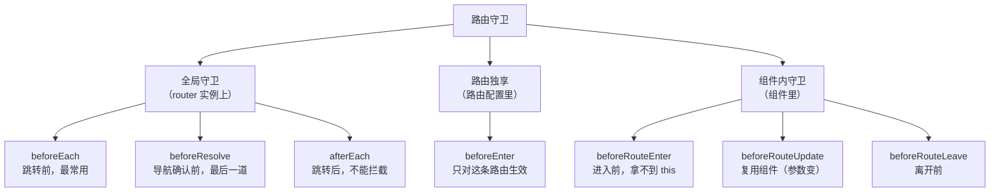
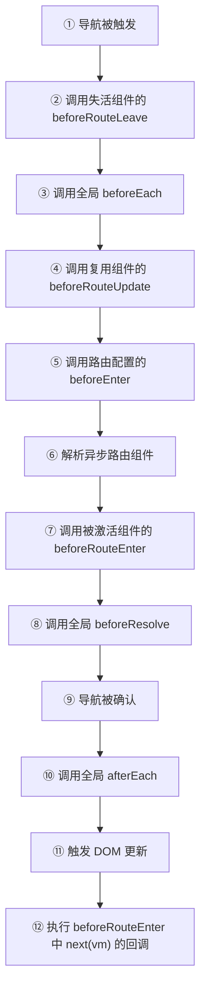

# Vue 路由守卫详解与面试回答

> 适用版本：Vue 2 + Vue Router 3 / Vue 3 + Vue Router 4
> 相关教程：路由模式（hash / history）见「Vue 路由模式详解与面试回答」

---

## 目录

1. [一句话回答](#1-一句话回答)
2. [守卫全景](#2-守卫全景)
3. [完整执行顺序](#3-完整执行顺序)
4. [参数与返回值](#4-参数与返回值)
5. [五个实战场景](#5-五个实战场景)
6. [守卫与生命周期及 keep-alive](#6-守卫与生命周期及-keep-alive)
7. [常见坑](#7-常见坑)
8. [面试怎么答](#8-面试怎么答)
9. [高频追问](#9-高频追问)
10. [速记与自测](#10-速记与自测)

---

## 1. 一句话回答

**路由守卫是导航流程中的钩子**：在「URL 变更」与「组件渲染」之间插入逻辑，用于校验、拦截、重定向和副作用，典型场景是登录鉴权、动态路由、权限校验、页面标题、进度条、离开确认、埋点。

---

## 2. 守卫全景

Vue Router 4（也适用于 3，写法略有差异）共有 **3 大类、7 种**守卫：



### 2.1 逐个说明

| 守卫 | 位置 | 时机 | this | 能拦截 | 典型用途 |
| --- | --- | --- | --- | --- | --- |
| `beforeEach(to, from)` | 全局 | 每次跳转最开始 | — | ✅ | 登录鉴权、白名单、动态路由 |
| `beforeResolve(to, from)` | 全局 | 所有组件内守卫、异步组件解析完之后 | — | ✅ | 最后一道校验 |
| `afterEach(to, from, failure)` | 全局 | 导航确认或被中止后 | — | ❌ | 页面标题、埋点、关进度条 |
| `beforeEnter(to, from)` | 路由配置 | 进入该路由前 | — | ✅ | 单路由权限 |
| `beforeRouteEnter(to, from, next)` | 组件内 | 组件实例**创建前** | ❌ | ✅ | 进入前预取数据 |
| `beforeRouteUpdate(to, from)` | 组件内 | 组件被复用、参数变化 | ✅ | ✅ | `/user/1` → `/user/2` |
| `beforeRouteLeave(to, from)` | 组件内 | 离开该组件对应路由前 | ✅ | ✅ | 未保存提示、清理定时器 |

### 2.2 三种写法的注册位置

```js
// ① 全局
router.beforeEach((to, from) => {})
router.beforeResolve((to, from) => {})
router.afterEach((to, from) => {})
```

```js
// ② 路由独享
{
  path: '/admin',
  component: Admin,
  beforeEnter: (to) => {
    if (!isAdmin()) return '/403'
  },
}
```

```vue
<!-- ③ 组件内（选项式） -->
<script>
export default {
  beforeRouteEnter(to, from, next) {
    next((vm) => {
      vm.init()
    }) // 实例还没创建，只能通过回调拿 vm
  },
  beforeRouteUpdate(to, from) {},
  beforeRouteLeave(to, from) {},
}
</script>
```

```vue
<!-- ③ 组件内（组合式，Vue Router 4） -->
<script setup>
import { onBeforeRouteLeave, onBeforeRouteUpdate } from 'vue-router'

onBeforeRouteUpdate((to) => {
  fetchDetail(to.params.id)
})
onBeforeRouteLeave(() => {
  if (hasUnsavedChanges()) return window.confirm('确定离开？')
})
</script>
```

> `<script setup>` 没有 `onBeforeRouteEnter`：setup 在组件创建时执行，已经晚于该守卫。

---

## 3. 完整执行顺序

### 3.1 官方顺序



### 3.2 两个具体场景

**场景一：`/detail/1` → `/detail/2`，同一个路由记录，Detail 组件被复用**

`beforeEach` → `beforeRouteUpdate` → `beforeResolve` → `afterEach`。没有 `beforeRouteLeave`（组件没离开），也没有 `beforeRouteEnter`（记录没重新进入）。

**场景二：`/list` → `/detail/2`，首次进入 Detail（懒加载）**

List 的 `beforeRouteLeave` → 全局 `beforeEach` → `/detail` 的 `beforeEnter` → 解析异步组件 → Detail 的 `beforeRouteEnter` → 全局 `beforeResolve` → `afterEach` → DOM 更新 → `beforeRouteEnter` 的 `next(vm)` 回调。

### 3.3 守卫与组件生命周期

首次进入一个页面：

```text
beforeEach → beforeEnter（有配置时）→ beforeRouteEnter → beforeResolve → afterEach
  → 组件 setup → beforeMount → DOM 更新
  → beforeRouteEnter 的 next(vm) 回调
```

- 全局守卫和 `beforeRouteEnter` 都在组件创建前执行，守卫里拿不到实例。
- `next(vm)` 回调在导航确认、DOM 更新后执行，能拿到实例；实测它可能早于 `mounted`，依赖 DOM 的逻辑放 `mounted` / `activated`。
- 进入前预取数据两种做法：守卫里请求并写入 store，组件读取；或在组件的 `mounted` / `activated` 里请求。

---

## 4. 参数与返回值

### 4.1 三个参数

```js
router.beforeEach((to, from) => {
  to // 目标路由对象：path / fullPath / params / query / hash / name / meta / matched
  from // 来源路由对象，结构相同
  // next // Vue Router 3 必写；Vue Router 4 可选
})
```

| 字段 | 说明 | 注意 |
| --- | --- | --- |
| `to.path` | 路径，不含 query 和 hash | `/user/1` |
| `to.fullPath` | 完整路径，含 query 和 hash | `/user/1?tab=a#top` |
| `to.params` | 动态段参数 | `/user/:id` → `{ id: '1' }` |
| `to.query` | 查询参数对象 | `?a=1` → `{ a: '1' }` |
| `to.hash` | 锚点 | `#top` |
| `to.name` | 命名路由 | — |
| `to.meta` | 路由元信息（**守卫最常用**） | `{ requiresAuth: true }` |
| `to.matched` | 匹配到的路由记录数组（含父级） | 跨层级鉴权用它 |

> 跨层级判断用 `to.matched.some((r) => r.meta.auth)`；Vue Router 4 的 `to.meta` 已合并各级 `meta`。

### 4.2 Vue Router 4：返回值即结果

```js
router.beforeEach((to) => {
  if (!token && to.meta.requiresAuth) {
    return { name: 'Login', query: { redirect: to.fullPath } } // 重定向
  }
  // return false            → 取消导航，停留在 from
  // return true / undefined → 放行
})
```

| 返回值 | 效果 |
| --- | --- |
| `undefined` / `true` | 放行 |
| `false` | 取消导航，停留在 `from` |
| 路由地址（字符串 / 对象） | 重定向到该地址 |
| `Promise` | 等待 resolve，resolve 的值同上 |

> 返回值只在守卫声明 **≤2 个参数** 时生效；声明 `(to, from, next)` 三个参数后必须显式调用 `next`，返回值会被忽略。

### 4.3 Vue Router 3：next 的四种用法

```js
router.beforeEach((to, from, next) => {
  if (!to.meta.auth) return next() // 放行
  if (to.path === '/noop') return next(false) // 取消，停留在 from
  if (!token) return next('/login') // 重定向，会重新走一遍守卫
  return next(new Error('blocked')) // 中断，触发 router.onError
})

// beforeRouteEnter 专属：拿实例
beforeRouteEnter(to, from, next) {
  next((vm) => {
    vm.load()
  }) // 导航确认、DOM 更新后执行
}
```

> Vue Router 4 里 `next` 仍然可用；但声明 3 个参数后只 `return` 非 `undefined` 值、不调 `next`，开发环境会抛 `Invalid navigation guard`，生产环境导航会一直 pending。每个守卫的 `next` 必须恰好调用一次。

### 4.4 异步守卫

```js
// Vue Router 4：直接 async
router.beforeEach(async (to) => {
  if (!store.user) {
    await store.fetchUser() // 等接口
  }
  if (!store.user && to.meta.auth) return '/login'
})
```

```js
// Vue Router 3：用 next 或返回 Promise
router.beforeEach((to, from, next) => {
  fetchUser()
    .then(() => next())
    .catch(() => next('/login'))
})
```

> 守卫 resolve 之前导航一直处于 pending：编程式跳转时地址栏和页面都停在 `from`，首次加载则是空白页，表现为「点了没反应」。用 `NProgress` 给出反馈，或把请求前置到应用初始化。

---

## 5. 五个实战场景

### 5.1 登录鉴权 + 白名单

```js
const whiteList = ['/login', '/404', '/register']

router.beforeEach((to) => {
  const token = getToken()

  if (!token) {
    if (whiteList.includes(to.path)) return true
    return { path: '/login', query: { redirect: to.fullPath } } // 记住来路
  }

  if (to.path === '/login') return { path: '/' } // 已登录还去登录页 → 送回首页
  return true
})
```

```js
// 登录成功后回跳
const redirect = route.query.redirect || '/'
router.replace(redirect)
```

> 用 `query` 传参时 Vue Router 会自动编码；手动拼字符串才需要 `encodeURIComponent`，否则 `&` 会截断参数。

### 5.2 动态路由（权限菜单）

```js
let routesAdded = false

router.beforeEach(async (to) => {
  if (!getToken()) {
    return to.path === '/login' ? true : { path: '/login', query: { redirect: to.fullPath } }
  }
  if (to.path === '/login') return '/'
  if (routesAdded) return true

  try {
    const { menus } = await fetchUserMenus()
    transformMenusToRoutes(menus).forEach((r) => router.addRoute(r))
    routesAdded = true

    // 按 path 重新匹配，不带上旧 to 的 name
    return { path: to.fullPath, replace: true }
  } catch (e) {
    clearToken()
    return { path: '/login' }
  }
})
```

> 这次导航在 `addRoute` 之前已经用旧路由表匹配过（通常是命名 404），新增路由后必须重新导航一次。不要直接展开旧 `to`：它命中的是命名路由时，`name` 会被一起带过去，而匹配器优先按 `name` 解析，结果仍落在 404 记录上。用 `path: to.fullPath` 既能保留 `params` / `query` / `hash`，又会丢掉旧 `name`；`replace: true` 用重导航替换当前历史记录，而不是新增一条。

### 5.3 页面标题 + 进度条

```js
import NProgress from 'nprogress'

router.beforeEach(() => {
  NProgress.start()
})

router.afterEach((to, from, failure) => {
  NProgress.done()
  if (failure) return // 被取消的导航不更新标题
  document.title = to.meta.title ? `${to.meta.title} - 我的应用` : '我的应用'
})
```

> 进度条在确认和取消时关闭；守卫抛错走 `onError`，需要在那里也调用 `NProgress.done()`。标题只在导航成功时更新。

### 5.4 离开前确认（未保存提示）

```vue
<script setup>
import { computed, reactive } from 'vue'
import { onBeforeRouteLeave } from 'vue-router'

const form = reactive({ name: '' })
const dirty = computed(() => form.name !== '')

onBeforeRouteLeave(() => {
  if (!dirty.value) return true
  return window.confirm('内容还没保存，确定离开吗？') // false → 取消导航
})
</script>
```

### 5.5 组件级权限（beforeEnter）

```js
{
  path: '/admin',
  component: Admin,
  meta: { requiresAuth: true, roles: ['admin'] },
  beforeEnter: (to) => {
    const { roles } = store.user
    if (!to.meta.roles.some((r) => roles.includes(r))) return '/403'
  },
}
```

> `beforeEnter` 只在进入这条路由时触发，权限逻辑内聚在路由配置里，不用在全局守卫里堆 `if (to.path === 'xxx')`。

---

## 6. 守卫与生命周期及 keep-alive

### 6.1 首次进入与二次进入

| 场景 | 触发的组件钩子 | 守卫要点 |
| --- | --- | --- |
| 首次进入 A | `setup` → `beforeMount` → `mounted` → `activated`（被缓存时） | `beforeRouteEnter` 在实例创建前；`next(vm)` 回调在 DOM 更新后 |
| A → B → 返回 A（A 被 keep-alive） | 只有 `activated`，不重复 `created` / `mounted` | `beforeRouteEnter` 与 `next(vm)` 仍会触发 |
| `/user/1` → `/user/2`（同组件） | 无（组件被复用） | `beforeRouteUpdate` |
| 离开 A | `deactivated`（缓存）/ `beforeUnmount` + `unmounted`（未缓存） | `beforeRouteLeave` |

### 6.2 keep-alive 下的注意事项

1. **`beforeRouteLeave` 在缓存组件上仍会触发**（路由确实变了），但组件只走 `deactivated`，`unmounted` 不执行——清理逻辑放 `onDeactivated`。
2. **二次进入缓存组件时 `beforeRouteEnter` 仍会执行**（守卫取自组件定义），`next(vm)` 也能拿到缓存实例；但 `created` / `mounted` 不会重复。「每次进入都要刷新」的逻辑放 `activated`。
3. **给 `<router-view>` 加 `:key="route.fullPath"` 会强制重建组件**：`beforeRouteUpdate` 仍由旧实例触发，`beforeRouteEnter` 不会触发；组件重新走一遍 `setup` / `unmounted` / `mounted`。

### 6.3 嵌套路由的守卫顺序

进入 `/a/b` 时：

1. `/a` 的 `beforeEnter`
2. `/a/b` 的 `beforeEnter`
3. `/a` 组件的 `beforeRouteEnter`
4. `/a/b` 组件的 `beforeRouteEnter`

> 进入时**父 → 子**，离开时**子 → 父**。只切换子路由（`/a/b` → `/a/c`）时，父级 `beforeEnter` 不重跑；父级若定义了 `beforeRouteUpdate` 会触发，随后是子级 `beforeRouteEnter`。

---

## 7. 常见坑

| 坑 | 现象 | 原因 / 解决 |
| --- | --- | --- |
| 动态路由后仍 404 | 有权限却进入 404 | 本次导航已按旧表匹配；`addRoute` 后按 `path` 重新导航（5.2） |
| `beforeEach` 里同步等接口 | 点菜单没反应 | 导航 pending，页面停在 `from`；加进度条或前置请求 |
| 重导航少了 `replace` | 历史记录新增一条 | 返回 `{ path: to.fullPath, replace: true }` |
| 守卫里用 `window.confirm` | 阻塞主线程 | 换组件库异步弹窗；组合式守卫可返回 `Promise<boolean>` |
| 跨层级只读 `to.meta` | 依赖版本合并规则 | 用 `to.matched.some((r) => r.meta.auth)`（4.1） |
| 异步守卫抛错未处理 | 导航中断，`push` reject | 用 `router.onError` 统一上报 |

---

## 8. 面试怎么答

### 8.1 结构化口述

1. **是什么**：导航流程中的钩子，在「URL 变更」和「组件渲染」之间插入校验、拦截和副作用。
2. **分类**：全局 3 个（`beforeEach` / `beforeResolve` / `afterEach`）、路由独享 1 个（`beforeEnter`）、组件内 3 个（`beforeRouteEnter` / `beforeRouteUpdate` / `beforeRouteLeave`）。
3. **顺序**：完整链路见第 3 节；容易记反的是 `beforeRouteLeave` 在全局守卫之前、`beforeRouteEnter` 在 `beforeResolve` 之前，`next(vm)` 回调在 DOM 更新后执行。
4. **返回值**：声明 3 个参数用 `next`，`≤2` 个参数用 `return`；`false` 取消、路由地址重定向、`Error` 中断，异步守卫返回 Promise 时会被等待。
5. **实战与坑**：登录鉴权 + `redirect`、`addRoute` 后按 `path` 重新导航、`afterEach` 做标题和进度条、`onBeforeRouteLeave` 做未保存提示；注意守卫 pending 无反馈、重定向死循环、缓存组件的生命周期。

---

## 9. 高频追问

1. **`next` 调两次，或声明 3 个参数却只 `return` 非 `undefined` 值、不调 `next`，会怎样？**——前者开发环境警告、生产环境静默只认第一次；后者开发环境抛 `Invalid navigation guard`，生产环境导航一直 pending。
2. **重定向死循环会怎样？**——Vue Router 4 在开发环境重定向超过 30 次后 reject `Infinite redirect in navigation guard`；生产环境没有这段保护，导航会无限重试。
3. **`afterEach` 一定执行吗？**——取消导航时也会执行，第三个参数 `failure` 有值（`next(false)` 对应 `NavigationFailureType.aborted`）；守卫里 `next(new Error())` 走 `router.onError`，这条路径不执行 `afterEach`。`afterEach` 的返回值不影响导航结果。

---

## 10. 速记与自测

### 10.1 自测清单

- [ ] 说出 3 类 7 种守卫及各自用途
- [ ] 完整背出执行顺序，包括嵌套路由进入父 → 子、离开子 → 父
- [ ] 说清 `beforeEach` / `beforeResolve` / `afterEach` 的差异
- [ ] 说出 `beforeRouteEnter` 为什么没有 `this`，怎么拿实例
- [ ] 说出 `beforeRouteUpdate` 的触发条件
- [ ] 写出登录鉴权 + `redirect` 回跳的完整代码
- [ ] 解释动态路由为什么必须重新导航，以及为什么按 `path` 而不是展开旧 `to`
- [ ] 说出 `next` 的四种用法和 `≤2` 参守卫 `return` 的对应关系
- [ ] 说清 keep-alive 二次进入时哪些守卫、钩子会再次触发
- [ ] 说出 `:key` 强制重建时走哪个组件守卫
