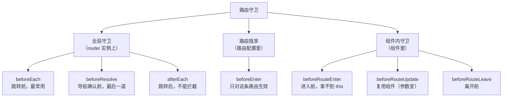
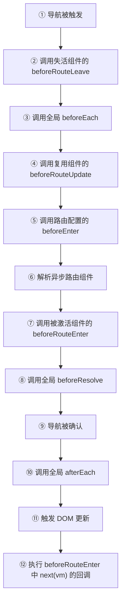

# Vue 路由守卫详解与面试回答

> 适用版本：Vue 2 + Vue Router 3 / Vue 3 + Vue Router 4
> 阅读建议：第 2~4 节是「是什么、什么时候触发、怎么控制」，第 5 节是实战，第 8 节可以直接背
> 相关教程：路由模式（hash / history）见「Vue 路由模式详解与面试回答」

---

## 目录

1. [一句话回答](#1-一句话回答)
2. [守卫全景](#2-守卫全景)
3. [完整执行顺序](#3-完整执行顺序)
4. [参数与返回值](#4-参数与返回值)
5. [五个实战场景](#5-五个实战场景)
6. [守卫与生命周期及 keep-alive](#6-守卫与生命周期及-keep-alive)
7. [常见坑](#7-常见坑)
8. [面试怎么答](#8-面试怎么答)
9. [高频追问](#9-高频追问)
10. [速记与自测](#10-速记与自测)

---

## 1. 一句话回答

**路由守卫是路由跳转流程中的「关卡」**：在导航真正发生前后，给你若干个钩子去**校验、拦截、重定向，或做副作用**。

它解决的问题是：在「URL 变了」和「组件渲染了」之间插入一段可控逻辑，典型用途是**登录鉴权、动态路由、权限校验、页面标题、进度条、离开确认、埋点**。

---

## 2. 守卫全景

Vue Router 4（也适用于 3，只是写法略有差异）共有 **3 大类、7 种**守卫：



### 2.1 逐个说明

| 守卫 | 位置 | 时机 | 能拦截 | 典型用途 |
| --- | --- | --- | --- | --- |
| `beforeEach(to, from)` | 全局 | 每次跳转最开始 | ✅ | 登录鉴权、白名单、动态路由 |
| `beforeResolve(to, from)` | 全局 | 所有组件守卫、异步组件解析完之后 | ✅ | 最后一道校验、等待数据 |
| `afterEach(to, from, failure)` | 全局 | 导航被确认后 | ❌ | 页面标题、埋点、关进度条 |
| `beforeEnter(to, from)` | 路由配置 | 进入该路由前 | ✅ | 单页面级别权限、必须登录 |
| `beforeRouteEnter(to, from, next)` | 组件内 | 组件实例**创建前** | ✅ | 进入前预取数据 |
| `beforeRouteUpdate(to, from)` | 组件内 | 组件被复用、参数变化 | ✅ | `/user/1` → `/user/2` |
| `beforeRouteLeave(to, from)` | 组件内 | 离开该组件对应路由前 | ✅ | 未保存提示、清理定时器 |

### 2.2 三种写法的注册位置

```js
// ① 全局
router.beforeEach((to, from) => {})
router.beforeResolve((to, from) => {})
router.afterEach((to, from) => {})
```

```js
// ② 路由独享
{
  path: '/admin',
  component: Admin,
  beforeEnter: (to, from) => {
    if (!isAdmin()) return '/403'
  },
}
```

```vue
<!-- ③ 组件内（选项式） -->
<script>
export default {
  beforeRouteEnter(to, from, next) {
    // ❌ 这里没有 this，组件实例还没创建
    next((vm) => {
      vm.init()
    }) // ✅ 通过回调拿实例
  },
  beforeRouteUpdate(to, from) {},
  beforeRouteLeave(to, from) {},
}
</script>
```

```vue
<!-- ③ 组件内（组合式，Vue Router 4） -->
<script setup>
import { onBeforeRouteLeave, onBeforeRouteUpdate } from 'vue-router'

// 注意：没有 onBeforeRouteEnter
// 因为 setup 执行时守卫已经过了，进入时机的逻辑直接写在 setup 里即可
onBeforeRouteUpdate((to, from) => {
  fetchDetail(to.params.id)
})
onBeforeRouteLeave((to, from) => {
  if (hasUnsavedChanges()) return window.confirm('确定离开？')
})
</script>
```

> **面试点：为什么没有 `onBeforeRouteEnter`？**
> 因为 `beforeRouteEnter` 的时机是「组件实例创建之前」，而 `<script setup>` 本身就是在实例创建阶段执行的——你写在 setup 里的代码本来就在那个时机，不需要再包一层。

---

## 3. 完整执行顺序

### 3.1 官方顺序



**记忆口诀：**

> **离 → 全局前 → 更新 → 独享 → 异步 → 进入 → 解析 → 确认 → 后置 → 渲染 → 回调**

或者分层记：

| 阶段 | 顺序 |
| --- | --- |
| 离开阶段 | 组件 `beforeRouteLeave` |
| 全局前置 | `beforeEach` |
| 组件复用 | `beforeRouteUpdate` |
| 路由级 | `beforeEnter` |
| 异步解析 | 加载异步组件 |
| 进入阶段 | 组件 `beforeRouteEnter` |
| 全局解析 | `beforeResolve` |
| 确认后 | `afterEach` → DOM 更新 → `next(vm)` 回调 |

### 3.2 一个具体例子

场景：从 `/list` 跳到 `/detail/2`，`/detail` 配了懒加载，且 Detail 组件之前在 `/detail/1` 时已被复用（同一路由记录）。

1. List 组件的 `beforeRouteLeave`——先「离开旧页面」
2. 全局 `beforeEach`
3. Detail 的 `beforeRouteUpdate`——因为它被复用（如果是新进入则没有这一步）
4. `/detail` 路由的 `beforeEnter`
5. 解析异步路由组件（`import()` 的 Detail chunk）
6. Detail 的 `beforeRouteEnter`——只在「从别的路由进入」时触发
7. 全局 `beforeResolve`
8. 全局 `afterEach`
9. DOM 更新
10. `beforeRouteEnter` 里 `next(vm => ...)` 的回调

如果 Detail 是**首次**进入（`/list` → `/detail/2`，之前没进过详情页），则第 3 步不存在，走的是第 6 步的 `beforeRouteEnter`。

> 注意：`beforeRouteEnter` 排在 `beforeRouteLeave` **之后**（因为要先离开旧页面），这一点很多人会记反。

### 3.3 守卫与组件生命周期

首次进入一个页面：

```text
beforeEach → beforeResolve → afterEach
  → 组件 beforeCreate → created → beforeMount → mounted
  → beforeRouteEnter 的 next(vm) 回调
```

所以：

- 守卫在**组件创建之前**执行 → 守卫里拿不到组件实例
- `next(vm)` 回调在 **mounted 之后**执行 → 这里能拿到实例、能操作 DOM
- 想在进入前预取数据，两种做法：① 守卫里请求，存 store，组件里读；② 组件内 `onMounted` / `activated` 里请求

---

## 4. 参数与返回值

### 4.1 三个参数

```js
router.beforeEach((to, from) => {
  to // 目标路由对象：path / fullPath / params / query / hash / name / meta / matched
  from // 来源路由对象，结构相同
  // next // Vue Router 3 必写；Vue Router 4 可选
})
```

| 字段 | 说明 | 注意 |
| --- | --- | --- |
| `to.path` | 路径，不含 query 和 hash | `/user/1` |
| `to.fullPath` | 完整路径，含 query 和 hash | `/user/1?tab=a#top` |
| `to.params` | 动态段参数 | `/user/:id` → `{ id: '1' }` |
| `to.query` | 查询参数对象 | `?a=1` → `{ a: '1' }` |
| `to.hash` | 锚点 | `#top` |
| `to.name` | 命名路由 | — |
| `to.meta` | 路由元信息（**守卫最常用**） | `{ requiresAuth: true }` |
| `to.matched` | 匹配到的路由记录数组（含父级） | 嵌套路由鉴权用它 |

### 4.2 Vue Router 4：返回值即结果

```js
router.beforeEach((to) => {
  if (!token && to.meta.requiresAuth) {
    return { name: 'Login', query: { redirect: to.fullPath } } // 重定向
  }
  // return false            → 取消导航，URL 回退到原位置
  // return true / undefined → 放行
})
```

| 返回值 | 效果 |
| --- | --- |
| `undefined` / `true` | 放行 |
| `false` | 取消导航（URL 恢复到 from） |
| 路由地址（字符串 / 对象） | 重定向到该地址 |
| `Promise` | 等待 resolve，resolve 的值同上 |

### 4.3 Vue Router 3：next 的四种用法

```js
router.beforeEach((to, from, next) => {
  next() // 放行
  next(false) // 取消，URL 回到 from
  next('/login') // 重定向到 /login（会重新走一遍守卫）
  next(new Error('x')) // 中断并抛错，触发 router.onError
})

// beforeRouteEnter 专属：拿实例
beforeRouteEnter(to, from, next) {
  next((vm) => {
    vm.load()
  }) // 组件 mounted 之后执行
}
```

> ⚠️ **Vue Router 4 里 `next` 仍然可用**（为了迁移平滑），但**不要和 `return` 混用**，否则容易出现「导航挂起」或「重复导航」的诡异问题。新项目统一用 `return`。

### 4.4 异步守卫

```js
// Vue Router 4：直接 async
router.beforeEach(async (to) => {
  if (!store.user) {
    await store.fetchUser() // 等接口
  }
  if (!store.user && to.meta.auth) return '/login'
})
```

```js
// Vue Router 3：用 next 或返回 Promise
router.beforeEach((to, from, next) => {
  fetchUser()
    .then(() => next())
    .catch(() => next('/login'))
})
```

> 守卫在 resolve 之前会**挂起导航**，URL 已经变了但页面还没渲染——所以慢接口会让「点了没反应」，建议配合 `NProgress` 给用户反馈。

---

## 5. 五个实战场景

### 5.1 登录鉴权 + 白名单

```js
const whiteList = ['/login', '/404', '/register']

router.beforeEach((to) => {
  const token = getToken()

  // 1. 没 token
  if (!token) {
    if (whiteList.includes(to.path)) return true
    return { path: '/login', query: { redirect: to.fullPath } } // 记住来路
  }

  // 2. 有 token 还去登录页 → 送回首页
  if (to.path === '/login') return { path: '/' }

  // 3. 正常放行
  return true
})
```

```js
// 登录成功后回跳
const redirect = route.query.redirect || '/'
router.replace(redirect)
```

> **加分点**：`redirect` 必须 `encodeURIComponent` 吗？
> 用 `query` 传时 Vue Router 会自动编码；但如果手动拼字符串，就要自己编码，否则 `?a=1&b=2` 会被截断。

### 5.2 动态路由（权限菜单）

```js
let routesAdded = false

router.beforeEach(async (to) => {
  if (!getToken()) {
    return to.path === '/login' ? true : { path: '/login', query: { redirect: to.fullPath } }
  }
  if (to.path === '/login') return '/'

  // 已经加载过权限路由 → 直接放行
  if (routesAdded) return true

  try {
    const { menus } = await fetchUserMenus()
    const dynamicRoutes = transformMenusToRoutes(menus)
    dynamicRoutes.forEach((r) => router.addRoute(r))
    routesAdded = true

    // ⚠️ 关键：路由表变了，必须重新进入当前地址，否则会命中 404
    return { ...to, replace: true }
  } catch (e) {
    clearToken()
    return { path: '/login' }
  }
})
```

> **为什么必须 `return { ...to, replace: true }`？**
> 因为这次导航在 `addRoute` **之前**就已经匹配过路由表了（匹配到 404）。新增路由后必须「重新导航一次」，让 Vue Router 用新的路由表重新匹配。这是动态路由最常见的坑。
> `...to` 展开是为了保留 `params` / `query` / `hash`，只加 `replace` 避免多一条历史记录。

### 5.3 页面标题 + 进度条

```js
import NProgress from 'nprogress'

router.beforeEach(() => {
  NProgress.start()
})

router.afterEach((to) => {
  NProgress.done()
  document.title = to.meta.title ? `${to.meta.title} - 我的应用` : '我的应用'
})
```

> `afterEach` 不能拦截导航，所以适合放「一定会执行」的副作用。

### 5.4 离开前确认（未保存提示）

```vue
<script setup>
import { computed, reactive } from 'vue'
import { onBeforeRouteLeave } from 'vue-router'

const form = reactive({ name: '' })
const dirty = computed(() => form.name !== '')

onBeforeRouteLeave(() => {
  if (!dirty.value) return true
  const ok = window.confirm('内容还没保存，确定离开吗？')
  return ok // false → 取消导航
})
</script>
```

### 5.5 组件级权限（beforeEnter）

```js
{
  path: '/admin',
  component: Admin,
  meta: { requiresAuth: true, roles: ['admin'] },
  beforeEnter: (to) => {
    const { roles } = store.user
    if (!to.meta.roles.some((r) => roles.includes(r))) return '/403'
  },
}
```

> 为什么用 `beforeEnter` 而不是 `beforeEach`？
> `beforeEnter` 只在**进入这条路由**时触发，逻辑内聚在路由配置里，不用在全局守卫里堆一堆 `if (to.path === 'xxx')`。

---

## 6. 守卫与生命周期及 keep-alive

### 6.1 首次进入与二次进入

| 场景 | 触发的守卫 | 触发的组件钩子 |
| --- | --- | --- |
| 首次进入 A | `beforeEach` → `beforeResolve` → `afterEach` → `beforeRouteEnter` | `setup` → `beforeMount` → `mounted` → `activated`（若被缓存） |
| A → B → 返回 A（A 被 keep-alive） | `beforeEach` → ... → `afterEach` | 只有 `activated`，**没有** `created` / `mounted` |
| `/user/1` → `/user/2`（同组件） | `beforeRouteUpdate` | 无（组件被复用） |
| 离开 A | `beforeRouteLeave` | `deactivated`（若被缓存）/ `beforeUnmount` + `unmounted`（若没缓存） |

### 6.2 keep-alive 下的注意事项

1. **`beforeRouteLeave` 在缓存组件上仍会触发**（路由确实变化了），但组件**不会销毁**，所以 `onUnmounted` 不执行——清理逻辑要放 `onDeactivated`。
2. **`beforeRouteEnter` 只在首次进入时触发**，二次进入被缓存时不会再执行——「每次进入都要做的事」（刷新数据）必须放 `activated`。
3. **`beforeRouteUpdate` 在组件被复用时触发**，典型场景是路由参数变化（`/detail/1` → `/detail/2`）。如果给 `<router-view>` 加了 `:key="route.fullPath"`，组件会被强制重建，此时走的是 `beforeRouteEnter` 而不是 `beforeRouteUpdate`。

### 6.3 嵌套路由的守卫顺序

进入 `/a/b` 时：

1. `/a` 的 `beforeEnter`
2. `/a/b` 的 `beforeEnter`
3. `/a` 组件的 `beforeRouteEnter`
4. `/a/b` 组件的 `beforeRouteEnter`

> 顺序是**父 → 子**。离开时反过来：**子 → 父**。

---

## 7. 常见坑

| 坑 | 现象 | 原因 / 解决 |
| --- | --- | --- |
| `next` 调用了两次 | 控制台警告、导航异常 | 每个分支只调一次，`return` 之后就不要再 `next()` |
| 忘了调 `next` | 页面卡住不跳转、白屏 | VR3 必写；VR4 用 `return` 避免 |
| `next()` 和 `return` 混用 | 导航挂起 / 重复触发 | 统一一种风格 |
| 重定向死循环 | 栈溢出、页面疯狂刷新 | 判断目标页本身，如 `if (to.path === '/login') return true` |
| 动态路由后仍 404 | 有权限但页面 404 | `addRoute` 后必须 `return { ...to, replace: true }` 重新匹配 |
| `beforeEach` 里请求接口太慢 | 点菜单没反应 | 加 NProgress / loading，或把请求前置到应用初始化 |
| 守卫里拿 `this` | `undefined` | `beforeRouteEnter` 没有 `this`，用 `next(vm => ...)` 或改 `onMounted` |
| 守卫里用 `window.confirm` | 阻塞渲染、体验差 | 中后台建议用组件库的 `MessageBox`（需异步 await 处理） |
| `afterEach` 里想阻止跳转 | 无效 | `afterEach` 时导航已确认，只能做副作用 |
| `meta` 写在子路由上但父级判断 | 拿不到 | 用 `to.matched.some(r => r.meta.auth)` 遍历 |
| 守卫里 `next({ ...to })` 少写 `replace` | 历史记录多一条、后退异常 | 补 `replace: true` |
| 异步守卫抛错没处理 | 导航中断、白屏 | `try/catch` + `router.onError` 兜底 |
| 登录页也走鉴权 | 无限重定向 | 白名单必须先判断 |
| `beforeRouteLeave` 里用 `await` | 行为不确定 | 返回 Promise 时 Vue Router 会等待，但 `confirm` 是同步的，注意写法 |

### 7.1 next 到底该写在哪

```js
// ✅ 每个分支明确出口
router.beforeEach((to, from, next) => {
  if (!token) {
    next('/login')
    return // ← 加 return，防止往下走
  }
  next()
})
```

```js
// ✅ VR4 更清爽
router.beforeEach((to) => {
  if (!token) return '/login'
})
```

---

## 8. 面试怎么答

### 8.1 30 秒版

> 路由守卫是路由跳转过程中的钩子，用来在导航前后做校验、拦截和副作用。分三类七种：
>
> **全局**有 `beforeEach`（跳转前，最常用，做登录鉴权）、`beforeResolve`（所有组件守卫和异步组件解析完之后，最后一道）、`afterEach`（跳转后，不能拦截，做标题和埋点）；
> **路由独享**的是 `beforeEnter`，只在进入某条路由时触发；
> **组件内**有 `beforeRouteEnter` / `beforeRouteUpdate` / `beforeRouteLeave`，分别对应进入前、组件复用（参数变化）、离开前。
>
> 执行顺序是：`beforeRouteLeave` → `beforeEach` → `beforeRouteUpdate` → `beforeEnter` → 解析异步组件 → `beforeRouteEnter` → `beforeResolve` → `afterEach` → DOM 更新 → `beforeRouteEnter` 的 `next(vm)` 回调。
>
> 返回值上，Vue Router 3 用 `next()` / `next(false)` / `next('/login')`；Vue Router 4 推荐直接 `return`，`false` 取消、返回地址则重定向。

### 8.2 2 分钟结构化版

1. **是什么**：导航流程中的钩子，能在「URL 变了」和「组件渲染」之间插入逻辑。
2. **分类**：全局 3 个、路由独享 1 个、组件内 3 个；重点讲 `beforeEach` 和 `beforeRouteEnter` 拿不到 `this` 的特点。
3. **顺序**：离开 → 全局前置 → 复用更新 → 路由独享 → 异步解析 → 进入 → 全局解析 → 后置 → 渲染 → 回调。
4. **返回值**：`false` 取消、地址重定向、`undefined` 放行；VR3 的 `next` 与 VR4 的 `return` 差异。
5. **实战**：登录鉴权 + `redirect` 回跳；动态路由 `addRoute` 后必须重新导航；`afterEach` 做标题和进度条；`onBeforeRouteLeave` 做未保存提示。
6. **坑**：`next` 重复调用、重定向死循环、动态路由不重新匹配、`beforeRouteEnter` 没有 `this`。
7. **与 keep-alive 的关系**：缓存组件二次进入只触发 `activated`，不再触发 `beforeRouteEnter`。

### 8.3 一段可以直接背的标准答案

> 路由守卫是 Vue Router 在导航过程中暴露的钩子，主要作用是在路由跳转前做**权限校验和拦截**，在跳转后做**副作用**，比如设置标题、上报埋点、关闭进度条。
>
> 它分三类：全局守卫 `beforeEach` / `beforeResolve` / `afterEach`；路由独享的 `beforeEnter`；组件内的 `beforeRouteEnter` / `beforeRouteUpdate` / `beforeRouteLeave`。其中 `beforeEach` 最常用，一般用来做登录态校验和白名单；`beforeResolve` 在所有组件内守卫和异步路由组件都解析完之后执行，是导航确认前的最后一道；`afterEach` 时导航已经确认，不能拦截，只能做副作用。
>
> 执行顺序上，先触发失活组件的 `beforeRouteLeave`，然后是全局 `beforeEach`，接着是复用组件的 `beforeRouteUpdate`、路由配置的 `beforeEnter`，再解析异步组件、调用激活组件的 `beforeRouteEnter`，然后是全局 `beforeResolve`，导航确认后走 `afterEach`，DOM 更新完成后再执行 `beforeRouteEnter` 里 `next(vm => ...)` 的回调。
>
> 参数是 `to`、`from`、`next`。Vue Router 3 里必须调 `next`，`next(false)` 取消、`next('/login')` 重定向；Vue Router 4 推荐直接返回值，返回 `false` 取消，返回路由地址就重定向，不返回就是放行。
>
> 实际项目里我一般这样用：`beforeEach` 里做 token 校验和白名单，把原地址塞到 `query.redirect` 里，登录成功后回跳；需要动态权限时，在守卫里拉菜单、`addRoute`，然后 `return { ...to, replace: true }` 让路由重新匹配一次，否则会因为这次导航已经匹配过 404 而白屏；`afterEach` 里设 `document.title` 和关掉进度条；表单页面用 `onBeforeRouteLeave` 做未保存提示。
>
> 有几个坑要注意：`next` 每个分支只能调一次、不能和 `return` 混用；重定向要判断目标页本身否则死循环；`beforeRouteEnter` 里没有 `this`，要拿实例得用 `next(vm => ...)`；组件被 keep-alive 缓存后，二次进入只触发 `activated`，不会再有 `beforeRouteEnter`。

---

## 9. 高频追问

1. **守卫有几种？**——3 类 7 种。
2. **执行顺序？**——背口诀：离 → 全局前 → 更新 → 独享 → 异步 → 进入 → 解析 → 确认 → 后置 → 渲染 → 回调。
3. **`beforeEach` 和 `beforeResolve` 的区别？**——`beforeResolve` 在所有组件内守卫和异步组件都解析完之后执行，是「确认前最后一道」，适合做需要等所有东西就绪的校验。
4. **`afterEach` 能阻止跳转吗？**——不能，导航已确认。
5. **`beforeRouteEnter` 为什么拿不到 `this`？**——组件实例还没创建；用 `next(vm => ...)` 或把逻辑放 `mounted` / `activated`。
6. **`beforeRouteUpdate` 什么时候触发？**——组件被复用、路由参数变化时（`/user/1` → `/user/2`）。
7. **动态路由为什么要重新导航？**——本次导航已经用旧路由表匹配过（可能命中 404），`addRoute` 后必须 `return { ...to, replace: true }` 重新匹配。
8. **守卫里怎么做异步？**——返回 Promise / `async` 函数，Vue Router 会等待 resolve 再继续。
9. **守卫会阻塞渲染吗？**——会。守卫未 resolve 前导航处于 pending，URL 已变但页面不更新，所以要给用户 loading 反馈。
10. **keep-alive 缓存的页面，守卫还触发吗？**——路由守卫照样触发（路由变了），但组件内的 `beforeRouteEnter` 只在首次进入时执行，二次进入走 `activated`。
11. **嵌套路由的守卫顺序？**——进入时父 → 子，离开时子 → 父。
12. **守卫里能拿到组件实例吗？**——全局守卫和 `beforeRouteEnter` 都不能；`beforeRouteUpdate` / `beforeRouteLeave` 可以（组件还在）。

---

## 10. 速记与自测

### 10.1 速记

```text
【路由守卫】3 类 7 种
全局    ：beforeEach（鉴权）、beforeResolve（最后一道）、afterEach（副作用）
路由独享：beforeEnter
组件内  ：beforeRouteEnter（无 this）、beforeRouteUpdate（复用）、beforeRouteLeave（离开）

顺序：离开 → beforeEach → beforeRouteUpdate → beforeEnter
      → 异步组件 → beforeRouteEnter → beforeResolve
      → afterEach → DOM 更新 → next(vm) 回调

返回值：false 取消 / 地址 重定向 / undefined 放行
      VR3 用 next()，VR4 用 return

动态路由：addRoute 后必须 return { ...to, replace: true }
```

### 10.2 自测清单

- [ ] 说出 3 类 7 种守卫及各自用途
- [ ] 完整背出执行顺序
- [ ] 说清 `beforeEach` / `beforeResolve` / `afterEach` 的差异
- [ ] 说出 `beforeRouteEnter` 为什么没有 `this`，怎么拿实例
- [ ] 说出 `beforeRouteUpdate` 的触发条件
- [ ] 写出登录鉴权 + `redirect` 回跳的完整代码
- [ ] 解释动态路由为什么必须重新导航
- [ ] 说出 `next` 的四种用法和 VR4 的 `return` 对应关系
- [ ] 说出 3 个守卫常见坑及修复方式
- [ ] 说清 keep-alive 对守卫的影响
