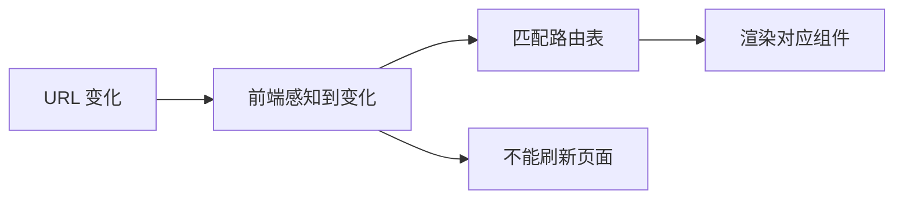
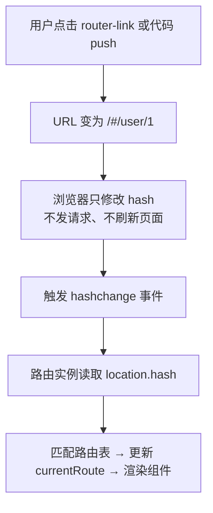
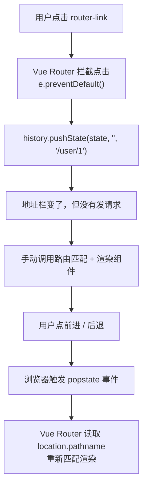
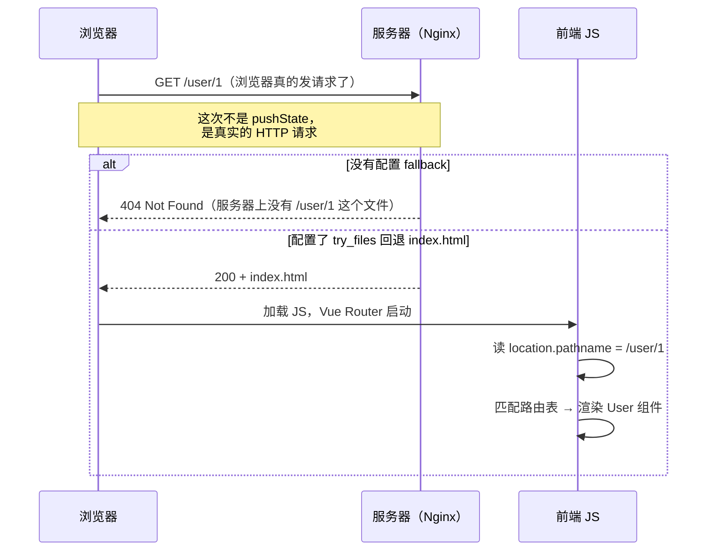

# Vue 路由模式详解与面试回答

> 适用版本：Vue 2 + Vue Router 3 / Vue 3 + Vue Router 4
> 相关教程：路由跳转流程中的拦截逻辑见「Vue 路由守卫详解与面试回答」

---

## 目录

1. [一句话回答](#1-一句话回答)
2. [前端路由的本质](#2-前端路由的本质)
3. [hash 模式](#3-hash-模式)
4. [history 模式](#4-history-模式)
5. [三种模式对比](#5-三种模式对比)
6. [Vue Router 4 中的用法](#6-vue-router-4-中的用法)
7. [history 模式的服务端配置](#7-history-模式的服务端配置)
8. [为什么 history 刷新会 404](#8-为什么-history-刷新会-404)
9. [手写迷你路由器](#9-手写迷你路由器)
10. [面试怎么答](#10-面试怎么答)
11. [高频追问](#11-高频追问)
12. [速记与自测](#12-速记与自测)

---

## 1. 一句话回答

Vue Router 有 **hash** 和 **history** 两种主要模式（外加用于 SSR / 测试的 **memory**），区别在于「**用什么方式改变 URL 而不刷新页面**」：

- **hash 模式**：利用 URL 的 `#` 片段，`#` 后面的内容不发往服务端，通过 hash 变化感知（原生实现监听 `hashchange`）——**不需要服务端配置**，但 URL 带 `#`。
- **history 模式**：利用 HTML5 **History API**（`pushState` / `replaceState` + `popstate`）改变路径——**URL 更好看、SEO 更好**，但**刷新或直接访问子路径需要服务端 fallback 到 `index.html`**，否则 404。

一句话记：**hash 靠「锚点不请求服务端」，history 靠「改地址栏但不发请求」。**

---

## 2. 前端路由的本质

### 2.1 多页应用与单页应用

| | 多页应用（MPA） | 单页应用（SPA） |
| --- | --- | --- |
| 页面切换 | 浏览器请求新 HTML，整页刷新 | 不请求 HTML，JS 换组件 |
| URL | 服务端真实存在的路径 | 前端「虚拟」的路径 |
| 谁来响应 URL | 服务端 | 前端路由 |

### 2.2 前端路由要做的四件事



拆开就是四步：

1. **改变 URL，但不发起请求、不刷新页面**（核心难点）
2. **监听 URL 的变化**（前进 / 后退、手动改地址）
3. **把 URL 映射到组件**（路由表匹配）
4. **渲染组件**（`<router-view>` 或 `component :is`）

**关键洞察**：浏览器原本只有两条路能改 URL——发请求（刷新）或改 `#`。HTML5 之后多了第三条：`pushState`。所以前端路由的实现只有两种思路，正好对应两种模式。

---

## 3. hash 模式

### 3.1 URL 形态

```
https://example.com/#/user/1
https://example.com/index.html#/user/1?tab=info
                        ↑ 从这里开始都是 hash，叫 fragment
```

### 3.2 原理



三个关键事实：

1. **`#` 及其后面的内容不会发送到服务端**。浏览器发请求时只发 `#` 前的部分，服务端永远只返回同一个 `index.html`，天然不会 404。
2. **改 hash 不刷新页面**，这是浏览器的原生行为（hash 的设计初衷就是页内锚点定位）。
3. **hash 变化会触发 `hashchange` 事件**；浏览器前进后退时，`hashchange` 和 `popstate` 都会触发。

```js
// 最小实现
window.addEventListener('hashchange', () => {
  const path = location.hash.slice(1) || '/'
  render(path)
})
```

### 3.3 优点

| 优点 | 说明 |
| --- | --- |
| **零服务端配置** | 部署到任何静态服务器、CDN，甚至 `file://` 都能跑 |
| **兼容性好** | `hashchange` 支持到 IE8+；history 模式需要 IE10+ |
| **不会 404** | 刷新、直接粘贴链接、分享链接都正常 |
| **不和真实路径冲突** | 后端已有的 `/api/xxx` 完全不受影响 |

### 3.4 缺点

| 缺点 | 说明 |
| --- | --- |
| **URL 带 `#`** | `example.com/#/user/1`，分享或粘贴时会保留片段 |
| **SEO 不友好** | 搜索引擎大多不索引 `#` 后的内容（历史上的 `#!` 爬取方案已废弃） |
| **锚点定位失效** | `#` 被路由占用了，没法用 `#section1` 做页内跳转（需要额外方案，比如 `scrollBehavior`） |
| **hash 有编码问题** | 中文 / 特殊字符会被编码，`location.hash` 拿到的可能是 `%E4%B8%AD` |
| **部分统计 / 埋点** | 默认只上报 `#` 前的部分，需要额外配置 |

> 补充：Vue Router 4 的 `createWebHashHistory()` 内部委托给 `createWebHistory()`，同样是 `pushState` / `replaceState` + `popstate`，只是 URL 多一个 `#`；`location.hash` + `hashchange` 是原生 hash 路由的最小实现。

---

## 4. history 模式

### 4.1 URL 形态

```
https://example.com/user/1
https://example.com/user/1?tab=info#section2   ← # 空出来做锚点了
```

### 4.2 原理



### 4.3 三个 API 必须分清

| API | 作用 | 是否触发 `popstate` | 是否新增历史记录 |
| --- | --- | --- | --- |
| `history.pushState(state, title, url)` | 新增一条历史记录 | **否** | 是 |
| `history.replaceState(state, title, url)` | 替换当前历史记录 | **否** | 否 |
| `history.back()` / `forward()` / `go(n)` | 前进后退 | **是** | — |

> **高频面试题：`pushState` 会触发 `popstate` 吗？**
> **不会。** `pushState` / `replaceState` 只修改地址栏和 session history，不触发任何事件；`popstate` 只在**用户点击前进 / 后退**（或调用 `history.go/back/forward`）时触发。
> 这就是为什么 Vue Router 在 `push` 之后要**自己手动调用一次匹配渲染**，而不是等事件。

> **另一个常考：`popstate` 事件的 `state` 是什么？**
> 是 `pushState` 时传入的第一个参数。Vue Router 会往里塞 `{ back, current, forward, replaced, position, scroll }` 之类的结构，用于还原滚动位置和判断方向。

### 4.4 为什么 pushState 不刷新页面

因为 History API 的定位就是「**只改地址栏和会话历史，不发起网络请求**」，这是规范里明确的行为。

```js
location.href = '/user/1' // 发请求 → 刷新
location.hash = '#/user/1' // 只改片段 → 不刷新
history.pushState({}, '', '/user/1') // 只改历史栈 → 不刷新（HTML5 新增）
```

### 4.5 优点

| 优点 | 说明 |
| --- | --- |
| **URL 美观** | 没有 `#`，和传统 URL 一致 |
| **SEO 更好** | 爬虫能正常抓取路径（配合 SSR / 预渲染效果最佳） |
| **可用锚点** | `#` 空出来了，可以做页内定位 |
| **分享 / 统计友好** | 第三方统计、分享卡片都能正确识别路径 |

### 4.6 缺点

| 缺点 | 说明 |
| --- | --- |
| **必须服务端配合** | 刷新 / 直接访问子路径会 404，需要 fallback 到 `index.html` |
| **兼容性** | 依赖 History API，IE9 及以下不支持 |
| **需要正确配置 base** | 部署到子目录时忘了配 `base`，路由和资源都会 404 |
| **不能直接双击打开** | `file://` 受同源策略限制，`pushState` 通常不可用（可能抛 `SecurityError`） |

---

## 5. 三种模式对比

| 维度 | hash | history | memory（abstract） |
| --- | --- | --- | --- |
| URL 形态 | `/#/user/1` | `/user/1` | 无 URL |
| 底层 API | `location.hash` + `hashchange`（Vue Router 4 内部用 `pushState` + `popstate`） | `pushState` + `popstate` | 纯内存栈 |
| 是否发请求 | 否（`#` 后不发） | 否（`pushState` 不发） | 否 |
| 刷新是否 404 | 不会 | **会**（需服务端 fallback） | 不适用 |
| 服务端配置 | 不需要 | **必需** | 不需要 |
| 兼容性 | IE8+ | IE10+ | 全部 |
| SEO | 差 | 好 | 无 |
| 锚点定位 | 冲突 | 可用 | 无 |
| Vue Router 4 创建函数 | `createWebHashHistory()` | `createWebHistory()` | `createMemoryHistory()` |
| Vue Router 3 配置 | `mode: 'hash'`（默认） | `mode: 'history'` | `mode: 'abstract'` |
| 典型场景 | 无服务端权限、微前端、内嵌页面、本地文件 | 面向 C 端的正式项目 | SSR、单元测试、小程序 |

> **memory 模式**：没有 URL 概念，路由状态存在内存里。Vue Router 4 用 `createMemoryHistory()`，主要用于 **SSR**（每个请求要一份独立路由实例，不能共享全局 URL）和**单元测试**。

---

## 6. Vue Router 4 中的用法

```js
// router/index.js
import { createRouter, createWebHistory, createWebHashHistory } from 'vue-router'

const router = createRouter({
  // history 模式（推荐，需服务端配合）
  history: createWebHistory(import.meta.env.BASE_URL),

  // hash 模式
  // history: createWebHashHistory(),

  routes: [
    { path: '/', component: Home },
    { path: '/user/:id', component: User },
    // 404 兜底：必须放最后
    { path: '/:pathMatch(.*)*', name: 'NotFound', component: NotFound },
  ],

  // 滚动行为（hash / history 模式都生效）
  scrollBehavior(to, from, savedPosition) {
    if (savedPosition) return savedPosition // 前进后退：还原位置
    if (to.hash) return { el: to.hash, behavior: 'smooth' } // 锚点
    return { top: 0 }
  },
})
```

### 6.1 base 是干什么的

`createWebHistory(base)` 的 base 是**应用部署的子路径**：

```js
createWebHistory('/admin/') // 应用部署在 https://example.com/admin/
```

- 它决定了 `router.push('/user')` 实际变成 `/admin/user`
- Vite 用 `import.meta.env.BASE_URL`（来自 `vite.config.js` 的 `base`）；Vue CLI 用 `process.env.BASE_URL`（来自 `vue.config.js` 的 `publicPath`），两者是同一含义
- **base 配错的典型症状**：路由前缀和实际部署路径不一致，刷新后 404、静态资源 404

### 6.2 路由跳转的两种方式

```vue
<!-- 声明式 -->
<router-link to="/user/1">用户</router-link>
<router-link :to="{ name: 'User', params: { id: 1 } }">用户</router-link>
```

```vue
<!-- 编程式 -->
<script setup>
import { useRouter, useRoute } from 'vue-router'

const router = useRouter()
const route = useRoute()

router.push('/user/1') // 新增历史记录
router.replace('/user/1') // 替换当前记录（后退会跳过它）
router.go(-1) // 后退
</script>
```

> **`push` 和 `replace` 的区别**：`push` 新增一条历史记录（能后退回去），`replace` 替换当前记录（后退会跳过它）。登录成功后跳首页一般用 `replace`，避免用户按后退回到登录页。

---

## 7. history 模式的服务端配置

核心就一句：**所有未命中真实文件的路径，都返回 `index.html`，交给前端路由处理。**

### 7.1 Nginx

```nginx
server {
  listen 80;
  server_name example.com;
  root /usr/share/nginx/html;
  index index.html;

  location / {
    # 先找真实文件 / 目录，找不到才回退 index.html
    try_files $uri $uri/ /index.html;
  }

  # 静态资源加长缓存（可选）
  location ~* \.(js|css|png|jpg|svg|woff2)$ {
    expires 30d;
    add_header Cache-Control "public, immutable";
  }
}
```

> **为什么必须写 `$uri $uri/`，而不是直接 `rewrite .* /index.html`？**
> 因为 `/assets/index-abc.js` 这种真实存在的静态文件不能被替换成 HTML，否则浏览器会拿到一段 HTML 当 JS 执行，报 `Unexpected token '<'`。`try_files` 的顺序保证「文件优先」。

### 7.2 部署到子目录

```nginx
location /admin/ {
  alias /usr/share/nginx/html/admin/;
  try_files $uri $uri/ /admin/index.html;
}
```

```js
// 前端要同步配
createWebHistory('/admin/')
// vite.config.js: base: '/admin/'
```

### 7.3 Apache

```apache
<IfModule mod_rewrite.c>
  RewriteEngine On
  RewriteBase /
  RewriteRule ^index\.html$ - [L]
  RewriteCond %{REQUEST_FILENAME} !-f
  RewriteCond %{REQUEST_FILENAME} !-d
  RewriteRule . /index.html [L]
</IfModule>
```

### 7.4 Node / Express

```js
const express = require('express')
const path = require('path')
const app = express()

app.use(express.static(path.resolve(__dirname, 'dist')))

// 注意：Express 5 里 '*' 写法变了，用正则 /.*/ 或中间件
app.get(/.*/, (req, res) => {
  res.sendFile(path.resolve(__dirname, 'dist/index.html'))
})
```

### 7.5 静态托管平台

```json
{
  "rewrites": [{ "source": "/(.*)", "destination": "/index.html" }]
}
```

```text
# Netlify: public/_redirects
/*  /index.html  200
```

> 一句话总结：**history 模式的 404 不是前端 bug，是部署配置问题。**

---

## 8. 为什么 history 刷新会 404

### 8.1 完整链路推演

场景：用户在 `https://example.com/user/1` 页面，按了 **F5**。



### 8.2 hash 模式为什么不会 404

```text
访问 https://example.com/#/user/1 并刷新
浏览器实际请求的是：https://example.com/     ← # 后面被丢弃了
服务器返回：index.html（肯定存在）
前端读到 location.hash = '#/user/1' → 渲染 User
```

**根因一句话**：

> hash 模式下，浏览器请求的永远是 `#` 前的路径，服务端一定能返回 `index.html`；
> history 模式下，浏览器请求的是**完整路径** `/user/1`，服务端没有这个文件就 404。

### 8.3 三种替代方案及问题

| 方案 | 问题 |
| --- | --- |
| 给每个路由生成一个真实 HTML 文件 | 路由是动态的（`/user/:id`），不可能穷举 |
| 用 404 页面重定向到首页 | 用户丢失了原路径，体验差，SEO 也不友好 |
| 用 hash 模式 | 能解决，但放弃了 history 的优点 |

**正确方案**：服务端 fallback（`try_files` / rewrite / rewrites 配置），由前端接管路由。生产环境追求 SEO 的话，再叠加 **SSR / 预渲染（prerender）**。

---

## 9. 手写迷你路由器

### 9.1 hash 版

```js
class HashRouter {
  constructor(routes) {
    this.routes = routes
    this.current = ''

    // 1. 监听 hash 变化（前进后退、手动改 hash 都会触发）
    window.addEventListener('hashchange', () => this.render())
    // 2. 首次进入也要渲染一次
    window.addEventListener('load', () => this.render())
  }

  render() {
    const path = location.hash.slice(1) || '/'
    if (path === this.current) return
    this.current = path

    const matched = this.match(path)
    const container = document.getElementById('app')
    container.innerHTML = matched ? matched.component() : '<h1>404</h1>'
  }

  match(path) {
    return this.routes.find((r) => r.path === path)
  }

  push(path) {
    location.hash = path // 改 hash，不刷新页面
  }

  replace(path) {
    // 不新增历史记录，用 replaceState 改掉带 hash 的完整 URL
    history.replaceState(null, '', `#${path}`)
    this.render()
  }
}

// 使用
new HashRouter([
  { path: '/', component: () => '<h1>Home</h1>' },
  { path: '/about', component: () => '<h1>About</h1>' },
])
```

### 9.2 history 版

```js
class HistoryRouter {
  constructor(routes) {
    this.routes = routes
    this.current = ''

    // 1. 前进后退 → popstate
    window.addEventListener('popstate', () => this.render())
    // 2. 拦截所有 <a> 点击（关键：阻止默认跳转）
    document.addEventListener('click', (e) => {
      const link = e.target.closest('a[href]')
      if (!link) return
      if (link.target === '_blank' || e.metaKey || e.ctrlKey || e.shiftKey) return

      const url = new URL(link.href, location.origin)
      if (url.origin !== location.origin) return // 外链不拦

      e.preventDefault() // 关键一步
      this.push(url.pathname + url.search + url.hash)
    })
    // 3. 首次进入
    window.addEventListener('load', () => this.render())
  }

  push(path) {
    history.pushState({ path }, '', path) // 只改地址栏，不发请求
    this.render() // 手动渲染（pushState 不触发事件）
  }

  render() {
    const path = location.pathname
    if (path === this.current) return
    this.current = path

    const matched = this.routes.find((r) => r.path === path)
    document.getElementById('app').innerHTML = matched
      ? matched.component()
      : '<h1>404</h1>'
  }
}
```

### 9.3 两个版本的本质差异

| | hash 版 | history 版 |
| --- | --- | --- |
| 改 URL | `location.hash = x` | `history.pushState()` |
| 感知变化 | `hashchange` 事件（自动） | `popstate` + **自己手动调 render** |
| 拦截点击 | 不需要（`<a href="#/x">` 天然不刷新） | **必须** `preventDefault()` |
| 首屏 | 读 `location.hash` | 读 `location.pathname` |
| 服务端 | 无关 | 必须 fallback |

> Vue Router 在此基础上增加了嵌套路由、动态参数、命名路由、守卫队列、异步组件解析、滚动行为和 `router-view` 深度解析。

---

## 10. 面试怎么答

### 10.1 30 秒版

- Vue Router 主要有 **hash** 和 **history** 两种模式，外加无 URL 的 **memory**；区别是「怎么改 URL 而不刷新页面」。
- **hash**：`#` 后的内容不发往服务端，刷新只请求 `#` 前的路径，因此不需要服务端配置；hash 变化可被感知（原生实现靠 `hashchange`）。代价是 URL 带 `#`、SEO 差、`#` 被占用后无法做锚点。
- **history**：用 `pushState` / `replaceState` 改地址栏，`popstate` 监听前进后退；URL 干净、SEO 好、锚点可用。刷新或直接访问子路径时浏览器会真实请求该路径，服务端必须 fallback 到 `index.html`，否则 404。
- **memory**（`createMemoryHistory`）：路由状态存在内存里，用于 SSR 和单元测试。

### 10.2 2 分钟结构化版

1. **本质**：前端路由 = 改 URL 不发请求 + 监听变化 + 匹配路由表 + 渲染组件。
2. **hash**：`#` 后不发服务端，刷新只请求 `#` 前的路径；hash 变化可被感知（原生靠 `hashchange`）；零配置、兼容 IE8；URL 带 `#`、SEO 差、锚点冲突。
3. **history**：`pushState` 只改历史栈不发请求，需要自己手动 render；`popstate` 监听前进后退；URL 干净、SEO 好、锚点可用；必须服务端 fallback。
4. **404 根因**：刷新时浏览器对 `/user/1` 发起真实 HTTP 请求，服务端找不到该文件。
5. **memory**：无 URL，SSR / 测试用。
6. **选型**：面向 C 端、能改服务端 → history；无服务端权限 / 微前端 / 内嵌 → hash。
7. **实现细节**：`push` 新增历史记录、`replace` 替换；`pushState` 不触发 `popstate`；`base` 是部署子路径。

---

## 11. 高频追问

1. **`pushState` 会触发 `popstate` 吗？**——不会。只有前进 / 后退（`go/back/forward`）才触发。
2. **那 Vue Router 怎么知道 `push` 之后要渲染？**——自己手动调匹配渲染，不等事件。
3. **`push` 和 `replace` 的区别？**——是否新增历史记录；登录后跳首页用 `replace`。
4. **`history.go(-1)` 和 `router.back()` 一样吗？**——`router.back()` 内部就是 `router.go(-1)`，最终调用 `history.go(-1)`；两者都会触发 `popstate`，Vue Router 仍能接管。
5. **`base` 有什么用？**——指定应用部署的子路径，影响路由前缀和静态资源路径。
6. **history 模式能部署到 CDN / 对象存储吗？**——需要支持 fallback 重写；纯静态对象存储一般做不到，只能用 hash 模式。
7. **memory 模式干什么用？**——无 URL，SSR 每个请求独立路由实例、单元测试。
8. **`scrollBehavior` 有什么用？**——控制跳转后的滚动位置：`savedPosition` 还原前进 / 后退位置，`{ el: to.hash }` 定位锚点，`{ top: 0 }` 回到顶部。
9. **前端路由的原理是什么？**——改 URL 不发请求（`hash` / `pushState`）+ 监听变化（`hashchange` / `popstate`）+ 匹配路由表 + 渲染组件。

---

## 12. 速记与自测

### 12.1 速记

```text
【路由模式】
hash    ：location.hash + hashchange（原生最小实现）
          Vue Router 4 内部仍走 pushState + popstate，URL 多一个 #
          创建：createWebHashHistory()
history ：pushState / replaceState + popstate
          pushState 不触发 popstate
          创建：createWebHistory(base)
memory  ：无 URL，SSR / 单测
          创建：createMemoryHistory()
```

### 12.2 自测清单

- [ ] 说出前端路由要做的四件事
- [ ] 说清 hash 模式的原理和「为什么不会 404」
- [ ] 说清 history 模式的原理，特别是「`pushState` 不触发 `popstate`」
- [ ] 画出 history 模式刷新的完整链路（浏览器 → 服务器 → 前端）
- [ ] 写出 Nginx 的 `try_files` 配置，并解释为什么要先找文件
- [ ] 说出 `push` 和 `replace` 的区别及使用场景
- [ ] 说出 `base` 的作用，以及配错时的症状
- [ ] 说出 memory 模式的两个用途
- [ ] 手写 hash 版和 history 版迷你路由
- [ ] 说出 hash / history / memory 三种模式的主要差异
