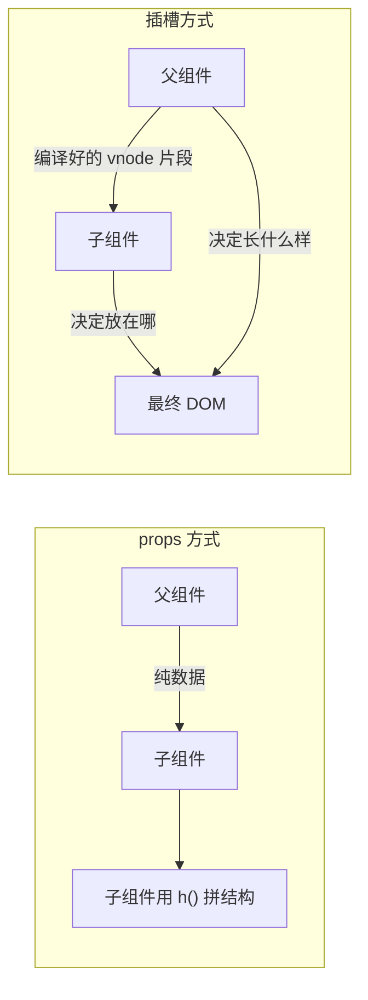
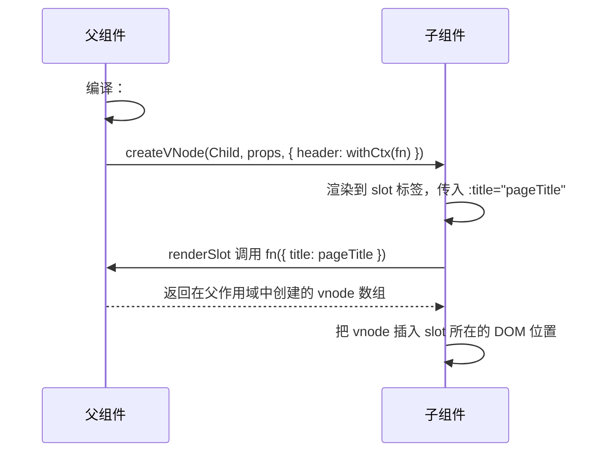

# Vue 插槽 slot 详解与面试回答

> 适用版本：Vue 2.x / Vue 3.x（含 `<script setup>`）
> 覆盖：默认 / 具名 / 作用域插槽，编译作用域，Vue 3 编译产物与 Vue 2 差异

---

## 目录

1. [一句话回答](#1-一句话回答)
2. [为什么需要插槽](#2-为什么需要插槽)
3. [三种插槽与语法对照](#3-三种插槽与语法对照)
4. [作用域插槽](#4-作用域插槽)
5. [编译与运行时原理](#5-编译与运行时原理)
6. [Vue 2 与 Vue 3 的差异](#6-vue-2-与-vue-3-的差异)
7. [常见坑](#7-常见坑)
8. [典型场景](#8-典型场景)
9. [面试怎么答](#9-面试怎么答)
10. [自测清单](#10-自测清单)

---

## 1. 一句话回答

**插槽是 Vue 的「内容分发」机制**：父组件调用子组件时，把自己的模板片段「填」进子组件预留的位置。

它解决的是——**子组件控制结构（在哪放），父组件控制内容（放什么）**，从而在不增加 props 数量的前提下实现高度可定制的组件。

关键约束：插槽内容**在父组件的作用域里编译**，想拿子组件的数据，必须用**作用域插槽**。

---

## 2. 为什么需要插槽

### 2.1 只用 props 的困境

Card 组件要支持「标题 + 内容 + 底部按钮 + 图标 + 头部右侧操作区」：

```vue
<!-- 用 props 的写法：props 数量爆炸，而且只能传字符串 / vnode -->
<Card
  title="用户信息"
  icon="user"
  content="这是一段文本"
  :footer="h(Button, {}, () => '确定')"
  :extra="h('a', {}, '详情')"
/>
```

| 问题 | 说明 |
| --- | --- |
| props 数量爆炸 | 每加一个可定制区域就要加一个 prop |
| 只能传数据，不能传结构 | 想放复杂 DOM 就得用 `h()` 手写渲染函数，可读性很差 |
| 无法访问父组件作用域 | `h()` 传进去的内容拿不到父组件的数据（除非手动闭包） |
| 事件绑定麻烦 | 内容里的 `@click` 只能靠回调 props 传递 |

### 2.2 插槽的思路

```vue
<!-- 子组件 Card.vue：只负责「结构」 -->
<template>
  <div class="card">
    <header class="card-header">
      <slot name="header">默认标题</slot>
    </header>
    <main class="card-body">
      <slot />
    </main>
    <footer
      v-if="$slots.footer"
      class="card-footer"
    >
      <slot name="footer" />
    </footer>
  </div>
</template>
```

```vue
<!-- 父组件：负责「内容」，随便写，能用自己的数据和方法 -->
<Card>
  <template #header>
    <h3>{{ user.name }}</h3>
    <a @click="handleEdit">编辑</a>
  </template>

  <p>这里是正文，可以放任意组件：<MyChart :data="chartData" /></p>

  <template #footer>
    <el-button @click="submit">确定</el-button>
  </template>
</Card>
```

两种方式的本质区别：



> **props 传数据，slot 传结构**。两者互补，不是替代关系。

---

## 3. 三种插槽与语法对照

### 3.1 默认插槽

```vue
<!-- 子组件 -->
<slot>这里是没有传内容时的后备内容（fallback）</slot>

<!-- 父组件 -->
<Child>我要放这里</Child>
```

### 3.2 具名插槽

子组件预留多个位置，父组件按名字填充：

```vue
<!-- 子组件：不写 name 的就是默认插槽 -->
<div class="layout">
  <header><slot name="header" /></header>
  <aside><slot name="sidebar" /></aside>
  <main><slot /></main>
  <footer><slot name="footer" /></footer>
</div>
```

```vue
<!-- 父组件：Vue 2.6+ / Vue 3 写法 -->
<Layout>
  <template #header>头部</template>
  <template #sidebar>侧边栏</template>
  <p>这里进 default</p>
  <template #footer>底部</template>
</Layout>
```

### 3.3 作用域插槽

子组件把数据通过 `<slot>` 的属性「反向」交给父组件的模板：

```vue
<!-- 子组件 MyList.vue -->
<template>
  <ul>
    <li
      v-for="(item, index) in list"
      :key="item.id"
    >
      <slot
        :item="item"
        :index="index"
      />
    </li>
  </ul>
</template>

<script setup>
defineProps({ list: Array })
</script>
```

```vue
<!-- 父组件：结构由我定，数据由子组件给 -->
<MyList :list="users">
  <template #default="{ item, index }">
    <span>{{ index + 1 }}. {{ item.name }}</span>
    <el-button @click="remove(item.id)">删除</el-button>
  </template>
</MyList>
```

Element Plus / Ant Design 的 Table、Select、Tree 的「自定义渲染」全都靠它实现。

### 3.4 动态插槽名

插槽名可以是一个表达式，用指令动态参数 `#[name]`：

```vue
<!-- 父组件：按 slotNames 逐个生成具名插槽 -->
<Layout>
  <template
    v-for="name in slotNames"
    :key="name"
    #[name]
  >
    <span>{{ name }}</span>
  </template>
</Layout>
```

编译产物不再是对象字面量，而是 `_createSlots([...])` + `DYNAMIC_SLOTS`（1024）patch flag；子组件侧对应的写法是 `<slot :name="name" />`。

> `#[dynamicName]` 用的是**指令动态参数**语法；Vue 2.6 的对应写法是 `v-slot:[name]`。

### 3.5 后备内容

`<slot>` 标签内部的内容，只在父组件没传这个插槽的有效内容时渲染：

```vue
<slot name="footer">
  <span>默认底部</span>
</slot>
```

如果只是想让某个外层容器在「有插槽时才出现」，用 `$slots` 判断：

```vue
<footer v-if="$slots.footer">
  <slot name="footer" />
</footer>
```

`$slots.footer` 只表示「父组件传了这个插槽」，不表示内容非空：`<template #footer></template>` 或只写注释时它仍然是函数（truthy），此时 `renderSlot` 会把注释、空文本视为无效内容，照旧渲染 fallback。

### 3.6 Vue 2 / Vue 3 语法对照

| 能力 | Vue 2.5 及以前 | Vue 2.6+ / Vue 3 |
| --- | --- | --- |
| 默认插槽 | 直接写在组件内 | 直接写 / `<template #default>` |
| 具名插槽 | `<div slot="header">` | `<template #header>` 或 `<template v-slot:header>` |
| 作用域插槽 | `<template slot-scope="props">` | `<template #default="props">` |
| 缩写 | 无 | `v-slot:header` → `#header` |

两个必须记住的限制：

- `v-slot` **只能用在 `<template>` 或组件标签上**，写在普通元素上编译报错：`v-slot can only be used on components or <template> tags.`
- 跨版本一律写 `#default`：Vue 3.5 的编译器会把单独的 `#` 当成默认插槽，这个边界行为不要依赖。

---

## 4. 作用域插槽

### 4.1 数据流向

| 机制 | 数据方向 | 谁决定结构 |
| --- | --- | --- |
| props | 父 → 子 | 子组件 |
| 默认 / 具名插槽 | 无数据传递（父作用域） | 父组件写内容 + 子组件定位置 |
| **作用域插槽** | **子 → 父** | 父组件写内容 + 子组件提供数据 |

> **props 是父传子，作用域插槽是子传父——但传的不是事件，是数据；父组件拿到数据后自己决定怎么渲染。**

### 4.2 编译作用域

规则只有一条：

> 父级模板里的所有内容，都在**父级作用域**中编译；子模板里的所有内容，都在**子作用域**中编译。

```vue
<!-- ❌ 拿不到 item：这段模板编译在父组件作用域，父组件没有 item -->
<MyList :list="users">
  <span>{{ item.name }}</span>
</MyList>

<!-- ✅ 子组件把 item 作为插槽 props 传出来，父组件再接收 -->
<MyList :list="users">
  <template #default="{ item }">
    <span>{{ item.name }}</span>
  </template>
</MyList>
```

所以有一个反直觉的结论：作用域插槽的内容虽然写在子组件标签内部，但它**属于父组件的渲染上下文**——能访问父组件的 `data` / `methods` / `computed`，访问不到子组件的内部状态。

```vue
<MyList :list="users">
  <template #default="{ item }">
    <!-- ✅ 父组件的 theme -->
    <span :class="theme">{{ item.name }}</span>
    <!-- ❌ 子组件的 internalState 拿不到 -->
  </template>
</MyList>
```

### 4.3 编译层面的实现

父组件把 `#default="{ item }"` 编译成一个**函数** `({ item }) => [vnode...]`，存进插槽对象；子组件渲染 `<slot :item="item" />` 时**以插槽 props 为参数调用它**，参数就是「作用域」。

```js
// renderSlot 的核心（简化）
function renderSlot(slots, name, props, fallback) {
  const slot = slots[name]
  const valid = slot ? ensureValidVNode(slot(props)) : null // 过滤注释等无效内容
  return createBlock(Fragment, null, valid || (fallback ? fallback() : []))
}
```

### 4.4 解构会丢响应式吗

不会。解构的是**函数参数**（每次渲染都会重新生成的对象），子组件每次重新渲染都会重新调用插槽函数、重新解构，所以拿到的是最新值。

这和 `const { count } = props` 不同：后者拿到的是普通值，才需要 `toRefs`。

---

## 5. 编译与运行时原理

### 5.1 父组件编译产物

```vue
<Child>
  <template #header="{ title }">
    <h1>{{ title }}</h1>
  </template>
  <p>正文</p>
</Child>
```

```js
// Vue 3 编译结果（省略 _resolveComponent 与 openBlock）
_createBlock(_component_Child, null, {
  header: _withCtx(({ title }) => [_createElementVNode('h1', null, _toDisplayString(title), 1)]),
  default: _withCtx(() => [_createElementVNode('p', null, '正文')]),
  _: 1 /* STABLE */,
})
```

组件的第三个参数（vnode 的 `children`）就是插槽对象：**键是插槽名，值是函数**。`_: 1` 标记插槽稳定；有动态插槽名时是 `_: 2`，并给 vnode 打 `DYNAMIC_SLOTS`（1024）patch flag。

### 5.2 withCtx 的作用

关键在于 `_withCtx`：它把「当前渲染实例（父组件）」绑定到插槽函数上。子组件稍后调用这个函数时，Vue 会把 `currentRenderingInstance` 临时切回父组件——**这就是「插槽内容在父作用域渲染」的编译层原因**。

```js
// Vue 3 withCtx 简化实现
function withCtx(fn, ctx = currentRenderingInstance) {
  const renderFnWithContext = (...args) => {
    const prev = setCurrentRenderingInstance(ctx) // 切回父组件上下文
    try {
      return fn(...args)
    } finally {
      setCurrentRenderingInstance(prev)
    }
  }
  return renderFnWithContext
}
```

### 5.3 子组件编译产物

```vue
<slot
  name="header"
  :title="pageTitle"
/>
```

```js
// Vue 3 编译结果
_renderSlot(_ctx.$slots, 'header', { title: _ctx.pageTitle })
```

默认插槽同理：`_renderSlot(_ctx.$slots, 'default', { item: _ctx.item, index: _ctx.index })`。带 fallback 时它作为第四个参数传入：

```js
_renderSlot(_ctx.$slots, 'footer', {}, () => [_createElementVNode('span', null, '默认底部')])
```

### 5.4 完整数据流



vnode 是在「父组件的渲染上下文」里创建的，但最终**挂载位置**在子组件的 DOM 树里——这就是「**渲染作用域**」和「**DOM 位置**」分离。

### 5.5 Vue 3 的惰性求值

Vue 3 中 `slots` 里存的是**函数**，调用才生成 vnode：

```js
slots.default()
```

如果子组件内部用 `v-if` 没渲染这个插槽，父组件传进来的内容**根本不会创建 vnode**，省掉创建 + diff 的开销。

Vue 2 中插槽内容是在**父组件 render 时就先生成 vnode 数组**再传给子组件，属于「急求值」，子组件用不用都会创建。

### 5.6 获取 slots 的 API

```js
import { useSlots } from 'vue'
const slots = useSlots()
// slots.default?.()        → vnode[]
// slots.header?.({ title: 'x' })
// Object.keys(slots)       → ['default', 'header']
```

Vue 3.3+ 可以用 `defineSlots` 给插槽加类型：

```ts
const slots = defineSlots<{
  default(props: { item: Item }): any
  header?(props: { title: string }): any
}>()
```

模板里写 `$slots.default`、`$slots.header`，拿到的是函数，只适合做存在性判断。`$slots` 不是响应式数据：它是 `shallowReadonly(instance.slots)`，插槽更新不会 trigger 依赖（只有 HMR 会），所以不要在 `computed` 里依赖它；需要响应式就把数据上提成 props。

---

## 6. Vue 2 与 Vue 3 的差异

| 维度 | Vue 2 | Vue 3 |
| --- | --- | --- |
| 数据结构 | `$slots`（vnode 数组）+ `$scopedSlots`（函数） | 统一为 `$slots`（全是函数） |
| 求值时机 | 父组件 render 时求值（急） | 调用时才求值（惰性） |
| 模板语法 | 2.5 用 `slot` / `slot-scope`；2.6+ 用 `v-slot` | 只有 `v-slot` / `#` |
| 代码里访问 | `this.$slots.x` / `this.$scopedSlots.x(props)` | `slots.x()` / `useSlots()` |
| 插槽透传 | `v-slot:[name]="props"` 手动转发 | `v-for="(_, name) in $slots"` + `<slot :name>` |
| 类型支持 | 弱 | `defineSlots`（3.3+） |

Vue 3 已移除 `$scopedSlots`，作用域插槽同样挂在 `$slots` 上，值也是函数。

---

## 7. 常见坑

| 坑 | 现象 | 说明 / 解决 |
| --- | --- | --- |
| 想直接访问子组件数据 | 报错 / undefined | 用作用域插槽，数据由子组件通过 `<slot :x>` 传出 |
| `v-slot` 写在普通元素上 | 编译报错 | 只能用在 `<template>` 或组件标签上 |
| 多个插槽忘了 `<template>` | 内容全进 default | 具名插槽必须包 `<template #name>` |
| 用 `$slots.x` 判断「有没有内容」 | 空插槽也是 truthy | `$slots` 只判断是否传入，空内容由 fallback 兜底 |
| 在 `computed` 里依赖 `$slots` | 不更新 | `$slots` 非响应式，改用 props / `onUpdated` |
| 作用域插槽解构担心丢响应式 | —— | 不会丢，每次渲染都会重新调用函数 |
| 子组件没渲染插槽 | Vue 2 里内容已创建 | Vue 3 是惰性的，Vue 2 不是 |
| 递归组件透传插槽 | 插槽丢失 | 用 `v-for="(_, name) in $slots"` + `<slot :name="name" />` 转发 |
| `<script setup>` 里给插槽定义类型 | TS 报错 | 用 `defineSlots` |

### 7.1 递归组件的插槽透传

```vue
<!-- Tree.vue 递归自己，并原样透传所有插槽 -->
<Tree
  v-for="child in node.children"
  :key="child.id"
  :node="child"
>
  <template
    v-for="(_, name) in $slots"
    #[name]="slotProps"
  >
    <slot
      :name="name"
      v-bind="slotProps ?? {}"
    />
  </template>
</Tree>
```

---

## 8. 典型场景

| 场景 | 插槽类型 | 说明 |
| --- | --- | --- |
| 布局组件（Layout / Card / Modal / Drawer） | 具名插槽 | header / default / footer / extra 各自定位 |
| 表格自定义列（Table） | 作用域插槽 | 子组件给出 `row`、`column`、`$index`，父组件决定渲染 |
| 下拉选择自定义选项（Select） | 作用域插槽 | 给出 option 数据，父组件渲染富文本 |
| 列表虚拟滚动 | 作用域插槽 | 父组件只管 item 长什么样 |
| 递归树 / 菜单 | 插槽透传 | 每一层都要把插槽往下传 |
| 表单布局（FormItem） | 默认 + 作用域插槽 | 传 `validateState`、`validateMessage` |
| 高阶组件 / 逻辑复用容器 | 默认插槽 | `<DataFetcher>` 传 `data`、`loading` |
| 权限包裹 / 条件渲染组件 | 默认插槽 | `<Auth code="user:add">按钮</Auth>` |

### 8.1 Table 自定义列

```vue
<el-table :data="rows">
  <el-table-column label="操作">
    <template #default="{ row }">
      <el-button @click="edit(row)">编辑</el-button>
      <el-button @click="remove(row.id)">删除</el-button>
    </template>
  </el-table-column>
</el-table>
```

### 8.2 render props 式的逻辑复用

```vue
<!-- DataFetcher.vue：只负责请求，不负责 UI -->
<script setup>
const props = defineProps({ url: String })
const data = ref(null)
const loading = ref(true)
const error = ref(null)

watchEffect(async () => {
  loading.value = true
  try {
    data.value = await fetch(props.url).then((r) => r.json())
  } catch (e) {
    error.value = e
  } finally {
    loading.value = false
  }
})
</script>

<template>
  <slot
    :data="data"
    :loading="loading"
    :error="error"
  />
</template>
```

```vue
<DataFetcher url="/api/users">
  <template #default="{ data, loading }">
    <el-skeleton v-if="loading" />
    <UserTable
      v-else
      :rows="data"
    />
  </template>
</DataFetcher>
```

> 这就是 Vue 版的 **render props**——逻辑在子组件、UI 在父组件，靠作用域插槽连接。

---

## 9. 面试怎么答

### 9.1 30 秒版

- 插槽是**内容分发机制**：子组件定结构、父组件定内容，避免 props 数量爆炸。
- 分默认、具名、作用域三种；插槽内容在父组件作用域编译，拿子组件数据只能靠作用域插槽。
- 作用域插槽 = 函数 + 参数：子组件 `<slot :item="item">` 调用父组件传入的 `({ item }) => vnode[]`。
- 原理：插槽编译成挂在组件 vnode `children` 上的函数，子组件 `renderSlot` 调用后把 vnode 插到 `<slot>` 位置。
- `withCtx` 保证插槽函数执行时上下文仍是父组件；Vue 3 惰性求值，不用就不创建 vnode。

### 9.2 2 分钟结构化版

1. **是什么**：内容分发机制，父组件传模板片段，子组件用 `<slot>` 占位。
2. **为什么**：props 只能传数据，不能传结构；插槽让「结构」和「内容」解耦，是组件库可定制的基础。
3. **分类**：默认、具名、作用域；作用域插槽解决「父组件要拿子组件数据来渲染」。
4. **作用域规则**：父模板在父作用域编译，插槽内容能访问父组件数据、访问不到子组件数据，需要子组件用 `<slot :x>` 显式传出。
5. **原理与版本差异**：编译成函数 → 子组件 `renderSlot` 调用 → vnode 插入 slot 位置，`withCtx` 保证渲染上下文是父组件；Vue 3 统一 `$slots` 为函数、惰性求值、`defineSlots`，Vue 2 是 `$slots` + `$scopedSlots` 两套。

### 9.3 高频追问速答

| 追问 | 答 |
| --- | --- |
| 插槽内容能访问子组件的数据吗 | 不能，编译作用域是父组件；用作用域插槽，由 `<slot :x>` 显式传出 |
| 作用域插槽和 props 有什么区别 | props 传数据、子组件决定渲染；作用域插槽把数据以函数参数传回，渲染由父组件决定 |
| 为什么说作用域插槽是「函数」 | 编译后就是 `({ item }) => vnode[]`，`<slot :item="x" />` 等价于调用 `slot({ item: x })` |
| Vue 3 的 slots 为什么是函数 | 惰性求值：子组件不渲染该插槽就不创建 vnode；Vue 2 在父组件 render 时就生成好 vnode 数组 |
| `$slots` 能驱动 `computed` 吗 | 不能，它不是响应式数据，插槽变化不会 trigger 依赖 |
| 插槽内容会重新渲染吗 | 父组件重渲染会重新调用插槽函数；子组件自身状态变化不会重跑插槽函数 |

---

## 10. 自测清单

- [ ] 用一句话说清插槽解决了什么问题
- [ ] 说出「props 传数据、slot 传结构」并各举一例
- [ ] 写得出三种插槽的 Vue 2 / Vue 3 语法
- [ ] 说清「编译作用域」规则，解释为什么不能直接访问子组件数据
- [ ] 说出作用域插槽的编译结果（函数 + 参数）
- [ ] 解释 `withCtx` 的作用
- [ ] 说出 Vue 3 slots 是函数的性能意义
- [ ] 说清 `$slots` 为什么不能驱动 `computed`
- [ ] 能写出 Table 自定义列的作用域插槽用法
- [ ] 知道递归组件怎么透传插槽
