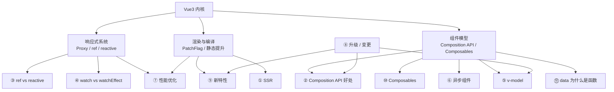
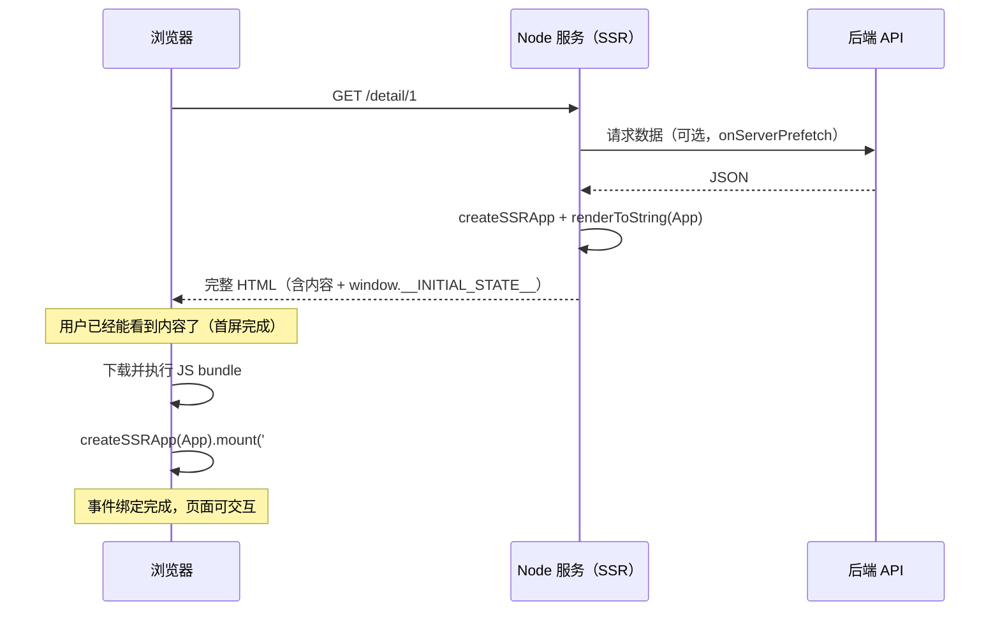
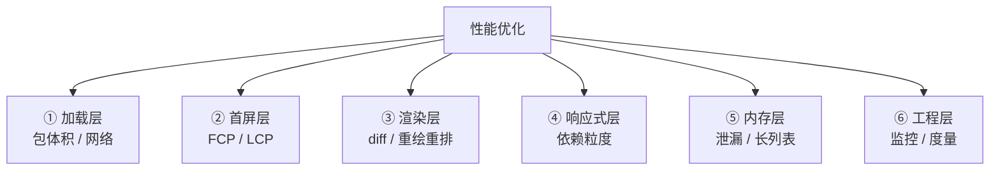
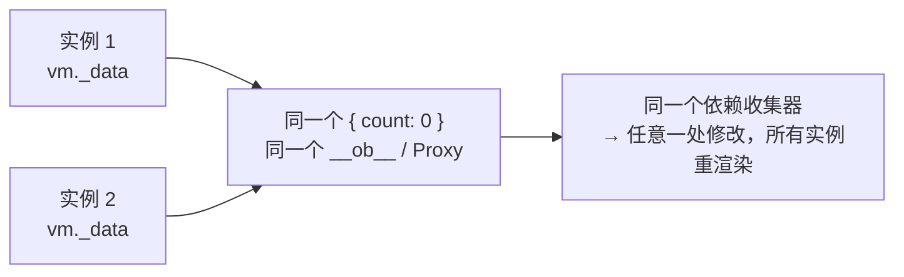
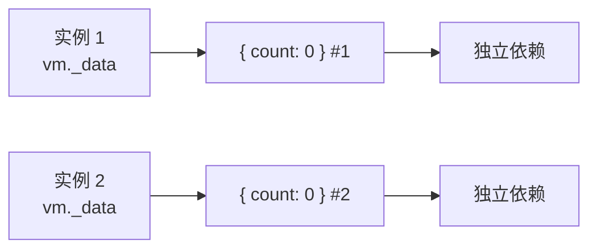

# Vue 3 高频面试题详解与答题模板

> 覆盖：SSR / Composition API / ref 与 reactive / watch 与 watchEffect / v-model / 异步组件 / 性能优化 / Vue3 升级与迁移 / 新特性 / Composables / data 为什么是函数
> 每题统一结构：**一句话结论 → 展开讲（原理 + 代码）→ 面试怎么答（30 秒 / 2 分钟）→ 追问**
> 使用方法：先看第 0 节的答题总纲，再按题号过；考前只看第 12 节的速记卡

---

## 目录

0. [先看：知识地图与答题总纲](#0-先看知识地图与答题总纲)
1. [SSR 是什么](#1-ssr-是什么)
2. [Vue3 Composition API 有什么好处](#2-vue3-composition-api-有什么好处)
3. [ref 和 reactive 的区别](#3-ref-和-reactive-的区别)
4. [watch 和 watchEffect 的区别](#4-watch-和-watcheffect-的区别)
5. [v-model 的原理](#5-v-model-的原理)
6. [怎么理解异步组件 defineAsyncComponent](#6-怎么理解异步组件-defineasynccomponent)
7. [Vue 性能优化怎么做](#7-vue-性能优化怎么做)
8. [Vue3 升级了哪些功能](#8-vue3-升级了哪些功能)
9. [说说 Vue3 的新特性](#9-说说-vue3-的新特性)
10. [Composables 解决了什么问题](#10-composables-解决了什么问题)
11. [Vue 组件里的 data 为什么必须是函数](#11-vue-组件里的-data-为什么必须是函数)
12. [速记卡与自测清单](#12-速记卡与自测清单)

---

## 0. 先看：知识地图与答题总纲

### 0.1 这 11 道题其实是一张网



**规律**：除 SSR 外，其余 10 道题都落在「响应式」「编译渲染」「组件模型」三条线上。

### 0.2 通用答题结构

```text
① 结论先行（10 秒）    —— 一句话说清「是什么 / 解决什么问题」
② 展开机制（40 秒）    —— 关键 API / 关键源码 / 数据流
③ 对比与边界（30 秒）  —— 和相近概念的区别、什么时候不该用
④ 落地场景（20 秒）    —— 项目中的用法与边界
```

**四个减分项**：

- ❌ 只背 API 列表，不说「为什么」
- ❌ 只讲「能做什么」，不讲「有什么代价」
- ❌ 概念之间不做对比
- ❌ 只给结论，不给适用条件

---

## 1. SSR 是什么

### 1.1 一句话结论

**SSR（Server-Side Rendering，服务端渲染）**：用户请求页面时，**服务端**把 Vue 组件执行一遍、渲染成 HTML 字符串返回，浏览器立刻就能显示内容；随后再加载 JS，由 Vue 在浏览器端「接管」这份 HTML（**hydration 水合**），之后才变成可交互的 SPA。

一句话对比：**CSR 是「先给空壳再填内容」，SSR 是「先给内容再装引擎」。**

### 1.2 四种渲染模式

| 模式 | HTML 从哪来 | 首屏内容 | 可交互时间 | SEO | 典型方案 |
| --- | --- | --- | --- | --- | --- |
| **CSR** 客户端渲染 | 浏览器里 JS 生成 | 慢（白屏） | 快（JS 一到就交互） | 差 | 普通 SPA |
| **SSR** 服务端渲染 | 每次请求服务端生成 | 快 | 慢（要等 JS + hydrate） | 好 | Nuxt 3、Vite SSR |
| **SSG** 静态生成 | 构建时预生成 HTML | 最快（CDN 直出） | 快 | 最好 | VitePress、Nuxt prerender |
| **ISR / 增量静态** | 构建 + 定时 / 按需再生成 | 最快 | 快 | 好 | Next.js 风格，Vue 生态靠 CDN + 缓存模拟 |

> 面试如果问「SSR 和 SSG 的区别」：**SSR 每次请求都渲染（内容实时，但有服务端成本）；SSG 构建时只渲染一次（最快最省，但内容不实时）**。博客、文档站用 SSG，电商详情、个性化首页用 SSR。

### 1.3 完整链路



三个关键阶段：

1. **服务端渲染**：`renderToString()` 把组件树变成 HTML 字符串。此时执行的是 `setup` / `beforeCreate` / `created` / `onServerPrefetch`，**`mounted` 不会执行**（因为没有 DOM）。
2. **直出 HTML**：首屏内容立刻可见 → 解决白屏和 SEO。
3. **Hydration（水合）**：客户端复用这份 HTML 的 DOM 结构，只绑事件、恢复响应式，**不重新创建 DOM**。所以叫「激活」而不是「渲染」。

### 1.4 为什么需要 SSR

| 痛点（CSR） | SSR 怎么解决 |
| --- | --- |
| 首屏白屏，用户等着 | HTML 直出，内容立刻可见 |
| 爬虫拿到空 `<div id="app"></div>` | 爬虫能直接抓到完整内容（SEO） |
| 弱网 / 低端机 JS 执行慢 | 内容不依赖 JS 就能看到（内容型页面体验提升明显） |
| 分享卡片没有缩略信息 | 服务端可直接输出 `meta` 标签 |

### 1.5 代价

| 代价 | 说明 |
| --- | --- |
| **需要 Node 服务** | 不再是纯静态部署，要维护服务、做负载均衡、考虑缓存 |
| **服务端压力大** | 每个请求都要跑一遍渲染，CPU 密集；要靠缓存 / 降级 / 集群 |
| **TTFB 变长** | 服务端要等接口数据才能出 HTML，接口慢则首字节慢（可能比 CSR 白屏更难受） |
| **双重执行** | 组件代码在服务端和客户端各跑一次，构建要出两份产物 |
| **环境限制** | 服务端没有 `window` / `document` / `localStorage`，第三方库要判环境 |
| **hydration mismatch** | 服务端和客户端首次渲染结果不一致会报警告、DOM 被重建 |
| **开发复杂度** | 状态要序列化传递、生命周期要区分、`<ClientOnly>` 之类的处理变多 |

### 1.6 Vue 3 原生 SSR 代码

```js
// server.js —— 服务端
import { createSSRApp } from 'vue'
import { renderToString } from 'vue/server-renderer'
import App from './App.vue'
import { createRouter } from './router'

server.get('*', async (req, res) => {
  const app = createSSRApp(App)

  // 每个请求一份独立实例（绝对不能复用，否则状态会串）
  const router = createRouter()
  app.use(router)
  await router.push(req.url)
  await router.isReady()

  const ctx = {}
  const html = await renderToString(app, ctx) // ← 核心：渲染成字符串
  const state = JSON.stringify(ctx.state || {})

  res.end(`
    <!DOCTYPE html>
    <html>
      <body>
        <div id="app">${html}</div>
        <script>window.__INITIAL_STATE__ = ${state}</script>
        <script type="module" src="/src/entry-client.js"></script>
      </body>
    </html>
  `)
})
```

```js
// entry-client.js —— 客户端
import { createSSRApp } from 'vue'
import App from './App.vue'

// createSSRApp 的 mount 会走 hydrate，而不是重新 render
createSSRApp(App).mount('#app')
```

```vue
<!-- 服务端预取数据：只有 SSR 阶段执行 -->
<script setup>
import { onServerPrefetch, ref } from 'vue'

const detail = ref(null)
onServerPrefetch(async () => {
  detail.value = await fetchDetail(route.params.id)
})
</script>
```

> 实际项目基本不手写这些，直接用 **Nuxt 3**（约定式路由 + 自动 SSR + 数据预取 + 部署适配）。

### 1.7 两个高频细节

**① 什么是 hydration mismatch？**

服务端渲染出来的 DOM 结构，和客户端首次 render 的 vnode 结构对不上，Vue 在 dev 下会警告：

```text
[Vue warn]: Hydration node mismatch
```

常见原因：

- 用了不确定的值：`Date.now()`、`Math.random()`、`new Date().toLocaleString()`
- 判断了浏览器环境：`typeof window !== 'undefined' ? 'client' : 'server'`
- 数据不一致：服务端和客户端拿到的接口数据不同（没传 `__INITIAL_STATE__`）
- HTML 结构被浏览器自动修正：`<p>` 里嵌 `<div>`、`<table>` 里直接写 `<tr>`
- 用了 `v-if="isClient"` 这类只在客户端成立的条件

**② 为什么 SSR 里不能用 `window`？**

因为服务端是 **Node 环境，没有 DOM / BOM**。`setup`、`created`、`onServerPrefetch` 都会在服务端执行，一旦直接访问 `window` 就报错 `window is not defined`。解决：

```js
// ① 放到 mounted / onMounted（服务端不执行）
onMounted(() => {
  window.addEventListener('scroll', onScroll)
})

// ② 判环境
if (typeof window !== 'undefined') {
  /* ... */
}

// ③ 动态 import 客户端专属库
onMounted(async () => {
  const { default: Chart } = await import('echarts')
})
```

```text
④ 用 <ClientOnly> 包裹（Nuxt 提供）
```

### 1.8 面试怎么答

**30 秒版：**

- SSR：请求时服务端用 `renderToString` 生成完整 HTML，浏览器先显示内容；随后加载 JS，用 `createSSRApp` + hydrate 复用这份 DOM、绑定事件，页面才可交互。
- 解决 CSR 的首屏白屏和 SEO；代价是需要 Node 服务、服务端有渲染压力、TTFB 受接口影响、服务端没有 `window`、hydration 可能不一致。
- 适合内容型、对 SEO 和首屏要求高的页面（电商详情、资讯、官网）；后台管理系统一般不需要。

**2 分钟版（补三点）：**

1. **hydration 是复用不是重渲染**：客户端不重建 DOM，只绑事件、恢复状态，所以首屏快不代表**可交互时间（TTI）**快。
2. **SSR 不是银弹**：接口慢会直接拖长 TTFB，需要接口缓存，或用流式渲染（`renderToWebStream`）先输出 head 和骨架。
3. **编译层红利**：静态提升让静态节点在服务端直接拼字符串，不必走完整 vnode 流程；`Suspense` 支持异步 setup 和流式输出。

### 1.9 追问

| 追问 | 要点 |
| --- | --- |
| SSR 和预渲染（prerender）区别？ | 预渲染是构建时生成固定 HTML（等于 SSG），适合内容不变的页面；SSR 是每次请求实时渲染 |
| SSR 页面为什么还会「闪一下」？ | hydration 前 DOM 是死的，事件没绑；如果 hydration 慢或失败，用户点击无反应 |
| 数据怎么从服务端传给客户端？ | 序列化到 `window.__INITIAL_STATE__`（注意 XSS 转义），客户端启动时读出来塞进 store |
| SSR 下 `mounted` 会执行吗？ | 不会。服务端只到 `created`；`mounted` 只在客户端 hydrate 后执行 |
| SSR 下能用 `keep-alive` 吗？ | 服务端渲染没有「组件切换」，缓存无意义；客户端 hydrate 后才生效 |
| 服务端渲染为什么要每个请求新建 app？ | 复用会导致不同用户的状态互相污染（内存泄漏 + 数据串号） |
| SSR 怎么做缓存？ | 页面级缓存（Redis / CDN）、组件级缓存、接口层缓存；注意按用户维度区分 |
| 只用 SSR 不用 SPA 行不行？ | 那就是传统多页应用了；Vue 的 SSR 是「SSR + hydrate」的混合模式 |

---

## 2. Vue3 Composition API 有什么好处

### 2.1 一句话结论

Composition API 是**用函数来组织和复用组件逻辑**的一套 API。它最大的价值不是「写法变了」，而是：**让「同一个功能的代码」能写在一起，让「同一段逻辑」能抽出来复用，并且天然对 TypeScript 友好。**

### 2.2 Options API 的四个痛点

**痛点 1：逻辑被拆散**

一个「搜索列表」功能，代码散落在五个地方：

```js
export default {
  data() {
    return { keyword: '', list: [], loading: false } // ① 状态
  },
  computed: {
    filtered() {
      return this.list.filter(/* ... */) // ② 派生状态
    },
  },
  watch: {
    keyword() {
      this.fetch() // ③ 副作用
    },
  },
  methods: {
    fetch() {
      /* ... */ // ④ 行为
    },
  },
  mounted() {
    this.fetch() // ⑤ 初始化
  },
}
```

一个功能要看 5 个地方，组件超过 300 行就没人能一眼看懂。

**痛点 2：mixin 是「复用灾难」**

来源不清晰、命名冲突、隐式依赖、不能传参、不能组合、TS 推导差，完整清单见 10.2。

**痛点 3：TypeScript 支持差**

Options API 里 `this` 的类型要靠 `ComponentOptions` 推导，`this.list`、`this.$refs.xxx` 经常推不出来，需要大量断言。

**痛点 4：逻辑无法独立测试**

逻辑绑在组件实例上，想单测就得 mount 一个组件。

### 2.3 Composition API 怎么解决

```js
// composables/useSearchList.js
import { ref, computed, watch } from 'vue'

export function useSearchList(fetcher, delay = 300) {
  const keyword = ref('')
  const list = ref([])
  const loading = ref(false)

  const filtered = computed(() => list.value.filter((i) => i.name.includes(keyword.value)))

  async function load() {
    loading.value = true
    try {
      list.value = await fetcher(keyword.value)
    } finally {
      loading.value = false
    }
  }

  // 防抖 + 竞态处理都在 composable 内部完成，使用者不用关心
  let timer = null
  watch(keyword, () => {
    clearTimeout(timer)
    timer = setTimeout(load, delay)
  })

  load()

  return { keyword, list, loading, filtered, load }
}
```

```vue
<script setup>
// 使用：一行引入，来源清晰，可以有多个互不干扰的实例
const { keyword, list, loading, filtered } = useSearchList(api.search)
const { page, total, next } = usePagination()
</script>
```

### 2.4 好处清单（面试就按这个说）

| 好处 | 具体说明 |
| --- | --- |
| **① 逻辑聚合** | 同一功能的 state / computed / watch / 方法写在一起，按「功能」而非「选项类型」组织 |
| **② 逻辑复用** | 用 composable 替代 mixin：来源明确（import 进来的）、无命名冲突（可重命名）、可传参、可组合、无隐式依赖 |
| **③ TS 友好** | 都是普通变量和函数，类型推导天然准确，不需要 `this` 类型体操 |
| **④ 更好的 tree-shaking** | API 是独立导入的函数，没用到的不进包（Options API 依赖 `this`，很多东西无法摇掉） |
| **⑤ 压缩友好** | 变量名可以压缩成 `a`、`b`；对象 key（`data` / `methods`）不能压缩 |
| **⑥ 可测试** | composable 是纯函数，可以脱离组件单测 |
| **⑦ 逻辑与视图解耦** | 同一套逻辑可以给不同 UI 用，甚至用在不同端（Web / 小程序 runtime） |
| **⑧ 灵活组合** | 可以条件调用、循环组合、嵌套组合（mixin 做不到） |
| **⑨ 类型安全的依赖注入** | `provide/inject` 可以带类型，替代 `this.$parent` 链式访问 |

**压缩友好的具体差别**：打包后 `data(){return{loading:!1}}` 里的 `loading` 不能改名，而 `const loading = ref(false)` 会被压成 `const x=ref(!1)`。

### 2.5 它不替代 Options API

- 官方明确：**Options API 会长期保留**，两者可以混用。
- 简单组件（纯展示、几个 props）用 Options 更直观；
- 复杂组件（多逻辑交织）、需要复用、需要 TS 时用 Composition。
- `<script setup>` 是 Composition API 的语法糖，编译后就是 `setup()` 返回一个渲染函数。

### 2.6 代价

| 代价 | 说明 |
| --- | --- |
| 心智负担 | 要理解 `ref` 的 `.value`、响应式丢失、依赖收集时机 |
| 组织靠自律 | 没有「选项」约束，写得不好就是 500 行巨型 `setup` → 要靠拆 composable |
| 生命周期要手动管 | 定时器、监听器在 composable 里注册，就要在 composable 里清理 |
| 团队门槛 | 新人要懂响应式原理，否则容易写出「不响应」的代码 |

### 2.7 面试怎么答

**30 秒版：**

- Composition API 用函数组织逻辑：同一功能的 state / computed / watch / 方法写在一起，不再按 `data` / `methods` 分区。
- 用 composable 替代 mixin，解决来源不清晰、命名冲突、隐式依赖；普通变量对 TS 推导、tree-shaking、压缩都更友好。
- 不替代 Options API，官方长期支持共存；简单组件用 Options 更直接。

**2 分钟版（补三点实践约束）：**

1. **复杂页面可维护性**：每个功能一个 composable，职责边界比全堆在 `methods` 里清晰。
2. **复用靠规范**：`use` 前缀、只返回 `ref`、在 `setup` 同步调用、内部副作用自己清理。
3. **代价**：要理解 `.value`、响应式丢失、依赖收集时机；没有选项约束，拆分靠自律。

### 2.8 追问

| 追问 | 要点 |
| --- | --- |
| Composition API 和 React Hooks 区别？ | 见 10.4：执行次数、依赖收集、闭包陷阱、调用限制四点 |
| 为什么 setup 只执行一次就能保证响应式？ | 因为响应式是 Proxy + 依赖收集，不是靠重新执行函数；模板的渲染函数才是每次更新重新执行的 |
| `setup` 里能拿到 `this` 吗？ | 不能，`setup` 在 `beforeCreate` 之前执行，且刻意不暴露 `this`（避免逻辑耦合组件实例） |
| `<script setup>` 编译成什么？ | 编译成 `setup()` 函数 + 内联的 render 函数，顶层绑定直接暴露给模板，无需 `return` |
| 什么时候必须用 Options API？ | 基本没有强制场景；需要 `this` 访问的老库、老代码迁移时混用 |
| 用了 Composition API 还需要 Vuex / Pinia 吗？ | 需要。composable 解决「逻辑复用」，状态管理解决「跨组件共享 + 单向数据流 + 调试」，两者互补。简单共享可以用 `provide/inject` 或 `reactive` 单例 |

---

## 3. ref 和 reactive 的区别

### 3.1 一句话结论

- **`ref`**：什么都能包（基本类型 + 对象），返回一个带 `.value` 的包装对象，**靠 `.value` 的 get / set 拦截实现响应式**。
- **`reactive`**：只能包对象（Object / Array / Map / Set），返回 **Proxy**，直接访问属性，**不需要 `.value`**。

一句话记：**`ref` 是「箱子」，`reactive` 是「透视镜」。**

### 3.2 对比表（背这个）

| 维度 | `ref` | `reactive` |
| --- | --- | --- |
| 支持类型 | **任意类型**（string / number / boolean / null / undefined / 对象 / 数组） | **只能是对象**（对象 / 数组 / Map / Set / WeakMap…），传基本类型会警告且无效 |
| 返回值 | `RefImpl` 对象（`{ value }`） | `Proxy` 代理对象 |
| 访问方式 | `x.value`（模板中自动解包，可省略） | `x.foo`（直接访问） |
| 实现原理 | `class RefImpl` + `get value` / `set value` + `dep` 依赖收集 | `new Proxy(target, mutableHandlers)`，`get` 收集、`set` 触发 |
| 整体替换 | ✅ `x.value = {...}` 可以 | ❌ `x = {...}` 会断开代理，**丢失响应式** |
| 解构 | ✅ 从普通对象 / composable 返回值解构仍是 ref，**不丢响应式** | ❌ 从 `reactive` 对象解构拿到解包后的普通值（要 `toRefs`） |
| 深层响应 | 默认 `deep`（对象内部也会被 `reactive` 转换） | 默认深层响应 |
| 模板中使用 | 自动解包，`{{ count }}` | 直接 `{{ obj.count }}` |
| 适用场景 | 基本类型、需要整体替换、需要传给函数保持引用 | 固定结构的表单对象、配置对象、状态集合 |

### 3.3 原理：为什么 ref 需要 .value

```ts
// 简化版源码
class RefImpl {
  private _value
  public dep = new Dep()
  constructor(value) {
    // 如果传的是对象，内部用 reactive 包一层
    this._value = isObject(value) ? reactive(value) : value
    this.__v_isRef = true
  }
  get value() {
    track(this.dep) // 收集依赖：记录读取这个值的 effect
    return this._value
  }
  set value(newVal) {
    if (hasChanged(newVal, this._value)) {
      this._value = isObject(newVal) ? reactive(newVal) : newVal
      trigger(this.dep) // 触发更新：重新执行读过它的 effect
    }
  }
}
```

**关键理解**：JS 里没法拦截「一个变量的读写」，只能拦截「对象属性的读写」。所以基本类型必须被包进对象，用 `get / set` 拦截——这就是 `.value` 存在的原因。

而 `reactive` 之所以不用 `.value`，是因为它直接对对象做 `Proxy`，`obj.foo` 的读写天然可以被拦截。

> 顺带一个考点：`ref(obj)` 内部就是 `reactive(obj)`，所以 `ref` 不是「另一种响应式」，而是「对基本类型的补丁 + 对对象的包装」。

### 3.4 六个必知的行为细节

**① 模板中自动解包**

```vue
<script setup>
const count = ref(0)
const obj = reactive({ n: 0 })
</script>

<template>
  {{ count }}
  <!-- ✅ 自动解包，不用 .value -->
  {{ obj.n }}
  <!-- ✅ -->
</template>
```

但在 `setup` 里、在 JS 里必须写 `.value`。

**② reactive 解构丢响应式**

```js
const state = reactive({ count: 0 })
const { count } = state // ❌ count 是普通数字，改了不响应
const { count: countRef } = toRefs(state) // ✅ countRef 是 ref
```

**③ 解构 ref 不丢，解构 reactive 丢**

```js
const refs = { count: ref(0) }
const { count } = refs // ✅ 仍是 ref

const state = reactive({ count: ref(0) })
const { count: stateCount } = state // ❌ 0，普通值（get 时已解包）
```

**④ reactive 嵌套 ref 会自动解包**

```js
const count = ref(0)
const state = reactive({ count })
console.log(state.count) // 0，不是 Ref 对象（自动解包）
state.count++ // 等价于 count.value++
```

**但数组和 Map 里不会自动解包**：

```js
const arr = reactive([ref(0)])
console.log(arr[0]) // RefImpl，需要 arr[0].value

const map = reactive(new Map([['k', ref(0)]]))
console.log(map.get('k')) // RefImpl
```

**⑤ reactive 整体替换会断链**

```js
let state = reactive({ a: 1 })
state = reactive({ a: 2 }) // ⚠️ 原来是 Proxy1，现在是 Proxy2
// 如果这个 state 被别处引用（比如传给了子组件），子组件还指着 Proxy1 → 不更新
```

正确做法：

```js
Object.assign(state, newObj) // ✅ 保持同一个代理

// 或者一开始就用 ref
const state = ref({ a: 1 })
state.value = { a: 2 } // ✅
```

**⑥ `reactive(props)` 不会得到可写副本**

```js
const props = defineProps(['foo'])
const state = reactive(props) // ❌ props 是 shallowReadonly，reactive() 原样返回；写 state.foo 触发只读警告
const { foo } = toRefs(props) // ✅ 解构后仍是 ref
```

### 3.5 选型建议

| 场景 | 推荐 |
| --- | --- |
| 基本类型（数字、字符串、布尔） | `ref`（唯一选择） |
| 需要整体替换的对象（接口返回的数据） | `ref`（`.value = res.data` 最省心） |
| 结构固定的表单 / 配置对象 | `reactive`（少写 `.value`，可读性好） |
| 需要解构或传给 composable | `ref` 或 `toRefs` |
| 大对象、第三方实例（ECharts、地图） | `shallowRef` / `markRaw` |
| 只读派生 | `computed` |

**选型结论**：**统一用 `ref`**。理由：① 只有一套规则；② 解构、传参、整体替换都不会断链；③ 新人少踩坑。只在「结构固定的对象、且需要频繁读写多个字段」时用 `reactive`。

### 3.6 面试怎么答

**30 秒版：**

- **能力范围**：`ref` 支持任意类型，`reactive` 只能传对象，传基本类型无效。
- **使用方式**：`ref` 返回包装对象，JS 里要 `.value`，模板自动解包；`reactive` 返回 Proxy，直接访问属性。
- **实现原理**：`ref` 用 `RefImpl` 的 `get value` / `set value` 拦截（JS 拦不住变量本身）；`reactive` 用 `new Proxy` 拦截对象属性。`ref` 传对象时内部就是 `reactive`。
- **边界**：`reactive` 解构丢响应式（要 `toRefs`）、整体替换断链（要 `Object.assign`）；`ref` 没有这些问题。
- **选型**：统一用 `ref`，只在固定结构的表单对象上用 `reactive`。

### 3.7 追问

| 追问 | 要点 |
| --- | --- |
| 为什么 `ref` 需要 `.value`？ | JS 无法拦截变量读写，只能拦截对象属性，所以要包一层用 get / set |
| 模板里为什么不用 `.value`？ | 普通模板访问 `$setup.count`，setupState 是 `proxyRefs`，get 时自动 `unref`；内联模板编译期直接生成 `count.value` |
| `reactive` 为什么不能传基本类型？ | `Proxy` 的 target 必须是对象；传基本类型会警告并原样返回 |
| `ref` 和 `shallowRef` 区别？ | `shallowRef` 只对 `.value` 整体赋值做响应，内部属性变化不触发；适合大对象 / 只整体替换的场景，性能更好 |
| `toRef` 和 `toRefs` 区别？ | `toRef(obj, key)` 单个；`toRefs(obj)` 全部，返回普通对象（每个值都是 ref），常用于解构 props |
| 怎么让 `reactive` 对象里的属性只读？ | `readonly()` / `shallowReadonly()` |
| `markRaw` 干什么？ | 标记对象「永远不要转成响应式」，用于 ECharts 实例、地图实例、复杂类实例，避免性能开销和奇怪行为 |
| `ref` 的 `.value` 在模板里失效的场景？ | 在 `v-for` 的数组里、在 `reactive` 的数组 / Map 里不会自动解包 |

---

## 4. watch 和 watchEffect 的区别

### 4.1 一句话结论

- **`watch`**：**你告诉它看什么**（显式指定依赖源），**懒执行**（默认不立即跑），**能拿到新旧值**。
- **`watchEffect`**：**它自己知道看什么**（执行时自动收集依赖），**立即执行一次**，**拿不到旧值**。

一句话记：**`watch` 是「定点监视」，`watchEffect` 是「边跑边记」。**

### 4.2 对比表

| 维度 | `watch` | `watchEffect` |
| --- | --- | --- |
| 依赖来源 | **显式**：ref / reactive / getter / 数组 | **隐式**：自动收集回调里访问过的响应式数据 |
| 首次执行 | 默认**不执行**（`immediate: true` 才执行） | **立即执行一次** |
| 回调参数 | `(newVal, oldVal, onCleanup)` | `(onCleanup)`，**没有新旧值** |
| 能否监听多个源 | ✅ 数组 | ✅ 天然支持（访问几个就监听几个） |
| `deep` | 默认：`reactive` 对象**自动深度**；`ref` 对象**不深度**，需显式 `deep: true` | 天然深度（访问到哪层追踪到哪层） |
| 适用场景 | 需要旧值、需要精确控制依赖、需要惰性、需要条件判断 | 副作用依赖多个源、不想维护依赖列表、需要「立即执行」的初始化逻辑 |
| 返回值 | `stop` 函数 | `stop` 函数 |

### 4.3 watch 的五种依赖源

```js
const count = ref(0)
const state = reactive({ a: 1, b: 2 })
const user = ref({ name: 'x', age: 18 })

// ① ref
watch(count, (n, o) => console.log(n, o))

// ② getter（可以组合多个，最灵活）
watch(
  () => state.a + state.b,
  (n, o) => {},
)

// ③ reactive 对象（自动 deep，且 oldVal === newVal，因为同一个引用）
watch(state, (n, o) => console.log('变了')) // 注意：拿不到真正旧值

// ④ 数组（多个源）
watch([count, () => state.a], ([nCount, nA], [oCount, oA]) => {})

// ⑤ ref 包对象：不 deep 时只有整体替换才触发
watch(user, () => {}) // ❌ user.value.name = 'y' 不触发
watch(user, () => {}, { deep: true }) // ✅
```

> **高频坑**：`watch(reactive对象)` 时 `newVal` 和 `oldVal` 是**同一个引用**（都是那个 Proxy），所以拿不到旧值。想要旧值得监听具体字段的 getter。

### 4.4 三个配置项

| 选项 | 作用 | 常用场景 |
| --- | --- | --- |
| `immediate` | 立即执行一次 | 初始化 + 监听合一（比如 `watch(id, fetch, { immediate: true })`） |
| `deep` | 深度监听 | 监听 `ref` 包裹的对象内部变化；`reactive` 默认已 deep |
| `flush` | 回调时机：`pre`（默认，组件更新前）/ `post`（更新后，能拿新 DOM）/ `sync`（同步，不推荐） | 需要读 DOM 用 `post` |

```js
watch(source, cb, { flush: 'post' }) // 可以拿到更新后的 DOM
```

### 4.5 watchEffect 的两个杀手场景

**场景 1：依赖多个源，懒得维护列表**

```js
watchEffect(() => {
  // 访问了 a、b、c → 自动全部追踪
  console.log(a.value, b.value, state.c)
})
```

**场景 2：需要「立即执行 + 自动追踪」的初始化**

```js
watchEffect(() => {
  document.title = `${route.meta.title} - ${userName.value}`
})
```

> 注意：`watchEffect` **会执行一次**，所以不要在里做「只能执行一次」的昂贵操作（比如埋点上报），否则会重复上报。

### 4.6 清理副作用：onCleanup

```js
// 搜索联想：上一次请求还没回来，新请求就发出了 → 竞态，结果可能被旧数据覆盖
watch(keyword, async (kw, _, onCleanup) => {
  const controller = new AbortController()
  onCleanup(() => controller.abort()) // 下一次触发前 / 停止时执行

  const res = await fetch(`/api/search?q=${kw}`, { signal: controller.signal })
  list.value = await res.json()
})
```

```js
// watchEffect 版本：参数就是 onCleanup
watchEffect((onCleanup) => {
  const timer = setInterval(poll, 1000)
  onCleanup(() => clearInterval(timer))
})
```

> `onCleanup` 的调用时机：**副作用重新执行之前**、**watcher 被停止时**（含组件卸载）。

### 4.7 停止监听

```js
const stop = watch(count, cb)

// 手动停止
stop()
```

**自动停止的前提**：watcher 要在组件上下文的**同步执行期间**创建（`setup`，或生命周期钩子的同步段）。Vue 会把它收集进当前组件的 effect scope，组件卸载时统一 `stop`。

```js
// ⚠️ 陷阱：await 之后 currentInstance 已经被清空，这里创建的 watcher 不属于任何组件
onMounted(async () => {
  await fetchSomething()

  const stop = watch(x, cb) // 组件卸载后仍会触发 → 内存泄漏
  onUnmounted(stop) // ✅ 必须手动停
})
```

> 记住这条规则：**只要有 `await`，之后创建的 watcher 都要自己 `stop`**。这条同样适用于 `effect`、`watchEffect`。

### 4.8 面试怎么答

**30 秒版：**

- 两者都在响应式数据变化时执行副作用，区别在「依赖怎么来」和「什么时候执行」。
- **`watch`**：显式指定 ref / getter / 数组，默认**懒执行**，回调拿到 **newVal 和 oldVal**，可配 `deep`、`immediate`、`flush`；适合需要旧值或精确控制依赖的场景。
- **`watchEffect`**：执行回调时自动收集依赖，**立即执行一次**，拿不到旧值，返回 stop 函数；适合依赖多个源、不想维护列表的副作用。
- 两者都支持 `onCleanup`，可在下一次执行前清理上一轮副作用，例如取消上一次请求。

**2 分钟版（补三个细节）：**

1. **`watch(reactive 对象)` 的 `oldVal` 是坑**：新旧值是同一个 Proxy 引用，拿不到真正的旧值，要监听具体字段。
2. **`deep` 的默认值不一样**：`reactive` 默认深度；`ref` 包对象默认**不**深度，要显式 `deep: true`。
3. **`flush: 'post'`**：想读 DOM 尺寸、或者依赖 DOM 更新后的结果，必须用 `post`，否则拿到的是旧 DOM。

### 4.9 追问

| 追问 | 要点 |
| --- | --- |
| `watchEffect` 怎么做到自动收集依赖？ | 执行回调时 `activeEffect = 当前 effect`，访问响应式数据触发 `track`，就把这个 effect 收进 dep；数据变化 `trigger` 时重新执行 |
| 为什么 `watchEffect` 会立即执行？ | 它需要「先跑一遍」才能收集依赖；`watch` 的依赖是你显式给的，所以不需要 |
| `watch` 能监听 `props` 吗？ | 可以：`watch(() => props.foo, cb)`，注意不要直接 `watch(props)` |
| 监听多个源时 `oldVal` 怎么拿？ | 数组形式：`([n1, n2], [o1, o2]) => {}` |
| `watch` 的回调里改被监听的值会怎样？ | 可能死循环；`flush: 'sync'` 时尤其危险 |
| 组件卸载后 watcher 还在跑吗？ | 在 `setup` 里同步创建的在卸载时自动停止；异步创建的要注意手动 `stop` |
| `watch` 和 `computed` 的区别？ | `computed` 是**派生值**（有返回值、有缓存、不产生副作用）；`watch` 是**副作用**（做事情、不返回值） |
| 想在 watch 里发请求，怎么避免竞态？ | `onCleanup` + `AbortController`，或给请求加序号只接受最新一次 |

---

## 5. v-model 的原理

### 5.1 一句话结论

**`v-model` 是一个语法糖**，本质是「**一个 prop + 一个事件**」：

- **在表单元素上**：编译成 `:value` + `@input`（或 `:checked` + `@change` 等），由内置指令 `vModelText` / `vModelCheckbox` / `vModelSelect` 处理。
- **在组件上**：编译成 `modelValue` prop + `update:modelValue` 事件（Vue 2 是 `value` + `input`）。

### 5.2 编译产物（最能说明问题）

```vue
<input v-model="msg" />
```

```js
// 编译后（简化）
_withDirectives(
  _createElementVNode(
    'input',
    {
      'onUpdate:modelValue': ($event) => (msg = $event),
    },
    null,
    8, // PROPS
  ),
  [[_vModelText, msg]],
)
```

```vue
<MyInput v-model="msg" />
```

```js
// 编译后（简化）
_createVNode(MyInput, {
  modelValue: msg,
  'onUpdate:modelValue': ($event) => (msg = $event),
})
```

**所以自定义组件实现 v-model 只需要三件事**：

```vue
<!-- MyInput.vue -->
<script setup>
const props = defineProps({ modelValue: String })
const emit = defineEmits(['update:modelValue'])

function onInput(e) {
  emit('update:modelValue', e.target.value) // ① 通知父组件更新
}
</script>

<template>
  <!-- ② 把 prop 绑到 value 上 -->
  <input
    :value="modelValue"
    @input="onInput"
  />
</template>
```

```vue
<!-- ③ 父组件就能用 v-model 了 -->
<MyInput v-model="msg" />
```

> **为什么不能直接改 prop？** 因为单向数据流：子组件不能修改父组件的数据。所以必须 `emit` 一个事件，让父组件自己改。`v-model` 就是这个「读 prop + 发事件」的语法糖。

### 5.3 Vue 3.4+ 的 defineModel

```vue
<script setup>
const model = defineModel() // 默认 modelValue
const title = defineModel('title') // 具名 v-model:title
const count = defineModel('count', { type: Number, default: 0 })
</script>

<template>
  <input v-model="model" />
  <input v-model="title" />
</template>
```

`defineModel()` 返回的是一个 **ref**：读它等于读 `props.modelValue`，写它会自动 `emit('update:modelValue', v)`。本质还是那一套，只是编译器帮你写好了。

### 5.4 多个 v-model

```vue
<!-- 父组件 -->
<UserForm
  v-model:name="form.name"
  v-model:age="form.age"
/>
```

```js
// 编译后
_createVNode(UserForm, {
  name: form.name,
  'onUpdate:name': ($event) => (form.name = $event),
  age: form.age,
  'onUpdate:age': ($event) => (form.age = $event),
})
```

```vue
<!-- 子组件（3.4 之前） -->
<script setup>
defineProps({ name: String, age: Number })
const emit = defineEmits(['update:name', 'update:age'])
</script>
```

> Vue 2 里多值绑定用的是 `.sync`：`<UserForm :name.sync="form.name" />`，Vue 3 统一成了 `v-model:name`。

### 5.5 修饰符

**内置修饰符（元素上）**

| 修饰符 | 作用 | 编译 / 实现 |
| --- | --- | --- |
| `.lazy` | 从 `input` 事件改成 `change` 事件（失焦 / 回车才同步） | `vModelText` 里监听 `change` 而不是 `input` |
| `.number` | 自动转数字 | `looseToNumber(value)` |
| `.trim` | 自动去首尾空格 | `value.trim()` |

**组件上的修饰符**

```vue
<MyInput v-model.trim="msg" />
```

```js
// 编译成：把修饰符传给子组件
_createVNode(MyInput, {
  modelValue: msg,
  'onUpdate:modelValue': ($event) => (msg = $event),
  modelModifiers: { trim: true }, // 默认 v-model 用 modelModifiers
})
```

```vue
<!-- 子组件 -->
<script setup>
const props = defineProps({
  modelValue: String,
  modelModifiers: { default: () => ({}) },
})
const emit = defineEmits(['update:modelValue'])

function onInput(e) {
  let val = e.target.value
  if (props.modelModifiers.trim) val = val.trim() // 自己处理修饰符
  emit('update:modelValue', val)
}
</script>
```

> 具名 v-model 的修饰符叫 `xxxModifiers`，比如 `v-model:title.trim` → `titleModifiers: { trim: true }`。

### 5.6 元素上的 v-model 做了什么

`vModelText` 指令简化实现：

```js
export const vModelText = {
  created(el, { modifiers: { lazy, trim, number } }, vnode) {
    el._assign = getModelAssigner(vnode) // 就是编译出来的 $event => msg = $event
    const castToNumber = number || vnode.props?.type === 'number'

    addEventListener(el, lazy ? 'change' : 'input', (e) => {
      if (e.target.composing) return // ← 关键：输入法拼写中不更新
      let domValue = el.value
      if (trim) domValue = domValue.trim()
      if (castToNumber) domValue = looseToNumber(domValue)
      el._assign(domValue)
    })

    if (trim || castToNumber) {
      addEventListener(el, 'change', () => {
        let v = el.value
        if (trim) v = v.trim()
        if (castToNumber) v = looseToNumber(v)
        el.value = v
      })
    }

    if (!lazy) {
      // ← 处理中文输入法：拼写过程不触发更新，选词完成后再触发
      addEventListener(el, 'compositionstart', () => (el.composing = true))
      addEventListener(el, 'compositionend', () => {
        if (el.composing) {
          el.composing = false
          trigger(el, 'input')
        }
      })
    }
  },
}
```

> `v-model` 不会在中文输入法拼写时把拼音写进数据：内置指令监听 `compositionstart / end`，`composing` 期间跳过更新。手写 `:value` + `@input` 没有这层处理，拼写过程就会同步。

### 5.7 Vue 2 与 Vue 3 的差异

| | Vue 2 | Vue 3 |
| --- | --- | --- |
| 组件默认 prop | `value` | `modelValue` |
| 组件默认事件 | `input` | `update:modelValue` |
| 多值绑定 | `:foo.sync="x"` | `v-model:foo="x"` |
| 自定义 prop / event 名 | `model: { prop, event }` | 不需要，用 `v-model:xxx` |
| 修饰符传递 | 不统一 | `modelModifiers` / `xxxModifiers` |
| 简写 API | 无 | `defineModel()`（3.4+） |

### 5.8 面试怎么答

**30 秒版：**

- **本质**：一个 prop + 一个事件。
- **原生元素**：编译成 `:value` + `@input`，由 `vModelText` 处理，所以支持 `.lazy` / `.number` / `.trim`，也内置了中文输入法的 `composition` 处理。
- **组件**：编译成 `modelValue` prop + `update:modelValue` 事件，子组件不能直接改 prop（单向数据流）；多个 v-model 对应 `v-model:name` → `name` + `update:name`，修饰符通过 `modelModifiers` 传给子组件，3.4+ 可用 `defineModel`。

### 5.9 追问

| 追问 | 要点 |
| --- | --- |
| `v-model` 和 `.sync` 的关系？ | `.sync` 是 Vue 2 的多值绑定语法糖，Vue 3 统一成 `v-model:xxx` |
| 为什么子组件不能直接改 prop？ | 单向数据流：数据源在父组件，改了会导致数据流向不可追踪；且 prop 是浅只读的 |
| `defineModel` 是怎么实现的？ | 编译器生成 `useModel(...)`，内部用 `customRef` + `watchSyncEffect` 跟踪 prop，写入时 `emit('update:xxx')` |
| 多个 v-model 会冲突吗？ | 不会，每个 v-model 对应独立的 prop 和事件名 |
| 怎么让 v-model 支持防抖？ | 子组件内部对 emit 做防抖；`.lazy` 只是把 `input` 换成 `change`，不是防抖 |
| `v-model` 能用在自定义指令场景吗？ | 不能，v-model 只对表单元素和组件生效；`v-model` 在组件上是 props 编译，不是指令 |
| 表单校验库为什么能配合 v-model？ | 它们一般监听 `update:modelValue` 或 `change` 事件，在事件里触发校验 |
| 手写 `:value` + `@input` 和 `v-model` 有什么差别？ | 少了中文输入法处理、`.trim / .number / .lazy` 支持、以及组件场景的事件名约定 |

---

## 6. 怎么理解异步组件 defineAsyncComponent

### 6.1 一句话结论

`defineAsyncComponent` 用来**把一个组件的加载过程「包装」成一个组件**：它返回一个「壳组件」，真正渲染时才去执行 `import()` 加载真实组件，加载期间可以显示 loading、失败可以显示错误、还能超时和重试。

**它的核心价值是「代码分割 + 按需加载」**：让首屏不必下载所有组件的代码。

### 6.2 三种用法

```js
import { defineAsyncComponent } from 'vue'

// ① 最简：只给 loader
const AsyncComp = defineAsyncComponent(() => import('./HeavyChart.vue'))

// ② 完整配置
const AsyncComp = defineAsyncComponent({
  loader: () => import('./HeavyChart.vue'),
  loadingComponent: Loading, // 加载中显示的组件
  errorComponent: ErrorView, // 失败显示的组件
  delay: 200, // 200ms 后才显示 loading（避免闪烁）
  timeout: 3000, // 3s 还没加载完就报错
  suspensible: false, // 是否交给 <Suspense> 控制
  onError(error, retry, fail, attempts) {
    if (attempts <= 3) retry() // 自动重试 3 次
    else fail()
  },
})

// ③ 配合 Suspense
const AsyncComp = defineAsyncComponent({
  loader: () => import('./HeavyChart.vue'),
  suspensible: true, // 默认 true：由 Suspense 统一控制 loading / error
})
```

### 6.3 原理：它返回的是什么

```js
// 简化版实现
export function defineAsyncComponent(source) {
  if (isFunction(source)) source = { loader: source }

  const {
    loader,
    loadingComponent,
    errorComponent,
    delay = 200,
    timeout,
    suspensible = true,
    onError,
  } = source

  let resolvedComp = null
  let retries = 0

  const load = () =>
    loader()
      .catch((err) => {
        // 交给 onError 决定重试还是放弃
        return new Promise((resolve, reject) => {
          onError?.(err, () => resolve(load()), reject, ++retries)
        })
      })
      .then((comp) => (resolvedComp = comp))

  return defineComponent({
    name: 'AsyncComponentWrapper',
    __asyncLoader: load,
    get __asyncResolved() {
      return resolvedComp
    },

    setup() {
      // 已加载过 → 直接渲染真实组件
      if (resolvedComp) return () => createInnerComp(resolvedComp)

      const loaded = ref(false)
      const error = ref(null)
      const delayed = ref(!!delay) // delay 内 delayed 为 true，先不显示 loading

      if (delay) setTimeout(() => (delayed.value = false), delay)
      if (timeout != null) {
        setTimeout(() => {
          if (!loaded.value && !error.value) error.value = new Error('timeout')
        }, timeout)
      }

      load()
        .then(() => (loaded.value = true))
        .catch((err) => (error.value = err))

      // 返回的渲染函数：按状态渲染不同东西
      return () => {
        if (loaded.value && resolvedComp) return createInnerComp(resolvedComp)
        if (error.value && errorComponent) return createVNode(errorComponent, { error: error.value })
        if (loadingComponent && !delayed.value) return createVNode(loadingComponent)
        return null // 什么也不渲染
      }
    },
  })
}
```

**三个关键点（面试就讲这三个）**：

1. **返回的是「包装组件」，不是真实组件**：所以真实组件加载完之前，`<component :is>` 拿到的是 `AsyncComponentWrapper`。
2. **`import()` 返回 Promise，`loader` 就是把这个 Promise 包起来**，加载状态用 `ref` 驱动渲染：loading → 真实组件 / error。
3. **缓存**：`resolvedComp` 变量存住已加载的组件，第二次渲染不会重复 `import()`（`import()` 本身有模块缓存，但这里还省掉了包装组件的重复加载逻辑）。

### 6.4 和路由懒加载的关系

```js
// 路由懒加载：本质也是异步组件，只是由 vue-router 帮你包装
{ path: '/detail', component: () => import('./Detail.vue') }
```

| | 路由懒加载 | `defineAsyncComponent` |
| --- | --- | --- |
| 作用层级 | 路由（整页） | 组件（页面内某块） |
| 谁来包装 | vue-router 内部处理 | 你自己 |
| 能否配置 loading / error | ❌（要靠 `Suspense` 或全局 loading） | ✅ |
| 典型场景 | 每个页面 | 弹窗里的图表、富文本编辑器、地图、大表格 |

### 6.5 典型场景

| 场景 | 为什么用异步 |
| --- | --- |
| 富文本编辑器（wangEditor / TinyMCE） | 体积大（几百 KB），只有编辑时才需要 |
| 图表库（ECharts） | 体积大，且只有某些页面用 |
| 地图（高德 / 百度） | 依赖外部 JS，加载慢 |
| 弹窗 / 抽屉里的复杂表单 | 用户不点开就不用加载 |
| 低概率业务（导出、打印、大屏） | 主流程不该为它买单 |
| 埋点 / 客服 SDK | 与首屏无关 |

### 6.6 四个坑

1. **`loadingComponent` 只在 `delay` 之后出现**：默认 200ms，加载很快时 loading 不会显示；delay 设太长用户会觉得卡。
2. **`timeout` 到了不会自动取消请求**：只是渲染 error 组件，`import()` 的 chunk 仍在下载（没法取消）。
3. **`keep-alive` 的 `include` 可能匹配不到**：KeepAlive 取 `__asyncResolved` 的真实组件名来匹配；解析完成前 name 为空，`include` 会判不中，第一次切走可能不缓存。
4. **异步组件不适合 SSR 首屏强依赖的内容**：服务端渲染时它会立即 `load()`，等于把「异步」变回「同步」，首屏并不会因此变快。SSR 场景下要配合 `Suspense` + 流式渲染。

### 6.7 面试怎么答

**30 秒版：**

- **做组件级代码分割**：接收返回 `import()` Promise 的 loader，返回「包装组件」；真正渲染时才加载真实组件，加载中显示 `loadingComponent`、失败显示 `errorComponent`，可配 `delay`、`timeout`、`onError` 重试。
- **内部状态驱动**：包装组件在 `setup` 里调用 loader，用 `ref` 记录 loading / error / resolved，渲染函数按状态返回不同 vnode；加载成功后缓存真实组件，避免重复加载。
- **和路由懒加载的分工**：路由懒加载是整页，`defineAsyncComponent` 是页面内某一块（弹窗里的图表、富文本编辑器、地图），目的都是首屏不下载用不到的代码。

### 6.8 追问

| 追问 | 要点 |
| --- | --- |
| `defineAsyncComponent` 和 `import()` 的区别？ | `import()` 只是动态导入，返回 Promise；`defineAsyncComponent` 把 Promise 包装成「能渲染的组件」，还带 loading / error / 超时 |
| 异步组件加载失败怎么办？ | `errorComponent` 展示错误；`onError` 里 `retry()` 重试、`fail()` 放弃 |
| 和 `Suspense` 什么关系？ | `suspensible: true` 且外层有 `Suspense` 时，加载态交给 `#fallback`，异步组件自身不显示 `loadingComponent`；错误仍走 `onErrorCaptured` |
| 异步组件会不会重复加载？ | 不会，`resolvedComp` 缓存 + 模块系统缓存（见 6.3） |
| 服务端渲染时异步组件怎么处理？ | SSR 时会立即加载（`load()`），配合 `Suspense` 可以做流式渲染；否则等于同步加载 |
| 异步组件能用在 `v-for` 里吗？ | 可以，但注意每个实例共享同一个包装组件，loader 只会执行一次 |
| 为什么首屏没变小反而变慢？ | 拆得太碎会产生很多小 chunk，HTTP/2 下影响不大，但每个 chunk 都有解析成本；建议按「路由 + 大依赖」两个维度拆 |

---

## 7. Vue 性能优化怎么做

> **答题结构**：按层说（加载 → 首屏 → 渲染 → 响应式 → 内存 → 工程），每层给 2~3 个具体手段 + 一个实例。

### 7.1 分层框架



### 7.2 ① 加载层：让包更小、来得更快

| 手段 | 说明 | 收益 |
| --- | --- | --- |
| **路由懒加载** | `component: () => import()` | 首屏只加载当前路由 |
| **组件异步化** | `defineAsyncComponent` 拆大依赖（图表、编辑器、地图） | 首屏体积明显下降 |
| **分包** | 用 `manualChunks`（Vite）把 `vue` / `vue-router` / `element-plus` 拆出来 | 利用缓存，避免业务改动导致 vendor 失效 |
| **Tree-shaking** | 按需引入组件库（`unplugin-vue-components`）、避免全量 `import ElementPlus` | 只打包实际用到的组件 |
| **构建产物** | `vue.runtime.esm-bundler.js`（runtime-only，不带模板编译器）；生产构建去掉 devtools | 少 30KB+ |
| **压缩** | gzip / brotli（nginx `brotli on`） | JS 体积再降 20%~30% |
| **CDN** | 静态资源上 CDN，配 `preconnect` | 降低 RTT |
| **预加载** | `<link rel="modulepreload">`、`prefetch` 非首屏 chunk | 提前拉取 |
| **图片** | WebP / AVIF、`srcset`、懒加载、`loading="lazy"` | LCP 改善最明显 |
| **字体** | `font-display: swap`、子集化 | 避免字体阻塞渲染 |

### 7.3 ② 首屏层

| 手段 | 说明 |
| --- | --- |
| **SSR / SSG** | 内容型页面直出 HTML（详见第 1 题） |
| **骨架屏** | 比空白好，改善感知性能 |
| **关键 CSS 内联** | 首屏样式内联，避免阻塞 |
| **避免布局抖动** | 图片 / 广告位写死宽高（CLS） |
| **接口并发 + 精简** | 首屏接口合并、并行请求、去掉冗余字段 |
| **延迟非关键 JS** | 埋点、客服、统计用 `async` / `defer` 或 `requestIdleCallback` |

### 7.4 ③ 渲染层：用好 Vue 3 的编译优化

Vue 3 编译器已经做了很多，但**写法不对会破坏优化**：

| 手段 | 说明 | 注意 |
| --- | --- | --- |
| **`v-once`** | 只渲染一次的静态内容 | 内容真的不变才用 |
| **`v-memo`**（3.2+） | 依赖数组不变就跳过整个子树更新 | `v-memo="[id, selected]"`，适合长列表 |
| **`v-if` 与 `v-show`** | 频繁切换用 `v-show`，条件很少成立用 `v-if` | `v-show` 首屏仍会渲染 |
| **`v-for` 的 key** | 用稳定唯一 id，**不要用 index**（列表会重排时） | 用 index 会导致状态错位 + 多余 patch |
| **`v-for` 不要和 `v-if` 同级** | Vue 3 里 `v-if` 先求值，拿不到循环变量（见 8.3） | 用 `computed` 过滤 |
| **避免超细粒度组件** | 每个组件都有 instance 开销 | 但 Vue 3 的 Block Tree 已大幅降低这个成本 |
| **`computed` 代替模板里的方法** | 方法每次渲染都执行，computed 有缓存 | `{{ formatDate(x) }}` 是常见性能坑 |
| **拆分更新范围** | 把频繁变化的部分抽成子组件 | 减少 patch 范围 |
| **`<KeepAlive>`** | 缓存重初始化成本高的页面 | 配 `max` 防内存涨 |
| **虚拟列表** | 万级数据只渲染可视区 | `vue-virtual-scroller` / `el-table-v2` |
| **减少重排重绘** | 动画用 `transform` / `opacity`；批量改样式 | 避免读写交替触发强制同步布局 |
| **`content-visibility: auto`** | 让浏览器跳过屏幕外区域的渲染 | 长页面有效 |

### 7.5 ④ 响应式层：减少「不必要的响应」

这是最容易被忽略、但收益很大的一层：

| 手段 | 说明 | 场景 |
| --- | --- | --- |
| **`shallowRef`** | 只对 `.value` 整体替换响应，不深度代理 | 大数组、接口返回的大对象、只整体替换 |
| **`shallowReactive`** | 只代理第一层 | 结构很深的配置对象 |
| **`markRaw`** | 标记永不响应式 | ECharts 实例、地图实例、`new Class()` 对象、`File` 对象 |
| **`Object.freeze`** | 冻结大数组（Vue 3 会跳过响应式转换） | 静态字典、省市区数据 |
| **`readonly` / `shallowReadonly`** | 明确只读，避免误触发 | 全局配置 |
| **`triggerRef`** | 手动触发 `shallowRef` 更新 | 配合 `shallowRef` 做大数据表格 |
| **避免在 `computed` 里做重计算** | computed 有缓存，但首次仍会算 | 拆小、加缓存 |
| **`watch` 精确依赖** | 用 getter 精确监听，别 `deep` 整个大对象 | `watch(() => obj.id, cb)` |

```js
// 典型：1 万行表格 + ECharts
const rows = shallowRef([]) // 只整体替换，不逐行代理
const chart = shallowRef(null)

onMounted(() => {
  chart.value = markRaw(echarts.init(el)) // 实例不参与响应式
  chart.value.setOption(option)
})

async function load() {
  rows.value = await api.getRows() // 整体替换触发更新
}
```

### 7.6 ⑤ 内存层

| 问题 | 表现 | 手段 |
| --- | --- | --- |
| 定时器 / 监听器未清理 | 页面越用越卡、切走后还在跑 | `onUnmounted` / `onDeactivated` 清理 |
| `keep-alive` 无限缓存 | 内存持续上涨 | `include` 白名单 + `max` |
| 全局事件总线 | 组件销毁但回调还在 | 改用 `mitt` + 手动解绑 |
| 大对象常驻 | 表格数据不释放 | 离开页面时置空 |
| `watch` 在异步中创建 | 组件卸载后仍触发 | 手动 `stop` |
| DOM 引用泄漏 | 持有已移除的 DOM | 用 `ref` 而非 `document.querySelector` 缓存 |

### 7.7 ⑥ 工程层：先度量再优化

- **指标**：LCP、FCP、CLS、INP、TBT；TTI 作为独立指标看
- **工具**：Lighthouse、Chrome Performance 面板、`web-vitals`、Vue DevTools（Performance / Component 渲染次数）
- **原则**：**先定位瓶颈再动手**，不要盲目加 `v-once`

> 性能优化不是把所有技巧用一遍，而是**先测量、找到瓶颈、针对性优化、再验证**：先看 Lighthouse 指标和 Performance 火焰图，确认是加载慢还是渲染慢，再决定往哪层优化。

### 7.8 面试怎么答

**30 秒版：**

> 按层看。**加载层**减体积：路由懒加载、大依赖 `defineAsyncComponent`、组件库按需引入、分包 + gzip / brotli + CDN。**首屏层**用 SSR / SSG 或骨架屏。**渲染层**用 `v-memo`、`v-once`、稳定的 `v-for` key、`computed` 代替模板方法，长列表上虚拟滚动。**响应式层**最容易被忽略：大对象和第三方实例用 `shallowRef`、`markRaw`、`Object.freeze` 避免深度代理。
>
> 前提是**先测量**，用 Lighthouse 和 Performance 面板确认瓶颈在加载还是渲染，再针对性优化。

**2 分钟版（补排查顺序）：**

1. **先定位**：看 bundle 分析和火焰图，区分「包大 / 首屏数据慢 / 渲染慢」。
2. **对应处理**：大依赖（图表、编辑器）改 `defineAsyncComponent`；大数组改 `shallowRef` 整体替换，第三方实例 `markRaw`；模板里的函数调用改 `computed` 或接口层预处理。
3. **收尾验证**：改完再看同一组指标，确认瓶颈转移，而不是凭感觉判断。

### 7.9 追问

| 追问 | 要点 |
| --- | --- |
| `v-memo` 和 `v-once` 区别？ | `v-once` 永远不更新；`v-memo` 依赖不变时跳过更新，依赖变了会更新 |
| 为什么 `v-for` 不要用 index 当 key？ | 列表重排时 index 会复用错节点，导致状态错位（输入框内容跑到别的行）和额外 patch |
| `shallowRef` 什么场景用？ | 大数组、只整体替换的对象；改了内部属性不触发更新，需要 `triggerRef` 手动触发 |
| `markRaw` 的原理？ | 给对象打 `__v_skip` 标记，`reactive()` 遇到它直接返回原对象 |
| Vue 3 的编译优化有哪些？ | 静态提升、Patch Flag、Block Tree、缓存事件处理函数、SSR 编译优化 |
| 虚拟列表原理？ | 只渲染可视区 + 缓冲区，用占位元素撑起总高度，滚动时动态换数据 |
| 怎么定位「为什么这个组件重复渲染」？ | Vue DevTools 的 Performance / 组件高亮更新；或 `onRenderTracked` / `onRenderTriggered` 调试 |
| 首屏优化你会先做什么？ | 先看 bundle 分析（`rollup-plugin-visualizer`），找出最大的 chunk，再决定拆还是换 |

---

## 8. Vue3 升级了哪些功能

> 第 8 题答「**从 Vue 2 迁到 Vue 3，变了什么、要注意什么**」；第 9 题答「**Vue 3 新增了哪些能力、底层做了什么重构**」。

### 8.1 一句话结论

Vue 3 的升级可以概括为：**API 层面（Composition API + 全局 API 重构）+ 架构层面（Proxy 响应式 + 编译器重写）+ 能力层面（Teleport / Suspense / 多根节点）+ 生态层面（TS 重写 + 构建工具链）**；同时对 Vue 2 的一些设计做了**破坏性调整**，迁移需要按官方迁移指南逐项处理。

### 8.2 破坏性变更清单（面试最常问的几个，必须记住）

| 变更 | Vue 2 | Vue 3 | 迁移方式 |
| --- | --- | --- | --- |
| **全局 API** | `Vue.use()` / `Vue.component()` / `Vue.prototype.$x` | `createApp()` 返回 app 实例，`app.use()` / `app.component()` / `app.config.globalProperties.$x` | 改成 app 实例链式调用 |
| **多根节点** | 必须单根 | **支持 Fragment（多根）** | 不用再包无意义的 `<div>` |
| **`v-model`** | `value` + `input`，`.sync` | `modelValue` + `update:modelValue`，`v-model:xxx` | 改 prop / event 名；`.sync` → `v-model:xxx` |
| **`filters`** | 支持 `{{ x \| filter }}` | **移除** | 改 `computed` 或方法 |
| **`$listeners`** | 单独存在 | **合并进 `$attrs`** | 用 `v-bind="$attrs"` 统一透传 |
| **`$children`** | 支持 | **移除** | 用 `ref` 显式访问 |
| **`$scopedSlots`** | 存在 | **移除**，统一 `$slots`（函数） | 改用 `$slots` |
| **事件 API** | `$on` / `$off` / `$once` / `$emit` 实例方法 | **移除 `$on / $off / $once`**（`$emit` 保留） | 用 `mitt` 等第三方事件库 |
| **生命周期** | `beforeDestroy` / `destroyed` | `beforeUnmount` / `unmounted` | 改名（`beforeDestroy` 在兼容构建里还能用） |
| **`render` 函数** | `h` 是参数 | `h` 从 `vue` 导入 | 改 import |
| **函数式组件** | `functional: true` + `context` | 普通函数 + `props` / `context` 参数 | 重写 |
| **`v-if` / `v-for` 优先级** | `v-for` 优先 | **`v-if` 优先** | 不要把两者放同一元素 |
| **`data`** | 可以是对象（根实例） | **必须是函数** | 改函数 |
| **`key` 位置** | `v-for` 时放子节点 | 放 `<template v-for>` 上 | 调整位置 |
| **过渡类名** | `v-enter` / `v-leave` | `v-enter-from` / `v-leave-from` | 改 CSS 类名 |
| **`inline-template`** | 支持 | 移除 | 改插槽 |
| **`$attrs` 的 `class` / `style`** | 不包含 | **包含** | 注意透传逻辑 |
| **`emits` 选项** | 无 | 新增，声明事件（影响 `$attrs` 透传） | 建议声明 |

### 8.3 三个最容易被追问的变更

**① 为什么全局 API 要改成 `createApp`？**

```js
// Vue 2：全局单例，多个 app 会互相污染（SSR 场景致命）
Vue.component('Foo', Foo)
new Vue({ el: '#app' })

// Vue 3：每个 app 独立作用域
const app = createApp(App)
app.component('Foo', Foo)
app.mount('#app')
```

**好处**：① **多个应用实例互不干扰**（微前端、SSR 每请求一个实例必须这样）；② **tree-shaking 友好**（全局 API 不再挂在 `Vue` 静态对象上，未使用的功能可以被摇掉）；③ 测试时可以创建隔离实例。

**② 为什么移除 `filters`？**

官方理由：`filters` 需要额外的语法支持、和 JS 的 `|` 位运算容易混淆、用 `computed` / 方法完全可以替代，而且**在模板里不方便复用和类型推导**。迁移：

```vue
<!-- Vue 2 -->
{{ price | currency }}

<!-- Vue 3 -->
{{ formatCurrency(price) }}
<!-- 或 -->
{{ formattedPrice }}
<!-- computed -->
```

**③ `v-if` 和 `v-for` 优先级为什么反转？**

Vue 2 里 `v-for` 优先，所以 `v-if` 能访问到循环变量，但**性能差**（每次循环都判断一次）。

Vue 3 改成 `v-if` 优先：先判断要不要渲染这个块，但 **`v-if` 拿不到 `item`**。编译器把它生成成 `_ctx.item.active`，落在 `_renderList` 回调之外，运行时取不到 `item` 会抛错（编译期不报错）。正确写法：

```vue
<!-- ❌ Vue 3 里 item 未定义 -->
<li
  v-for="item in list"
  v-if="item.active"
/>

<!-- ✅ 先过滤 -->
<li
  v-for="item in activeList"
  :key="item.id"
/>
```

### 8.4 迁移策略

1. 升级依赖 + 用 `@vue/compat` 兼容构建（Vue 3 提供，跑起来会提示不兼容点）
2. 按官方迁移指南逐项处理：全局 API → v-model → filters → 生命周期改名 → 事件 API
3. 先改基础设施（router / store / 组件库），再改业务组件
4. 用 gogocode / vue-codemod 做机械替换，人工 review
5. 双跑对比：关键页面截图 diff + 单测
6. 移除 `@vue/compat`，切到正式构建

> 现实建议：**中大型项目不要「原地升级」，而是「新页面用 Vue 3，老页面用 iframe / 微前端隔离」，逐步替换**。原地升级的隐性成本（组件库、自定义指令、mixin、过滤器）通常远超预期。

### 8.5 面试怎么答

**30 秒版：**

- **API**：引入 Composition API；全局 API 从 `Vue.xxx` 改成 `createApp()` 创建的 app 实例，解决多实例隔离和 tree-shaking。
- **架构**：响应式从 `Object.defineProperty` 换成 `Proxy`，能监听新增 / 删除属性、数组索引，也不再递归初始化；编译器支持静态提升、Patch Flag。能力上新增 `Teleport`、`Suspense`、多根节点 Fragment、`v-memo`、`defineModel`。
- **破坏性变更**：`filters` 移除、`$listeners` 合并进 `$attrs`、`v-model` 改成 `modelValue` / `update:modelValue`、`v-if` 与 `v-for` 优先级反转、`beforeDestroy` 改名 `beforeUnmount`；迁移时用 `@vue/compat` 检测不兼容点。

### 8.6 追问

| 追问 | 要点 |
| --- | --- |
| `Proxy` 相比 `defineProperty` 好在哪？ | 见 9.1 对比表：新增 / 删除属性、数组索引、Map / Set 都能监听，且是惰性代理；缺点是不支持 IE |
| `Proxy` 有什么缺点？ | 不兼容 IE11；对 `Proxy` 的引用要一致（解构 / 整体替换会断链）；某些场景需要 `Reflect` 配合 |
| Vue 3 为什么移除 `$on`？ | 组件实例上的事件总线容易造成内存泄漏、数据流向不清晰；官方建议用 `mitt` 或状态管理 |
| `@vue/compat` 是什么？ | Vue 3 的「兼容构建」，运行时检测 Vue 2 的写法并给出警告，用于渐进迁移 |
| Vue 3 还能用 Options API 吗？ | 能，完全支持，且可以混用 `<script setup>` |
| 为什么要用 `emits` 声明事件？ | 影响 `$attrs` 透传（声明过的事件不会作为 attribute 落到根元素）、提供类型提示、避免原生事件冲突 |

---

## 9. 说说 Vue3 的新特性

> 第 9 题讲「**多了什么、底层强在哪**」，按「**性能 → 能力 → 开发体验 → 生态**」四条线展开。

### 9.1 性能：三个层面的提升

#### ① 响应式重写：Object.defineProperty → Proxy

| | Vue 2 | Vue 3 |
| --- | --- | --- |
| 实现 | `Object.defineProperty` 劫持已有属性 | `Proxy` 代理整个对象 |
| 新增 / 删除属性 | ❌ 需要 `Vue.set` / `Vue.delete` | ✅ 直接支持 |
| 数组索引 / length | ❌ 需要重写数组方法 | ✅ 支持 |
| 初始化开销 | 递归遍历所有属性（深层对象很慢） | **惰性代理**，访问到才代理 |
| Map / Set | ❌ 不支持 | ✅ 支持 |
| 兼容性 | IE9+ | 不支持 IE |

**面试要点**：`Proxy` 最大的收益不只是「能监听更多」，而是**惰性**——大对象不需要初始化时全量递归，首次渲染明显更快。

#### ② 编译优化：从运行时全量比对到编译期标记

Vue 2 没有编译期标记，patch 时要遍历整棵 vnode 树（同层比较 + 双端 keyed diff）；Vue 3 让编译器提前告诉运行时「哪里会变」：

| 优化 | 做了什么 | 效果 |
| --- | --- | --- |
| **静态提升（hoistStatic）** | 把静态节点提到 render 函数外，只创建一次 | 减少 vnode 创建 |
| **Patch Flag** | 给动态节点打标记（`TEXT`、`CLASS`、`PROPS`、`STYLE`…） | diff 时只比对标记的部分，跳过静态部分 |
| **Block Tree** | 把动态节点收集到「block」数组，diff 只遍历这个扁平数组 | 跳过整棵静态子树，diff 复杂度大幅下降 |
| **缓存事件处理函数（cacheHandlers）** | 内联事件只创建一次 | 减少无意义的 props diff |
| **SSR 编译优化** | 静态内容直接拼字符串 | 服务端渲染更快 |

```html
<!-- 模板 -->
<div class="static">
  <span>静态文本</span>
  <span :class="dynamic">{{ msg }}</span>
</div>
```

```js
// Vue 3 编译结果（简化）
const _hoisted_1 = _createElementVNode('span', null, '静态文本', -1) // ← 提升到外面，只创建一次

function render() {
  return _createElementVNode('div', { class: 'static' }, [
    _hoisted_1, // ← 直接复用
    _createElementVNode(
      'span',
      { class: _ctx.dynamic },
      _toDisplayString(_ctx.msg),
      3 /* TEXT, CLASS */,
    ),
    // ↑ PatchFlag：只比对这些
  ])
}
```

**官方基准**（数量级）：初始渲染约快 1.3~2 倍，更新约快 2~3 倍，内存占用减少约一半。

#### ③ 包体积：更好的 tree-shaking

- 所有 API 都是独立导出的函数（`ref`、`computed`、`watch`），**没用到的不会进包**。
- 内置组件（`Transition`、`KeepAlive`）也可以按需引入。
- 结果：Vue 3 的 runtime 比 Vue 2 更小（官方称减少约 41%）。

### 9.2 新能力：四个「以前做不到」的东西

#### ① Fragment（多根节点）

```vue
<!-- Vue 3 允许，不再需要包一层 div -->
<template>
  <header>标题</header>
  <main>内容</main>
  <footer>底部</footer>
</template>
```

好处：减少无意义的 DOM 层级（影响 CSS 布局、`flex` / `grid` 选择器）；坏处：**多根组件上不能用 `v-bind="$attrs"` 自动透传**（需要 `inheritAttrs: false` + 手动指定目标），也**不能直接用自定义指令**（会警告）。

#### ② Teleport（传送门）

把内容渲染到 `body` 或其他 DOM 节点下，**但保持 Vue 的组件关系**（props、组件事件、响应式都正常）。

```vue
<Teleport to="body">
  <div
    v-if="visible"
    class="modal"
  >
    弹窗
  </div>
</Teleport>
```

**解决什么**：弹窗 / 抽屉 / 通知被父级的 `overflow: hidden`、`transform`、`z-index` 层级困住的问题。以前要用 `position: fixed` 硬刚，或者手动 `appendChild`（绕过 Vue 的 DOM 管理）。

#### ③ Suspense（异步依赖的兜底）

```vue
<Suspense>
  <template #default>
    <AsyncDetail />
  </template>
  <template #fallback>
    <Loading />
  </template>
</Suspense>
```

配合 `defineAsyncComponent` 或 `setup` 里的顶层 `await`，**用 `#fallback` 统一处理加载态**；错误仍由 `onErrorCaptured` / `errorCaptured` 处理。

> 注意：`Suspense` 至今仍是 **experimental（实验性）**，API 可能变，生产项目谨慎使用。

#### ④ 自定义渲染器与 Web Components

- **Custom Renderer API**（`createRenderer`）：可以把 Vue 渲染到非 DOM 目标，比如 Canvas、Native、小程序、终端 UI。
- **`defineCustomElement`**：把 Vue 组件编译成原生 Web Component，可以嵌到任何框架甚至纯 HTML 里。

### 9.3 开发体验：这些是日常最常用的

| 特性 | 版本 | 作用 |
| --- | --- | --- |
| **`<script setup>`** | 3.0 / 3.2 稳定 | 编译期语法糖，写起来像普通 JS，性能更好（不用 `return` 一个大对象） |
| **`defineProps` / `defineEmits`** | 3.2 | 编译宏，无需 import，类型推导友好 |
| **`defineExpose`** | 3.2 | 显式暴露给父组件 `ref` 的方法 / 属性（`<script setup>` 默认全封闭） |
| **`defineOptions`** | 3.3 | 在 `<script setup>` 里声明 `name`、`inheritAttrs` 等选项 |
| **`defineSlots`** | 3.3 | 给插槽加 TS 类型 |
| **`defineModel`** | 3.4 | 一行实现 `v-model` |
| **响应式 props 解构** | 3.5 | `const { count } = defineProps()` 解构后仍保持响应式（以前会丢） |
| **`useTemplateRef`** | 3.5 | 更清晰的模板 ref 获取方式 |
| **`useId`** | 3.5 | 生成 SSR 安全的唯一 ID（表单 label、无障碍属性用） |
| **`onWatcherCleanup`** | 3.5 | 在 `watch` 回调外也能注册清理函数 |
| **`v-memo`** | 3.2 | 依赖不变时跳过子树更新 |
| **`v-bind` 同名简写** | 3.4 | `` 等价于 `` |
| **`vapor mode`** | 3.6 实验 | 无虚拟 DOM 的编译模式（性能导向，仍在演进） |

### 9.4 生态与工程

| 方面 | 变化 |
| --- | --- |
| **TypeScript** | Vue 3 用 TS 重写，类型定义更完整；`vue-tsc` 做模板类型检查 |
| **构建工具** | 官方推荐 Vite（开发期原生 ESM，构建基于 Rolldown），冷启动和 HMR 明显更快 |
| **状态管理** | Vuex → **Pinia**（Composition API 风格、无 mutations、TS 友好、支持多 store） |
| **路由** | Vue Router 4（`createRouter`、`createWebHistory`） |
| **SSR** | Nuxt 3（基于 Nitro，支持多种部署目标） |
| **调试** | Vue DevTools 支持 Timeline、组件渲染追踪（`onRenderTracked`） |

### 9.5 一张表总结「新特性」

| 分类 | 新特性 |
| --- | --- |
| **响应式** | Proxy 重写、`ref` / `reactive` / `shallowRef` / `markRaw`、`effectScope` |
| **组件模型** | Composition API、`<script setup>`、多根节点、`emits` 选项、`defineModel` |
| **内置能力** | `Teleport`、`Suspense`、`KeepAlive`（按需引入）、`Transition` 增强 |
| **编译优化** | 静态提升、Patch Flag、Block Tree、事件缓存、SSR 优化 |
| **模板语法** | `v-memo`、`v-model:xxx`、动态参数 `v-bind:[key]`、`v-bind` 同名简写 |
| **工程** | TS 重写、Vite、Pinia、Vue Router 4、Nuxt 3 |
| **扩展** | Custom Renderer、`defineCustomElement`（Web Components）、Vapor mode |

### 9.6 面试怎么答

**30 秒版：**

Vue 3 的新特性按四块说：

- **性能**：响应式从 `defineProperty` 换成 `Proxy`，能监听新增 / 删除和数组索引，且改成惰性代理，大对象初始化更快；编译器做了静态提升、Patch Flag、Block Tree，diff 只遍历动态节点；API 都是独立函数，tree-shaking 更好。
- **新能力**：多根节点 Fragment、`Teleport` 解决弹窗层级、`Suspense` 处理异步依赖，还有自定义渲染器和 `defineCustomElement`。
- **开发体验**：Composition API + `<script setup>`，加上 `defineProps`、`defineModel`、`defineOptions` 等编译宏，TS 支持更完整。
- **生态**：Vite、Pinia、Vue Router 4、Nuxt 3。

### 9.7 追问

| 追问 | 要点 |
| --- | --- |
| Patch Flag 是什么？ | 编译时给动态节点打的位标记（TEXT / CLASS / PROPS / STYLE 等），运行时 diff 只看标记的部分 |
| Block Tree 解决什么问题？ | 把动态节点收集成扁平数组，diff 时跳过静态子树，不用递归整棵树 |
| 静态提升提升了什么？ | 静态 vnode 提到 render 外只创建一次，避免每次渲染重复创建 |
| `Teleport` 会破坏组件关系吗？ | 不会。DOM 位置变了，但组件树、props、事件、响应式都不变 |
| `Suspense` 能用于生产吗？ | 仍是 experimental，API 可能变化；Nuxt 内部有使用，业务里谨慎 |
| 多根组件有什么限制？ | `$attrs` 不会自动透传（要 `inheritAttrs: false` 手动绑）、自定义指令会警告 |
| 为什么 Vue 3 不再支持 IE？ | `Proxy` 无法 polyfill；官方理由是 IE 已停止支持，且保留兼容会阻碍优化 |
| Vapor mode 是什么？ | 3.6 起的实验特性，编译成无虚拟 DOM 的代码，直接操作真实 DOM，性能更高 |
| Vue 3 的 diff 还是双端比较吗？ | 仍然同层比较、不跨层级。keyed 列表先做首尾双端预判，再用 `getSequence`（最长递增子序列）决定哪些节点需要移动；Block Tree 和 PatchFlag 减少了参与比对的节点 |

---

## 10. Composables 解决了什么问题

### 10.1 一句话结论

**Composable（组合式函数）是以 `use` 开头的函数，内部用 Composition API 封装「有状态的逻辑」，返回响应式数据和方法。**

它解决的核心问题是：**在 Vue 2 时代，跨组件复用「有状态的逻辑」几乎没有好办法**——mixin 混乱、HOC 嵌套地狱、render props 可读性差。Composable 让逻辑复用的成本降到「import 一个函数」。

### 10.2 先看 mixin 的七个问题

```js
// 三个 mixin，每个都有 loading / list / fetch
export default {
  mixins: [listMixin, paginationMixin, authMixin],
  data() {
    return { loading: false } // 和三个 mixin 都可能冲突
  },
}
```

| 问题 | 具体表现 |
| --- | --- |
| **① 来源不清晰** | `this.loading` 到底来自哪个 mixin？只能全局搜索 |
| **② 命名冲突** | 后引入的静默覆盖前面的，且没有报错 |
| **③ 隐式依赖** | mixin 假设组件有 `this.api`，但组件没定义就运行时炸 |
| **④ 无法传参** | mixin 是「固定配置」，想要不同参数只能复制一份 |
| **⑤ 无法组合** | mixin 之间互相依赖时，顺序敏感、难以推理 |
| **⑥ 类型差** | TS 几乎推不出来自 mixin 的属性 |
| **⑦ 逻辑分散** | 一个 mixin 里的 state / method / hook 还是分散在组件各处 |

HOC（高阶组件）和 render props 能解决一部分，但会带来**嵌套地狱**和**可读性下降**。

### 10.3 Composable 怎么解决

```js
// composables/useRequest.js
import { ref, shallowRef, onUnmounted } from 'vue'

export function useRequest(fetcher, { immediate = true } = {}) {
  const data = shallowRef(null)
  const loading = ref(false)
  const error = ref(null)
  let controller = null

  async function run(...args) {
    controller?.abort() // 取消上一次请求，避免竞态
    controller = new AbortController()
    loading.value = true
    error.value = null
    try {
      data.value = await fetcher(...args, { signal: controller.signal })
      return data.value
    } catch (e) {
      if (e.name !== 'AbortError') error.value = e
    } finally {
      loading.value = false
    }
  }

  // 逻辑自己负责清理，使用者不用管
  onUnmounted(() => controller?.abort())

  if (immediate) run()

  return { data, loading, error, run }
}
```

```vue
<!-- 使用：一行拿到全部能力，来源清晰，可重命名，可多实例 -->
<script setup>
import { useRequest } from '@/composables/useRequest'

const { data: users, loading, error, run } = useRequest(api.getUsers)
const { data: orders, run: reloadOrders } = useRequest(api.getOrders, { immediate: false })

// ✅ 同一页面可以有两份互不干扰的实例（mixin 做不到）
</script>
```

对照 mixin 的七个问题：

| mixin 的问题 | Composable 怎么解决 |
| --- | --- |
| 来源不清晰 | `import { useRequest }`，一眼看出从哪来 |
| 命名冲突 | 解构时可以重命名（`data: users`） |
| 隐式依赖 | 参数显式传入，缺参数直接报错 |
| 无法传参 | 函数参数随便传，还能带默认值 |
| 无法组合 | composable 里可以调用别的 composable |
| 类型差 | 普通函数，TS 推导完整 |
| 逻辑分散 | 全部封装在一个文件里 |

### 10.4 和 React Hooks 的区别（高频追问）

| 维度 | Vue Composable | React Hooks |
| --- | --- | --- |
| 执行次数 | **只执行一次**（setup 只在创建时跑） | **每次渲染都执行** |
| 依赖 | 自动收集（Proxy） | 手动维护依赖数组 |
| 闭包陷阱 | 没有（值存在 ref 里） | 有（要 `useRef` / `useCallback`） |
| 调用限制 | 相对宽松（但要在 setup 同步阶段） | 必须严格保持调用顺序（不能条件调用） |
| 状态存储 | `ref` / `reactive` 对象 | `useState` 返回的闭包变量 |

> **一句话**：Vue 的 composable 是「**初始化时执行一次的函数**」，React 的 Hook 是「**每次渲染都执行的函数**」——这个差异导致 Vue 不需要 `useMemo` / `useCallback` / 依赖数组这一套。

### 10.5 写 Composable 的六条规范

1. **命名以 `use` 开头**：`useTable`、`useModal`、`usePermission`，符合社区约定，也便于 lint 规则识别。
2. **只在组件上下文的同步阶段调用（通常在 `setup`）**：因为要绑定当前组件实例（`onUnmounted` 等需要 `currentInstance`）。异步回调里调用会拿不到实例。
3. **参数用 `ref` 或 getter**：想保持响应性，别直接传普通值。

```js
// ❌ 传值 → 值变了 composable 不知道
useFetch(url)

// ✅ 传 ref / getter
useFetch(() => `/api/user/${id.value}`)
```

4. **返回 `ref` 而不是 `reactive`**：方便解构、重命名、保持引用。
5. **自己清理副作用**：定时器、监听器、请求，在 composable 内部 `onUnmounted` / `onDeactivated` 清理，别甩给使用者。
6. **单一职责**：一个 composable 只干一件事，`useTable` 不要顺带管权限和埋点。

### 10.6 常见的 composable 清单

| Composable | 作用 |
| --- | --- |
| `useRequest` / `useFetch` | 请求 + loading + error + 取消 |
| `usePagination` | 分页状态 + 页码计算 |
| `useTable` | 列表 + 分页 + 搜索 + 批量选择（项目里最常抽的） |
| `useForm` | 表单值 + 校验 + 重置 |
| `useModal` / `useDialog` | 开关 + 确认回调 + 销毁时机 |
| `usePermission` | 权限判断 + 按钮级控制 |
| `useLocalStorage` | 本地存储 + 响应式同步 |
| `useIntersectionObserver` | 懒加载 / 无限滚动 |
| `useEventListener` | 自动解绑的事件监听 |
| `useDebounceFn` / `useThrottleFn` | 防抖节流 |
| `useTheme` / `useI18n` | 主题、国际化 |
| `useCountdown` | 倒计时（验证码） |

### 10.7 和状态管理（Pinia）怎么分工

| | Composable | Pinia |
| --- | --- | --- |
| 作用域 | 组件内（每次调用一份新状态） | 全局单例（跨组件共享） |
| 数据流向 | 组件自己管 | 集中管理 + 可追踪 |
| 调试 | 靠组件 DevTools | 有专门的 store 面板、时间旅行 |
| 适用 | 组件内部逻辑、局部状态 | 用户信息、权限、购物车、跨页面共享 |

> 分界线：**「这个状态需要跨页面 / 跨组件共享吗？」** 需要就 Pinia，不需要就 composable。
> 注意：composable 里也可以用 Pinia（`useUserStore()`），这是常见组合。

### 10.8 面试怎么答

**30 秒版：**

- 解决的问题：**跨组件复用有状态逻辑**。Vue 2 只能用 mixin，而 mixin 有来源不清晰、命名冲突、隐式依赖、不能传参、不能组合、TS 推导差等问题；HOC 和 render props 会带来嵌套和可读性问题。
- 形态：一个 `use` 开头的函数，内部用 Composition API 组织状态和副作用，`return` 出 ref 和方法；使用时 import 解构，可重命名、可传参、可开多份互不干扰的实例，副作用自己清理。
- 与 Pinia 分工：**组件内逻辑用 composable，跨组件 / 跨页面共享的状态用 Pinia**。

**2 分钟版（补三个细节）：**

1. **必须在组件上下文的同步阶段调用**，因为它依赖 `currentInstance` 来绑定生命周期；异步回调里调用会导致 `onUnmounted` 不生效、清理逻辑丢失。
2. **参数要传 `ref` 或 getter**，不然依赖不会更新。这是从 mixin 迁移过来最容易错的地方。
3. **副作用要自己清理**（`onUnmounted` / `onDeactivated`），否则组件卸载后定时器还在跑——这是 composable 变成「内存泄漏源」的最主要原因。

### 10.9 追问

| 追问 | 要点 |
| --- | --- |
| Composable 和普通函数的区别？ | 内部用了响应式 API、绑定了组件生命周期、必须在 setup 中调用；普通函数无副作用、可随处调用 |
| Composable 和 mixin 的本质区别？ | mixin 是「选项合并」（隐式、全局污染风险），composable 是「函数调用」（显式、作用域隔离） |
| Composable 能互相调用吗？ | 能，而且推荐（`useTable` 内部用 `usePagination`），注意别循环依赖 |
| 怎么在 composable 外部使用（比如 Pinia 里）？ | 用 `effectScope` 手动管理 effect，或在 store 的 setup 里调用（Pinia store 本身就在 effectScope 中） |
| Composable 会不会导致状态共享？ | 不会，每次调用都创建新的 ref；想共享就放到模块顶层或 Pinia |
| 为什么返回 ref 而不是 reactive？ | 解构不丢响应式、可重命名、可整体替换 |
| 怎么测试 composable？ | 纯函数可以直接测；用到生命周期的用 `@vue/test-utils` 挂一个宿主组件 |
| 大型项目怎么组织 composables？ | 按领域分目录（`composables/user/`、`composables/table/`），公共的放 `@/composables`，业务专属的放模块内 |

---

## 11. Vue 组件里的 data 为什么必须是函数

### 11.1 一句话结论

因为**组件会被实例化多次**（一个页面里可能同时存在好几个同一个组件），而 **JS 对象是引用类型**：如果 `data` 直接写成一个对象，所有实例的 `data` 会指向**同一个对象**，一个实例改了数据，其他实例跟着变。

写成**函数**，Vue 在**每次创建组件实例时调用一次**这个函数，`return {}` 就产生一个**全新的对象**，天然做到「每个实例一份独立状态」。

一句话记：**`data` 是对象 → 相当于把属性写在原型上；`data` 是函数 → 相当于写在构造函数里。**

### 11.2 对象 data 的后果

```js
// ❌ 对象写法（Vue 3 会警告并要求函数，这里用来说明共享后果）
export default {
  data: { count: 0 },
  template: `<button @click="count++">{{ count }}</button>`,
}
```

页面上放两个 `<Counter />`。如果框架接受对象写法，两个实例的 `vm._data` 指向同一个对象，点第一个按钮就会**两个数字同时加 1**：



```js
// ✅ 正确写法：函数
export default {
  data() {
    return { count: 0 } // 每次调用产生新对象
  },
}
```



### 11.3 三个层面的解释

**① JS 层面：对象是引用**

```js
const a = { count: 0 }
const b = a // b 和 a 是同一个对象
b.count++
console.log(a.count) // 1 —— a 也变了
```

`data: { count: 0 }` 就等于把这个对象「借给」了所有实例。

**② 组件层面：组件是「工厂」，不是「单例」**

一个组件定义（`export default {...}`）只是**模板 + 配置**，它会被实例化 N 次：

- `<Counter />` 写了三次 → 三个实例
- `v-for` 渲染列表 → 每个元素一个实例
- 路由 A → B → A，如果没缓存就是新实例
- 同一个页面里弹窗、抽屉、Tab 各放一个 → 多个实例

每个实例都需要自己的状态，所以必须有「每次实例化都产生新数据」的机制——**函数调用**就是最直接的机制（每次调用创建新的执行上下文，`return {}` 是新对象）。

**③ 响应式层面：连依赖都是共享的**

Vue 会把 `data` 返回的对象变成响应式：Vue 2 用 `observe()` 打上 `__ob__`，Vue 3 用 `reactive()` 包成 Proxy。**同一个对象只会有一份响应式包装**：

```js
// Vue 3 的 reactive 内部有缓存（proxyMap: WeakMap<target, proxy>）
const obj = { count: 0 }
reactive(obj) === reactive(obj) // true，返回同一个 Proxy！
```

所以就算两个实例是通过对象共享的，它们拿到的也是**同一个 Proxy**，依赖收集在同一个 `dep` 上 → 一个实例改数据，两个实例的渲染 effect 都会被触发。

> 这就是为什么「对象 data」不只是「数据看着一样」，而是**真的联动**。

### 11.4 源码层面（Vue 2 / Vue 3）

**Vue 2**：`initData` 里判断类型，函数就调用

```js
function initData(vm) {
  let data = vm.$options.data
  // 关键：是函数就调用一次，拿到全新对象
  data = vm._data = typeof data === 'function' ? getData(data, vm) : data || {}

  if (!isPlainObject(data)) {
    data = {}
    warn('data functions should return an object')
  }
  // ...
  observe(data, true) // 递归把 data 变成响应式
}

function getData(data, vm) {
  // 用 call 把 this 指向组件实例，并传入实例
  return data.call(vm, vm)
}
```

另外，Vue 2 在**合并选项**时就给了警告：

```js
// strats.data（简化）
if (childVal && typeof childVal !== 'function') {
  warn(
    'The "data" option should be a function that returns a per-instance value in component definitions.',
  )
  return parentVal
}
```

**Vue 3**：`applyOptions` 里直接要求函数

```js
if (dataOptions) {
  if (__DEV__ && !isFunction(dataOptions)) {
    warn('The data option must be a function. Plain object usage is no longer supported.')
  }
  const data = dataOptions.call(publicThis, publicThis)
  if (__DEV__ && isPromise(data)) {
    warn(
      'data() returned a Promise - note data() cannot be async; use async setup() + <Suspense> instead.',
    )
  }
  if (!isObject(data)) {
    warn('data() should return an object.')
  } else {
    instance.data = reactive(data) // ← 每次拿到新对象再包响应式
  }
}
```

**面试讲这两段就够了**：Vue 2 是 `getData(data, vm)` 调用函数；Vue 3 是 `dataOptions.call(publicThis)` 再 `reactive()`。

### 11.5 Vue 3 为什么连根实例也必须是函数

| | Vue 2 | Vue 3 |
| --- | --- | --- |
| 根实例 | `new Vue({ data: { count: 0 } })` **允许对象** | `createApp({ data: { count: 0 } })` **必须是函数** |
| 原因 | 根实例只会 `new` 一次，不存在多实例共享 | `createApp` 允许创建**多个 app 实例**（微前端、SSR 每请求一个、单元测试隔离），共享对象会串状态 |

Vue 3 的官方说明就是：*"Plain object usage is no longer supported"*——因为「只有一个根实例」的假设不再成立。

> 这也和「SSR 每个请求要新建一个 app 实例」是同一个理由：**凡是有可能多实例的东西，状态就不能放在模块级共享对象里。**

### 11.6 由这题衍生的四个小问题（常连着问）

**① 为什么 `data` 不建议写成箭头函数？**

```js
// ❌ 不推荐
data: () => ({ count: 0 })
```

Vue 通过 `data.call(vm, vm)` 把 `this` 绑定到组件实例，而**箭头函数没有自己的 `this`**，`call` 绑不上去。如果 `data` 里需要访问 `this.xxx`（props、methods），就会拿到 `undefined` 或者外层的 `this`。

> 只说「返回对象」的话，箭头函数在语法上能跑；但只要你在里面用 `this`，就会出问题。所以规范上统一写普通函数（或 `data() {}` 简写）。

**② `data` 里能访问 `computed` 吗？**

不能。Vue 2 的初始化顺序是：

```text
initProps → initMethods → initData → initComputed → initWatch
```

`data` 在 `computed` **之前**初始化，所以 `this.someComputed` 在 `data()` 里是 `undefined`。

能访问的是：`props`（已初始化）、`methods`（已初始化）、`this.$options` 等。

**③ 想让多个实例共享同一份数据，怎么办？**

**不要**让 `data()` 返回同一个对象（这就是对象 data 的 bug 复现）。正确做法：

```js
// 方案 1：模块作用域 + 响应式（Vue 3）
// shared.js
import { reactive } from 'vue'
export const sharedState = reactive({ count: 0 })

// Counter.vue
import { sharedState } from './shared'
export default { setup: () => ({ sharedState }) }
```

```js
// 方案 2：用状态管理（推荐，可追踪、可调试）
const store = useCounterStore()
```

**④ `<script setup>` 里为什么天然独立？**

```vue
<script setup>
const count = ref(0) // setup 每次创建实例时执行一次 → 每个实例一个新 ref
</script>
```

**`setup()` 和 `data()` 是同一个角色**：都是「每个实例执行一次的工厂」。所以 `ref` 写在里面天然隔离，不需要像 Options API 那样靠「函数返回对象」来保证。

> 反过来说，在 `<script setup>` 外面写 `const count = ref(0)`（模块作用域）等价于「对象 data」，所有实例共享。

### 11.7 面试怎么答

**30 秒版：**

- **根因**：组件会被实例化多次，而 JS 对象是引用类型。`data` 写成对象时所有实例指向同一个对象，Vue 只给它做一份响应式包装和依赖收集，结果是一个实例改数据、所有实例跟着变。
- **函数写法**：Vue 在每次创建实例时调用一次 `data()`，`return {}` 产生新对象。Vue 2 是 `initData` 里用 `getData` 调用，Vue 3 是 `dataOptions.call(publicThis)` 后再 `reactive()`。
- **根实例**：Vue 2 根实例可以写对象，因为只 `new` 一次；Vue 3 支持多个 app 实例，连根组件也必须用函数。

**2 分钟版（补三点）：**

1. **本质是「实例隔离」**：这跟 `ref` 在每个实例里独立、composable 每次调用新建状态是同一个道理，都是「把状态放进每个实例自己的作用域里」。
2. **共享的后果不只是「值一样」**：连依赖都是共享的——Vue 3 的 `reactive` 对同一个 target 返回同一个 Proxy，所以触发更新时会同时触发多个实例重渲染。
3. **想共享数据不能靠对象 data**：应该用 Pinia，或者把 `reactive` 提到模块作用域；`<script setup>` 里如果把 `ref` 写在 setup 外面，也会踩同样的坑。

### 11.8 追问

| 追问 | 要点 |
| --- | --- |
| 对象 `data` 具体会出什么问题？ | 多个实例共享同一个对象 / 同一个 Proxy / 同一个依赖，改一个全变；还会互相污染表单、列表等状态 |
| Vue 2 根实例为什么可以是对象？ | 根实例只 `new` 一次，不存在多实例共享；组件才会被多次实例化 |
| Vue 3 为什么根实例也必须函数？ | `createApp` 支持多 app 实例（微前端、SSR、测试），共享对象会串状态 |
| 为什么不能用箭头函数？ | 箭头函数没有自己的 `this`，`data.call(vm, vm)` 绑不上，访问不到 props / methods |
| `data` 里能访问 `computed` 吗？ | 不能，初始化顺序是 props → methods → data → computed → watch |
| `data` 能是 `async` 函数吗？ | 不能，Vue 3 会警告；要异步取数用 `async setup()` + `Suspense` 或 `onMounted` |
| `data` 返回的对象会被怎么处理？ | Vue 2 `observe()` 递归转响应式；Vue 3 `reactive()` 包成 Proxy |
| 多个实例共享数据怎么做？ | Pinia，或把 `reactive` 对象提到模块作用域导出 |
| `<script setup>` 需要 `data` 吗？ | 不需要，`ref` / `reactive` 写在 setup 内天然按实例隔离（写在外面就变成共享） |
| 为什么说这和 `ref` 是同一个道理？ | 都是「每个实例创建时执行一次，产生独立状态」；差别只是 API 形式 |

---

## 12. 速记卡与自测清单

### 12.1 一页速记

```text
① SSR
   服务端渲染成 HTML → 浏览器直出内容 → 加载 JS → hydrate 复用 DOM 变可交互
   解决：首屏白屏、SEO
   代价：Node 服务、TTFB、无 window、hydration mismatch、双份构建
   关键：mounted 不执行；每请求一个 app；数据用 __INITIAL_STATE__ 传

② Composition API
   逻辑聚合 + composable 复用（替代 mixin）+ TS 友好 + tree-shaking/压缩友好 + 可测试
   不替代 Options API，可共存
   代价：.value 心智负担、靠自律拆分、副作用要手工清

③ ref vs reactive
   ref：任意类型 / .value / RefImpl get-set / 可整体替换 / 从普通对象解构不丢
   reactive：仅对象 / 直接访问 / Proxy / 整体替换断链 / 解构丢（要 toRefs）
   ref(对象) 内部就是 reactive；模板自动解包；reactive 数组/Map 里 ref 不解包
   建议：统一 ref

④ watch vs watchEffect
   watch：显式依赖 / 懒执行 / 有新旧值 / deep-immediate-flush
   watchEffect：自动收集 / 立即执行 / 无旧值
   坑：watch(reactive) 的 oldVal === newVal；watch(ref对象) 默认不 deep
   清理：onCleanup 取消竞态请求

⑤ v-model
   语法糖 = 一个 prop + 一个事件
   元素：:value + @input（vModelText 指令，处理 composition 中文输入）
   组件：modelValue + update:modelValue（Vue2 是 value + input）
   多值：v-model:foo → foo + update:foo；修饰符 → modelModifiers
   3.4+：defineModel()

⑥ defineAsyncComponent
   返回「包装组件」，渲染时才 import()，状态驱动 loading/error/真实组件
   配 delay/timeout/onError(retry)/suspensible
   vs 路由懒加载：层级不同，路由是整页
   坑：keep-alive include 在组件解析前匹配不到；SSR 会立即加载

⑦ 性能优化（六层）
   加载：懒加载 / 异步组件 / 按需引入 / 分包 / gzip / CDN / modulepreload
   首屏：SSR·SSG / 骨架屏 / 关键 CSS / 图片优化
   渲染：v-memo / v-once / 稳定 key / computed 替代方法 / 虚拟列表 / KeepAlive
   响应式：shallowRef / shallowReactive / markRaw / Object.freeze / 精确 watch
   内存：清理定时器 / KeepAlive max / 大对象置空
   工程：先度量（Lighthouse + Performance）再优化

⑧ 升级（破坏性变更）
   createApp / filters 移除 / $listeners→$attrs / $children 移除 / $on 移除
   v-model: value→modelValue / .sync→v-model:xxx
   v-if 与 v-for 优先级反转（v-if 优先）/ beforeDestroy→beforeUnmount
   h 从参数变 import / 多根节点 / 过渡类名 -from

⑨ 新特性
   性能：Proxy（惰性、支持增删/数组/Map）、静态提升 + PatchFlag + Block Tree、tree-shaking
   能力：Fragment、Teleport、Suspense、Custom Renderer、defineCustomElement
   开发：<script setup>、defineProps/Emits/Expose/Options/Slots/Model、v-memo
   生态：TS 重写、Vite、Pinia、Router 4、Nuxt 3

⑩ Composables
   解决 mixin 七宗罪（来源/冲突/隐式依赖/不能传参/不能组合/TS差/逻辑分散）
   规范：use 开头 / setup 内同步调用 / 传 ref 或 getter / 返回 ref / 自己清副作用
   分工：组件内逻辑用 composable，跨页面共享用 Pinia
   vs React Hooks：Vue 只执行一次，无依赖数组，无闭包陷阱

⑪ data 为什么是函数
   根因：组件会实例化多次 + 对象是引用类型
   对象 data → 所有实例共享同一个对象、同一个 __ob__/Proxy、同一个依赖 → 改一个全变
   函数 data → 每次实例化调用一次，return {} 产生新对象 → 每实例独立
   源码：Vue2 initData → getData(data, vm) = data.call(vm, vm)
        Vue3 dataOptions.call(publicThis) → instance.data = reactive(data)
        且 reactive 对同一 target 返回同一 Proxy（proxyMap 缓存）
   衍生：不能箭头函数（无 this）/ data 里拿不到 computed（初始化顺序）
        Vue3 根实例也必须函数（支持多 app）/ setup 内 ref 天然独立（同理，写外面就共享）
```

### 12.2 自测清单

**SSR**

- [ ] 说清 CSR / SSR / SSG 的区别和适用场景
- [ ] 画出 SSR 的完整链路（渲染 → 直出 → hydrate）
- [ ] 解释 hydration 是什么、为什么会 mismatch
- [ ] 说出 SSR 的主要代价
- [ ] 解释为什么 SSR 里不能用 `window`，给出几种解法
- [ ] 说清服务端生命周期执行到哪一步

**Composition API**

- [ ] 说出 Options API 的主要痛点
- [ ] 说出 Composition API 的主要好处
- [ ] 说清它和 React Hooks 的差异（见 10.4）
- [ ] 解释为什么 `setup` 只执行一次还能保证响应式
- [ ] 说出它的主要代价

**ref / reactive**

- [ ] 说清为什么 `ref` 需要 `.value`
- [ ] 说出 `reactive` 的 2 个致命坑（解构、整体替换）
- [ ] 说清自动解包的三条规则（模板、reactive 嵌套、数组 / Map 例外）
- [ ] 说出 `shallowRef` / `markRaw` / `toRefs` 的用途
- [ ] 能给出选型建议和理由

**watch / watchEffect**

- [ ] 说清主要区别
- [ ] 说出 `watch(reactive)` 的 `oldVal` 坑
- [ ] 说清 `deep` 在 `ref` 和 `reactive` 上的默认差异
- [ ] 会用 `onCleanup` 解决请求竞态
- [ ] 说出 `flush` 的三个值和用途

**v-model**

- [ ] 说出「一个 prop + 一个事件」
- [ ] 写出组件 v-model 的三步实现
- [ ] 说清多值 v-model 和修饰符的编译产物
- [ ] 解释为什么不能在子组件直接改 prop
- [ ] 说清中文输入法的 `composition` 处理

**异步组件**

- [ ] 说出它解决的问题（代码分割）
- [ ] 讲清包装组件的状态机（loading / error / resolved）
- [ ] 说出 `delay` / `timeout` / `onError` 的作用
- [ ] 说清和路由懒加载的区别
- [ ] 说出主要坑（keep-alive include、SSR）

**性能优化**

- [ ] 能按 6 层说出至少 12 个手段
- [ ] 说清 `v-memo` / `v-once` / `shallowRef` / `markRaw` 的适用场景
- [ ] 说出虚拟列表的原理
- [ ] 讲一个优化实例的排查与验证过程
- [ ] 说清「先度量再优化」的方法

**升级 / 新特性**

- [ ] 说出主要破坏性变更
- [ ] 说清 `Proxy` 相比 `defineProperty` 的主要优势
- [ ] 说清静态提升 / PatchFlag / Block Tree
- [ ] 说出 `Teleport` / `Suspense` / Fragment 的用途和限制
- [ ] 说出 `defineModel` / `defineOptions` / `useId` 分别是干什么的

**Composables**

- [ ] 说出 mixin 的主要问题
- [ ] 说清 composable 的 6 条编写规范
- [ ] 说清和 Pinia 的分工
- [ ] 解释为什么必须在组件上下文的同步阶段调用
- [ ] 说清和 React Hooks 的本质差异

**data 为什么是函数**

- [ ] 说出「组件实例化多次 + 对象是引用类型」这个根因
- [ ] 能描述对象 `data` 被多个实例共享时的表现
- [ ] 说出 Vue 2（`getData`）/ Vue 3（`reactive`）的初始化过程
- [ ] 解释为什么 `reactive` 对同一对象返回同一 Proxy
- [ ] 说出为什么不能用箭头函数
- [ ] 说出 `data` 里为什么拿不到 `computed`
- [ ] 解释 Vue 2 根实例可以用对象、Vue 3 为什么不行
- [ ] 说清想共享数据该怎么做（Pinia / 模块作用域）

### 12.3 34 个连环追问

| # | 追问 | 一句话答案 |
| --- | --- | --- |
| 1 | SSR 首屏快，那 TTI 快吗？ | 不一定，要等 JS 下载 + hydrate 完成才能交互 |
| 2 | hydrate 和 render 的区别？ | hydrate 复用已有 DOM 只绑事件；render 从零创建 |
| 3 | SSR 时接口慢怎么办？ | 接口缓存、并行请求、流式渲染先吐骨架 |
| 4 | 为什么 SSR 每请求要新建 app？ | 共享实例会串用户状态、内存泄漏 |
| 5 | `setup` 里为什么不能用 `this`？ | 执行时机在 `beforeCreate` 前，刻意不暴露实例 |
| 6 | `<script setup>` 性能更好吗？ | 编译期展开、不用 `return` 一个大对象，运行时开销更小 |
| 7 | 为什么 `ref` 不能省 `.value`？ | JS 拦不住变量读写，只能拦对象属性 |
| 8 | `reactive` 能包数组吗？ | 能，数组也是对象 |
| 9 | `reactive` 对象被 `Object.freeze` 后还响应吗？ | 不响应，Vue 会跳过冻结对象 |
| 10 | 为什么 `watch` 默认不立即执行？ | 依赖是显式给的，不需要先跑一遍收集 |
| 11 | `watchEffect` 里能拿到旧值吗？ | 不能，需要旧值就用 `watch` |
| 12 | `computed` 和 `watch` 能互相替代吗？ | 不能，`computed` 必须有返回值且无副作用 |
| 13 | `v-model` 在组件上是指令吗？ | 不是，编译成 prop + event，不走指令系统 |
| 14 | 为什么 `v-model` 要做输入法处理？ | 中文拼写过程中不该把拼音写进数据 |
| 15 | `defineModel` 需要什么版本？ | 3.4+（3.3 是实验特性） |
| 16 | 异步组件能取消加载吗？ | 不能，`timeout` 只是切到 error 状态 |
| 17 | 异步组件会不会导致布局抖动？ | 会，要给 loading 占位固定高度 |
| 18 | 拆太细有什么坏处？ | chunk 过多、请求开销、依赖图复杂 |
| 19 | `v-memo` 有什么风险？ | 依赖写错会导致该更新的没更新 |
| 20 | 为什么 `key` 不能用 index？ | 列表重排时节点复用错位，状态跑到别的行 |
| 21 | `shallowRef` 改了内部属性会更新吗？ | 不会，要 `triggerRef` 手动触发 |
| 22 | `markRaw` 之后还能改吗？ | 能改，只是不触发视图更新 |
| 23 | `Proxy` 有什么性能代价？ | 每次属性访问都有 trap 开销，但比递归 defineProperty 整体更优 |
| 24 | Vue 3 为什么不支持 IE？ | `Proxy` 无法 polyfill |
| 25 | `Teleport` 之后事件还能冒泡到原父级吗？ | 组件事件（`emit`）仍沿组件树；原生 DOM 事件按传送后的实际 DOM 位置冒泡，不回到原父级 |
| 26 | 多根组件上能用 `v-bind="$attrs"` 自动透传吗？ | 不能，要 `inheritAttrs: false` 手动指定 |
| 27 | `Suspense` 能嵌套吗？ | 能，就近捕获 |
| 28 | composable 里能用 `provide/inject` 吗？ | 能，但要在 setup 同步阶段调用 |
| 29 | composable 状态会共享吗？ | 不会，每次调用新建；要共享就提到模块顶层 |
| 30 | 为什么 composable 要 `use` 开头？ | 社区约定 + lint 规则识别 + 表明「内部有响应式 / 生命周期」 |
| 31 | 为什么组件 `data` 必须是函数？ | 组件会实例化多次，对象会被所有实例共享，状态会串 |
| 32 | 为什么 `data` 不能用箭头函数？ | 箭头函数没有自己的 `this`，`data.call(vm)` 绑不到组件实例 |
| 33 | `data` 里为什么拿不到 `computed`？ | 初始化顺序是 props → methods → data → computed → watch |
| 34 | 想让多个实例共享数据怎么做？ | 用 Pinia，或把 `reactive` 提到模块作用域；不要让 `data()` 返回同一个对象 |
